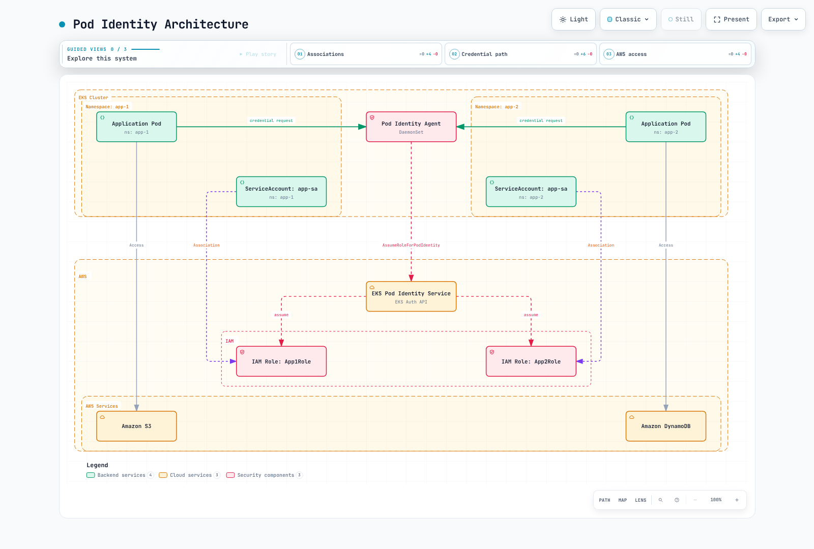

# EKS Pod Identity

> **Last Updated**: November 21, 2026

This page is the detailed split-out of the "EKS Pod Identity" section of [Amazon EKS Security](./05-eks-security.md). It is a setup reference for the Pod Identity Agent and credential flow, role trust and association preparation, and cross-account and cache considerations. The workbook [Migrate EKS node IAM permissions to IRSA and Pod Identity](../security/17-eks-workload-identity-migration.md) is the reference for the IRSA comparison, the production migration order and the live demo, so this page only summarizes and links to it.

## Table of Contents

1. [What Pod Identity Provides](#what-pod-identity-provides)
2. [Comparison with IRSA](#comparison-with-irsa)
3. [Agent and Credential Flow](#agent-and-credential-flow)
4. [Prepared Role and Association](#prepared-role-and-association)
5. [Cross-Account and Cache Considerations](#cross-account-and-cache-considerations)
6. [IRSA to Pod Identity Migration Procedure](#irsa-to-pod-identity-migration-procedure)

## What Pod Identity Provides

EKS Pod Identity supplies temporary AWS credentials through the SDK’s container credential provider and EKS Auth. A Pod Identity association is a mapping of cluster/namespace/ServiceAccount to an IAM role; it neither creates the ServiceAccount nor grants Kubernetes RBAC permissions.

## Comparison with IRSA

The workbook's [IRSA and Pod Identity compared](../security/17-eks-workload-identity-migration.md#irsa-and-pod-identity-compared) table is the reference for how the two mechanisms differ (per-cluster setup, trust policy, scale limits, cross-account and separation of duties). Keep these differences in mind when reading the setup examples on this page:

- **Trust and binding**: IRSA uses an IAM OIDC provider with issuer/subject/audience trust conditions; Pod Identity uses `pods.eks.amazonaws.com` role trust and an EKS API association.
- **Credential path**: with IRSA the SDK exchanges a web-identity token with STS ([How IRSA works](../security/17-eks-workload-identity-migration.md#irsa-flow)); with Pod Identity the SDK calls the node agent's container credential endpoint, which obtains credentials from EKS Auth ([How EKS Pod Identity works](../security/17-eks-workload-identity-migration.md#pod-identity-flow)).
- **Session tags**: Pod Identity's Kubernetes session tags are enabled by default and may be disabled deliberately. Session tags label the assumed-role session; they do not automatically tag every AWS resource an application creates.

Simpler setup does not remove IAM, network, SDK or application validation requirements.

## Agent and Credential Flow

<!-- Diagram repair pending: SDK calls container credential endpoint; agent calls EKS Auth AssumeRoleForPodIdentity, not STS directly or arbitrary request interception.


[🔍 View interactive diagram](https://www.atomai.click/kubernetes-docs/archmaps/en-eks-05-eks-security-4.html)
-->

For an associated newly created Pod, EKS injects a token with audience pods.eks.amazonaws.com, a token-file environment variable and a container credentials URI. The SDK calls the agent’s endpoint, commonly 169.254.170.23/v1/credentials. The agent calls **AssumeRoleForPodIdentity on EKS Auth** and makes the returned credentials available to the SDK. It is not a transparent interceptor for all application requests, and the application still calls AWS services directly with its credentials. A step-by-step flow diagram is in [How EKS Pod Identity works](../security/17-eks-workload-identity-migration.md#pod-identity-flow).

Standard supported EC2 nodes use the Pod Identity Agent add-on/DaemonSet. Auto Mode provides the capability as part of its managed nodes. Hybrid Nodes support it with the documented OS, agent and node credential configuration (`spec.hybrid.enableCredentialsFile: true` in the node's `nodeadm` config and `daemonsets.hybrid.create` in the agent add-on, with separate Bottlerocket settings; see [Hybrid Nodes add-on placement and Pod Identity](../eks-hybrid-nodes/04-node-bootstrap.md#add-on-placement-and-pod-identity)); do not reuse a standard EC2 agent configuration blindly. EKS Fargate does not support this Pod Identity agent path, and neither do Windows nodes, Outposts or EKS Anywhere. Verify the actual compute support and the node’s EKS Auth permissions/network access.

## Prepared Role and Association

For a standard managed-agent installation, inspect the actual cluster version and compatible add-on catalog through the owner. Do not hard-code the old v1.0.0 build or install a duplicate agent over Auto Mode/another owner:

```bash
set -euo pipefail
: "${CLUSTER_NAME:?Set the existing cluster}"
: "${AWS_REGION:?Set its Region}"
EKS_VERSION=$(aws eks describe-cluster --name "$CLUSTER_NAME" --region "$AWS_REGION" \
  --query cluster.version --output text)
aws eks describe-addon-versions --addon-name eks-pod-identity-agent \
  --kubernetes-version "$EKS_VERSION" --region "$AWS_REGION" --output json
```

Prepare a same-account IAM role with the [scoped S3 read policy from the IRSA example](./05-eks-security-irsa-oidc.md#a-scoped-irsa-example) and this trust relationship. Replace account/cluster values together. This example relies on the default session tags; disabling tags requires reviewing these conditions. The caller needs appropriate association permissions and iam:PassRole for the intended role:

```json
{
  "Version": "2012-10-17",
  "Statement": [
    {
      "Effect": "Allow",
      "Principal": {
        "Service": "pods.eks.amazonaws.com"
      },
      "Action": [
        "sts:AssumeRole",
        "sts:TagSession"
      ],
      "Condition": {
        "StringEquals": {
          "aws:RequestTag/eks-cluster-arn": "arn:aws:eks:us-west-2:111122223333:cluster/my-cluster",
          "aws:RequestTag/kubernetes-namespace": "security-demo",
          "aws:RequestTag/kubernetes-service-account": "podid-reader"
        }
      }
    }
  ]
}
```

The following new-association example refuses to overwrite an existing association. It does not create the IAM role, install the agent or create a Kubernetes account:

```bash
set -euo pipefail
: "${CLUSTER_NAME:?Set the verified cluster}"
: "${AWS_REGION:?Set its Region}"
: "${POD_ID_ROLE_ARN:?Set the prepared same-account role matching the trust example}"
aws eks list-pod-identity-associations --cluster-name "$CLUSTER_NAME" --region "$AWS_REGION" \
  --namespace security-demo --service-account podid-reader --output json > podid-associations-before.json
python3 - <<'PY'
import json
with open("podid-associations-before.json") as stream:
    existing = json.load(stream)["associations"]
if existing:
    raise SystemExit("Association exists; review its owner/configuration before changing it")
PY
aws eks create-pod-identity-association --cluster-name "$CLUSTER_NAME" --region "$AWS_REGION" \
  --namespace security-demo --service-account podid-reader --role-arn "$POD_ID_ROLE_ARN"
```

After the association has propagated, create the ServiceAccount and a fresh bounded test Job. The IAM role trust, namespace, account name and bucket prefix must match. A Pod created before the association may need recreation to receive the injected configuration. Check the provider actually selected and representative permissions; do not print credential/token files.

```yaml
apiVersion: v1
kind: ServiceAccount
metadata:
  name: podid-reader
  namespace: security-demo
---
apiVersion: batch/v1
kind: Job
metadata:
  name: podid-read-check
  namespace: security-demo
spec:
  backoffLimit: 0
  activeDeadlineSeconds: 120
  template:
    spec:
      serviceAccountName: podid-reader
      restartPolicy: Never
      securityContext:
        runAsNonRoot: true
        runAsUser: 1000
        runAsGroup: 1000
        fsGroup: 1000
        seccompProfile:
          type: RuntimeDefault
      containers:
      - name: reader
        image: public.ecr.aws/aws-cli/aws-cli:2.36.43
        command:
        - aws
        args:
        - s3api
        - list-objects-v2
        - --bucket
        - replace-with-owned-security-bucket
        - --prefix
        - security-demo/
        - --max-items
        - '5'
        env:
        - name: AWS_REGION
          value: us-west-2
        - name: AWS_EC2_METADATA_DISABLED
          value: 'true'
        securityContext:
          allowPrivilegeEscalation: false
          readOnlyRootFilesystem: true
          capabilities:
            drop:
            - ALL
        resources:
          requests:
            cpu: 100m
            memory: 128Mi
          limits:
            cpu: 500m
            memory: 256Mi
        volumeMounts:
        - name: private-home
          mountPath: /root
        - name: tmp
          mountPath: /tmp
      volumes:
      - name: private-home
        emptyDir: {}
      - name: tmp
        emptyDir: {}
      nodeSelector:
        kubernetes.io/os: linux
```



[🔍 View interactive diagram](https://www.atomai.click/kubernetes-docs/archmaps/en-eks-05-eks-security-5.html)

## Cross-Account and Cache Considerations

The association role must be in the EKS cluster account. An optional target IAM role can be in another account; Pod Identity chains from the same-account role to that target, with both trust and assume-role permissions configured. This is not permission to attach an arbitrary foreign role directly as the association role.

The current target-role guide documents cached credentials lasting 6 hours without a target role and 59 minutes with a target role. Association changes do not reset that cache; recreating Pods can obtain the new configuration sooner. Check actual refresh/revocation behavior in the application. The newer association session-policy option requires disabled session tags and constrains the target role when one is configured; do not combine it unreviewed with trust conditions that require those tags.

## IRSA to Pod Identity Migration Procedure

Follow the workbook's [Migration order for production clusters](../security/17-eks-workload-identity-migration.md#migration-order-for-production-clusters) for the step-by-step order and canary commands, and its [live demo](../security/17-eks-workload-identity-migration.md#live-demo) for a measured migration of three copies of one app. This page keeps only the points to observe before migrating.

Preserve the existing IRSA trust and ServiceAccount configuration before preparing a migration. Replacing the role trust with only the Pod Identity service principal can break existing consumers when their credentials refresh. The following records configuration only:

```bash
set -euo pipefail
: "${IRSA_ROLE_NAME:?Set the existing role whose trust must be preserved}"
: "${WORKLOAD_NAMESPACE:?Set the workload namespace}"
: "${SERVICE_ACCOUNT:?Set the existing application ServiceAccount}"
aws iam get-role --role-name "$IRSA_ROLE_NAME" \
  --query Role.AssumeRolePolicyDocument --output json > irsa-trust-before.json
kubectl -n "$WORKLOAD_NAMESPACE" get serviceaccount "$SERVICE_ACCOUNT" \
  -o yaml > irsa-serviceaccount-before.yaml
```

- First verify the actual compute support, a compatible SDK/container credential provider, the Pod Identity agent or built-in capability, and the prepared IAM role permissions.
- Merge the reviewed Pod Identity trust statement into the existing trust policy through its owner; keep the IRSA issuer, subject and audience conditions and unrelated valid statements until all consumers are migrated.
- When one ServiceAccount has both an IRSA annotation and an association, EKS injects only the Pod Identity variables into **new Pods**, not the IRSA ones. Running Pods keep their IRSA variables until they are recreated, so switch with a controlled rollout and remove the unused annotation afterwards. Because an association on the production ServiceAccount switches every new Pod using it, validate first with a canary on a separate ServiceAccount, and do not remove the production IRSA annotation or restart the production deployment before that.
- A successful get-caller-identity showing the same IAM role alone does not distinguish IRSA from Pod Identity. Without printing tokens or secret values, check the environment variable names injected into the new Pod and the intended AWS access, and make sure no provider earlier in the SDK chain, such as explicit credentials, remains in use.
- Keep a tested reversal path for the workload configuration. Remove the old IRSA trust only after inventorying every remaining consumer and verifying the completed migration.

## References

- [EKS Pod Identity](https://docs.aws.amazon.com/eks/latest/userguide/pod-identities.html)
- [How Pod Identity works](https://docs.aws.amazon.com/eks/latest/userguide/pod-id-how-it-works.html)
- [Hybrid add-ons and Pod Identity](https://docs.aws.amazon.com/eks/latest/userguide/hybrid-nodes-add-ons.html)
- [Migrate EKS node IAM permissions to IRSA and Pod Identity](../security/17-eks-workload-identity-migration.md)

## Next Steps

- Previous: [IRSA and the OIDC Provider](./05-eks-security-irsa-oidc.md)
- Next: [Amazon EKS Security - Cluster Endpoint Access Control](./05-eks-security.md#cluster-endpoint-access-control)
- Related: [EKS Cluster Access Authentication: IAM and Access Entries](./05-eks-security-cluster-access.md)
- Back to the overview: [Amazon EKS Security](./05-eks-security.md)

## Quiz

To test what you learned in this chapter, try the [topic quiz](../quizzes/eks/05-eks-security-pod-identity-quiz.md).
