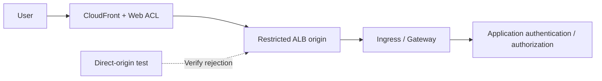

# WAF, Edge and API Security with Origin Protection

> **Review basis**: Official AWS WAF, CloudFront and ALB documentation. Features and inspection limits are distinguished by associated resource.
> **Last Updated**: October 15, 2026

The goal is to demonstrate that protected requests traverse WAF, that inspection limits and exceptions are understood, and that the application processes requests safely. Application, origin and operational criteria below are design proposals.

## 1. Separate WAF, NGFW and application authorization

AWS WAF inspects requests to associated supported resources, including CloudFront, ALB and API Gateway **REST APIs**. Do not assume the same direct association works for API Gateway HTTP/WebSocket APIs or NLB. CloudFront ACLs use `CLOUDFRONT` scope and the `us-east-1` API endpoint; ALB and other regional resources use `REGIONAL` scope in the resource Region. [S09]

Distinguish VM-Series/FortiGate NGFW capabilities from separate Palo Alto/Fortinet WAF offerings. Application authorization remains another layer. Check cross-customer object access, business limits, duplicate payment processing and LLM tool permissions in the application.

| Flow | Primary control | Remaining verification |
|---|---|---|
| Public HTTP(S) | WAF associated with CloudFront/ALB | Direct origin, body limits, exceptions and application authorization |
| IP session retaining TLS | NGFW path and selected decryption | Actual payload visibility and exemptions |
| Internal admission webhook | Access restrictions, admission and RBAC | Pod reachability and controller privileges |
| Upload/gRPC/WebSocket | Supported path and application-specific handling | Coverage beyond the initial request and file processing |

The ingress-nginx admission CVE involves a webhook reachable from the Pod network; test it separately from public-URL WAF coverage. [S01]

## 2. Design origin protection with the request path



This is a logical design. Document whether only CloudFront WAF is used or the ALB also receives a regional ACL. Evaluate logging, false positives and costs before choosing dual inspection.

### Option A: Public ALB origin

Combine controls based on the AWS CloudFront-to-ALB restriction example. [S16]

1. Review the CloudFront origin-facing managed prefix list in the ALB security group.
2. Combine a CloudFront origin custom header with an ALB listener header condition.
3. Design the default listener action to reject requests outside the approved path.
4. Manage origin HTTPS, header-secret rotation and configuration-read permissions.
5. Test ALB DNS names, alternate domains, addresses, listeners, other load balancers and NodePorts.

**CloudFront address ranges do not identify your distribution.** The header adds a distinction from other CloudFront paths, but its value is a shared secret that loses effectiveness when disclosed. Keep real values out of source, screenshots and ordinary logs. An application trusting a forwarded header is different from a listener restricting origin access. [S16]

### Option B: CloudFront VPC origin

CloudFront VPC origins can deliver to supported origins in private VPC subnets. The Internet Gateway attachment requirement does not require a public IP on the origin. Check current Region, resource and protocol restrictions, subnet addresses and service-managed security group configuration. NLB origin support is separate from direct WAF-to-NLB association. [S17]

For either option, review additional public Services, NodePorts and management endpoints exposing the same application. A private-origin label does not complete the entry-path inventory.

## 3. Rule ordering and terminating actions

AWS WAF evaluates lower numeric priorities first. `Allow` and `Block` terminate evaluation; `Count` continues. `CAPTCHA` and `Challenge` are non-terminating with valid tokens and terminating without an acceptable token. The ACL default action applies when no terminating rule decides the request. [S10]

| Pitfall | Consequence | Design proposal |
|---|---|---|
| Broad early `Allow` | Later managed/rate rules are not evaluated | Narrow the allowance and review ordering |
| Exempting an entire group | Other protections can be removed | Record individual rule, path, method, owner and expiry |
| Treating `Count` as blocking | Requests are only monitored | Inspect action, overrides and effective results |
| Challenge on every API | Automated-client compatibility issues | Test browser and machine APIs separately |

Managed-rule selection and updates require change control. Evaluate relevant baseline, known-bad-input and SQLi groups against legitimate traffic, and check supported version pinning/change notifications. A group name does not establish complete attack detection.

## 4. Request-body and oversize limits

| Associated resource | AWS WAF body inspection size |
|---|---|
| ALB, AppSync | Fixed 8 KB |
| CloudFront, API Gateway, Cognito, App Runner, Verified Access, Bedrock AgentCore Gateway | Default 16 KB, configurable up to 64 KB where supported |
| gRPC requests | AWS documents that body inspection rules do not apply |

These are inspection limits, not upload allowances or whole-request limits. Increasing the limit requires reviewing support and cost. A managed rule’s own size condition remains distinct from ACL inspection-size configuration. [S11]

When bodies, headers or cookies exceed inspection limits, the statement’s oversize handling matters. [S12]

- `CONTINUE`: Evaluate the available inspected portion.
- `MATCH`: Treat oversize as a match for that statement.
- `NO_MATCH`: Treat oversize as a non-match for that statement.

**`MATCH` is not a Block command.** Final behavior depends on the action and surrounding statements such as `NOT`. An earlier terminating allowance can also prevent a later oversize-blocking rule from running. [S10] [S12]

Validate full body size, schema, content type, decompression, file handling and authorization in the application. Consider separate large-upload paths and storage-based follow-up inspection. Compare benign JSON/multipart requests around the threshold and data after the inspected prefix. Attack payloads are unnecessary to establish limits and paths.

## 5. Client IP and rate-based rules

Connection-peer and forwarded-client addresses can differ along CloudFront→ALB→Ingress→application. Define trusted proxies and origin paths before using forwarded IP configuration. Geo match, ASN match and rate-based statements use the first address. IP set match uses the configured `FIRST`, `LAST` or `ANY` position; `ANY` checks up to 10 addresses, using the last 10 when more are present. [S13]

A missing header produces no match for the direct statement and does not invoke malformed-value fallback. An enclosing `NOT` can invert no match into a match, so test the complete statement tree as well as the forwarded-IP setting. [S13]

Proposed API-abuse controls:

| Request | Aggregation/application checks | Test cases |
|---|---|---|
| Login/password reset | Client IP, application account policy, path/method scope | Shared NAT, legitimate retries and unknown accounts |
| Search/expensive APIs | Supported custom aggregation and application quotas | Query cost, token issuance/rotation and client types |
| Crawling/bots | Browser tokens, supported bot rules and application checks | SDKs, mobile and accessibility clients |
| Upload/payment | Authorization, size, idempotency and business limits | Duplicate submission and retry after failure |

Rate rules use approximate tracking, not exact requests-per-second quotas. Supported evaluation windows are 60, 120, 300 and 600 seconds. Changing limits, windows, aggregation or scope resets counters and can pause enforcement for up to one minute. When using tokens or arbitrary headers as keys, test attacker-controlled key variation and missing values. [S14] [S37] [S43]

## 6. Validate logging and failure policy

Review `terminatingRuleId`, `action`, `nonTerminatingMatchingRules`, internal managed-rule results, labels, `ruleMatchDetails`, `oversizeFields`, path, method and request ID. Count matches cannot be found solely through the terminating rule. Use the [official field definitions][S36].

Limit personal data, tokens and authentication headers. **Log redaction does not automatically protect request sampling or Security Lake collection.** Review sampling/data protection separately and inspect collected data. Monitoring delays/missing events alongside application logs is an operational proposal. [S15]

ALB's `waf.fail_open.enabled` controls whether to forward to targets when requests cannot be sent to WAF; it defaults to `false`. Read effective attributes and document expected allow/deny behavior. Association alone does not establish that every WAF failure blocks requests. Verify other proposed failure settings against the resource's current official attributes first. [S18]

## 7. Safe verification and rollout

This JSON is **one Rule inside a Web ACL**, not a complete ACL, association or deployment command. It counts a unique header on approved test requests to establish path and logging.

```json
{
  "Name": "DocumentedCanaryCount",
  "Priority": 0,
  "Statement": {
    "ByteMatchStatement": {
      "SearchString": "security-review",
      "FieldToMatch": { "SingleHeader": { "Name": "x-doc-waf-canary" } },
      "TextTransformations": [{ "Priority": 0, "Type": "NONE" }],
      "PositionalConstraint": "EXACTLY"
    }
  },
  "Action": { "Count": {} },
  "VisibilityConfig": {
    "SampledRequestsEnabled": false,
    "CloudWatchMetricsEnabled": true,
    "MetricName": "DocumentedCanaryCount"
  }
}
```

Coordinate priority and metric names with the existing ACL. This does not validate malicious-request detection or false positives. In staging, follow with a narrowly scoped benign Block canary and verify it does not reach the application; evaluate real protection rules with business-traffic replay. Record Count-to-Block changes, exception expiry and rollback owners.

| Verification | Expected result and retained evidence |
|---|---|
| Legitimate business/automated API clients | Success, error rate, p95 and token/Challenge outcomes |
| Count/Block canary | Non-terminating versus terminating result; WAF/application correlation |
| Direct origin/another distribution | Rejection at the configured origin boundary |
| Requests around body threshold/large uploads | Oversize behavior and application full-input validation |
| Missing/spoofed forwarded header | Trust boundary and rule applicability |
| Shared NAT/distributed keys/rate-rule updates | Legitimate-user impact, approximate limits and reset |
| ACL removal/exceptions/WAF failure | Change detection and documented failure behavior |

This documentation update did not deploy WAF/appliances, reproduce attacks or measure traffic performance.

## Continue learning

- [Defense in Depth and Incident Response](./13-defense-in-depth-incident-response.md)
- [Palo Alto and Fortinet NGFW](./15-ngfw-paloalto-fortinet.md)
- [GWLB and GENEVE](./16-gwlb-geneve-inspection.md)
- [Chapter quiz](../quizzes/security/14-waf-edge-api-security-quiz.md)

## References and Research Basis

Primary sources accessed on 2026-10-15. Recheck advisories and constraints for the selected product/branch before changes.

- [S01 — Kubernetes: CVE-2025-1974][S01]
- [S09 — AWS WAF: Associating a web ACL][S09]
- [S10 — AWS WAF: Rule action][S10]
- [S11 — AWS WAF: Body inspection sizes][S11]
- [S12 — AWS WAF: Oversize request components][S12]
- [S13 — AWS WAF: Forwarded IP addresses][S13]
- [S14 — AWS WAF: Rate-based rules][S14]
- [S15 — AWS WAF: Logging][S15]
- [S16 — CloudFront: Restricting access to ALB origins][S16]
- [S17 — CloudFront: VPC origins][S17]
- [S18 — ALB: Attributes][S18]
- [S36 — AWS WAF: Log fields][S36]
- [S37 — AWS WAF: Rate evaluation window][S37]
- [S43 — AWS WAF: Rate rule caveats][S43]

[S01]: https://kubernetes.io/blog/2025/03/24/ingress-nginx-cve-2025-1974/
[S09]: https://docs.aws.amazon.com/waf/latest/developerguide/web-acl-associating-aws-resource.html
[S10]: https://docs.aws.amazon.com/waf/latest/developerguide/waf-rule-action.html
[S11]: https://docs.aws.amazon.com/waf/latest/developerguide/web-acl-setting-body-inspection-limit.html
[S12]: https://docs.aws.amazon.com/waf/latest/developerguide/waf-oversize-request-components.html
[S13]: https://docs.aws.amazon.com/waf/latest/developerguide/waf-rule-statement-forwarded-ip-address.html
[S14]: https://docs.aws.amazon.com/waf/latest/developerguide/waf-rule-statement-type-rate-based.html
[S15]: https://docs.aws.amazon.com/waf/latest/developerguide/logging.html
[S16]: https://docs.aws.amazon.com/AmazonCloudFront/latest/DeveloperGuide/restrict-access-to-load-balancer.html
[S17]: https://docs.aws.amazon.com/AmazonCloudFront/latest/DeveloperGuide/private-content-vpc-origins.html
[S18]: https://docs.aws.amazon.com/elasticloadbalancing/latest/application/application-load-balancers.html
[S36]: https://docs.aws.amazon.com/waf/latest/developerguide/logging-fields.html
[S37]: https://docs.aws.amazon.com/waf/latest/developerguide/waf-rule-statement-type-rate-based-high-level-settings.html
[S43]: https://docs.aws.amazon.com/waf/latest/developerguide/waf-rule-statement-type-rate-based-caveats.html
