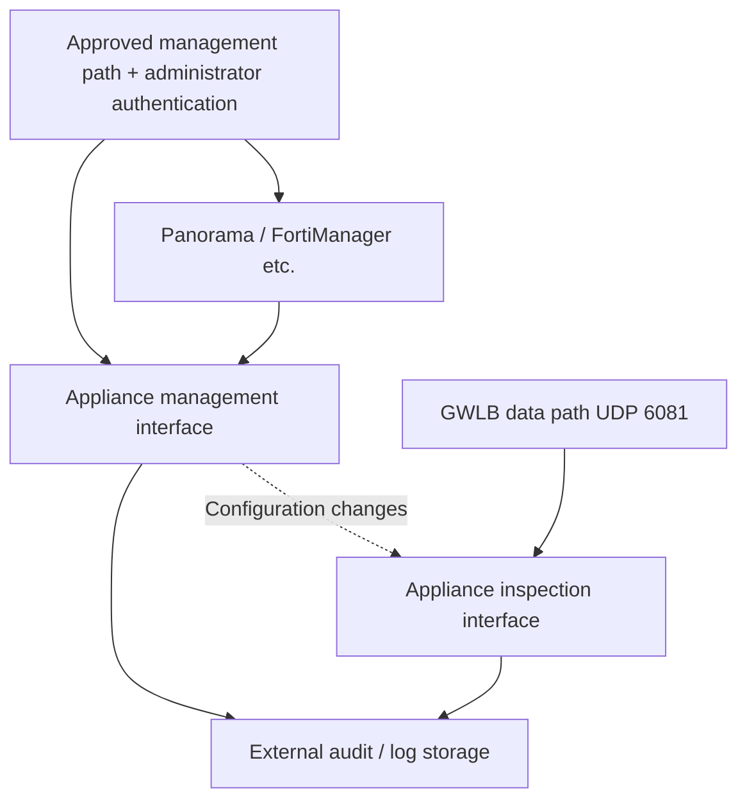

# Palo Alto and Fortinet NGFW Design and Operations on AWS/EKS

> **Review basis**: Official VM-Series/FortiGate-VM AWS GWLB integration guides and vendor security advisories. Review examples against the chosen supported branch and deployment mode.
> **Last Updated**: October 15, 2026

An NGFW applies configured policies to traversing sessions. Adding an appliance does not establish inspection of every VPC or Pod flow. This chapter compares integration requirements, management, TLS, sessions and capacity, then connects to [GWLB path validation](./16-gwlb-geneve-inspection.md).

## 1. Choose the deployment model

| Model | Structure | PoC evidence |
|---|---|---|
| Distributed inspection | Paths and appliances in workload VPCs | Local paths, AZ separation and policy consistency across fleets |
| Central inspection | Selected multi-VPC traffic through TGW/inspection VPC | Symmetry, TGW appliance mode, NAT and exceptions |
| GWLB insertion | GWLBE delivers to a GENEVE-compatible fleet | Encapsulation, health, flow reassignment and appliance policies |
| Vendor-managed service | Supported managed-NGFW deployment | Product-specific routing, policies, logging and account responsibility |

Central inspection covers traffic routed into TGW. Verify VPC-local, node-local and other connectivity separately. GWLB endpoints and TGW appliance mode do not provide inspection without an appliance. [S24] [S29] [S30]

VM-Series differs from Palo Alto Cloud NGFW; FortiGate-VM differs from FortiWeb. Match support, features and advisories to the actual product. The Cloud NGFW exclusion in CVE-2026-0322 applies to that advisory. [S03]

## 2. Vendor-specific GWLB integration

| Review item | Palo Alto VM-Series | Fortinet FortiGate-VM |
|---|---|---|
| Integration | PAN-OS GWLB integration, vendor templates or manual configuration | GENEVE interfaces and single/multi-AZ deployment guides |
| Data path | Decapsulation followed by interface/zone/security policy | Decapsulation followed by interface/policy processing |
| Encapsulation | UDP 6081 and supported release/mode | UDP 6081, GWLB-node GENEVE configuration and AWS TLV handling [S42] |
| Policy prerequisites | Interfaces, zones, allowance and security profiles | GENEVE interfaces, firewall policies and UTM/security profiles |
| Management | Applicable Panorama/management structure and change audits | Applicable FortiManager/FortiAnalyzer structure and change audits |
| Failure/scaling | GWLB registration/deregistration and appliance session/configuration handling | GWLB registration/deregistration and appliance session/configuration handling |

Sources: [VM-Series overview][S19], [manual configuration][S20], [enabling integration][S21], [Fortinet interface configuration][S22] and [FortiGate deployment guide][S23]. AWS defines the GWLB GENEVE TLV format and Option Class `0x0108` separately in its [target-group documentation][S42]. The referenced Fortinet 7.0.0 guide establishes deployment mechanics; **it is not a recommended production version**. Check the guide, PSIRT and image for the supported branch actually selected.

### Palo Alto: integration, interfaces and default zone policy

Match GWLB integration support with actual interfaces, zones, health checks and policies. The enable guide describes management/data interface swapping and enabling GWLB inspection. A minimum feature-support version is not a current safe patch or production-version recommendation. [S21]

The manual guide says HTTP health checks cannot be used and recommends HTTPS/TCP, but later includes an HTTP-enablement sentence in the management-profile step. **Do not turn that ambiguity into automatic configuration.** Verify supported protocols and responses in the chosen version/template and seek vendor clarification. Health success does not establish functioning signatures, licensing or inspection policies. [S20]

AWS also documents HTTPS-health failure for targets supporting only TLS 1.3; the health endpoint must support an earlier version such as TLS 1.2. This health requirement is separate from inspected application TLS support. [S26]

The same guide states that GWLB traffic is treated as intrazone and that the default intrazone rule allows all traffic. Review the default action and applied profiles so traffic outside intended policies is denied. Enabling interfaces alone does not complete blocking policy. [S20]

### Fortinet: validate interfaces and policies together

Fortinet's post-deployment guide uses the same-AZ GWLB interface IPv4 address as the GENEVE peer and configures egress back through the receiving GENEVE interface. Do not substitute a management/application address. Check required encapsulation metadata and the selected mode's support against deployment documentation. [S22] [S23]

A GENEVE interface without the intended allow/deny policies and inspection profiles is insufficient. A separate FGCP HA design and independent GWLB targets are also different constructs. Select a supported vendor HA/session-sharing mode and validate it.

## 3. Protect the appliance management plane

This is a logical responsibility split; actual ENI/subnet counts follow the chosen vendor template.

Proposed management criteria:

- Restrict appliance/manager HTTPS, SSH and APIs to approved management paths and sources.
- Manage individual accounts, least privilege, supported MFA and a separate recovery account.
- Audit administrative/configuration changes for automation tokens, SSO and central management.
- Check public IPs, EIPs, listeners, alternate ports and other ENIs for actual exposure.
- Preserve logs/configuration revisions externally and verify time synchronization.
- Inventory supported branches, hotfixes, signatures and manager compatibility.

PAN-OS advisories recommend restricting management to trusted internal addresses. The 2026 RCE includes authenticated attackers, so review both source restrictions and administrator authentication. [S03] [S04]

The manual deployment guide assigns an EIP to the management ENI. Treat that as a sample setup step, not a default exposure requirement: reconcile actual access with the advisories' trusted-internal-source restriction before production adoption. [S20] [S03] [S04]

The FortiCloud SSO incident included cross-account logins and administrator/VPN changes. The official correction excludes third-party SAML IdPs and FortiAuthenticator from that issue; do not generalize it to every SSO mechanism. [S05] [S06]

## 4. TLS visibility

| Inspection point | Default visibility | Payload-inspection review |
|---|---|---|
| NGFW before HTTPS termination | Packets, connections and exposed TLS metadata | Supported decryption, keys/certificates and client compatibility |
| WAF-associated CloudFront/ALB | Request portions supplied to WAF by the resource | Body/gRPC/oversize limits |
| NGFW on reencrypted ALB→Pod path | TLS connection on that segment | Separate decryption or endpoint-layer inspection |
| Mesh mTLS segment | Observable peer/transport metadata | Mesh trust, authorization and supported inspection location |

GWLB encapsulates with GENEVE rather than terminating TLS. GENEVE itself is not encryption. Network Firewall TLS inspection also requires separate policy/certificate configuration. Appliance traversal and successful decryption are different facts. [S24] [S31] [S35]

A decryption PoC should cover TLS versions/ciphers, HTTP/2, gRPC, WebSocket, mTLS, certificate pinning, client CA trust and regulatory exceptions. Record compensating controls for exemptions. A setting named “SSL inspection” does not prove that all encrypted payloads were inspected.

An HTTPS ALB target group does not prove backend certificate trust validation. AWS states that ALB does not validate target certificates; design any required server-identity checks separately. [S38]

## 5. NAT, original addresses and Pod attribution

Correlate these observations for each session:

| Segment | Record |
|---|---|
| Application/Pod | Workload/namespace, request ID, Pod/node addresses and time |
| Node/CNI | SNAT behavior/mode and effective NetworkPolicy |
| Appliance | Observed five-tuple, policy/profile, action and decryption outcome |
| NAT/external | Translated address, destination, responses and retries |
| TGW/GWLBE | Attachment, AZ, route table and endpoint identity |

After node SNAT the appliance may see a node address rather than a Pod address. For default VPC CNI IPv4 egress outside VPC CIDRs, EKS documents translation to the node's primary address; verify actual external-SNAT, OS and routing configuration rather than treating this as universal. [S44]

Even preserved Pod addresses can change when Pods are replaced. Distinguish IP policy from Kubernetes label/identity policy and correlate with CNI/IPAM observations. [S33]

Requests and responses arriving at different appliances or with incompatible tuples can break stateful inspection. Validate stickiness, NAT location, TGW appliance mode and the selected deployment mode together. TGW appliance mode requires five-tuple stickiness; two/three-tuple modes are unsupported. Do not add arbitrary SNAT to a transparent GWLB design. [S25] [S29] [S30]

## 6. Sessions, scaling, licensing and capacity

GWLB provides target selection, health and flow failover, not automatic state replication between independent appliances. Test **existing and new sessions** during target addition/removal, `rebalance`, reboot and AZ loss. Where HA/session sharing is needed, verify the supported vendor mode and failure conditions. [S25]

Proposed measurement plan:

| Measurement | Conditions to hold constant |
|---|---|
| Throughput/packet rate | Packet size, bidirectional ratio, small packets and large bodies |
| Connection rate/concurrent sessions | TCP/UDP, keepalive and long-lived gRPC/WebSocket |
| Inspection-enabled throughput | Actual IPS, malware, URL, logging and TLS-decryption profiles |
| p50/p95/p99/errors | Application/appliance/TGW/AZ path and baseline |
| N-1/AZ loss | Remaining instance/license capacity, CPU/memory and policy readiness |
| Maintenance/scaling | Registration readiness, draining, policy/signature deployment and session interruption |

Datasheet values are not a controlled cross-vendor comparison. Record port, CPU, cryptographic and license/subscription limits. Total cost includes appliance EC2/EBS/licenses, GWLB/GWLBE, TGW, NAT, AZ transfer, logs and operations, priced separately for the real Region. This research includes no price quotation or measured performance.

## 7. Patching versus removing compromise

| State | Required checks |
|---|---|
| Affectedness established | Product, branch, hotfix, features, exposure and advisory revision |
| Patch completed | Actually deployed fixed release and manager/template/signature compatibility |
| Compromise removed | Administrator/VPN/system/configuration changes and related credential use |
| Recovery demonstrated | Inspection/business functions, restricted management, old/new sessions and external logs |

Fortinet’s 2025 analysis describes access persisting after earlier SSL-VPN patches. Its 2026 SSO analysis recommends configuration audit/restoration and credential rotation when compromise is confirmed. A current version alone does not complete eradication. [S07] [S05]

For that historical symlink issue, Fortinet identified 7.6.2, 7.4.7, 7.2.11, 7.0.17 and 6.4.16 as releases that remove the link on upgrade, while still requiring configuration review. These are historical remediation references, not 2026 version recommendations. [S07]

PAN-OS fixed-release/ETA tables can change by branch. Rather than turning a static version in this chapter into a deployment instruction, recheck the advisory at change time. [S03]

## 8. PoC acceptance criteria

Proposed common criteria; compare usability, operating costs and performance after mandatory checks pass.

1. Supported image, license, branch and official integration agree.
2. Restricted management access and administrator/configuration changes are observable.
3. Request/response tuples and applied profiles can be correlated for allowed and denied sessions.
4. Decryption scope/exceptions and legitimate-client compatibility are explained.
5. All-unhealthy, single-target failure, AZ loss, scale-in and upgrade are tested with old/new sessions.
6. N-1 capacity and application latency/error SLOs are measured.
7. Advisory review, patching, eradication and rollback have named owners and evidence.

## Continue learning

- [GWLB and GENEVE Inspection](./16-gwlb-geneve-inspection.md)
- [WAF and Origin Protection](./14-waf-edge-api-security.md)
- [Incident Response](./13-defense-in-depth-incident-response.md)
- [Chapter quiz](../quizzes/security/15-ngfw-paloalto-fortinet-quiz.md)

## References and Research Basis

Primary sources accessed on 2026-10-15. Recheck advisories and constraints for the selected product/branch before changes.

- [S03: Palo Alto: CVE-2026-0322][S03]
- [S04: Palo Alto: CVE-2025-0108][S04]
- [S05: Fortinet: Analysis of SSO abuse on FortiOS][S05]
- [S06: CISA: Known Exploited Vulnerabilities Catalog][S06]
- [S07: Fortinet: Analysis of threat actor activity][S07]
- [S19: VM-Series: GWLB integration][S19]
- [S20: VM-Series: Manual GWLB integration][S20]
- [S21: VM-Series: Enable GWLB integration][S21]
- [S22: FortiGate: GWLB post-deployment configuration][S22]
- [S23: FortiGate: Security inspection with GWLB integration][S23]
- [S24: AWS: Gateway Load Balancers][S24]
- [S25: AWS GWLB: Target group attributes][S25]
- [S26: AWS GWLB: Health checks][S26]
- [S29: AWS: Centralized inspection with GWLB and TGW][S29]
- [S30: AWS: NAT Gateway scenarios][S30]
- [S31: RFC 8926: GENEVE][S31]
- [S33: EKS: Network security][S33]
- [S35: AWS Network Firewall: TLS inspection configurations][S35]
- [S38: ALB: Target groups][S38]
- [S42: AWS GWLB: Target groups][S42]
- [S44: EKS: Outbound internet access and SNAT][S44]

[S03]: https://security.paloaltonetworks.com/CVE-2026-0322
[S04]: https://security.paloaltonetworks.com/CVE-2025-0108
[S05]: https://www.fortinet.com/blog/psirt-blogs/analysis-of-sso-abuse-on-fortios
[S06]: https://www.cisa.gov/sites/default/files/feeds/known_exploited_vulnerabilities.json
[S07]: https://www.fortinet.com/blog/psirt-blogs/analysis-of-threat-actor-activity
[S19]: https://docs.paloaltonetworks.com/vm-series/deployment/public-cloud/set-up-the-vm-series-firewall-on-aws/vm-series-integration-with-gateway-load-balancer
[S20]: https://docs.paloaltonetworks.com/vm-series/deployment/public-cloud/set-up-the-vm-series-firewall-on-aws/vm-series-integration-with-gateway-load-balancer/manually-integrate-the-vm-series-with-a-gateway-load-balancer
[S21]: https://docs.paloaltonetworks.com/vm-series/deployment/public-cloud/set-up-the-vm-series-firewall-on-aws/vm-series-integration-with-gateway-load-balancer/enabling-vm-series-integration-with-a-gwlb
[S22]: https://docs.fortinet.com/document/fortigate-public-cloud/7.0.0/aws-administration-guide/337773/post-deployment-configuration
[S23]: https://docs.fortinet.com/document/fortigate-public-cloud/7.0.0/aws-administration-guide/571235/security-inspection-with-gateway-load-balancer-integration
[S24]: https://docs.aws.amazon.com/elasticloadbalancing/latest/gateway/gateway-load-balancers.html
[S25]: https://docs.aws.amazon.com/elasticloadbalancing/latest/gateway/edit-target-group-attributes.html
[S26]: https://docs.aws.amazon.com/elasticloadbalancing/latest/gateway/health-checks.html
[S29]: https://aws.amazon.com/blogs/networking-and-content-delivery/centralized-inspection-architecture-with-aws-gateway-load-balancer-and-aws-transit-gateway/
[S30]: https://docs.aws.amazon.com/vpc/latest/userguide/nat-gateway-scenarios.html
[S31]: https://www.rfc-editor.org/info/rfc8926/
[S33]: https://docs.aws.amazon.com/eks/latest/best-practices/network-security.html
[S35]: https://docs.aws.amazon.com/network-firewall/latest/developerguide/tls-inspection-configurations.html
[S38]: https://docs.aws.amazon.com/elasticloadbalancing/latest/application/load-balancer-target-groups.html
[S42]: https://docs.aws.amazon.com/elasticloadbalancing/latest/gateway/target-groups.html
[S44]: https://docs.aws.amazon.com/eks/latest/userguide/external-snat.html
