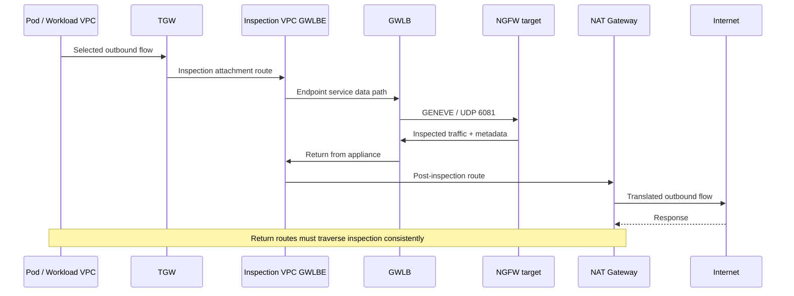

# GWLB and GENEVE: Symmetric Inspection Paths and Failure Validation

> **Review basis**: Official AWS Gateway Load Balancer, PrivateLink, TGW and NAT documentation, RFC 8926 and vendor integration guides.
> **Last Updated**: October 15, 2026

GWLB distributes original IP flows to GENEVE-compatible security appliances. GWLBE is a route target in the consumer VPC; inspection policies reside in appliances. This guide follows [Palo Alto/Fortinet selection](./15-ngfw-paloalto-fortinet.md) with path, session and failure verification. Route tables and acceptance criteria are design examples, not complete IaC or deployed results. [S24] [S27]

## 1. Components and responsibilities

| Component | Role | Check |
|---|---|---|
| GWLB | Deliver IP flows to targets | AZs, target groups, stickiness and failover |
| GENEVE target group | Appliance registration, health and attributes | GENEVE port 6081 and supported IP/instance targets |
| Appliance | Decapsulate, inspect and reencapsulate | Policies, sessions, licenses, metadata and MTU |
| Endpoint service | Expose provider GWLB to consumer VPCs | Allowed principals, acceptance and ownership |
| GWLBE | Zonal route target in the consumer VPC | Subnet, AZ, state and routes |
| TGW appliance mode | One inspection-attachment ENI/AZ per flow, used for both directions | Effective setting on the inspection VPC attachment |

Endpoint-service permissions/acceptance govern connection establishment, not application authorization or appliance policies. Compare physical zones across accounts using **AZ IDs**, not account-specific AZ names. Check [PrivateLink requirements][S27].

GWLB does not receive an ALB-style security group. **GWLBE also does not support SGs.** ELB API security-group parameters apply to ALB/NLB, and endpoint SG parameters apply to interface endpoints. Review appliance/workload ENIs, NACLs, routes and policies. [S39] [S40]

## 2. GENEVE is inspection transport, not encryption

```text
Outer IP
  └─ UDP destination port 6081
      └─ GENEVE header + options / AWS metadata
          └─ Original encapsulated traffic
```

RFC 8926 defines GENEVE headers, VNI, variable options and UDP transport. AWS GWLB uses TLV metadata with Option Class `0x0108`; appliances must process the TLV pairs, and GWLB uses that metadata to select the return GWLBE. Preserve the required metadata through supported integration. General GENEVE support alone does not establish GWLB compatibility. [S31] [S42] [S29]

GENEVE does not encrypt payloads like TLS/IPsec. Cilium overlay and GWLB encapsulation have different purposes and paths even when using the same port. TLS payload inspection needs appliance decryption or controls at the termination point. [S31] [S24]

## 3. Logical zonal egress flow

This sequence shows **one direction** of central egress. Actual TGW, GWLBE, appliance and NAT paths are selected by AZ; responses must traverse a consistent inspection path for the session.



TGW-attachment, endpoint and NAT subnet route tables serve different purposes. Pointing every subnet’s default route at GWLBE can loop inspected traffic back into inspection. Review AWS TGW inspection and NAT integration together. [S29] [S30]

## 4. Central inspection route review

This is one pattern for central IPv4 egress and inter-VPC inspection. Review actual CIDRs, AZs, endpoint/attachment IDs, prefix precedence and existing routes. Consumer connectivity does not establish inspection in every direction.

| Location | Selected destination | Example next hop/purpose |
|---|---|---|
| Spoke workload subnet | Other spoke CIDRs/external default | TGW |
| TGW table associated with spokes | Inspected spoke/external traffic | Inspection VPC attachment |
| Inspection VPC TGW-attachment subnet | Inspected destinations | GWLBE in the selected AZ |
| GWLBE subnet | Spoke CIDRs | TGW |
| GWLBE subnet | External `0.0.0.0/0` | NAT Gateway in that AZ |
| NAT subnet | External `0.0.0.0/0` | Internet Gateway |
| NAT subnet | Return spoke CIDRs | Inspection GWLBE |
| TGW table associated with inspection attachment | Spoke CIDRs | Correct spoke attachment, not the inspection attachment again |

Requests are inspected before NAT; responses traverse inspection after reverse translation and return through TGW. Omitting the NAT subnet’s return route can leave only one direction inspected or break stateful sessions. Moving NAT requires revisiting tuples and routes. [S29] [S30]

Verify TGW appliance mode on the central inspection attachment. It selects an inspection-attachment ENI/AZ consistently for both directions of a flow, replacing TGW's default origin-AZ preference and allowing cross-AZ routing. It does not replicate firewall sessions. Validate it separately from GWLB target selection. [S29] [S25] [S32]

### Internet ingress needs a separate design

For ingress insertion, review IGW edge-associated routes, protected-subnet routes, GWLBE subnet routes and return paths together. An unordered diagram of ALB/IGW/GWLBE is insufficient. AWS documents gateway-route-table constraints for IGW/VGW. Trace ALB proxy frontend/backend connections as separate flows. [S28]

## 5. Paths outside central inspection

| Path | Reason for separate validation | Proposed complementary control |
|---|---|---|
| Same-node Pod traffic | May never reach VPC/TGW | CNI, NetworkPolicy and service authorization |
| VPC-local/other subnet | Local prefix is more specific than default | Supported local-route design or CNI/SG controls |
| Peering/other TGW attachment | May use a different route | Effective routes and connection inventory |
| PrivateLink/gateway endpoints | Different from public default egress | IAM, endpoint/resource policies and application authorization |
| IPv6/NAT64/proxy | Not covered by IPv4 `0.0.0.0/0` alone | Service/appliance support and `::/0` paths |
| Management/health | Different purpose from inspected data | Restricted sources and records |

Local VPC routes can be redirected to appliances under specified conditions; neither “impossible” nor “automatically centralized” is accurate. Verify route type, supported targets and CIDR constraints. [S28]

EKS Pod/node addresses, CNI SNAT and Security Groups for Pods modes affect visibility and paths. Pod policies and VPC inspection routes are different configurations. [S33] [S34] [S44]

## 6. Stickiness and idle timeout

Default stickiness is the **five-tuple**: source/destination addresses, source/destination ports and protocol. Supported alternatives use **three-tuple** address pair/protocol or **two-tuple** address pair, but **these modes are unsupported with TGW appliance mode enabled**. This central pattern uses five-tuple stickiness. Reduced-tuple modes can concentrate load; review their deployment constraints and capacity. [S25]

TCP idle timeout defaults to 350 seconds and can be changed to 60–6000 seconds with five-tuple stickiness. UDP timeout is fixed at 120 seconds. Do not assume TCP customization works with two/three-tuple modes. Independently inspect appliance, NAT, application, TGW and target ENI `TcpEstablishedTimeout`; a shorter ENI tracking timeout can cause drops while GWLB still considers the connection active. [S24]

After TCP idle expiry, a new SYN starts a new flow, while data packets on the old connection are dropped. A UDP packet after expiry can form a new flow. Longer timeouts differ from cross-appliance state sharing. Test keepalive, idle resumption, long-lived gRPC/WebSocket and UDP. [S24]

## 7. Health, failover and fail open

| State/setting | Documented AWS behavior | Operational check |
|---|---|---|
| One unhealthy target | New flows use available healthy targets | Configured behavior for existing flows |
| `target_failover.on_unhealthy=no_rebalance` | Existing flows remain assigned | Possible blackholing at unhealthy target |
| `target_failover.on_unhealthy=rebalance` | Existing flows are redistributed | Session loss on independent appliances |
| Deregistration | Behavior follows `on_deregistration` | Draining, scale-in and upgrades |
| All targets unhealthy | GWLB randomly selects an unhealthy target per flow and keeps it until reset/timeout; AWS documents drops until it becomes healthy | Verify the documented outcome; a health-only fault that still forwards is a PoC hypothesis |
| No registered targets | No target for new flows; verify drops | Empty-fleet recovery; distinguish existing draining flows |

`target_failover.on_unhealthy` and `target_failover.on_deregistration` must have the same value. The default is `no_rebalance`. Health checks support TCP, HTTP and HTTPS; match protocol, port and path to the appliance. [S25] [S26]

Current documentation also provides `send_tcp_reset.on_unhealthy.enabled` and `send_tcp_reset.on_deregistration.enabled`. They default to `false`, apply only to TCP and require five-tuple stickiness (`stickiness.enabled=false`) with `no_rebalance`. They cannot be enabled with `rebalance` or reduced-tuple stickiness. Test reconnection, retries and duplicate business operations after RST; this is not uninterrupted session migration. Review deregistration drain time. [S25]

**GWLB does not directly bypass appliances when all targets are unhealthy.** AWS documents random per-flow target selection and traffic drops until the chosen target becomes healthy. Decisions are independent among zones; with cross-zone disabled, review the eligible targets in each AZ. Cross-zone expands the eligible target set while existing/new-flow semantics remain relevant. [S26]

The older deployment blog uses “fail-open mode” for existing flows remaining on failed targets. That term is not an availability guarantee or a direct-bypass feature; distinguish it from appliance-local fail-open settings. Whether a health-only fault still forwards traffic is an experiment to perform, not the documented recovery expectation. [S32] [S25] [S26]

Cross-zone balancing can use healthy targets in another AZ but does not replicate state or repair a zonal endpoint. Review cross-AZ costs, capacity and session disruption. Test GWLBE/AZ loss separately from target loss. Prefer current target-group attributes over older deployment-blog statements that GWLB never sends RST. [S24] [S25] [S27] [S32]

## 8. MTU, fragments, NACLs and health paths

AWS documents a maximum packet size of 8500 bytes and 68 bytes of GENEVE overhead. GWLB does not provide fragmentation or Path MTU Discovery on behalf of the path. A large workload MTU does not establish equivalent support through TGW, NAT and appliances. [S24] [S32]

Review:

- End-to-end MTU, appliance GENEVE-interface headroom and TCP MSS handling.
- Large packets, UDP datagrams, TLS/HTTP2, uploads and fragments.
- Outer UDP 6081 versus inner payload protocols in SGs, NACLs and appliance policies.
- Health-port reachability/response and a real inspection canary.
- Request/return ports and actual outer tuples through stateless NACLs.
- Current IPv6, encapsulation and ICMP/ICMPv6 requirements by product.

An open port or a healthy target alone does not establish inspection. [S26] [S32]

## 9. Read-only checks in an approved environment

These AWS CLI examples are read-only. Set task-specific variables to owned resources and an explicit Region. They were not executed during this research.

```bash
aws elbv2 describe-load-balancer-attributes \
  --region "$INSPECTION_REGION" --load-balancer-arn "$INSPECTION_GWLB_ARN"

aws elbv2 describe-target-group-attributes \
  --region "$INSPECTION_REGION" --target-group-arn "$INSPECTION_TARGET_GROUP_ARN"

aws elbv2 describe-target-health \
  --region "$INSPECTION_REGION" --target-group-arn "$INSPECTION_TARGET_GROUP_ARN"

aws ec2 describe-vpc-endpoints \
  --region "$INSPECTION_REGION" --vpc-endpoint-ids "$INSPECTION_ENDPOINT_ID"

aws ec2 describe-route-tables \
  --region "$INSPECTION_REGION" --route-table-ids "$INSPECTION_ROUTE_TABLE_ID"

aws ec2 describe-transit-gateway-vpc-attachments \
  --region "$INSPECTION_REGION" \
  --transit-gateway-attachment-ids "$INSPECTION_TGW_ATTACHMENT_ID"
```

Compare cross-zone attributes, target stickiness/failover, health, endpoint state/AZ, routes/associations and attachment `ApplianceModeSupport`. TGW route-table associations, propagation and effective routes need additional queries; these six commands alone do not prove symmetry.

## 10. Failure experiments and acceptance criteria

Run the following plan in an isolated, approved environment.

| Experiment | Required observations |
|---|---|
| Allowed/denied benign canary | Request/response five-tuples, target, policy/profile and application result |
| Single-target health failure | Old/new sessions and `no_rebalance` versus `rebalance` |
| All-unhealthy | Delivery to unhealthy targets, inspection/errors; no assumption of direct bypass |
| Empty fleet | New-flow drops versus existing drains, detection and recovery |
| TCP RST feature | Five-tuple/no-rebalance constraints, reconnection and retries |
| AZ/endpoint-path loss | Endpoint versus target failure, failover and recovery |
| Scale-in/rolling upgrade | Draining, interruptions, readiness and policy consistency |
| NAT/route changes | Before/after translation, return paths and loops |
| MTU/idle/IPv6 | Large packets, long-lived sessions and supported paths |
| Paths outside central inspection | Local, endpoint, peering and Pod paths with complementary controls |

Acceptance should combine **business SLOs, observed inspection/blocking, old/new session behavior, N-1 capacity, documented bypass paths and rollback/recovery owners**. This update did not deploy infrastructure, inject failures or measure performance.

## Continue learning

- [Palo Alto and Fortinet NGFW](./15-ngfw-paloalto-fortinet.md)
- [WAF and Origin Protection](./14-waf-edge-api-security.md)
- [Incident-driven Defense in Depth](./13-defense-in-depth-incident-response.md)
- [Chapter quiz](../quizzes/security/16-gwlb-geneve-inspection-quiz.md)

## References and Research Basis

Primary sources accessed on 2026-10-15. Recheck advisories and constraints for the selected product/branch before changes.

- [S24: AWS: Gateway Load Balancers][S24]
- [S25: AWS GWLB: Target group attributes][S25]
- [S26: AWS GWLB: Health checks][S26]
- [S27: AWS PrivateLink: Gateway Load Balancer endpoints][S27]
- [S28: AWS VPC: Route table options][S28]
- [S29: AWS: Centralized inspection with GWLB and TGW][S29]
- [S30: AWS: NAT Gateway scenarios][S30]
- [S31: RFC 8926: GENEVE][S31]
- [S32: AWS: GWLB deployment best practices][S32]
- [S33: EKS: Network security][S33]
- [S34: Kubernetes: Network Policies][S34]
- [S39: AWS ELB API: CreateLoadBalancer parameters][S39]
- [S40: AWS EC2 API: CreateVpcEndpoint parameters][S40]
- [S42: AWS GWLB: Target groups][S42]
- [S44: EKS: Outbound internet access and SNAT][S44]

[S24]: https://docs.aws.amazon.com/elasticloadbalancing/latest/gateway/gateway-load-balancers.html
[S25]: https://docs.aws.amazon.com/elasticloadbalancing/latest/gateway/edit-target-group-attributes.html
[S26]: https://docs.aws.amazon.com/elasticloadbalancing/latest/gateway/health-checks.html
[S27]: https://docs.aws.amazon.com/vpc/latest/privatelink/gateway-load-balancer-endpoints.html
[S28]: https://docs.aws.amazon.com/vpc/latest/userguide/route-table-options.html
[S29]: https://aws.amazon.com/blogs/networking-and-content-delivery/centralized-inspection-architecture-with-aws-gateway-load-balancer-and-aws-transit-gateway/
[S30]: https://docs.aws.amazon.com/vpc/latest/userguide/nat-gateway-scenarios.html
[S31]: https://www.rfc-editor.org/info/rfc8926/
[S32]: https://aws.amazon.com/blogs/networking-and-content-delivery/best-practices-for-deploying-gateway-load-balancer/
[S33]: https://docs.aws.amazon.com/eks/latest/best-practices/network-security.html
[S34]: https://kubernetes.io/docs/concepts/services-networking/network-policies/
[S39]: https://docs.aws.amazon.com/elasticloadbalancing/latest/APIReference/API_CreateLoadBalancer.html
[S40]: https://docs.aws.amazon.com/AWSEC2/latest/APIReference/API_CreateVpcEndpoint.html
[S42]: https://docs.aws.amazon.com/elasticloadbalancing/latest/gateway/target-groups.html
[S44]: https://docs.aws.amazon.com/eks/latest/userguide/external-snat.html
