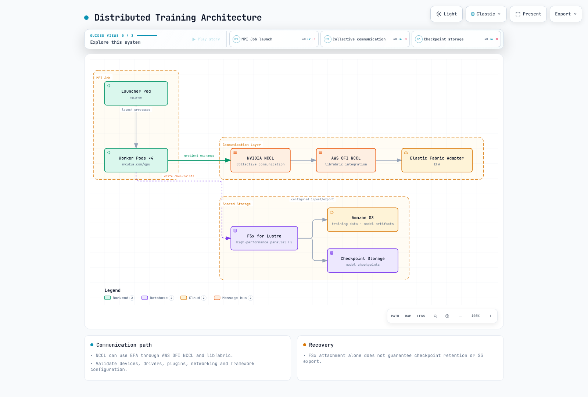
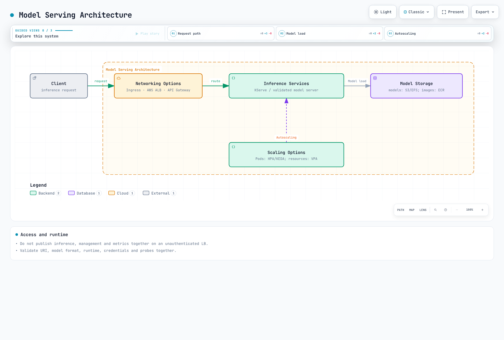

# Cargas de trabajo de IA/ML

> **Línea base de revisión**: GPU Operator 26.7.2 / NVIDIA device plugin 0.20.1 / FSx CSI 1.11.0
> **Última actualización**: 16 de octubre de 2026

Kubernetes es una plataforma potente para ejecutar cargas de trabajo de IA/ML. En este capítulo, aprenderemos a ejecutar cargas de trabajo de IA/ML en EKS y exploraremos las prácticas recomendadas.

## Características de las cargas de trabajo de IA/ML

Las cargas de trabajo de IA/ML tienen características distintas de las cargas de trabajo de aplicaciones habituales:


[🔍 Ver diagrama interactivo](https://www.atomai.click/kubernetes-docs/archmaps/en-ai-ml-01-ai-ml-workloads-0.html)

1. **Uso intensivo de recursos**: Requieren recursos informáticos considerables, como GPU, CPU de alto rendimiento y mucha memoria.
2. **Uso intensivo de datos**: Requieren acceso rápido a conjuntos de datos grandes.
3. **Procesamiento distribuido**: Requieren procesamiento distribuido en varios nodos para entrenar modelos a gran escala.
4. **Diversidad de cargas de trabajo**: Incluyen varios tipos de cargas de trabajo, como entrenamiento, inferencia y preprocesamiento de datos.

## Distinciones del diseño de IA/ML

Verifica la compatibilidad con el framework, la imagen, el dispositivo y la versión de Kubernetes seleccionados:

### 1. Implementación de modelos de lenguaje de gran tamaño (LLM)

Los modelos de lenguaje de gran tamaño (LLM) son una de las tecnologías más destacadas de la IA en los últimos años. Consideraciones clave para implementar LLM de forma eficiente en Kubernetes:

- **Fragmentación del modelo**: Distribuir modelos grandes entre varias GPU
- **Selección de precisión**: Distinguir los cálculos FP16/BF16 de la cuantización INT8/INT4 y validar la exactitud y la compatibilidad con el dispositivo
- **Optimización de la inferencia**: Mejorar el rendimiento de la inferencia con vLLM, TensorRT, ONNX Runtime, etc.
- **Estrategia de escalado**: Aumentar el rendimiento mediante el escalado horizontal

### 2. Frameworks de orquestación de IA

Frameworks de orquestación especializados para gestionar cargas de trabajo de IA/ML en Kubernetes:

- **Kubeflow**: Plataforma integral para flujos de trabajo de aprendizaje automático
- **Ray en Kubernetes**: Marco de computación distribuida
- **KServe**: Gestión de inferencias con Knative/Standard y otras modalidades
- **Seldon Core**: Despliegue y supervisión de modelos

### 3. Uso compartido y optimización de GPU

Tecnologías para utilizar los recursos de GPU de forma eficiente:

- **MIG (Multi-Instance GPU)**: Particionamiento de GPU NVIDIA A100/H100
- **Enfoques para compartir**: MPS y el uso compartido por intervalos de tiempo difieren entre sí y también de MIG en cuanto a aislamiento y compatibilidad
- **Asignación dinámica**: Asignación dinámica de recursos de GPU según las necesidades
- **GPU Operator**: Automatización de la gestión de GPU en Kubernetes

### 4. Integración de MLOps y GitOps

Aplicación de los principios de DevOps a la gestión del ciclo de vida de IA/ML:

- **Control de versiones de modelos**: Control de versiones de modelos integrado con Git
- **Pipelines de CI/CD**: Automatización del entrenamiento y la implementación de modelos
- **Pruebas A/B y despliegues canary**: La comparación experimental y el despliegue gradual tienen objetivos y métricas diferentes
- **Supervisión y ciclos de retroalimentación**: Supervisión del rendimiento de los modelos y reentrenamiento

### 5. Integración de bases de datos vectoriales

Integración de bases de datos vectoriales para embeddings y búsqueda semántica:

- **Pinecone**: Búsqueda vectorial administrada
- **Milvus**: Base de datos vectorial de código abierto
- **Faiss**: Biblioteca eficiente de búsqueda por similitud de Facebook AI
- **OpenSearch**: Motor de búsqueda con capacidades de búsqueda vectorial

La inferencia por lotes y la inferencia en línea tienen objetivos distintos de latencia y caudal.

## Configuración de infraestructura de IA/ML en EKS


[🔍 Ver diagrama interactivo](https://www.atomai.click/kubernetes-docs/archmaps/en-ai-ml-01-ai-ml-workloads-1.html)

### Selección del tipo de nodo

Estos son ejemplos de capacidad, no un catálogo actual exhaustivo ni una clasificación. Comprueba la disponibilidad regional, las cuotas, la arquitectura de CPU, la memoria de GPU y la compatibilidad del software:

1. **Instancias con GPU**:
   - p4d.24xlarge: 8x GPU NVIDIA A100, 320GB de memoria de GPU
   - p3.16xlarge: 8x GPU NVIDIA V100, 128GB de memoria de GPU
   - g5.xlarge~g5.48xlarge: GPU NVIDIA A10G, hasta 8 GPU
   - g4dn.12xlarge: 4 GPU T4; g4dn.16xlarge: 1 GPU T4 (el tamaño y la cantidad de GPU no aumentan de forma monotónica)

2. **Instancias optimizadas para CPU**:
   - c6i.32xlarge: 128 vCPU, 256GB de memoria
   - c7g.16xlarge: 64 vCPU (AWS Graviton3), 128GB de memoria

3. **Instancias optimizadas para memoria**:
   - r6i.32xlarge: 128 vCPU, 1024GB de memoria
   - x2gd.16xlarge: 64 vCPU, 1024GB de memoria

4. **Instancias Inferentia**:
   - inf1.24xlarge: 16 chips AWS Inferentia, 96 vCPU, 192GB de memoria

5. **Instancias Trainium**:
   - trn1.32xlarge: 16 chips AWS Trainium, 128 vCPU, 512GB de memoria

### Configuración de almacenamiento

Las cargas de trabajo de IA/ML requieren almacenamiento de alto rendimiento:

1. **Amazon EBS**:
   - gp3: Almacenamiento SSD de uso general predeterminado
   - io2: Almacenamiento SSD de alto rendimiento
   - st1: Almacenamiento HDD optimizado para el rendimiento

2. **Amazon EFS**:
   - Es útil cuando varios nodos necesitan acceder a datos compartidos
   - Modo de rendimiento: se recomienda General Purpose; el modo heredado Max I/O es incompatible con el caudal Elastic
   - Modos de caudal: Elastic, Provisioned y Bursting; compara las necesidades de la carga de trabajo, los precios y los límites

3. **Amazon FSx for Lustre**:
   - Sistema de archivos paralelo de alto rendimiento
   - Proporciona acceso rápido a conjuntos de datos grandes
   - Simplifica la importación y exportación de datos mediante la integración con S3

4. **Amazon S3**:
   - Almacena conjuntos de datos grandes
   - Almacena datos de entrenamiento y artefactos de modelos

### Configuración de redes

Configuración de redes para el entrenamiento distribuido:

1. **Grupos de ubicación de clúster**:
   - Minimizan la latencia entre nodos
   - Ubican los nodos en la misma zona de disponibilidad

2. **Redes mejoradas**:
   - Elastic Network Adapter (ENA)
   - ENA Express
   - Elastic Fabric Adapter (EFA)

3. **Configuración de VPC CNI**:
   - Gestión de direcciones IP para implementaciones de Pods a gran escala
   - Configuración de rangos de direcciones IP secundarias

## Implementación de cargas de trabajo de IA/ML


[🔍 Ver diagrama interactivo](https://www.atomai.click/kubernetes-docs/archmaps/en-ai-ml-01-ai-ml-workloads-2.html)

### NVIDIA GPU Operator y asignación de dispositivos {#nvidia-gpu-operator-and-device-allocation}

Las AMI NVIDIA de EKS AL2023 ya incluyen controladores y Container Toolkit, así que desactiva su instalación por parte de GPU Operator. No incluyen el device plugin ni el controlador DRA, que requieren configuración. Las AMI NVIDIA de Bottlerocket incluyen el device plugin. Evita instalar componentes duplicados que administren la misma función.

Este comando **renderiza localmente** el chart revisado de GPU Operator. Inspecciona ClusterPolicy/RBAC y los requisitos reales de instalación antes de la implementación.

```bash
# AL2023 NVIDIA AMI profile: host driver/toolkit are already installed.
helm repo add nvidia https://helm.ngc.nvidia.com/nvidia
helm repo update nvidia
helm template gpu-operator nvidia/gpu-operator \
  --version v26.7.2 --namespace gpu-operator \
  --set driver.enabled=false --set toolkit.enabled=false \
  > gpu-operator.rendered.yaml
```

El recurso extendido de NVIDIA es `nvidia.com/gpu`. Al establecer un límite entero, se implica una solicitud del mismo valor; si especificas ambos, deben coincidir. `0.5` no es una asignación válida de GPU. Esta imagen CUDA 12.8 es ilustrativa; verifica la compatibilidad entre el controlador del host y la arquitectura, y fija el digest de la imagen antes de la implementación. En esta revisión no se ejecutó ninguna GPU.

```yaml
apiVersion: v1
kind: Pod
metadata:
  name: gpu-allocation-check
spec:
  restartPolicy: Never
  containers:
    - name: check
      image: nvidia/cuda:12.8.1-base-ubuntu22.04
      command: ["nvidia-smi", "-L"]
      resources:
        requests:
          cpu: "100m"
          memory: 128Mi
        limits:
          memory: 256Mi
          nvidia.com/gpu: 1
```

### Kubeflow y entrenamiento distribuido {#kubeflow-and-distributed-training}

Usa la [guía de instalación 26.03.1](kubeflow/01-architecture-installation.md) fijada para consultar dependencias, identidad y almacenamiento, en lugar de una instalación de una sola línea desde la rama master. El proyecto de servicio de modelos es KServe; KFServing es su nombre histórico.

La ejecución distribuida puede utilizar [Trainer](kubeflow/05-training-operator.md), TFJob/PyTorchJob heredados o el MPI Operator independiente. Distingue la API de MPI Operator de Training Operator heredado según las CRD y la versión instaladas. Los controladores de trabajos crean Pods; un lanzador MPI o torchrun inicia los procesos.

Un solo Pod no puede satisfacer torchrun --nnodes=2, y un nombre DNS inventado para un Pod no proporciona rendezvous. Proporciona el código y la imagen de entrenamiento reales, la cantidad de workers, el Service/DNS, los ranks de los procesos y el backend, la partición de datos y el comportamiento de checkpoints, tiempos de espera y reintentos. La planificación en grupo requiere una política y compatibilidad del scheduler independientes.



[🔍 Diagrama interactivo](https://www.atomai.click/kubernetes-docs/archmaps/en-ai-ml-01-ai-ml-workloads-3.html)

Para usar NCCL sobre EFA, la ruta es AWS OFI NCCL plugin → libfabric → EFA. MPI puede iniciar procesos sin ser una capa de transporte obligatoria de NCCL. Verifica ENA/EFA, GPUDirect, los grupos de seguridad, la AMI y las bibliotecas por separado. Multus/SR-IOV o los montajes hostPath de dispositivos, por sí solos, no configuran EFA/GPUDirect en EKS.

### Servicio de modelos

Comprueba el modo Knative/Standard de [KServe](kubeflow/06-kserve.md), el runtime/formato del modelo, el acceso a URI, el protocolo y la configuración de dispositivos GPU. Una solicitud de GPU, por sí sola, no habilita la inferencia con GPU. Triton también necesita un repositorio de modelos, configuración de backend y validación de disponibilidad.

TorchServe anuncia que ya no tiene mantenimiento activo ni correcciones de seguridad planificadas, por lo que no es una opción predeterminada mantenida para nuevas implementaciones. No publiques los puertos de inferencia, administración y métricas juntos mediante un LoadBalancer sin autenticación. Configura un ingreso autenticado y el acceso interno adecuado a la administración.



[🔍 Diagrama interactivo](https://www.atomai.click/kubernetes-docs/archmaps/en-ai-ml-01-ai-ml-workloads-4.html)

## Optimización de cargas de trabajo de IA/ML


[🔍 Ver diagrama interactivo](https://www.atomai.click/kubernetes-docs/archmaps/en-ai-ml-01-ai-ml-workloads-5.html)

### Uso compartido y memoria de GPU

El uso compartido por intervalos de tiempo proporciona acceso compartido a la GPU, pero no ofrece aislamiento de memoria ni de fallos, ni garantías de rendimiento proporcional. MPS utiliza un daemon de control independiente; la documentación revisada del plugin califica la compatibilidad como experimental y excluye los dispositivos con MIG habilitado. Un RuntimeClass junto con un Pod MPS privilegiado no configura el uso compartido en todo el nodo.

Esta es una configuración independiente de device plugin. Si GPU Operator administra el plugin, usa en su lugar la ruta de configuración de ese administrador.

```yaml
# device-plugin-sharing.yaml: NVIDIA device plugin configuration, not a Pod.
version: v1
sharing:
  timeSlicing:
    renameByDefault: true
    failRequestsGreaterThanOne: true
    resources:
      - name: nvidia.com/gpu
        replicas: 2
```

```bash
# Alternative to an operator-owned plugin; do not install a second owner.
helm repo add nvdp https://nvidia.github.io/k8s-device-plugin
helm repo update nvdp
helm template nvdp nvdp/nvidia-device-plugin \
  --version 0.20.1 --namespace nvidia-device-plugin \
  --set config.default=shared \
  --set-file config.map.shared=device-plugin-sharing.yaml \
  > device-plugin.rendered.yaml
```

Esto expone nvidia.com/gpu.shared; los Pods solicitan un valor entero de ese recurso. replicas=2 no garantiza la mitad de la memoria de la GPU. Verifica los nodos seleccionados, la asignación y la contención en hardware GPU real.

### Ubicación y topología {#placement-and-topology}

Las anotaciones de zona/región no controlan la ubicación de los Pods. Usa nodeSelector/afinidad con etiquetas reales de los nodos; los selectores de antiafinidad y distribución también deben coincidir con las etiquetas de los Pods. Sustituye la AZ indicada más abajo por la real. La ubicación en la misma AZ, la distribución entre nodos y la admisión en grupo son restricciones distintas.

```yaml
apiVersion: v1
kind: Pod
metadata:
  name: placement-check
  labels:
    app: placement-check
spec:
  restartPolicy: Never
  nodeSelector:
    topology.kubernetes.io/zone: us-west-2a
  affinity:
    podAntiAffinity:
      preferredDuringSchedulingIgnoredDuringExecution:
        - weight: 100
          podAffinityTerm:
            labelSelector:
              matchLabels:
                app: placement-check
            topologyKey: kubernetes.io/hostname
  containers:
    - name: check
      image: python:3.12-slim
      command: ["python", "-c", "print('placement check')"]
      resources:
        requests:
          cpu: "100m"
          memory: 64Mi
        limits:
          cpu: "1"
          memory: 128Mi
```

### Almacenamiento y almacenamiento en caché {#storage-and-caching}

El aprovisionamiento estático de FSx CSI conecta un **sistema de archivos existente** con un PV/PVC. Sustituye el ID del sistema de archivos, el DNS, el nombre del montaje, la capacidad y el namespace por valores reales. Retain evita la eliminación automática del sistema de archivos; los cargos continúan hasta que se elimine por separado.

```yaml
apiVersion: v1
kind: PersistentVolume
metadata:
  name: ml-fsx-existing
spec:
  capacity:
    storage: 1200Gi
  volumeMode: Filesystem
  accessModes: [ReadWriteMany]
  storageClassName: ""
  persistentVolumeReclaimPolicy: Retain
  mountOptions: [flock]
  csi:
    driver: fsx.csi.aws.com
    volumeHandle: fs-0123456789abcdef0
    volumeAttributes:
      dnsname: fs-0123456789abcdef0.fsx.us-west-2.amazonaws.com
      mountname: replace-with-actual-mount-name
---
apiVersion: v1
kind: PersistentVolumeClaim
metadata:
  name: ml-dataset
  namespace: ml-workloads
spec:
  accessModes: [ReadWriteMany]
  storageClassName: ""
  volumeName: ml-fsx-existing
  resources:
    requests:
      storage: 1200Gi
```

El aprovisionamiento dinámico crea un sistema de archivos a partir de un StorageClass/PVC. No incluyas la configuración estática de volumeHandle/DNS en el StorageClass ni la combines con un recurso fsx.aws.k8s.io/Lustre sin definir. Usa el [ejemplo de aprovisionamiento dinámico del controlador](https://github.com/kubernetes-sigs/aws-fsx-csi-driver/tree/v1.11.0/examples/kubernetes/dynamic_provisioning) y comprueba las reglas de rendimiento y copias de seguridad específicas del tipo de implementación; SCRATCH_2 no puede usar opciones exclusivas de almacenamiento persistente.

Un DaemonSet de workers de Alluxio, por sí solo, no constituye una implementación completa de caché. Diseña los roles de master/worker, las rutas, la memoria, la red, la coherencia y la retención. Mide el rendimiento con una prueba independiente en una ruta del PVC realmente montado; ejecutar FIO en un /data sin montar no mide el rendimiento de FSx.

## Supervisión y registro


[🔍 Ver diagrama interactivo](https://www.atomai.click/kubernetes-docs/archmaps/en-ai-ml-01-ai-ml-workloads-6.html)

### Prometheus y Grafana {#prometheus-and-grafana}

DCGM Exporter proporciona métricas de GPU, que son distintas de la capacidad asignable del device plugin. Evita duplicar un exporter administrado por Operator con otro DaemonSet. No se necesita un montaje del socket de Docker en una configuración con containerd.

ServiceMonitor selecciona **etiquetas de Service y puertos con nombre**, no etiquetas de Pod directamente. Ajusta estos valores al Service del exporter instalado y asegúrate de que Prometheus también seleccione el namespace y las etiquetas de ServiceMonitor.

```yaml
apiVersion: monitoring.coreos.com/v1
kind: ServiceMonitor
metadata:
  name: gpu-metrics
  namespace: monitoring
spec:
  namespaceSelector:
    matchNames: [gpu-operator]
  selector:
    matchLabels:
      app: nvidia-dcgm-exporter
  endpoints:
    - port: gpu-metrics
      interval: 15s
```

Observa la utilización, la memoria y los errores de GPU junto con las solicitudes, los errores y los histogramas de latencia de la aplicación. La exactitud del modelo requiere un flujo de evaluación con valores de referencia; añadir réplicas no mejora su calidad. Sustituye el formato JSON antiguo de gráficas de Grafana/Flot por los formatos actuales de series temporales/indicadores y los UID reales de las fuentes de datos, y después valida la importación.

### Recopilación de registros

El formato de encuadre de los registros CRI de containerd y el JSON de la aplicación corresponden a capas distintas. Configura en Fluent Bit el análisis CRI y multilínea, las rutas, la base de datos de posiciones y la rotación, así como RBAC para los metadatos de Kubernetes. No copies tipos de documentos de Elasticsearch/OpenSearch eliminados ni nombres de analizadores sin definir. Las integraciones de salida de CloudWatch requieren plugins de imagen, IAM para cargas de trabajo y acceso a la red. Gestiona los payloads sensibles de los modelos y el crecimiento de los búferes de reintentos. Consulta la ruta de recopilación seleccionada en la [guía de observabilidad](../observability/README.md).

## Optimización de costos

### Spot y aprovisionamiento de nodos {#spot-and-node-provisioning}

Las interrupciones de Spot y la falta de capacidad requieren checkpoints externos, reintentos, idempotencia y validación del tiempo de recuperación. Usa la configuración actual de NodePool/EC2NodeClass de la [guía de Karpenter](../autoscaling/02-karpenter.md), incluidas la revisión de la imagen/AMI, las taints/tolerations, los límites y la gestión de interrupciones. Combinar grupos de nodos de CPU/GPU no es lo mismo que el producto EKS Hybrid Nodes.

### HPA y métricas {#hpa-and-metrics}

Usa las métricas Resource de HPA para CPU/memoria proporcionadas por metrics-server. La asignación de nvidia.com/gpu no es una métrica Resource de utilización de GPU. Las señales de GPU/solicitudes requieren exporters y un adaptador de métricas personalizadas/externas.

Este ejemplo usa RPS expuesto **por namespace/Pod** por un adaptador. El Deployment de destino y el adaptador requieren instalaciones independientes; 100 RPS es un objetivo ilustrativo que debe calibrarse mediante mediciones. Asigna un solo responsable del escalado, en lugar de permitir que varios controladores HPA/KEDA controlen la misma cantidad de réplicas.

```yaml
apiVersion: autoscaling/v2
kind: HorizontalPodAutoscaler
metadata:
  name: inference-hpa
  namespace: ml-workloads
spec:
  scaleTargetRef:
    apiVersion: apps/v1
    kind: Deployment
    name: inference-service
  minReplicas: 1
  maxReplicas: 10
  metrics:
    - type: Pods
      pods:
        metric:
          name: inference_requests_per_second
        target:
          type: AverageValue
          averageValue: "100"
```

Una agregación o agrupación de etiquetas incorrecta puede impedir que un adaptador devuelva valores por Pod. Los percentiles de histogramas o la precisión del modelo no son señales proporcionales adecuadas para HPA de forma automática. Mide conjuntamente la carga, la cola, la latencia, la utilización y el rendimiento alcanzado. Reducir la cantidad de Pod puede mantener los cargos de EC2 hasta que se terminen los nodos; la hora del día, por sí sola, no reduce las tarifas On-Demand.

### Acceso a datos y modelos {#data-and-model-access}

RBAC de Kubernetes controla el acceso a la API; los permisos de S3/KMS usan IAM para cargas de trabajo. Usa almacenamiento de objetos, cifrado y credenciales basadas en archivos en lugar de Secrets grandes para los modelos o claves de descifrado en variables de entorno. La codificación base64 de un Secret no es cifrado. En NetworkPolicy, namespaceSelector y podSelector dentro del mismo peer se combinan mediante AND; las entradas separadas se combinan mediante OR. Permite también el tráfico necesario hacia/desde DNS, almacenamiento y métricas.

## Validación y referencias

Este capítulo se corrigió mediante la renderización oficial con Helm de GPU Operator y device plugin, además de la revisión de manifiestos y configuraciones. No se realizaron ejecuciones reales de GPU, creación/montaje de FSx, entrenamiento distribuido, servicio de modelos ni escalado automático. Valida las versiones de los componentes y los requisitos de los nodos en el entorno de destino.

- [AMI aceleradas de EKS](https://docs.aws.amazon.com/eks/latest/userguide/ml-eks-optimized-ami.html)
- [Planificación de GPU en Kubernetes](https://kubernetes.io/docs/tasks/manage-gpus/scheduling-gpus/)
- [NVIDIA device plugin 0.20.1](https://github.com/NVIDIA/k8s-device-plugin/tree/v0.20.1)
- [FSx CSI 1.11.0](https://github.com/kubernetes-sigs/aws-fsx-csi-driver/tree/v1.11.0)
- [Modos de rendimiento de EFS](https://docs.aws.amazon.com/efs/latest/ug/performance.html)
- [HPA de Kubernetes](https://kubernetes.io/docs/tasks/run-application/horizontal-pod-autoscale/)

## Cuestionario

Para comprobar lo que has aprendido en este capítulo, prueba el [cuestionario del tema](../quizzes/ai-ml/03-ai-ml-workloads-quiz.md).
