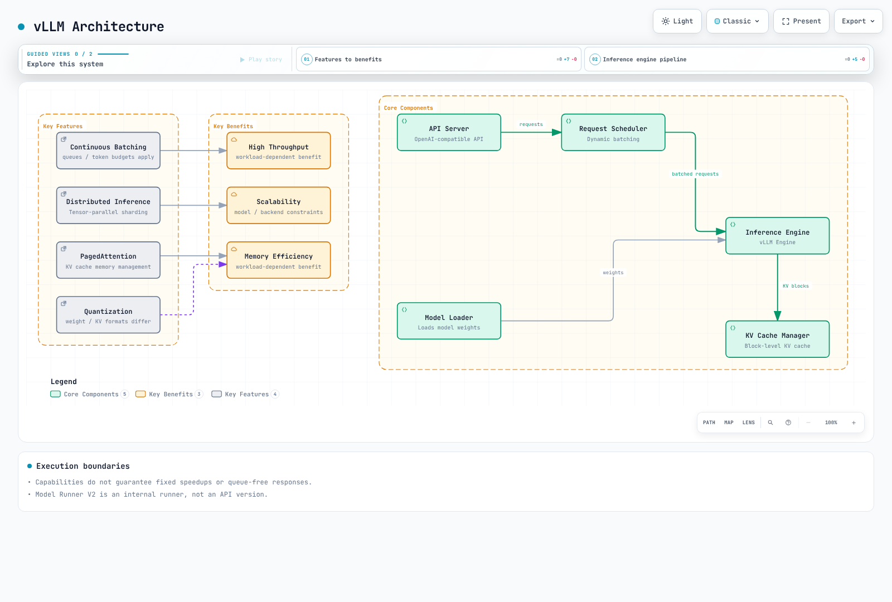
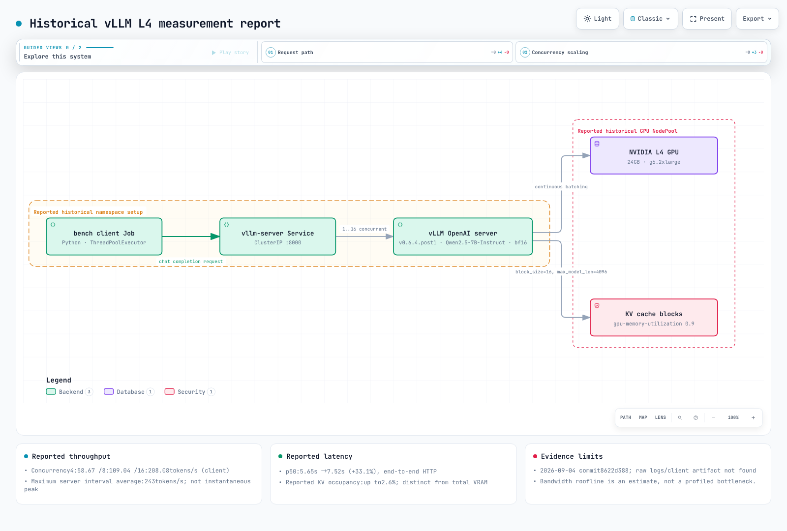
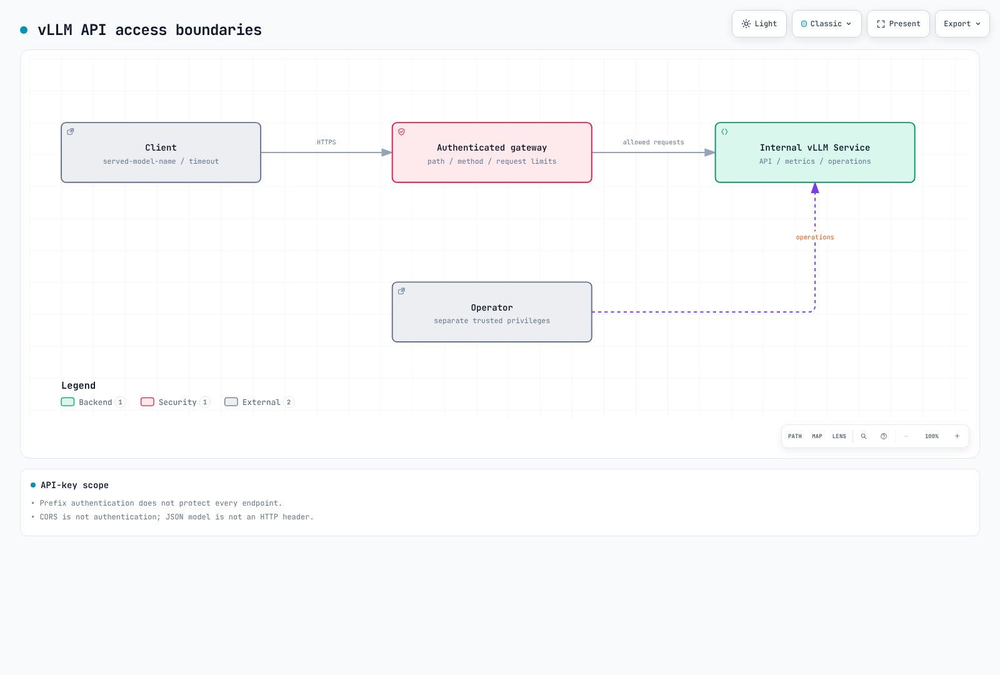

# Despliegue y optimización de vLLM

> **Base de la revisión**: vLLM 0.29.0, variante de imagen con CUDA 12.9; se presenta por separado el benchmark histórico de 0.6.4.post1
> **Última versión comprobada**: vLLM 0.31.0 (5 de octubre de 2026), comprobada el 12 de octubre de 2026
> **Última actualización**: 12 de octubre de 2026

vLLM es un motor de inferencia de código abierto para modelos generativos y para las cargas multimodales y de pooling compatibles. Su nombre no significa «Vector Language Model». Este capítulo examina una versión concreta y los límites de operación en EKS; no ofrece garantías universales de aceleración ni de compatibilidad con modelos.

## Configuración del entorno de laboratorio

Los manifiestos y las comprobaciones locales de este capítulo usan [v0.29.0](https://github.com/vllm-project/vllm/releases/tag/v0.29.0), publicada el 9 de septiembre de 2026. Le siguieron versiones posteriores: v0.30.0 (22 de septiembre de 2026) y [v0.31.0](https://github.com/vllm-project/vllm/releases/tag/v0.31.0) (5 de octubre de 2026).

En v0.31.0:

- `mm_processor_kwargs` y `media_io_kwargs` por solicitud se rechazan de forma predeterminada. Permítalos solo con la opción explícita `--trust-request-mm-kwargs`.
- Se eliminó `tokenizer_mode="slow"`.

Los ejemplos 0.29.0 de este capítulo no se han vuelto a ejecutar en v0.30.0 ni en v0.31.0. Revise los [cambios de la versión](https://github.com/vllm-project/vllm/releases/tag/v0.31.0) y la compatibilidad antes de actualizar.

La instalación predeterminada de 0.29.0 mediante PyPI o Docker utiliza CUDA 13.0; la imagen v0.29.0-cu129 se ofrece por separado. Parte de la documentación de instalación de esa versión todavía presenta CUDA 12.9 como opción predeterminada. Compruebe la variante y el digest de la imagen real.

PyPI requiere Python >=3.10, <3.15, mientras que la guía de GPU de esa versión enumera 3.10–3.13. Esto no garantiza cualquier combinación de Python, PyTorch y CUDA. La opción NVIDIA requiere capacidad de cómputo 7.5 o posterior, por lo que excluye V100 (7.0). Los kernels, los tipos de datos y la cuantización pueden imponer requisitos adicionales al dispositivo.

Siga los requisitos de AMI, controlador y plugin de dispositivo descritos en [cargas de trabajo AI/ML](01-ai-ml-workloads.md). Una imagen CUDA no se puede desplegar directamente en Trainium o Inferentia; valide Neuron u otros plugins de plataforma por separado. Dimensione la GPU, la RAM y el disco según el modelo, la caché y la concurrencia, en lugar de considerar g5.2xlarge o 50GB como mínimos universales.

## Introducción a vLLM

vLLM es un motor de inferencia LLM con las siguientes características:



[🔍 Ver diagrama interactivo](https://www.atomai.click/kubernetes-docs/archmaps/en-ai-ml-02-vllm-deployment-0.html)

### Capacidades y límites de compatibilidad

| Capacidad | Significado y condiciones |
| --- | --- |
| PagedAttention / caché KV | Gestiona bloques de tokens para reducir el desperdicio; los kernels y la organización de la caché dependen del modelo y del backend |
| Procesamiento continuo por lotes | El planificador ajusta el trabajo en cada paso; no garantiza admisión inmediata, ausencia de colas ni una aceleración fija |
| TP / PP / DP / EP | El paralelismo tensorial, de pipeline, de datos y de expertos son ejes distintos que requieren soporte del modelo, del backend y de la red |
| Precisión / cuantización | Distinga los tipos FP16/BF16 de los formatos FP8/INT8/INT4/AWQ, y la cuantización de pesos de la cuantización de la caché KV |
| Caché de prefijos / prefill por fragmentos | Compruebe los valores predeterminados de los modelos compatibles y sus ajustes; no almacena respuestas completas ni mejora la precisión |
| Salidas estructuradas | response_format o structured_outputs restringe el formato; la veracidad y la validez para el negocio requieren comprobaciones independientes |
| Llamadas a herramientas | Requieren un modelo, una plantilla de chat, un parser y un bucle de ejecución en el cliente; el servidor no ejecuta las herramientas automáticamente |
| LoRA | Requiere soporte del modelo y registro del adaptador; cambiar únicamente el modelo de la solicitud no carga un adaptador |

En 0.29.0, Model Runner V2 es el ejecutor predeterminado. No es la versión de la API compatible con OpenAI ni un «vLLM Engine V2» independiente. El nombre de una familia de modelos no garantiza compatibilidad con todos los tamaños, formatos de cuantización o variantes de visión. Verifique la arquitectura, el artefacto y el tokenizer, la plantilla de chat y los kernels.

### Configuración de funciones en la CLI actual

Use vllm serve en lugar de python -m vllm.entrypoints.openai.api_server, que está obsoleto. Las opciones anteriores --speculative-model/--num-speculative-tokens se reemplazan por --speculative-config en la CLI actual.

```bash
# Syntax when compatible target/draft models and sufficient memory are prepared.
vllm serve /models/target \
  --speculative-config '{"model":"/models/draft","method":"draft_model","num_speculative_tokens":5}'
```

El ejemplo muestra la sintaxis; no proporciona los archivos de los modelos ni demuestra una aceleración. La tasa de aceptación del modelo borrador, la memoria adicional y los costes de comunicación pueden contrarrestar las mejoras.

Registre LoRA al iniciar el servidor con --enable-lora --lora-modules adapter=/models/adapter. La carga y descarga durante la ejecución requieren habilitar por separado VLLM_ALLOW_RUNTIME_LORA_UPDATING y disponer de una vía de acceso restringida para operadores. --enable-auto-tool-choice necesita el --tool-call-parser adecuado. Las URL multimodales también requieren controles contra SSRF, dominios permitidos y límites de descarga y decodificación.

## Requisitos del sistema

Requisitos del sistema para desplegar vLLM en EKS:


[🔍 Ver diagrama interactivo](https://www.atomai.click/kubernetes-docs/archmaps/en-ai-ml-02-vllm-deployment-1.html)

Comience a estimar la memoria de los pesos multiplicando el número de parámetros por los bytes almacenados por parámetro. Solo los pesos FP16/BF16 de un modelo 70B ocupan unos 140GB, por lo que 80GB no es un requisito universal para 70B. Añada la caché KV, las activaciones, los grafos y espacios de trabajo de CUDA y los búferes de comunicación, teniendo en cuenta los metadatos de cuantización y los tensores replicados.

A continuación se muestra una estimación habitual de la caché KV para atención densa. En GQA/MQA, utilice el número de cabezas KV; no sustituya ese término por el tamaño oculto de una fórmula que solo sirve para MHA.

```text
KV bytes ≈ 2 × layers × KV_heads × head_dim × cached_tokens × bytes_per_element
```

cached_tokens suma los tokens conservados entre todas las solicitudes concurrentes. El particionado o la replicación con TP, las ventanas deslizantes, MLA y las arquitecturas híbridas requieren un tratamiento aparte. La configuración actual de Qwen2.5-7B tiene 28 capas, 4 cabezas KV y una dimensión por cabeza de 128: unos 56KiB por token con dos bytes por elemento, o 224MiB para una secuencia de 4096 tokens. Es una estimación agregada, no una medición por GPU ni de la memoria total del modelo.

p4d.24xlarge utiliza GPU A100 de 40GB; distíngalas de las A100 de 80GB de las instancias p4de. Compare p5/g6/g6e y otras opciones según la capacidad disponible en la región, los controladores y las necesidades de la carga. Reglas fijas como cuatro núcleos de CPU por GPU o una RAM equivalente al doble de los pesos no sustituyen las mediciones.

## Configuración de infraestructura de EKS


[🔍 Ver diagrama interactivo](https://www.atomai.click/kubernetes-docs/archmaps/en-ai-ml-02-vllm-deployment-2.html)

## Almacenamiento y preparación de modelos

FSx for Lustre es una opción; no es obligatorio ni resulta óptimo en todos los casos. Compare NVMe o EBS locales, cachés reutilizables, almacenamiento de objetos y sistemas de archivos compartidos según el tiempo de carga, el coste y la concurrencia. emptyDir puede sobrevivir al reinicio de un contenedor, pero no a la eliminación y recreación del Pod.

Distinga los [PV/PVC estáticos de FSx del aprovisionamiento dinámico](01-ai-ml-workloads.md#storage-and-caching). snapshot_download de Hugging Face descarga desde Hugging Face, no desde S3. Registre la revisión del repositorio, la integridad, la licencia y los permisos de acceso. Para modelos con acceso restringido, monte los tokens como archivos y utilice una etapa de descarga que lea el archivo. No autorice por defecto la ejecución de código remoto.

El siguiente ejemplo utiliza una revisión verificada del modelo público Qwen3-0.6B sin token. La descarga a su caché emptyDir se repite cuando se recrea el Pod. Los procesos de trabajo multinodo requieren la misma revisión y ruta del modelo.

## Despliegue de vLLM

### Arquitectura de despliegue

El siguiente diagrama muestra dos arquitecturas principales para desplegar vLLM en EKS:


[🔍 Ver diagrama interactivo](https://www.atomai.click/kubernetes-docs/archmaps/en-ai-ml-02-vllm-deployment-3.html)

### Ejemplo de configuración de una sola GPU

Esta es una **plantilla que debe revisarse antes de ejecutarse en GPU**. Prepare el namespace, el controlador de GPU y el plugin. El digest identifica el artefacto amd64 v0.29.0-cu129; la revisión del modelo identifica la instantánea pública de Qwen3-0.6B inspeccionada. Esta auditoría no ejecutó la descarga de la imagen, la ejecución sin root, la compilación de kernels ni la inferencia; esas operaciones requieren validación en el entorno real.

Recreate evita necesitar una réplica con GPU adicional, pero causa una interrupción durante la actualización. startupProbe concede unos 15 minutos para el arranque; la comprobación de disponibilidad no es un SLA. El Service es de tipo ClusterIP y no crea una entrada pública.

```yaml
apiVersion: apps/v1
kind: Deployment
metadata:
  name: vllm-demo
  namespace: ml-inference
spec:
  replicas: 1
  strategy:
    type: Recreate
  selector:
    matchLabels:
      app: vllm-demo
  template:
    metadata:
      labels:
        app: vllm-demo
    spec:
      automountServiceAccountToken: false
      nodeSelector:
        kubernetes.io/arch: amd64
      securityContext:
        runAsNonRoot: true
        runAsUser: 1000
        runAsGroup: 1000
        fsGroup: 1000
        seccompProfile:
          type: RuntimeDefault
      containers:
        - name: vllm
          image: vllm/vllm-openai@sha256:3e10e8189823e0f7ae4620c271bcdaaf64127ec7d0edc351591a508498b7684a
          command: ["vllm", "serve"]
          args:
            - Qwen/Qwen3-0.6B
            - --revision=c1899de289a04d12100db370d81485cdf75e47ca
            - --served-model-name=qwen3-demo
            - --dtype=float16
            - --max-model-len=2048
            - --max-num-seqs=8
            - --gpu-memory-utilization=0.80
            - --host=0.0.0.0
            - --port=8000
          env:
            - name: HF_HOME
              value: /cache/huggingface
            - name: XDG_CACHE_HOME
              value: /cache
            - name: XDG_CONFIG_HOME
              value: /cache/config
            - name: VLLM_NO_USAGE_STATS
              value: "1"
            - name: VLLM_CACHE_ROOT
              value: /cache/vllm
            - name: TORCHINDUCTOR_CACHE_DIR
              value: /cache/torchinductor
            - name: TRITON_CACHE_DIR
              value: /cache/triton
          ports:
            - name: http
              containerPort: 8000
          resources:
            requests:
              cpu: "2"
              memory: 4Gi
              ephemeral-storage: 4Gi
            limits:
              cpu: "4"
              memory: 12Gi
              ephemeral-storage: 12Gi
              nvidia.com/gpu: 1
          securityContext:
            allowPrivilegeEscalation: false
            readOnlyRootFilesystem: true
            capabilities:
              drop: [ALL]
          startupProbe:
            httpGet:
              path: /health
              port: http
            periodSeconds: 10
            failureThreshold: 90
          readinessProbe:
            httpGet:
              path: /health
              port: http
            periodSeconds: 10
          volumeMounts:
            - name: cache
              mountPath: /cache
            - name: tmp
              mountPath: /tmp
            - name: shm
              mountPath: /dev/shm
      volumes:
        - name: cache
          emptyDir:
            sizeLimit: 8Gi
        - name: tmp
          emptyDir:
            sizeLimit: 1Gi
        - name: shm
          emptyDir:
            medium: Memory
            sizeLimit: 2Gi
---
apiVersion: v1
kind: Service
metadata:
  name: vllm-demo
  namespace: ml-inference
  labels:
    app: vllm-demo
spec:
  type: ClusterIP
  selector:
    app: vllm-demo
  ports:
    - name: http
      port: 8000
      targetPort: http
```

### Particionado multinodo frente a réplicas independientes

Particionar una réplica del modelo requiere TP/PP y coordinación mediante Ray o multiprocessing. En cambio, cada réplica independiente del servidor de API carga el modelo y aporta escalado horizontal. Son diseños distintos.

0.29.0 admite las opciones de multiprocessing --nnodes, --node-rank, --master-addr y --master-port. Las opciones antiguas --rank, --tensor-parallel-rank y --distributed-init-method no equivalen a estas opciones de la CLI. Con dos nodos preparados, cada uno con ocho GPU, los comandos tienen esta forma:

```bash
# node0: substitute an actual trusted head IP and identical prepared model path.
vllm serve /models/model --distributed-executor-backend mp \
  --tensor-parallel-size 8 --pipeline-parallel-size 2 \
  --nnodes 2 --node-rank 0 --master-addr 10.0.0.10 --master-port 29500
# node1: the worker does not start a duplicate API server.
vllm serve /models/model --distributed-executor-backend mp \
  --tensor-parallel-size 8 --pipeline-parallel-size 2 \
  --nnodes 2 --node-rank 1 --master-addr 10.0.0.10 --master-port 29500 --headless
```

Estos comandos no crean los nodos, los archivos del modelo ni la conectividad. En Kubernetes debe prepararse la creación concurrente de los procesos de trabajo, el DNS antes de que los Pods estén listos, VLLM_HOST_IP por Pod, la conectividad interna y la memoria compartida. Ray necesita un clúster funcional y una dependencia de Ray compatible antes de iniciar un único punto de entrada de API con --distributed-executor-backend ray; consulte [Ray](ray/README.md). Mantenga privados los puertos de comunicación interna.

## Optimización del rendimiento


[🔍 Ver diagrama interactivo](https://www.atomai.click/kubernetes-docs/archmaps/en-ai-ml-02-vllm-deployment-4.html)

### Opciones de memoria, planificación y comunicación

En 0.29.0, CacheConfig utiliza 0.92 como valor predeterminado de gpu_memory_utilization; no es un límite estricto de toda la VRAM del proceso. El ejemplo selecciona explícitamente 0.80. --kv-cache-memory-bytes prevalece sobre el dimensionamiento automático de la caché KV, por lo que debe comprobar la prioridad de las opciones.

--swap-space no existe en la CLI actual. Trasladar los pesos a la memoria de CPU y trasladar la caché KV son capacidades con configuraciones distintas; no garantizan que la RAM del host resuelva los límites de la GPU. La caché de prefijos puede estar activada por defecto en modelos compatibles; el prefill por fragmentos también depende del modelo. Los límites de cola, los presupuestos de tokens, max-num-seqs y max-model-len son controles diferentes.

EFA requiere dispositivos EC2 compatibles, AMI, plugin y red adecuados, además de AWS OFI NCCL/libfabric. No copie opciones inventadas como NCCL_IB_ENABLE_RDMA ni ajustes arbitrarios de mlx5/GID como valores universales. Compruebe las variables actuales de NVIDIA/PyTorch y los registros reales del backend. Las pruebas de NCCL en un solo nodo no demuestran el rendimiento de EFA entre varios nodos.

## Medición histórica: Qwen2.5-7B en una sola GPU L4

Estas mediciones históricas se publicaron en el [commit del repositorio del 4 de septiembre de 2026](https://github.com/Atom-oh/kubernetes-docs/commit/8622d388cb684dc4f68083af7be6d91f80b79106). Esta auditoría no encontró resultados brutos de solicitudes, registros del servidor ni un artefacto completo del cliente, y no repitió el experimento. Se conservan las cifras publicadas; no se presentan como rendimiento actual de 0.29.0 ni como resultados reproducidos de forma independiente.



[🔍 Ver diagrama interactivo](https://www.atomai.click/kubernetes-docs/archmaps/en-ai-ml-02-vllm-deployment-6.html)

### Configuración

- **Clúster**: un NodePool de Karpenter dedicado (`bench-gpu`, `g6.2xlarge` bajo demanda: 1 NVIDIA L4, 24GB de memoria de GPU, 8 vCPU y 32 GiB de RAM), con el taint `nvidia.com/gpu=true:NoSchedule` y etiquetas para incorporarse a los daemonsets existentes de `nvidia-device-plugin`; se eliminó inmediatamente después de la prueba.
- **Servidor**: `vllm/vllm-openai:v0.6.4.post1` (publicada el 15 de noviembre de 2024; desde entonces vLLM ha incorporado su motor V1 con caché de prefijos activada por defecto, por lo que debe interpretarse como una instantánea de aquella línea de versiones), modelo `Qwen/Qwen2.5-7B-Instruct`, `--dtype bfloat16 --max-model-len 4096 --gpu-memory-utilization 0.90`. Se utilizó una sola precisión, bf16, nativa del modelo, sin cuantización, decodificación especulativa ni caché de prefijos: los valores predeterminados básicos descritos en otras partes de esta página.
- **Cliente**: un `ThreadPoolExecutor` de Python ejecutado como Job **dentro del clúster**, en otro nodo sin GPU, que enviaba solicitudes a `/v1/chat/completions` mediante el Service ClusterIP `vllm-server`. Sin streaming, con `temperature=0`, `max_tokens=128` y 8 prompts cortos rotativos: preguntas sobre conceptos de Kubernetes que pedían respuestas de 1-2 frases. En la práctica, cada respuesta se acercó al límite de 128 tokens, con una media estable de unos 102 tokens en los tres lotes concurrentes, en lugar de detenerse tras 1-2 frases. Esto permite comparar la tasa de procesamiento entre niveles de concurrencia en condiciones similares, pero conviene tenerlo presente al interpretar la latencia como «tiempo para responder una pregunta corta».
- **Arranque en frío**: desde el mensaje de inicio del motor vLLM hasta que `/health` devolvió `200`, unos 4.5 minutos, principalmente por la descarga de unos 15 GB de pesos de Qwen2.5-7B-Instruct desde Hugging Face a la caché efímera del Pod. No se incluye el tiempo de descarga de la imagen, que no se midió por separado.

### Reproducción

```yaml
# NodePool (Karpenter) - dedicated, deleted after the run; nodeClassRef points at the cluster's existing GPU EC2NodeClass (AMI/subnets/SG), not shown here
apiVersion: karpenter.sh/v1
kind: NodePool
metadata: { name: bench-gpu }
spec:
  limits: { cpu: "16", memory: 128Gi, nvidia.com/gpu: "1" }
  template:
    metadata:
      labels: { node-type: bench-gpu, nvidia.com/device-plugin.config: default }
    spec:
      expireAfter: 6h
      nodeClassRef: { group: karpenter.k8s.aws, kind: EC2NodeClass, name: gpu }
      requirements:
        - { key: node.kubernetes.io/instance-type, operator: In, values: [g6.2xlarge] }
      taints: [{ key: nvidia.com/gpu, value: "true", effect: NoSchedule }]
---
# vLLM server (namespace bench-gpu) + the ClusterIP Service the client calls
apiVersion: apps/v1
kind: Deployment
metadata: { name: vllm-server, namespace: bench-gpu }
spec:
  replicas: 1
  selector: { matchLabels: { app: vllm-server } }
  template:
    metadata: { labels: { app: vllm-server } }
    spec:
      nodeSelector: { node-type: bench-gpu }
      tolerations: [{ key: nvidia.com/gpu, value: "true", effect: NoSchedule }]
      containers:
        - name: vllm
          image: vllm/vllm-openai:v0.6.4.post1
          args: ["--model", "Qwen/Qwen2.5-7B-Instruct", "--max-model-len", "4096",
                 "--gpu-memory-utilization", "0.90", "--dtype", "bfloat16"]
          ports: [{ containerPort: 8000 }]
          resources:
            limits: { nvidia.com/gpu: "1" }
            requests: { nvidia.com/gpu: "1", cpu: "3", memory: 20Gi }
          readinessProbe: { httpGet: { path: /health, port: 8000 }, initialDelaySeconds: 30, periodSeconds: 10, failureThreshold: 60 }
---
apiVersion: v1
kind: Service
metadata: { name: vllm-server, namespace: bench-gpu }
spec:
  selector: { app: vllm-server }
  ports: [{ port: 8000, targetPort: 8000 }]
```

Los manifiestos muestran una parte del entorno descrito. Omiten la creación del namespace, el EC2NodeClass existente y el script completo del cliente, por lo que no permiten una reproducción completa. nvidia.com/device-plugin.config:default era un requisito de la configuración compartida de aquel DaemonSet, no una etiqueta universal para planificar Pods. La afirmación de que se utilizó capacidad bajo demanda también requiere comprobar la configuración histórica real.

### Resultados

| Concurrencia | Solicitudes | Tiempo transcurrido | Latencia p50 / p90 del cliente | Tasa agregada del cliente | Máxima tasa de generación registrada por el servidor | Uso de la caché KV de la GPU |
|---|---|---|---|---|---|---|
| 1 (secuencial) | 10 | ~53.2 s (suma de las latencias de las solicitudes) | 5.65 s / 7.43 s | ~17-18 tokens/s por solicitud | ~17 tokens/s | 0.1-0.2% |
| 4 | 16 | 27.78 s | 6.99 s / 7.88 s | 58.67 tokens/s | 65-66 tokens/s | 0.4-0.7% |
| 8 | 32 | 30.02 s | 7.18 s / 8.15 s | 109.04 tokens/s | 123-129 tokens/s | 0.8-1.4% |
| 16 | 64 | 31.35 s | 7.52 s / 8.74 s | 208.08 tokens/s | hasta 243 tokens/s | 1.5-2.6% |

La tasa agregada del cliente se calcula dividiendo el número de tokens generados en las respuestas por el tiempo transcurrido medido. Avg generation throughput del servidor es una media por intervalo; el mayor valor de sus registros no es un «pico real» instantáneo. Las ventanas temporales, la contabilidad de tokens y los límites de medición HTTP son distintos, por lo que estas métricas no son intercambiables.

### Interpretación

El p50 publicado aumentó de 5.65s a 7.52s, aproximadamente un 33.1%. La tasa agregada con concurrencias 4→8→16 fue de 58.67→109.04→208.08tokens/s. Distinga esta observación del procesamiento por lotes de una demostración causal del cuello de botella.

Dividir unos 300GB/s de ancho de banda entre 15.2GB de pesos da un límite teórico idealizado cercano a 20 tokens/s. Esta auditoría no dispone de mediciones de un profiler que demuestren directamente el ancho de banda utilizado o la ejecución de FLOP. Por ello, no demuestra que el proceso esté «definitivamente limitado por memoria» ni que las solicitudes adicionales sean «casi gratuitas». La ocupación de la caché KV y el uso total de VRAM son magnitudes distintas.

### Limitaciones

Se trata de una sola ejecución (n=1), con un modelo, una precisión (bf16), un tipo de GPU y una longitud de contexto. Interprétela como un único punto de datos calibrado, no como una afirmación general sobre el rendimiento de vLLM o L4. El cliente se ejecutó dentro del clúster, en otro nodo sin GPU, por lo que la latencia de red refleja saltos internos del clúster, no el acceso de un cliente externo. La latencia medida es el tiempo completo de respuesta HTTP de extremo a extremo, no el tiempo hasta el primer token (TTFT); no se probó streaming. No se probaron la caché de prefijos, la decodificación especulativa, FP8 ni el paralelismo tensorial entre varias GPU, descritos antes en esta página. La reproducción completa necesita los artefactos de ejecución y los detalles del entorno que faltan; no extrapole estas cifras a otros tamaños de modelo, GPU o longitudes de prompt.

## Monitorización y registros


[🔍 Ver diagrama interactivo](https://www.atomai.click/kubernetes-docs/archmaps/en-ai-ml-02-vllm-deployment-5.html)

### Métricas y registros

El endpoint /metrics utiliza por defecto el puerto 8000 de la API. No invente un puerto 8001 aparte ni la opción --enable-metrics=true. Las etiquetas del Service, los puertos con nombre y la selección de namespaces deben coincidir con los de ServiceMonitor.

```promql
# End-to-end p95 by model
histogram_quantile(0.95, sum by (le, model_name) (rate(vllm:e2e_request_latency_seconds_bucket[5m])))
# Generation-token throughput
sum by (model_name) (rate(vllm:generation_tokens_total[5m]))
# Queued requests
sum by (model_name) (vllm:num_requests_waiting)
```

vllm:kv_cache_usage_perc es una proporción en la que 1 representa el 100%; no expresa los bytes totales de memoria de GPU. Observe los errores y las cancelaciones del gateway junto con los contadores de éxito, y no interprete un periodo de inactividad normal como un fallo por baja tasa de procesamiento. Verifique los nombres y las etiquetas reales de los endpoints. Distinga el formato de encapsulado de CRI de los registros de la aplicación y evite registrar indiscriminadamente prompts, respuestas o tokens.

## Autoescalado


[🔍 Ver diagrama interactivo](https://www.atomai.click/kubernetes-docs/archmaps/en-ai-ml-02-vllm-deployment-10.html)

### Autoescalado y disponibilidad

Escalar réplicas independientes con HPA/KEDA es distinto de escalar el grupo de procesos de trabajo de un modelo particionado. Aumentar las réplicas de un StatefulSet no reconfigura automáticamente TP/PP. Valide las señales de solicitudes y colas de los adaptadores; no utilice HPA basado en utilización de CPU sin configurar las solicitudes de CPU. Evite que Karpenter y Cluster Autoscaler compitan por gestionar la misma capacidad.

Los PDB restringen determinadas expulsiones voluntarias, no todos los fallos. Las réplicas independientes pueden distribuirse entre zonas de disponibilidad. En cambio, repartir entre zonas un grupo TP/PP que intercambia muchos datos tiene sus propias consecuencias de latencia y coste. Valide la carga del modelo, el calentamiento, el drenaje, los flujos en curso y las GPU de reserva antes de afirmar que las actualizaciones no causan interrupciones.

## Configuración de seguridad

--api-key no protege todos los endpoints. El middleware de esta versión protege los prefijos /v1, /v2, /inference y /cohere; /invocations, /metrics y algunos endpoints operativos necesitan protección adicional. Un gateway autenticado debe permitir únicamente las rutas y los métodos necesarios. Restrinja la comunicación distribuida a redes de confianza. CORS no es autenticación.

LoRA durante la ejecución, el código remoto de los modelos y las URL multimodales introducen límites de confianza, permisos y protección frente a SSRF. Bloquear con expresiones regulares «ignore instructions» no evita toda inyección de prompts ni garantiza eliminar información personal identificable (PII). Aplique permisos de herramientas y datos de forma independiente a la salida del modelo.

Proporcione los secretos como archivos y sitúe correctamente los campos securityContext de los Pods y contenedores. Ajuste los selectores de NetworkPolicy, el DNS, la dirección de recopilación de métricas y el tráfico interno a la configuración real. Las anotaciones de un Pod no pueden activar la auditoría del servidor de API; no registre cuerpos RequestResponse de Secrets. La auditoría del plano de control de EKS y los registros de acceso de la aplicación son independientes.

## Integración del cliente



[🔍 Ver diagrama interactivo](https://www.atomai.click/kubernetes-docs/archmaps/en-ai-ml-02-vllm-deployment-7.html)

### Solicitud del cliente

Tras validar el despliegue y la disponibilidad, un desarrollador autorizado puede ejecutar kubectl port-forward -n ml-inference service/vllm-demo 8000:8000. Mantenga la vinculación predeterminada a localhost. Este ejemplo local no sustituye la autenticación mediante un gateway de producción.

```python
import json
import urllib.request

payload = {
    "model": "qwen3-demo",
    "messages": [{"role": "user", "content": "Explain a Kubernetes Pod briefly."}],
    "max_tokens": 64,
    "temperature": 0,
    "chat_template_kwargs": {"enable_thinking": False},
}
request = urllib.request.Request(
    "http://127.0.0.1:8000/v1/chat/completions",
    data=json.dumps(payload).encode(),
    headers={"Content-Type": "application/json"},
    method="POST",
)
with urllib.request.urlopen(request, timeout=60) as response:
    result = json.load(response)
print(result["choices"][0]["message"]["content"])
```

El modelo de la solicitud debe coincidir con served-model-name o con /v1/models. Los clientes de producción necesitan credenciales del gateway leídas de archivos, además de gestionar tiempos de espera, errores y streaming. El campo model del cuerpo JSON no es una cabecera HTTP de modelo; el enrutamiento por cabecera no inspecciona ese campo automáticamente.

## Alcance de la validación

Se inspeccionó el código fuente de la versión fijada para comprobar los argumentos de la CLI, las métricas, la autenticación y los metadatos de los artefactos. Los esquemas de Kubernetes y las pruebas locales con datos HTTP preparados no validan la ejecución real del parser, los kernels o las GPU de vLLM. Esta auditoría no descargó pesos de modelos ni creó servidores con GPU o recursos en la nube.

## Referencias

- [Versión vLLM 0.29.0 (base de la revisión)](https://github.com/vllm-project/vllm/releases/tag/v0.29.0)
- [Versión vLLM 0.31.0 (última comprobada)](https://github.com/vllm-project/vllm/releases/tag/v0.31.0)
- [Paralelismo y escalado](https://github.com/vllm-project/vllm/blob/v0.29.0/docs/serving/parallelism_scaling.md)
- [Límites de seguridad](https://github.com/vllm-project/vllm/blob/v0.29.0/docs/usage/security.md)
- [Métricas de producción](https://github.com/vllm-project/vllm/blob/v0.29.0/docs/usage/metrics.md)
- [Salidas estructuradas](https://github.com/vllm-project/vllm/blob/v0.29.0/docs/features/structured_outputs.md)
- [Adaptadores LoRA](https://github.com/vllm-project/vllm/blob/v0.29.0/docs/features/lora.md)

## Cuestionario

Para comprobar lo aprendido en este capítulo, resuelva el [cuestionario del tema](../quizzes/ai-ml/04-vllm-deployment-quiz.md).
