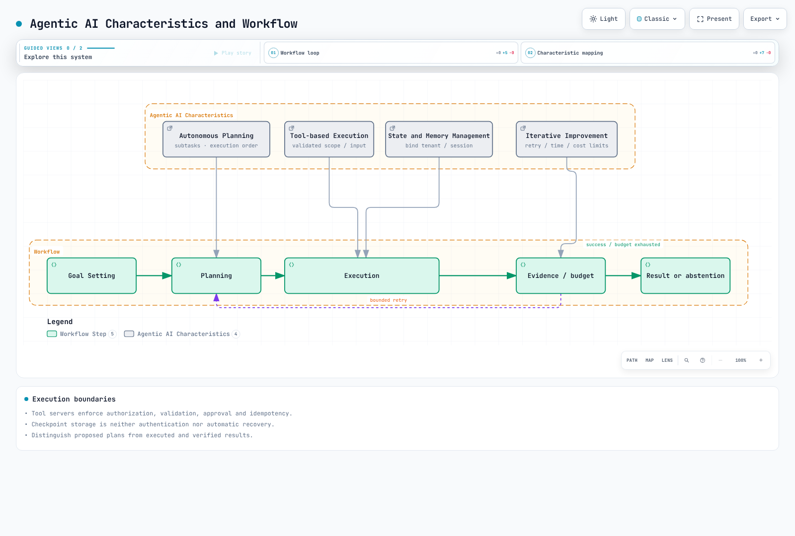

# Construcción de una plataforma de IA agéntica en EKS

> **Base de revisión**: Kagent 0.10.1 / Gateway Inference Extension 1.6.1 / LangGraph 1.2.11 / Langfuse SDK 4.15.2
> **Última actualización**: 16 de octubre de 2026

La IA agéntica va más allá de responder preguntas sencillas: crea planes de forma autónoma, usa herramientas y alcanza objetivos de manera iterativa. Este capítulo explica cómo diseñar una plataforma de IA agéntica y definir sus límites operativos en EKS.

## 1. Descripción general de la plataforma de IA agéntica

### ¿Qué es la IA agéntica?

La IA agéntica es un sistema de IA autónomo con las siguientes características:



[🔍 Ver diagrama interactivo](https://www.atomai.click/kubernetes-docs/archmaps/en-ai-ml-03-agentic-ai-platform-0.html)

1. **Planificación autónoma**: descompone tareas complejas en subtareas y determina el orden de ejecución.
2. **Ejecución basada en herramientas**: utiliza diversas herramientas, incluidas API externas, bases de datos y ejecutores de código.
3. **Mejora iterativa**: evalúa los resultados de la ejecución y modifica los planes según sea necesario.
4. **Gestión del estado**: mantiene el estado y la memoria de las tareas de larga duración.

### Cuándo elegir Kubernetes

Kubernetes ofrece las siguientes capacidades fundamentales para las plataformas de IA agéntica:

| Requisito | Solución de Kubernetes |
|-------------|---------------------|
| Orquestación de GPU | Device Plugin, GPU Operator, MIG |
| Escalado automático | HPA, VPA, Karpenter |
| Aislamiento multiinquilino | RBAC, Namespace, NetworkPolicy aplicada, identidad de cargas de trabajo |
| Alta disponibilidad | réplicas, probes, pruebas de ubicación y recuperación |
| Service Mesh | implementación configurada de gateway/mesh |
| Optimización de costos | Instancias Spot, consolidación de nodos |

### Cuatro desafíos técnicos clave

Desafíos clave que deben resolverse al construir una plataforma de IA agéntica:


[🔍 Ver diagrama interactivo](https://www.atomai.click/kubernetes-docs/archmaps/en-ai-ml-03-agentic-ai-platform-1.html)

---

## 2. Bases de referencia de GPU y costos

Los agentes que usan API de modelos externos no necesariamente necesitan GPU. La inferencia autohospedada requiere seleccionar dispositivos según los pesos y la precisión, la caché KV, la concurrencia, la arquitectura de CPU y la compatibilidad de los controladores. Usa la [guía de GPU revisada](01-ai-ml-workloads.md) y evita instalar controladores o toolkits duplicados en las AMI NVIDIA de AL2023.

MIG particiona las GPU compatibles. La compartición temporal de una misma instancia MIG no añade aislamiento de memoria ni frente a fallos entre las cargas de trabajo que la comparten; no constituye un límite de seguridad de software. Del mismo modo, por lo general, 80 GB no bastan para alojar pesos 70B FP16.

Los valores de Helm de GPU Operator son distintos de los recursos ConfigMap/HelmRelease. Pasar un HelmRelease de Flux como helm --values no aplica la configuración prevista. Las referencias de ConfigMap del administrador de MIG, las etiquetas de nodo de perfil y la estrategia del plugin deben coincidir. Las etiquetas de device-plugin.config seleccionan una clave de configuración, no el nombre del ConfigMap. La reconfiguración de MIG puede interrumpir las cargas de trabajo y no se ejecutó en esta auditoría.

Los precios requieren contexto de región, sistema operativo, modalidad de compra, fecha y cuota. La tabla de precios por hora anterior, sin fuentes, y los porcentajes fijos de ahorro no son pruebas actuales de precios. Compara el tiempo de inactividad total de la GPU autohospedada, el almacenamiento y la transferencia, y los costos de operación y recuperación con el rendimiento medido de solicitudes completadas correctamente.

## 3. Servicio de modelos (vLLM)

### Arquitectura de vLLM

vLLM ofrece inferencia de LLM de alto rendimiento mediante las siguientes tecnologías fundamentales:


[🔍 Ver diagrama interactivo](https://www.atomai.click/kubernetes-docs/archmaps/en-ai-ml-03-agentic-ai-platform-2.html)

### Ruta de servicio revisada

Usa la [guía actual de vLLM](02-vllm-deployment.md) para las revisiones de imagen/modelo de 0.29.0, las startup probes, el Service privado y las opciones reales de CLI. Un NodePool con una sola GPU no puede ubicar el Pod anterior de cuatro GPU/200Gi. Distingue los grupos TP/PP de las réplicas independientes y calcula los requisitos de memoria.

La caché de prefijos reutiliza prefijos KV compatibles, no respuestas completas. La utilización de memoria de GPU no es únicamente una fracción de la caché KV, y swap-space no aparece en la CLI actual. La desagregación de llm-d no consiste en dos imágenes inventadas de prefill/decode con argumentos de rol; valida el servidor de modelos, el conector KV, el scheduler, el gateway y la combinación de hardware/red de su versión real.

## 4. Inference Gateway

### Enrutamiento de cargas de trabajo de inferencia de IA basado en Gateway API

Extensión de Kubernetes Gateway API para enrutar de manera eficiente las cargas de trabajo de inferencia de IA.

### Arquitectura de Kgateway + InferencePool


[🔍 Ver diagrama interactivo](https://www.atomai.click/kubernetes-docs/archmaps/en-ai-ml-03-agentic-ai-platform-3.html)

#### InferencePool v1

Gateway API y Gateway API Inference Extension son API independientes. La versión 1.6.1 de la extensión usa inference.networking.k8s.io/v1 con targetPorts y endpointPickerRef. El EndpointPicker CRD/endpointPickerConfig inventado anteriormente no corresponde a este esquema.

Este ejemplo, validado contra el esquema, requiere el Service de EPP en 9002, los Pods de modelos y un controlador de gateway compatible. InferencePool por sí solo no configura la autenticación, los límites de frecuencia ni un algoritmo de selección que tenga en cuenta los prefijos.

```yaml
apiVersion: inference.networking.k8s.io/v1
kind: InferencePool
metadata:
  name: model-pool
  namespace: ai-inference
spec:
  selector:
    matchLabels:
      app: vllm-demo
  targetPorts:
    - number: 8000
  endpointPickerRef:
    name: model-epp
    kind: Service
    group: ""
    port:
      number: 9002
    failureMode: FailClose
```

El selector solo coincide con Pods del mismo namespace. EndpointPickerRef hace referencia a un Service de forma predeterminada y usa FailClose. Valida conjuntamente HTTPRoute, la configuración de EPP y la compatibilidad de versiones, TLS y el estado del gateway. Las definiciones de API o la instalación de Kgateway no habilitan todas las capacidades de los plugins.

### Gateway de proveedores LiteLLM 1.100.1

La adaptación de proveedores de LiteLLM y la selección de endpoints de InferencePool son capas diferentes. Las API de proveedores difieren en rutas, autenticación, cargas, respuestas y streaming; reenviar JSON de OpenAI sin cambios a un endpoint de Anthropic no es una adaptación válida.

A continuación se muestra la estructura actual de fallback de Router. Conecta el comando/los argumentos del proxy con el archivo de configuración real y proporciona por separado Redis/base de datos, credenciales y callbacks cuando sea necesario.

```yaml
model_list:
  - model_name: local-primary
    litellm_params:
      model: openai/qwen3-demo
      api_base: http://vllm-demo.ml-inference:8000/v1
  - model_name: local-fallback
    litellm_params:
      model: openai/qwen3-demo
      api_base: http://vllm-secondary.ml-inference:8000/v1
router_settings:
  fallbacks:
    - local-primary: [local-fallback]
  num_retries: 0
```

Esto ilustra una configuración que requiere endpoints preparados y autenticación. Proporciona a los clientes de la aplicación credenciales con alcance limitado, no la clave maestra. El fallback externo es una ruta de salida de datos: aplica la política de proveedores/datos del inquilino antes del enrutamiento. Un nombre elegido por el modelo o un encabezado del cliente no debe permitir eludirla.

## 5. Datos de RAG y límites de recuperación

La versión más reciente de Milvus inspeccionada es 3.0.3 (2026-10-14); el Operator 1.3.9 revisado por separado usa Milvus 2.6.11 de forma predeterminada. No son la misma versión, y una tabla de compatibilidad general no demuestra que se haya probado una actualización a 3.x. El repositorio del operador es https://zilliztech.github.io/milvus-operator/, distinto del repositorio habitual del chart de Milvus.

Las dimensiones vectoriales deben coincidir con la salida real de embeddings. Registra la revisión, las opciones de dimensiones, el tokenizer, la normalización y la métrica de distancia para la ingesta y las consultas. Los parámetros de índice varían; los valores M/efConstruction de HNSW no se pueden reutilizar sin más en GPU_IVF_FLAT. La indexación en GPU requiere imágenes, versiones, dispositivos y roles de componentes compatibles; solicitar una GPU en indexNode no acelera automáticamente el proceso.

Un campo tenant_id por sí solo no impone el aislamiento. Deriva el alcance de la identidad autenticada, aplica filtros de recuperación del lado del servidor y valida los documentos devueltos. Gestiona también la eliminación y los cambios de documentos, así como el ciclo de vida de las versiones de embeddings.

### Fragmentación y búsqueda híbrida

Las importaciones actuales de splitter usan langchain_text_splitters. De forma predeterminada, RecursiveCharacterTextSplitter define chunk_size en caracteres, no en tokens. La división en tokens debe coincidir con el tokenizer del modelo de embeddings y con el límite real de entrada. La fragmentación semántica añade llamadas y costos de embeddings, y no garantiza una mejor calidad.

La búsqueda híbrida requiere combinar los resultados, por ejemplo mediante RRF o puntuaciones calibradas; ejecutar dos búsquedas no basta, y ambas deben aplicar filtros de autorización idénticos. Evalúa la exhaustividad (recall), la precisión y la latencia. Limita los reintentos y abstente cuando no haya evidencia, en lugar de generar siempre una respuesta tras agotar los reintentos.

## 6. Implementación de agentes de IA (Kagent)

### Descripción general de Kagent

Kagent es una herramienta nativa de Kubernetes para gestionar el ciclo de vida de agentes de IA.


[🔍 Ver diagrama interactivo](https://www.atomai.click/kubernetes-docs/archmaps/en-ai-ml-03-agentic-ai-platform-4.html)

### API Agent de Kagent 0.10.1

Kagent no se limita a ejecutar kubectl automáticamente. Los agentes declarativos usan runtimes ADK de Go/Python; BYO aloja un agente A2A proporcionado por el usuario. LangGraph es un framework de flujos de trabajo integrado por separado, no el mismo runtime que Kagent.

Este Agent hace referencia a recursos ModelConfig y RemoteMCPServer aprobados/configurados por separado en el mismo namespace. Proporciona el servicio MCP/herramienta search_documents real, autenticación, TLS y permisos de datos. No crea la herramienta ni concede acceso de escritura a Kubernetes.

```yaml
apiVersion: kagent.dev/v1alpha2
kind: Agent
metadata:
  name: research-agent
  namespace: ai-agents
spec:
  type: Declarative
  description: Retrieves authorized documents and cites their sources
  declarative:
    runtime: go
    modelConfig: approved-internal-model
    systemMessage: 'Use approved document tools. Cite retrieved sources.

      If evidence is missing, say so. Do not execute arbitrary code.

      '
    tools:
    - type: McpServer
      mcpServer:
        apiGroup: kagent.dev
        kind: RemoteMCPServer
        name: document-tools
        toolNames:
        - search_documents
    deployment:
      replicas: 1
      resources:
        requests:
          cpu: 250m
          memory: 256Mi
        limits:
          cpu: '1'
          memory: 1Gi
```

ModelConfig.apiKeySecret no implica que se entregue el secreto como archivo. El traductor de OpenAI inspeccionado genera OPENAI_API_KEY como variable de entorno cuyo valor procede de SecretKeyRef. En una política que prohíba secretos en el entorno, usa una ruta verificada de credenciales en archivo mediante BYO/runtime o un gateway de autenticación. Habilitar apiKeyPassthrough sin diseñar la delegación de tokens y la audiencia no es una alternativa equivalente.

Una calculadora basada en eval() y campos de permisos inventados no son límites de seguridad. Implementa privilegios mínimos, validación de entradas, límites de recursos, aprobación e idempotencia en el servidor de herramientas real. Las réplicas de Agent no hacen que los almacenes compartidos de memoria/sesiones sean altamente disponibles de forma automática.

### Flujo de control ejecutable de LangGraph

Este ejemplo local usa el SDK real con callbacks explícitos de recuperación, reformulación y generación. La demostración no llama a un LLM ni a una base de datos vectorial. Conserva la pregunta original, limita las reformulaciones a dos y se abstiene cuando no hay documentos. El administrador de contexto de SQLite se usa correctamente y se comprobó el estado persistido tras volver a abrirlo.

```python
from typing import Callable, TypedDict
from langgraph.graph import StateGraph, START, END
from langgraph.checkpoint.sqlite import SqliteSaver


class QAState(TypedDict):
    question: str
    search_query: str
    documents: list[str]
    answer: str
    retries: int


def build_graph(retrieve: Callable[[str], list[str]],
                rewrite: Callable[[str], str],
                generate: Callable[[str, list[str]], str]):
    def search(state: QAState):
        return {"documents": retrieve(state["search_query"])}

    def route(state: QAState):
        if state["documents"]:
            return "answer"
        return "rewrite" if state["retries"] < 2 else "abstain"

    def rewrite_query(state: QAState):
        return {"search_query": rewrite(state["search_query"]),
                "retries": state["retries"] + 1}

    def answer(state: QAState):
        return {"answer": generate(state["question"], state["documents"])}

    def abstain(state: QAState):
        return {"answer": "No supporting documents were found."}

    graph = StateGraph(QAState)
    graph.add_node("retrieve", search)
    graph.add_node("rewrite", rewrite_query)
    graph.add_node("answer", answer)
    graph.add_node("abstain", abstain)
    graph.add_edge(START, "retrieve")
    graph.add_conditional_edges("retrieve", route,
                               {"answer": "answer", "rewrite": "rewrite", "abstain": "abstain"})
    graph.add_edge("rewrite", "retrieve")
    graph.add_edge("answer", END)
    graph.add_edge("abstain", END)
    return graph


if __name__ == "__main__":
    # Deterministic local fixtures, not a vector database or LLM quality test.
    graph = build_graph(
        retrieve=lambda query: ["A Pod groups containers."] if query == "pod" else [],
        rewrite=lambda query: "pod",
        generate=lambda question, documents: documents[0],
    )
    initial = {"question": "What is a Pod?", "search_query": "unknown",
               "documents": [], "answer": "", "retries": 0}
    # Server-derived authorized tenant/session identity is required in a real app.
    config = {"configurable": {"thread_id": "tenant-a/session-1"}, "recursion_limit": 12}
    with SqliteSaver.from_conn_string("agent-state.sqlite") as saver:
        app = graph.compile(checkpointer=saver)
        print(app.invoke(initial, config)["answer"])
        print(app.get_state(config).values["retries"])
```

En producción, thread_id debe estar vinculado a la identidad autenticada del inquilino/de la sesión, con controles de autorización de base de datos, cifrado, concurrencia y retención. :memory: no sobrevive a la salida del proceso. SqliteSaver no puede usar un DSN de PostgreSQL; usa el saver de Postgres correspondiente. Leer solo get_state_history() no restaura la ejecución; usa la configuración del checkpoint y la semántica real de reanudación/reproducción.

Valida la salida del supervisor con una enumeración permitida y gestiona los valores desconocidos y el agotamiento del presupuesto. La subcadena COMPLETE no debe tratar INCOMPLETE como un éxito. Pedirle a un modelo que use una herramienta no hace que la ejecute ni que verifique su uso.

## 7. Langfuse y observabilidad operativa

Langfuse SDK 4.15.2 sustituye las API antiguas trace()/generation() por start_as_current_observation(), create_score() y métodos relacionados. Esta auditoría verificó tres spans de recuperación/generación/padre en una traza mediante un exporter en memoria, no la ingesta/almacenamiento/autenticación de un servidor real.

```python
from pathlib import Path
from langfuse import Langfuse

# Read existing Secret-volume files; do not put credentials in source.
client = Langfuse(
    public_key=Path("/run/secrets/langfuse/public-key").read_text().strip(),
    secret_key=Path("/run/secrets/langfuse/secret-key").read_text().strip(),
    base_url="https://langfuse.example.internal",
)
with client.start_as_current_observation(name="rag", as_type="span"):
    with client.start_as_current_observation(name="retrieve", as_type="span") as span:
        span.update(metadata={"document_count": 2})
    with client.start_as_current_observation(name="generate", as_type="generation",
                                           model="prepared-model-alias") as generation:
        # Supply actual provider usage; these values only illustrate the shape.
        generation.update(usage_details={"input": 10, "output": 5})
client.flush()
client.shutdown()
```

El chart 2.1.0 de Langfuse hace referencia a app 4.24.0, distinta de la versión más reciente del servidor inspeccionada, 4.60.0 (2026-10-15). Se requieren Web/worker, PostgreSQL, Redis/Valkey, almacenamiento de objetos y ClickHouse. El chart comprueba los requisitos previos de ClickHouse Operator/cert-manager. La generación sin conexión mostró información simulada sobre las capacidades de la API, no un operador implementado. Los charts predeterminados incluyen la entrega de secretos mediante variables de entorno y no están aprobados para implementaciones que solo admiten credenciales en archivos.

DCGM FB_USED es una cantidad, no un porcentaje; verifica las unidades y la memoria total. Una utilización de GPU del 80 % o una temperatura de 85 °C no constituyen umbrales universales de estado. Observa conjuntamente la latencia, las colas, los errores, la limitación y los límites reales del dispositivo.

### Cachés de respuestas y costos

Las claves de caché deben incluir el alcance del inquilino/autorización, la revisión del modelo/prompt/datos recuperados, la configuración de generación y el estado pertinente de las herramientas. Las claves compartidas de modelo+prompt pueden reutilizar el resultado de otro usuario. Deshabilita la caché o define una caducidad/invalidación explícita para estados privados o externos que cambien.

Las estimaciones de precios por token no son facturas. Incluye lecturas/escrituras de caché, procesamiento por lotes, reintentos, llamadas de enrutamiento y costos fijos de autohospedaje. Rechaza un fallback al modelo más barato si infringe el presupuesto, la calidad o la política de proveedores. Un disparador cron de KEDA no impone un límite nocturno inferior al de otros disparadores. Define la zona horaria, la concurrencia, el plazo, los reintentos y los resultados persistidos del CronJob.

## 8. Evaluación y gestión de la calidad

Ragas 0.4.3 no se pudo importar con langchain-community 0.4.2 resuelto, porque importa un módulo vertexai que se eliminó. En un entorno aparte fijado en langchain 0.3.27, core 0.3.79, community 0.3.31 y la integración openai 0.3.35, se importaron correctamente los módulos y se construyeron correctamente SingleTurnSample/EvaluationDataset. No supongas que comparte una misma pila de dependencias con LangGraph actual.

Las API actuales de recopilación, como Faithfulness/AnswerRelevancy, requieren adaptadores explícitos de LLM/embeddings; las importaciones antiguas de singleton ragas.metrics generan advertencias de obsolescencia. La evaluación requiere gestionar costos/fallos de llamadas al modelo, revisiones de conjuntos de datos/jueces/prompts y valores ausentes/NaN. Aquí solo se probaron las importaciones de métricas y los esquemas; no se midió ninguna puntuación de calidad como 0.92.

Un ConfigMap de A/B por sí solo no enruta el tráfico. Implementa su consumidor/controlador real, asignación estable, contexto equivalente de autorización/datos, muestras suficientes y métricas de protección. Las tablas arbitrarias de calidad/precio de modelos no demuestran ahorros del 30–50 %.

La función compliance_check de un ejemplo financiero no certifica el cumplimiento normativo. Diseña el alcance autenticado de las cuentas, condiciones sensibles/de aprobación monotónicas (no sobrescribas un valor true con false más adelante), idempotencia de efectos secundarios, auditoría y criterios de derivación a una persona.

## 9. Bases de revisión y alcance de validación

| Componente | Base | Alcance verificado |
| --- | --- | --- |
| Kagent |0.10.1 / v1alpha2 | Helm/CRD oficiales y esquemas de Agent/ModelConfig/RemoteMCPServer |
| Inference Extension |1.6.1 / v1 | Esquema de InferencePool; sin EPP/gateway activo |
| LiteLLM |1.100.1 | Configuración de fallback de Router; sin llamadas a proveedores |
| Milvus | servidor/SDK 3.0.1; Operator 1.3.9 | Helm del operador/esquema vectorial sintético; sin base de datos |
| LangGraph |1.2.11 + sqlite saver 3.1.1 | Recuperación limitada, abstención y recuperación del estado |
| Langfuse | SDK 4.15.2 / chart 2.1.0 | Trazas/spans locales e inspección sin conexión del chart |
| Ragas |0.4.3 | Importaciones/esquemas aislados compatibles; sin llamadas a modelos evaluadores |

Las comprobaciones de esquemas, Helm y SDK locales no demuestran la implementación de la plataforma completa, la autenticación, la alta disponibilidad ni el rendimiento de GPU. No se utilizaron recursos en la nube ni llamadas pagadas a modelos.

## 10. Pasos siguientes

### Cuestionario de práctica

Para comprobar que comprendes la plataforma de IA agéntica, responde al siguiente cuestionario:
- [Cuestionario sobre la plataforma de IA agéntica](../quizzes/ai-ml/08-agentic-ai-platform-quiz.md)

### Documentos relacionados

- [Guía detallada de implementación de vLLM](./02-vllm-deployment.md) - Instalación y optimización detalladas de vLLM
- [Cargas de trabajo de IA/ML](./01-ai-ml-workloads.md) - Gestión de cargas de trabajo de IA/ML en Kubernetes

### Referencias

- [Kagent 0.10.1](https://github.com/kagent-dev/kagent/tree/v0.10.1)
- [API de InferencePool v1](https://github.com/kubernetes-sigs/gateway-api-inference-extension/blob/v1.6.1/api/v1/inferencepool_types.go)
- [Milvus Operator 1.3.9](https://github.com/zilliztech/milvus-operator/tree/milvus-operator-1.3.9)
- [Langfuse SDK 4.15.2](https://github.com/langfuse/langfuse-python/tree/v4.15.2)
- [Langfuse Helm 2.1.0](https://github.com/langfuse/langfuse-k8s/releases/tag/langfuse-2.1.0)
- [Persistencia de LangGraph](https://docs.langchain.com/oss/python/langgraph/persistence)
- [Router de LiteLLM](https://docs.litellm.ai/docs/routing)
- [Ragas 0.4.3](https://pypi.org/project/ragas/0.4.3/)
