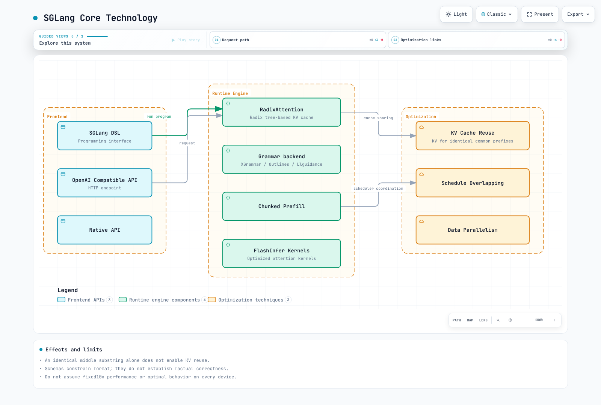

# Frameworks de inferencia para servir modelos LLM

> **Base de revisión**: Lanzamientos oficiales, API, charts y comprobaciones locales inspeccionados el 12 de septiembre de 2026; sin ejecución de modelos GPU/Neuron.
> **Última actualización**: 12 de octubre de 2026

Seleccione por separado los motores de inferencia, las capas de ejecución distribuida, los controladores de Kubernetes y las puertas de enlace de proveedores. «Compatible con OpenAI» no significa endpoints, campos, streaming, llamadas a herramientas ni autenticación idénticos.

## Panorama de frameworks de inferencia


[Ver diagrama interactivo](https://www.atomai.click/kubernetes-docs/archmaps/en-ai-ml-04-inference-frameworks-0.html)

| Componente | Base inspeccionada | Comprobaciones de selección |
| --- | --- | --- |
| NIM LLM/VLM | documentación 2.0.12; oferta 3.0 independiente | Modelo, perfil, hardware, acuerdo de soporte y backend |
| Dynamo | 1.4.2 | Servicio de inferencia agregado/desagregado, transferencia KV, planificador y controlador |
| AIBrix | 0.7.0 | Envoy Gateway, adaptador/controlador y escalado automático |
| SGLang | 0.5.19 | Modelo, backend de gramática, dispositivo y carga de trabajo medida |
| vLLM / Ray Serve | vLLM 0.29.0 / Ray 2.58.0 / KubeRay 1.7.0 | Combinaciones de imagen/modelo/controlador validadas individualmente |
| TGI | 3.3.7; modo de mantenimiento | Mantenimiento de sistemas existentes y planificación de migración |
| Ollama | 0.34.0 | Acceso a API local, almacenamiento y preparación de modelos |
| LiteLLM | 1.100.1 | Adaptación de proveedores, autenticación, mecanismo de respaldo e instrumentación de costes |
| Neuron | SDK 2.32.0; Helm 1.10.0 | Compatibilidad del plugin/compilador/controlador específica de la instancia |

vLLM 0.31.0 se lanzó el 5 de octubre de 2026, después de la base de validación local existente 0.29.0 de la tabla. Las versiones de la tabla identifican las combinaciones comprobadas; no afirman ser los lanzamientos más recientes ni un conjunto mutuamente compatible. Consulte la [actualización del capítulo de despliegue](02-vllm-deployment.md) para el cambio de 0.31.0 que limita de forma predeterminada los argumentos multimodales por solicitud.

Evite una matriz universal de funcionalidades de sí/no. La planificación de Dynamo y la desagregación de vLLM/SGLang, el soporte de CPU y GGUF dependen del lanzamiento, el backend y el hardware. La carga de adaptadores y los alias de modelos no autentican a los tenants ni establecen límites de acceso entre ellos.

## NVIDIA NIM

Compruebe conjuntamente el contenedor, el perfil de modelo, la compatibilidad de GPU y el acuerdo de soporte. NIM Operator 3.1.2 es independiente de los contenedores LLM/VLM 2.0.12. El lanzamiento 2.0.12 inspeccionado documenta vLLM 0.27.1; NIM no siempre usa TensorRT-LLM. No trate la oferta 3.0 basada en Dynamo como la misma ruta de despliegue que 2.0.


[Ver diagrama interactivo](https://www.atomai.click/kubernetes-docs/archmaps/en-ai-ml-04-inference-frameworks-1.html)

### Preparación del despliegue y perfiles

Use la [guía de GPU](01-ai-ml-workloads.md) para consultar los requisitos de AMI, controlador/toolkit y plugin de dispositivos. Habilitar siempre la instalación del controlador puede entrar en conflicto con la AMI del proveedor. Compruebe NodePool/EC2NodeClass de Karpenter, los recursos reales de CPU/RAM/GPU que se pueden programar y el recuento de dispositivos. Un Pod que solicita ocho GPU no cabe en un nodo con una o cuatro GPU, y las AMI personalizadas requieren una configuración explícita de bootstrap de EKS.

Use NIM_MODEL_PROFILE con un ID o nombre de perfil admitido que figure en la lista del contenedor. No suponga que NIM_MANIFEST_PROFILE, ya obsoleto, ni la cadena inventada vllm-bf16-tp8 sean válidos. Registre juntos el digest de la imagen, la revisión del modelo, el perfil, los controladores y la verificación realizada.

Las credenciales para descargar imágenes de NGC y modelos en tiempo de ejecución cumplen funciones distintas. El uso de NGC_API_KEY como variable de entorno, tal como está documentado, no satisface una política que exija credenciales solo en archivos. Use una ruta aprobada para modelos preparados o un adaptador de credenciales verificado; nunca incluya claves reales en argumentos de shell ni en el código fuente. Un Service interno por sí solo no autentica las solicitudes de inferencia.

Evite compartir un PVC de EBS con acceso RWO entre réplicas ubicadas en nodos distintos. Elija almacenamiento o cachés locales por réplica, o un sistema de archivos compartido apropiado. Pruebe los fallos de descarga, el rendimiento del almacenamiento, las sondas de inicio y las actualizaciones graduales. Los modelos no siempre están incluidos en las imágenes, y las cachés no se sincronizan automáticamente con FSx/S3.

### Métricas y GenAI-Perf

La documentación inspeccionada de NIM 2.0.12 expone `/v1/metrics` con las métricas nativas del backend de vLLM. Inspeccione los nombres, las unidades y las etiquetas reales; no copie nombres nim_* inventados ni `/metrics`. Un ConfigMap de Grafana necesita el origen de datos y el sidecar correspondientes, además de la recopilación de Prometheus. No muestre segundos sin convertirlos en un panel que espera milisegundos.

Defina SLO específicos de la carga de trabajo para TTFT, ITL, latencia de extremo a extremo, tasa de solicitudes completadas con éxito y tiempo en cola. Si los intervalos entre tokens son uniformes, la aproximación es `TTFT + (output tokens - 1) × ITL`, más la sobrecarga de red y posprocesamiento, que se mide por separado. Objetivos como 500 ms o una utilización de GPU del 80 % no son estándares universales de buen estado.

GenAI-Perf 0.0.16 usa el subcomando profile y las opciones synthetic-input-tokens-mean y output-tokens-mean. El siguiente comando consultaría un endpoint interno preparado; no se ejecutó en esta auditoría. Primero prepare perf_analyzer, el tokenizador y las demás dependencias de la distribución.

```bash
genai-perf profile   --endpoint-type chat   --service-kind openai   --url http://127.0.0.1:8000   --model approved-model-alias   --concurrency 2   --synthetic-input-tokens-mean 128   --output-tokens-mean 64   --num-prompts 20   --profile-export-file profile_export.json
```

No suponga que analyze solo procesa resultados JSON: los parámetros de barrido también pueden ejecutar perfiles adicionales. Conserve las solicitudes sin procesar, los fallos, el tokenizador, el calentamiento, la concurrencia y las revisiones del modelo/backend. Para medir la utilización de GPU se deben recopilar métricas reales.

## NVIDIA Dynamo

La ruta oficial de Kubernetes 1.4.2 usa la plataforma Dynamo, DynamoGraphDeployment (DGD) y DynamoGraphDeploymentRequest (DGDR). No está implementada por las antiguas imágenes inventadas dynamo-router/dynamo-worker, KV_CACHE_HOST ni YAML de router arbitrario. Una DGDR solicita perfilado y creación de DGD; no es una inspección de solo lectura.


[Ver diagrama interactivo](https://www.atomai.click/kubernetes-docs/archmaps/en-ai-ml-04-inference-frameworks-2.html)

### Estructura real de DGD

Esta **configuración validada con el esquema** adapta el ejemplo oficial agregado v1beta1 de la versión 1.4.2 para un modelo público y parámetros de ejecución acotados. Requiere la plataforma y el controlador, el espacio de nombres, una GPU, acceso al modelo y conectividad de red. Fije los digests del modelo y de la imagen, y verifique el hardware real antes del despliegue; en esta auditoría no se ejecutó ningún modelo.

```yaml
apiVersion: nvidia.com/v1beta1
kind: DynamoGraphDeployment
metadata:
  name: vllm-agg
  namespace: dynamo-system
spec:
  components:
  - name: Frontend
    podTemplate:
      spec:
        containers:
        - image: nvcr.io/nvidia/ai-dynamo/vllm-runtime:1.4.2
          name: main
          resources:
            requests:
              cpu: 250m
              memory: 512Mi
            limits:
              cpu: '1'
              memory: 2Gi
    replicas: 1
    type: frontend
  - name: VllmDecodeWorker
    podTemplate:
      spec:
        containers:
        - args:
          - --model
          - Qwen/Qwen3-0.6B
          - --max-model-len
          - '2048'
          - --max-num-seqs
          - '8'
          command:
          - python3
          - -m
          - dynamo.vllm
          image: nvcr.io/nvidia/ai-dynamo/vllm-runtime:1.4.2
          name: main
          resources:
            limits:
              nvidia.com/gpu: '1'
              cpu: '4'
              memory: 12Gi
            requests:
              ephemeral-storage: 2Gi
              cpu: '2'
              memory: 4Gi
          workingDir: /workspace/examples/backends/vllm
    replicas: 1
    type: worker
```

La desagregación requiere roles compatibles de prefill/decode, conectores y formatos KV, revisiones de modelo y conectividad de red. Las combinaciones arbitrarias de backends o GPU no son interoperables automáticamente. El enrutamiento consciente de KV equilibra la localidad y la carga; una fórmula fija de 0.7/0.3 no es una implementación universal. Redis no es el almacén obligatorio de tensores KV en todos los despliegues de Dynamo.

El operador de ámbito de clúster del chart de la plataforma inspeccionada administra los CRD mediante un contenedor de inicialización crd-apply. upgradeCRD=false selecciona la administración externa; no elimina el requisito de los CRD. Compruebe el planificador, el descubrimiento, NATS/etcd, Grove/KAI y los demás parámetros propios de la versión. Renderizar el chart no verifica que se hayan aplicado los CRD, ni la autorización ni el descubrimiento en un clúster activo.

## AIBrix

La versión 0.7.0 usa Envoy Gateway, un plugin de gateway, controller-manager y servicios de metadatos. KubeRay es opcional para las funciones basadas en Ray. El servidor independiente aibrix-registry y la API /v1/lora/register, usados anteriormente, no forman parte de la ruta de instalación 0.7.0 inspeccionada.

### ModelAdapter y PodAutoscaler

Los campos reales de ModelAdapter incluyen baseModel, podSelector y artifactURL. Si se omite replicas, el adaptador se carga en todos los Pods coincidentes; el valor 1 lo carga en un Pod; los demás valores se rechazan. Sustituya el bucket, la revisión de ejemplo y el modelo base por valores aprobados. Verifique por separado los permisos de descarga del controlador, la compatibilidad en tiempo de ejecución, la capacidad y el ciclo de vida del adaptador, y la autorización del tenant.

```yaml
apiVersion: model.aibrix.ai/v1alpha1
kind: ModelAdapter
metadata:
  name: support-lora
  namespace: ai-inference
spec:
  baseModel: approved-base-model
  podSelector:
    matchLabels:
      model.aibrix.ai/name: approved-base-model
  artifactURL: s3://REPLACE_WITH_APPROVED_BUCKET/adapters/support/REVISION/
  replicas: 1
```

PodAutoscaler 0.7.0 usa metricsSources y las estrategias HPA/KPA/APA, no un ConfigMap de autoescalador arbitrario. Este ejemplo basado en CPU requiere metrics-server, solicitudes de CPU en la carga de trabajo y el controlador. No valida el escalado basado en colas de GPU. Evite que varios escaladores controlen el mismo objetivo.

```yaml
apiVersion: autoscaling.aibrix.ai/v1alpha1
kind: PodAutoscaler
metadata:
  name: model-cpu
  namespace: ai-inference
spec:
  scaleTargetRef:
    apiVersion: apps/v1
    kind: Deployment
    name: prepared-model-server
  minReplicas: 1
  maxReplicas: 3
  scalingStrategy: HPA
  metricsSources:
  - metricSourceType: resource
    targetMetric: cpu
    targetValue: '70'
```

## Integración de Ray Serve

Use las API auditadas de [Ray Serve](ray/04-ray-serve.md) y [KubeRay](ray/02-kuberay-operator.md). La reconciliación de KubeRay, el autoescalado de los workers de Ray y el de las réplicas de Serve cumplen funciones distintas. No use RayCluster como destino de una política HPA de un Deployment normal, ni suponga los nombres o selectores de Service que se generan para los servicios de clúster y Serve.

El código y las dependencias deben llegar a los workers de ejecución, no solo al nodo principal (head). user_config no cambia automáticamente los argumentos del constructor; implemente la ruta de reconfigure adecuada. Una API compatible debe gestionar la plantilla de chat, el streaming, la cancelación, los motivos de finalización, los datos de uso y los errores reales. Concatenar cadenas de roles e ignorar stream=true no es suficiente. Se eliminaron los ejemplos antiguos de Ray 2.9/Operator 1.1 y el uso incondicional de trust_remote_code=True.

## SGLang

RadixAttention de la versión 0.5.19 reutiliza KV para prefijos comunes; las subcadenas intermedias solapadas arbitrariamente no son prefijos almacenados en caché que se puedan intercambiar. Deben coincidir el modelo, el formato KV y las políticas de acceso. Los backends de gramática actuales incluyen XGrammar, que es el predeterminado, y las alternativas Outlines/Llguidance. «Siempre es 10 veces más rápido gracias a una FSM comprimida» no es una conclusión general.



[Ver diagrama interactivo](https://www.atomai.click/kubernetes-docs/archmaps/en-ai-ml-04-inference-frameworks-3.html)

### Ejemplo de solicitud estructurada

Este cliente presupone un gateway aprobado que admite la forma de solicitud json_schema de SGLang. Comprueba la finalización normal y la forma de salida. La validación utiliza un fixture HTTP local con respuestas sintéticas y casos de fallo; no mide la precisión del modelo. La validez de JSON no establece la corrección factual ni la autorización de herramientas.

```python
from pathlib import Path
import json
from urllib.request import Request, urlopen

# Existing private gateway and a scoped credential mounted as a file.
base_url = "https://inference.example.internal/v1"
credential = Path("/run/secrets/inference/token").read_text().strip()
payload = {
    "model": "approved-model-alias",
    "messages": [{"role": "user", "content": "Return the city Seoul and country Korea."}],
    "temperature": 0,
    "max_tokens": 128,
    "response_format": {
        "type": "json_schema",
        "json_schema": {
            "name": "location",
            "schema": {
                "type": "object",
                "properties": {"city": {"type": "string"}, "country": {"type": "string"}},
                "required": ["city", "country"],
                "additionalProperties": False,
            },
        },
    },
}
request = Request(
    base_url + "/chat/completions",
    data=json.dumps(payload).encode(),
    headers={"Content-Type": "application/json", "Authorization": "Bearer " + credential},
    method="POST",
)
with urlopen(request, timeout=30) as response:
    result = json.load(response)
choice = result["choices"][0]
if choice["finish_reason"] != "stop":
    raise RuntimeError("Generation did not complete normally")
location = json.loads(choice["message"]["content"])
if set(location) != {"city", "country"} or not all(isinstance(v, str) for v in location.values()):
    raise ValueError("Unexpected output shape")
print(location)
```

Las API DSL function/system/user/assistant/gen de SGLang permanecen en este lanzamiento. Declarar una función no ejecuta la inferencia: conecte un RuntimeEndpoint/backend preparado y ejecútela. Verifique la compatibilidad de Torch, FlashInfer y hardware durante la instalación. Esta auditoría no instaló el SDK completo de GPU ni conectó el DSL a un modelo.

## Hugging Face TGI

El repositorio oficial declara que TGI está en **modo de mantenimiento**; la última versión inspeccionada es la 3.3.7 (19 de diciembre de 2025). Acepta correcciones menores, documentación y tareas de mantenimiento, y recomienda vLLM, SGLang y otros motores para proyectos nuevos. TGI ya no es una recomendación predeterminada general para un proyecto nuevo. Al migrar despliegues existentes, valide la compatibilidad del modelo, la plantilla, el streaming, las métricas y los SLO.

Añadir --quantize=awq no genera automáticamente pesos AWQ a partir de un modelo normal. Use un modelo compatible preparado en ese formato. Las etiquetas flotantes, la falta de credenciales para modelos con acceso restringido y los plazos de las sondas de liveness demasiado breves perjudican la reproducibilidad y el inicio correcto.

## Ollama

En la versión 0.34.0, descargar un modelo y ofrecerlo para inferencia son operaciones independientes. Un hook postStart con sleep 10 no garantiza que esté listo. Prepare de antemano los modelos aprobados o use un procedimiento de preparación independiente con comprobaciones de estado, reintentos acotados y gestión de fallos. Registre las etiquetas mutables de los modelos y los permisos de almacenamiento.

La API local de Ollama no autentica a los usuarios; aplique controles de autorización y de rutas antes de exponerla. No se puede acceder mediante el Service a un servidor enlazado solo a localhost dentro del Pod. OLLAMA_HOST cambia el ámbito de escucha, no la autenticación. Restrinja por separado los endpoints de administración de modelos y de inferencia.

Un Modelfile define el modelo base, el prompt del sistema y los ajustes de generación; no entrena un modelo ni crea una imagen de Kubernetes. Verifique el soporte de CPU/GPU por tamaño de modelo, dispositivo y backend en vez de asumir multitenencia a gran escala.

## LiteLLM

Use la configuración Router 1.100.1 auditada en la [guía de IA agéntica](03-agentic-ai-platform.md). Un gateway de proveedor es una capa distinta de un motor de inferencia. Llamar a un alias gpt-4-equivalent no demuestra que la calidad sea equivalente. El mecanismo de respaldo debe cumplir primero las políticas sobre proveedores permitidos y salida de datos.

Conecte el archivo de configuración real al comando del proxy y configure las credenciales del cliente, DB/Redis y los callbacks necesarios. Una clave ficticia o una ClusterIP no proporciona autenticación; drop_params=true puede eliminar condiciones importantes de la solicitud. Distinga entre solicitudes, éxitos, fallos, reintentos y costes de caché.

## AWS Neuron e Inferentia2

Distinga entre chips, NeuronCores y la RAM/HBM del host. Cada chip Inferentia2 tiene dos núcleos NeuronCore-v2 y 32 GiB de HBM.

| Instancia | Chips | NeuronCores-v2 | HBM de dispositivo (GiB) | RAM de host (GiB) | vCPU |
| --- | --- | --- | --- | --- | --- |
| inf2.xlarge | 1 | 2 | 32 | 16 | 4 |
| inf2.8xlarge | 1 | 2 | 32 | 128 | 32 |
| inf2.24xlarge | 6 | 12 | 192 | 384 | 96 |
| inf2.48xlarge | 12 | 24 | 384 | 768 | 192 |

### Asignación de dispositivos y rutas de plugin

aws.amazon.com/neuron asigna **dispositivos completos**; aws.amazon.com/neuroncore asigna **núcleos**. El ejemplo anterior para inf2.xlarge solicitaba neuron:2, ocho CPU y 24 Gi de RAM, pero el nodo solo tenía un dispositivo, cuatro vCPU y 16 Gi de RAM, por lo que no se podía programar. NEURON_RT_VISIBLE_CORES selecciona el ámbito del tiempo de ejecución, pero no crea dispositivos que no se hayan asignado. Compruebe la precedencia de NUM_CORES y la política de núcleos lógicos para la versión elegida.

El chart oficial de Helm 1.10.0 inspeccionado incluye opciones para device-plugin, scheduler y node-problem-detector. Antes de instalarlo, inspeccione los DaemonSets renderizados, hostPaths, RBAC y el comportamiento de recuperación. Este comando solo genera archivos de salida local.

```bash
helm template neuron-audit oci://public.ecr.aws/neuron/neuron-helm-chart   --version 1.10.0 --namespace kube-system --include-crds > neuron-rendered.yaml
```

El SDK 2.32.0 documenta dos rutas independientes: **el plugin NxD Inference 0.5.x con vLLM 0.16 para Inf2/Trn1/Trn2**, y la **nueva versión beta de vLLM Neuron 0.24.0.1.1.0 solo para Trn2/Trn3**. La guía detallada de NxD aún muestra 0.5.0/SDK 2.29, mientras que la descripción general muestra 0.5.3; verifique la etiqueta del plugin elegida, el DLC y las dependencias exactas. Instalar la versión beta más reciente en Inf2 o añadir pip install a un DLC 2.18 antiguo no valida la compatibilidad.

La compilación de Neuron requiere implementaciones de modelo compatibles, grupos de formas, tamaños de lote y longitudes de secuencia, TP, compilador/SDK, hardware y artefactos de caché. Llamar a torch_neuronx.trace en un modelo genérico de Transformers y pasar un diccionario tp_degree que no se usa no implementa un servicio distribuido de modelos causal-LM. Los archivos que genera el compilador y los directorios del tokenizador son artefactos distintos. En esta auditoría no se ejecutaron el compilador ni una instancia Neuron.

## Rendimiento, coste y operaciones

Se eliminaron la tabla de clasificación A100 sin fuentes y las afirmaciones de ahorro fijo del 40–70 %. Compare el mismo modelo, revisión y precisión, la distribución de tokens de entrada/salida, la concurrencia, la tasa de éxito, los SLO, el calentamiento y los precios fechados. Un millón de solicitudes al día durante 30 días equivale a 30 millones de solicitudes: un coste hipotético de 48 000 USD al mes equivale a 1,60 USD por cada 1 000 solicitudes. La cifra anterior de 0,80 era aritméticamente incorrecta; esta ilustración no representa los precios actuales de AWS.

Al cambiar de motor, ejecute pruebas de regresión con cargas útiles, plantillas, streaming, uso y comportamiento ante fallos reales. Distinga los grupos de modelos fragmentados de las réplicas independientes y compruebe si el inicio ordenado de StatefulSet bloquea a workers que se esperan mutuamente. StatefulSet por sí solo no configura TP/PP, rendezvous ni NCCL.

Compare las cachés locales, EBS, EFS y FSx usando tamaño de modelo, concurrencia de reinicio/descarga, autorización y coste. EFS no es universalmente más lento que FSx, y los límites históricos de gp3 no son garantías actuales. Consulte los [ejemplos de GPU/almacenamiento](01-ai-ml-workloads.md).

Antes de operar, pruebe en el entorno real la autenticación, TLS, las rutas de administración, las sondas, la colocación, las cuotas, la existencia de un único responsable del escalador, las unidades de las métricas, las revisiones de modelo fijadas, el ciclo de vida de la caché, la actualización y reversión, y la recuperación tras interrupciones.

## Alcance de la verificación

Las comprobaciones abarcaron los charts y CRD oficiales, el código fuente real de SDK/CLI, pruebas locales de solicitudes y fallos HTTP, Markdown e imágenes. No se ejecutaron modelos en GPU/Neuron ni se midieron el rendimiento o el coste; tampoco se desplegó en la nube ni se descargaron modelos. La validación del esquema o del chart no demuestra que funcionen la admisión, la autorización o la compatibilidad del modelo, ni que el sistema esté listo para producción.

## Referencias

- [Notas de lanzamiento de NIM 2.0](https://docs.nvidia.com/nim/large-language-models/2.0.12/about-nim-llm/release-notes.html)
- [Configuración de NIM](https://docs.nvidia.com/nim/large-language-models/2.0.12/reference/environment-variables.html)
- [Observabilidad de NIM](https://docs.nvidia.com/nim/large-language-models/2.0.12/reference/logging-and-observability.html)
- [Dynamo 1.4.2](https://github.com/ai-dynamo/dynamo/tree/v1.4.2)
- [AIBrix 0.7.0](https://github.com/aibrix/aibrix/tree/v0.7.0)
- [Salida estructurada de SGLang 0.5.19](https://github.com/sgl-project/sglang/blob/v0.5.19/docs/docs/advanced_features/structured_outputs.mdx)
- [Aviso de mantenimiento de TGI](https://github.com/huggingface/text-generation-inference)
- [Ollama 0.34.0](https://github.com/ollama/ollama/tree/v0.34.0)
- [GenAI-Perf 0.0.16](https://pypi.org/project/genai-perf/0.0.16/)
- [Rutas de inferencia de Neuron SDK 2.32.0](https://github.com/aws-neuron/aws-neuron-sdk/blob/v2.32.0/libraries/vllm-neuron/neuron-inference-overview.rst)
- [Arquitectura de Inf2](https://awsdocs-neuron.readthedocs-hosted.com/en/latest/about-neuron/arch/neuron-hardware/inf2-arch.html)
- [Componentes de Kubernetes de Neuron](https://github.com/aws-neuron/neuron-helm-charts)

## Cuestionario

[Cuestionario de frameworks de inferencia](../quizzes/ai-ml/04-inference-frameworks-quiz.md)
