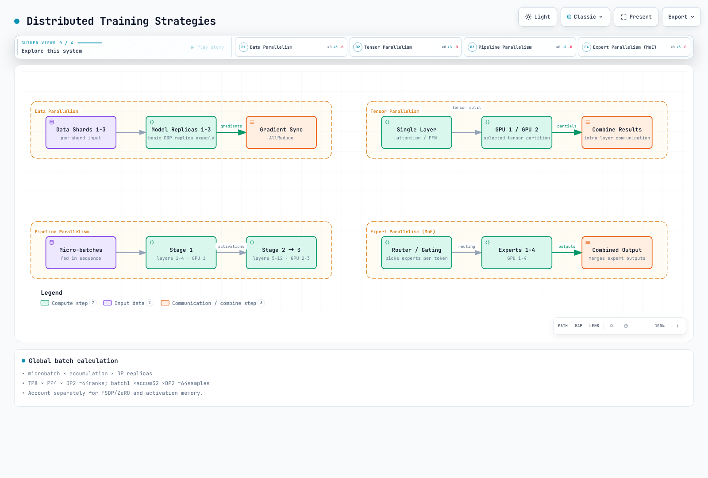
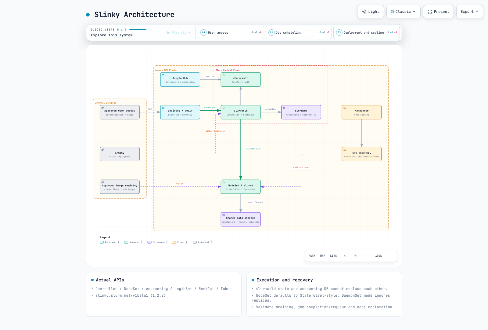

# Entrenamiento de modelos en EKS

> **Última actualización**: 16 de octubre de 2026
> **Versiones de referencia**: Slinky 1.2.3, MPI Operator 0.8.2, Volcano 1.15.2, PyTorch 2.14.0, Neuron SDK 2.32.0

El entrenamiento distribuido exige compatibilidad entre el código del modelo, la partición de datos, los lanzadores, la asignación de dispositivos, la comunicación y los checkpoints. Un manifiesto válido o un Pod en estado Running no demuestra que el entrenamiento o la recuperación funcionen.

Para comparar QLoRA con una sola GPU y SageMaker AI/EKS, consulta la [guía de Qwen](sagemaker-ai/README.md), que también explica el ciclo de soporte de las imágenes y las restricciones de ejecución.

## Flujo de entrenamiento


[Ver diagrama interactivo](https://www.atomai.click/kubernetes-docs/archmaps/en-ai-ml-05-model-training-0.html)

## Estrategias de entrenamiento distribuido



[Ver diagrama interactivo](https://www.atomai.click/kubernetes-docs/archmaps/en-ai-ml-05-model-training-1.html)

| Estrategia | Unidad particionada | Restricciones que se deben validar |
| --- | --- | --- |
| DDP | Diferentes lotes de datos; réplicas del modelo | Memoria del estado de entrenamiento/activaciones y sincronización de gradientes |
| FSDP / ZeRO | Parámetros, gradientes y estados del optimizador | Comunicación y formatos de checkpoint específicos de cada etapa |
| TP | Operaciones tensoriales dentro de las capas | Dimensiones de las cabezas y de las capas ocultas, backend y topología |
| PP | Etapas de capas | Microbatches, burbujas de pipeline y transferencia de activaciones |
| Paralelismo de expertos | Expertos MoE y distribución de tokens | Desequilibrio, all-to-all y capacidad de enrutamiento |
| Combinaciones | Grupos DP/TP/PP/contexto/expertos | Malla de dispositivos compatible y número total de procesos (ranks) |

No supongas que la estrategia 3D siempre sea la mejor para modelos de más de 100 B de parámetros. Ten en cuenta la memoria del optimizador, los gradientes, las activaciones y la comunicación, además de los pesos; después, compara el rendimiento y el costo de recuperación. El all-reduce de DDP no requiere un servidor de parámetros.

TP8×PP4×DP2 significa 64 ranks. El lote global es **microbatch × acumulación × réplicas DP**: 1×32×2=64, no 2048 por volver a multiplicar todos los ranks de TP/PP. Con empaquetado de longitud variable, lleva un seguimiento separado de las muestras y los tokens.

## Slurm y Slinky

El repositorio oficial es SlinkyProject/slurm-operator. Se verificaron la etiqueta 1.2.3 y sus charts OCI; las páginas de versiones y latest de GitHub devolvieron 404, por lo que no se presenta como la versión más reciente publicada en GitHub. La documentación de la versión 1.2 indica como requisitos mínimos Kubernetes 1.29 y Slurm 25.11 (data parser 0.0.44). La compatibilidad mínima no garantiza el ciclo de soporte operativo.



[Ver diagrama interactivo](https://www.atomai.click/kubernetes-docs/archmaps/en-ai-ml-05-model-training-2.html)

### API y ciclo de vida reales

La versión 1.2.3 define los recursos Controller, NodeSet, Accounting, LoginSet, RestApi y Token en `slinky.slurm.net/v1beta1`. Los ejemplos antiguos de SlurmCluster/SlurmNodeSet no corresponden a esta API. NodeSet usa controllerRef y una plantilla de Pod. Su modo de escalado predeterminado se comporta como StatefulSet; el modo DaemonSet crea un Pod por cada nodo de Kubernetes que coincida e ignora el campo replicas. Son modos del controlador de NodeSet; esto no demuestra que slurmd siempre se ejecute como un recurso DaemonSet de Kubernetes.

slurmctld administra el estado y la planificación de los trabajos, nodos y particiones; conserva su StateSaveLocation. slurmdbd gestiona el acceso a la base de datos de contabilidad y sus registros; no sustituye el estado del controlador. Diseña conjuntamente las identidades de acceso por login/REST/trabajo, los permisos del sistema de archivos, las claves/JWT de Slurm y la entrega y rotación de credenciales de la base de datos. Exponer SSH mediante un NLB público no es un requisito previo predeterminado.

Primero, renderiza los charts reales. Estos comandos solo generan archivos locales. Una implementación operativa requiere, por separado, ordenar correctamente cert-manager, los CRD, el operador y Slurm, además de configurar persistencia y base de datos, identidad de usuario e imágenes de Slurm compatibles.

```bash
helm template slurm-api oci://ghcr.io/slinkyproject/charts/slurm-operator-crds   --version 1.2.3 > slurm-crds.yaml
helm template slurm-control oci://ghcr.io/slinkyproject/charts/slurm-operator   --version 1.2.3 --namespace slinky > slurm-operator.yaml
helm template slurm-example oci://ghcr.io/slinkyproject/charts/slurm   --version 1.2.3 --namespace slurm   --set-json 'nodesets={"cpu-example":{}}'   --set partitions.all.enabled=true > slurm-example.yaml
```

Una aplicación de Argo CD debe apuntar a una ruta y revisión reales del chart y usar valores válidos. Los parámetros inventados compute.partitions/efa.enabled no lo configuran. Revisa la poda de recursos, la eliminación de CRD/PVC, el drenaje y reencolado de Slurm, y los tiempos de espera para terminar trabajos. La reducción de escala de NodeSet y la terminación de instancias EC2 son ciclos de control separados.

### Lanzamiento de torchrun desde Slurm

Ejecuta un launcher de torchrun por nodo y deja que cree un proceso por GPU. En la configuración anterior, cada una de las ocho tareas de Slurm iniciaba ocho procesos: 64 procesos por nodo. Este ejemplo está pensado para 4 nodos × 8 procesos; en esta auditoría no se ejecutó ninguna asignación real de Slurm/GPU.

```bash
#!/bin/bash
#SBATCH --job-name=distributed-training
#SBATCH --nodes=4
#SBATCH --ntasks-per-node=1
#SBATCH --gpus-per-node=8
#SBATCH --cpus-per-task=16
#SBATCH --time=01:00:00
set -euo pipefail

: "${SLURM_NNODES:?Run within an approved Slurm allocation}"
: "${SLURM_JOB_ID:?}"
: "${SLURM_JOB_NODELIST:?}"
export MASTER_ADDR
MASTER_ADDR=$(scontrol show hostnames "$SLURM_JOB_NODELIST" | head -n 1)
export MASTER_PORT=29500

# One torchrun launcher per Slurm node, eight training processes per launcher.
# train.py, dependencies, data, credentials and checkpoints must be prepared.
srun --ntasks="$SLURM_NNODES" --ntasks-per-node=1 bash -c '
  exec torchrun \
    --nnodes="$SLURM_NNODES" \
    --nproc-per-node=8 \
    --node-rank="$SLURM_PROCID" \
    --rdzv-id="$SLURM_JOB_ID" \
    --rdzv-backend=c10d \
    --rdzv-endpoint="$MASTER_ADDR:$MASTER_PORT" \
    /workspace/train.py
'
```

Si Slurm limita la visibilidad de las GPU por tarea, asegúrate de que cada launcher reciba las ocho GPU previstas. train.py debe implementar LOCAL_RANK/RANK/WORLD_SIZE, la vinculación de dispositivos, DDP/sampler, datos y modelos versionados, y la reanudación. La prueba con shell verificó cuatro launchers, ranks de nodo distintos y un endpoint de rendezvous común.

## Comunicación de GPU y EFA

FI_PROVIDER=efa selecciona un proveedor libfabric; no instala EFA, conecta interfaces ni integra NCCL. Valida conjuntamente las instancias compatibles con EFA, el controlador/libfabric, aws-ofi-nccl, el device plugin/la asignación del Pod, los grupos de seguridad y el transporte real. RAID0 o una etiqueta de subred no habilitan EFA.

Los nodos que se comunican deben estar en la misma AZ; se recomienda un grupo de ubicación de clúster para mejorar el rendimiento. Asegúrate de que los Pods de entrenamiento usen realmente el NodePool restringido. El ancho de banda y el número de dispositivos EFA varían según el tipo de instancia; 400 Gbps no es un valor universal. Forzar a ciegas configuraciones antiguas de Ring/Simple, IB_DISABLE, SOCKET_IFNAME o FI_EFA_USE_DEVICE_RDMA puede interferir con los plugins actuales. Verifica la documentación de la versión, los registros y las pruebas colectivas.

Karpenter budgets.nodes=0 restringe las rutas de interrupción voluntaria; no impide que AWS retire instancias Spot, los fallos de nodo, la terminación forzada ni la expiración en todos los casos. Comprueba la interacción entre do-not-disrupt/PDB y terminationGracePeriod/expireAfter, y conserva la capacidad de recuperación desde checkpoints. Evita descargar instaladores de controladores con versiones flotantes en cada bootstrap o fijar a ciegas las frecuencias de GPU en distintos tipos de dispositivo.

## BioNeMo

La versión inspeccionada 3.0.0 es **BioNeMo Recipes**, que proporciona modelos y checkpoints basados en TransformerEngine, además de recetas para PyTorch, Accelerate y Lightning. Comprueba la compatibilidad específica de cada receta con ESM-2, AMPLIFY, Geneformer y otros modelos. No ejecutes un módulo MegaMolBART de BioNeMo 1.5 como si perteneciera a la API 3.0. La evaluación biológica y los permisos de acceso a modelos y datos siguen siendo requisitos independientes; asignar una GPU no prepara por sí solo la receta.

## Trainium y Neuron

Distingue entre torch-neuronx del SDK 2.32.0, las implementaciones de NeuronX Distributed Training/modelos y las rutas de Optimum Neuron. La compatibilidad de transformers-neuronx para inferencia no implica compatibilidad general con el entrenamiento. Comprueba las versiones de TensorFlow/JAX/PyTorch con el hardware y el SDK seleccionados, en vez de añadir paquetes pip arbitrarios a un DLC antiguo 2.18.

Optimum Neuron 0.4.5 incluye NeuronTrainer/NeuronTrainingArguments e implementaciones de modelos de entrenamiento específicas para Neuron. Cargar un BertForPreTraining genérico y pasar variables dataset/tokenizer sin definir no constituye un entrenamiento TP completo. Prepara un modelo y una configuración compatibles, etiquetas/collator, tokenizer y revisiones, formatos de optimizador/checkpoint y launcher. El ejemplo de CPU con PyTorch 2.14 no afirma que exista compatibilidad con Neuron SDK.

### Jobs multinodo y precompilación

El valor parallelism=4 de un Job solo inicia cuatro Pods; no configura ranks ni rendezvous. Los Jobs indexados necesitan completionMode/index y un endpoint master compartido. Si estableces el MASTER_ADDR de cada Pod en su propio status.podIP, los workers apuntarán a distintos masters. Usa una topología de coordinador/controlador y launchers compatibles, y prepara train_lora.py, los datos, la caché de compilación y los dispositivos.

neuron_parallel_compile extrae/compila grafos; no sustituye el entrenamiento real. Ejecuta el entrenamiento por separado después y verifica los aciertos de caché, las formas y las revisiones del compilador/SDK. Consulta [Distinciones entre unidades de Neuron](04-inference-frameworks.md) para diferenciar cores de dispositivos.

## Ray Train, MPI y Volcano

Usa la [guía de Train](ray/03-ray-train-tune.md), auditada para Ray 2.58/KubeRay 1.7. Haz coincidir el número de llamadas a report entre los workers e informa los objetos Checkpoint reales. get_checkpoint() recupera el estado anterior para reanudar; no es un administrador de contexto para guardar un checkpoint nuevo. resources_per_worker con GPU=8 no inicia automáticamente ocho procesos DDP dentro de un worker.

MPI Operator 0.8.2 usa kubeflow.org/v2beta1. slotsPerWorker declara los slots del hostfile; no determina por sí solo mpirun -np, el mapeo ni la vinculación de GPU. Prepara el código de Launcher/Worker, la implementación de MPI/SSH, las imágenes compatibles y CRD/RBAC. Cuatro workers × ocho slots no garantizan por sí solos 32 procesos de GPU.

Volcano 1.15.2 minAvailable cuenta **Pods/miembros**, no nodos EC2. Tres nodos con recursos suficientes pueden alojar cuatro Pods. El plugin gang aplica condiciones de recursos y del número mínimo de miembros, pero no garantiza que los contenedores se inicien simultáneamente ni que el entrenamiento tenga éxito. Revisa los workers adicionales, la compatibilidad con elastic-runtime y el comportamiento de RestartJob/requeue.

Los perfiles de GPU de JupyterHub deben coincidir con las imágenes, etiquetas de dispositivos y reglas de autorización reales. g5.xlarge usa una GPU A10G, no una A100. Integra la configuración en el Hub en ejecución y configura almacenamiento por usuario, cuotas, redes y eliminación de sesiones inactivas.

## Almacenamiento de entrenamiento y checkpoints

Usa las rutas CSI auditadas en la [guía de GPU/almacenamiento](01-ai-ml-workloads.md). Montar un sistema de archivos FSx existente mediante un PV estático es distinto de crear uno nuevo mediante aprovisionamiento dinámico. No inventes campos FileSystem dataRepositoryAssociations ni combines SCRATCH_2 con configuraciones de rendimiento exclusivas para almacenamiento persistente. Verifica por separado las API de DRA/importación/exportación, las políticas y la finalización.

Una solicitud de capacidad para un PVC de EFS no constituye una cuota de almacenamiento físico. Valida el UID/GID del punto de acceso, los permisos del directorio, la identidad CSI, la red y los puntos de montaje. Un checkpoint local no es duradero en remoto hasta que se completa su transferencia a S3.

Para recuperarse hay que guardar el modelo, el optimizador, el scheduler, RNG, scaler cuando se use, el cursor de datos/sampler y todos los estados particionados. Evita que varios ranks sobrescriban el mismo archivo; usa el mecanismo de guardado distribuido del framework. Valida los manifiestos de finalización y los checksums, la transferencia remota y la restauración antes de eliminar checkpoints anteriores que sean válidos. Una imagen inventada de checkpoint-manager o un ConfigMap con auto_resume=true no implementa estas funciones.

### Ejemplo ejecutable mínimo de CPU

Este ejemplo sintético usa 16 muestras y un hilo de CPU, y realiza cuatro actualizaciones del optimizador. Muestra acumulación, un scheduler coseno acotado, el reemplazo mediante un archivo temporal y la restauración del optimizador/RNG. PyTorch 2.14.0+cpu produjo los mismos resultados tanto en el entrenamiento ininterrumpido como al reanudarlo después de dos pasos. Esto no prueba GPU, entrenamiento distribuido ni durabilidad remota.

```python
from pathlib import Path
import math
import os
import tempfile
import torch


def lr_factor(step, warmup_steps, total_steps, min_ratio=0.1):
    if not 0 <= warmup_steps < total_steps or not 0 <= min_ratio <= 1:
        raise ValueError("Invalid schedule bounds")
    if step < 0:
        raise ValueError("Step must be non-negative")
    if step < warmup_steps:
        return step / max(1, warmup_steps)
    progress = min(1.0, (step - warmup_steps) / (total_steps - warmup_steps))
    return min_ratio + (1 - min_ratio) * (1 + math.cos(math.pi * progress)) / 2


def save_checkpoint(path, state):
    path = Path(path)
    path.parent.mkdir(parents=True, exist_ok=True)
    temporary = None
    try:
        with tempfile.NamedTemporaryFile(dir=path.parent, delete=False) as output:
            temporary = output.name
            torch.save(state, output)
            output.flush()
            os.fsync(output.fileno())
        os.replace(temporary, path)
    finally:
        if temporary is not None and os.path.exists(temporary):
            os.unlink(temporary)


def train_toy(checkpoint_path, stop_after=4, resume=False):
    # Tiny deterministic CPU example; no GPU, dataset or model download.
    torch.set_num_threads(1)
    torch.manual_seed(17)
    model = torch.nn.Linear(2, 1)
    optimizer = torch.optim.SGD(model.parameters(), lr=0.05, momentum=0.9)
    scheduler = torch.optim.lr_scheduler.LambdaLR(
        optimizer, lambda step: lr_factor(step, 1, 4)
    )
    inputs = torch.arange(32, dtype=torch.float32).reshape(16, 2) / 32
    targets = inputs.sum(dim=1, keepdim=True)
    start = 0
    if resume:
        saved = torch.load(checkpoint_path, map_location="cpu", weights_only=True)
        model.load_state_dict(saved["model"])
        optimizer.load_state_dict(saved["optimizer"])
        scheduler.load_state_dict(saved["scheduler"])
        torch.set_rng_state(saved["torch_rng"])
        start = saved["optimizer_step"]
    if not start <= stop_after <= 4:
        raise ValueError("Invalid stopping point")
    for step in range(start, stop_after):
        optimizer.zero_grad(set_to_none=True)
        # Two equal-sized microbatches per optimizer update.
        for microbatch in range(2):
            offset = step * 4 + microbatch * 2
            prediction = model(inputs[offset:offset + 2])
            loss = torch.nn.functional.mse_loss(prediction, targets[offset:offset + 2]) / 2
            loss.backward()
        torch.nn.utils.clip_grad_norm_(model.parameters(), 1.0)
        optimizer.step()
        scheduler.step()
        save_checkpoint(checkpoint_path, {
            "model": model.state_dict(),
            "optimizer": optimizer.state_dict(),
            "scheduler": scheduler.state_dict(),
            "optimizer_step": step + 1,
            "torch_rng": torch.get_rng_state(),
        })
    return {name: value.detach().clone() for name, value in model.state_dict().items()}


if __name__ == "__main__":
    path = Path("toy-training.pt")
    train_toy(path, stop_after=2)
    train_toy(path, stop_after=4, resume=True)
    print("Completed four CPU optimizer updates, including checkpoint resume.")
```

El ejemplo demuestra el reemplazo de un archivo completado dentro de un mismo sistema de archivos; no demuestra durabilidad frente a fallos del sistema o de los metadatos del directorio, transacciones de S3 ni protocolos de checkpoint distribuido. Su orden fijo de datos tampoco implementa la recuperación general del sampler. Elige los intervalos y la retención de checkpoints según la latencia del guardado, la tasa de fallos, la cantidad de trabajo que se puede perder y el costo; no apliques una regla universal de 500 pasos o cinco copias.

## Precisión numérica y optimización de memoria

Las API actuales de PyTorch usan torch.amp.autocast y torch.amp.GradScaler. BF16 comparte con FP32 la cantidad de bits del exponente, no la precisión de la mantisa ni el valor máximo finito exacto. A menudo evita el escalado de pérdida propio de FP16, pero verifica el hardware, las operaciones y la convergencia. Autocast no convierte todos los pesos/estados del optimizador a BF16.

El checkpointing de activaciones vuelve a calcular las activaciones durante el paso backward, lo que intercambia cómputo por memoria. No equivale a guardar checkpoints en disco y no garantiza un ahorro de 3–4x ni una ralentización del 30 %. Especifica use_reentrant de forma explícita y valida los gradientes, dropout/RNG y las capas con estado.

La selección del backend de Flash Attention/SDPA depende del dtype, el tamaño de las cabezas, el dispositivo y las máscaras. Define el estado de entrenamiento y pasa dropout_p=0 durante la evaluación. Comprueba la compatibilidad de la API con combinaciones de máscaras explícitas/causales; use_cache=False por sí solo no instala un backend de atención.

DeepSpeed 0.19.6 ZeRO 1 particiona el estado del optimizador; ZeRO 2 añade los gradientes y ZeRO 3 añade los parámetros. El offload a CPU/NVMe se configura por separado; Stage 3 no lo habilita automáticamente. Distingue las integraciones de nivel superior que reemplazan los valores auto de la configuración pura de DeepSpeed. Los buffers, las activaciones y la capa de mayor tamaño impiden reducir la memoria sin límite.

Avanza los schedulers con las actualizaciones del optimizador, no con los microsteps de acumulación. Limita el progreso para que el coseno no vuelva a subir después del horizonte de entrenamiento y valida los límites de warmup/total-step como en el ejemplo.

## Alcance de la verificación

Se revisó toda la prosa de la guía y del cuestionario, así como los 76 bloques de código originales únicos. Las comprobaciones abarcan los charts Helm y CRD oficiales de Slinky, las API de MPI/Volcano y las fuentes del SDK, un ejemplo mínimo de entrenamiento/reanudación en CPU y una prueba del launcher de shell. No se ejecutaron GPU/Neuron/EFA, clústeres Slurm/MPI, modelos preentrenados reales ni recursos de la nube. La verificación local del código y el esquema no equivale a validar una implementación de producción.

## Referencias

- [Slinky 1.2.3](https://github.com/SlinkyProject/slurm-operator/tree/v1.2.3)
- [Controlador de Slurm](https://slurm.schedmd.com/slurmctld.html)
- [Demonio de contabilidad de Slurm](https://slurm.schedmd.com/slurmdbd.html)
- [MPI Operator 0.8.2](https://github.com/kubeflow/mpi-operator/tree/v0.8.2)
- [Complemento gang de Volcano 1.15.2](https://github.com/volcano-sh/volcano/blob/v1.15.2/pkg/scheduler/plugins/gang/gang.go)
- [Redes EFA de EKS](https://docs.aws.amazon.com/eks/latest/best-practices/aiml-networking.html)
- [Recetas BioNeMo 3.0.0](https://github.com/NVIDIA/bionemo-framework/tree/v3.0.0)
- [Optimum Neuron 0.4.5](https://github.com/huggingface/optimum-neuron/tree/v0.4.5)
- [Neuron SDK 2.32.0](https://github.com/aws-neuron/aws-neuron-sdk/tree/v2.32.0)
- [Launcher de PyTorch 2.14](https://github.com/pytorch/pytorch/blob/v2.14.0/torch/distributed/run.py)
- [Configuración ZeRO de DeepSpeed 0.19.6](https://github.com/deepspeedai/DeepSpeed/blob/v0.19.6/deepspeed/runtime/zero/config.py)

## Cuestionario

[Cuestionario sobre entrenamiento de modelos](../quizzes/ai-ml/05-model-training-quiz.md)
