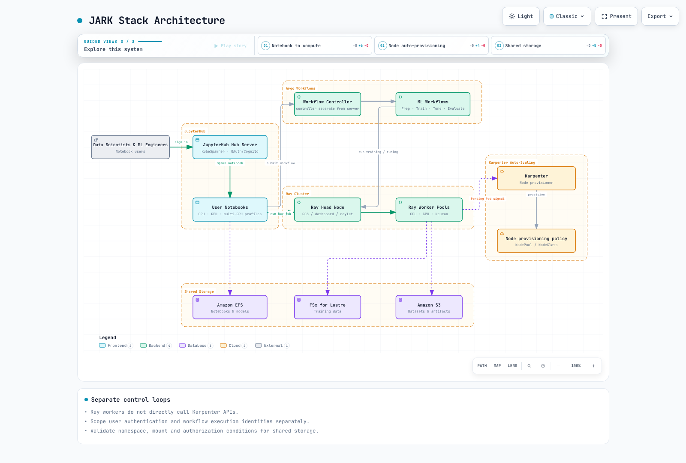
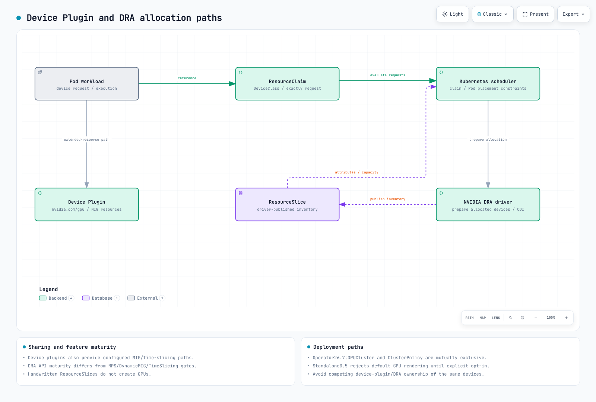

# Infraestructura de IA en EKS

> **Última actualización**: 16 de octubre de 2026
> **Versiones de referencia**: GPU Operator 26.7.2 / NVIDIA DRA 0.5.0 / Argo Workflows 4.1.3 / chart de JupyterHub 4.4.2 / Mountpoint CSI 2.8.0

La infraestructura de IA combina notebooks, pipelines, runtimes distribuidos, dispositivos y nodos, almacenamiento, redes y autorización. Una lista de herramientas o una instalación correcta con Helm no demuestra que la plataforma sea segura, esté disponible ni ejecute modelos.

## Capas y responsabilidades


[Ver el diagrama interactivo](https://www.atomai.click/kubernetes-docs/archmaps/en-ai-ml-06-ai-infrastructure-0.html)

Las cargas de trabajo administran el código de modelos, datos y ejecución; las plataformas, los workflows, runtimes y registros; y el cómputo, los dispositivos reales, Pods y capacidad de los nodos. Las identidades de IAM, redes y almacenamiento abarcan estas capas. Un NodePool con Spot no garantiza capacidad, recuperación ni ahorro.

## Stack JARK

JARK combina JupyterHub, Argo Workflows, Ray y Karpenter. Es un patrón de integración, no un producto cuyos componentes ya estén conectados entre sí. Conecta explícitamente la autorización de notebooks, el envío de workflows, los trabajos de Ray, la programación de Kubernetes y el aprovisionamiento de nodos.



[Ver el diagrama interactivo](https://www.atomai.click/kubernetes-docs/archmaps/en-ai-ml-06-ai-infrastructure-1.html)

### Autenticación y perfiles de notebooks de JupyterHub

El chart 4.4.2 declara appVersion 5.5.2, distinta de la versión más reciente de Hub inspeccionada en PyPI: 6.1.0 (2026-10-14). Las comprobaciones locales de la API usaron Hub 6.0.0, OAuthenticator 17.4.0 y KubeSpawner 7.1.0; verifica las combinaciones reales de paquetes dentro de la imagen del chart operativo.

Cognito es una opción de proveedor OIDC. Haz coincidir las URL de callback, los endpoints de token y userInfo, los scopes y un claim estable para el nombre de usuario, y configura una política de autorización explícita. MFA y la federación corporativa deben configurarse en el proveedor; GenericOAuthenticator no las habilita automáticamente.

Esta configuración de Hub presupone que ya existe un volumen Secret montado en /run/secrets/oidc. Mantén los secretos reales fuera de ConfigMaps, del código fuente y de las variables de entorno. Conecta este archivo Python a la ruta de configuración que usa Hub y sustituye los URI y valores de sub aprobados según tu entorno.

```python
from pathlib import Path

c.JupyterHub.authenticator_class = "oauthenticator.generic.GenericOAuthenticator"
c.GenericOAuthenticator.client_id = "prepared-client-id"
c.GenericOAuthenticator.client_secret = Path("/run/secrets/oidc/client-secret").read_text().strip()
c.GenericOAuthenticator.oauth_callback_url = "https://jupyter.example.com/hub/oauth_callback"
c.GenericOAuthenticator.authorize_url = "https://prepared-domain.auth.us-west-2.amazoncognito.com/oauth2/authorize"
c.GenericOAuthenticator.token_url = "https://prepared-domain.auth.us-west-2.amazoncognito.com/oauth2/token"
c.GenericOAuthenticator.userdata_url = "https://prepared-domain.auth.us-west-2.amazoncognito.com/oauth2/userInfo"
c.GenericOAuthenticator.scope = ["openid", "profile", "email"]
c.GenericOAuthenticator.username_claim = "sub"
c.GenericOAuthenticator.allow_all = False
c.GenericOAuthenticator.allow_existing_users = False
c.GenericOAuthenticator.allowed_users = {"replace-with-approved-cognito-sub"}
```

El ejemplo establece allow_all=False, una lista explícita de allowed_users y allow_existing_users=False. Las comprobaciones locales permitieron una identidad aprobada y rechazaron identidades no aprobadas y usuarios anteriores. No se ejecutó un inicio de sesión OAuth ni un intercambio de tokens real.

Distingue las reservas de CPU/RAM de los notebooks de sus límites, y haz que coincidan con las imágenes GPU, etiquetas, tolerations y drivers reales. No des por hecho que las antiguas etiquetas jupyter/*:gpu incluyen CUDA. Los PVC deben estar en el mismo namespace que el Pod que los consume; un Pod de jupyterhub no puede hacer referencia a un PVC de ml-platform solo por su nombre. Revisa los puntos de acceso por usuario, UID/GID, cuotas y permisos de escritura para los modelos compartidos. storage_capacity de EFS no limita la capacidad física.

### Flujo de datos de Argo Workflows

El workflow anterior hacía referencia a templates, artifacts y scripts inexistentes. Este **fixture pequeño de flujo de datos** tiene seis etapas. Pasa parámetros mediante variables de entorno y JSON, en vez de insertarlos en el código fuente de Python. Selecciona uno de dos coeficientes; no es un pipeline real para entrenar un clasificador de imágenes, un clúster de Ray o un registro externo.

El lint sin conexión de Argo 4.1.3 y los seis cuerpos de scripts Python se validaron localmente. Antes de operar, prepara prepared-workflow-runner con privilegios mínimos y configura por separado los digests de imágenes, las cuotas y el almacenamiento de artifacts.

```yaml
apiVersion: argoproj.io/v1alpha1
kind: Workflow
metadata:
  generateName: toy-dataflow-
  namespace: argo
spec:
  entrypoint: pipeline
  serviceAccountName: prepared-workflow-runner
  parallelism: 1
  activeDeadlineSeconds: 600
  arguments:
    parameters:
    - name: data
      value: '[[1,2],[2,4],[3,6],[4,8]]'
  templates:
  - name: pipeline
    dag:
      tasks:
      - name: validate
        template: validate
        arguments:
          parameters:
          - name: data
            value: '{{workflow.parameters.data}}'
      - name: prepare
        template: prepare
        arguments:
          parameters:
          - name: data
            value: '{{tasks.validate.outputs.result}}'
        dependencies:
        - validate
      - name: tune
        template: tune
        arguments:
          parameters:
          - name: data
            value: '{{tasks.prepare.outputs.result}}'
        dependencies:
        - prepare
      - name: train
        template: train
        arguments:
          parameters:
          - name: scale
            value: '{{tasks.tune.outputs.result}}'
        dependencies:
        - tune
      - name: evaluate
        template: evaluate
        arguments:
          parameters:
          - name: model
            value: '{{tasks.train.outputs.result}}'
          - name: data
            value: '{{tasks.prepare.outputs.result}}'
        dependencies:
        - train
      - name: register
        template: register
        arguments:
          parameters:
          - name: model
            value: '{{tasks.train.outputs.result}}'
        dependencies:
        - evaluate
        when: '{{tasks.evaluate.outputs.result}} == 0'
  - name: validate
    inputs:
      parameters:
      - name: data
    script:
      image: python:3.12.14-slim-trixie
      command:
      - python
      env:
      - name: DATA
        value: '{{inputs.parameters.data}}'
      resources:
        requests:
          cpu: 100m
          memory: 64Mi
        limits:
          cpu: 500m
          memory: 128Mi
      source: 'import json, os

        rows = json.loads(os.environ["DATA"])

        assert rows and all(len(row) == 2 for row in rows)

        assert all(isinstance(v, (int, float)) for row in rows for v in row)

        print(json.dumps(rows))

        '
  - name: prepare
    inputs:
      parameters:
      - name: data
    script:
      image: python:3.12.14-slim-trixie
      command:
      - python
      env:
      - name: DATA
        value: '{{inputs.parameters.data}}'
      resources:
        requests:
          cpu: 100m
          memory: 64Mi
        limits:
          cpu: 500m
          memory: 128Mi
      source: 'import json, os

        rows = json.loads(os.environ["DATA"])

        print(json.dumps({"train": rows[:2], "test": rows[2:]}))

        '
  - name: tune
    inputs:
      parameters:
      - name: data
    script:
      image: python:3.12.14-slim-trixie
      command:
      - python
      env:
      - name: DATA
        value: '{{inputs.parameters.data}}'
      resources:
        requests:
          cpu: 100m
          memory: 64Mi
        limits:
          cpu: 500m
          memory: 128Mi
      source: 'import json, os

        data = json.loads(os.environ["DATA"])

        candidates = [1.0, 2.0]

        loss = lambda scale: sum((scale*x-y)**2 for x,y in data["train"]) / len(data["train"])

        print(min(candidates, key=loss))

        '
  - name: train
    inputs:
      parameters:
      - name: scale
    script:
      image: python:3.12.14-slim-trixie
      command:
      - python
      env:
      - name: SCALE
        value: '{{inputs.parameters.scale}}'
      resources:
        requests:
          cpu: 100m
          memory: 64Mi
        limits:
          cpu: 500m
          memory: 128Mi
      source: 'import json, os

        print(json.dumps({"scale": float(os.environ["SCALE"]), "fixture": True}))

        '
  - name: evaluate
    inputs:
      parameters:
      - name: model
      - name: data
    script:
      image: python:3.12.14-slim-trixie
      command:
      - python
      env:
      - name: MODEL
        value: '{{inputs.parameters.model}}'
      - name: DATA
        value: '{{inputs.parameters.data}}'
      resources:
        requests:
          cpu: 100m
          memory: 64Mi
        limits:
          cpu: 500m
          memory: 128Mi
      source: 'import json, os

        model = json.loads(os.environ["MODEL"])

        held_out = json.loads(os.environ["DATA"])["test"]

        print(sum((model["scale"]*x-y)**2 for x,y in held_out) / len(held_out))

        '
  - name: register
    inputs:
      parameters:
      - name: model
    script:
      image: python:3.12.14-slim-trixie
      command:
      - python
      env:
      - name: MODEL
        value: '{{inputs.parameters.model}}'
      resources:
        requests:
          cpu: 100m
          memory: 64Mi
        limits:
          cpu: 500m
          memory: 128Mi
      source: 'import json, os

        model = json.loads(os.environ["MODEL"])

        print(json.dumps({"candidate": model, "note": "fixture output only; no registry write"}))

        '
```

El MSE0 del fixture se calcula a partir de cuatro muestras sintéticas; no mide la calidad de un modelo real. Los workflows de producción necesitan separar entrenamiento y pruebas, versionar datos y modelos, definir reglas de fallo, reintento e idempotencia, y transferir artifacts reales. artifactRepositoryRef no instala boto3 ni concede a la aplicación permisos para descargar archivos.

### Ray y Karpenter

Usa las rutas auditadas de Ray 2.58 y KubeRay 1.7 de la [guía de Ray](ray/README.md). GCS significa Global Control Service; la programación también interactúa con raylets. El head puede ejecutar trabajo si anuncia CPU. Evita combinaciones de Ray y Python no verificadas entre workers de CPU, GPU y Neuron; las imágenes de Neuron también necesitan Ray y frameworks compatibles.

El autoscaling de Ray expresa la demanda de Pods worker; el scheduler de Kubernetes coloca los Pods y Karpenter proporciona capacidad de nodo compatible. Los workers de Ray no invocan directamente las API de Karpenter. Haz coincidir las etiquetas de producto de memoria y GPU con los nodos reales; no asignes una etiqueta de 80 GB a las GPU A100 de 40 GB de p4d.

No dupliques drivers en AMI NVIDIA de AL2023 ni sobrescribas toda la configuración de containerd. Los límites de Karpenter no son topes absolutos de admisión ni de costo, y la consolidación no usa directamente un umbral de utilización de DCGM del 20 %. Inspecciona las solicitudes, la viabilidad de la programación, los precios y las restricciones de interrupción.

## API de DRA y límites de compatibilidad

DRA representa atributos, solicitudes y asignaciones de dispositivos mediante DeviceClass, ResourceSlice y ResourceClaim/Template. Los drivers publican slices; los componentes del scheduler y del driver asignan y preparan los claims. Los ResourceSlices escritos a mano no crean GPU reales. La madurez de la API de Kubernetes y la madurez de las funciones del driver NVIDIA son independientes.



[Ver el diagrama interactivo](https://www.atomai.click/kubernetes-docs/archmaps/en-ai-ml-06-ai-infrastructure-2.html)

### Ejemplo actual de claim

El esquema resource.k8s.io/v1 inspeccionado en Kubernetes 1.36.2 usa requests.exactly. Los requisitos previos del driver NVIDIA 0.5 distinguen la asignación de GPU (1.34.2 o posterior) de ComputeDomains (1.32 o posterior). Verifica las API y las versiones de plataforma y parche que EKS realmente sirve. La afirmación «todas las funciones de DRA están disponibles en 1.31 o posterior» es inexacta.

Este **ejemplo de esquema** define un claim de GPU y un Pod que ejecuta un comando de inventario. Prepara por separado el namespace ml-workloads, la DeviceClass gpu.nvidia.com, el driver y CDI, los nodos y los permisos. En esta auditoría no se ejecutó ninguna GPU.

```yaml
apiVersion: resource.k8s.io/v1
kind: ResourceClaimTemplate
metadata:
  namespace: ml-workloads
  name: single-gpu
spec:
  spec:
    devices:
      requests:
      - name: gpu
        exactly:
          deviceClassName: gpu.nvidia.com
          count: 1
---
apiVersion: v1
kind: Pod
metadata:
  name: gpu-inventory-demo
  namespace: ml-workloads
spec:
  restartPolicy: Never
  automountServiceAccountToken: false
  containers:
  - name: inspect
    image: ubuntu:24.04
    command:
    - nvidia-smi
    - -L
    resources:
      claims:
      - name: gpu
      requests:
        cpu: 100m
        memory: 64Mi
      limits:
        cpu: 500m
        memory: 128Mi
  resourceClaims:
  - name: gpu
    resourceClaimTemplateName: single-gpu
  tolerations:
  - key: nvidia.com/gpu
    operator: Exists
    effect: NoSchedule
```

CEL debe usar los atributos tipados y la estructura de dominio que realmente se hayan publicado. La expresión anterior device.topology.node==device.topology.node no describe la colocación en el mismo nodo ni coincide con la API. matchAttribute requiere un atributo cualificado real. Un claim de GPU normal para un solo Pod no asigna automáticamente 72 GPU en un rack NVL72.

### NVIDIA 0.5 y GPU Operator 26.7

El README de la versión 0.5 aún describe la asignación de GPU como experimental y deshabilitada de forma predeterminada, en contradicción con la documentación de instalación, del chart y de Operator 26.7. El chart independiente establece resources.gpus.enabled=true de forma predeterminada, pero **rechaza el renderizado** si no se habilita explícitamente, para evitar conflictos con device-plugin. No describas la instalación predeterminada como si deshabilitara GPU en silencio y terminara correctamente.

La ruta administrada de Operator 26.7 usa el singleton GPUCluster llamado gpu-cluster, que no puede coexistir con ClusterPolicy. En la ruta que usa el driver preinstalado se establecen clusterPolicy.deployCR=false, gpuCluster.deployCR=true y driver.enabled=false. GPUCluster no sustituye toda la preparación de driver y toolkit; debes proporcionar por separado los requisitos previos de driver y CDI. No instales además una versión independiente de DRA. El renderizado local simuló una API DeviceClass servida; no habilitó una función real del clúster.

Distingue la compatibilidad con GPU completas, MIG existente y ComputeDomain de las funciones alfa DynamicMIG, MPS y TimeSlicingSettings. El código de feature gates de 0.5 inspeccionado declara esas tres funciones como false/Alpha. Algunas etiquetas GA de la documentación también difieren de las etiquetas Beta del código fuente; consulta y documenta juntas la matriz de compatibilidad, el código y la configuración de la versión exacta. GPU Operator 25.3 por sí solo no demuestra que todo sea compatible.

Los device plugins también admiten MIG existente, time-slicing y MPS experimental; el uso compartido de GPU no es exclusivo de DRA. 3g.20gb identifica un perfil de instancia, no tres instancias de 20 GB. La asignación MIG o exclusiva no aísla automáticamente el host, el driver, los privilegios ni todos los canales laterales; MPS y time-slicing no son límites de seguridad.

### NVLink multinodo y ComputeDomains

GB200 es Grace Blackwell, no Grace Hopper. ComputeDomains coordinan recursos MNNVL e IMEX entre Pods y nodos. Distingue los racks, las instancias EC2, los nodos de Kubernetes y los Pods, y verifica la compatibilidad real de cliques, fabric, dispositivos y drivers. Los campos inventados nvswitchEnabled/graceHopperMode y las puertas de programación no configuran la topología. Si ningún controlador retira una puerta de programación, el Pod seguirá esperando.

## Plataformas de agentes y MCP

Usa las API actuales de Kagent, LangGraph, Langfuse y Milvus de la [guía de IA agéntica](03-agentic-ai-platform.md). GitLab es una plataforma opcional de código fuente y CI; los runners privilegiados y el ingreso público no son requisitos básicos. Separa la identidad de los trabajos, las redes, los secretos y los permisos para crear imágenes, y verifica que el proveedor entregue las credenciales.

MCP define operaciones de protocolo, como enumerar y llamar herramientas; no es un controlador estándar de autodetección de Kubernetes ni una distribución de gateway. Se eliminaron la imagen anterior ghcr.io/anthropics/mcp-gateway:latest y la etiqueta/configuración mcp.anthropic.com/tool, porque eran implementaciones no verificadas. Elige una versión real del servidor o gateway y valida el transporte, la autenticación, la autorización, los tiempos de espera y los esquemas de entrada de las herramientas. Una variable de entorno URL no implementa esas operaciones.

Solicitar recursos GPU para Milvus no habilita la indexación en GPU. Haz coincidir las dimensiones de embedding y las revisiones de modelos, los parámetros del índice, el ciclo de vida de eliminación y actualización, y los filtros por tenant. No uses un Deployment de Langfuse 2.x como instalación actual de la plataforma 4.x; comprueba las dependencias del backend, las credenciales para archivos, las API de instrumentación y la retención de datos sensibles.

## Almacenamiento y redes

Verifica IAM, UID y GID del punto de acceso de EFS, los permisos del directorio y que el PVC se consuma desde el mismo namespace. La opción de montaje IAM no configura por sí sola las credenciales del controlador ni la identidad de montaje.

Usa parámetros CSI de FSx y unidades de capacidad compatibles. No copies los valores inventados s3ImportPath/s3ExportPath para PERSISTENT_2 ni una capacidad inválida de 10Ti. Distingue los sistemas de archivos existentes o estáticos de los aprovisionados recientemente, DRA y la compatibilidad de copias de seguridad en la [guía de almacenamiento](01-ai-ml-workloads.md).

Mountpoint CSI 2.8.0 admite **PV estáticos** para buckets de S3 existentes. Se eliminó el ejemplo de bucket dinámico que solo usaba StorageClass/PVC. Mountpoint no ofrece semántica POSIX completa; comprueba el comportamiento de rename, escritura aleatoria, bloqueo y checkpoints. La tabla de compatibilidad de la versión 2.8 elimina AL2 y Ubuntu 22.04, y recomienda instalar mediante complementos de EKS o charts oficiales en vez de ramas del repositorio.

No multipliques el número de interfaces por un ancho de banda de instancia que ya sea agregado. Las cifras anteriores «4×400 Gbps» para p4d y «16×1600 Gbps» para trn1n eran incorrectas. Consulta la [guía de redes para entrenamiento](05-model-training.md) sobre colocación en la misma AZ, interfaces reales, driver/libfabric/NCCL, asignación de dispositivo y Pod, y grupos de seguridad. Las etiquetas RAID0 y efa-enabled no habilitan EFA.

Las subredes son solo una parte del aislamiento. Configura el ingreso y egreso de las cargas de trabajo y los requisitos de autorreferencia de EFA mediante recursos SG/IAM reales. Un YAML con apariencia de Terraform guardado en un ConfigMap no aplica reglas de red. Evita habilitar acceso desde un CIDR que abarque toda la VPC por defecto.

## Observabilidad y alertas de GPU

DCGM Exporter 4.6.0–4.8.3 define XID_ERRORS como un **gauge del último código de error**. increase(XID_ERRORS) no cuenta errores y puede interpretar un cambio de código de 31 a 13 como un reinicio. Observa el código actual o habilita por separado el contador XID_ERRORS_TOTAL. No todos los XID indican un fallo de hardware.

FB_USED/FB_FREE son gauges en MiB; la proporción siguiente va de 0 a 1. Un valor alto de VRAM reservada no significa necesariamente que haya ocurrido un OOM: revisa conjuntamente los fallos de asignación, el comportamiento de la carga de trabajo, la caché del modelo y la memoria disponible. Los umbrales fijos de 85 °C y 20 % no son estándares universales de fallo o recuperación de recursos. Comprueba los tipos y unidades reales de las métricas antes de aplicar rate() a gauges de caudal de PCIe o ancho de banda de NVLink.

Estas reglas presuponen un clúster por Prometheus. Para combinar clústeres, incluye sus etiquetas en las agregaciones y uniones. Inspecciona las etiquetas reales de nodo, UUID y MIG, así como la normalización de etiquetas de recursos de kube-state-metrics.

```yaml
groups:
- name: gpu-observations
  rules:
  - record: gpu:framebuffer_used_ratio
    expr: DCGM_FI_DEV_FB_USED / (DCGM_FI_DEV_FB_USED + DCGM_FI_DEV_FB_FREE)
  - alert: GPUReportedXIDCode
    expr: DCGM_FI_DEV_XID_ERRORS > 0
    for: 1m
    labels:
      severity: warning
    annotations:
      summary: "Inspect the reported XID code and workload context"
  - record: namespace:pending_gpu_requesting_pods:count
    expr: |
      count by (namespace) (
        max by (namespace, pod) (kube_pod_status_phase{phase="Pending"} == 1)
        and on (namespace, pod)
        max by (namespace, pod) (kube_pod_container_resource_requests{resource="nvidia_com_gpu"} > 0)
      )
```

La regla de pendientes cuenta los Pods en espera que solicitan GPU; no demuestra que la espera se deba a una falta de GPU. Varios contenedores que solicitan GPU se cuentan una sola vez por Pod. Inspecciona los eventos, PVC, afinidad, taints, cuotas, claims y descargas de imágenes. No supongas que todas las alertas incluyen una etiqueta de nodo.

Configura la selección real de reglas de Prometheus y el scraping del Service y puerto correctos para DCGM, Ray y Karpenter. El aprovisionamiento de dashboards mediante archivos de Grafana es distinto de un wrapper HTTP; una etiqueta por sí sola no conecta los datasources. La salida del monitor de Neuron y los endpoints del exporter requieren preparativos aparte.

## Alcance de la verificación

Se revisó todo el texto original de la guía y del cuestionario, así como 58 bloques de código únicos. Las comprobaciones cubren esquemas de DRA y Pods, Helm oficial, políticas de autorización de OAuthenticator, el lint sin conexión y los cuerpos de scripts de Argo, y fixtures de Prometheus. No se ejecutaron OAuth, operaciones de clúster, asignaciones reales de GPU/DRA, modelos, montajes de S3 ni servidores MCP; tampoco se crearon recursos en la nube ni se hicieron llamadas de pago.

## Referencias

- [Instalación de DRA de GPU Operator 26.7](https://docs.nvidia.com/datacenter/cloud-native/gpu-operator/26.7/dra-intro-install.html)
- [Código fuente de NVIDIA DRA 0.5](https://github.com/kubernetes-sigs/dra-driver-nvidia-gpu/tree/v0.5.0)
- [Requisitos previos de DRA 0.5](https://github.com/kubernetes-sigs/dra-driver-nvidia-gpu/blob/v0.5.0/site/content/docs/prerequisites.md)
- [Feature gates de DRA 0.5](https://github.com/kubernetes-sigs/dra-driver-nvidia-gpu/blob/v0.5.0/pkg/featuregates/featuregates.go)
- [OAuthenticator 17.4](https://github.com/jupyterhub/oauthenticator/tree/17.4.0)
- [Chart de JupyterHub 4.4.2](https://github.com/jupyterhub/zero-to-jupyterhub-k8s/releases/tag/4.4.2)
- [Argo Workflows 4.1.3](https://github.com/argoproj/argo-workflows/tree/v4.1.3)
- [Mountpoint CSI 2.8.0](https://github.com/awslabs/mountpoint-s3-csi-driver/tree/v2.8.0)
- [Definiciones de contadores de DCGM Exporter](https://github.com/NVIDIA/dcgm-exporter/blob/4.6.0-4.8.3/etc/default-counters.csv)
- [Especificación de herramientas MCP](https://modelcontextprotocol.io/specification/2025-11-25/server/tools)

## Cuestionario

[Cuestionario sobre infraestructura de IA](../quizzes/ai-ml/06-ai-infrastructure-quiz.md)
