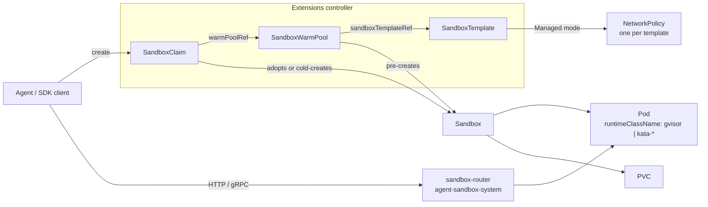

# Sandbox de agentes en EKS: entornos de ejecución aislados y con estado para agentes de IA

> **Versiones compatibles**: Agent Sandbox v1.0.6 (API `v1beta1`), SDK de Python `k8s-agent-sandbox` 1.0.6, Karpenter v1.13.0+ para `cpuOptions.nestedVirtualization`
> **Última actualización**: October 16, 2026

[Agent Sandbox](https://github.com/kubernetes-sigs/agent-sandbox) (`kubernetes-sigs/agent-sandbox`) es un subproyecto de Kubernetes SIG Apps que agrega un recurso personalizado `Sandbox` y un controlador para **cargas de trabajo aisladas, con estado y de instancia única**. Un Sandbox es un único Pod con una identidad estable, almacenamiento persistente opcional y controles de ciclo de vida (expiración, suspensión y reanudación) que Deployments y StatefulSets no modelan directamente. Los consumidores habituales son agentes de IA que ejecutan código generado por LLM, ejecuciones de aprendizaje por refuerzo (RL), notebooks y entornos de desarrollo por usuario.

Este capítulo explica la API tal como existe en la etiqueta `v1.0.6` y qué cambia al ejecutarla en Amazon EKS: opciones de aislamiento del entorno de ejecución, el comportamiento de NetworkPolicy predeterminada con Amazon VPC CNI, la exposición privada del router y IAM.

> Los datos de este capítulo provienen del código fuente upstream en la etiqueta `v1.0.6` (tipos de CRD, controladores, notas de la versión y modelo de amenazas), la documentación de AWS y el código fuente de Karpenter. Los manifiestos no se ejecutaron en un clúster de EKS para este capítulo; considérelos puntos de partida y pruébelos con su propia configuración de nodos y red.

---

## 1. Por qué una nueva API de cargas de trabajo

| Necesidad | Deployment | StatefulSet (replicas: 1) + Service + PVC | Sandbox |
|------|------------|------------------------------------------|---------|
| Exactamente un Pod con un nombre estable | No (sufijo aleatorio) | Sí (`name-0`) | Sí (el nombre del Pod = nombre del Sandbox) |
| Almacenamiento por instancia que sobrevive a los reinicios del Pod | No | Sí | Sí (`volumeClaimTemplates`) |
| Detener el cómputo, pero conservar el objeto y los volúmenes | Escalar a 0 (todas las réplicas) | Escalar a 0 | `operatingMode: Suspended` |
| Hora de expiración absoluta | No | No | `shutdownTime` + `shutdownPolicy` |
| Instancias precalentadas que se asignan bajo demanda | No | No | `SandboxWarmPool` + `SandboxClaim` |
| Valores predeterminados seguros para código no confiable | No | No | `SandboxTemplate` (sin token de SA, NetworkPolicy administrada) |

Una plataforma de agentes suele necesitar miles de estos entornos de corta duración o inactivos la mayor parte del tiempo, cada uno propiedad de una sesión o un usuario. Modelar cada uno como un StatefulSet de tamaño 1 más un Service y un PVC funciona, pero deja la expiración, los grupos de instancias precalentadas, la latencia de las solicitudes y los valores predeterminados de aislamiento a cargo de código personalizado.

### Estado del proyecto (October 16, 2026)

| Elemento | Valor |
|------|-------|
| Creación del repositorio | August 12, 2025 |
| v1.0.0 | August 28, 2026: se eliminaron `v1alpha1` y el webhook de conversión; todos los CRD solo sirven `v1beta1` |
| Última versión | v1.0.7 (October 15, 2026); desde v1.0.0 se han publicado versiones de parche cada semana. Este capítulo se basa en v1.0.6 |
| Grupos de API | `agents.x-k8s.io/v1beta1` (núcleo), `extensions.agents.x-k8s.io/v1beta1` (extensiones) |
| Namespace del controlador | `agent-sandbox-system` |
| SDK | Python (`k8s-agent-sandbox`, Python ≥ 3.11), Go (`sigs.k8s.io/agent-sandbox/clients/go/sandbox`), TypeScript |
| Aislamiento | Delegado al `RuntimeClass` del Pod (por ejemplo, gVisor o Kata Containers) |

La versión del proyecto es 1.0, pero la versión de su API sigue siendo `v1beta1`. Fije las versiones y lea la sección «Breaking Changes / Action Required» de cada versión; varias versiones de parche (v1.0.2, v1.0.5, v1.0.6 y v1.0.7) incluyen acciones necesarias.

---

## 2. Arquitectura



| Tipo | Grupo | Nombre corto | Función |
|------|-------|-----------|------|
| `Sandbox` | `agents.x-k8s.io` | `sandbox` | Un Pod con identidad estable, PVC opcionales y un Service headless, ciclo de vida y suspensión |
| `SandboxTemplate` | `extensions.agents.x-k8s.io` | `sandboxtemplate` | Plano reutilizable más políticas de la plataforma (NetworkPolicy y reglas de inyección de variables de entorno y volúmenes) |
| `SandboxWarmPool` | `extensions.agents.x-k8s.io` | `swp` | Mantiene N Sandboxes sin reclamar, listos a partir de una plantilla; incluye un subrecurso de escalado para HPA |
| `SandboxClaim` | `extensions.agents.x-k8s.io` | `sandboxclaim` | Solicitud de un Sandbox de un grupo de instancias precalentadas; pasa a ser propietario del Sandbox tras adoptarlo |

Componentes auxiliares:

- **sandbox-router** (opcional): proxy inverso HTTP en Go (`registry.k8s.io/agent-sandbox/sandbox-router-go`) que enruta mediante encabezados `X-Sandbox-ID` o, con `--path-routing-prefix`, mediante la ruta URL. Desde v1.0.2, sus manifiestos se encuentran en `agent-sandbox-system` y admite tokens limitados por ámbito Ed25519 (v2), vinculados al UID del Sandbox, el puerto, el método y la ruta.
- **sandboxd**: daemon de ejecución dentro del Sandbox (sistema de archivos REST en `:8080`, `ProcessService` gRPC en `:9090`) que los SDK pueden usar para ejecutar comandos, administrar archivos y gestionar procesos interactivos.

---

## 3. El recurso principal `Sandbox`

```yaml
apiVersion: agents.x-k8s.io/v1beta1
kind: Sandbox
metadata:
  name: py-session-42           # also the Pod name; ≤ 63 chars when spec.service is true
  namespace: agents
spec:
  podTemplate:
    metadata:
      labels:
        team.example.com/owner: data-science
    spec:
      runtimeClassName: gvisor   # isolation comes from the runtime, not from Agent Sandbox
      automountServiceAccountToken: false
      containers:
      - name: runtime
        image: <your-registry>/python-runtime:<tag>
        ports:
        - containerPort: 8888
        resources:
          requests: { cpu: 250m, memory: 512Mi }
          limits:   { cpu: "1",  memory: 1Gi }
  volumeClaimTemplates:          # immutable after creation
  - metadata:
      name: workspace
    spec:
      accessModes: [ReadWriteOnce]
      storageClassName: gp3
      resources:
        requests:
          storage: 5Gi
  service: true                  # create a headless Service named after the Sandbox
  operatingMode: Running         # or Suspended
  shutdownTime: "2026-10-14T00:00:00Z"
  shutdownPolicy: Delete         # default Retain
```

Comportamiento de los campos en `v1beta1`:

| Campo | Comportamiento |
|-------|----------|
| `podTemplate` | Obligatorio. Las etiquetas y anotaciones se propagan al Pod, excepto las claves reservadas del sistema bajo `agents.x-k8s.io/` y `extensions.agents.x-k8s.io/`, que el controlador filtra. |
| `volumeClaimTemplates` | Se crean PVC por cada Sandbox. Son inmutables (regla CEL). |
| `service` | Sin establecer: no se crea ningún Service nuevo (los existentes se conservan por compatibilidad con versiones anteriores). `true`: Service headless con el nombre del Sandbox. `false`: se elimina el Service. |
| `operatingMode` | `Running` (valor predeterminado) mantiene un Pod; `Suspended` elimina el Pod, pero conserva el objeto Sandbox y sus PVC. |
| `shutdownTime` | Hora de expiración absoluta. En ese momento se eliminan el Pod y el Service. |
| `shutdownPolicy` | `Retain` (valor predeterminado) conserva el objeto Sandbox con `Ready=False, reason=SandboxExpired`; `Delete` lo elimina. |

Las condiciones de estado siguen las convenciones de Gateway API:

| Condición | Significado |
|-----------|---------|
| `Ready` | Solo es True cuando el Pod está Running y Ready, y tiene una IP (y el Service existe, si se requiere). Los motivos de False incluyen `DependenciesNotReady`, `SandboxSuspended`, `SandboxExpired`, `InvalidConfiguration` y `ReconcilerError`. |
| `Suspended` | Progreso de una suspensión: primero `PodTerminating`, luego `PodTerminated`; `NotSuspended` cuando vuelve a estar en ejecución. |
| `PodScheduled` | Refleja la condición `PodScheduled` del Pod (por ejemplo, `Unschedulable`), por lo que no es necesario consultar el Pod. |
| `Finished` | Se establece cuando el Pod alcanza el estado `Succeeded` o `Failed`. |

`status` también contiene `serviceFQDN`, `podIPs` y `nodeName`.

> **Acción necesaria en v1.0.6**: ahora una regla CEL rechaza los Sandbox cuyo nombre supera los 63 caracteres cuando `spec.service` es `true` (el nombre de un Service es una etiqueta DNS-1035). Los objetos existentes no están exentos, por lo que un Sandbox de ese tipo falla en cada actualización, incluidas las actualizaciones de estado, hasta que se desactive `spec.service` o se vuelva a crear con un nombre más corto.

---

## 4. Extensiones: plantilla, grupo de instancias precalentadas y solicitud

### SandboxTemplate: dónde se definen las políticas de la plataforma

```yaml
apiVersion: extensions.agents.x-k8s.io/v1beta1
kind: SandboxTemplate
metadata:
  name: python-gvisor
  namespace: agents
spec:
  podTemplate:
    metadata:
      annotations:
        karpenter.sh/do-not-disrupt: "true"   # optional: keep consolidation away from live sessions
    spec:
      runtimeClassName: gvisor
      containers:
      - name: python-runtime
        image: <your-registry>/python-runtime-sandbox:<tag>
        ports:
        - containerPort: 8888
        readinessProbe:
          httpGet: { path: "/", port: 8888 }
          periodSeconds: 1
        resources:
          requests: { cpu: 250m, memory: 512Mi, ephemeral-storage: 512Mi }
          limits:   { cpu: "1",  memory: 1Gi }
  networkPolicyManagement: Managed      # default
  # networkPolicy: omitted -> controller applies its secure default (section 6)
  envVarsInjectionPolicy: Disallowed    # default; Allowed | Overrides
  volumeClaimTemplatesPolicy: Disallowed  # default; Allowed | Overrides
```

Valores predeterminados seguros que se aplican a los Sandbox creados mediante una plantilla (a través de un grupo de instancias precalentadas o una solicitud):

- Si el PodSpec no establece `automountServiceAccountToken`, el controlador lo establece en `false`.
- Con `networkPolicyManagement: Managed` (el valor predeterminado), el controlador crea **una NetworkPolicy compartida por plantilla**. Editar sus reglas cambia la aplicación de políticas para todos los Sandbox existentes y futuros de esa plantilla.
- Las solicitudes no pueden inyectar variables de entorno ni plantillas de volúmenes, a menos que la plantilla lo permita.

Un `Sandbox` independiente no recibe ninguno de estos valores predeterminados. Use controles de admisión (ValidatingAdmissionPolicy, Kyverno o Gatekeeper) si los usuarios pueden crear objetos `Sandbox` directamente, o concédales permisos RBAC solo para `SandboxClaim`.

### SandboxWarmPool: capacidad precargada

```yaml
apiVersion: extensions.agents.x-k8s.io/v1beta1
kind: SandboxWarmPool
metadata:
  name: python-gvisor-pool
  namespace: agents
spec:
  replicas: 10                 # default 1; scale subresource, so an HPA can own it
  sandboxTemplateRef:
    name: python-gvisor
  updateStrategy:
    type: OnReplenish          # default; Recreate replaces stale unclaimed Sandboxes at once
```

Cuando cambia el plano de la plantilla, los Sandbox sin reclamar quedan obsoletos. `OnReplenish` los reemplaza solo cuando se reclaman o se eliminan; `Recreate` los elimina de inmediato. Los Sandbox que ya se reclamaron nunca se modifican, porque la propiedad pasa a la solicitud.

### SandboxClaim: lo que solicita una sesión de agente

```yaml
apiVersion: extensions.agents.x-k8s.io/v1beta1
kind: SandboxClaim
metadata:
  name: session-7f3a
  namespace: agents
spec:
  warmPoolRef:
    name: python-gvisor-pool
  lifecycle:
    shutdownTime: "2026-10-13T12:00:00Z"
    shutdownPolicy: Delete       # Delete | DeleteForeground | Retain (default)
    ttlSecondsAfterFinished: 600
```

- La solicitud adopta un Sandbox listo del grupo. Si ningún candidato precalentado informa una IP de Pod dentro de `--sandbox-claim-warm-candidate-grace-period` (valor predeterminado: `2s`, agregado en v1.0.6), se crea uno desde cero.
- Establecer `spec.env` o `spec.volumeClaimTemplates` siempre obliga a iniciar uno desde cero, porque esos valores deben existir antes de crear el Pod.
- Las etiquetas de `additionalPodMetadata` deben usar un dominio permitido (de manera predeterminada, `sandbox.users.io`, configurable mediante el ConfigMap `agent-sandbox-config`).
- `status.sandbox` informa el `name`, `podIPs` y `serviceFQDN` del Sandbox asociado.

---

## 5. Aislamiento en EKS: elegir un RuntimeClass

Agent Sandbox es un orquestador. Su modelo de amenazas indica que la fuga del contenedor se mitiga ejecutando los Pod con un entorno de ejecución más robusto seleccionado mediante `runtimeClassName`, que conviene definir en un `SandboxTemplate` para impedir que los usuarios lo eliminen. Con el `runc` predeterminado, el código generado por LLM comparte el kernel del nodo con todos los demás Pod del nodo.

| Opción en EKS | Límite de aislamiento | Requisitos del nodo | Notas |
|---------------|-------------------|-------------------|-------|
| `runc` (valor predeterminado) | Namespaces y cgroups de Linux | Cualquiera | No es suficiente para código no confiable en nodos compartidos |
| gVisor (`runsc`) | Kernel de aplicación en espacio de usuario | Instalar `runsc` y `containerd-shim-runsc-v1`, registrar el controlador `runsc` en containerd | Funciona en instancias virtualizadas comunes; algunas llamadas al sistema y cargas de trabajo se comportan de manera diferente, así que pruébelas |
| Kata Containers | Máquina virtual ligera por Pod | Virtualización de hardware: instancias bare metal (`*.metal`) o instancias con virtualización anidada | El límite más robusto de estas opciones; mayor sobrecarga por Pod |
| Nodos dedicados por tenant | Instancia EC2 | Taints, tolerations y selectores de nodo | Se puede combinar con gVisor o Kata |

Puntos específicos de EKS:

- **EKS Auto Mode**: AWS elige la AMI y se encarga del entorno de ejecución del contenedor; no se puede acceder a las instancias por SSH, así que no es posible agregar `runsc` o Kata allí. Use grupos de nodos administrados, nodos autoadministrados o Karpenter con una AMI personalizada o datos de usuario para los grupos de nodos de Sandbox.
- **gVisor**: instale los binarios en una AMI personalizada o durante el arranque y registre el controlador del entorno de ejecución. En AL2023, `NodeConfig` de nodeadm acepta TOML insertado en `spec.containerd.config`. containerd 1.x usa la versión de configuración 2 (`plugins."io.containerd.grpc.v1.cri"`), mientras que 2.x usa la versión 3 (`plugins."io.containerd.cri.v1.runtime"`), así que compruebe `containerd --version` en su AMI antes de escribir la sección del entorno de ejecución.
- **Kata y virtualización anidada**: EC2 admite virtualización anidada (KVM o Hyper-V como L1) en M7i, M7i-flex, M8i, M8id, M8i-flex, C7i, C7i-flex, C8i, C8id, C8i-flex, R7i, R7iz, R8i, R8id, R8i-flex, X8i, I7i e I7ie, habilitada con la opción de CPU `NestedVirtualization=enabled`. AWS recomienda instancias bare metal para cargas de trabajo que requieren alto rendimiento.
  - Karpenter v1.13.0 y versiones posteriores exponen `spec.cpuOptions.nestedVirtualization: enabled` en `EC2NodeClass` y filtran los tipos de instancia para incluir solo los que indican `nested-virtualization`.
  - La solicitud de containers-roadmap ([#2784](https://github.com/aws/containers-roadmap/issues/2784)) para grupos de nodos administrados se cerró como completada el October 12, 2026, después de que usuarios informaran que se respeta la configuración de la plantilla de lanzamiento. Confírmelo en un nodo de prueba (`grep -cE 'vmx|svm' /proc/cpuinfo`) antes de depender de ello.
- **Fargate** ejecuta cada Pod en su propia máquina virtual, pero VPC CNI no puede aplicar políticas de red a los Pod de Fargate, por lo que allí no se aplicaría la NetworkPolicy administrada de la plantilla. Revise las consideraciones de Fargate antes de elegirlo.

Asocie RuntimeClass a los nodos preparados para que un Pod de Sandbox nunca pueda ejecutarse en un nodo sin el controlador:

```yaml
apiVersion: node.k8s.io/v1
kind: RuntimeClass
metadata:
  name: gvisor
handler: runsc
scheduling:
  nodeSelector:
    sandbox.example.com/runtime: gvisor
  tolerations:
  - key: sandbox.example.com/untrusted
    operator: Exists
    effect: NoSchedule
---
# Karpenter: a NodeClass for Kata nodes on nested-virtualization instances
apiVersion: karpenter.k8s.aws/v1
kind: EC2NodeClass
metadata:
  name: kata-nested
spec:
  cpuOptions:
    nestedVirtualization: enabled   # Karpenter >= v1.13.0
  # amiSelectorTerms, role, subnetSelectorTerms, securityGroupSelectorTerms,
  # and user data that installs Kata are omitted here.
```

---

## 6. Redes en EKS

### Qué hace la política predeterminada administrada

Cuando una plantilla no establece `networkPolicy` y mantiene el modo `Managed`, el controlador genera esta política (a partir de `buildDefaultNetworkPolicySpec` en v1.0.6):

| Dirección | Regla |
|-----------|------|
| Ingress | Solo desde Pod con la etiqueta `app: sandbox-router` en el namespace `agent-sandbox-system` |
| Egress (IPv4) | `0.0.0.0/0`, excepto `10.0.0.0/8`, `172.16.0.0/12`, `192.168.0.0/16`, `169.254.0.0/16` |
| Egress (IPv6) | `::/0`, excepto `fc00::/7`, `fe80::/10` |
| DNS | No permitido: CoreDNS tiene una IP privada y el comentario del código indica que esto es intencional para evitar la detección de servicios internos |

Consecuencias en EKS:

1. **La aplicación requiere un motor de políticas.** Habilite la política de red en el complemento Amazon VPC CNI (versión 1.21.0 o posterior, `enableNetworkPolicy: "true"`). En Auto Mode, establezca `enable-network-policy-controller: "true"` en el ConfigMap `amazon-vpc-cni` de `kube-system`; la configuración `networkPolicy` de NodeClass es opcional. Sin aplicación, el objeto NetworkPolicy existe, pero no bloquea nada.
2. **Los nombres de host públicos no se resuelven de manera predeterminada.** Los agentes que ejecutan `pip install` o llaman a API públicas por nombre fallarán hasta que se permita DNS o se proporcione al Pod un resolver diferente.
3. **La lista de rangos privados no corresponde al plan de direcciones de su VPC.** Compruebe qué destinos siguen siendo accesibles con el valor predeterminado:
   - Los CIDR de la VPC fuera de RFC1918 (por ejemplo, los CIDR secundarios `100.64.0.0/10` usados para redes personalizadas de VPC CNI) **no** están excluidos.
   - En un clúster IPv4, IMDS (`169.254.169.254`) y Route 53 Resolver (`169.254.169.253`) están bloqueados, como se pretende. El agente de EKS Pod Identity (`169.254.170.23`) también está bloqueado, por lo que las credenciales de Pod Identity no funcionan con la política predeterminada.
   - En un **clúster IPv6**, VPC CNI ignora las reglas IPv4 y aplica solo las reglas IPv6. Las direcciones IPv6 de IMDS, Resolver y Pod Identity Agent (`fd00:ec2::254`, `fd00:ec2::253`, `fd00:ec2::23`) pertenecen a `fc00::/7` y están bloqueadas. Sin embargo, las direcciones de los Pod y los nodos son direcciones unicast globales del CIDR IPv6 de la VPC, que la regla `::/0` permite.
   - También en un clúster IPv6, VPC CNI aplica políticas solo a la interfaz principal del Pod (`eth0`). Con el egress IPv4 habilitado (`ENABLE_V4_EGRESS=true`), el tráfico IPv4 sale por una interfaz adicional que no filtra ninguna política, incluido el tráfico a `169.254.169.254` y a las direcciones RFC1918. Deshabilite el egress IPv4 en los nodos de Sandbox si no lo necesita y mantenga el límite de saltos de IMDS en 1.
   - Los endpoints de interfaz de VPC tienen IP privadas y están bloqueados. Las llamadas a API de AWS, si las hay, salen mediante NAT hacia endpoints públicos.
4. **Se bloquean las conexiones directas dentro del clúster.** Ingress solo permite el router, así que un Pod de agente que use el modo in-cluster del SDK (DNS de Service o IP del Pod) necesita una regla de ingress explícita para su namespace.

Una política personalizada para un clúster IPv4 cuya VPC usa `10.0.0.0/16` más un CIDR de Pod `100.64.0.0/16` podría verse así. Permite DNS solo a CoreDNS, permite que el namespace del agente se conecte directamente y excluye de egress público todos los rangos de la VPC:

```yaml
spec:
  networkPolicyManagement: Managed
  networkPolicy:
    ingress:
    - from:
      - namespaceSelector:
          matchLabels: { kubernetes.io/metadata.name: agent-sandbox-system }
        podSelector:
          matchLabels: { app: sandbox-router }
      - namespaceSelector:
          matchLabels: { kubernetes.io/metadata.name: agent-orchestrator }
      ports:
      - { protocol: TCP, port: 8888 }
    egress:
    - to:
      - namespaceSelector:
          matchLabels: { kubernetes.io/metadata.name: kube-system }
        podSelector:
          matchLabels: { k8s-app: kube-dns }
      ports:
      - { protocol: UDP, port: 53 }
      - { protocol: TCP, port: 53 }
    - to:
      - ipBlock:
          cidr: 0.0.0.0/0
          except: [10.0.0.0/8, 172.16.0.0/12, 192.168.0.0/16, 169.254.0.0/16, 100.64.0.0/10]
```

Permitir CoreDNS hace posible que un Sandbox resuelva nombres de Service internos. Si esto supone un riesgo, mantenga DNS bloqueado y proporcione al Pod un resolver explícito (`dnsPolicy: None` con `dnsConfig.nameservers` configurado con un resolver que controle y que sea accesible según las reglas de egress). Para listas de permisos de egress basadas en FQDN, use un CNI o proxy que las admita; Kubernetes NetworkPolicy solo compara bloques IP y selectores. VPC CNI cuenta como máximo 24 combinaciones de puerto y protocolo por CIDR en todas las políticas.

### Exponer el router

Los ejemplos del SDK upstream incluyen un «Gateway mode» que envía tráfico a través de un balanceador de carga público en la nube. En EKS, mantenga privado el plano de datos:

| Cliente | Ruta |
|--------|------|
| Agentes en el mismo clúster | Modo in-cluster del SDK directamente al Pod (agregue la regla de ingress anterior) o Service ClusterIP `sandbox-router-svc` en el puerto 8080 |
| Equipo de desarrollo o CI | Modo túnel del SDK (`kubectl port-forward` al Service del router) |
| Navegador o clientes externos | CloudFront → origen VPC de CloudFront → ALB **interno** → Service del router. El grupo de seguridad del ALB interno solo admite el grupo de seguridad del origen VPC de CloudFront o la lista de prefijos administrada de CloudFront; nada en la ruta, salvo CloudFront, está expuesto a Internet. |

El autorizador predeterminado del router es `AllowAll`. Su modelo de amenazas señala que, sin un autorizador configurado, rechazar literales de IP locales y de metadatos en `X-Sandbox-Pod-IP` es la única defensa contra SSRF. Antes de exponer el router fuera del clúster, habilite la autorización v2 mediante tokens de ámbito limitado (Ed25519, vinculados al UID del Sandbox, el puerto, el método y la ruta; con v2 se rechazan las anulaciones de IP del Pod) y aplique límites de velocidad y conexiones en la capa de ALB o Envoy, ya que el router no lo hace por sí mismo para WebSockets.

---

## 7. IAM y credenciales

- Mantenga `automountServiceAccountToken: false` (el valor predeterminado de la plantilla). Un agente que pueda acceder a la API de Kubernetes con un token puede intentar escalar privilegios.
- No proporcione credenciales de AWS a los Pod de Sandbox de manera predeterminada. En un clúster IPv4, la política administrada ya bloquea IMDS y Pod Identity Agent, pero esto no se cumple para el egress IPv4 de clústeres IPv6 (sección 6); exija IMDSv2 con un límite de saltos de 1 en los nodos de Sandbox como segunda barrera.
- Si un Sandbox debe llamar a AWS, use un ServiceAccount dedicado con el rol más limitado posible, restrínjalo a un único namespace y modifique NetworkPolicy de manera deliberada (Pod Identity necesita el puerto 80 en `169.254.170.23/32` o `fd00:ec2::23/128` en un clúster IPv6; IRSA necesita el endpoint regional de STS). Documente esto como excepción de política.
- Conceda a los usuarios finales permisos RBAC solo para `SandboxClaim` en su namespace. Los equipos de la plataforma son propietarios de `SandboxTemplate` y `SandboxWarmPool`.

---

## 8. Instalación y actualización

```bash
export VERSION=v1.0.6
# Core + extensions (recommended; works with Argo CD / Flux as plain manifests)
kubectl apply -f "https://github.com/kubernetes-sigs/agent-sandbox/releases/download/${VERSION}/sandbox-with-extensions.yaml"

kubectl get crd sandboxes.agents.x-k8s.io \
  sandboxclaims.extensions.agents.x-k8s.io \
  sandboxtemplates.extensions.agents.x-k8s.io \
  sandboxwarmpools.extensions.agents.x-k8s.io
kubectl -n agent-sandbox-system get deploy agent-sandbox-controller

# Optional router: apply the manifests from sandbox-router/deploy/ at the same tag,
# and pin the image to registry.k8s.io/agent-sandbox/sandbox-router-go:${VERSION}
```

- Recursos de versión por etiqueta: `sandbox.yaml` (núcleo), `extensions.yaml`, `sandbox-with-extensions.yaml`. Las imágenes del controlador y el router se publican en `registry.k8s.io/agent-sandbox/` con etiquetas `v1.0.x` correspondientes.
- Hay un chart de Helm en el repositorio (`helm/`, versión 0.1.2 en v1.0.6) que se instala desde una copia local (`helm install agent-sandbox ./helm/`). No se publica ningún repositorio de charts.
- **Desde versiones anteriores a v0.5.0**: no se admiten las actualizaciones directas a v1.x. Actualice a v0.5.2 o posterior, migre los objetos almacenados a `v1beta1`, confirme que `status.storedVersions` de cada CRD solo enumera `v1beta1` y luego actualice. Los usuarios de Helm deben aplicar `helm/crds/` antes de `helm upgrade`.
- Otras acciones necesarias desde v1.0.0:
  - v1.0.0 dejó de escribir la anotación `agents.x-k8s.io/pod-name`; use `.metadata.name`.
  - v1.0.2 movió los manifiestos del router de `default` a `agent-sandbox-system` y modificó la interfaz Go `Authorizer`.
  - v1.0.6 agregó la regla de 63 caracteres para los nombres y modificó los contratos de scoped-token v2 y `proxy.Lookup`.
- Desinstalación: al eliminar los CRD, se eliminan en cascada todos los Sandbox, las solicitudes, las plantillas y los grupos del clúster. Primero, enumérelos.

---

## 9. Uso del SDK de Python

```bash
pip install k8s-agent-sandbox==1.0.6
```

```python
from k8s_agent_sandbox import SandboxClient
from k8s_agent_sandbox.models import SandboxLocalTunnelConnectionConfig

# Tunnel mode: port-forward to sandbox-router-svc in agent-sandbox-system
client = SandboxClient(connection_config=SandboxLocalTunnelConnectionConfig())

sandbox = client.create_sandbox(warmpool="python-gvisor-pool", namespace="agents")
try:
    result = sandbox.commands.run("python -c 'print(2 + 2)'")
    print(result.stdout)
finally:
    sandbox.terminate()
```

- `create_sandbox` crea un `SandboxClaim` para el grupo de instancias precalentadas indicado. Pasar `env=` obliga a iniciar uno desde cero.
- Para flujos de trabajo seguros ante reintentos, pase un `claim_name` estable con `adopt_existing=True`; un `409 Conflict` adopta entonces la solicitud existente. `shutdown_after_seconds` establece una expiración para que un cliente que se cierre inesperadamente no deje Sandbox sin limpiar.
- Otras configuraciones de conexión: `SandboxInClusterConnectionConfig` (entorno de ejecución heredado; primero IP del Pod y luego DNS del clúster), `SandboxdInClusterConnectionConfig` (modos `in-cluster-service` e `in-cluster-pod-ip` desde v1.0.6), `SandboxDirectConnectionConfig` (URL explícita, mTLS opcional) y `AsyncSandboxClient` para asyncio.
- Las integraciones del repositorio incluyen ejemplos de LangChain, OpenAI Agents, Deep Agents, NVIDIA NeMo Gym, Gymnasium y Ray RLlib, además de un servidor MCP.

---

## 10. Operación a escala

| Consideración | Qué hacer |
|---------|-----------|
| Latencia de las solicitudes | Ajuste el tamaño de los grupos de instancias precalentadas a la demanda; supervise `agent_sandbox_claim_controller_startup_latency_ms` por `launch_type` (precalentado frente a inicio desde cero). Si aumentan los inicios desde cero en clústeres con IPAM lento, incremente `--sandbox-claim-warm-candidate-grace-period`. |
| Dimensionamiento del grupo | Use las métricas `agent_sandbox_warmpool_size` (por grupo y preparación) y `agent_sandboxes`. El subrecurso de escalado del grupo permite que HPA o KEDA controle `replicas`. |
| Carga del servidor API | Las reposiciones masivas compiten con las solicitudes. El proyecto documenta manifiestos de APF `FlowSchema`/`PriorityLevelConfiguration` y opciones del controlador (`--api-connections`, `--sandbox-warm-pool-replenish-delay`, ventanas de escritura diferida) expuestas bajo `controller.*` en el chart de Helm. |
| Consolidación de nodos | Karpenter podría consolidar nodos que alojan Pod precalentados inactivos o sesiones activas. Agregue `karpenter.sh/do-not-disrupt: "true"` en los metadatos de Pod de la plantilla para los Pod de sesión y use un NodePool aparte para los nodos de Sandbox. |
| Suspensión y reanudación | `Suspended` elimina el Pod y conserva los PVC. Los volúmenes EBS son zonales, por lo que un Pod reanudado debe programarse en la zona de disponibilidad del volumen; mantenga capacidad allí o use una clase de almacenamiento que se ajuste a su patrón de reanudación. |
| Limpieza | Establezca siempre `shutdownTime` (o `shutdown_after_seconds` en el SDK) y `ttlSecondsAfterFinished` en las solicitudes; `Retain` deja objetos para inspeccionarlos. |
| Uso abusivo de recursos | Establezca requests y limits en la plantilla y configure un `LimitRange` y un `ResourceQuota` por namespace de tenant. |

---

## 11. Cuándo usarlo

| Situación | Recomendación |
|-----------|----------------|
| Plataforma de agentes autohospedada en EKS que ejecuta código no confiable por sesión | Agent Sandbox con plantillas, nodos gVisor o Kata y router privado |
| Ejecuciones de RL o evaluación que necesitan miles de entornos aislados de corta duración | Grupos de instancias precalentadas de Agent Sandbox; siga las guías del proyecto sobre optimización del rendimiento y APF |
| Unos pocos servicios de un solo Pod y larga duración con nombres estables | Un StatefulSet puede ser más sencillo; Agent Sandbox resulta útil cuando se necesita expiración o suspensión |
| No desea operar entornos de ejecución y nodos para ejecutar código | Considere un servicio administrado de ejecución de código (por ejemplo, Amazon Bedrock AgentCore Code Interpreter) y compare su modelo de aislamiento, red y residencia de datos con sus requisitos |

### Lista de comprobación previa a producción

- [ ] Versión fijada (`v1.0.6`) y acciones necesarias de cada versión revisadas antes de actualizar
- [ ] Todas las plantillas establecen `runtimeClassName`; RuntimeClass incluye `scheduling` para los nodos preparados
- [ ] Los usuarios solo tienen permisos RBAC para `SandboxClaim`; la creación directa de `Sandbox` está restringida o validada mediante una política de admisión
- [ ] La aplicación de políticas de red de VPC CNI está habilitada y probada con un Pod de prueba (DNS, IMDS, CIDR de la VPC y otros Sandbox); en clústeres IPv6 también se comprobó la ruta de egress IPv4
- [ ] Las excepciones de egress abarcan todos los CIDR de la VPC, incluidos los rangos no RFC1918 y los IPv6
- [ ] El router solo es accesible de forma privada; la autorización v2 mediante tokens de ámbito limitado está habilitada
- [ ] Cada solicitud tiene `shutdownTime` o una expiración del SDK; hay cuotas por namespace
- [ ] Se recopilan métricas del controlador y los grupos de instancias precalentadas y se generan alertas

---

## Referencias

- [kubernetes-sigs/agent-sandbox](https://github.com/kubernetes-sigs/agent-sandbox) y [sitio de documentación](https://agent-sandbox.sigs.k8s.io/docs/)
- [Versión v1.0.6](https://github.com/kubernetes-sigs/agent-sandbox/releases/tag/v1.0.6) · [Versión v1.0.0](https://github.com/kubernetes-sigs/agent-sandbox/releases/tag/v1.0.0) · [Hoja de ruta](https://github.com/kubernetes-sigs/agent-sandbox/blob/main/roadmap.md)
- [Modelo de amenazas (v1.0.6)](https://github.com/kubernetes-sigs/agent-sandbox/blob/v1.0.6/docs/security/threat_model.md)
- [Tipos de CRD: Sandbox](https://github.com/kubernetes-sigs/agent-sandbox/blob/v1.0.6/api/v1beta1/sandbox_types.go) · [extensiones](https://github.com/kubernetes-sigs/agent-sandbox/tree/v1.0.6/extensions/api/v1beta1) · [NetworkPolicy predeterminada](https://github.com/kubernetes-sigs/agent-sandbox/blob/v1.0.6/extensions/controllers/sandboxtemplate_controller.go)
- [README del SDK de Python (v1.0.6)](https://github.com/kubernetes-sigs/agent-sandbox/blob/v1.0.6/clients/python/agentic-sandbox-client/README.md) · [Métricas](https://github.com/kubernetes-sigs/agent-sandbox/blob/v1.0.6/docs/metrics.md)
- [Virtualización anidada de Amazon EC2](https://docs.aws.amazon.com/AWSEC2/latest/UserGuide/amazon-ec2-nested-virtualization.html)
- [Limitar el tráfico de Pod con políticas de red de Kubernetes (Amazon EKS)](https://docs.aws.amazon.com/eks/latest/userguide/cni-network-policy.html)
- [Instalación de gVisor](https://gvisor.dev/docs/user_guide/install/) · [Kata Containers](https://katacontainers.io/)
- Capítulos relacionados: [Plataforma de IA agéntica en EKS](03-agentic-ai-platform.md) · [Gateway de LLM](08-llm-gateway.md) · [Estándares de seguridad de Pod](../security/03-pod-security-standards.md)
