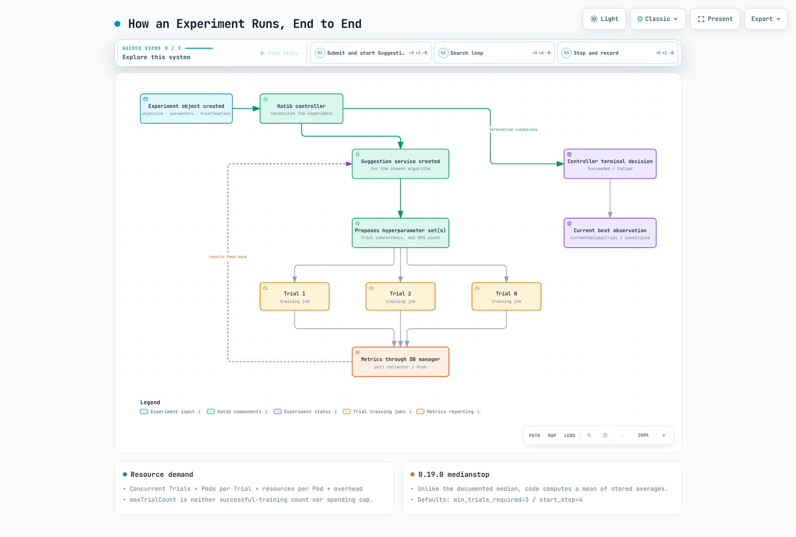

# Parte 4: Katib (ajuste de hiperparámetros y AutoML)

> **Versiones compatibles**: Katib 0.19.0, Kubeflow Community Distribution 26.03.1
> **Última actualización**: September 12, 2026

## Configuración del entorno del laboratorio

Usa los controladores de Katib 0.19.0, el administrador y almacenamiento de la base de datos, las imágenes de Suggestion necesarias y los permisos de espacio de nombres requeridos para crear Experiments. Distingue entre el acceso a Profile de la plataforma completa y una instalación independiente. La capacidad de GPU es opcional; Karpenter es uno de los aprovisionadores.

## Qué es Katib

Katib admite la optimización de hiperparámetros (HPO) y la búsqueda de arquitecturas neuronales (NAS). Un `Experiment` define la métrica objetivo, el espacio de búsqueda, el algoritmo y la plantilla de Trial; `Suggestion` y su servicio de algoritmo proponen candidatos; un `Trial` administra la ejecución de un candidato. La influencia de los resultados anteriores en las sugerencias depende del algoritmo.

Son **objetos de recursos personalizados** definidos por CRD, no nuevas definiciones de CRD que se instalen en cada ejecución. El controlador de Trial crea el recurso de trabajo configurado; el controlador de ese trabajo y Kubernetes se encargan de crear los Pod y ubicarlos en los nodos. El valor predeterminado de `trialResources` en 0.19.0 incluye `TrainJob.v1alpha1.trainer.kubeflow.org`, Kubernetes Job y tipos de trabajos de entrenamiento heredados. Asegúrate de que coincidan la API y el entorno de ejecución de Trainer, los permisos, las condiciones de éxito y fallo, y los Pod o contenedores de destino del recopilador; la compatibilidad no es automática.

Inspecciona el estado con `kubectl get experiments.kubeflow.org` y `kubectl get trials.kubeflow.org`. Son distintos de la API Experiment de KFP, que tiene un nombre similar.

## Algoritmos de búsqueda

Los nombres de los algoritmos deben coincidir con las entradas instaladas de KatibConfig y las imágenes de Suggestion. La configuración predeterminada de 0.19.0 incluye:

| Nombre | Estrategia y restricciones |
| --- | --- |
| `random` | Muestreo del espacio o las distribuciones configurados; no necesariamente es uniforme para todos los parámetros |
| `grid` | Combinaciones finitas; los objetivos, los fallos o los límites de Trial pueden impedir una ejecución exhaustiva |
| `bayesianoptimization`, `tpe`, `multivariate-tpe` | Diferentes estrategias de candidatos basadas en modelos; no se garantiza que se usen menos Trial ni que se encuentre un óptimo |
| `hyperband` | Presupuestos de recursos y reducción sucesiva; el código de entrenamiento debe respetar el parámetro de presupuesto |
| `cmaes`, `sobol` | Adaptación de la covarianza y muestreo de baja discrepancia, respectivamente; no son el mismo algoritmo |
| `pbt` | Entrenamiento basado en poblaciones con requisitos para compartir puntos de control; distinto de CMA-ES |
| `enas`, `darts` | Algoritmos de búsqueda de arquitecturas con sus propias plantillas y dependencias |

La guía de PBT requiere un volumen RWX y `resumePolicy: FromVolume`. Cambiar el nombre de un algoritmo no hace que un código de entrenamiento arbitrario sea compatible.

## Anatomía de un Experiment

| Campo | Significado |
| --- | --- |
| `objective` | Nombre de la métrica, maximización o minimización y objetivo opcional |
| `parameters` | Espacios double/int/discrete/categorical, rangos, listas o distribuciones |
| `algorithm` | Algoritmo de Suggestion instalado y su configuración |
| `trialTemplate` | Sustitución de trialParameters y especificación del trabajo, selección del contenedor/Pod principal, condiciones de éxito y fallo |
| `parallelTrialCount` | Cantidad de Trial procesados simultáneamente, no cantidad de Pod/GPU/EC2 |
| `maxTrialCount` | Criterio de detención según la cantidad de Trial completados; no según la cantidad de entrenamientos exitosos ni un límite inmutable del costo de por vida |
| `maxFailedTrialCount` | Umbral de fallos que incluye los Trial fallidos y aquellos sin métricas disponibles |
| `metricsCollectorSpec` / `earlyStopping` | Informes de métricas y configuración independiente de detención anticipada |

Al alcanzar el objetivo, llegar al límite de Trial completados o agotar las sugerencias, el Experiment puede finalizar correctamente; los umbrales de fallos o los errores de Suggestion pueden hacer que falle. El estado de finalización contabiliza los Trial exitosos, fallidos, cancelados, detenidos anticipadamente y sin métricas disponibles. La política de reanudación y los cambios en la especificación también afectan al ciclo de vida; por eso, no trates `maxTrialCount` como un límite inmutable de creación o gasto de por vida.

`Succeeded` es el resultado de un bucle de control, no una certificación de la calidad del modelo. `status.currentOptimalTrial` describe la mejor observación recopilada; si faltan métricas, puede que no haya ningún modelo óptimo utilizable.

## Detención anticipada y la implementación medianstop de 0.19.0

La detención anticipada puede terminar un Trial en curso. La guía oficial requiere recopiladores `StdOut`/`File` y registros con marcas de tiempo. No des por sentado que todos los recopiladores o bucles de entrenamiento arbitrarios ofrecen un soporte equivalente. Los valores predeterminados son `min_trials_required=3` y `start_step=4`.

**Distingue la regla documentada de la implementación de esta versión.** La guía oficial describe la mediana de los promedios acumulados de los Trial completados. Sin embargo, en v0.19.0, `get_median_value` almacena el promedio de las primeras start_step observaciones de cada Trial exitoso y devuelve la **media aritmética** de esos promedios almacenados. Al ejecutar localmente la función sin modificar con `[1, 2, 100]`, se obtuvo aproximadamente 34.333, no la mediana estadística 2. El nombre del algoritmo no garantiza que esta versión calcule una mediana.

La asignación de presupuestos de Hyperband y el servicio de detención anticipada son rutas independientes de configuración y ejecución. Valida el riesgo de descartar candidatos prometedores y los efectos del formato de las métricas, la frecuencia de los informes y los parámetros de presupuesto.

## Cómo se ejecuta un Experiment de principio a fin

[🔍 Ver diagrama interactivo](https://www.atomai.click/kubernetes-docs/archmaps/en-ai-ml-kubeflow-04-katib-0.html)

El controlador de Experiment solicita candidatos mediante recursos Suggestion y crea objetos Trial. Los controladores de Trial y de los trabajos de entrenamiento impulsan la ejecución, mientras que las métricas se informan mediante DB manager. Los algoritmos consumen los resultados según su implementación. Inspecciona las condiciones de terminación y los trabajos secundarios restantes; los hiperparámetros óptimos no son, por sí solos, un artefacto de modelo que se pueda implementar.

## Recopilación de métricas

| Modo | Configuración y restricciones |
| --- | --- |
| `StdOut` | Modo de extracción predeterminado; extrae métricas del formato de registro del contenedor principal |
| `File` | TEXT o JSON delimitado por líneas; configura la ruta y los filtros |
| `TensorFlowEvent` | Directorio de archivos de eventos, incluidos los escritores compatibles con TensorBoard |
| `Custom` | Implementación de recopilador proporcionada por el usuario; el scraping HTTP arbitrario no es una opción predeterminada integrada |
| `Push` | El código de entrenamiento llama al SDK `report_metrics()` para enviar datos a DB manager; no siempre se requiere un sidecar de recopilador |

La inyección de extracción requiere la etiqueta de espacio de nombres `katib.kubeflow.org/metrics-collector-injection: enabled`, un webhook operativo y la selección correcta del Pod o contenedor de destino. El entrenamiento distribuido requiere una política explícita para el rango que informa las métricas. Valida los nombres de las métricas, el formato numérico, las marcas de tiempo, la conectividad y las políticas. Que un trabajo de entrenamiento finalice correctamente no garantiza que se hayan recopilado métricas.

## Capacidad y costos en EKS

La demanda es aproximadamente **cantidad de Trial simultáneos × Pod por Trial × recursos por Pod**, más la sobrecarga de los recopiladores, Suggestion y la base de datos. Si cada Trial tiene dos Pod que solicitan cuatro GPU cada uno, un `parallelTrialCount` de 8 puede solicitar 64 GPU, no ocho.

Si hay Pod pendientes, inspecciona los eventos, las restricciones de programación, las cuotas, la capacidad de NodePool/EC2, los controladores y el estado de inicialización. Karpenter no siempre puede proporcionar capacidad, y una mayor concurrencia no garantiza que se reduzca el tiempo total de ejecución. La detención anticipada puede liberar recursos de los Pod mientras los cargos de EC2 continúan por los nodos retenidos.

Configura conjuntamente los criterios del total de Trial, la concurrencia, los reintentos de trabajos, el tamaño del entrenamiento distribuido, los plazos y la retención de datos. Verifica la recopilación de métricas y la terminación con una carga de trabajo pequeña de CPU antes de aumentar la escala de GPU.

## Validación y fuentes

Se inspeccionaron la configuración de v0.19.0, el controlador y la API, las rutas del recopilador y el código fuente de medianstop. La función medianstop sin modificar se ejecutó localmente con el historial precargado de Trial exitosos y las llamadas de red bloqueadas. No se ejecutó ningún Experiment ni carga de trabajo de GPU.

- [KatibConfig predeterminado de 0.19.0](https://github.com/kubeflow/katib/blob/v0.19.0/manifests/v1beta1/installs/katib-standalone/katib-config.yaml)
- [Decisiones sobre el estado de Experiment](https://github.com/kubeflow/katib/blob/v0.19.0/pkg/controller.v1beta1/experiment/util/status_util.go)
- [Implementación de medianstop](https://github.com/kubeflow/katib/blob/v0.19.0/pkg/earlystopping/v1beta1/medianstop/service.py)
- [Guía del recopilador de métricas](https://www.kubeflow.org/docs/components/katib/user-guides/metrics-collector/)
- [Guía de detención anticipada](https://www.kubeflow.org/docs/components/katib/user-guides/early-stopping/)

## Pasos siguientes

Continúa con las API y los entornos de ejecución del entrenamiento distribuido en [Parte 5: Trainer](05-training-operator.md).

[Volver a la página principal](./README.md)

## Cuestionario

Para poner a prueba lo que aprendiste en este capítulo, prueba el [cuestionario del tema](../../quizzes/ai-ml/kubeflow/04-katib-quiz.md).
