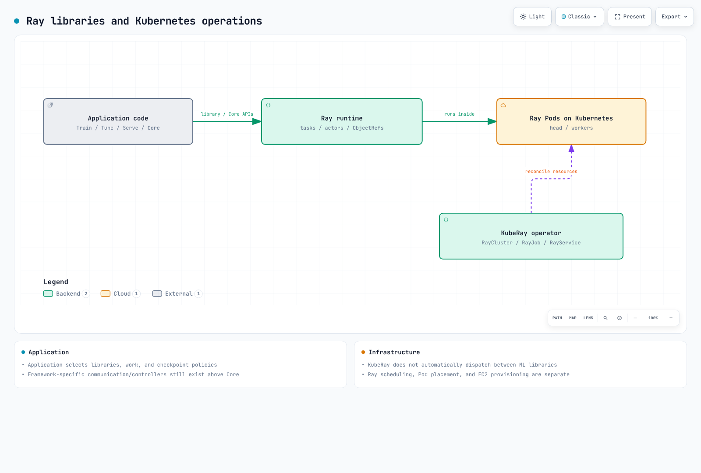

# Análisis detallado de Ray en EKS

> **Versión de referencia para la revisión**: Ray 2.58.0, KubeRay v1.7.1
> **Última versión comprobada**: Ray 2.59.0 (2 de octubre de 2026), comprobada el 16 de octubre de 2026; los ejemplos usan la versión 2.58.0
> **Documentación revisada**: 16 de octubre de 2026

## Descripción general

Ray distribuye el trabajo de Python mediante tareas, actores, ObjectRefs y almacenes de objetos por nodo. Train, Tune y Serve usan esa base y añaden políticas de entrenamiento, búsqueda y servicio. Una única ruta del almacén de objetos no gestiona automáticamente todos los problemas de comunicación y recuperación.

KubeRay es el operador de Kubernetes que reconcilia RayCluster, RayJob y RayService. No selecciona la biblioteca de ML de la aplicación como despachador. La programación del trabajo de Ray, la ubicación de los Pods de Kubernetes y el aprovisionamiento de nodos EC2 son capas independientes.

## Mapa de componentes

| Concepto | Problema que resuelve | Análisis detallado |
|---------|--------------------|-----------|
| **Arquitectura** | Tareas, actores y el almacén de objetos sobre el que se construye todo lo demás | [Parte 1](01-architecture.md) |
| **Operador KubeRay** | Ejecutar clústeres Ray como recursos nativos de Kubernetes (`RayCluster`/`RayJob`/`RayService`) | [Parte 2](02-kuberay-operator.md) |
| **Ray Train y Tune** | Entrenamiento distribuido de modelos y búsqueda de hiperparámetros | [Parte 3](03-ray-train-tune.md) |
| **Ray Serve** | Servicio de modelos, incluidos componentes específicos para servir LLM | [Parte 4](04-ray-serve.md) |

[🔍 Ver diagrama interactivo](https://www.atomai.click/kubernetes-docs/archmaps/en-ai-ml-ray-readme-0.html)

## Por qué ejecutarlo en EKS

La compensación es la misma que se describe en otras partes de las secciones de datos/ML de este sitio de documentación: un equipo que ya ejecuta EKS puede reutilizar para las cargas de trabajo de Ray los mismos patrones de escalado automático de grupos de nodos (mediante Karpenter), IAM y observabilidad que para todo lo demás en el clúster, a cambio de operar directamente el operador KubeRay y sus recursos RayCluster/RayJob/RayService, en lugar de utilizar una alternativa administrada.

La comprobación básica es una pequeña ejecución de Ray en un solo nodo. No demuestra el entrenamiento con GPU, la recuperación de varios nodos, una instalación activa de EKS ni el escalado automático.

Ray 2.59.0 habilita la autenticación mediante tokens de forma predeterminada para los clústeres locales. Al llamar a `ray.init()` sin una dirección, se genera un token si no existe `~/.ray/auth_token`; `RAY_AUTH_MODE=disabled` la desactiva. Las notas de la versión indican que se prevé ampliar el valor predeterminado a los clústeres remotos y de varios nodos a partir de la versión 2.61. Los ejemplos de esta serie se comprobaron con la versión 2.58.0 y no se volvieron a ejecutar con la versión 2.59.0.

## Contenido actual

1. [Parte 1: Arquitectura de Ray](01-architecture.md): tareas, actores, el almacén de objetos y el modelo de clúster con head y workers
2. [Parte 2: El operador KubeRay](02-kuberay-operator.md): RayCluster, RayJob, RayService y el patrón de escalado automático de dos niveles con Karpenter
3. [Parte 3: Ray Train y Ray Tune](03-ray-train-tune.md): entrenamiento distribuido y ajuste de hiperparámetros
4. [Parte 4: Ray Serve](04-ray-serve.md): servicio de modelos, Ray Serve LLM y despliegue de producción basado en RayService

## Fuentes principales

- [Ray 2.58.0](https://github.com/ray-project/ray/releases/tag/ray-2.58.0)
- [Ray 2.59.0 (última versión comprobada)](https://github.com/ray-project/ray/releases/tag/ray-2.59.0)
- [KubeRay 1.7.1](https://github.com/ray-project/kuberay/releases/tag/v1.7.1)
