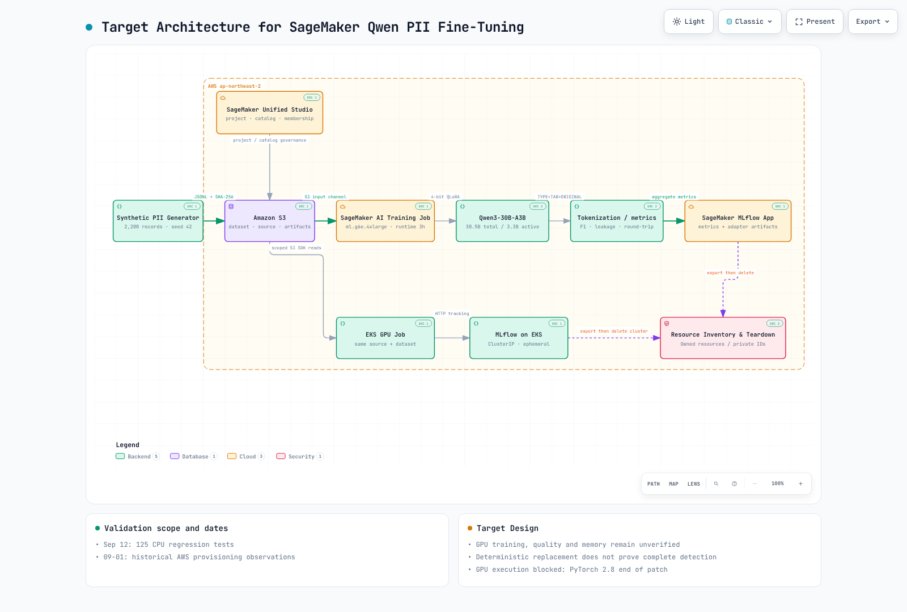

# Parte 1: Arquitectura de la plataforma PII de SageMaker Qwen

> **Última actualización**: September 12, 2026. El diagrama representa un diseño objetivo; ninguna de las dos rutas de entrenamiento con GPU se ejecutó en el registro histórico de AWS.

La ejecución con GPU está bloqueada porque la versión fijada de PyTorch 2.8 DLC llegó al fin de su ciclo de parches. Primero, sigue los requisitos de actualización a un entorno de ejecución compatible del [capítulo de ejecución](03-sagemaker-mlflow-execution.md).

[Diagrama interactivo](https://www.atomai.click/kubernetes-docs/archmaps/en-ai-ml-sagemaker-ai-01-platform-architecture-0.html)

## 1. Responsabilidades y límites del registro

| Componente | Responsabilidad y límite |
| --- | --- |
| Generador sintético | Particiones configuradas de 1,600/200/400, 2,200 registros; registrar el generador, la semilla y los hashes |
| S3 / entrega de datos | Almacenar el origen, los datos y los artefactos; gestionar IAM, cifrado, retención y transporte por separado |
| Qwen + QLoRA | Diseño de entrenamiento de adaptadores para candidatos de entidades; la sustitución final y la detección completa son cuestiones distintas |
| Procesamiento/evaluación en Python | Comprobaciones de tipo/origen, sustitución/restauración y agregados; no recupera automáticamente las entidades que el modelo no detectó |
| MLflow | Comparar configuraciones, versiones y agregados; verificar el acceso al servidor y el contenido de registros/artefactos |
| Unified Studio | Elección de gobernanza para este experimento, no una dependencia obligatoria de QLoRA, EKS o Training Jobs |
| Inventario / desmontaje | Registrar en privado los identificadores, la propiedad y las dependencias; exportar, limpiar y verificar |

Controla los artefactos que contengan texto de origen o correspondencias de tokens. La sustitución es reversible si se dispone de su correspondencia y no es cifrado. La política de registro es un diseño/contrato, no una prueba de que se hayan probado todas las bibliotecas, las funciones callback, las excepciones y el rastreo automático. Los ID/ARN de recursos pueden ser necesarios en un inventario privado, distinto de los informes públicos.

## 2. Un contrato compartido en distintos entornos

| Aspecto | Ruta de SageMaker AI | Ruta de EKS |
| --- | --- | --- |
| Ejecución | Training Job administrado | GPU Job/clúster preparado para este experimento |
| Seguimiento | SageMaker MLflow App | MLflow ClusterIP |
| Datos | Canal de entrada de S3 | Descargas mediante el SDK de S3 con permisos de AWS acotados al ServiceAccount |
| Ciclo de vida | Distinguir la terminación del Job de la limpieza de Apps/buckets externos | Exportar los resultados y luego recuperar los recursos temporales propios |

Un Training Job o un límite de namespace/Job no completan automáticamente el aislamiento de seguridad. Verifica los IAM/service accounts, la red, el almacenamiento, el acceso a los endpoints/MLflow y la configuración del contenedor reales. La ruta de EKS usa la identidad de cargas de trabajo mediante su ServiceAccount y la cadena de credenciales del SDK. No coloca URL presignadas con credenciales bearer en los valores del entorno del Pod; verifica el SHA-256 del manifiesto de entrada y la propiedad del bucket.

La comparación requiere la configuración, los hashes de las particiones, el código de entrenamiento/evaluación y el número de pasos, además de las revisiones del modelo/tokenizador, los digests de las imágenes, las dependencias transitivas, CUDA/controladores/hardware y la configuración de decodificación. Una semilla fija no garantiza resultados idénticos en GPU entre entornos. requirements.lock fija los paquetes directos, no todo el entorno transitivo.

## 3. Modelo y configuración QLoRA propuesta

La línea base es Qwen/Qwen3-30B-A3B-Instruct-2507. La ficha del modelo describe una arquitectura MoE de **30.5B parámetros totales / 3.3B parámetros activos**, con comportamiento sin razonamiento. Los parámetros activos no representan todos los pesos almacenados ni la memoria GPU necesaria. No se presenta como el modelo más reciente ni se afirma que se haya demostrado que cabe en una GPU concreta.

La revisión del repositorio del modelo observada durante la revisión fue `0d7cf23991f47feeb3a57ecb4c9cee8ea4a17bfe`. El cargador/configuración actual usa el ID del modelo sin fijar explícitamente esa revisión. Fija las revisiones del modelo/tokenizador y los artefactos antes de afirmar que la ejecución es reproducible.

| Configuración | Configuración propuesta |
| --- | --- |
| Cuantización / cómputo | NF4 de 4 bits, doble cuantización / bfloat16 |
| Rango / alfa / dropout de LoRA | 16 / 32 / 0.05 |
| Longitud de secuencia | 1,024 |
| Lote por dispositivo / acumulación de gradientes | 1 / 8 |
| Prueba rápida / completa | 10 / 80 pasos |
| Configuración de tiempo de ejecución del Job | 10,800 segundos |

Estos valores no son mediciones de un entrenamiento exitoso, de una calidad suficiente ni del pico de memoria de la GPU. El límite de tiempo de un Job no es un límite integral para la vida útil ni el costo del aprovisionamiento, el seguimiento y el almacenamiento. QLoRA usa pesos base de baja precisión y entrena adaptadores; verifica la cobertura real de los módulos, los optimizadores, la memoria y la compatibilidad del modelo durante la ejecución.

## 4. Gobernanza y preparación para la ejecución

Este experimento comprueba el dominio/perfil previsto, la pertenencia de quien realiza la llamada y el acceso a MLflow antes de enviar trabajos con GPU. CreateProject membershipAssignments puede incluir la propiedad en la misma solicitud, pero no garantiza la reversión atómica de todo el aprovisionamiento. También se deben comprobar por separado el estado ACTIVE del proyecto y la preparación de las herramientas/entornos requeridos.

Como muestran los intentos históricos, pueden existir recursos como una App antes de que falle la creación del proyecto. Combina las comprobaciones previas de permisos con un inventario posterior a la creación y acciones de compensación. Limita la limpieza a los recursos propios de esta ejecución y no deduzcas que quedan recursos actuales a partir de registros antiguos. Sigue el [capítulo de Unified Studio](../../data-on-eks/sagemaker-unified-studio/01-domains-projects-governance.md)
para conocer los límites de identidad y eliminación.

## Alcance de la validación

Se compararon la configuración, el código fuente del entrenador, la ficha pública del modelo y los informes históricos. A las 30 pruebas locales iniciales se añadieron pruebas de regresión para la tokenización, la ejecución y la limpieza.
No se descargaron pesos del modelo; no se realizó entrenamiento con GPU, evaluación de la calidad de inferencia ni inspección de recursos actuales de AWS.

## Referencias

- [Ficha del modelo Qwen](https://huggingface.co/Qwen/Qwen3-30B-A3B-Instruct-2507)
- [Artículo de QLoRA](https://arxiv.org/abs/2305.14314)
- [Configuración del experimento](https://github.com/Atom-oh/kubernetes-docs/blob/main/examples/ai-ml/qwen-pii-finetuning/config/experiment.yaml)
- [Resultado de aprovisionamiento registrado](https://github.com/Atom-oh/kubernetes-docs/blob/main/examples/ai-ml/qwen-pii-finetuning/results/provisioning-validation.json)

[Siguiente: datos PII y tokenización](02-pii-data-tokenization.md)

[Cuestionario](../../quizzes/ai-ml/sagemaker-ai/01-platform-architecture-quiz.md)
