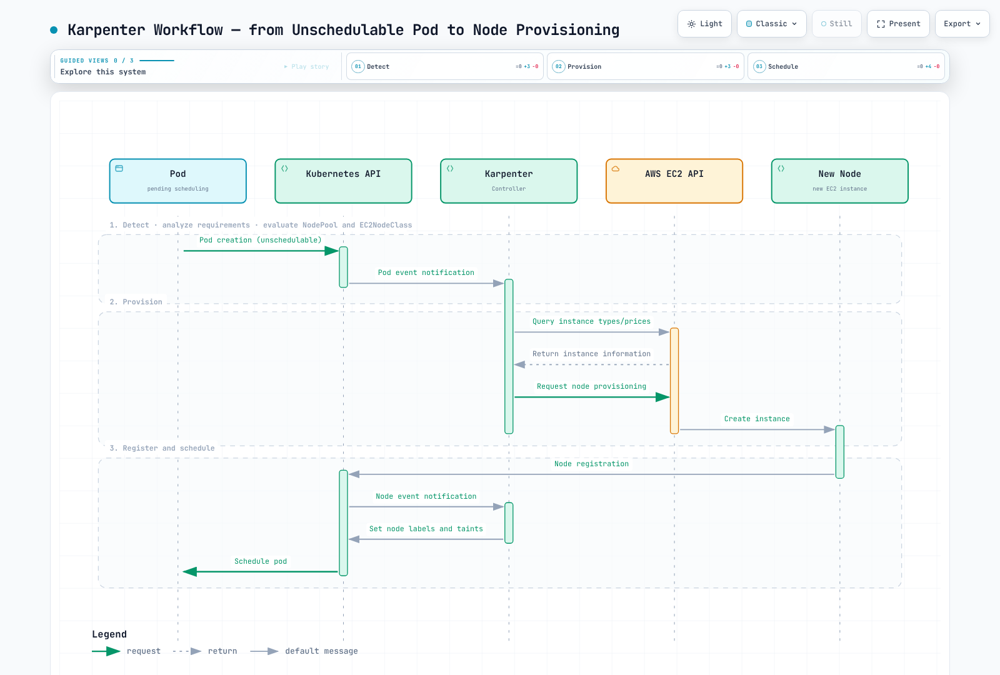
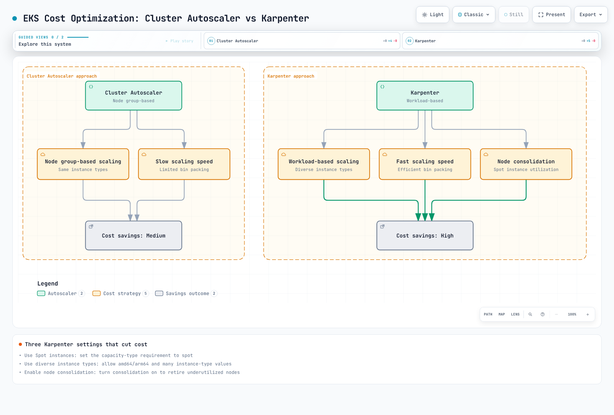

# Karpenter

> **Versiones compatibles**: Karpenter 1.14 LTS (ejemplos: 1.14.1); seleccione las versiones de Kubernetes/EKS usando las tablas de compatibilidad y soporte del proveedor.
> **Última actualización**: October 12, 2026

## Tabla de contenidos
- [Introducción](#introduction)
- [Arquitectura](#architecture)
- [Instalación y configuración](#installation-and-configuration)
- [NodePool](#nodepool)
- [Clases de nodos](#node-classes)
- [Manejo de interrupciones](#interruption-handling)
- [Integración](#integration)
- [Integración con Amazon EKS](#integration-with-amazon-eks)
- [Mejores prácticas](#best-practices)
- [Resolución de problemas](#troubleshooting)
- [Conclusión](#conclusion)

## Introducción

Karpenter es un escalador automático de nodos de código abierto. Este capítulo usa su proveedor de AWS, que aprovisiona capacidad EC2 para cargas de trabajo de Kubernetes compatibles. La disponibilidad y la eficiencia dependen de las restricciones, la capacidad de la nube, la inicialización de nodos y el diseño de la aplicación.

### Beneficios principales de Karpenter

1. **Escalado receptivo**: inicia el aprovisionamiento en respuesta a demanda de cargas de trabajo no programables; la preparación del nodo y de la aplicación no tiene una garantía de latencia fija.
2. **Optimización de costos**: selección de los tipos de instancia más adecuados para las cargas de trabajo
3. **Configuración sencilla**: configuración fácil mediante APIs declarativas
4. **Diseño centrado en las cargas de trabajo**: aprovisionamiento de nodos basado en los requisitos de los Pod
5. **Integración con la nube**: aprovecha las capacidades del proveedor de nube
6. **Empaquetado eficiente**: optimiza la utilización de recursos
7. **Gestión flexible de nodos**: gestión del ciclo de vida de los nodos y manejo integrado de interrupciones

### Comparación con escaladores automáticos existentes

| Característica | Karpenter | Cluster Autoscaler | Grupos de nodos administrados por el proveedor de nube |
|---------|-----------|-------------------|---------------------------|
| Velocidad de escalado | Depende de la programación, la capacidad EC2 y la inicialización | Depende del escalado e inicialización del grupo de nodos | Depende de la política de escalado, la capacidad y la inicialización |
| Selección de tipo de instancia | Dinámica | Basada en grupos de nodos | Basada en grupos de nodos |
| Eficiencia de empaquetado | Dependiente de la carga de trabajo/restricciones | Dependiente de la carga de trabajo/grupo de nodos | Depende del programador y el controlador de escalado |
| Complejidad de configuración | Baja | Media | Baja |
| Integración con la nube | Implementación específica del proveedor | Múltiples integraciones con proveedores de nube | Nativa de la plataforma |
| Gestión de grupos de nodos | No requerida | Requerida | Requerida |
| Manejo de interrupciones | Manejo de eventos y ciclo de vida de nodos configurado | Depende de la plataforma/integración | Manejo específico de la plataforma |

> **Nota**: EKS añadió soporte de warm-pool para Managed Node Group el 8 de abril de 2026. Las instancias preinicializadas pueden reducir el trabajo de inicialización repetido; los modos Stopped y Running tienen diferente tiempo de transición y costo, y la reutilización al reducir la escala es opcional. Según AWS, la integración con Cluster Autoscaler no necesita configuración adicional. La reanudación, la preparación del nodo y el inicio de la aplicación siguen tomando tiempo. Esta es una característica de EKS Managed Node Group/Auto Scaling, no un pool administrado por Karpenter.

## Arquitectura

Karpenter funciona como un controlador de Kubernetes, detectando Pods no programables y aprovisionando nodos adecuados.


[🔍 Ver diagrama interactivo](https://www.atomai.click/kubernetes-docs/archmaps/en-autoscaling-02-karpenter-0.html)

### Flujo de trabajo de Karpenter

El siguiente diagrama muestra cómo funciona Karpenter en un clúster EKS:



[🔍 Ver diagrama interactivo](https://www.atomai.click/kubernetes-docs/archmaps/en-autoscaling-02-karpenter-1.html)

### Componentes principales

1. **Controlador Karpenter**: simula las necesidades de programación, crea NodeClaims y administra el ciclo de vida de los nodos; el programador de Kubernetes realiza la vinculación real de los Pod.
2. **Validación CEL de CRD**: NodePool y EC2NodeClass son validados por reglas CEL en los CRD (los webhooks de admisión/conversión se eliminaron en Karpenter 1.1)
3. **CRD NodePool y NodeClaim**: NodePool define la política; un NodeClaim registra los requisitos y el ciclo de vida de un nodo individual aprovisionado.
4. **CRD EC2NodeClass**: define la configuración de los nodos que se aprovisionarán
5. **Integración con el proveedor de nube**: se integra con las APIs del proveedor de nube para administrar recursos de cómputo

### Cómo funciona

1. El controlador Karpenter detecta Pods no programables
2. Analiza los requisitos del Pod (recursos, selectores de nodo, tolerations, etc.)
3. Determina los tipos de nodo adecuados según la configuración de NodePool y EC2NodeClass
4. Llama a la API del proveedor de nube para aprovisionar nodos
5. El nodo se registra y queda preparado; el programador de Kubernetes puede entonces vincular Pods elegibles. Karpenter no reemplaza a kube-scheduler.
6. La consolidación, la deriva, la expiración, la eliminación manual y las interrupciones de nube tienen desencadenantes y protecciones distintos; no todos son eventos de interrupción de SQS.

## Instalación y configuración

Los bloques YAML sin apiVersion/kind son fragmentos de configuración para la especificación de NodePool o EC2NodeClass tratada; no son documentos independientes para kubectl apply.

Estos son ejemplos de aprendizaje independientes para un clúster existente, no un paquete de despliegue listo para producción. Los nombres de objeto repetidos representan alternativas. Prepare y verifique IAM/OIDC, acceso de nodos, subredes/grupos de seguridad aprobados, capacidad de bootstrap y la cola de interrupciones antes de la instalación. Todo YAML usa nombres de ejemplo literales como `my-cluster`; kubectl no expande `${CLUSTER_NAME}` dentro de un archivo YAML guardado. La auditoría no aprovisionó recursos de AWS, instaló Karpenter ni midió el escalado. Los comandos de instalación nueva fallan si esa versión ya existe; las instalaciones existentes deben seguir la guía de actualización/migración de CRD versionada.

### Requisitos previos

- Use una versión de Kubernetes compatible con su plataforma y la matriz de Karpenter. La matriz publicada lista Karpenter 1.6 como mínimo para Kubernetes1.34, 1.9 para1.35 y1.13 para1.36; estos mínimos no significan que cada minor anterior de Karpenter continúe mantenida. La matriz no establece actualmente compatibilidad con1.37. La disponibilidad/el soporte de la versión de EKS debe verificarse por separado.
- kubectl configurado
- Credenciales y permisos del proveedor de nube
- Helm (opcional)

### Instalación en AWS EKS

#### 1. Configuración de roles y políticas IAM

Los comandos presuponen un rol de controlador, un rol de nodo y autenticación de EKS basada en API (API o API_AND_CONFIG_MAP) existentes. Un clúster solo CONFIG_MAP necesita comprobar su mapeo de nodos aws-auth existente en lugar de list-access-entries; no cambie el modo de autenticación como un paso incidental de configuración. El rol de nodo confía en EC2 y necesita permisos de worker-node/ECR pull (por ejemplo AmazonEKSWorkerNodePolicy y AmazonEC2ContainerRegistryPullOnly). Otorgue a VPC CNI su propia identidad donde se admita; los permisos de SSM son opcionales y requieren un agente configurado. AmazonEKSClusterPolicy no sustituye la política del controlador Karpenter.

```bash
# Set the existing cluster and Region; these commands only inspect AWS/Kubernetes.
export CLUSTER_NAME="my-cluster"
export AWS_REGION="us-west-2"
export KARPENTER_VERSION="1.14.1"
ACCOUNT_ID=$(aws sts get-caller-identity --query Account --output text)
CLUSTER_ENDPOINT=$(aws eks describe-cluster --region "$AWS_REGION" --name "$CLUSTER_NAME" --query cluster.endpoint --output text)
export ACCOUNT_ID CLUSTER_ENDPOINT
kubectl config current-context
aws iam get-role --role-name "KarpenterControllerRole-${CLUSTER_NAME}" --query Role.AssumeRolePolicyDocument
aws iam get-role --role-name "KarpenterNodeRole-${CLUSTER_NAME}" --query Role.AssumeRolePolicyDocument
aws eks list-access-entries --region "$AWS_REGION" --cluster-name "$CLUSTER_NAME"
```

#### 2. Instalación usando Helm

Use el ejemplo de instalación nueva una vez, después de preparar la cola referenciada y la capacidad de bootstrap. Para una actualización, revise la guía de migración versionada y actualice los CRD correspondientes (por ejemplo, mediante el chart karpenter-crd administrado por separado); una actualización solo del chart del controlador generalmente no actualiza los CRD. Verifique la propiedad antes de migrar una instalación de CRD existente.

```bash
# Run only after the prerequisites and the current kubectl context are verified.
: "${CLUSTER_NAME:?Set the existing cluster name}"
: "${ACCOUNT_ID:?Set the AWS account ID}"
: "${CLUSTER_ENDPOINT:?Set the matching EKS endpoint}"
KARPENTER_VERSION="1.14.1"
helm install karpenter oci://public.ecr.aws/karpenter/karpenter \
  --version "$KARPENTER_VERSION" \
  --namespace karpenter --create-namespace \
  --set-string 'serviceAccount.annotations.eks\.amazonaws\.com/role-arn'="arn:aws:iam::${ACCOUNT_ID}:role/KarpenterControllerRole-${CLUSTER_NAME}" \
  --set-string settings.clusterName="$CLUSTER_NAME" \
  --set-string settings.clusterEndpoint="$CLUSTER_ENDPOINT" \
  --set-string settings.interruptionQueue="$CLUSTER_NAME" \
  --wait --timeout 5m
```

#### 3. Verificar la instalación

```bash
kubectl get deployments,pods -n karpenter
kubectl rollout status deployment/karpenter -n karpenter --timeout=180s
kubectl get nodepools,ec2nodeclasses,nodeclaims
```

Salida ilustrativa para las dos réplicas predeterminadas del controlador (no es una ejecución capturada en esta auditoría):
```
NAME                         READY   STATUS    RESTARTS   AGE
karpenter-<hash>-<id-1>      1/1     Running   0          1m
karpenter-<hash>-<id-2>      1/1     Running   0          1m
```

### Configuración básica de NodePool y EC2NodeClass

```yaml
apiVersion: karpenter.sh/v1
kind: NodePool
metadata:
  name: default
spec:
  disruption:
    consolidationPolicy: WhenEmpty
    consolidateAfter: 30s
  limits:
    cpu: '1000'
    memory: 1000Gi
  template:
    spec:
      requirements:
      - key: karpenter.sh/capacity-type
        operator: In
        values:
        - on-demand
      - key: kubernetes.io/arch
        operator: In
        values:
        - amd64
      - key: node.kubernetes.io/instance-type
        operator: In
        values:
        - m5.large
        - m5.xlarge
        - m5.2xlarge
      nodeClassRef:
        group: karpenter.k8s.aws
        kind: EC2NodeClass
        name: default
---
apiVersion: karpenter.k8s.aws/v1
kind: EC2NodeClass
metadata:
  name: default
spec:
  role: KarpenterNodeRole-my-cluster
  amiSelectorTerms:
  - alias: al2023@latest
  subnetSelectorTerms:
  - tags:
      karpenter.sh/discovery: my-cluster
  securityGroupSelectorTerms:
  - tags:
      karpenter.sh/discovery: my-cluster
  tags:
    karpenter.sh/discovery: my-cluster
  blockDeviceMappings:
  - deviceName: /dev/xvda
    ebs:
      volumeSize: 100Gi
      volumeType: gp3
      deleteOnTermination: true
      encrypted: true
```

## NodePool

NodePool es un recurso personalizado de Kubernetes que define cómo Karpenter aprovisiona nodos. Reemplaza al Provisioner anterior.

### Configuración básica de NodePool

El taint especial siguiente requiere intencionalmente una toleration de carga de trabajo coincidente. startupTaints está vacío hasta que tenga un inicializador verificado que elimine el taint configurado; inventar un startup taint sin su propietario puede dejar nodos inutilizables. Los ejemplos de límites, inicialización e interrupción son alternativas, no cambios acumulativos a un NodePool de producción en ejecución.

```yaml
apiVersion: karpenter.sh/v1
kind: NodePool
metadata:
  name: default
spec:
  template:
    metadata:
      labels:
        environment: training
        app: web
    spec:
      requirements:
      - key: karpenter.sh/capacity-type
        operator: In
        values:
        - on-demand
      - key: kubernetes.io/arch
        operator: In
        values:
        - amd64
      - key: node.kubernetes.io/instance-type
        operator: In
        values:
        - m5.large
        - m5.xlarge
        - m5.2xlarge
      nodeClassRef:
        group: karpenter.k8s.aws
        kind: EC2NodeClass
        name: default
      expireAfter: 720h
      taints:
      - key: example.com/special-taint
        value: 'true'
        effect: NoSchedule
      startupTaints: []
  limits:
    cpu: '1000'
    memory: 1000Gi
  disruption:
    consolidationPolicy: WhenEmpty
    consolidateAfter: 30s
```

### Configuración de requisitos

Los requisitos se intersectan entre sí, con EC2NodeClass y con las restricciones del Pod. Permitir amd64 y arm64 solo ayuda si los tipos de instancia, las AMI y las imágenes de contenedor elegibles admiten ambos. Una lista de zonas/tipos de capacidad elegibles no garantiza una división uniforme; use restricciones de topología de carga de trabajo para ese fin.

Los requisitos definen las características de los nodos que Karpenter aprovisionará:

```yaml
template:
  spec:
    requirements:
    - key: karpenter.sh/capacity-type
      operator: In
      values:
      - on-demand
      - spot
    - key: kubernetes.io/arch
      operator: In
      values:
      - amd64
      - arm64
    - key: node.kubernetes.io/instance-type
      operator: In
      values:
      - m5.large
      - m5.xlarge
      - c5.large
      - m6g.large
      - c6g.large
    - key: topology.kubernetes.io/zone
      operator: In
      values:
      - us-west-2a
      - us-west-2b
      - us-west-2c
    - key: kubernetes.io/os
      operator: In
      values:
      - linux
```

### Configuración de límites

`spec.limits` restringe los recursos aprovisionados agregados, pero el aprovisionamiento paralelo usa comprobaciones eventualmente consistentes y puede exceder temporalmente un límite. No es un límite de facturación estricto. Las cantidades como cadena evitan diferencias de tipo de API/GitOps.

```yaml
limits:
  cpu: '1000'
  memory: 1000Gi
  nvidia.com/gpu: '10'
```

### Seguimiento experimental de asignación DRA (v1.13)

El Karpenter core v1.13 añadió seguimiento de asignación de dispositivos DRA. Esto no es una garantía general de aprovisionamiento DRA de producción: el chart AWS1.14.1 predetermina `settings.ignoreDRARequests: true`, y upstream etiqueta el soporte DRA formal como aún no GA. Un mínimo de Kubernetes1.29 no es evidencia suficiente de compatibilidad. Valide la API de recursos de Kubernetes exacta, el controlador DRA, ResourceClaims/ResourceSlices y la configuración de Karpenter; no trate las reclamaciones DRA como intercambiables con el ejemplo de recursos extendidos del device-plugin a continuación.

### Configuración de expiración de nodos

`expireAfter` define cuándo comienza el drenaje impulsado por expiración, no un tiempo de finalización de reemplazo garantizado. El `terminationGracePeriod` opcional siguiente limita el drenaje, pero puede forzar la eliminación de los Pod restantes, incluidos los bloqueados por PDB. Elija ese plazo solo después de validar los requisitos de apagado y recuperación de la aplicación.

```yaml
spec:
  template:
    spec:
      expireAfter: 720h
      terminationGracePeriod: 30m
  disruption:
    consolidationPolicy: WhenEmpty
    consolidateAfter: 30s
```

### Reconocimiento de taints de NodeReadinessController (v1.13)

El Karpenter core v1.13 reconoce los taints `readiness.k8s.io/` del NodeReadinessController separado como efímeros durante la simulación de programación de un nodo administrado no inicializado. Aún espera que esos taints desaparezcan antes de marcar la inicialización como completa; no los elimina ni permite que el programador de Kubernetes los omita. Otros taints de inicializador aún necesitan una configuración precisa de `startupTaints` y un controlador que los elimine.

### Actualización de julio de 2026: se lanzó v1.14

Karpenter v1.14, lanzado el 11 de julio de 2026, aporta:

- **Soporte de API CapacityBuffers**: una integración alpha de capacity-buffer; `CapacityBuffer` está deshabilitado de forma predeterminada y requiere la configuración coincidente de CRD/controlador. La capacidad de reserva no es capacidad gratuita ni una garantía de latencia.
- **Soporte de tipos de instancia preview**: reconoce ofertas preview elegibles; el aprovisionamiento real aún requiere acceso y disponibilidad de la cuenta/Region.
- **Soporte de Nitro Enclaves**: el proveedor configura `EnclaveOptions.Enabled` de la launch-template generada cuando las solicitudes de recursos NodeClaim incluyen `eks.amazonaws.com/nip-slots`. Las instancias compatibles, la AMI y la configuración del device-plugin siguen siendo requisitos previos; no existe un campo `EC2NodeClass.spec.enclaveOptions` en1.14.1.
- Correcciones de errores: contabilización de la IP primaria en ENI secundarios, garantía de que se hidrate la caché de Zonal Shift, conexión de un timeout de cliente AWS SDK en la configuración del operador y más

Consulte las [notas de lanzamiento de v1.14.0](https://github.com/aws/karpenter-provider-aws/releases/tag/v1.14.0) para obtener detalles.

El 17 de julio de 2026, las ramas anteriores recibieron parches que incluyeron1.3.8 y1.11.3. Este backport histórico no establece soporte continuo para todos los minors intermedios. La política de soporte actual lista LTS1.9 hasta febrero de2027 y LTS1.14 hasta julio de2027; los minors regulares se admiten solo hasta el siguiente minor. Seleccione una línea compatible y siga su guía de migración en vez de asumir que una línea antigua continúa mantenida.

El anuncio de AWS del 22 de julio de 2026 añadió configuración de interfaz de red EFA y placement-group para Karpenter/EKS Auto Mode. En AWS Karpenter1.14.1, los campos concretos son `EC2NodeClass.spec.networkInterfaces` y `spec.placementGroupSelector` (no campos NodePool). Las interfaces solo EFA no consumen direcciones IP de VPC, pero aún se requiere una `interface` primaria en el índice de dispositivo/tarjeta0. Seleccione un placement group existente por nombre o ID; su estrategia cluster/spread/partition y las instancias compatibles restringen la ubicación. El ejemplo de aquí no configura ni valida una carga de trabajo HPC.

### Actualización de agosto de 2026: lanzamiento del parche v1.14.1

[v1.14.1](https://github.com/aws/karpenter-provider-aws/releases/tag/v1.14.1), el primer parche de la línea v1.14, se publicó el 21 de agosto de 2026. Es un lanzamiento de mantenimiento que actualiza la versión upstream `sigs.k8s.io/karpenter` y aplica mediante cherry-pick correcciones realizadas desde v1.14.0.

### Actualización de octubre de 2026: se lanzó v1.15.0

[v1.15.0](https://github.com/aws/karpenter-provider-aws/releases/tag/v1.15.0) se publicó el 10 de octubre de 2026. Cambios clave:

- **La reparación de nodos pasa a ser una interrupción voluntaria**: la reparación de nodos se incorpora al mecanismo de interrupción, con reparación de terminate-first cuando un NodePool con capacidad limitada no puede preparar primero un nodo de reemplazo. Se añade el reinicio mediante `ec2:RebootInstances` como acción de reparación (detrás del feature gate AWS `RebootForRepair`), y el controlador de reparación anterior sigue disponible mediante la marca `--legacy-node-repair`.
- **Soporte de CEL en KubeletConfiguration**: `maxPodsExpression`, `kubeReserved` y `systemReserved` aceptan expresiones CEL, y se ampliaron los campos EC2NodeClass KubeletConfiguration.
- **Soporte DRA más amplio**: soporte para alternativas priorizadas, además de soporte DRA para controladores NVIDIA y EFA.
- También: una marca `--aws-feature-gates`, reconocimiento predeterminado de pod topology spread, contabilización de límites de volumen de tipo de instancia durante el aprovisionamiento, nuevas métricas de interrupción como `karpenter_pods_disrupted_total` y un controlador de gestión de costo de eliminación de Pod controlado por feature gate.

Según la política de soporte, los minors regulares se admiten solo hasta el siguiente minor, así que con v1.15.0 disponible, v1.14 continúa solo como una línea LTS (hasta julio de 2027). Consulte las [notas de lanzamiento de v1.15.0](https://github.com/aws/karpenter-provider-aws/releases/tag/v1.15.0) para obtener detalles.

## Clases de nodos

Las clases de nodos definen la configuración de los nodos que Karpenter aprovisiona. En AWS, usa el CRD EC2NodeClass.

### Configuración de AWS EC2NodeClass

```yaml
apiVersion: karpenter.k8s.aws/v1
kind: EC2NodeClass
metadata:
  name: default
spec:
  subnetSelectorTerms:
  - tags:
      karpenter.sh/discovery: my-cluster
  securityGroupSelectorTerms:
  - tags:
      karpenter.sh/discovery: my-cluster
  tags:
    karpenter.sh/discovery: my-cluster
    environment: training
  blockDeviceMappings:
  - deviceName: /dev/xvda
    ebs:
      volumeSize: 100Gi
      volumeType: gp3
      deleteOnTermination: true
      encrypted: true
  role: KarpenterNodeRole-my-cluster
  amiSelectorTerms:
  - alias: al2023@latest
  userData: '#!/bin/bash

    echo "Hello from Karpenter node!"

    '
  metadataOptions:
    httpEndpoint: enabled
    httpProtocolIPv6: disabled
    httpPutResponseHopLimit: 1
    httpTokens: required
```

### Selección de subred y grupo de seguridad

Las subredes y los grupos de seguridad se seleccionan con términos de selector (varios términos se combinan con OR; las etiquetas dentro de un término se combinan con AND):

```yaml
subnetSelectorTerms:
- tags:
    karpenter.sh/discovery: my-cluster
    Name: private-*
securityGroupSelectorTerms:
- tags:
    karpenter.sh/discovery: my-cluster
```

### Configuración de AMI

Karpenter selecciona AMI mediante `amiSelectorTerms`. Un alias selecciona una familia/versión; **`@latest` no es un pin de versión** y puede cambiar las AMI resueltas y activar deriva. Las muestras con `@latest` son ejemplos de aprendizaje. Para producción, resuelva y pruebe una versión explícita de AMI compatible (`al2023@vYYYYMMDD` con una fecha de lanzamiento real) o ID de AMI aprobados antes del despliegue. Las AMI AL2 EKS no se publican para Kubernetes1.33+. Las variantes siguientes son alternativas, y una AMI Custom requiere bootstrap funcional, taint de registro, kubelet, CNI/runtime y configuración de identidad.

```yaml
# Amazon Linux 2023
amiSelectorTerms:
  - alias: al2023@latest
---
# Bottlerocket
amiSelectorTerms:
  - alias: bottlerocket@latest
---
# Custom AMI (by ID) — amiFamily is required when no alias term is used
amiFamily: Custom
amiSelectorTerms:
  - id: "ami-0123456789abcdef0"
# Ubuntu: no v1 alias — use amiFamily: Custom with an id/tags/name term
```

### Configuración de dispositivos de bloque

Los mapeos de dispositivos son específicos de la familia de AMI. Estos ejemplos de AL2023 usan /dev/xvda para el dispositivo raíz; inspeccione el diseño real para otras AMI. Los volúmenes adicionales necesitan un plan explícito de sistema de archivos/montaje o almacenamiento de aplicación. Una clave KMS administrada por el cliente también necesita los permisos de clave/IAM adecuados.

Puede definir la configuración de almacenamiento para nodos:

```yaml
blockDeviceMappings:
- deviceName: /dev/xvda
  ebs:
    volumeSize: 100Gi
    volumeType: gp3
    iops: 3000
    throughput: 125
    deleteOnTermination: true
    encrypted: true
    kmsKeyID: arn:aws:kms:us-west-2:111122223333:key/1234abcd-12ab-34cd-56ef-1234567890ab
- deviceName: /dev/xvdb
  ebs:
    volumeSize: 500Gi
    volumeType: gp3
    deleteOnTermination: true
    encrypted: true
```

### Configuración de datos de usuario

Estos fragmentos shell de user-data asumen AL2023, cuya configuración generada de bootstrap/nodeadm Karpenter combina con datos personalizados. No son bootstrap genéricos válidos para Bottlerocket/Windows. Incluya y pruebe los paquetes en una AMI en vez de ejecutar una actualización de paquetes sin restricciones en cada lanzamiento. Instalar/iniciar CloudWatch Agent sin su configuración, IAM y ruta de red no establece recopilación de telemetría.

```yaml
userData: |
  #!/bin/bash
  set -euo pipefail
  # Only for a workload that requires this setting; keep node packages in a tested AMI.
  cat > /etc/sysctl.d/99-workload-map-count.conf <<'EOF'
  vm.max_map_count=262144
  EOF
  sysctl -p /etc/sysctl.d/99-workload-map-count.conf
```

### Proceso de consolidación de nodos

El siguiente diagrama muestra el proceso de consolidación de nodos de Karpenter. Esta característica es importante para optimizar la eficiencia del clúster y reducir costos:


[🔍 Ver diagrama interactivo](https://www.atomai.click/kubernetes-docs/archmaps/en-autoscaling-02-karpenter-2.html)

## Manejo de interrupciones

El manejo de interrupciones configurado intenta reaccionar antes de que se pierda capacidad. Las notificaciones, la capacidad de reemplazo, los plazos de apagado y la recuperación de la aplicación determinan el resultado; la disponibilidad ininterrumpida no está garantizada.

### Manejo de interrupciones integrado

El manejo de interrupciones de nube es independiente de la consolidación/expiración. Cubre señales como:

1. **Advertencias de interrupción de Spot**: inicia el drenaje y solicita capacidad de reemplazo cuando es posible; la ventana de aviso no es un SLA de recuperación garantizado.
2. **Eventos de mantenimiento/salud programados**: reacciona a las instancias afectadas.
3. **Eventos de detención/terminación de instancias**: reconcilia la capacidad que deja el servicio.
4. **Fallos de instance-status de EC2**: inspecciona la salud con los permisos de API EC2 requeridos. Las recomendaciones de rebalanceo por sí solas se publican como eventos, no como operaciones automáticas de taint/drain/terminate.

### Configuración de manejo de interrupciones

```yaml
apiVersion: karpenter.sh/v1
kind: NodePool
metadata:
  name: default
spec:
  template:
    spec:
      requirements:
        - key: karpenter.sh/capacity-type
          operator: In
          values: ["on-demand"]
      nodeClassRef:
        group: karpenter.k8s.aws
        kind: EC2NodeClass
        name: default

      # Node expiration settings
      expireAfter: 720h  # 30 days
  disruption:
    consolidationPolicy: WhenEmpty
    consolidateAfter: 30s
```

### Configuración de drenaje

Karpenter normalmente usa eviction durante el drenaje ordenado. La configuración de Helm configura el controlador; los budgets de interrupción de NodePool limitan los inicios de consolidación/deriva voluntarios, no todas las pérdidas simultáneas de nodos. Un budget de30% se redondea hacia arriba y luego resta los nodos en eliminación/no preparados; no es un límite máximo estricto de30%. La expiración, las interrupciones y la reparación pueden tener distintos comportamientos forzosos. Configure la cola SQS nombrada, las reglas/destinos EventBridge, la política de la cola y los permisos del controlador antes de habilitar `interruptionQueue`; el campo de Helm por sí solo no los crea.

```yaml
settings:
  clusterName: my-cluster
  interruptionQueue: my-cluster
  batchMaxDuration: 10s
  batchIdleDuration: 1s
  featureGates:
    spotToSpotConsolidation: false
controller:
  resources:
    requests:
      cpu: 1
      memory: 1Gi
    limits:
      cpu: '1'
      memory: 1Gi
logLevel: info
```

```yaml
apiVersion: karpenter.sh/v1
kind: NodePool
metadata:
  name: default
spec:
  template:
    spec:
      requirements:
        - key: karpenter.sh/capacity-type
          operator: In
          values: ["on-demand"]
      nodeClassRef:
        group: karpenter.k8s.aws
        kind: EC2NodeClass
        name: default
      expireAfter: 720h
  disruption:
    consolidationPolicy: WhenEmpty
    consolidateAfter: 30s
    budgets:
      - nodes: "30%"   # Voluntary budget: round up, then subtract deleting/not-ready nodes
```

### Integración con PDB (PodDisruptionBudget)

Los PDB restringen el eviction voluntario según las réplicas saludables; no crean réplicas ni garantizan la disponibilidad de la aplicación. El `minAvailable: 2` siguiente necesita suficientes Pods saludables coincidentes antes de que se permita un eviction. La pérdida de instancias y los plazos de terminación forzosa aún pueden interrumpirlos.

```yaml
apiVersion: policy/v1
kind: PodDisruptionBudget
metadata:
  name: app-pdb
  namespace: default
spec:
  minAvailable: 2
  selector:
    matchLabels:
      app: my-app
```

## Integración

Karpenter se integra con diversos servicios de Kubernetes y de nube.

### Integración con Kubernetes

#### 1. Restricciones de distribución de topología de Pod

Karpenter considera Pod Topology Spread Constraints al aprovisionar nodos:

```yaml
apiVersion: apps/v1
kind: Deployment
metadata:
  name: web-server
  namespace: default
spec:
  replicas: 10
  template:
    spec:
      topologySpreadConstraints:
      - maxSkew: 1
        topologyKey: topology.kubernetes.io/zone
        whenUnsatisfiable: DoNotSchedule
        labelSelector:
          matchLabels:
            app: web-server
      containers:
      - name: web-server
        image: nginx:1.30.4
        ports:
        - containerPort: 80
        resources:
          requests:
            cpu: 100m
            memory: 128Mi
          limits:
            memory: 256Mi
    metadata:
      labels:
        app: web-server
  selector:
    matchLabels:
      app: web-server
```

#### 2. Afinidad/anti-afinidad de Pod

Karpenter considera las reglas de Pod Affinity y Anti-Affinity:

```yaml
apiVersion: apps/v1
kind: Deployment
metadata:
  name: web-server
  namespace: default
spec:
  replicas: 10
  template:
    spec:
      affinity:
        podAntiAffinity:
          requiredDuringSchedulingIgnoredDuringExecution:
          - labelSelector:
              matchExpressions:
              - key: app
                operator: In
                values:
                - web-server
            topologyKey: kubernetes.io/hostname
      containers:
      - name: web-server
        image: nginx:1.30.4
        ports:
        - containerPort: 80
        resources:
          requests:
            cpu: 100m
            memory: 128Mi
          limits:
            memory: 256Mi
    metadata:
      labels:
        app: web-server
  selector:
    matchLabels:
      app: web-server
```

#### 3. Taints y tolerations

El ejemplo de GPU requiere una AMI acelerada compatible, el controlador NVIDIA y un DaemonSet de device-plugin que tolere el taint de GPU y anuncie nvidia.com/gpu. El Pod BusyBox solo demuestra reservar una GPU; no ejecuta ni evalúa CUDA. Valide por separado con la imagen de su aplicación GPU real.

Karpenter considera taints y tolerations al aprovisionar nodos:

```yaml
apiVersion: karpenter.sh/v1
kind: NodePool
metadata:
  name: gpu
spec:
  template:
    spec:
      requirements:
      - key: node.kubernetes.io/instance-type
        operator: In
        values:
        - g4dn.xlarge
        - g4dn.2xlarge
      taints:
      - key: nvidia.com/gpu
        value: 'true'
        effect: NoSchedule
      nodeClassRef:
        group: karpenter.k8s.aws
        kind: EC2NodeClass
        name: default
---
apiVersion: apps/v1
kind: Deployment
metadata:
  name: gpu-app
  namespace: default
spec:
  replicas: 3
  template:
    spec:
      tolerations:
      - key: nvidia.com/gpu
        operator: Exists
        effect: NoSchedule
      nodeSelector:
        karpenter.sh/nodepool: gpu
      containers:
      - name: gpu-allocation-demo
        image: busybox:1.37.0
        command:
        - sh
        - -c
        - sleep 3600
        resources:
          requests:
            cpu: 100m
            memory: 64Mi
          limits:
            memory: 128Mi
            nvidia.com/gpu: 1
    metadata:
      labels:
        app: gpu-app
  selector:
    matchLabels:
      app: gpu-app
```

### Integración con AWS

#### 1. Instancias EC2 Spot

Karpenter admite instancias EC2 Spot para optimizar costos:

```yaml
apiVersion: karpenter.sh/v1
kind: NodePool
metadata:
  name: spot
spec:
  template:
    spec:
      requirements:
      - key: karpenter.sh/capacity-type
        operator: In
        values:
        - spot
      nodeClassRef:
        group: karpenter.k8s.aws
        kind: EC2NodeClass
        name: spot
---
apiVersion: karpenter.k8s.aws/v1
kind: EC2NodeClass
metadata:
  name: spot
spec:
  role: KarpenterNodeRole-my-cluster
  amiSelectorTerms:
  - alias: al2023@latest
  subnetSelectorTerms:
  - tags:
      karpenter.sh/discovery: my-cluster
  securityGroupSelectorTerms:
  - tags:
      karpenter.sh/discovery: my-cluster
```

#### 2. Perfiles de instancia EC2

role e instanceProfile son mutuamente excluyentes. Con role, Karpenter administra un perfil de instancia y necesita la conectividad/permisos de API IAM correspondientes. Si el clúster no tiene una ruta al endpoint IAM, use un instanceProfile aprovisionado previamente; IAM no tiene endpoint PrivateLink. El controlador aún necesita PassRole para su rol de nodo, y el acceso de nodos EKS es independiente de poseer credenciales EC2.

Karpenter usa perfiles de instancia EC2 para otorgar permisos IAM a nodos:

```yaml
apiVersion: karpenter.k8s.aws/v1
kind: EC2NodeClass
metadata:
  name: default
spec:
  instanceProfile: KarpenterNodeInstanceProfile-my-cluster
  amiSelectorTerms:
  - alias: al2023@latest
  subnetSelectorTerms:
  - tags:
      karpenter.sh/discovery: my-cluster
  securityGroupSelectorTerms:
  - tags:
      karpenter.sh/discovery: my-cluster
```

#### 3. Reemplazar launch templates (EC2NodeClass)

Karpenter v1 no acepta launch templates EC2 proporcionadas por el usuario (el campo heredado `launchTemplate` fue eliminado). Karpenter genera y administra launch templates por sí mismo desde EC2NodeClass, por lo que las configuraciones que habría colocado en una launch template se expresan directamente en EC2NodeClass:

```yaml
apiVersion: karpenter.k8s.aws/v1
kind: EC2NodeClass
metadata:
  name: node-config
spec:
  role: KarpenterNodeRole-my-cluster
  subnetSelectorTerms:
  - tags:
      karpenter.sh/discovery: my-cluster
  securityGroupSelectorTerms:
  - tags:
      karpenter.sh/discovery: my-cluster
  amiSelectorTerms:
  - alias: al2023@latest
  userData: '#!/bin/bash

    echo "Hello from Karpenter node!"

    '
  blockDeviceMappings:
  - deviceName: /dev/xvda
    ebs:
      volumeSize: 100Gi
      volumeType: gp3
      deleteOnTermination: true
      encrypted: true
  metadataOptions:
    httpEndpoint: enabled
    httpProtocolIPv6: disabled
    httpPutResponseHopLimit: 1
    httpTokens: required
```
## Integración con Amazon EKS

El proveedor AWS de Karpenter puede aprovisionar capacidad EC2 junto con cómputo administrado por EKS cuando se configuran identidad, red, acceso de nodos y bootstrap.


[🔍 Ver diagrama interactivo](https://www.atomai.click/kubernetes-docs/archmaps/en-autoscaling-02-karpenter-3.html)

### Preparación del clúster EKS

Reemplace todos los nombres de ejemplo de forma consistente. Seleccione solo subredes/grupos de seguridad adecuados para workers; etiquetar cada subred del plano de control no es una estrategia de descubrimiento segura. Verifique las rutas de subred, reglas de seguridad, capacidad IP de CNI y cualquier endpoint privado requerido antes de permitir que se inicien nodos.

#### 1. Configuración de etiquetas del clúster

Haga que la configuración de su infraestructura etiquete solo las subredes y grupos de seguridad de workers aprobados. El etiquetado de VPC no es lo que selecciona esos recursos. Los valores de descubrimiento deben coincidir con los ejemplos (`my-cluster` aquí); las etiquetas por sí solas no prueban enrutamiento privado, reglas de seguridad adecuadas o suficientes direcciones libres. Inspeccione los recursos y las rutas reales antes de aplicar un NodePool.

```bash
# Inspect resources that your infrastructure configuration has tagged for this cluster.
: "${CLUSTER_NAME:?Set the existing cluster name}"
: "${AWS_REGION:?Set the cluster Region}"
aws ec2 describe-subnets --region "$AWS_REGION" \
  --filters "Name=tag:karpenter.sh/discovery,Values=${CLUSTER_NAME}" \
  --query 'Subnets[].{ID:SubnetId,AZ:AvailabilityZone,FreeIPs:AvailableIpAddressCount,PublicIPOnLaunch:MapPublicIpOnLaunch,VPC:VpcId}'
aws ec2 describe-security-groups --region "$AWS_REGION" \
  --filters "Name=tag:karpenter.sh/discovery,Values=${CLUSTER_NAME}" \
  --query 'SecurityGroups[].{ID:GroupId,VPC:VpcId,Name:GroupName}'
# Inspect explicit and main route-table associations for the intended subnets.
aws ec2 describe-route-tables --region "$AWS_REGION" \
  --filters "Name=vpc-id,Values=$(aws eks describe-cluster --region "$AWS_REGION" --name "$CLUSTER_NAME" --query cluster.resourcesVpcConfig.vpcId --output text)"
```

#### 2. Configuración de roles IAM

Use la política del controlador y la referencia de infraestructura específicas de la versión que aparecen a continuación en lugar de la política allow-all incompleta escrita manualmente antes. Las credenciales del controlador (IRSA aquí) son independientes de las credenciales de nodo y de las identidades de VPC CNI/cargas de trabajo. La relación de confianza del controlador debe coincidir con el proveedor OIDC del clúster, `system:serviceaccount:karpenter:karpenter` y `aud: sts.amazonaws.com`; conceda solo las acciones/recursos/condiciones requeridos para esta versión y las características elegidas. El rol de nodo debe poder unirse a EKS, normalmente mediante una entrada de acceso `EC2_LINUX` cuando la autenticación basada en API está habilitada. Los comandos de inspección no crean roles IAM ni entradas de acceso.

```bash
# Download a versioned reference for review; this does not create a CloudFormation stack.
KARPENTER_VERSION="1.14.1"
curl --fail --show-error --location \
  "https://raw.githubusercontent.com/aws/karpenter-provider-aws/v${KARPENTER_VERSION}/website/content/en/preview/getting-started/getting-started-with-karpenter/cloudformation.yaml" \
  --output karpenter-cloudformation-reference.yaml
# Inspect the existing role's attached and inline policies.
: "${CLUSTER_NAME:?Set the existing cluster name}"
aws iam list-attached-role-policies --role-name "KarpenterControllerRole-${CLUSTER_NAME}"
aws iam list-role-policies --role-name "KarpenterControllerRole-${CLUSTER_NAME}"
```

### Instalación de Karpenter en el clúster EKS

```bash
# Run only after the prerequisites and the current kubectl context are verified.
: "${CLUSTER_NAME:?Set the existing cluster name}"
: "${ACCOUNT_ID:?Set the AWS account ID}"
: "${CLUSTER_ENDPOINT:?Set the matching EKS endpoint}"
KARPENTER_VERSION="1.14.1"
helm install karpenter oci://public.ecr.aws/karpenter/karpenter \
  --version "$KARPENTER_VERSION" \
  --namespace karpenter --create-namespace \
  --set-string 'serviceAccount.annotations.eks\.amazonaws\.com/role-arn'="arn:aws:iam::${ACCOUNT_ID}:role/KarpenterControllerRole-${CLUSTER_NAME}" \
  --set-string settings.clusterName="$CLUSTER_NAME" \
  --set-string settings.clusterEndpoint="$CLUSTER_ENDPOINT" \
  --set-string settings.interruptionQueue="$CLUSTER_NAME" \
  --wait --timeout 5m
```

### Uso con EKS Managed Node Groups

Karpenter puede coexistir con EKS Managed Node Groups. El siguiente NodePool aprovisiona nodos EC2 separados; no administra Managed Node Group. Mantenga el controlador en capacidad de bootstrap confiable (el chart predeterminado excluye nodos Karpenter y solicita dos réplicas en hosts distintos).

```yaml
apiVersion: karpenter.sh/v1
kind: NodePool
metadata:
  name: managed-ng
spec:
  template:
    metadata:
      labels:
        managed-by: karpenter
    spec:
      requirements:
      - key: karpenter.sh/capacity-type
        operator: In
        values:
        - on-demand
      - key: node.kubernetes.io/instance-type
        operator: In
        values:
        - m5.large
        - m5.xlarge
      taints:
      - key: managed-by
        value: karpenter
        effect: NoSchedule
      nodeClassRef:
        group: karpenter.k8s.aws
        kind: EC2NodeClass
        name: managed-ng
  disruption:
    consolidationPolicy: WhenEmpty
    consolidateAfter: 30s
---
apiVersion: karpenter.k8s.aws/v1
kind: EC2NodeClass
metadata:
  name: managed-ng
spec:
  role: KarpenterNodeRole-my-cluster
  amiSelectorTerms:
  - alias: al2023@latest
  subnetSelectorTerms:
  - tags:
      karpenter.sh/discovery: my-cluster
  securityGroupSelectorTerms:
  - tags:
      karpenter.sh/discovery: my-cluster
  tags:
    karpenter.sh/discovery: my-cluster
```

### Uso con EKS Fargate

Fargate no implementa Kubernetes topologySpreadConstraints, y las reglas de afinidad/anti-afinidad de Kubernetes no se aplican allí. No suponga que las restricciones de ubicación EC2 del chart predeterminado garantizan la separación de AZ de Fargate; diseñe y verifique por separado la ubicación del perfil/subred.

Un perfil Fargate con selección limitada puede alojar Pods de controlador, mientras Karpenter aprovisiona workers EC2. Karpenter no crea capacidad Fargate ni administra sus perfiles. Prepare un perfil que seleccione el namespace `karpenter` y las etiquetas del controlador en vez de todo `default`/`kube-system`; la forma del selector JSON es `[{"namespace":"karpenter","labels":{"app.kubernetes.io/name":"karpenter"}}]`. El perfil necesita su propio rol de ejecución de Pod/subredes privadas, y los permisos AWS del controlador aún necesitan IRSA (EKS Pod Identity no es compatible con Fargate). El siguiente comando solo inspecciona un perfil existente.

```bash
# Inspect an existing, narrowly selected controller Fargate profile.
: "${CLUSTER_NAME:?Set the existing cluster name}"
: "${AWS_REGION:?Set the cluster Region}"
aws eks describe-fargate-profile --region "$AWS_REGION" \
  --cluster-name "$CLUSTER_NAME" --fargate-profile-name karpenter-controller
```

```yaml
apiVersion: karpenter.sh/v1
kind: NodePool
metadata:
  name: ec2
spec:
  template:
    spec:
      requirements:
      - key: karpenter.sh/capacity-type
        operator: In
        values:
        - on-demand
      nodeClassRef:
        group: karpenter.k8s.aws
        kind: EC2NodeClass
        name: ec2
  disruption:
    consolidationPolicy: WhenEmpty
    consolidateAfter: 30s
---
apiVersion: karpenter.k8s.aws/v1
kind: EC2NodeClass
metadata:
  name: ec2
spec:
  role: KarpenterNodeRole-my-cluster
  amiSelectorTerms:
  - alias: al2023@latest
  subnetSelectorTerms:
  - tags:
      karpenter.sh/discovery: my-cluster
  securityGroupSelectorTerms:
  - tags:
      karpenter.sh/discovery: my-cluster
```

### Respuesta ante fallo de AZ: integración con Amazon ARC Zonal Shift (mayo de 2026)

Karpenter puede integrarse con un recurso EKS ARC zonal-shift habilitado. Una vez que un zonal shift manual o un autoshift configurado está activo, Karpenter evita nueva capacidad en la AZ desplazada. No es una detección independiente de cada fallo de AZ y no anula un requisito Pod/PV que fija trabajo a esa AZ.

Durante un shift activo, las interrupciones voluntarias en la AZ desplazada se detienen; también se evitan las interrupciones de zona saludable que dependen de mover Pods a esa AZ. Esto no es una detención incondicional de cada interrupción voluntaria en todas las AZ saludables. Configure los requisitos previos de EKS/ARC, los permisos `eks:DescribeCluster`/ARC y `settings.enableZonalShift: true` (opción de entorno `ENABLE_ZONAL_SHIFT`); autoshift también necesita su propia configuración de opt-in/práctica. No se requiere un CRD ARC personalizado, y las operaciones se reanudan cuando termina el shift.

### Optimización de costos de EKS

Puede usar Karpenter para optimizar costos para clústeres EKS:



[🔍 Ver diagrama interactivo](https://www.atomai.click/kubernetes-docs/archmaps/en-autoscaling-02-karpenter-4.html)

#### 1. Uso de instancias Spot

```yaml
apiVersion: karpenter.sh/v1
kind: NodePool
metadata:
  name: spot
spec:
  template:
    spec:
      requirements:
      - key: karpenter.sh/capacity-type
        operator: In
        values:
        - spot
      - key: kubernetes.io/arch
        operator: In
        values:
        - amd64
        - arm64
      nodeClassRef:
        group: karpenter.k8s.aws
        kind: EC2NodeClass
        name: spot
  disruption:
    consolidationPolicy: WhenEmpty
    consolidateAfter: 30s
---
apiVersion: karpenter.k8s.aws/v1
kind: EC2NodeClass
metadata:
  name: spot
spec:
  role: KarpenterNodeRole-my-cluster
  amiSelectorTerms:
  - alias: al2023@latest
  subnetSelectorTerms:
  - tags:
      karpenter.sh/discovery: my-cluster
  securityGroupSelectorTerms:
  - tags:
      karpenter.sh/discovery: my-cluster
```

#### 2. Uso de diversos tipos de instancia

```yaml
apiVersion: karpenter.sh/v1
kind: NodePool
metadata:
  name: flexible
spec:
  template:
    spec:
      requirements:
      - key: karpenter.sh/capacity-type
        operator: In
        values:
        - on-demand
        - spot
      - key: kubernetes.io/arch
        operator: In
        values:
        - amd64
        - arm64
      - key: node.kubernetes.io/instance-type
        operator: In
        values:
        - m5.large
        - m5.xlarge
        - m5.2xlarge
        - m6g.large
        - m6g.xlarge
        - m6g.2xlarge
        - c5.large
        - c5.xlarge
        - c5.2xlarge
        - c6g.large
        - c6g.xlarge
        - c6g.2xlarge
        - r5.large
        - r5.xlarge
        - r5.2xlarge
        - r6g.large
        - r6g.xlarge
        - r6g.2xlarge
      nodeClassRef:
        group: karpenter.k8s.aws
        kind: EC2NodeClass
        name: default
  disruption:
    consolidationPolicy: WhenEmpty
    consolidateAfter: 30s
```

#### 3. Habilitar la consolidación de nodos

```yaml
apiVersion: karpenter.sh/v1
kind: NodePool
metadata:
  name: default
spec:
  template:
    spec:
      requirements:
        - key: karpenter.sh/capacity-type
          operator: In
          values: ["on-demand"]
      nodeClassRef:
        group: karpenter.k8s.aws
        kind: EC2NodeClass
        name: default
  disruption:
    consolidationPolicy: WhenEmptyOrUnderutilized
    consolidateAfter: 1m
```

## Mejores prácticas


[🔍 Ver diagrama interactivo](https://www.atomai.click/kubernetes-docs/archmaps/en-autoscaling-02-karpenter-5.html)

### Optimización del rendimiento

1. **Seleccionar tipos de instancia adecuados**: elija tipos de instancia adecuados para sus cargas de trabajo
2. **Permitir diversos tipos de instancia**: permita varios tipos de instancia para disponibilidad y optimización de costos
3. **Establecer TTL adecuado**: establezca TTL que coincida con los patrones de sus cargas de trabajo
4. **Habilitar la consolidación de nodos**: habilite la consolidación de nodos para optimizar la utilización de recursos

```yaml
apiVersion: karpenter.sh/v1
kind: NodePool
metadata:
  name: optimized
spec:
  template:
    spec:
      requirements:
      - key: node.kubernetes.io/instance-type
        operator: In
        values:
        - m5.large
        - m5.xlarge
        - m5.2xlarge
        - c5.large
        - c5.xlarge
        - c5.2xlarge
        - r5.large
        - r5.xlarge
        - r5.2xlarge
      nodeClassRef:
        group: karpenter.k8s.aws
        kind: EC2NodeClass
        name: default
      expireAfter: 720h
  disruption:
    consolidationPolicy: WhenEmpty
    consolidateAfter: 30s
```

### Optimización de costos

1. **Utilizar instancias Spot**: use instancias Spot para ahorrar costos
2. **Seleccionar tamaños de instancia adecuados**: elija tamaños de instancia adecuados para sus cargas de trabajo
3. **Evaluar la eliminación de nodos vacíos**: los NodePool de worker elegibles pueden llegar a cero; el cómputo de controlador/bootstrap y los costos de clúster no relacionados permanecen.
4. **Planificar la renovación de nodos**: la expiración rota la capacidad elegible según las restricciones actuales; no elige automáticamente tipos de instancia más nuevos ni actualiza una AMI fijada.

```yaml
apiVersion: karpenter.sh/v1
kind: NodePool
metadata:
  name: cost-optimized
spec:
  template:
    spec:
      requirements:
      - key: karpenter.sh/capacity-type
        operator: In
        values:
        - spot
      nodeClassRef:
        group: karpenter.k8s.aws
        kind: EC2NodeClass
        name: default
      expireAfter: 168h
  disruption:
    consolidationPolicy: WhenEmpty
    consolidateAfter: 30s
```

### Mejora de disponibilidad

1. **Usar múltiples zonas de disponibilidad**: despliegue nodos en varias zonas de disponibilidad
2. **Mezclar instancias On-demand y Spot**: equilibre disponibilidad y costo
3. **Establecer PDB adecuados**: proteja el eviction voluntario dentro de los límites reales de réplicas saludables, junto con el diseño de redundancia y recuperación.
4. **Configurar y probar el manejo de interrupciones**: valide rutas de notificación, plazos de apagado y capacidad de reemplazo sin asumir servicio ininterrumpido.

```yaml
apiVersion: karpenter.sh/v1
kind: NodePool
metadata:
  name: high-availability
spec:
  template:
    spec:
      requirements:
      - key: topology.kubernetes.io/zone
        operator: In
        values:
        - us-west-2a
        - us-west-2b
        - us-west-2c
      - key: karpenter.sh/capacity-type
        operator: In
        values:
        - on-demand
        - spot
      nodeClassRef:
        group: karpenter.k8s.aws
        kind: EC2NodeClass
        name: default
      expireAfter: 720h
  disruption:
    consolidationPolicy: WhenEmptyOrUnderutilized
    consolidateAfter: 60s
```

## Resolución de problemas

### Problemas comunes

#### 1. Fallo de aprovisionamiento de nodos

**Síntoma**: los Pods permanecen en estado Pending y los nodos no se aprovisionan

**Solución**:
- Compruebe los logs de Karpenter
- Verifique los permisos IAM
- Compruebe la configuración de NodePool

```bash
# Check Karpenter logs
kubectl logs -n karpenter -l app.kubernetes.io/name=karpenter -c controller

# Check NodePool status
kubectl describe nodepool <name>

# Check pod events
kubectl describe pod <name>
```

#### 2. Problemas de eliminación de nodos

**Síntoma**: los nodos no se eliminan como se esperaba

**Solución**:
- Compruebe la configuración de TTL
- Verifique la configuración de consolidación de nodos
- Compruebe el estado de drenaje de Pod

```bash
# Check node status
kubectl describe node <name>

# Check node labels
kubectl get node <name> --show-labels

# Check Karpenter logs
kubectl logs -n karpenter -l app.kubernetes.io/name=karpenter -c controller --since=30m
```

#### 3. Problemas de selección de tipo de instancia

**Síntoma**: se aprovisionan tipos de instancia inesperados

**Solución**:
- Compruebe los requisitos de NodePool
- Verifique las solicitudes de recursos del Pod
- Compruebe las restricciones de zona de disponibilidad

```bash
# Check NodePool requirements
kubectl get nodepool <name> -o yaml

# Check pod resource requests
kubectl describe pod <name>

# Check node information
kubectl describe node <name>
```

### Herramientas de depuración

```bash
# Check Karpenter version
kubectl get deployment -n karpenter karpenter -o jsonpath="{.spec.template.spec.containers[0].image}"

# Check Karpenter logs
kubectl logs -n karpenter -l app.kubernetes.io/name=karpenter -c controller

# Check NodePool list
kubectl get nodepools

# Check EC2NodeClass list
kubectl get ec2nodeclasses

# Check events
kubectl get events --sort-by='.lastTimestamp'

# Inspect the installed chart version and values before any optional log-level change.
helm list --namespace karpenter --filter '^karpenter$'
helm get values karpenter --namespace karpenter
kubectl get nodeclaims -o wide
```

## Conclusión

Karpenter automatiza el aprovisionamiento y el ciclo de vida de nodos según las restricciones de carga de trabajo e infraestructura. Puede mejorar la gestión de capacidad, pero los resultados de disponibilidad, rendimiento y costos requieren verificación específica para cada carga de trabajo.

Este documento cubrió los conceptos básicos de Karpenter, métodos de instalación, configuración de NodePool y EC2NodeClass, manejo de interrupciones, diversas integraciones, integración con Amazon EKS, mejores prácticas y resolución de problemas.

Al usar Karpenter, puede simplificar la gestión de clústeres, optimizar la utilización de recursos y reducir costos. Especialmente en entornos Kubernetes administrados en la nube como Amazon EKS, puede maximizar los beneficios de Karpenter.

### Próximos pasos

- Implementar estrategias de optimización de costos con Karpenter
- Configurar NodePools para diversos tipos de cargas de trabajo
- Diseñar arquitecturas de clúster híbridas
- Integrar Karpenter con otras herramientas de Kubernetes
- Desarrollar estrategias avanzadas de gestión del ciclo de vida de nodos

## Referencias

- [Documentación oficial de Karpenter](https://karpenter.sh/)
- [Repositorio del proveedor AWS de Karpenter](https://github.com/aws/karpenter-provider-aws)
- [Amazon EKS Workshop - Karpenter](https://www.eksworkshop.com/docs/autoscaling/compute/karpenter/)
- [Blog de AWS - Karpenter](https://aws.amazon.com/blogs/aws/introducing-karpenter-an-open-source-high-performance-kubernetes-cluster-autoscaler/)
- [Mejores prácticas de Karpenter](https://aws.github.io/aws-eks-best-practices/karpenter/)
- [Lanzamientos de Karpenter GitHub](https://github.com/aws/karpenter-provider-aws/releases)
- [AWS What's New - Soporte de Karpenter ARC Zonal Shift](https://aws.amazon.com/about-aws/whats-new/2026/05/karpenter-arc-zonal-shift/)
- [AWS What's New - Soporte de warm pool de Amazon EKS Managed Node Group](https://aws.amazon.com/about-aws/whats-new/2026/04/amazon-eks-managed-node-groups-ec2-warm-pools/)

## Cuestionario

Para probar lo que ha aprendido en este capítulo, pruebe el [cuestionario del tema](../quizzes/autoscaling/06-karpenter-quiz.md).

Referencias primarias verificadas para esta revisión: [Compatibilidad](https://karpenter.sh/v1.14/upgrading/compatibility/), [NodePool](https://karpenter.sh/v1.14/concepts/nodepools/), [EC2NodeClass](https://karpenter.sh/v1.14/concepts/nodeclasses/), [Disruption](https://karpenter.sh/v1.14/concepts/disruption/), [Política de soporte](https://github.com/aws/karpenter-provider-aws/blob/main/SUPPORT.md), [Valores Helm fijados](https://github.com/aws/karpenter-provider-aws/blob/v1.14.1/charts/karpenter/values.yaml), [Taints de preparación](https://github.com/kubernetes-sigs/karpenter/commit/05431485c90c76a3a662b678a46c1a8da330038d), [Opción DRA fijada](https://github.com/kubernetes-sigs/karpenter/blob/6e7eab7a0f48/pkg/operator/options/options.go), [IAM de nodo EKS](https://docs.aws.amazon.com/eks/latest/userguide/create-node-role.html), [Perfiles Fargate](https://docs.aws.amazon.com/eks/latest/userguide/fargate-profile.html).