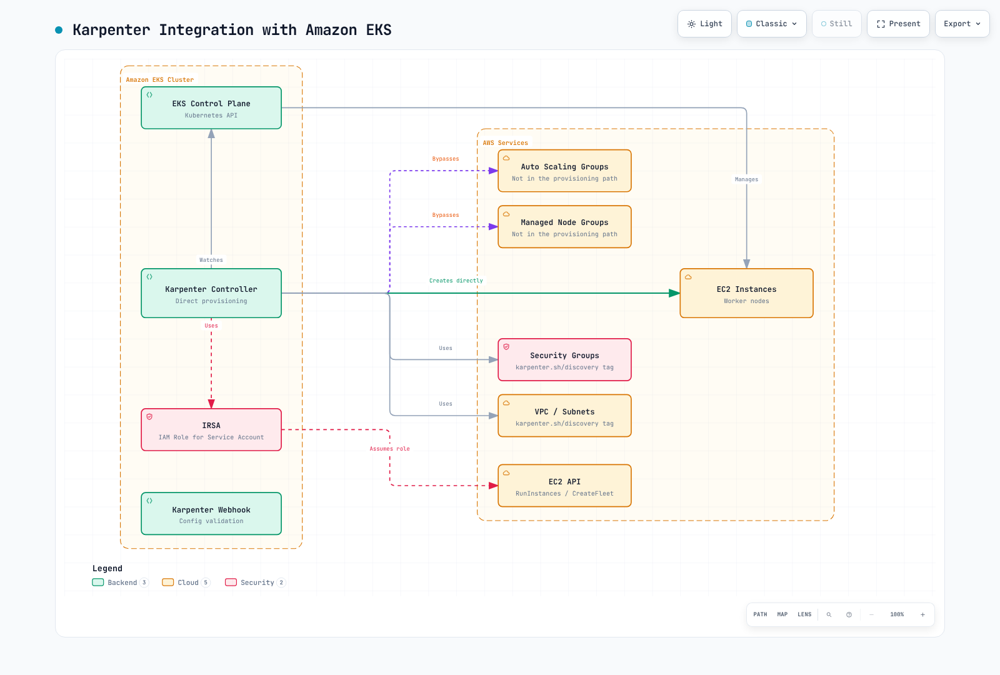
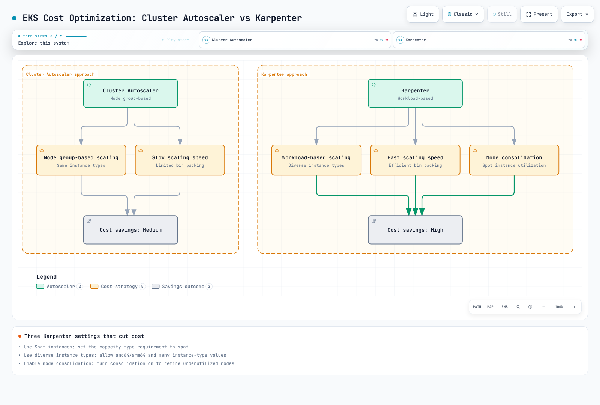
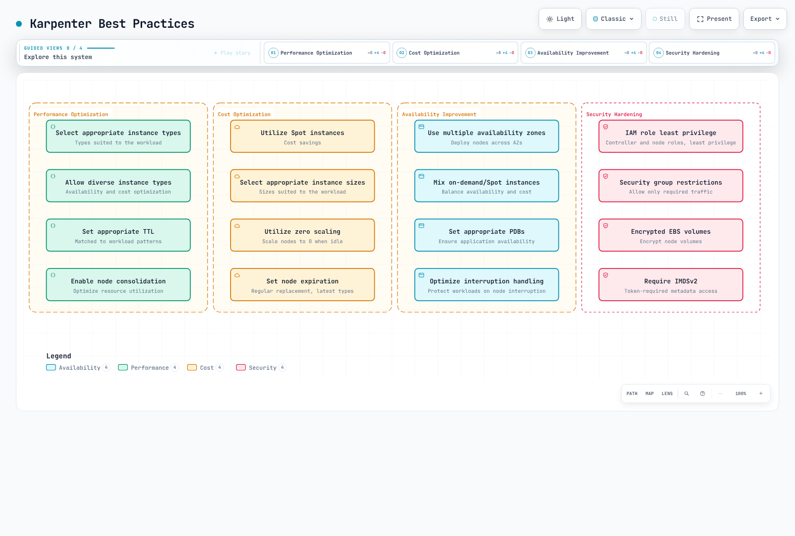

# Karpenter

> **Versiones compatibles**: Karpenter 1.14 LTS (ejemplos: 1.14.1); seleccione las versiones de Kubernetes/EKS mediante las tablas de compatibilidad y compatibilidad del proveedor.
> **Última actualización**: 16 de noviembre de 2026

## Tabla de contenido
- [Introducción](#introduction)
- [Arquitectura](#architecture)
- [Instalación y configuración](#installation-and-configuration)
- [NodePool](#nodepool)
- [Clases de nodo](#node-classes)
- [Gestión de interrupciones](#interruption-handling)
- [Integración](#integration)
- [Integración con Amazon EKS](#integration-with-amazon-eks)
- [Prácticas recomendadas](#best-practices)
- [Solución de problemas](#troubleshooting)
- [Conclusión](#conclusion)

## Introducción {#introduction}

Karpenter es un escalador automático de nodos de código abierto. Este capítulo usa su proveedor de AWS, que aprovisiona capacidad EC2 para cargas de trabajo de Kubernetes compatibles. La disponibilidad y la eficiencia dependen de las restricciones, la capacidad de la nube, la inicialización de los nodos y el diseño de las aplicaciones.

### Ventajas principales de Karpenter

1. **Escalado ágil**: inicia el aprovisionamiento en respuesta a la demanda de cargas de trabajo que no se pueden programar; no hay una garantía de latencia fija para la disponibilidad de los nodos y las aplicaciones.
2. **Optimización de costos**: selección de los tipos de instancia más adecuados para las cargas de trabajo
3. **Configuración sencilla**: configuración fácil mediante API declarativas
4. **Diseño centrado en las cargas de trabajo**: aprovisionamiento de nodos basado en los requisitos de los Pod
5. **Integración con la nube**: aprovecha las capacidades del proveedor de nube
6. **Empaquetado eficiente**: optimiza la utilización de recursos
7. **Gestión flexible de nodos**: gestión del ciclo de vida de los nodos y gestión integrada de interrupciones

### Comparación con los escaladores automáticos existentes

| Característica | Karpenter | Cluster Autoscaler | Grupos de nodos administrados por el proveedor de nube |
|---------|-----------|-------------------|---------------------------|
| Velocidad de escalado | Depende de la programación, la capacidad de EC2 y la inicialización | Depende del escalado del grupo de nodos y de la inicialización | Depende de la política de escalado, la capacidad y la inicialización |
| Selección del tipo de instancia | Dinámica | Basada en grupos de nodos | Basada en grupos de nodos |
| Eficiencia del empaquetado | Depende de las cargas de trabajo y las restricciones | Depende de las cargas de trabajo y los grupos de nodos | Depende del programador y del controlador de escalado |
| Complejidad de configuración | Baja | Media | Baja |
| Integración con la nube | Implementación específica del proveedor | Integraciones con varios proveedores de nube | Nativa del proveedor |
| Gestión de grupos de nodos | No es necesaria | Necesaria | Necesaria |
| Gestión de interrupciones | Gestión de eventos configurada y ciclo de vida de los nodos | Depende de la plataforma o la integración | Gestión específica de la plataforma |

> **Nota**: EKS añadió compatibilidad con grupos de calentamiento para grupos de nodos administrados el 8 de abril de 2026. Las instancias preinicializadas pueden reducir el trabajo repetido de inicialización; los modos Stopped y Running tienen distintos tiempos de transición y costos, y la reutilización al reducir la escala es opcional. Según AWS, la integración con Cluster Autoscaler no requiere configuración adicional. La reanudación, la disponibilidad del nodo y el inicio de la aplicación siguen llevando tiempo. Esta es una función de EKS Managed Node Group/Auto Scaling, no un grupo administrado por Karpenter.

## Arquitectura {#architecture}

Karpenter funciona como un controlador de Kubernetes: detecta los Pod que no se pueden programar y aprovisiona los nodos adecuados.


[🔍 Ver diagrama interactivo](https://www.atomai.click/kubernetes-docs/archmaps/en-autoscaling-02-karpenter-0.html)

### Flujo de trabajo de Karpenter

El siguiente diagrama muestra cómo funciona Karpenter en un clúster de EKS:


[🔍 Ver diagrama interactivo](https://www.atomai.click/kubernetes-docs/archmaps/en-autoscaling-02-karpenter-1.html)

### Componentes principales

1. **Controlador de Karpenter**: simula las necesidades de programación, crea NodeClaims y administra el ciclo de vida de los nodos; el programador de Kubernetes realiza la vinculación real de los Pod.
2. **Validación CEL de los CRD**: NodePool y EC2NodeClass se validan mediante reglas CEL en los CRD (los webhooks de admisión/conversión se eliminaron en Karpenter 1.1)
3. **CRD NodePool y NodeClaim**: NodePool define la política; un NodeClaim registra los requisitos y el ciclo de vida de un nodo aprovisionado individual.
4. **CRD EC2NodeClass**: define la configuración de los nodos que se aprovisionarán
5. **Integración con el proveedor de nube**: se integra con las API del proveedor de nube para administrar recursos de cómputo

### Cómo funciona

1. El controlador de Karpenter detecta los Pod que no se pueden programar.
2. Analiza los requisitos del Pod (recursos, selectores de nodo, tolerancias, etc.).
3. Determina los tipos de nodo adecuados según la configuración de NodePool y EC2NodeClass.
4. Llama a la API del proveedor de nube para aprovisionar nodos.
5. El nodo se registra y queda listo; entonces, el programador de Kubernetes puede vincular los Pod aptos. Karpenter no reemplaza a kube-scheduler.
6. La consolidación, la desviación, la expiración, la eliminación manual y las interrupciones de la nube tienen activadores y medidas de protección distintos; no todos son eventos de interrupción de SQS.

## Instalación y configuración {#installation-and-configuration}

Los bloques YAML sin apiVersion/kind son fragmentos de configuración para la especificación de NodePool o EC2NodeClass que se esté tratando; no son documentos independientes para aplicar con kubectl.

Estos son ejemplos didácticos independientes para un clúster existente, no un conjunto de implementación listo para producción. Los nombres de objeto repetidos representan alternativas. Prepare y verifique IAM/OIDC, el acceso de los nodos, las subredes y los grupos de seguridad aprobados, la capacidad de arranque y la cola de interrupciones antes de la instalación. Todos los YAML usan nombres de ejemplo literales como `my-cluster`; kubectl no expande `${CLUSTER_NAME}` dentro de un archivo YAML guardado. La auditoría no aprovisionó recursos de AWS, no instaló Karpenter ni midió el escalado. Los comandos de instalación nueva fallan si esa versión ya está instalada; las instalaciones existentes deben seguir la guía de migración de CRD y actualización específica de la versión.

### Requisitos previos

- Use una versión de Kubernetes compatible con su plataforma y la matriz de Karpenter. La matriz publicada indica Karpenter 1.6 como versión mínima para Kubernetes 1.34, 1.9 para 1.35 y 1.13 para 1.36; estos mínimos no significan que todas las versiones menores antiguas de Karpenter sigan recibiendo mantenimiento. La matriz de v1.14 no incluye 1.37, y la matriz de v1.15 requiere Karpenter 1.15.x para Kubernetes 1.37. La disponibilidad y la compatibilidad de las versiones de EKS deben verificarse por separado.
- kubectl configurado
- Credenciales y permisos del proveedor de nube
- Helm (opcional)

### Instalación en AWS EKS

#### 1. Configuración del rol y la política de IAM

Los comandos suponen que ya existen un rol de controlador y un rol de nodo, y que EKS usa autenticación basada en API (API o API_AND_CONFIG_MAP). En un clúster que solo use CONFIG_MAP, debe comprobarse la asignación de nodos existente en aws-auth en lugar de list-access-entries; no cambie el modo de autenticación como paso incidental de configuración. El rol de nodo confía en EC2 y necesita permisos de nodo de trabajo y extracción de ECR (por ejemplo, AmazonEKSWorkerNodePolicy y AmazonEC2ContainerRegistryPullOnly). Asigne una identidad propia a la VPC CNI cuando sea compatible; los permisos de SSM son opcionales y requieren un agente configurado. AmazonEKSClusterPolicy no sustituye la política del controlador de Karpenter.

```bash
# Set the existing cluster and Region; these commands only inspect AWS/Kubernetes.
export CLUSTER_NAME="my-cluster"
export AWS_REGION="us-west-2"
export KARPENTER_VERSION="1.14.1"
ACCOUNT_ID=$(aws sts get-caller-identity --query Account --output text)
CLUSTER_ENDPOINT=$(aws eks describe-cluster --region "$AWS_REGION" --name "$CLUSTER_NAME" --query cluster.endpoint --output text)
export ACCOUNT_ID CLUSTER_ENDPOINT
kubectl config current-context
aws iam get-role --role-name "KarpenterControllerRole-${CLUSTER_NAME}" --query Role.AssumeRolePolicyDocument
aws iam get-role --role-name "KarpenterNodeRole-${CLUSTER_NAME}" --query Role.AssumeRolePolicyDocument
aws eks list-access-entries --region "$AWS_REGION" --cluster-name "$CLUSTER_NAME"
```

#### 2. Instalación mediante Helm

Use una sola vez el ejemplo de instalación nueva, después de preparar la cola mencionada y la capacidad de arranque. Para una actualización, revise la guía de migración específica de la versión y actualice los CRD correspondientes (por ejemplo, mediante el chart karpenter-crd, administrado por separado); por lo general, actualizar solo el chart del controlador no actualiza los CRD. Antes de migrar una instalación de CRD existente, compruebe quién es su propietario.

```bash
# Run only after the prerequisites and the current kubectl context are verified.
: "${CLUSTER_NAME:?Set the existing cluster name}"
: "${ACCOUNT_ID:?Set the AWS account ID}"
: "${CLUSTER_ENDPOINT:?Set the matching EKS endpoint}"
KARPENTER_VERSION="1.14.1"
helm install karpenter oci://public.ecr.aws/karpenter/karpenter \
  --version "$KARPENTER_VERSION" \
  --namespace karpenter --create-namespace \
  --set-string 'serviceAccount.annotations.eks\.amazonaws\.com/role-arn'="arn:aws:iam::${ACCOUNT_ID}:role/KarpenterControllerRole-${CLUSTER_NAME}" \
  --set-string settings.clusterName="$CLUSTER_NAME" \
  --set-string settings.clusterEndpoint="$CLUSTER_ENDPOINT" \
  --set-string settings.interruptionQueue="$CLUSTER_NAME" \
  --wait --timeout 5m
```

#### 3. Verificación de la instalación

```bash
kubectl get deployments,pods -n karpenter
kubectl rollout status deployment/karpenter -n karpenter --timeout=180s
kubectl get nodepools,ec2nodeclasses,nodeclaims
```

Salida ilustrativa para las dos réplicas predeterminadas del controlador (no es una ejecución registrada en esta auditoría):
```
NAME                         READY   STATUS    RESTARTS   AGE
karpenter-<hash>-<id-1>      1/1     Running   0          1m
karpenter-<hash>-<id-2>      1/1     Running   0          1m
```

### Configuración básica de NodePool y EC2NodeClass

```yaml
apiVersion: karpenter.sh/v1
kind: NodePool
metadata:
  name: default
spec:
  disruption:
    consolidationPolicy: WhenEmpty
    consolidateAfter: 30s
  limits:
    cpu: '1000'
    memory: 1000Gi
  template:
    spec:
      requirements:
      - key: karpenter.sh/capacity-type
        operator: In
        values:
        - on-demand
      - key: kubernetes.io/arch
        operator: In
        values:
        - amd64
      - key: node.kubernetes.io/instance-type
        operator: In
        values:
        - m5.large
        - m5.xlarge
        - m5.2xlarge
      nodeClassRef:
        group: karpenter.k8s.aws
        kind: EC2NodeClass
        name: default
---
apiVersion: karpenter.k8s.aws/v1
kind: EC2NodeClass
metadata:
  name: default
spec:
  role: KarpenterNodeRole-my-cluster
  amiSelectorTerms:
  - alias: al2023@latest
  subnetSelectorTerms:
  - tags:
      karpenter.sh/discovery: my-cluster
  securityGroupSelectorTerms:
  - tags:
      karpenter.sh/discovery: my-cluster
  tags:
    karpenter.sh/discovery: my-cluster
  blockDeviceMappings:
  - deviceName: /dev/xvda
    ebs:
      volumeSize: 100Gi
      volumeType: gp3
      deleteOnTermination: true
      encrypted: true
```

## NodePool

NodePool es un recurso personalizado de Kubernetes que define cómo aprovisiona Karpenter los nodos. Reemplaza al Provisioner anterior.

### Configuración básica de NodePool

El taint especial siguiente requiere intencionalmente una tolerancia coincidente en la carga de trabajo. startupTaints permanece vacío hasta que se cuente con un inicializador verificado que elimine el taint configurado; inventar un taint de inicio sin un responsable que lo elimine puede dejar los nodos inutilizables. Los ejemplos de límites, inicialización e interrupciones son alternativas, no cambios que deban acumularse en un NodePool de producción en ejecución.

```yaml
apiVersion: karpenter.sh/v1
kind: NodePool
metadata:
  name: default
spec:
  template:
    metadata:
      labels:
        environment: training
        app: web
    spec:
      requirements:
      - key: karpenter.sh/capacity-type
        operator: In
        values:
        - on-demand
      - key: kubernetes.io/arch
        operator: In
        values:
        - amd64
      - key: node.kubernetes.io/instance-type
        operator: In
        values:
        - m5.large
        - m5.xlarge
        - m5.2xlarge
      nodeClassRef:
        group: karpenter.k8s.aws
        kind: EC2NodeClass
        name: default
      expireAfter: 720h
      taints:
      - key: example.com/special-taint
        value: 'true'
        effect: NoSchedule
      startupTaints: []
  limits:
    cpu: '1000'
    memory: 1000Gi
  disruption:
    consolidationPolicy: WhenEmpty
    consolidateAfter: 30s
```

### Configuración de requisitos

Los requisitos se intersectan entre sí, con EC2NodeClass y con las restricciones de los Pod. Permitir amd64 y arm64 solo es útil si los tipos de instancia, las AMI y las imágenes de contenedor aptos son compatibles con ambas arquitecturas. Una lista de zonas o tipos de capacidad aptos no garantiza una distribución uniforme; para ello, use restricciones de topología de la carga de trabajo.

Los requisitos definen las características de los nodos que aprovisionará Karpenter:

```yaml
template:
  spec:
    requirements:
    - key: karpenter.sh/capacity-type
      operator: In
      values:
      - on-demand
      - spot
    - key: kubernetes.io/arch
      operator: In
      values:
      - amd64
      - arm64
    - key: node.kubernetes.io/instance-type
      operator: In
      values:
      - m5.large
      - m5.xlarge
      - c5.large
      - m6g.large
      - c6g.large
    - key: topology.kubernetes.io/zone
      operator: In
      values:
      - us-west-2a
      - us-west-2b
      - us-west-2c
    - key: kubernetes.io/os
      operator: In
      values:
      - linux
```

### Configuración de límites

`spec.limits` restringe los recursos aprovisionados en conjunto, pero el aprovisionamiento en paralelo usa comprobaciones con coherencia eventual y puede superar temporalmente un límite. No es un tope estricto de facturación. Las cantidades en forma de cadena evitan diferencias de tipo en la API y GitOps.

```yaml
limits:
  cpu: '1000'
  memory: 1000Gi
  nvidia.com/gpu: '10'
```

### Seguimiento experimental de asignación de DRA (v1.13)

Karpenter v1.13 incorporó el seguimiento de asignación de dispositivos DRA. Esto no es una garantía general de aprovisionamiento DRA en producción: el chart de AWS 1.14.1 establece `settings.ignoreDRARequests: true` de forma predeterminada, y el proyecto upstream indica que la compatibilidad formal con DRA aún no es GA. Un requisito mínimo de Kubernetes 1.29 no basta para demostrar compatibilidad. Valide la API exacta de recursos de Kubernetes, el controlador DRA, ResourceClaims/ResourceSlices y la configuración de Karpenter; no considere las solicitudes DRA intercambiables con el ejemplo de recursos extendidos del complemento de dispositivos que aparece a continuación.

### Configuración de expiración de nodos

`expireAfter` define cuándo comienza el drenaje motivado por la expiración, no un tiempo garantizado para completar el reemplazo. El `terminationGracePeriod` opcional que aparece a continuación limita el drenaje, pero puede eliminar por la fuerza los Pod restantes, incluidos los bloqueados por PDB. Elija ese plazo solo después de validar los requisitos de apagado y recuperación de la aplicación.

```yaml
spec:
  template:
    spec:
      expireAfter: 720h
      terminationGracePeriod: 30m
  disruption:
    consolidationPolicy: WhenEmpty
    consolidateAfter: 30s
```

### Reconocimiento de taints de NodeReadinessController (v1.13)

Karpenter v1.13 reconoce los taints `readiness.k8s.io/` del NodeReadinessController independiente como efímeros durante la simulación de programación de un nodo administrado sin inicializar. Aun así, espera a que desaparezcan esos taints antes de marcar la inicialización como completa; no los elimina ni permite que el programador de Kubernetes los omita. Los demás taints de inicializador siguen requiriendo una configuración precisa de `startupTaints` y un controlador que los elimine.

### Actualización de julio de 2026: lanzamiento de v1.14

Karpenter v1.14, lanzado el 11 de julio de 2026, incorpora lo siguiente:

- **Compatibilidad con la API CapacityBuffers**: integración alfa con búferes de capacidad; `CapacityBuffer` está desactivado de forma predeterminada y requiere los CRD y la configuración del controlador correspondientes. La capacidad reservada no es capacidad gratuita ni una garantía de latencia.
- **Compatibilidad con tipos de instancia preliminares**: reconoce ofertas preliminares aptas; el aprovisionamiento real sigue requiriendo acceso a la cuenta y la Región, además de disponibilidad.
- **Compatibilidad con Nitro Enclaves**: el proveedor establece `EnclaveOptions.Enabled` en la plantilla de lanzamiento generada cuando las solicitudes de recursos de NodeClaim incluyen `eks.amazonaws.com/nip-slots`. Las instancias compatibles, la AMI y la configuración del complemento de dispositivos siguen siendo requisitos previos; en 1.14.1 no existe el campo `EC2NodeClass.spec.enclaveOptions`.
- Correcciones de errores: contabilización de la IP principal en las ENI secundarias, hidratación de la caché de Zonal Shift, incorporación de un tiempo de espera del cliente de AWS SDK a la configuración del operador y otras

Consulte las [notas de la versión v1.14.0](https://github.com/aws/karpenter-provider-aws/releases/tag/v1.14.0) para obtener más información.

El 17 de julio de 2026 se publicaron parches para ramas anteriores, incluidos 1.3.8 y 1.11.3. Este retroporte histórico no demuestra que todas las versiones menores intermedias sigan teniendo soporte. La política de soporte actual enumera LTS 1.9 hasta febrero de 2027 y LTS 1.14 hasta julio de 2027; las versiones menores regulares solo tienen soporte hasta la siguiente versión menor. Elija una línea con soporte y siga su guía de migración en lugar de asumir que una línea antigua sigue recibiendo mantenimiento.

El anuncio de AWS del 22 de julio de 2026 añadió la configuración de interfaces de red EFA y grupos de ubicación para Karpenter/EKS Auto Mode. En AWS Karpenter 1.14.1, los campos concretos son `EC2NodeClass.spec.networkInterfaces` y `spec.placementGroupSelector` (no campos de NodePool). Las interfaces exclusivamente EFA no consumen direcciones IP de la VPC, pero sigue siendo necesaria una `interface` principal en el índice de dispositivo/tarjeta 0. Seleccione un grupo de ubicación existente por nombre o ID; su estrategia de clúster, dispersión o partición, y las instancias compatibles, restringen la ubicación. El ejemplo de este documento no configura ni valida una carga de trabajo de HPC.

### Actualización de agosto de 2026: versión de parche v1.14.1

[v1.14.1](https://github.com/aws/karpenter-provider-aws/releases/tag/v1.14.1), el primer parche de la línea v1.14, se publicó el 21 de agosto de 2026. Es una versión de mantenimiento que actualiza la versión upstream de `sigs.k8s.io/karpenter` y selecciona mediante cherry-pick las correcciones realizadas desde v1.14.0.

### Actualización de octubre de 2026: versión estándar v1.15.0

[v1.15.0](https://github.com/aws/karpenter-provider-aws/releases/tag/v1.15.0), una versión menor estándar (no LTS), se publicó el 10 de octubre de 2026. Cambios principales:

- **La reparación de nodos pasa a ser una interrupción voluntaria**: la reparación de nodos se integra en el mecanismo de interrupciones, con reparación que primero termina el nodo cuando un NodePool limitado por capacidad no puede preparar antes un nodo de reemplazo. Se añade el reinicio mediante `ec2:RebootInstances` como acción de reparación (detrás de la opción de función de AWS `RebootForRepair`), y el controlador de reparación anterior sigue disponible mediante la marca `--legacy-node-repair`.
- **Compatibilidad con CEL en KubeletConfiguration**: `maxPodsExpression`, `kubeReserved` y `systemReserved` aceptan expresiones CEL, y se ampliaron los campos KubeletConfiguration de EC2NodeClass.
- **Compatibilidad ampliada con DRA**: compatibilidad con alternativas priorizadas y con DRA para los controladores NVIDIA y EFA.
- También: marca `--aws-feature-gates`, reconocimiento predeterminado de la distribución de topología de los Pod, contabilización de los límites de volúmenes del tipo de instancia durante el aprovisionamiento, nuevas métricas de interrupción como `karpenter_pods_disrupted_total` y un controlador de gestión del costo de eliminación de Pod sujeto a una opción de función.

Según la política de soporte, las versiones menores regulares solo tienen soporte hasta la siguiente versión menor; por tanto, con v1.15.0 ya disponible, v1.14 continúa únicamente como línea LTS (hasta julio de 2027). Por eso, los ejemplos de este capítulo siguen usando 1.14 LTS (1.14.1). Kubernetes 1.37 requiere Karpenter 1.15.x; así que, si necesita Kubernetes 1.37 o cambia a 1.15, consulte primero la [matriz de compatibilidad de v1.15](https://karpenter.sh/v1.15/upgrading/compatibility/) y las indicaciones de actualización. Consulte las [notas de la versión v1.15.0](https://github.com/aws/karpenter-provider-aws/releases/tag/v1.15.0) para obtener más información.

### Actualización de octubre de 2026: v1.15.1 y versiones de parche LTS

Entre el 20 y el 23 de octubre de 2026 se publicaron versiones de parche en las líneas con soporte: [v1.15.1](https://github.com/aws/karpenter-provider-aws/releases/tag/v1.15.1) (primer parche de la línea 1.15: las correcciones incluyen relajar las preferencias en lugar de aplazar el proceso cuando todas las reservas de capacidad compatibles están completas, y poner en cola la reparación de nodos cuando la etiqueta se sincroniza después de la creación), [v1.14.2](https://github.com/aws/karpenter-provider-aws/releases/tag/v1.14.2) y [v1.14.3](https://github.com/aws/karpenter-provider-aws/releases/tag/v1.14.3) en la línea 1.14 LTS (clasificación de `SpotMaxPriceTooLow` como error ICE y tratamiento de una reserva de capacidad interrumpible que se está reclamando como capacidad no disponible, entre otras), y [v1.9.3](https://github.com/aws/karpenter-provider-aws/releases/tag/v1.9.3) en la línea 1.9 LTS. Las tres líneas también actualizan la cadena de herramientas de Go a 1.26.10, la versión de parche de Go que deja de confiar en los certificados de CA intermedia de eMudhra comprometidos (CVE-2026-111943).

### Actualización de noviembre de 2026: se anuncia la compatibilidad con DRA para EKS Auto Mode y Karpenter

El 9 de noviembre de 2026, AWS anunció la compatibilidad con Dynamic Resource Allocation (DRA) de Kubernetes para GPU NVIDIA y dispositivos de red Elastic Fabric Adapter (EFA) con EKS Auto Mode y Karpenter. Las cargas de trabajo declaran mediante DRA los atributos de dispositivo que necesitan y pueden compartir dispositivos GPU entre Pod. Karpenter admite DRA en todas las versiones de Kubernetes; EKS Auto Mode lo admite en Kubernetes 1.36 y versiones posteriores, excepto en AWS GovCloud (US) y las Regiones de China. Consulte el [anuncio](https://aws.amazon.com/about-aws/whats-new/2026/11/amazon-eks-auto-mode-karpenter-dra/) para obtener más información.

### Actualización de noviembre de 2026: versión de parche v1.15.2

[v1.15.2](https://github.com/aws/karpenter-provider-aws/releases/tag/v1.15.2), publicada el 12 de noviembre de 2026, solo actualiza los metadatos de los tipos de instancia DRA; no cambia nada a menos que se habilite la opción alfa `settings.awsFeatureGates.draNVIDIAGPU` o `settings.awsFeatureGates.draEFA` (o `settings.enableDRA`). Añade metadatos DRA de GPU NVIDIA para `g7` y `g7e` y actualiza los atributos de memoria GPU para los tipos de instancia GPU existentes; los tipos de GPU fraccionaria `g6f` y `gr6f` dejan de incluir metadatos DRA de NVIDIA, por lo que Karpenter no los elegirá para solicitudes `gpu.nvidia.com`. Los metadatos DRA de EFA ahora cubren 302 tipos de instancia, frente a 29; las entradas añadidas solo establecen `dra.net/pciDevice`, `dra.net/pciVendor` y `dra.net/rdma`. Para compilar desde el código fuente, ahora se necesita Go 1.26.11 o posterior.

## Clases de nodo {#node-classes}

Las clases de nodo definen la configuración de los nodos que aprovisiona Karpenter. En AWS, usa el CRD EC2NodeClass.

### Configuración de AWS EC2NodeClass

```yaml
apiVersion: karpenter.k8s.aws/v1
kind: EC2NodeClass
metadata:
  name: default
spec:
  subnetSelectorTerms:
  - tags:
      karpenter.sh/discovery: my-cluster
  securityGroupSelectorTerms:
  - tags:
      karpenter.sh/discovery: my-cluster
  tags:
    karpenter.sh/discovery: my-cluster
    environment: training
  blockDeviceMappings:
  - deviceName: /dev/xvda
    ebs:
      volumeSize: 100Gi
      volumeType: gp3
      deleteOnTermination: true
      encrypted: true
  role: KarpenterNodeRole-my-cluster
  amiSelectorTerms:
  - alias: al2023@latest
  userData: '#!/bin/bash

    echo "Hello from Karpenter node!"

    '
  metadataOptions:
    httpEndpoint: enabled
    httpProtocolIPv6: disabled
    httpPutResponseHopLimit: 1
    httpTokens: required
```

### Selección de subredes y grupos de seguridad

Las subredes y los grupos de seguridad se seleccionan mediante términos de selección (varios términos se combinan con OR; las etiquetas dentro de un mismo término se combinan con AND):

```yaml
subnetSelectorTerms:
- tags:
    karpenter.sh/discovery: my-cluster
    Name: private-*
securityGroupSelectorTerms:
- tags:
    karpenter.sh/discovery: my-cluster
```

### Configuración de AMI

Karpenter selecciona las AMI mediante `amiSelectorTerms`. Un alias selecciona una familia/versión; **`@latest` no fija una versión** y puede cambiar las AMI resueltas y activar la desviación. Los ejemplos con `@latest` son didácticos. En producción, resuelva y pruebe una versión explícita y compatible de AMI (`al2023@vYYYYMMDD` con una fecha real de lanzamiento) o ID de AMI aprobados antes del despliegue. No se publican AMI de AL2 EKS para Kubernetes 1.33 o posterior. Las variantes siguientes son alternativas, y una AMI personalizada requiere una configuración funcional de arranque, taint de registro, kubelet, CNI/tiempo de ejecución e identidad.

```yaml
# Amazon Linux 2023
amiSelectorTerms:
  - alias: al2023@latest
---
# Bottlerocket
amiSelectorTerms:
  - alias: bottlerocket@latest
---
# Custom AMI (by ID): amiFamily is required when no alias term is used
amiFamily: Custom
amiSelectorTerms:
  - id: "ami-0123456789abcdef0"
# Ubuntu: no v1 alias; use amiFamily: Custom with an id/tags/name term
```

### Configuración de dispositivos de bloque

Las asignaciones de dispositivos dependen de la familia de AMI. Estos ejemplos de AL2023 usan /dev/xvda para el dispositivo raíz; inspeccione la distribución real de otras AMI. Los volúmenes adicionales necesitan un plan explícito de sistema de archivos/montaje o almacenamiento de aplicaciones. Una clave de KMS administrada por el cliente también requiere los permisos adecuados de clave/IAM.

Puede definir la configuración de almacenamiento de los nodos:

```yaml
blockDeviceMappings:
- deviceName: /dev/xvda
  ebs:
    volumeSize: 100Gi
    volumeType: gp3
    iops: 3000
    throughput: 125
    deleteOnTermination: true
    encrypted: true
    kmsKeyID: arn:aws:kms:us-west-2:111122223333:key/1234abcd-12ab-34cd-56ef-1234567890ab
- deviceName: /dev/xvdb
  ebs:
    volumeSize: 500Gi
    volumeType: gp3
    deleteOnTermination: true
    encrypted: true
```

### Configuración de datos de usuario

Estos fragmentos de datos de usuario de shell presuponen AL2023, cuya configuración de arranque/nodeadm generada Karpenter combina con los datos personalizados. No son válidos como configuración de arranque genérica de Bottlerocket/Windows. Incluya los paquetes en una AMI y pruébelos, en lugar de ejecutar una actualización de paquetes sin restricciones en cada lanzamiento. Instalar/iniciar CloudWatch Agent sin su configuración, IAM y ruta de red no garantiza la recopilación de telemetría.

```yaml
userData: |
  #!/bin/bash
  set -euo pipefail
  # Only for a workload that requires this setting; keep node packages in a tested AMI.
  cat > /etc/sysctl.d/99-workload-map-count.conf <<'EOF'
  vm.max_map_count=262144
  EOF
  sysctl -p /etc/sysctl.d/99-workload-map-count.conf
```

### Proceso de consolidación de nodos

El siguiente diagrama muestra el proceso de consolidación de nodos de Karpenter. Esta función es importante para optimizar la eficiencia del clúster y reducir costos:


[🔍 Ver diagrama interactivo](https://www.atomai.click/kubernetes-docs/archmaps/en-autoscaling-02-karpenter-2.html)

## Gestión de interrupciones {#interruption-handling}

La gestión de interrupciones configurada intenta reaccionar antes de que se pierda capacidad. Las notificaciones, la capacidad de reemplazo, los plazos de apagado y la recuperación de la aplicación determinan el resultado; no se garantiza la disponibilidad ininterrumpida.

### Gestión integrada de interrupciones

La gestión de interrupciones de la nube es independiente de la consolidación y la expiración. Abarca señales como las siguientes:

1. **Advertencias de interrupción de Spot**: inicia el drenaje y solicita capacidad de reemplazo cuando es posible; el plazo de aviso no es un SLA de recuperación garantizado.
2. **Eventos programados de estado/mantenimiento**: reacciona a las instancias afectadas.
3. **Eventos de detención/terminación de instancias**: concilia la capacidad que dejará de prestar servicio.
4. **Fallos de estado de instancias EC2**: inspecciona el estado con los permisos necesarios de la API de EC2. Las recomendaciones de rebalanceo por sí solas se publican como eventos; no activan automáticamente operaciones de taint, drenaje o terminación.

### Configuración de la gestión de interrupciones

```yaml
apiVersion: karpenter.sh/v1
kind: NodePool
metadata:
  name: default
spec:
  template:
    spec:
      requirements:
        - key: karpenter.sh/capacity-type
          operator: In
          values: ["on-demand"]
      nodeClassRef:
        group: karpenter.k8s.aws
        kind: EC2NodeClass
        name: default

      # Node expiration settings
      expireAfter: 720h  # 30 days
  disruption:
    consolidationPolicy: WhenEmpty
    consolidateAfter: 30s
```

### Configuración del drenaje

Karpenter normalmente usa la expulsión durante el drenaje ordenado. La configuración de Helm configura el controlador; los presupuestos de interrupción de NodePool limitan el inicio de la consolidación/desviación voluntarias, no todas las pérdidas simultáneas de nodos. Un presupuesto del 30 % se redondea hacia arriba y luego se descuentan los nodos que se están eliminando o no están listos; no es un límite estricto del 30 %. La expiración, las interrupciones y la reparación pueden tener distintos comportamientos de fuerza. Configure la cola SQS con nombre, las reglas/destinos de EventBridge, la política de la cola y los permisos del controlador antes de habilitar `interruptionQueue`; el campo de Helm por sí solo no los crea.

```yaml
settings:
  clusterName: my-cluster
  interruptionQueue: my-cluster
  batchMaxDuration: 10s
  batchIdleDuration: 1s
  featureGates:
    spotToSpotConsolidation: false
controller:
  resources:
    requests:
      cpu: 1
      memory: 1Gi
    limits:
      cpu: '1'
      memory: 1Gi
logLevel: info
```

```yaml
apiVersion: karpenter.sh/v1
kind: NodePool
metadata:
  name: default
spec:
  template:
    spec:
      requirements:
        - key: karpenter.sh/capacity-type
          operator: In
          values: ["on-demand"]
      nodeClassRef:
        group: karpenter.k8s.aws
        kind: EC2NodeClass
        name: default
      expireAfter: 720h
  disruption:
    consolidationPolicy: WhenEmpty
    consolidateAfter: 30s
    budgets:
      - nodes: "30%"   # Voluntary budget: round up, then subtract deleting/not-ready nodes
```

### Integración de PDB (PodDisruptionBudget)

Los PDB restringen la expulsión voluntaria según las réplicas en buen estado; no crean réplicas ni garantizan la disponibilidad de la aplicación. El valor `minAvailable: 2` que aparece a continuación requiere suficientes Pod coincidentes en buen estado antes de permitir una expulsión. La pérdida de una instancia y los plazos de terminación forzada aún pueden interrumpirlos.

```yaml
apiVersion: policy/v1
kind: PodDisruptionBudget
metadata:
  name: app-pdb
  namespace: default
spec:
  minAvailable: 2
  selector:
    matchLabels:
      app: my-app
```

## Integración {#integration}

Karpenter se integra con varios servicios de Kubernetes y de la nube.

### Integración con Kubernetes

#### 1. Restricciones de distribución de topología de los Pod

Karpenter tiene en cuenta las restricciones de distribución de topología de los Pod al aprovisionar nodos:

```yaml
apiVersion: apps/v1
kind: Deployment
metadata:
  name: web-server
  namespace: default
spec:
  replicas: 10
  template:
    spec:
      topologySpreadConstraints:
      - maxSkew: 1
        topologyKey: topology.kubernetes.io/zone
        whenUnsatisfiable: DoNotSchedule
        labelSelector:
          matchLabels:
            app: web-server
      containers:
      - name: web-server
        image: nginx:1.30.6
        ports:
        - containerPort: 80
        resources:
          requests:
            cpu: 100m
            memory: 128Mi
          limits:
            memory: 256Mi
    metadata:
      labels:
        app: web-server
  selector:
    matchLabels:
      app: web-server
```

#### 2. Afinidad y antiafinidad de Pod

Karpenter tiene en cuenta las reglas de afinidad y antiafinidad de Pod:

```yaml
apiVersion: apps/v1
kind: Deployment
metadata:
  name: web-server
  namespace: default
spec:
  replicas: 10
  template:
    spec:
      affinity:
        podAntiAffinity:
          requiredDuringSchedulingIgnoredDuringExecution:
          - labelSelector:
              matchExpressions:
              - key: app
                operator: In
                values:
                - web-server
            topologyKey: kubernetes.io/hostname
      containers:
      - name: web-server
        image: nginx:1.30.6
        ports:
        - containerPort: 80
        resources:
          requests:
            cpu: 100m
            memory: 128Mi
          limits:
            memory: 256Mi
    metadata:
      labels:
        app: web-server
  selector:
    matchLabels:
      app: web-server
```

#### 3. Taints y tolerancias

El ejemplo de GPU requiere una AMI acelerada compatible, el controlador NVIDIA y un DaemonSet del complemento de dispositivos que tolere el taint de GPU y anuncie nvidia.com/gpu. El Pod BusyBox solo demuestra la reserva de una GPU; no ejecuta ni evalúa el rendimiento de CUDA. Valide por separado su imagen real de aplicación de GPU.

Karpenter tiene en cuenta los taints y las tolerancias al aprovisionar nodos:

```yaml
apiVersion: karpenter.sh/v1
kind: NodePool
metadata:
  name: gpu
spec:
  template:
    spec:
      requirements:
      - key: node.kubernetes.io/instance-type
        operator: In
        values:
        - g4dn.xlarge
        - g4dn.2xlarge
      taints:
      - key: nvidia.com/gpu
        value: 'true'
        effect: NoSchedule
      nodeClassRef:
        group: karpenter.k8s.aws
        kind: EC2NodeClass
        name: default
---
apiVersion: apps/v1
kind: Deployment
metadata:
  name: gpu-app
  namespace: default
spec:
  replicas: 3
  template:
    spec:
      tolerations:
      - key: nvidia.com/gpu
        operator: Exists
        effect: NoSchedule
      nodeSelector:
        karpenter.sh/nodepool: gpu
      containers:
      - name: gpu-allocation-demo
        image: busybox:1.38.0
        command:
        - sh
        - -c
        - sleep 3600
        resources:
          requests:
            cpu: 100m
            memory: 64Mi
          limits:
            memory: 128Mi
            nvidia.com/gpu: 1
    metadata:
      labels:
        app: gpu-app
  selector:
    matchLabels:
      app: gpu-app
```

### Integración con AWS

#### 1. Instancias EC2 Spot

Karpenter admite instancias EC2 Spot para optimizar costos:

```yaml
apiVersion: karpenter.sh/v1
kind: NodePool
metadata:
  name: spot
spec:
  template:
    spec:
      requirements:
      - key: karpenter.sh/capacity-type
        operator: In
        values:
        - spot
      nodeClassRef:
        group: karpenter.k8s.aws
        kind: EC2NodeClass
        name: spot
---
apiVersion: karpenter.k8s.aws/v1
kind: EC2NodeClass
metadata:
  name: spot
spec:
  role: KarpenterNodeRole-my-cluster
  amiSelectorTerms:
  - alias: al2023@latest
  subnetSelectorTerms:
  - tags:
      karpenter.sh/discovery: my-cluster
  securityGroupSelectorTerms:
  - tags:
      karpenter.sh/discovery: my-cluster
```

#### 2. Perfiles de instancia de EC2

`role` y `instanceProfile` son mutuamente excluyentes. Con `role`, Karpenter administra un perfil de instancia y necesita los permisos/conectividad de API de IAM correspondientes. Si el clúster no tiene una ruta al punto de conexión de IAM, use un `instanceProfile` aprovisionado previamente; IAM no tiene un punto de conexión de PrivateLink. El controlador sigue necesitando PassRole para su rol de nodo, y el acceso de los nodos a EKS es independiente de tener credenciales de EC2.

Karpenter usa perfiles de instancia de EC2 para conceder permisos de IAM a los nodos:

```yaml
apiVersion: karpenter.k8s.aws/v1
kind: EC2NodeClass
metadata:
  name: default
spec:
  instanceProfile: KarpenterNodeInstanceProfile-my-cluster
  amiSelectorTerms:
  - alias: al2023@latest
  subnetSelectorTerms:
  - tags:
      karpenter.sh/discovery: my-cluster
  securityGroupSelectorTerms:
  - tags:
      karpenter.sh/discovery: my-cluster
```

#### 3. Reemplazo de plantillas de lanzamiento (EC2NodeClass)

Karpenter v1 no acepta plantillas de lanzamiento de EC2 proporcionadas por el usuario (se eliminó el campo heredado `launchTemplate`). Karpenter genera y administra sus propias plantillas de lanzamiento a partir de EC2NodeClass; por ello, los ajustes que habría incluido en una plantilla de lanzamiento se expresan directamente en EC2NodeClass:

```yaml
apiVersion: karpenter.k8s.aws/v1
kind: EC2NodeClass
metadata:
  name: node-config
spec:
  role: KarpenterNodeRole-my-cluster
  subnetSelectorTerms:
  - tags:
      karpenter.sh/discovery: my-cluster
  securityGroupSelectorTerms:
  - tags:
      karpenter.sh/discovery: my-cluster
  amiSelectorTerms:
  - alias: al2023@latest
  userData: '#!/bin/bash

    echo "Hello from Karpenter node!"

    '
  blockDeviceMappings:
  - deviceName: /dev/xvda
    ebs:
      volumeSize: 100Gi
      volumeType: gp3
      deleteOnTermination: true
      encrypted: true
  metadataOptions:
    httpEndpoint: enabled
    httpProtocolIPv6: disabled
    httpPutResponseHopLimit: 1
    httpTokens: required
```
## Integración con Amazon EKS {#integration-with-amazon-eks}

El proveedor de AWS de Karpenter puede aprovisionar capacidad EC2 junto con la capacidad administrada por EKS cuando se configuran la identidad, la red, el acceso de los nodos y el arranque.



[🔍 Ver diagrama interactivo](https://www.atomai.click/kubernetes-docs/archmaps/en-autoscaling-02-karpenter-3.html)

### Preparación del clúster de EKS

Reemplace todos los nombres de ejemplo de forma coherente. Seleccione solo subredes/grupos de seguridad adecuados para los nodos de trabajo; etiquetar todas las subredes del plano de control no es una estrategia segura de detección. Verifique las rutas de las subredes, las reglas de seguridad, la capacidad de direcciones IP de CNI y los puntos de conexión privados necesarios antes de permitir el lanzamiento de nodos.

#### 1. Configuración de etiquetas del clúster

Haga que la configuración de infraestructura etiquete solo las subredes y los grupos de seguridad de los nodos de trabajo aprobados. Las etiquetas de la VPC no seleccionan esos recursos. Los valores de detección deben coincidir con los ejemplos (`my-cluster` en este caso); las etiquetas por sí solas no demuestran que haya enrutamiento privado, reglas de seguridad adecuadas ni suficientes direcciones libres. Inspeccione los recursos y las rutas reales antes de aplicar un NodePool.

```bash
# Inspect resources that your infrastructure configuration has tagged for this cluster.
: "${CLUSTER_NAME:?Set the existing cluster name}"
: "${AWS_REGION:?Set the cluster Region}"
aws ec2 describe-subnets --region "$AWS_REGION" \
  --filters "Name=tag:karpenter.sh/discovery,Values=${CLUSTER_NAME}" \
  --query 'Subnets[].{ID:SubnetId,AZ:AvailabilityZone,FreeIPs:AvailableIpAddressCount,PublicIPOnLaunch:MapPublicIpOnLaunch,VPC:VpcId}'
aws ec2 describe-security-groups --region "$AWS_REGION" \
  --filters "Name=tag:karpenter.sh/discovery,Values=${CLUSTER_NAME}" \
  --query 'SecurityGroups[].{ID:GroupId,VPC:VpcId,Name:GroupName}'
# Inspect explicit and main route-table associations for the intended subnets.
aws ec2 describe-route-tables --region "$AWS_REGION" \
  --filters "Name=vpc-id,Values=$(aws eks describe-cluster --region "$AWS_REGION" --name "$CLUSTER_NAME" --query cluster.resourcesVpcConfig.vpcId --output text)"
```

#### 2. Configuración del rol de IAM

Use la política del controlador específica de la versión y la referencia de infraestructura que aparecen a continuación en lugar de la política incompleta, escrita a mano y permisiva para todo lo anterior. Las credenciales del controlador (IRSA en este caso) son independientes de las credenciales de los nodos y de las identidades de VPC CNI/cargas de trabajo. La relación de confianza del controlador debe coincidir con el proveedor OIDC del clúster, `system:serviceaccount:karpenter:karpenter` y `aud: sts.amazonaws.com`; conceda solo las acciones, recursos y condiciones necesarios para esta versión y las funciones elegidas. El rol de nodo debe poder unirse a EKS, normalmente mediante una entrada de acceso `EC2_LINUX` cuando está habilitada la autenticación basada en API. Los comandos de inspección no crean roles de IAM ni entradas de acceso.

```bash
# Download a versioned reference for review; this does not create a CloudFormation stack.
KARPENTER_VERSION="1.14.1"
curl --fail --show-error --location \
  "https://raw.githubusercontent.com/aws/karpenter-provider-aws/v${KARPENTER_VERSION}/website/content/en/preview/getting-started/getting-started-with-karpenter/cloudformation.yaml" \
  --output karpenter-cloudformation-reference.yaml
# Inspect the existing role's attached and inline policies.
: "${CLUSTER_NAME:?Set the existing cluster name}"
aws iam list-attached-role-policies --role-name "KarpenterControllerRole-${CLUSTER_NAME}"
aws iam list-role-policies --role-name "KarpenterControllerRole-${CLUSTER_NAME}"
```

### Instalación de Karpenter en un clúster de EKS

```bash
# Run only after the prerequisites and the current kubectl context are verified.
: "${CLUSTER_NAME:?Set the existing cluster name}"
: "${ACCOUNT_ID:?Set the AWS account ID}"
: "${CLUSTER_ENDPOINT:?Set the matching EKS endpoint}"
KARPENTER_VERSION="1.14.1"
helm install karpenter oci://public.ecr.aws/karpenter/karpenter \
  --version "$KARPENTER_VERSION" \
  --namespace karpenter --create-namespace \
  --set-string 'serviceAccount.annotations.eks\.amazonaws\.com/role-arn'="arn:aws:iam::${ACCOUNT_ID}:role/KarpenterControllerRole-${CLUSTER_NAME}" \
  --set-string settings.clusterName="$CLUSTER_NAME" \
  --set-string settings.clusterEndpoint="$CLUSTER_ENDPOINT" \
  --set-string settings.interruptionQueue="$CLUSTER_NAME" \
  --wait --timeout 5m
```

### Uso con EKS Managed Node Groups

Karpenter puede coexistir con EKS Managed Node Groups. El siguiente NodePool aprovisiona nodos EC2 independientes; no administra Managed Node Group. Mantenga el controlador en una capacidad de arranque fiable (el chart predeterminado excluye los nodos de Karpenter y solicita dos réplicas en hosts distintos).

```yaml
apiVersion: karpenter.sh/v1
kind: NodePool
metadata:
  name: managed-ng
spec:
  template:
    metadata:
      labels:
        managed-by: karpenter
    spec:
      requirements:
      - key: karpenter.sh/capacity-type
        operator: In
        values:
        - on-demand
      - key: node.kubernetes.io/instance-type
        operator: In
        values:
        - m5.large
        - m5.xlarge
      taints:
      - key: managed-by
        value: karpenter
        effect: NoSchedule
      nodeClassRef:
        group: karpenter.k8s.aws
        kind: EC2NodeClass
        name: managed-ng
  disruption:
    consolidationPolicy: WhenEmpty
    consolidateAfter: 30s
---
apiVersion: karpenter.k8s.aws/v1
kind: EC2NodeClass
metadata:
  name: managed-ng
spec:
  role: KarpenterNodeRole-my-cluster
  amiSelectorTerms:
  - alias: al2023@latest
  subnetSelectorTerms:
  - tags:
      karpenter.sh/discovery: my-cluster
  securityGroupSelectorTerms:
  - tags:
      karpenter.sh/discovery: my-cluster
  tags:
    karpenter.sh/discovery: my-cluster
```

### Uso con EKS Fargate

Fargate no implementa topologySpreadConstraints de Kubernetes, y las reglas de afinidad/antiafinidad de Kubernetes no se aplican allí. No suponga que las restricciones de ubicación EC2 del chart predeterminado garantizan la separación de zonas de disponibilidad de Fargate; diseñe y verifique por separado la ubicación del perfil y las subredes.

Un perfil de Fargate seleccionado de forma específica puede alojar los Pod del controlador, mientras Karpenter aprovisiona los nodos de trabajo EC2. Karpenter no crea capacidad de Fargate ni administra sus perfiles. Prepare un perfil que seleccione el espacio de nombres `karpenter` y las etiquetas del controlador, en lugar de todo `default`/`kube-system`; la estructura del selector JSON es `[{"namespace":"karpenter","labels":{"app.kubernetes.io/name":"karpenter"}}]`. El perfil necesita su propio rol de ejecución de Pod y subredes privadas; los permisos de AWS del controlador siguen requiriendo IRSA (EKS Pod Identity no es compatible con Fargate). El siguiente comando solo inspecciona un perfil existente.

```bash
# Inspect an existing, narrowly selected controller Fargate profile.
: "${CLUSTER_NAME:?Set the existing cluster name}"
: "${AWS_REGION:?Set the cluster Region}"
aws eks describe-fargate-profile --region "$AWS_REGION" \
  --cluster-name "$CLUSTER_NAME" --fargate-profile-name karpenter-controller
```

```yaml
apiVersion: karpenter.sh/v1
kind: NodePool
metadata:
  name: ec2
spec:
  template:
    spec:
      requirements:
      - key: karpenter.sh/capacity-type
        operator: In
        values:
        - on-demand
      nodeClassRef:
        group: karpenter.k8s.aws
        kind: EC2NodeClass
        name: ec2
  disruption:
    consolidationPolicy: WhenEmpty
    consolidateAfter: 30s
---
apiVersion: karpenter.k8s.aws/v1
kind: EC2NodeClass
metadata:
  name: ec2
spec:
  role: KarpenterNodeRole-my-cluster
  amiSelectorTerms:
  - alias: al2023@latest
  subnetSelectorTerms:
  - tags:
      karpenter.sh/discovery: my-cluster
  securityGroupSelectorTerms:
  - tags:
      karpenter.sh/discovery: my-cluster
```

### Respuesta ante fallos de zona de disponibilidad: integración con Zonal Shift de Amazon ARC (mayo de 2026)

Karpenter puede integrarse con un recurso de cambio zonal de EKS ARC habilitado. Cuando se activa un cambio zonal manual o un cambio automático configurado, Karpenter evita incorporar nueva capacidad en la zona de disponibilidad afectada. Esto no supone la detección independiente de todos los fallos de zona y no anula un requisito de Pod/PV que fije la carga de trabajo a esa zona.

Durante un cambio activo, se detienen las interrupciones voluntarias en la zona afectada; también se evitan las interrupciones en zonas en buen estado que dependan de mover Pod a esa zona. Esto no significa que se detengan incondicionalmente todas las interrupciones voluntarias en todas las zonas en buen estado. Configure los requisitos previos de EKS/ARC, los permisos `eks:DescribeCluster`/ARC y `settings.enableZonalShift: true` (opción de entorno `ENABLE_ZONAL_SHIFT`); el cambio automático también requiere su propia configuración de habilitación y práctica. No se necesita un CRD de ARC personalizado, y las operaciones se reanudan cuando termina el cambio.

### Optimización de costos de EKS

Puede usar Karpenter para optimizar los costos de los clústeres de EKS:



[🔍 Ver diagrama interactivo](https://www.atomai.click/kubernetes-docs/archmaps/en-autoscaling-02-karpenter-4.html)

#### 1. Uso de instancias Spot

```yaml
apiVersion: karpenter.sh/v1
kind: NodePool
metadata:
  name: spot
spec:
  template:
    spec:
      requirements:
      - key: karpenter.sh/capacity-type
        operator: In
        values:
        - spot
      - key: kubernetes.io/arch
        operator: In
        values:
        - amd64
        - arm64
      nodeClassRef:
        group: karpenter.k8s.aws
        kind: EC2NodeClass
        name: spot
  disruption:
    consolidationPolicy: WhenEmpty
    consolidateAfter: 30s
---
apiVersion: karpenter.k8s.aws/v1
kind: EC2NodeClass
metadata:
  name: spot
spec:
  role: KarpenterNodeRole-my-cluster
  amiSelectorTerms:
  - alias: al2023@latest
  subnetSelectorTerms:
  - tags:
      karpenter.sh/discovery: my-cluster
  securityGroupSelectorTerms:
  - tags:
      karpenter.sh/discovery: my-cluster
```

#### 2. Uso de distintos tipos de instancia

```yaml
apiVersion: karpenter.sh/v1
kind: NodePool
metadata:
  name: flexible
spec:
  template:
    spec:
      requirements:
      - key: karpenter.sh/capacity-type
        operator: In
        values:
        - on-demand
        - spot
      - key: kubernetes.io/arch
        operator: In
        values:
        - amd64
        - arm64
      - key: node.kubernetes.io/instance-type
        operator: In
        values:
        - m5.large
        - m5.xlarge
        - m5.2xlarge
        - m6g.large
        - m6g.xlarge
        - m6g.2xlarge
        - c5.large
        - c5.xlarge
        - c5.2xlarge
        - c6g.large
        - c6g.xlarge
        - c6g.2xlarge
        - r5.large
        - r5.xlarge
        - r5.2xlarge
        - r6g.large
        - r6g.xlarge
        - r6g.2xlarge
      nodeClassRef:
        group: karpenter.k8s.aws
        kind: EC2NodeClass
        name: default
  disruption:
    consolidationPolicy: WhenEmpty
    consolidateAfter: 30s
```

#### 3. Habilitación de la consolidación de nodos

```yaml
apiVersion: karpenter.sh/v1
kind: NodePool
metadata:
  name: default
spec:
  template:
    spec:
      requirements:
        - key: karpenter.sh/capacity-type
          operator: In
          values: ["on-demand"]
      nodeClassRef:
        group: karpenter.k8s.aws
        kind: EC2NodeClass
        name: default
  disruption:
    consolidationPolicy: WhenEmptyOrUnderutilized
    consolidateAfter: 1m
```

## Prácticas recomendadas {#best-practices}



[🔍 Ver diagrama interactivo](https://www.atomai.click/kubernetes-docs/archmaps/en-autoscaling-02-karpenter-5.html)

### Optimización del rendimiento

1. **Seleccione tipos de instancia adecuados**: elija tipos de instancia apropiados para sus cargas de trabajo.
2. **Permita varios tipos de instancia**: permita varios tipos de instancia para optimizar la disponibilidad y los costos.
3. **Establezca un TTL adecuado**: establezca un TTL que se ajuste a los patrones de sus cargas de trabajo.
4. **Habilite la consolidación de nodos**: habilite la consolidación de nodos para optimizar la utilización de recursos.

```yaml
apiVersion: karpenter.sh/v1
kind: NodePool
metadata:
  name: optimized
spec:
  template:
    spec:
      requirements:
      - key: node.kubernetes.io/instance-type
        operator: In
        values:
        - m5.large
        - m5.xlarge
        - m5.2xlarge
        - c5.large
        - c5.xlarge
        - c5.2xlarge
        - r5.large
        - r5.xlarge
        - r5.2xlarge
      nodeClassRef:
        group: karpenter.k8s.aws
        kind: EC2NodeClass
        name: default
      expireAfter: 720h
  disruption:
    consolidationPolicy: WhenEmpty
    consolidateAfter: 30s
```

### Optimización de costos

1. **Aproveche las instancias Spot**: use instancias Spot para reducir costos.
2. **Seleccione tamaños de instancia adecuados**: elija tamaños de instancia apropiados para sus cargas de trabajo.
3. **Evalúe la eliminación de nodos vacíos**: los NodePool aptos de nodos de trabajo pueden reducirse a cero; el cómputo del controlador/de arranque y los costos no relacionados del clúster permanecen.
4. **Planifique la renovación de nodos**: la expiración rota la capacidad apta según las restricciones actuales; no elige automáticamente tipos de instancia más nuevos ni aplica parches a una AMI fijada.

```yaml
apiVersion: karpenter.sh/v1
kind: NodePool
metadata:
  name: cost-optimized
spec:
  template:
    spec:
      requirements:
      - key: karpenter.sh/capacity-type
        operator: In
        values:
        - spot
      nodeClassRef:
        group: karpenter.k8s.aws
        kind: EC2NodeClass
        name: default
      expireAfter: 168h
  disruption:
    consolidationPolicy: WhenEmpty
    consolidateAfter: 30s
```

### Mejora de la disponibilidad

1. **Use varias zonas de disponibilidad**: implemente nodos en varias zonas de disponibilidad.
2. **Combine instancias On-demand y Spot**: equilibre disponibilidad y costo.
3. **Establezca PDB adecuados**: proteja contra la expulsión voluntaria dentro de los límites reales de réplicas en buen estado, junto con un diseño de redundancia y recuperación.
4. **Configure y pruebe la gestión de interrupciones**: valide las rutas de notificación, los plazos de apagado y la capacidad de reemplazo sin dar por sentado que el servicio será ininterrumpido.

```yaml
apiVersion: karpenter.sh/v1
kind: NodePool
metadata:
  name: high-availability
spec:
  template:
    spec:
      requirements:
      - key: topology.kubernetes.io/zone
        operator: In
        values:
        - us-west-2a
        - us-west-2b
        - us-west-2c
      - key: karpenter.sh/capacity-type
        operator: In
        values:
        - on-demand
        - spot
      nodeClassRef:
        group: karpenter.k8s.aws
        kind: EC2NodeClass
        name: default
      expireAfter: 720h
  disruption:
    consolidationPolicy: WhenEmptyOrUnderutilized
    consolidateAfter: 60s
```

## Solución de problemas {#troubleshooting}

### Problemas comunes

#### 1. Error de aprovisionamiento de nodos

**Síntoma**: los Pod permanecen en estado Pending y no se aprovisionan nodos.

**Solución**:
- Compruebe los registros de Karpenter.
- Verifique los permisos de IAM.
- Compruebe la configuración de NodePool.

```bash
# Check Karpenter logs
kubectl logs -n karpenter -l app.kubernetes.io/name=karpenter -c controller

# Check NodePool status
kubectl describe nodepool <name>

# Check pod events
kubectl describe pod <name>
```

#### 2. Problemas al eliminar nodos

**Síntoma**: los nodos no se eliminan según lo esperado.

**Solución**:
- Compruebe la configuración de TTL.
- Verifique la configuración de consolidación de nodos.
- Compruebe el estado de drenaje de los Pod.

```bash
# Check node status
kubectl describe node <name>

# Check node labels
kubectl get node <name> --show-labels

# Check Karpenter logs
kubectl logs -n karpenter -l app.kubernetes.io/name=karpenter -c controller --since=30m
```

#### 3. Problemas de selección del tipo de instancia

**Síntoma**: se aprovisionan tipos de instancia inesperados.

**Solución**:
- Compruebe los requisitos de NodePool.
- Verifique las solicitudes de recursos de los Pod.
- Compruebe las restricciones de las zonas de disponibilidad.

```bash
# Check NodePool requirements
kubectl get nodepool <name> -o yaml

# Check pod resource requests
kubectl describe pod <name>

# Check node information
kubectl describe node <name>
```

### Herramientas de depuración

```bash
# Check Karpenter version
kubectl get deployment -n karpenter karpenter -o jsonpath="{.spec.template.spec.containers[0].image}"

# Check Karpenter logs
kubectl logs -n karpenter -l app.kubernetes.io/name=karpenter -c controller

# Check NodePool list
kubectl get nodepools

# Check EC2NodeClass list
kubectl get ec2nodeclasses

# Check events
kubectl get events --sort-by='.lastTimestamp'

# Inspect the installed chart version and values before any optional log-level change.
helm list --namespace karpenter --filter '^karpenter$'
helm get values karpenter --namespace karpenter
kubectl get nodeclaims -o wide
```

## Conclusión

Karpenter automatiza el aprovisionamiento de nodos y su ciclo de vida según las restricciones de las cargas de trabajo y la infraestructura. Puede mejorar la gestión de la capacidad, pero los resultados de disponibilidad, rendimiento y costos requieren validación específica para cada carga de trabajo.

Este documento abordó los conceptos básicos de Karpenter, los métodos de instalación, la configuración de NodePool y EC2NodeClass, la gestión de interrupciones, varias integraciones, la integración con Amazon EKS, las prácticas recomendadas y la solución de problemas.

Con Karpenter, puede simplificar la gestión del clúster, optimizar la utilización de recursos y reducir costos. Puede aprovechar al máximo Karpenter, sobre todo en entornos de Kubernetes administrados en la nube, como Amazon EKS.

### Próximos pasos

- Implemente estrategias de optimización de costos con Karpenter.
- Configure NodePool para varios tipos de cargas de trabajo.
- Diseñe arquitecturas de clúster híbridas.
- Integre Karpenter con otras herramientas de Kubernetes.
- Desarrolle estrategias avanzadas de gestión del ciclo de vida de los nodos.

## Referencias

- [Documentación oficial de Karpenter](https://karpenter.sh/)
- [Repositorio del proveedor de AWS de Karpenter](https://github.com/aws/karpenter-provider-aws)
- [Taller de Amazon EKS - Karpenter](https://www.eksworkshop.com/docs/autoscaling/compute/karpenter/)
- [Blog de AWS - Karpenter](https://aws.amazon.com/blogs/aws/introducing-karpenter-an-open-source-high-performance-kubernetes-cluster-autoscaler/)
- [Prácticas recomendadas para Karpenter](https://aws.github.io/aws-eks-best-practices/karpenter/)
- [Versiones de Karpenter en GitHub](https://github.com/aws/karpenter-provider-aws/releases)
- [Novedades de AWS - Compatibilidad de Karpenter con Zonal Shift de ARC](https://aws.amazon.com/about-aws/whats-new/2026/05/karpenter-arc-zonal-shift/)
- [Novedades de AWS - Compatibilidad con grupos de calentamiento de EKS Managed Node Group de Amazon](https://aws.amazon.com/about-aws/whats-new/2026/04/amazon-eks-managed-node-groups-ec2-warm-pools/)

## Cuestionario

Para comprobar lo aprendido en este capítulo, pruebe el [cuestionario del tema](../quizzes/autoscaling/06-karpenter-quiz.md).

Referencias primarias verificadas para esta revisión: [Compatibilidad](https://karpenter.sh/v1.14/upgrading/compatibility/), [NodePool](https://karpenter.sh/v1.14/concepts/nodepools/), [EC2NodeClass](https://karpenter.sh/v1.14/concepts/nodeclasses/), [Interrupciones](https://karpenter.sh/v1.14/concepts/disruption/), [Política de soporte](https://github.com/aws/karpenter-provider-aws/blob/main/SUPPORT.md), [Valores fijados de Helm](https://github.com/aws/karpenter-provider-aws/blob/v1.14.1/charts/karpenter/values.yaml), [Taints de disponibilidad](https://github.com/kubernetes-sigs/karpenter/commit/05431485c90c76a3a662b678a46c1a8da330038d), [Opción DRA fijada](https://github.com/kubernetes-sigs/karpenter/blob/6e7eab7a0f48/pkg/operator/options/options.go), [IAM de nodos de EKS](https://docs.aws.amazon.com/eks/latest/userguide/create-node-role.html), [Perfiles de Fargate](https://docs.aws.amazon.com/eks/latest/userguide/fargate-profile.html).
