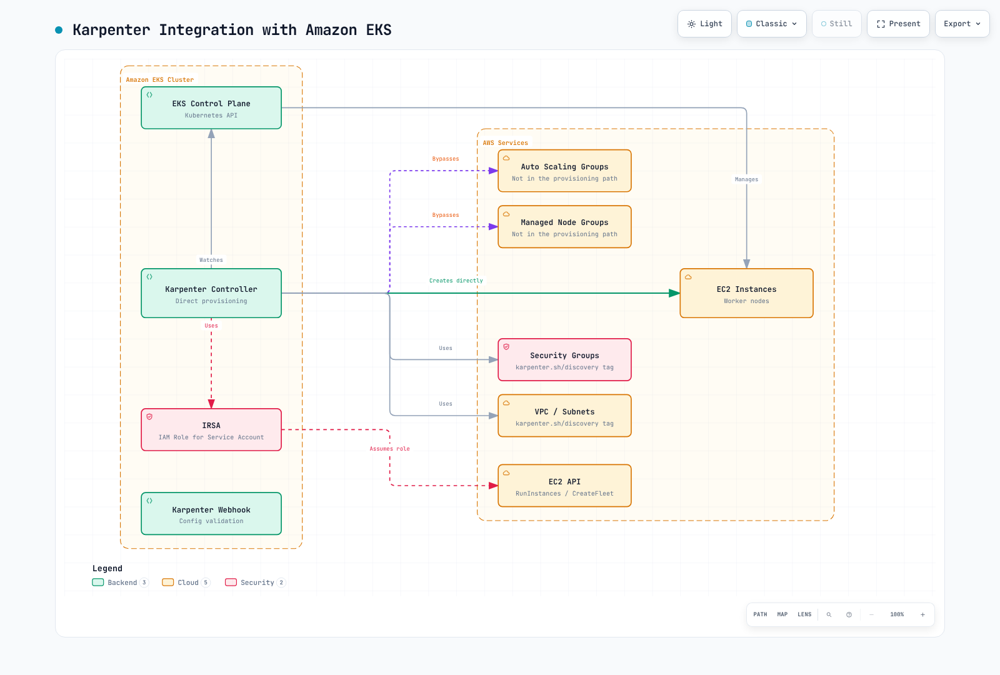

# Karpenter

> **Versiones compatibles**: Karpenter 1.14 LTS (ejemplos: 1.14.1); seleccione las versiones de Kubernetes/EKS según las tablas de compatibilidad y compatibilidad del proveedor.
> **Última actualización**: 26 de octubre de 2026

## Tabla de contenido
- [Introducción](#introduction)
- [Arquitectura](#architecture)
- [Instalación y configuración](#installation-and-configuration)
- [NodePool](#nodepool)
- [Clases de nodo](#node-classes)
- [Gestión de interrupciones](#interruption-handling)
- [Integración](#integration)
- [Integración con Amazon EKS](#integration-with-amazon-eks)
- [Prácticas recomendadas](#best-practices)
- [Solución de problemas](#troubleshooting)
- [Conclusión](#conclusion)

## Introducción

Karpenter es un autoescalador de nodos de código abierto. Este capítulo utiliza su proveedor de AWS, que aprovisiona capacidad de EC2 para cargas de trabajo compatibles de Kubernetes. La disponibilidad y la eficiencia dependen de las restricciones, la capacidad de la nube, la inicialización de los nodos y el diseño de las aplicaciones.

### Ventajas principales de Karpenter

1. **Escalado ágil**: inicia el aprovisionamiento cuando detecta demanda de cargas de trabajo que no se pueden programar; no hay una garantía fija de latencia para que los nodos y las aplicaciones estén listos.
2. **Optimización de costos**: selecciona los tipos de instancia más adecuados para las cargas de trabajo
3. **Configuración sencilla**: configuración fácil mediante API declarativas
4. **Diseño centrado en las cargas de trabajo**: aprovisiona nodos según los requisitos de los pods
5. **Integración con la nube**: aprovecha las capacidades del proveedor de nube
6. **Empaquetado eficiente de bin packing**: optimiza la utilización de recursos
7. **Gestión flexible de nodos**: gestión del ciclo de vida de los nodos y gestión integrada de interrupciones

### Comparación con los autoescaladores existentes

| Característica | Karpenter | Cluster Autoscaler | Grupos de nodos administrados por el proveedor de nube |
|---------|-----------|-------------------|---------------------------|
| Velocidad de escalado | Depende de la programación, la capacidad de EC2 y la inicialización | Depende del escalado del grupo de nodos y de la inicialización | Depende de la política de escalado, la capacidad y la inicialización |
| Selección del tipo de instancia | Dinámica | Basada en grupos de nodos | Basada en grupos de nodos |
| Eficiencia del bin packing | Depende de las cargas de trabajo y las restricciones | Depende de las cargas de trabajo y los grupos de nodos | Depende del programador y del controlador de escalado |
| Complejidad de configuración | Baja | Media | Baja |
| Integración con la nube | Implementación específica del proveedor | Integraciones con varios proveedores de nube | Nativa del proveedor |
| Gestión de grupos de nodos | No es necesaria | Necesaria | Necesaria |
| Gestión de interrupciones | Gestión de eventos configurada y ciclo de vida de los nodos | Depende de la plataforma o integración | Gestión específica de la plataforma |

> **Nota**: EKS añadió compatibilidad con grupos de nodos administrados con grupo de calentamiento el 8 de abril de 2026. Las instancias preinicializadas pueden reducir el trabajo repetido de inicialización; los modos Stopped y Running tienen distintos tiempos de transición y costos, y la reutilización al reducir el escalado es opcional. Según AWS, la integración con Cluster Autoscaler no requiere configuración adicional. Reanudar las instancias, preparar los nodos y arrancar las aplicaciones todavía lleva tiempo. Esta es una característica de EKS Managed Node Group/Auto Scaling, no un grupo administrado por Karpenter.

## Arquitectura

Karpenter funciona como un controlador de Kubernetes: detecta pods que no se pueden programar y aprovisiona los nodos adecuados.


[🔍 Ver diagrama interactivo](https://www.atomai.click/kubernetes-docs/archmaps/en-autoscaling-02-karpenter-0.html)

### Flujo de trabajo de Karpenter

El siguiente diagrama muestra cómo funciona Karpenter en un clúster de EKS:


[🔍 Ver diagrama interactivo](https://www.atomai.click/kubernetes-docs/archmaps/en-autoscaling-02-karpenter-1.html)

### Componentes principales

1. **Controlador de Karpenter**: simula las necesidades de programación, crea NodeClaims y gestiona el ciclo de vida de los nodos; el programador de Kubernetes realiza la vinculación real de los Pods.
2. **Validación CEL de los CRD**: NodePool y EC2NodeClass se validan mediante reglas CEL en los CRD (los webhooks de admisión y conversión se eliminaron en Karpenter 1.1).
3. **CRD NodePool y NodeClaim**: NodePool define la política; un NodeClaim registra los requisitos y el ciclo de vida de un nodo aprovisionado individual.
4. **CRD EC2NodeClass**: define la configuración de los nodos que se aprovisionarán
5. **Integración con el proveedor de nube**: se integra con las API del proveedor de nube para gestionar los recursos de cómputo

### Cómo funciona

1. El controlador de Karpenter detecta los pods que no se pueden programar
2. Analiza los requisitos del pod (recursos, selectores de nodos, tolerancias, etc.)
3. Determina los tipos de nodo adecuados según la configuración de NodePool y EC2NodeClass
4. Llama a la API del proveedor de nube para aprovisionar nodos
5. El nodo se registra y queda listo; entonces el programador de Kubernetes puede vincular los Pods que cumplan los requisitos. Karpenter no reemplaza a kube-scheduler.
6. La consolidación, la desviación, la expiración, la eliminación manual y las interrupciones de la nube tienen desencadenadores y medidas de protección distintos; no todos son eventos de interrupción de SQS.

## Instalación y configuración

Los bloques YAML sin apiVersion/kind son fragmentos de configuración para la especificación de NodePool o EC2NodeClass que se analiza; no son documentos independientes para aplicar con kubectl.

Estos son ejemplos didácticos independientes para un clúster existente, no un paquete de implementación listo para producción. Los nombres de objeto repetidos representan alternativas. Antes de la instalación, prepare y verifique IAM/OIDC, el acceso de los nodos, las subredes y los grupos de seguridad aprobados, la capacidad de arranque y la cola de interrupciones. Todo el YAML utiliza nombres literales de ejemplo, como `my-cluster`; kubectl no expande `${CLUSTER_NAME}` dentro de un archivo YAML guardado. La auditoría no aprovisionó recursos de AWS, instaló Karpenter ni midió el escalado. Los comandos de instalación desde cero fallan si esa versión ya está instalada; las instalaciones existentes deben seguir la guía de migración de CRD y actualización específica de la versión.

### Requisitos previos

- Use una versión de Kubernetes compatible con su plataforma y con la matriz de Karpenter. La matriz publicada indica que las versiones mínimas de Karpenter son 1.6 para Kubernetes 1.34, 1.9 para 1.35 y 1.13 para 1.36; estos mínimos no significan que se sigan manteniendo todas las versiones antiguas de Karpenter. La matriz de v1.14 no incluye 1.37 y la matriz de v1.15 requiere Karpenter 1.15.x para Kubernetes 1.37. La disponibilidad y la compatibilidad de las versiones de EKS deben comprobarse por separado.
- kubectl configurado
- Credenciales y permisos del proveedor de nube
- Helm (opcional)

### Instalación en AWS EKS

#### 1. Configuración del rol y la política de IAM

Los comandos presuponen que ya existen un rol del controlador y un rol de los nodos, y que EKS utiliza autenticación basada en API (API o API_AND_CONFIG_MAP). En un clúster que solo use CONFIG_MAP, compruebe el mapeo de nodos existente en aws-auth en lugar de usar list-access-entries; no cambie el modo de autenticación como paso incidental de configuración. El rol de los nodos confía en EC2 y necesita permisos para los nodos de trabajo y para extraer imágenes de ECR (por ejemplo, AmazonEKSWorkerNodePolicy y AmazonEC2ContainerRegistryPullOnly). Si es compatible, proporcione al VPC CNI una identidad propia; los permisos de SSM son opcionales y requieren un agente configurado. AmazonEKSClusterPolicy no sustituye a la política del controlador de Karpenter.

```bash
# Set the existing cluster and Region; these commands only inspect AWS/Kubernetes.
export CLUSTER_NAME="my-cluster"
export AWS_REGION="us-west-2"
export KARPENTER_VERSION="1.14.1"
ACCOUNT_ID=$(aws sts get-caller-identity --query Account --output text)
CLUSTER_ENDPOINT=$(aws eks describe-cluster --region "$AWS_REGION" --name "$CLUSTER_NAME" --query cluster.endpoint --output text)
export ACCOUNT_ID CLUSTER_ENDPOINT
kubectl config current-context
aws iam get-role --role-name "KarpenterControllerRole-${CLUSTER_NAME}" --query Role.AssumeRolePolicyDocument
aws iam get-role --role-name "KarpenterNodeRole-${CLUSTER_NAME}" --query Role.AssumeRolePolicyDocument
aws eks list-access-entries --region "$AWS_REGION" --cluster-name "$CLUSTER_NAME"
```

#### 2. Instalación mediante Helm

Use una sola vez el ejemplo de instalación desde cero, después de preparar la cola mencionada y la capacidad de arranque. Para actualizar, revise la guía de migración específica de la versión y actualice los CRD correspondientes (por ejemplo, mediante el chart karpenter-crd, que se administra por separado); una actualización del chart del controlador por sí sola normalmente no actualiza los CRD. Antes de migrar una instalación existente de CRD, verifique quién es su propietario.

```bash
# Run only after the prerequisites and the current kubectl context are verified.
: "${CLUSTER_NAME:?Set the existing cluster name}"
: "${ACCOUNT_ID:?Set the AWS account ID}"
: "${CLUSTER_ENDPOINT:?Set the matching EKS endpoint}"
KARPENTER_VERSION="1.14.1"
helm install karpenter oci://public.ecr.aws/karpenter/karpenter \
  --version "$KARPENTER_VERSION" \
  --namespace karpenter --create-namespace \
  --set-string 'serviceAccount.annotations.eks\.amazonaws\.com/role-arn'="arn:aws:iam::${ACCOUNT_ID}:role/KarpenterControllerRole-${CLUSTER_NAME}" \
  --set-string settings.clusterName="$CLUSTER_NAME" \
  --set-string settings.clusterEndpoint="$CLUSTER_ENDPOINT" \
  --set-string settings.interruptionQueue="$CLUSTER_NAME" \
  --wait --timeout 5m
```

#### 3. Verificación de la instalación

```bash
kubectl get deployments,pods -n karpenter
kubectl rollout status deployment/karpenter -n karpenter --timeout=180s
kubectl get nodepools,ec2nodeclasses,nodeclaims
```

Salida ilustrativa de las dos réplicas del controlador predeterminadas (no corresponde a una ejecución capturada en esta auditoría):
```
NAME                         READY   STATUS    RESTARTS   AGE
karpenter-<hash>-<id-1>      1/1     Running   0          1m
karpenter-<hash>-<id-2>      1/1     Running   0          1m
```

### Configuración básica de NodePool y EC2NodeClass

```yaml
apiVersion: karpenter.sh/v1
kind: NodePool
metadata:
  name: default
spec:
  disruption:
    consolidationPolicy: WhenEmpty
    consolidateAfter: 30s
  limits:
    cpu: '1000'
    memory: 1000Gi
  template:
    spec:
      requirements:
      - key: karpenter.sh/capacity-type
        operator: In
        values:
        - on-demand
      - key: kubernetes.io/arch
        operator: In
        values:
        - amd64
      - key: node.kubernetes.io/instance-type
        operator: In
        values:
        - m5.large
        - m5.xlarge
        - m5.2xlarge
      nodeClassRef:
        group: karpenter.k8s.aws
        kind: EC2NodeClass
        name: default
---
apiVersion: karpenter.k8s.aws/v1
kind: EC2NodeClass
metadata:
  name: default
spec:
  role: KarpenterNodeRole-my-cluster
  amiSelectorTerms:
  - alias: al2023@latest
  subnetSelectorTerms:
  - tags:
      karpenter.sh/discovery: my-cluster
  securityGroupSelectorTerms:
  - tags:
      karpenter.sh/discovery: my-cluster
  tags:
    karpenter.sh/discovery: my-cluster
  blockDeviceMappings:
  - deviceName: /dev/xvda
    ebs:
      volumeSize: 100Gi
      volumeType: gp3
      deleteOnTermination: true
      encrypted: true
```

## NodePool

NodePool es un recurso personalizado de Kubernetes que define cómo Karpenter aprovisiona nodos. Reemplaza al antiguo Provisioner.

### Configuración básica de NodePool

El taint especial que aparece a continuación exige deliberadamente una tolerancia coincidente en la carga de trabajo. startupTaints permanece vacío hasta que haya un inicializador verificado que elimine el taint configurado; inventar un startup taint sin definir quién lo gestiona puede dejar los nodos inutilizables. Los ejemplos de límites, inicialización e interrupciones son alternativas, no cambios acumulativos para un NodePool de producción en ejecución.

```yaml
apiVersion: karpenter.sh/v1
kind: NodePool
metadata:
  name: default
spec:
  template:
    metadata:
      labels:
        environment: training
        app: web
    spec:
      requirements:
      - key: karpenter.sh/capacity-type
        operator: In
        values:
        - on-demand
      - key: kubernetes.io/arch
        operator: In
        values:
        - amd64
      - key: node.kubernetes.io/instance-type
        operator: In
        values:
        - m5.large
        - m5.xlarge
        - m5.2xlarge
      nodeClassRef:
        group: karpenter.k8s.aws
        kind: EC2NodeClass
        name: default
      expireAfter: 720h
      taints:
      - key: example.com/special-taint
        value: 'true'
        effect: NoSchedule
      startupTaints: []
  limits:
    cpu: '1000'
    memory: 1000Gi
  disruption:
    consolidationPolicy: WhenEmpty
    consolidateAfter: 30s
```

### Configuración de requisitos

Los requisitos se intersectan entre sí, con EC2NodeClass y con las restricciones de los Pods. Permitir amd64 y arm64 solo es útil si los tipos de instancia, las AMI y las imágenes de contenedor que cumplen los requisitos admiten ambas arquitecturas. Una lista de zonas y tipos de capacidad elegibles no garantiza una distribución uniforme; para eso, use las restricciones de topología de las cargas de trabajo.

Los requisitos definen las características de los nodos que Karpenter aprovisionará:

```yaml
template:
  spec:
    requirements:
    - key: karpenter.sh/capacity-type
      operator: In
      values:
      - on-demand
      - spot
    - key: kubernetes.io/arch
      operator: In
      values:
      - amd64
      - arm64
    - key: node.kubernetes.io/instance-type
      operator: In
      values:
      - m5.large
      - m5.xlarge
      - c5.large
      - m6g.large
      - c6g.large
    - key: topology.kubernetes.io/zone
      operator: In
      values:
      - us-west-2a
      - us-west-2b
      - us-west-2c
    - key: kubernetes.io/os
      operator: In
      values:
      - linux
```

### Configuración de límites

`spec.limits` restringe los recursos aprovisionados agregados, pero el aprovisionamiento paralelo utiliza comprobaciones de consistencia eventual y puede superar temporalmente un límite. No es un tope estricto de facturación. Las cantidades expresadas como cadenas evitan diferencias de tipos en API/GitOps.

```yaml
limits:
  cpu: '1000'
  memory: 1000Gi
  nvidia.com/gpu: '10'
```

### Seguimiento experimental de asignación de DRA (v1.13)

Karpenter v1.13 añadió el seguimiento de la asignación de dispositivos DRA en el núcleo. Esto no supone una garantía general de aprovisionamiento de DRA para producción: el chart de AWS 1.14.1 establece `settings.ignoreDRARequests: true` de forma predeterminada, y el proyecto upstream indica que la compatibilidad formal con DRA aún no es GA. Un requisito mínimo de Kubernetes 1.29 no basta para demostrar la compatibilidad. Valide la API exacta de recursos de Kubernetes, el controlador DRA, ResourceClaims/ResourceSlices y la configuración de Karpenter; no considere que las solicitudes de DRA son intercambiables con el ejemplo de recurso extendido de device-plugin que aparece a continuación.

### Configuración de expiración de nodos

`expireAfter` define cuándo comienza el vaciado provocado por la expiración, no cuándo se garantiza que termine el reemplazo. El parámetro opcional `terminationGracePeriod` que aparece a continuación establece un límite para el vaciado, pero puede forzar la eliminación de los Pods restantes, incluidos los bloqueados por PDB. Elija ese plazo solo después de validar los requisitos de cierre y recuperación de la aplicación.

```yaml
spec:
  template:
    spec:
      expireAfter: 720h
      terminationGracePeriod: 30m
  disruption:
    consolidationPolicy: WhenEmpty
    consolidateAfter: 30s
```

### Reconocimiento de taints de NodeReadinessController (v1.13)

Karpenter Core v1.13 reconoce los taints `readiness.k8s.io/` del NodeReadinessController independiente como efímeros al simular la programación de un nodo administrado que aún no se ha inicializado. Sigue esperando a que desaparezcan esos taints antes de marcar la inicialización como completada; no los elimina ni permite que el programador de Kubernetes los omita. Los demás taints de inicializadores siguen necesitando una configuración precisa de `startupTaints` y un controlador que los elimine.

### Actualización de julio de 2026: lanzamiento de v1.14

Karpenter v1.14, publicado el 11 de julio de 2026, incorpora:

- **Compatibilidad con la API CapacityBuffers**: integración alfa con búferes de capacidad; `CapacityBuffer` está deshabilitado de forma predeterminada y requiere los CRD y la configuración del controlador correspondientes. La capacidad reservada no es capacidad gratuita ni una garantía de latencia.
- **Compatibilidad con tipos de instancia preliminares**: reconoce ofertas preliminares elegibles; el aprovisionamiento real sigue requiriendo acceso a la cuenta y la Región, además de disponibilidad.
- **Compatibilidad con Nitro Enclaves**: el proveedor establece `EnclaveOptions.Enabled` en la plantilla de lanzamiento generada cuando las solicitudes de recursos de NodeClaim incluyen `eks.amazonaws.com/nip-slots`. Siguen siendo requisitos previos las instancias compatibles, la AMI y la configuración de device-plugin; en 1.14.1 no existe el campo `EC2NodeClass.spec.enclaveOptions`.
- Correcciones de errores: contabilización de la IP principal en las ENI secundarias, garantía de que se haya cargado la caché de Zonal Shift, conexión de un tiempo de espera del cliente de AWS SDK con la configuración del operador, entre otras

Consulte las [notas de la versión v1.14.0](https://github.com/aws/karpenter-provider-aws/releases/tag/v1.14.0) para obtener más información.

El 17 de julio de 2026, se publicaron parches para ramas anteriores, incluidas 1.3.8 y 1.11.3. Esta adaptación histórica no demuestra que todas las versiones intermedias sigan teniendo soporte. La política de soporte actual indica que la versión LTS 1.9 tiene soporte hasta febrero de 2027 y que la LTS 1.14 lo tiene hasta julio de 2027; las versiones menores regulares solo reciben soporte hasta la siguiente versión menor. Elija una línea con soporte y siga su guía de migración, en lugar de suponer que una línea antigua sigue recibiendo mantenimiento.

El anuncio de AWS del 22 de julio de 2026 añadió la configuración de interfaces de red EFA y grupos de ubicación para Karpenter/EKS Auto Mode. En AWS Karpenter 1.14.1, los campos concretos son `EC2NodeClass.spec.networkInterfaces` y `spec.placementGroupSelector` (no son campos de NodePool). Las interfaces exclusivas de EFA no consumen direcciones IP de VPC, pero sigue siendo necesaria una `interface` principal en el índice 0 de dispositivo/tarjeta. Seleccione un grupo de ubicación existente por nombre o ID; su estrategia de clúster/distribución/partición y las instancias compatibles condicionan la ubicación. Este ejemplo no configura ni valida una carga de trabajo de HPC.

### Actualización de agosto de 2026: versión de parche v1.14.1

[v1.14.1](https://github.com/aws/karpenter-provider-aws/releases/tag/v1.14.1), el primer parche de la línea v1.14, se publicó el 21 de agosto de 2026. Es una versión de mantenimiento que actualiza la versión upstream de `sigs.k8s.io/karpenter` e incorpora mediante cherry-pick correcciones realizadas desde v1.14.0.

### Actualización de octubre de 2026: versión estándar v1.15.0

[v1.15.0](https://github.com/aws/karpenter-provider-aws/releases/tag/v1.15.0), una versión menor estándar (no LTS), se publicó el 10 de octubre de 2026. Cambios principales:

- **La reparación de nodos pasa a ser una interrupción voluntaria**: la reparación de nodos se integra en el mecanismo de interrupciones, con reparación que termina primero el nodo cuando un NodePool con capacidad restringida no puede preparar primero un nodo de reemplazo. Se añade el reinicio mediante `ec2:RebootInstances` como acción de reparación (detrás del indicador de característica de AWS `RebootForRepair`), y el controlador de reparación anterior sigue disponible mediante la opción `--legacy-node-repair`.
- **Compatibilidad con CEL en KubeletConfiguration**: `maxPodsExpression`, `kubeReserved` y `systemReserved` aceptan expresiones CEL, y se ampliaron los campos KubeletConfiguration de EC2NodeClass.
- **Compatibilidad más amplia con DRA**: compatibilidad con alternativas priorizadas y con DRA para los controladores NVIDIA y EFA.
- También: opción `--aws-feature-gates`, conocimiento predeterminado de la distribución de topología de los pods, contabilización de los límites de volumen de los tipos de instancia durante el aprovisionamiento, nuevas métricas de interrupción como `karpenter_pods_disrupted_total` y un controlador de gestión del costo de eliminación de pods sujeto a un indicador de característica.

Según la política de soporte, las versiones menores regulares solo reciben soporte hasta la siguiente versión menor; por tanto, tras el lanzamiento de v1.15.0, v1.14 continúa únicamente como línea LTS (hasta julio de 2027). Por ello, los ejemplos de este capítulo siguen usando 1.14 LTS (1.14.1). Kubernetes 1.37 requiere Karpenter 1.15.x; por tanto, si necesita Kubernetes 1.37 o pasa a 1.15, consulte primero la [matriz de compatibilidad de v1.15](https://karpenter.sh/v1.15/upgrading/compatibility/) y la guía de actualización. Consulte las [notas de la versión v1.15.0](https://github.com/aws/karpenter-provider-aws/releases/tag/v1.15.0) para obtener más información.

### Actualización de octubre de 2026: v1.15.1 y versiones de parche LTS

Entre el 20 y el 23 de octubre de 2026 se publicaron versiones de parche para las líneas compatibles: [v1.15.1](https://github.com/aws/karpenter-provider-aws/releases/tag/v1.15.1) (primer parche de la línea 1.15; las correcciones incluyen relajar las preferencias en lugar de aplazar cuando todas las reservas de capacidad compatibles están completas y poner en cola la reparación de nodos cuando la etiqueta se sincroniza después de la creación), [v1.14.2](https://github.com/aws/karpenter-provider-aws/releases/tag/v1.14.2) y [v1.14.3](https://github.com/aws/karpenter-provider-aws/releases/tag/v1.14.3) en la línea 1.14 LTS (entre otras, clasifican `SpotMaxPriceTooLow` como error ICE y tratan una reserva de capacidad interrumpible que se está recuperando como capacidad no disponible), y [v1.9.3](https://github.com/aws/karpenter-provider-aws/releases/tag/v1.9.3) en la línea 1.9 LTS. Las tres líneas también actualizan la cadena de herramientas de Go a 1.26.10, la versión de parche de Go que deja de confiar en los certificados de CA intermedia de eMudhra comprometidos (CVE-2026-111943).

## Clases de nodo

Las clases de nodo definen la configuración de los nodos que aprovisiona Karpenter. En AWS, utiliza el CRD EC2NodeClass.

### Configuración de AWS EC2NodeClass

```yaml
apiVersion: karpenter.k8s.aws/v1
kind: EC2NodeClass
metadata:
  name: default
spec:
  subnetSelectorTerms:
  - tags:
      karpenter.sh/discovery: my-cluster
  securityGroupSelectorTerms:
  - tags:
      karpenter.sh/discovery: my-cluster
  tags:
    karpenter.sh/discovery: my-cluster
    environment: training
  blockDeviceMappings:
  - deviceName: /dev/xvda
    ebs:
      volumeSize: 100Gi
      volumeType: gp3
      deleteOnTermination: true
      encrypted: true
  role: KarpenterNodeRole-my-cluster
  amiSelectorTerms:
  - alias: al2023@latest
  userData: '#!/bin/bash

    echo "Hello from Karpenter node!"

    '
  metadataOptions:
    httpEndpoint: enabled
    httpProtocolIPv6: disabled
    httpPutResponseHopLimit: 1
    httpTokens: required
```

### Selección de subredes y grupos de seguridad

Las subredes y los grupos de seguridad se seleccionan mediante términos selectores (varios términos se combinan con OR; las etiquetas dentro de un término se combinan con AND):

```yaml
subnetSelectorTerms:
- tags:
    karpenter.sh/discovery: my-cluster
    Name: private-*
securityGroupSelectorTerms:
- tags:
    karpenter.sh/discovery: my-cluster
```

### Configuración de AMI

Karpenter selecciona las AMI mediante `amiSelectorTerms`. Un alias selecciona una familia y una versión; **`@latest` no fija una versión** y puede cambiar las AMI resueltas y provocar desviaciones. Los ejemplos con `@latest` son didácticos. Para producción, resuelva y pruebe una versión explícita de AMI compatible (`al2023@vYYYYMMDD` con una fecha de lanzamiento real) o los ID de AMI aprobados antes del despliegue. Las AMI de EKS de AL2 no se publican para Kubernetes 1.33+. Las variantes siguientes son alternativas; una AMI personalizada requiere una configuración funcional de arranque, taint de registro, kubelet, CNI/entorno de ejecución e identidad.

```yaml
# Amazon Linux 2023
amiSelectorTerms:
  - alias: al2023@latest
---
# Bottlerocket
amiSelectorTerms:
  - alias: bottlerocket@latest
---
# Custom AMI (by ID): amiFamily is required when no alias term is used
amiFamily: Custom
amiSelectorTerms:
  - id: "ami-0123456789abcdef0"
# Ubuntu: no v1 alias; use amiFamily: Custom with an id/tags/name term
```

### Configuración de dispositivos de bloques

Los mapeos de dispositivos dependen de la familia de AMI. En estos ejemplos para AL2023 se usa /dev/xvda como dispositivo raíz; compruebe la disposición real de otras AMI. Los volúmenes adicionales requieren un plan explícito de sistema de archivos/montaje o almacenamiento de la aplicación. Una clave de KMS administrada por el cliente también requiere los permisos adecuados para la clave y en IAM.

Puede definir la configuración de almacenamiento de los nodos:

```yaml
blockDeviceMappings:
- deviceName: /dev/xvda
  ebs:
    volumeSize: 100Gi
    volumeType: gp3
    iops: 3000
    throughput: 125
    deleteOnTermination: true
    encrypted: true
    kmsKeyID: arn:aws:kms:us-west-2:111122223333:key/1234abcd-12ab-34cd-56ef-1234567890ab
- deviceName: /dev/xvdb
  ebs:
    volumeSize: 500Gi
    volumeType: gp3
    deleteOnTermination: true
    encrypted: true
```

### Configuración de los datos de usuario

Estos fragmentos de datos de usuario de shell presuponen AL2023, cuya configuración de arranque/nodeadm generada Karpenter combina con los datos personalizados. No son una configuración genérica válida de arranque para Bottlerocket o Windows. Incluya los paquetes en una AMI y pruébelos, en lugar de ejecutar una actualización de paquetes sin restricciones cada vez que se lance una instancia. Instalar e iniciar CloudWatch Agent sin su configuración, permisos de IAM y ruta de red no garantiza la recopilación de telemetría.

```yaml
userData: |
  #!/bin/bash
  set -euo pipefail
  # Only for a workload that requires this setting; keep node packages in a tested AMI.
  cat > /etc/sysctl.d/99-workload-map-count.conf <<'EOF'
  vm.max_map_count=262144
  EOF
  sysctl -p /etc/sysctl.d/99-workload-map-count.conf
```

### Proceso de consolidación de nodos

El siguiente diagrama muestra el proceso de consolidación de nodos de Karpenter. Esta función es importante para optimizar la eficiencia del clúster y reducir costos:


[🔍 Ver diagrama interactivo](https://www.atomai.click/kubernetes-docs/archmaps/en-autoscaling-02-karpenter-2.html)

## Gestión de interrupciones

La gestión de interrupciones configurada intenta reaccionar antes de que se pierda capacidad. El resultado depende de las notificaciones, la capacidad de reemplazo, los plazos de apagado y la recuperación de la aplicación; no se garantiza la disponibilidad ininterrumpida.

### Gestión integrada de interrupciones

La gestión de interrupciones de la nube es independiente de la consolidación y la expiración. Abarca señales como las siguientes:

1. **Avisos de interrupción de Spot**: inicia el vaciado y solicita capacidad de reemplazo cuando es posible; el plazo de aviso no es un SLA de recuperación garantizado.
2. **Eventos programados de estado/mantenimiento**: reacciona ante las instancias afectadas.
3. **Eventos de detención/terminación de instancias**: reconcilia la capacidad que dejará de prestar servicio.
4. **Errores de estado de instancias EC2**: comprueba el estado con los permisos necesarios de la API de EC2. Las recomendaciones de rebalanceo por sí solas se publican como eventos; no provocan automáticamente operaciones de taint, vaciado ni terminación.

### Configuración de la gestión de interrupciones

```yaml
apiVersion: karpenter.sh/v1
kind: NodePool
metadata:
  name: default
spec:
  template:
    spec:
      requirements:
        - key: karpenter.sh/capacity-type
          operator: In
          values: ["on-demand"]
      nodeClassRef:
        group: karpenter.k8s.aws
        kind: EC2NodeClass
        name: default

      # Node expiration settings
      expireAfter: 720h  # 30 days
  disruption:
    consolidationPolicy: WhenEmpty
    consolidateAfter: 30s
```

### Configuración del vaciado

Normalmente, Karpenter utiliza la expulsión durante el vaciado gradual. La configuración de Helm controla el controlador; los presupuestos de interrupción de NodePool limitan el inicio de las operaciones voluntarias de consolidación y desviación, no toda pérdida simultánea de nodos. Un presupuesto del 30 % se redondea hacia arriba y después se restan los nodos en proceso de eliminación o que no están listos; no es un límite estricto del 30 %. La expiración, las interrupciones y las reparaciones pueden tener distintos comportamientos forzosos. Configure la cola de SQS indicada, las reglas/destinos de EventBridge, la política de la cola y los permisos del controlador antes de habilitar `interruptionQueue`; el campo de Helm por sí solo no los crea.

```yaml
settings:
  clusterName: my-cluster
  interruptionQueue: my-cluster
  batchMaxDuration: 10s
  batchIdleDuration: 1s
  featureGates:
    spotToSpotConsolidation: false
controller:
  resources:
    requests:
      cpu: 1
      memory: 1Gi
    limits:
      cpu: '1'
      memory: 1Gi
logLevel: info
```

```yaml
apiVersion: karpenter.sh/v1
kind: NodePool
metadata:
  name: default
spec:
  template:
    spec:
      requirements:
        - key: karpenter.sh/capacity-type
          operator: In
          values: ["on-demand"]
      nodeClassRef:
        group: karpenter.k8s.aws
        kind: EC2NodeClass
        name: default
      expireAfter: 720h
  disruption:
    consolidationPolicy: WhenEmpty
    consolidateAfter: 30s
    budgets:
      - nodes: "30%"   # Voluntary budget: round up, then subtract deleting/not-ready nodes
```

### Integración con PDB (PodDisruptionBudget)

Los PDB limitan las expulsiones voluntarias según las réplicas en buen estado; no crean réplicas ni garantizan la disponibilidad de la aplicación. El `minAvailable: 2` que aparece a continuación requiere que haya suficientes Pods coincidentes en buen estado antes de permitir una expulsión. La pérdida de instancias y los plazos de terminación forzosa todavía pueden interrumpirlos.

```yaml
apiVersion: policy/v1
kind: PodDisruptionBudget
metadata:
  name: app-pdb
  namespace: default
spec:
  minAvailable: 2
  selector:
    matchLabels:
      app: my-app
```

## Integración

Karpenter se integra con diversos servicios de Kubernetes y de la nube.

### Integración con Kubernetes

#### 1. Restricciones de distribución de topología de Pods

Karpenter tiene en cuenta las restricciones de distribución de topología de Pods al aprovisionar nodos:

```yaml
apiVersion: apps/v1
kind: Deployment
metadata:
  name: web-server
  namespace: default
spec:
  replicas: 10
  template:
    spec:
      topologySpreadConstraints:
      - maxSkew: 1
        topologyKey: topology.kubernetes.io/zone
        whenUnsatisfiable: DoNotSchedule
        labelSelector:
          matchLabels:
            app: web-server
      containers:
      - name: web-server
        image: nginx:1.30.6
        ports:
        - containerPort: 80
        resources:
          requests:
            cpu: 100m
            memory: 128Mi
          limits:
            memory: 256Mi
    metadata:
      labels:
        app: web-server
  selector:
    matchLabels:
      app: web-server
```

#### 2. Afinidad y anti-afinidad de Pods

Karpenter tiene en cuenta las reglas de afinidad y anti-afinidad de Pods:

```yaml
apiVersion: apps/v1
kind: Deployment
metadata:
  name: web-server
  namespace: default
spec:
  replicas: 10
  template:
    spec:
      affinity:
        podAntiAffinity:
          requiredDuringSchedulingIgnoredDuringExecution:
          - labelSelector:
              matchExpressions:
              - key: app
                operator: In
                values:
                - web-server
            topologyKey: kubernetes.io/hostname
      containers:
      - name: web-server
        image: nginx:1.30.6
        ports:
        - containerPort: 80
        resources:
          requests:
            cpu: 100m
            memory: 128Mi
          limits:
            memory: 256Mi
    metadata:
      labels:
        app: web-server
  selector:
    matchLabels:
      app: web-server
```

#### 3. Taints y tolerancias

El ejemplo de GPU requiere una AMI acelerada compatible, un controlador de NVIDIA y un DaemonSet de device-plugin que tolere el taint de GPU y anuncie nvidia.com/gpu. El Pod de BusyBox solo muestra cómo reservar una GPU; no ejecuta CUDA ni hace pruebas de rendimiento. Valídelo por separado con la imagen real de la aplicación de GPU.

Karpenter tiene en cuenta los taints y las tolerancias al aprovisionar nodos:

```yaml
apiVersion: karpenter.sh/v1
kind: NodePool
metadata:
  name: gpu
spec:
  template:
    spec:
      requirements:
      - key: node.kubernetes.io/instance-type
        operator: In
        values:
        - g4dn.xlarge
        - g4dn.2xlarge
      taints:
      - key: nvidia.com/gpu
        value: 'true'
        effect: NoSchedule
      nodeClassRef:
        group: karpenter.k8s.aws
        kind: EC2NodeClass
        name: default
---
apiVersion: apps/v1
kind: Deployment
metadata:
  name: gpu-app
  namespace: default
spec:
  replicas: 3
  template:
    spec:
      tolerations:
      - key: nvidia.com/gpu
        operator: Exists
        effect: NoSchedule
      nodeSelector:
        karpenter.sh/nodepool: gpu
      containers:
      - name: gpu-allocation-demo
        image: busybox:1.38.0
        command:
        - sh
        - -c
        - sleep 3600
        resources:
          requests:
            cpu: 100m
            memory: 64Mi
          limits:
            memory: 128Mi
            nvidia.com/gpu: 1
    metadata:
      labels:
        app: gpu-app
  selector:
    matchLabels:
      app: gpu-app
```

### Integración con AWS

#### 1. Instancias EC2 Spot

Karpenter admite instancias EC2 Spot para optimizar costos:

```yaml
apiVersion: karpenter.sh/v1
kind: NodePool
metadata:
  name: spot
spec:
  template:
    spec:
      requirements:
      - key: karpenter.sh/capacity-type
        operator: In
        values:
        - spot
      nodeClassRef:
        group: karpenter.k8s.aws
        kind: EC2NodeClass
        name: spot
---
apiVersion: karpenter.k8s.aws/v1
kind: EC2NodeClass
metadata:
  name: spot
spec:
  role: KarpenterNodeRole-my-cluster
  amiSelectorTerms:
  - alias: al2023@latest
  subnetSelectorTerms:
  - tags:
      karpenter.sh/discovery: my-cluster
  securityGroupSelectorTerms:
  - tags:
      karpenter.sh/discovery: my-cluster
```

#### 2. Perfiles de instancia EC2

`role` e `instanceProfile` son mutuamente excluyentes. Con `role`, Karpenter administra un perfil de instancia y necesita los permisos/conectividad correspondientes para la API de IAM. Si el clúster no tiene acceso al endpoint de IAM, utilice un `instanceProfile` aprovisionado previamente; IAM no tiene un endpoint de PrivateLink. El controlador sigue necesitando PassRole para su rol de nodo, y el acceso de los nodos a EKS es independiente de disponer de credenciales de EC2.

Karpenter utiliza perfiles de instancia EC2 para conceder permisos de IAM a los nodos:

```yaml
apiVersion: karpenter.k8s.aws/v1
kind: EC2NodeClass
metadata:
  name: default
spec:
  instanceProfile: KarpenterNodeInstanceProfile-my-cluster
  amiSelectorTerms:
  - alias: al2023@latest
  subnetSelectorTerms:
  - tags:
      karpenter.sh/discovery: my-cluster
  securityGroupSelectorTerms:
  - tags:
      karpenter.sh/discovery: my-cluster
```

#### 3. Sustitución de las plantillas de lanzamiento (EC2NodeClass)

Karpenter v1 no acepta plantillas de lanzamiento EC2 proporcionadas por el usuario (se eliminó el campo heredado `launchTemplate`). Karpenter genera y administra sus propias plantillas de lanzamiento a partir de EC2NodeClass, de modo que las opciones que habría incluido en una plantilla de lanzamiento se expresan directamente en EC2NodeClass:

```yaml
apiVersion: karpenter.k8s.aws/v1
kind: EC2NodeClass
metadata:
  name: node-config
spec:
  role: KarpenterNodeRole-my-cluster
  subnetSelectorTerms:
  - tags:
      karpenter.sh/discovery: my-cluster
  securityGroupSelectorTerms:
  - tags:
      karpenter.sh/discovery: my-cluster
  amiSelectorTerms:
  - alias: al2023@latest
  userData: '#!/bin/bash

    echo "Hello from Karpenter node!"

    '
  blockDeviceMappings:
  - deviceName: /dev/xvda
    ebs:
      volumeSize: 100Gi
      volumeType: gp3
      deleteOnTermination: true
      encrypted: true
  metadataOptions:
    httpEndpoint: enabled
    httpProtocolIPv6: disabled
    httpPutResponseHopLimit: 1
    httpTokens: required
```
## Integración con Amazon EKS

El proveedor de AWS de Karpenter puede aprovisionar capacidad de EC2 junto con el cómputo administrado por EKS, siempre que estén configurados la identidad, la red, el acceso de los nodos y el arranque.



[🔍 Ver diagrama interactivo](https://www.atomai.click/kubernetes-docs/archmaps/en-autoscaling-02-karpenter-3.html)

### Preparación del clúster de EKS

Sustituya todos los nombres de ejemplo de manera coherente. Seleccione solo subredes y grupos de seguridad adecuados para los nodos de trabajo; etiquetar todas las subredes del plano de control no es una estrategia segura de descubrimiento. Verifique las rutas de las subredes, las reglas de seguridad, la capacidad de direcciones IP del CNI y los endpoints privados necesarios antes de permitir el lanzamiento de nodos.

#### 1. Configuración de etiquetas del clúster

Configure la infraestructura para etiquetar solo las subredes y los grupos de seguridad de los nodos de trabajo aprobados. No es el etiquetado de la VPC lo que selecciona esos recursos. Los valores de descubrimiento deben coincidir con los ejemplos (aquí, `my-cluster`); las etiquetas por sí solas no demuestran que haya rutas privadas, reglas de seguridad adecuadas o suficientes direcciones libres. Inspeccione los recursos y las rutas reales antes de aplicar un NodePool.

```bash
# Inspect resources that your infrastructure configuration has tagged for this cluster.
: "${CLUSTER_NAME:?Set the existing cluster name}"
: "${AWS_REGION:?Set the cluster Region}"
aws ec2 describe-subnets --region "$AWS_REGION" \
  --filters "Name=tag:karpenter.sh/discovery,Values=${CLUSTER_NAME}" \
  --query 'Subnets[].{ID:SubnetId,AZ:AvailabilityZone,FreeIPs:AvailableIpAddressCount,PublicIPOnLaunch:MapPublicIpOnLaunch,VPC:VpcId}'
aws ec2 describe-security-groups --region "$AWS_REGION" \
  --filters "Name=tag:karpenter.sh/discovery,Values=${CLUSTER_NAME}" \
  --query 'SecurityGroups[].{ID:GroupId,VPC:VpcId,Name:GroupName}'
# Inspect explicit and main route-table associations for the intended subnets.
aws ec2 describe-route-tables --region "$AWS_REGION" \
  --filters "Name=vpc-id,Values=$(aws eks describe-cluster --region "$AWS_REGION" --name "$CLUSTER_NAME" --query cluster.resourcesVpcConfig.vpcId --output text)"
```

#### 2. Configuración del rol de IAM

En lugar de la política incompleta escrita a mano que concede todos los permisos mencionada antes, utilice la política del controlador específica de la versión y la referencia de infraestructura que aparecen a continuación. Las credenciales del controlador (IRSA en este caso) son independientes de las credenciales de los nodos y de las identidades del VPC CNI y de las cargas de trabajo. La relación de confianza del controlador debe coincidir con el proveedor OIDC del clúster, `system:serviceaccount:karpenter:karpenter` y `aud: sts.amazonaws.com`; conceda solo las acciones, los recursos y las condiciones que necesiten esta versión y las funciones elegidas. El rol de los nodos debe permitirles unirse a EKS, normalmente mediante una entrada de acceso `EC2_LINUX` cuando está habilitada la autenticación basada en API. Los comandos de inspección no crean roles ni entradas de acceso de IAM.

```bash
# Download a versioned reference for review; this does not create a CloudFormation stack.
KARPENTER_VERSION="1.14.1"
curl --fail --show-error --location \
  "https://raw.githubusercontent.com/aws/karpenter-provider-aws/v${KARPENTER_VERSION}/website/content/en/preview/getting-started/getting-started-with-karpenter/cloudformation.yaml" \
  --output karpenter-cloudformation-reference.yaml
# Inspect the existing role's attached and inline policies.
: "${CLUSTER_NAME:?Set the existing cluster name}"
aws iam list-attached-role-policies --role-name "KarpenterControllerRole-${CLUSTER_NAME}"
aws iam list-role-policies --role-name "KarpenterControllerRole-${CLUSTER_NAME}"
```

### Instalación de Karpenter en un clúster de EKS

```bash
# Run only after the prerequisites and the current kubectl context are verified.
: "${CLUSTER_NAME:?Set the existing cluster name}"
: "${ACCOUNT_ID:?Set the AWS account ID}"
: "${CLUSTER_ENDPOINT:?Set the matching EKS endpoint}"
KARPENTER_VERSION="1.14.1"
helm install karpenter oci://public.ecr.aws/karpenter/karpenter \
  --version "$KARPENTER_VERSION" \
  --namespace karpenter --create-namespace \
  --set-string 'serviceAccount.annotations.eks\.amazonaws\.com/role-arn'="arn:aws:iam::${ACCOUNT_ID}:role/KarpenterControllerRole-${CLUSTER_NAME}" \
  --set-string settings.clusterName="$CLUSTER_NAME" \
  --set-string settings.clusterEndpoint="$CLUSTER_ENDPOINT" \
  --set-string settings.interruptionQueue="$CLUSTER_NAME" \
  --wait --timeout 5m
```

### Uso con EKS Managed Node Groups

Karpenter puede coexistir con EKS Managed Node Groups. El siguiente NodePool aprovisiona nodos EC2 independientes; no administra Managed Node Group. Mantenga el controlador en una capacidad de arranque fiable (el chart predeterminado excluye los nodos de Karpenter y solicita dos réplicas en hosts distintos).

```yaml
apiVersion: karpenter.sh/v1
kind: NodePool
metadata:
  name: managed-ng
spec:
  template:
    metadata:
      labels:
        managed-by: karpenter
    spec:
      requirements:
      - key: karpenter.sh/capacity-type
        operator: In
        values:
        - on-demand
      - key: node.kubernetes.io/instance-type
        operator: In
        values:
        - m5.large
        - m5.xlarge
      taints:
      - key: managed-by
        value: karpenter
        effect: NoSchedule
      nodeClassRef:
        group: karpenter.k8s.aws
        kind: EC2NodeClass
        name: managed-ng
  disruption:
    consolidationPolicy: WhenEmpty
    consolidateAfter: 30s
---
apiVersion: karpenter.k8s.aws/v1
kind: EC2NodeClass
metadata:
  name: managed-ng
spec:
  role: KarpenterNodeRole-my-cluster
  amiSelectorTerms:
  - alias: al2023@latest
  subnetSelectorTerms:
  - tags:
      karpenter.sh/discovery: my-cluster
  securityGroupSelectorTerms:
  - tags:
      karpenter.sh/discovery: my-cluster
  tags:
    karpenter.sh/discovery: my-cluster
```

### Uso con EKS Fargate

Fargate no implementa topologySpreadConstraints de Kubernetes, y las reglas de afinidad y anti-afinidad de Kubernetes no se aplican allí. No suponga que las restricciones de ubicación EC2 del chart predeterminado garantizan la separación de Fargate entre zonas de disponibilidad; diseñe y verifique por separado la ubicación del perfil y las subredes.

Un perfil de Fargate con una selección acotada puede alojar los Pods del controlador, mientras Karpenter aprovisiona los nodos de trabajo EC2. Karpenter no crea capacidad de Fargate ni administra sus perfiles. Prepare un perfil que seleccione el espacio de nombres `karpenter` y las etiquetas del controlador, en lugar de seleccionar todo `default` o `kube-system`; la estructura del selector JSON es `[{"namespace":"karpenter","labels":{"app.kubernetes.io/name":"karpenter"}}]`. El perfil necesita su propio rol de ejecución de Pod y sus subredes privadas, y los permisos de AWS del controlador siguen necesitando IRSA (EKS Pod Identity no es compatible con Fargate). El siguiente comando solo inspecciona un perfil existente.

```bash
# Inspect an existing, narrowly selected controller Fargate profile.
: "${CLUSTER_NAME:?Set the existing cluster name}"
: "${AWS_REGION:?Set the cluster Region}"
aws eks describe-fargate-profile --region "$AWS_REGION" \
  --cluster-name "$CLUSTER_NAME" --fargate-profile-name karpenter-controller
```

```yaml
apiVersion: karpenter.sh/v1
kind: NodePool
metadata:
  name: ec2
spec:
  template:
    spec:
      requirements:
      - key: karpenter.sh/capacity-type
        operator: In
        values:
        - on-demand
      nodeClassRef:
        group: karpenter.k8s.aws
        kind: EC2NodeClass
        name: ec2
  disruption:
    consolidationPolicy: WhenEmpty
    consolidateAfter: 30s
---
apiVersion: karpenter.k8s.aws/v1
kind: EC2NodeClass
metadata:
  name: ec2
spec:
  role: KarpenterNodeRole-my-cluster
  amiSelectorTerms:
  - alias: al2023@latest
  subnetSelectorTerms:
  - tags:
      karpenter.sh/discovery: my-cluster
  securityGroupSelectorTerms:
  - tags:
      karpenter.sh/discovery: my-cluster
```

### Respuesta ante fallos de AZ: integración con Amazon ARC Zonal Shift (mayo de 2026)

Karpenter puede integrarse con un recurso de cambio zonal de EKS ARC habilitado. Una vez activo un cambio zonal manual o un autoshift configurado, Karpenter evita aprovisionar nueva capacidad en la AZ afectada. Esto no equivale a detectar de forma independiente todos los fallos de AZ ni anula un requisito de Pod/PV que fije la carga de trabajo a esa AZ.

Durante un cambio activo, se detienen las interrupciones voluntarias en la AZ afectada; también se impiden las interrupciones en zonas en buen estado que dependan de trasladar Pods a esa AZ. Esto no significa que se detengan incondicionalmente todas las interrupciones voluntarias en todas las AZ en buen estado. Configure los requisitos previos de EKS/ARC, los permisos `eks:DescribeCluster`/ARC y `settings.enableZonalShift: true` (opción de entorno `ENABLE_ZONAL_SHIFT`); el autoshift también requiere su propia configuración de participación y práctica. No se necesita un CRD ARC personalizado, y las operaciones se reanudan cuando termina el cambio.

### Optimización de costos de EKS

Puede usar Karpenter para optimizar los costos de los clústeres de EKS:


[🔍 Ver diagrama interactivo](https://www.atomai.click/kubernetes-docs/archmaps/en-autoscaling-02-karpenter-4.html)

#### 1. Uso de instancias Spot

```yaml
apiVersion: karpenter.sh/v1
kind: NodePool
metadata:
  name: spot
spec:
  template:
    spec:
      requirements:
      - key: karpenter.sh/capacity-type
        operator: In
        values:
        - spot
      - key: kubernetes.io/arch
        operator: In
        values:
        - amd64
        - arm64
      nodeClassRef:
        group: karpenter.k8s.aws
        kind: EC2NodeClass
        name: spot
  disruption:
    consolidationPolicy: WhenEmpty
    consolidateAfter: 30s
---
apiVersion: karpenter.k8s.aws/v1
kind: EC2NodeClass
metadata:
  name: spot
spec:
  role: KarpenterNodeRole-my-cluster
  amiSelectorTerms:
  - alias: al2023@latest
  subnetSelectorTerms:
  - tags:
      karpenter.sh/discovery: my-cluster
  securityGroupSelectorTerms:
  - tags:
      karpenter.sh/discovery: my-cluster
```

#### 2. Uso de diversos tipos de instancia

```yaml
apiVersion: karpenter.sh/v1
kind: NodePool
metadata:
  name: flexible
spec:
  template:
    spec:
      requirements:
      - key: karpenter.sh/capacity-type
        operator: In
        values:
        - on-demand
        - spot
      - key: kubernetes.io/arch
        operator: In
        values:
        - amd64
        - arm64
      - key: node.kubernetes.io/instance-type
        operator: In
        values:
        - m5.large
        - m5.xlarge
        - m5.2xlarge
        - m6g.large
        - m6g.xlarge
        - m6g.2xlarge
        - c5.large
        - c5.xlarge
        - c5.2xlarge
        - c6g.large
        - c6g.xlarge
        - c6g.2xlarge
        - r5.large
        - r5.xlarge
        - r5.2xlarge
        - r6g.large
        - r6g.xlarge
        - r6g.2xlarge
      nodeClassRef:
        group: karpenter.k8s.aws
        kind: EC2NodeClass
        name: default
  disruption:
    consolidationPolicy: WhenEmpty
    consolidateAfter: 30s
```

#### 3. Habilitación de la consolidación de nodos

```yaml
apiVersion: karpenter.sh/v1
kind: NodePool
metadata:
  name: default
spec:
  template:
    spec:
      requirements:
        - key: karpenter.sh/capacity-type
          operator: In
          values: ["on-demand"]
      nodeClassRef:
        group: karpenter.k8s.aws
        kind: EC2NodeClass
        name: default
  disruption:
    consolidationPolicy: WhenEmptyOrUnderutilized
    consolidateAfter: 1m
```

## Prácticas recomendadas


[🔍 Ver diagrama interactivo](https://www.atomai.click/kubernetes-docs/archmaps/en-autoscaling-02-karpenter-5.html)

### Optimización del rendimiento

1. **Seleccione los tipos de instancia adecuados**: elija los tipos de instancia que se adapten a sus cargas de trabajo
2. **Permita diversos tipos de instancia**: permita varios tipos de instancia para optimizar la disponibilidad y los costos
3. **Establezca un TTL adecuado**: elija un TTL que coincida con los patrones de sus cargas de trabajo
4. **Habilite la consolidación de nodos**: habilite la consolidación de nodos para optimizar la utilización de recursos

```yaml
apiVersion: karpenter.sh/v1
kind: NodePool
metadata:
  name: optimized
spec:
  template:
    spec:
      requirements:
      - key: node.kubernetes.io/instance-type
        operator: In
        values:
        - m5.large
        - m5.xlarge
        - m5.2xlarge
        - c5.large
        - c5.xlarge
        - c5.2xlarge
        - r5.large
        - r5.xlarge
        - r5.2xlarge
      nodeClassRef:
        group: karpenter.k8s.aws
        kind: EC2NodeClass
        name: default
      expireAfter: 720h
  disruption:
    consolidationPolicy: WhenEmpty
    consolidateAfter: 30s
```

### Optimización de costos

1. **Aproveche las instancias Spot**: use instancias Spot para reducir costos
2. **Seleccione los tamaños de instancia adecuados**: elija tamaños de instancia que se adapten a sus cargas de trabajo
3. **Evalúe la eliminación de nodos vacíos**: los NodePool elegibles de nodos de trabajo pueden reducirse a cero; los costos del cómputo del controlador y de arranque, así como los costos no relacionados del clúster, permanecen.
4. **Planifique la renovación de nodos**: la expiración rota la capacidad elegible de acuerdo con las restricciones actuales; no elige automáticamente tipos de instancia más recientes ni aplica parches a una AMI fijada.

```yaml
apiVersion: karpenter.sh/v1
kind: NodePool
metadata:
  name: cost-optimized
spec:
  template:
    spec:
      requirements:
      - key: karpenter.sh/capacity-type
        operator: In
        values:
        - spot
      nodeClassRef:
        group: karpenter.k8s.aws
        kind: EC2NodeClass
        name: default
      expireAfter: 168h
  disruption:
    consolidationPolicy: WhenEmpty
    consolidateAfter: 30s
```

### Mejora de la disponibilidad

1. **Use varias zonas de disponibilidad**: despliegue nodos en varias zonas de disponibilidad
2. **Combine instancias On-Demand y Spot**: equilibre la disponibilidad y los costos
3. **Configure PDB adecuados**: proteja frente a expulsiones voluntarias dentro de los límites reales de réplicas en buen estado, junto con un diseño de redundancia y recuperación.
4. **Configure y pruebe la gestión de interrupciones**: valide las rutas de notificación, los plazos de apagado y la capacidad de reemplazo sin presuponer que el servicio no sufrirá interrupciones.

```yaml
apiVersion: karpenter.sh/v1
kind: NodePool
metadata:
  name: high-availability
spec:
  template:
    spec:
      requirements:
      - key: topology.kubernetes.io/zone
        operator: In
        values:
        - us-west-2a
        - us-west-2b
        - us-west-2c
      - key: karpenter.sh/capacity-type
        operator: In
        values:
        - on-demand
        - spot
      nodeClassRef:
        group: karpenter.k8s.aws
        kind: EC2NodeClass
        name: default
      expireAfter: 720h
  disruption:
    consolidationPolicy: WhenEmptyOrUnderutilized
    consolidateAfter: 60s
```

## Solución de problemas

### Problemas comunes

#### 1. Error de aprovisionamiento de nodos

**Síntoma**: los Pods permanecen en estado Pending y no se aprovisionan nodos

**Solución**:
- Compruebe los registros de Karpenter
- Verifique los permisos de IAM
- Compruebe la configuración de NodePool

```bash
# Check Karpenter logs
kubectl logs -n karpenter -l app.kubernetes.io/name=karpenter -c controller

# Check NodePool status
kubectl describe nodepool <name>

# Check pod events
kubectl describe pod <name>
```

#### 2. Problemas al eliminar nodos

**Síntoma**: los nodos no se eliminan según lo previsto

**Solución**:
- Compruebe la configuración de TTL
- Verifique la configuración de consolidación de nodos
- Compruebe el estado de vaciado de los pods

```bash
# Check node status
kubectl describe node <name>

# Check node labels
kubectl get node <name> --show-labels

# Check Karpenter logs
kubectl logs -n karpenter -l app.kubernetes.io/name=karpenter -c controller --since=30m
```

#### 3. Problemas de selección del tipo de instancia

**Síntoma**: se aprovisionan tipos de instancia inesperados

**Solución**:
- Compruebe los requisitos de NodePool
- Verifique las solicitudes de recursos de los pods
- Compruebe las restricciones de las zonas de disponibilidad

```bash
# Check NodePool requirements
kubectl get nodepool <name> -o yaml

# Check pod resource requests
kubectl describe pod <name>

# Check node information
kubectl describe node <name>
```

### Herramientas de depuración

```bash
# Check Karpenter version
kubectl get deployment -n karpenter karpenter -o jsonpath="{.spec.template.spec.containers[0].image}"

# Check Karpenter logs
kubectl logs -n karpenter -l app.kubernetes.io/name=karpenter -c controller

# Check NodePool list
kubectl get nodepools

# Check EC2NodeClass list
kubectl get ec2nodeclasses

# Check events
kubectl get events --sort-by='.lastTimestamp'

# Inspect the installed chart version and values before any optional log-level change.
helm list --namespace karpenter --filter '^karpenter$'
helm get values karpenter --namespace karpenter
kubectl get nodeclaims -o wide
```

## Conclusión

Karpenter automatiza el aprovisionamiento de nodos y su ciclo de vida según las restricciones de las cargas de trabajo y la infraestructura. Puede mejorar la gestión de capacidad, pero los resultados en disponibilidad, rendimiento y costos deben verificarse para cada carga de trabajo.

Este documento abordó los conceptos básicos de Karpenter, los métodos de instalación, la configuración de NodePool y EC2NodeClass, la gestión de interrupciones, varias integraciones, la integración con Amazon EKS, las prácticas recomendadas y la solución de problemas.

Con Karpenter, puede simplificar la gestión del clúster, optimizar la utilización de recursos y reducir costos. Puede aprovechar especialmente las ventajas de Karpenter en entornos de Kubernetes administrados en la nube, como Amazon EKS.

### Próximos pasos

- Implemente estrategias de optimización de costos con Karpenter
- Configure NodePool para diversos tipos de cargas de trabajo
- Diseñe arquitecturas de clúster híbridas
- Integre Karpenter con otras herramientas de Kubernetes
- Desarrolle estrategias avanzadas de gestión del ciclo de vida de los nodos

## Referencias

- [Documentación oficial de Karpenter](https://karpenter.sh/)
- [Repositorio del proveedor de AWS de Karpenter](https://github.com/aws/karpenter-provider-aws)
- [Taller de Amazon EKS - Karpenter](https://www.eksworkshop.com/docs/autoscaling/compute/karpenter/)
- [Blog de AWS - Karpenter](https://aws.amazon.com/blogs/aws/introducing-karpenter-an-open-source-high-performance-kubernetes-cluster-autoscaler/)
- [Prácticas recomendadas de Karpenter](https://aws.github.io/aws-eks-best-practices/karpenter/)
- [Versiones de Karpenter en GitHub](https://github.com/aws/karpenter-provider-aws/releases)
- [Novedades de AWS - Compatibilidad de Karpenter con ARC Zonal Shift](https://aws.amazon.com/about-aws/whats-new/2026/05/karpenter-arc-zonal-shift/)
- [Novedades de AWS - Compatibilidad de Amazon EKS Managed Node Group con grupos de calentamiento](https://aws.amazon.com/about-aws/whats-new/2026/04/amazon-eks-managed-node-groups-ec2-warm-pools/)

## Cuestionario

Para comprobar lo que ha aprendido en este capítulo, intente responder el [cuestionario del tema](../quizzes/autoscaling/06-karpenter-quiz.md).

Referencias primarias verificadas para esta revisión: [Compatibilidad](https://karpenter.sh/v1.14/upgrading/compatibility/), [NodePool](https://karpenter.sh/v1.14/concepts/nodepools/), [EC2NodeClass](https://karpenter.sh/v1.14/concepts/nodeclasses/), [Interrupciones](https://karpenter.sh/v1.14/concepts/disruption/), [Política de soporte](https://github.com/aws/karpenter-provider-aws/blob/main/SUPPORT.md), [Valores fijados de Helm](https://github.com/aws/karpenter-provider-aws/blob/v1.14.1/charts/karpenter/values.yaml), [Taints de preparación](https://github.com/kubernetes-sigs/karpenter/commit/05431485c90c76a3a662b678a46c1a8da330038d), [Opción DRA fijada](https://github.com/kubernetes-sigs/karpenter/blob/6e7eab7a0f48/pkg/operator/options/options.go), [IAM de nodos de EKS](https://docs.aws.amazon.com/eks/latest/userguide/create-node-role.html), [Perfiles de Fargate](https://docs.aws.amazon.com/eks/latest/userguide/fargate-profile.html).
