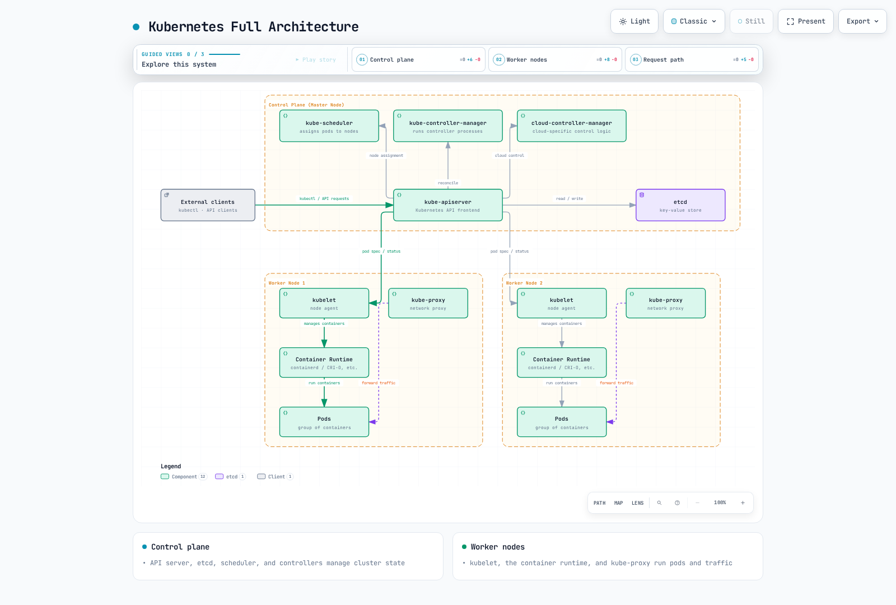

# Introducción a Kubernetes

> **Versiones compatibles**: Kubernetes upstream 1.35–1.37; soporte estándar de EKS 1.34–1.37 (al 12 de octubre de 2026)
> **Última actualización**: October 12, 2026

El proyecto Kubernetes mantiene ramas de lanzamiento para las tres versiones menores más recientes (1.35–1.37). Upstream 1.34 está en modo de mantenimiento y sigue recibiendo lanzamientos de parches hasta el final de su vida útil el **October 27, 2026**; esa fecha es independiente de la fecha de finalización del soporte de EKS de AWS. Consulta el [ciclo de vida de AWS EKS](https://docs.aws.amazon.com/eks/latest/userguide/kubernetes-versions.html) para conocer la cobertura y las fechas de EKS.

Kubernetes (K8s) es una plataforma de orquestación de contenedores de código abierto que automatiza el despliegue, el escalado y la administración de aplicaciones en contenedores. Este documento explica los conceptos básicos, la arquitectura, los componentes principales y las características de Kubernetes.

Estos ejemplos de aprendizaje independientes se revisaron estáticamente con esquemas y documentación oficial. No son configuraciones de producción validadas mediante despliegue. Verifica las imágenes personalizadas, los nombres/labels, TLS, IAM/RBAC, CNI y los requisitos de almacenamiento en el entorno de destino, y sustituye los marcadores de posición.

## Configuración del entorno de laboratorio

Para seguir los ejemplos de este documento, necesitarás las siguientes herramientas y entorno:

### Herramientas necesarias

* **kubectl**: Herramienta de línea de comandos para interactuar con clusters de Kubernetes
* **Controlador de cluster local**: Un motor de contenedores o controlador de VM compatible con minikube/kind; los nodos de Kubernetes usan un runtime CRI v1.
* **minikube** o **kind**: Cluster local de Kubernetes (para desarrollo y aprendizaje)

### Métodos de instalación

**Instalación de kubectl**:

```bash
# macOS: use a kubectl version within one minor of the API server.
brew install kubectl
```

```bash
# Linux: select an explicit compatible version and architecture.
set -euo pipefail
: "${KUBECTL_VERSION:?Set a cluster-compatible version, e.g. v1.37.1}"
case "$(uname -m)" in
  x86_64) KUBECTL_ARCH=amd64 ;;
  aarch64|arm64) KUBECTL_ARCH=arm64 ;;
  *) echo "Choose a supported kubectl architecture" >&2; exit 1 ;;
esac
curl --fail --location --output kubectl "https://dl.k8s.io/release/$KUBECTL_VERSION/bin/linux/$KUBECTL_ARCH/kubectl"
curl --fail --location --output kubectl.sha256 "https://dl.k8s.io/release/$KUBECTL_VERSION/bin/linux/$KUBECTL_ARCH/kubectl.sha256"
echo "$(cat kubectl.sha256)  kubectl" | sha256sum --check
sudo install -m 0755 kubectl /usr/local/bin/kubectl
```

```powershell
$ErrorActionPreference = "Stop"
$KubectlVersion = Read-Host "Cluster-compatible kubectl version (vX.Y.Z)"
$KubectlArch = Read-Host "Architecture (amd64 or arm64)"
if ($KubectlVersion -notmatch '^v\d+\.\d+\.\d+$' -or $KubectlArch -notin @('amd64','arm64')) { throw "Invalid version/architecture" }
$BaseUrl = "https://dl.k8s.io/release/$KubectlVersion/bin/windows/$KubectlArch"
Invoke-WebRequest "$BaseUrl/kubectl.exe" -OutFile kubectl.exe
Invoke-WebRequest "$BaseUrl/kubectl.exe.sha256" -OutFile kubectl.exe.sha256
if ((Get-FileHash kubectl.exe -Algorithm SHA256).Hash -ne (Get-Content kubectl.exe.sha256).Trim()) { throw "Checksum mismatch" }
# Move the verified binary to a directory included in PATH.
```

**Instalación de minikube**:

Usa la guía oficial de inicio de minikube para seleccionar el binario, la suma de comprobación y el controlador para tu sistema operativo/arquitectura. Ejecuta las instrucciones de Linux y Windows en sus shells respectivos y agrega el binario verificado a PATH. Para macOS:

```bash
brew install minikube
minikube version
```

### Inicio de un cluster local

```bash
minikube start
```

## Tabla de contenido

* [¿Qué es Kubernetes?](04-kubernetes-introduction.md#what-is-kubernetes)
* [Historia de Kubernetes](04-kubernetes-introduction.md#history-of-kubernetes)
* [Arquitectura de Kubernetes](04-kubernetes-introduction.md#kubernetes-architecture)
* [Componentes principales de Kubernetes](04-kubernetes-introduction.md#kubernetes-main-components)
* [Objetos básicos de Kubernetes](04-kubernetes-introduction.md#kubernetes-basic-objects)
* [Recursos de carga de trabajo de Kubernetes](04-kubernetes-introduction.md#kubernetes-workload-resources)
* [Services y redes de Kubernetes](04-kubernetes-introduction.md#kubernetes-services-and-networking)
* [Almacenamiento de Kubernetes](04-kubernetes-introduction.md#kubernetes-storage)
* [Configuración y seguridad de Kubernetes](04-kubernetes-introduction.md#kubernetes-configuration-and-security)
* [Kubernetes frente a Amazon EKS](04-kubernetes-introduction.md#kubernetes-vs-amazon-eks)
* [Primeros pasos con Kubernetes](04-kubernetes-introduction.md#getting-started-with-kubernetes)

## ¿Qué es Kubernetes?

Kubernetes significa «timonel» o «piloto» en griego y es un sistema de código abierto que automatiza el despliegue, el escalado y la operación de aplicaciones en contenedores. Se inspiró en el sistema interno Borg de Google y se publicó como código abierto en 2014.

### Características clave de Kubernetes

1. **Detección de Service y balanceo de carga**: Expone contenedores externamente y distribuye el tráfico
2. **Orquestación de almacenamiento**: Monta automáticamente sistemas de almacenamiento locales o en la nube
3. **Rollouts y rollbacks**: Actualiza gradualmente las aplicaciones y admite rollback activado por operador/herramienta; un Deployment fallido no hace rollback automáticamente.
4. **Empaquetado automático**: Coloca contenedores en nodos según los requisitos de recursos
5. **Autocuración**: Reinicia contenedores fallidos y reemplaza contenedores que no responden
6. **Administración de Secret y configuración**: Almacena información sensible y actualiza la configuración
7. **Escalado horizontal**: Escala aplicaciones mediante comandos sencillos o UI
8. **Ejecución por lotes**: Administra cargas de trabajo por lotes y de CI

### Problemas que resuelve Kubernetes

* **Orquestación de contenedores**: Administra eficazmente cientos o miles de contenedores
* **Alta disponibilidad**: Admite un diseño de aplicaciones resiliente con réplicas, ubicación, probes y capacidad
* **Escalabilidad**: Escalado automático según el aumento del tráfico
* **Recuperación**: Reconcilia cargas de trabajo fallidas; la recuperación ante desastres también requiere copias de seguridad y planes de restauración probados
* **Eficiencia de recursos**: Utiliza eficazmente los recursos de hardware
* **Configuración declarativa**: Administra la infraestructura como código
* **Nube múltiple y nube híbrida**: Despliegue y administración coherentes en distintos entornos

## Historia de Kubernetes

### Antecedentes

* **2003-2013**: Google usó internamente un sistema de orquestación de contenedores llamado Borg
* **June 2014**: Google publicó Kubernetes como código abierto
* **July 2015**: Se lanzó Kubernetes 1.0 y se donó a Cloud Native Computing Foundation (CNCF)
* **2016-2017**: Los principales proveedores de nube lanzaron servicios administrados de Kubernetes
* **2018 y posteriores**: Se estableció como el estándar de facto para la orquestación de contenedores

### Origen del nombre

Kubernetes (κυβερνήτης) significa «timonel» o «piloto» en griego. Esto simboliza su función de guiar las aplicaciones en contenedores. Se usa la abreviatura K8s porque hay 8 caracteres entre «K» y «s».

### Significado del logotipo

El logotipo de Kubernetes representa un timón (la rueda de dirección de un barco) con 7 radios, que simboliza el papel de Kubernetes al guiar el rumbo de las aplicaciones en contenedores.

## Arquitectura de Kubernetes

Kubernetes sigue una arquitectura maestro-nodo. Los nodos maestros (control plane) administran el cluster y los nodos de trabajo ejecutan las cargas de trabajo reales de las aplicaciones.

### Componentes de Control Plane (maestro)


[🔍 Ver diagrama interactivo](https://www.atomai.click/kubernetes-docs/archmaps/en-basics-04-kubernetes-introduction-0.html)

1. **kube-apiserver**: Frontend del control plane que expone la API de Kubernetes
2. **etcd**: Almacén de pares clave-valor coherente y altamente disponible para objetos de la API de Kubernetes y el estado del cluster (no el contenido de volúmenes de aplicaciones)
3. **kube-scheduler**: Componente que asigna Pods a nodos
4. **kube-controller-manager**: Componente que ejecuta procesos de controller
   * Node Controller: Notificación y respuesta cuando los nodos fallan
   * Replication Controller: Mantiene el número correcto de réplicas de Pod
   * EndpointSlice Controller: Mantiene registros de endpoints de Service (los Endpoints heredados están en desuso)
   * El controller ServiceAccount crea cuentas predeterminadas; los tokens proyectados de Pod usan TokenRequest y la rotación de kubelet
5. **cloud-controller-manager**: Componente que contiene lógica de control específica de la nube
   * Node Controller: Comprueba con el proveedor de nube si se eliminó el nodo
   * Route Controller: Configura rutas en la infraestructura de nube
   * Service Controller: Crea, actualiza y elimina balanceadores de carga del proveedor de nube

### Componentes de nodo


[🔍 Ver diagrama interactivo](https://www.atomai.click/kubernetes-docs/archmaps/en-basics-04-kubernetes-introduction-1.html)

1. **kubelet**: Agente que se ejecuta en cada nodo y garantiza que los contenedores de los Pods se estén ejecutando
2. **kube-proxy**: Proxy de red que se ejecuta en cada nodo e implementa el concepto de Service de Kubernetes
3. **Container Runtime**: Software que implementa CRI v1, como containerd o CRI-O; Docker Engine requiere un adaptador CRI independiente

### Arquitectura completa



[🔍 Ver diagrama interactivo](https://www.atomai.click/kubernetes-docs/archmaps/en-basics-04-kubernetes-introduction-2.html)

## Componentes principales de Kubernetes

### API Server (kube-apiserver)

El servidor API es el frontend del control plane que expone la API de Kubernetes. Las solicitudes de la API de Kubernetes pasan por él; el tráfico de aplicaciones y la E/S de almacenamiento no pasan por el servidor API.

**Funciones clave**:

* Proporciona API REST
* Autenticación y autorización
* Validación de solicitudes
* Comunicación con etcd
* Escalable horizontalmente

### etcd

etcd es un almacén de pares clave-valor coherente y altamente disponible que almacena objetos de la API de Kubernetes y el estado del cluster (no el contenido de volúmenes de aplicaciones).

**Características clave**:

* Sistema distribuido
* Coherencia fuerte
* Alta disponibilidad
* Almacenamiento seguro de datos
* Función Watch para supervisar cambios

### Scheduler (kube-scheduler)

El scheduler es un componente del control plane que selecciona nodos para ejecutar Pods recién creados.

**Proceso de programación**:

1. **Filtrado**: Identifica nodos que pueden ejecutar el Pod
2. **Puntuación**: Asigna puntuaciones a los nodos adecuados
3. **Vinculación**: Asigna el Pod al nodo óptimo

**Consideraciones**:

* Requisitos de recursos (CPU, memoria)
* Restricciones de hardware/software/política
* Especificaciones de afinidad/antiafinidad
* Localidad de los datos
* Interferencia de cargas de trabajo

### Controller Manager (kube-controller-manager)

El controller manager es un componente del control plane que ejecuta varios procesos de controller.

**Controllers principales**:

* **Node Controller**: Supervisa y responde al estado del nodo
* **Replication Controller**: Mantiene el recuento de réplicas de Pod
* **EndpointSlice Controller**: Mantiene registros de endpoints de Service (los Endpoints heredados están en desuso)
* **controller ServiceAccount**: Crea cuentas predeterminadas; los tokens modernos de Pod se solicitan mediante TokenRequest y kubelet los rota
* **Job Controller**: Administra tareas de una sola vez
* **CronJob Controller**: Administra tareas programadas
* **DaemonSet Controller**: Reconcilia un Pod en cada nodo elegible
* **StatefulSet Controller**: Administra aplicaciones con estado
* **PV Controller**: Administra volúmenes persistentes

### Cloud Controller Manager (cloud-controller-manager)

El cloud controller manager contiene lógica de control específica de la nube. Los sidecars/drivers de controller CSI y los plugins de kubelet/nodo administran el aprovisionamiento, la conexión y el montaje de almacenamiento; esto no es un controller de volúmenes CCM.

**Controllers principales**:

* **Node Controller**: Comprueba el estado del nodo mediante la API del proveedor de nube
* **Route Controller**: Configura rutas en el entorno de nube
* **Service Controller**: Crea, actualiza y elimina balanceadores de carga de nube

### kubelet

kubelet es un agente que se ejecuta en cada nodo y garantiza que los contenedores de los Pods se estén ejecutando.

**Funciones clave**:

* Ejecuta contenedores según PodSpec
* Informa del estado de los contenedores
* Realiza comprobaciones de estado de contenedores
* Administra el ciclo de vida de los contenedores
* Informa del estado del nodo

### kube-proxy

kube-proxy es un proxy de red que se ejecuta en cada nodo e implementa el concepto de Service de Kubernetes.

**Funciones clave**:

* Mantiene reglas de red para IP y puertos de Service
* Reenvía conexiones
* Implementa el balanceo de carga

**Modos de funcionamiento**:

* **modo nftables**: Estable desde 1.33; verifica la compatibilidad del kernel y del plugin de red
* **modo iptables**: Implementación NAT mediante iptables de Linux (predeterminado)
* **modo IPVS**: En desuso desde 1.35; planifica la migración. Se eliminó el modo userspace histórico.

## Objetos básicos de Kubernetes

Los objetos de Kubernetes son entidades persistentes que representan el estado del cluster. Estos objetos describen aplicaciones en ejecución, recursos disponibles, políticas, etc. en el cluster.

### Pod

Un Pod es la unidad desplegable más pequeña de Kubernetes y representa un grupo de uno o más contenedores. Los contenedores de un Pod comparten la red y pueden compartir volúmenes montados explícitamente; se ejecutan en el mismo nodo. No comparten automáticamente sus sistemas de archivos raíz.

**Características clave**:

* Tiene una dirección IP única
* Espacio de nombres de red compartido (mismo espacio de IP y puertos)
* Espacio de nombres IPC compartido
* Nombre de host compartido
* Es posible la comunicación localhost entre contenedores

**Ejemplo de Pod**:

```yaml
apiVersion: v1
kind: Pod
metadata:
  name: nginx-pod
  labels:
    app: nginx
spec:
  containers:
  - name: nginx
    image: nginx:1.30.4
    ports:
    - containerPort: 80
    volumeMounts:
    - name: logs
      mountPath: /var/log/nginx
  - name: log-sidecar
    image: busybox:1.37.0
    command:
    - /bin/sh
    - -c
    - until [ -f /var/log/nginx/access.log ]; do sleep 1; done; tail -F /var/log/nginx/access.log
    volumeMounts:
    - name: logs
      mountPath: /var/log/nginx
      readOnly: true
  volumes:
  - name: logs
    emptyDir: {}
```

### Namespace

Los Namespaces proporcionan una forma de aislar grupos de recursos dentro de un único cluster. Esto ayuda a organizar equipos/proyectos; los namespaces por sí solos no aplican aislamiento de red ni de autorización.

**Namespaces predeterminados**:

* **default**: Namespace predeterminado
* **kube-system**: Namespace para objetos creados por el sistema Kubernetes
* **kube-public**: Namespace usado convencionalmente para información pública; el acceso real a los objetos sigue dependiendo de RBAC
* **kube-node-lease**: Namespace para heartbeats de nodos

**Ejemplo de Namespace**:

```yaml
apiVersion: v1
kind: Namespace
metadata:
  name: development
```

### Labels y Selectors

Los labels son pares clave-valor adjuntos a objetos, usados para identificar y seleccionar objetos. Los selectors proporcionan una forma de filtrar objetos según labels.

**Ejemplo de labels**:

```yaml
metadata:
  labels:
    app: nginx
    environment: production
    tier: frontend
```

**Tipos de selector**:

* **Basado en igualdad**: `=`, `!=`
* **Basado en conjuntos**: `in`, `notin`, `exists`

**Ejemplo de selector**:

```yaml
selector:
  matchLabels:
    app: nginx
  matchExpressions:
    - {key: tier, operator: In, values: [frontend, middleware]}
    - {key: environment, operator: NotIn, values: [dev]}
```

### Annotations

Las annotations son pares clave-valor que almacenan metadatos no identificativos sobre los objetos. Las annotations son útiles para almacenar información usada por herramientas o bibliotecas.

**Ejemplo de annotations**:

```yaml
metadata:
  annotations:
    example.com/created-by: "admin"
    example.com/last-modified: "2023-07-01T12:00:00Z"
    prometheus.io/scrape: "true"
    prometheus.io/port: "9090"
```

### Node

Un nodo es una máquina de trabajo de un cluster de Kubernetes que ejecuta Pods. Un nodo puede ser una máquina física o virtual.

**Estado del nodo**:

* **Direcciones**: Hostname, IP interna, IP externa
* **Condiciones**: Ready, DiskPressure, MemoryPressure, PIDPressure, NetworkUnavailable
* **Capacidad**: CPU, memoria, máximo de Pods
* **Información**: Versión del kernel, versión del runtime de contenedores, versión de kubelet

**Estado ilustrativo de Node (informado por el nodo/controllers, no un manifiesto de aprovisionamiento de nodos)**:

```yaml
apiVersion: v1
kind: Node
metadata:
  name: worker-1
  labels:
    kubernetes.io/hostname: worker-1
    node-role.kubernetes.io/worker: ""
    topology.kubernetes.io/zone: us-east-1a
status:
  capacity:
    cpu: "4"
    memory: 8Gi
    pods: "110"
  conditions:
    - type: Ready
      status: "True"
  # ...
```

## Recursos de carga de trabajo de Kubernetes

Los recursos de carga de trabajo son objetos usados para administrar y ejecutar Pods. Estos recursos administran la creación, el escalado, las actualizaciones y la terminación de Pods.

### ReplicaSet

Un ReplicaSet reconcilia un recuento deseado de objetos Pod; la disponibilidad también depende de la capacidad, una configuración válida y la aplicación. Si los Pods fallan o se eliminan, ReplicaSet crea automáticamente Pods de reemplazo.

**Funciones clave**:

* Mantiene el número especificado de réplicas de Pod
* Define la plantilla de Pod
* Identifica Pods mediante selectors

**Ejemplo de ReplicaSet**:

```yaml
apiVersion: apps/v1
kind: ReplicaSet
metadata:
  name: nginx-replicaset
  labels:
    app: nginx
spec:
  replicas: 3
  selector:
    matchLabels:
      app: nginx
  template:
    metadata:
      labels:
        app: nginx
    spec:
      containers:
      - name: nginx
        image: nginx:1.30.4
        ports:
        - containerPort: 80
```

### Deployment

Un Deployment abstrae los ReplicaSets un nivel más, proporcionando actualizaciones declarativas para las aplicaciones. Los Deployments proporcionan características como actualizaciones progresivas, rollbacks y escalado.

**Funciones clave**:

* Actualizaciones declarativas de aplicaciones
* Actualizaciones progresivas y rollbacks
* Administración del historial de Deployment
* Escalado

**Ejemplo de Deployment**:

```yaml
apiVersion: apps/v1
kind: Deployment
metadata:
  name: nginx-deployment
  labels:
    app: nginx
spec:
  replicas: 3
  selector:
    matchLabels:
      app: nginx
  strategy:
    type: RollingUpdate
    rollingUpdate:
      maxSurge: 1
      maxUnavailable: 0
  template:
    metadata:
      labels:
        app: nginx
    spec:
      containers:
      - name: nginx
        image: nginx:1.30.4
        ports:
        - containerPort: 80
        resources:
          requests:
            cpu: 100m
            memory: 128Mi
          limits:
            cpu: 200m
            memory: 256Mi
        livenessProbe:
          httpGet:
            path: /
            port: 80
          initialDelaySeconds: 30
          periodSeconds: 10
        readinessProbe:
          httpGet:
            path: /
            port: 80
          initialDelaySeconds: 5
          periodSeconds: 5
```

El ejemplo de MySQL es una sola instancia persistente. StatefulSet no configura replicación, failover ni copias de seguridad de bases de datos. Primero proporciona mysql-secret/password y sustituye el marcador de posición de StorageClass. Aumentar las réplicas por sí solo crea bases de datos independientes; HA necesita una configuración de operator/replicación de bases de datos probada.

### StatefulSet

Un StatefulSet es un recurso de carga de trabajo para aplicaciones que requieren mantenimiento de estado. Asigna identificadores únicos a cada Pod y proporciona identificadores de red estables y almacenamiento persistente.

**Funciones clave**:

* Identificadores de red estables y únicos
* Almacenamiento estable y persistente
* Despliegue y escalado secuenciales
* Actualizaciones secuenciales

**Ejemplo de StatefulSet**:

```yaml
apiVersion: v1
kind: Service
metadata:
  name: mysql
spec:
  clusterIP: None
  selector:
    app: mysql
  ports:
  - name: mysql
    port: 3306
    targetPort: 3306
---
apiVersion: apps/v1
kind: StatefulSet
metadata:
  name: mysql
spec:
  selector:
    matchLabels:
      app: mysql
  serviceName: mysql
  replicas: 1
  template:
    metadata:
      labels:
        app: mysql
        role: db
    spec:
      containers:
      - name: mysql
        image: mysql:8.4
        env:
        - name: MYSQL_ROOT_PASSWORD
          valueFrom:
            secretKeyRef:
              name: mysql-secret
              key: password
        ports:
        - containerPort: 3306
          name: mysql
        volumeMounts:
        - name: data
          mountPath: /var/lib/mysql
        readinessProbe:
          tcpSocket:
            port: 3306
          initialDelaySeconds: 10
          periodSeconds: 5
  volumeClaimTemplates:
  - metadata:
      name: data
    spec:
      accessModes:
      - ReadWriteOnce
      storageClassName: replace-with-storage-class
      resources:
        requests:
          storage: 10Gi
```

El ejemplo de Fluent Bit para Linux envía logs de CRI a stdout como demostración. Excluye sus propios logs para evitar un bucle de retroalimentación y conserva por separado su base de datos de posición. No lo despliegues junto con otro recopilador que vuelva a publicar los mismos logs en stdout. Producción necesita un destino externo y rutas de host, permisos y excepciones PSS revisados.

### DaemonSet

Un DaemonSet crea un Pod en cada nodo elegible; los selectors de nodo, taints, la capacidad y las políticas de admisión siguen aplicándose. Cuando se agregan nodos al cluster, los Pods se agregan automáticamente y, cuando se eliminan nodos, los Pods también se eliminan.

**Casos de uso clave**:

* Recopiladores de logs (Fluentd, Logstash)
* Agentes de monitorización (Prometheus Node Exporter)
* Plugins de red (Calico, Cilium)
* Daemons de almacenamiento (Ceph)

**Ejemplo de DaemonSet**:

```yaml
apiVersion: v1
kind: ConfigMap
metadata:
  name: intro-log-agent-config
  namespace: kube-system
data:
  fluent-bit.conf: |
    [SERVICE]
        Flush 5
        Parsers_File /fluent-bit/etc/parsers.conf
    [INPUT]
        Name tail
        Path /var/log/containers/*.log
        Exclude_Path /var/log/containers/intro-log-agent-*_kube-system_fluent-bit-*.log
        Parser cri
        Tag kube.*
        DB /var/lib/fluent-bit/tail.db
        Mem_Buf_Limit 5MB
        Skip_Long_Lines On
    [OUTPUT]
        Name stdout
        Match *
---
apiVersion: apps/v1
kind: DaemonSet
metadata:
  name: intro-log-agent
  namespace: kube-system
spec:
  selector:
    matchLabels:
      app: intro-log-agent
  template:
    metadata:
      labels:
        app: intro-log-agent
    spec:
      automountServiceAccountToken: false
      tolerations:
      - key: node-role.kubernetes.io/control-plane
        operator: Exists
        effect: NoSchedule
      containers:
      - name: fluent-bit
        image: cr.fluentbit.io/fluent/fluent-bit:5.1.2
        securityContext:
          runAsUser: 0
          allowPrivilegeEscalation: false
          readOnlyRootFilesystem: true
          capabilities:
            drop: [ALL]
        args:
        - -c
        - /fluent-bit/custom/fluent-bit.conf
        resources:
          requests:
            cpu: 100m
            memory: 100Mi
          limits:
            memory: 200Mi
        volumeMounts:
        - name: varlog
          mountPath: /var/log
          readOnly: true
        - name: config
          mountPath: /fluent-bit/custom
          readOnly: true
        - name: state
          mountPath: /var/lib/fluent-bit
      volumes:
      - name: varlog
        hostPath:
          path: /var/log
          type: Directory
      - name: config
        configMap:
          name: intro-log-agent-config
      - name: state
        hostPath:
          path: /var/lib/intro-log-agent
          type: DirectoryOrCreate
      nodeSelector:
        kubernetes.io/os: linux
```

### Job

Un Job crea uno o más Pods y continúa la ejecución hasta que un número especificado de Pods finaliza correctamente. Es adecuado para tareas de procesamiento por lotes.

**Funciones clave**:

* Ejecución de tareas de una sola vez
* Ejecución de tareas en paralelo
* Realiza seguimiento de las finalizaciones correctas; los límites de fallo/plazo aún pueden hacer que falle el Job
* Reintento en caso de fallo

**Ejemplo de Job**:

```yaml
apiVersion: batch/v1
kind: Job
metadata:
  name: pi-calculator
spec:
  completions: 5
  parallelism: 2
  backoffLimit: 3
  template:
    spec:
      containers:
      - name: pi
        image: perl
        command: ["perl", "-Mbignum=bpi", "-wle", "print bpi(2000)"]
      restartPolicy: Never
```

Los Jobs pueden fallar debido a límites de reintento/plazo y pueden ejecutar el mismo trabajo de nuevo, por lo que las tareas deben ser idempotentes. La programación de CronJob no es exactamente una vez; Forbid solo controla Jobs superpuestos de ese CronJob.

### CronJob

Un CronJob ejecuta Jobs periódicamente de acuerdo con una programación especificada. Funciona de forma similar a los trabajos cron de Linux.

**Funciones clave**:

* Ejecución de tareas según la programación
* Compatibilidad con expresiones cron
* Configuración de política de concurrencia
* Límites de historial

**Ejemplo de CronJob**:

```yaml
apiVersion: batch/v1
kind: CronJob
metadata:
  name: database-backup
spec:
  timeZone: Etc/UTC
  schedule: "0 2 * * *"  # Run at 02:00 daily
  concurrencyPolicy: Forbid
  successfulJobsHistoryLimit: 3
  failedJobsHistoryLimit: 1
  jobTemplate:
    spec:
      template:
        spec:
          containers:
          - name: backup
            image: database-backup:v1
            env:
            - name: DB_HOST
              value: "db.example.com"
          restartPolicy: OnFailure
```

## Services y redes de Kubernetes

El modelo de redes de Kubernetes se basa en la premisa de que la red de Pod es proporcionada por un CNI compatible; el enrutamiento está sujeto a NetworkPolicy, firewalls y topología. Los Services proporcionan endpoints estables para conjuntos de Pods.

### Service

Un Service proporciona un único endpoint y balanceo de carga para un conjunto de Pods. Dado que los Pods se crean y eliminan dinámicamente, los Services proporcionan direcciones de red estables a pesar de estos cambios.

**Tipos de Service**:

* **ClusterIP**: Service accesible solo dentro del cluster (predeterminado)
* **NodePort**: Accesible externamente mediante la IP y un puerto específico de cada nodo
* **LoadBalancer**: Accesible externamente mediante el balanceador de carga del proveedor de nube
* **ExternalName**: Crea un registro CNAME para un Service externo


[🔍 Ver diagrama interactivo](https://www.atomai.click/kubernetes-docs/archmaps/en-basics-04-kubernetes-introduction-3.html)

**Ejemplo de Service**:

```yaml
apiVersion: v1
kind: Service
metadata:
  name: nginx-service
spec:
  selector:
    app: nginx
  ports:
  - port: 80
    targetPort: 80
  type: ClusterIP
```

**Ejemplo de Service NodePort**:

```yaml
apiVersion: v1
kind: Service
metadata:
  name: nginx-nodeport
spec:
  selector:
    app: nginx
  ports:
  - port: 80
    targetPort: 80
    nodePort: 30080
  type: NodePort
```

Este ejemplo de AWS requiere AWS Load Balancer Controller y sus requisitos previos de IAM/red. EKS Auto Mode usa un loadBalancerClass diferente; los clusters locales requieren su propia implementación de LoadBalancer.

**Ejemplo de Service LoadBalancer**:

```yaml
apiVersion: v1
kind: Service
metadata:
  name: nginx-lb
  annotations:
    service.beta.kubernetes.io/aws-load-balancer-scheme: internet-facing
    service.beta.kubernetes.io/aws-load-balancer-nlb-target-type: ip
spec:
  selector:
    app: nginx
  ports:
  - port: 80
    targetPort: 80
  type: LoadBalancer
  loadBalancerClass: service.k8s.aws/nlb
```

Este ejemplo requiere Traefik instalado, su IngressClass traefik, los Services app1/app2 y el Secret TLS. Las rutas /app1 y /app2 se conservan y deben ser servidas por los backends. Un recurso Ingress no instala un controller.

### Ingress

Un Ingress es un objeto de API que administra el enrutamiento HTTP y HTTPS desde fuera del cluster hacia Services internos. Ingress proporciona balanceo de carga, terminación SSL, alojamiento virtual basado en nombres, etc.

**Controllers de Ingress**:

* **ingress-nginx (retirado en March 2026)**: Controller comunitario histórico; elige un controller mantenido para instalaciones nuevas. F5 NGINX Ingress Controller es un proyecto independiente.
* **AWS Load Balancer Controller**: Controller de ingress basado en AWS Application Load Balancer
* **Traefik**: Router perimetral nativo de nube
* **Istio Ingress**: Ingress basado en service mesh

**Ejemplo de Ingress**:

```yaml
apiVersion: networking.k8s.io/v1
kind: Ingress
metadata:
  name: example-ingress
spec:
  ingressClassName: traefik
  rules:
  - host: example.com
    http:
      paths:
      - path: /app1
        pathType: Prefix
        backend:
          service:
            name: app1-service
            port:
              number: 80
      - path: /app2
        pathType: Prefix
        backend:
          service:
            name: app2-service
            port:
              number: 80
  tls:
  - hosts:
    - example.com
    secretName: example-tls
```

### NetworkPolicy

NetworkPolicy proporciona una forma de controlar la comunicación entre Pods. De forma predeterminada, todos los Pods pueden comunicarse entre sí, pero puedes restringirlo mediante políticas de red.&#x20;


[🔍 Ver diagrama interactivo](https://www.atomai.click/kubernetes-docs/archmaps/en-basics-04-kubernetes-introduction-4.html)

**Funciones clave**:

* Controla la comunicación entre Pods
* Controla la comunicación entre Namespaces
* Controla el tráfico de ingreso (entrante) y egreso (saliente)
* Filtrado basado en puertos y protocolos

**Ejemplo de NetworkPolicy**:

```yaml
apiVersion: networking.k8s.io/v1
kind: NetworkPolicy
metadata:
  name: db-network-policy
  namespace: default
spec:
  podSelector:
    matchLabels:
      role: db
  policyTypes:
  - Ingress
  - Egress
  ingress:
  - from:
    - podSelector:
        matchLabels:
          role: api
    ports:
    - protocol: TCP
      port: 3306
  - from:
    - namespaceSelector:
        matchLabels:
          kubernetes.io/metadata.name: monitoring
      podSelector:
        matchLabels:
          app: prometheus
    ports:
    - protocol: TCP
      port: 9104
  egress:
  - to:
    - namespaceSelector:
        matchLabels:
          kubernetes.io/metadata.name: kube-system
      podSelector:
        matchLabels:
          k8s-app: kube-dns
    ports:
    - protocol: UDP
      port: 53
    - protocol: TCP
      port: 53
```

Las autorizaciones de NetworkPolicy son aditivas. La política permite role=api al puerto DB 3306 y app=prometheus en monitoring a un exporter de DB instalado por separado en 9104. No hace que la DB se conecte a Prometheus 9090. Adapta los selectors de egreso DNS para la configuración real de DNS/NodeLocal DNS del cluster.

### DNS

Las distribuciones de Kubernetes suelen desplegar CoreDNS para la detección de Service. Conserva la configuración administrada por la distribución al editar su ConfigMap. El modo inseguro de Pods siguiente proporciona registros heredados basados en IP sin verificar la existencia de Pod; usa disabled si esos registros no son necesarios, o verified con su coste adicional de observación/memoria.

**Formato de nombre DNS**:

* **Service**: `<service-name>.<namespace>.svc.cluster.local`
* **Pod**: `<pod-ip-with-dashes>.<namespace>.pod.cluster.local` (registro IPv4; depende del modo Pods de CoreDNS)

**Ejemplo de configuración DNS**:

```yaml
apiVersion: v1
kind: ConfigMap
metadata:
  name: coredns
  namespace: kube-system
data:
  Corefile: |
    .:53 {
        errors
        health
        ready
        kubernetes cluster.local in-addr.arpa ip6.arpa {
          pods insecure
          fallthrough in-addr.arpa ip6.arpa
        }
        prometheus :9153
        forward . /etc/resolv.conf
        cache 30
        loop
        reload
        loadbalance
    }
```

### Service Mesh

Un service mesh es una capa de infraestructura que administra la comunicación entre microservicios. Los service meshes proporcionan administración de tráfico, seguridad y observabilidad.

**Principales Service Meshes**:

* **Istio**: Service mesh más usado
* **Linkerd**: Service mesh ligero
* **AWS App Mesh**: El soporte terminó el 2026-09-30; AWS indica que su consola y recursos ya no son accesibles.

**Ejemplo de Istio VirtualService**:

```yaml
apiVersion: networking.istio.io/v1
kind: VirtualService
metadata:
  name: reviews-route
spec:
  hosts:
  - reviews
  http:
  - match:
    - headers:
        end-user:
          exact: jason
    route:
    - destination:
        host: reviews
        subset: v2
  - route:
    - destination:
        host: reviews
        subset: v1
---
apiVersion: networking.istio.io/v1
kind: DestinationRule
metadata:
  name: reviews-subsets
spec:
  host: reviews
  subsets:
  - name: v1
    labels:
      version: v1
  - name: v2
    labels:
      version: v2
```

## Almacenamiento de Kubernetes

Kubernetes proporciona varias opciones de almacenamiento para aplicaciones en contenedores. Proporciona formas de persistir los datos incluso cuando los Pods se reinician o se reprograman.


[🔍 Ver diagrama interactivo](https://www.atomai.click/kubernetes-docs/archmaps/en-basics-04-kubernetes-introduction-5.html)

### Volume

Un volumen es un directorio que se puede montar en contenedores de un Pod, y conserva datos durante el ciclo de vida del Pod. Los volúmenes también se usan para compartir datos entre contenedores de un Pod.

**Tipos de Volume principales**:

* **emptyDir**: Comienza como directorio vacío, se elimina cuando se elimina el Pod
* **hostPath**: Montaje desde el sistema de archivos del nodo host al Pod
* **configMap**: Monta ConfigMap como volumen
* **secret**: Monta Secret como volumen
* **persistentVolumeClaim**: Monta volumen persistente en Pod

**Ejemplo de Volume emptyDir**:

```yaml
apiVersion: v1
kind: Pod
metadata:
  name: test-pd
spec:
  containers:
  - name: test-container
    image: nginx:1.30.4
    volumeMounts:
    - mountPath: /cache
      name: cache-volume
  volumes:
  - name: cache-volume
    emptyDir: {}
```

### PersistentVolume (PV)

Un PersistentVolume es un objeto de API que representa un recurso de almacenamiento en el cluster. Existe independientemente de los Pods y se aprovisiona estáticamente por administradores o dinámicamente mediante un aprovisionador de almacenamiento.

**Modos de acceso**:

* **ReadWriteOnce (RWO)**: Se puede montar para lectura/escritura mediante un único nodo
* **ReadOnlyMany (ROX)**: Se puede montar como solo lectura mediante varios nodos
* **ReadWriteMany (RWX)**: Se puede montar para lectura/escritura mediante varios nodos
* **ReadWriteOncePod (RWOP)**: Acceso de un único Pod para volúmenes CSI compatibles; RWO por sí solo aún permite varios Pods en el mismo nodo

El driver EBS CSI y los permisos IAM ya deben estar instalados. Usa un ID de volumen existente y su zona de disponibilidad real; nunca reutilices un volumen que todavía esté en uso en otro lugar. Estos ejemplos de almacenamiento son específicos de AWS; los clusters locales necesitan su propio aprovisionador.

**Ejemplo de PersistentVolume**:

```yaml
apiVersion: v1
kind: PersistentVolume
metadata:
  name: pv-example
spec:
  capacity:
    storage: 10Gi
  accessModes:
  - ReadWriteOnce
  persistentVolumeReclaimPolicy: Retain
  storageClassName: ebs-gp3
  csi:
    driver: ebs.csi.aws.com
    volumeHandle: vol-0123456789abcdef0
    fsType: ext4
  nodeAffinity:
    required:
      nodeSelectorTerms:
      - matchExpressions:
        - key: topology.kubernetes.io/zone
          operator: In
          values:
          - replace-with-volume-az
```

### PersistentVolumeClaim (PVC)

Un PersistentVolumeClaim es un objeto de API que representa la solicitud de almacenamiento de un usuario. Los Pods acceden a los PV mediante PVC.

**Ejemplo de PersistentVolumeClaim**:

```yaml
apiVersion: v1
kind: PersistentVolumeClaim
metadata:
  name: pvc-example
spec:
  accessModes:
  - ReadWriteOnce
  resources:
    requests:
      storage: 5Gi
  storageClassName: ebs-gp3
```

**Ejemplo de Pod que usa PVC**:

```yaml
apiVersion: v1
kind: Pod
metadata:
  name: mypod
spec:
  containers:
    - name: myfrontend
      image: nginx:1.30.4
      volumeMounts:
      - mountPath: "/var/www/html"
        name: mypd
  volumes:
    - name: mypd
      persistentVolumeClaim:
        claimName: pvc-example
```

### StorageClass

Una StorageClass describe «clases» de almacenamiento proporcionadas por administradores. Se pueden proporcionar distintos niveles de calidad de Service, políticas de copia de seguridad o políticas arbitrarias determinadas por los administradores del cluster.

**Ejemplo de StorageClass**:

```yaml
apiVersion: storage.k8s.io/v1
kind: StorageClass
metadata:
  name: ebs-gp3
provisioner: ebs.csi.aws.com
parameters:
  type: gp3
  csi.storage.k8s.io/fstype: ext4
  encrypted: 'true'
reclaimPolicy: Delete
allowVolumeExpansion: true
volumeBindingMode: WaitForFirstConsumer
```

### Aprovisionamiento dinámico

El aprovisionamiento dinámico es una característica que crea automáticamente PV cuando se solicitan PVC mediante clases de almacenamiento.

**Ejemplo de aprovisionamiento dinámico**:

```yaml
apiVersion: v1
kind: PersistentVolumeClaim
metadata:
  name: dynamic-pvc
spec:
  accessModes:
  - ReadWriteOnce
  resources:
    requests:
      storage: 10Gi
  storageClassName: ebs-gp3
```

### CSI (Container Storage Interface)

CSI proporciona una interfaz estándar entre Kubernetes y los sistemas de almacenamiento. Esto permite a los proveedores de almacenamiento desarrollar sus propios drivers de almacenamiento sin modificar el código de Kubernetes.

**Drivers CSI principales**:

* **AWS EBS CSI Driver**: Administración de volúmenes Amazon EBS
* **AWS EFS CSI Driver**: Administración de sistemas de archivos Amazon EFS
* **AWS FSx for Lustre CSI Driver**: Administración de sistemas de archivos FSx for Lustre
* **GCE PD CSI Driver**: Administración de discos persistentes de Google Compute Engine
* **Azure Disk CSI Driver**: Administración de discos de Azure

**StorageClass que usa un driver CSI instalado**:

```yaml
apiVersion: storage.k8s.io/v1
kind: StorageClass
metadata:
  name: ebs-sc
provisioner: ebs.csi.aws.com
parameters:
  type: gp3
  encrypted: 'true'
  csi.storage.k8s.io/fstype: ext4
volumeBindingMode: WaitForFirstConsumer
```

## Configuración y seguridad de Kubernetes

Kubernetes proporciona diversos objetos y mecanismos para administrar la configuración y la seguridad de las aplicaciones.

### ConfigMap

Un ConfigMap es un objeto de API que almacena datos de configuración como pares clave-valor. Los Pods pueden usar datos de ConfigMap como variables de entorno, argumentos de línea de comandos o archivos de configuración.

**Ejemplo de ConfigMap**:

```yaml
apiVersion: v1
kind: ConfigMap
metadata:
  name: app-config
data:
  app.properties: |
    app.name=MyApp
    app.version=1.0.0
    app.environment=production
  log-level: INFO
  max-connections: "100"
```

Los valores de entorno no se actualizan automáticamente; vuelve a crear los Pods después de los cambios. Las actualizaciones de volumen son eventuales y requieren recarga de la aplicación; los montajes subPath no reciben actualizaciones.

**Ejemplo de Pod que usa ConfigMap**:

```yaml
apiVersion: v1
kind: Pod
metadata:
  name: config-pod
spec:
  containers:
  - name: app
    image: myapp:1.0
    env:
    - name: LOG_LEVEL
      valueFrom:
        configMapKeyRef:
          name: app-config
          key: log-level
    volumeMounts:
    - name: config-volume
      mountPath: /etc/config
  volumes:
  - name: config-volume
    configMap:
      name: app-config
```

### Secret

Un Secret es un objeto de API que almacena información sensible como contraseñas, tokens y claves. Es similar a ConfigMap, pero está diseñado para datos sensibles.

**Tipos de Secret**:

* **Opaque**: Datos arbitrarios definidos por el usuario (predeterminado)
* **kubernetes.io/service-account-token**: Secret de token heredado de larga duración solicitado manualmente; prefiere TokenRequest/tokens proyectados
* **kubernetes.io/dockercfg**: Archivo \~/.dockercfg serializado
* **kubernetes.io/dockerconfigjson**: Archivo \~/.docker/config.json serializado
* **kubernetes.io/basic-auth**: Credenciales para autenticación básica
* **kubernetes.io/ssh-auth**: Credenciales para autenticación SSH
* **kubernetes.io/tls**: Datos para cliente o servidor TLS

El campo data usa codificación base64, no cifrado. Protege los Secrets con RBAC y cifrado en reposo adecuado para el cluster; EKS cifra todos los datos de la API de Kubernetes de forma predeterminada para 1.28+. Los valores siguientes son solo de demostración y deben reemplazarse.

**Ejemplo de Secret**:

```yaml
apiVersion: v1
kind: Secret
metadata:
  name: db-credentials
type: Opaque
data:
  username: YWRtaW4=  # base64 encoded "admin"
  password: cGFzc3dvcmQxMjM=  # base64 encoded "password123"
```

**Ejemplo de Pod que usa Secret**:

```yaml
apiVersion: v1
kind: Pod
metadata:
  name: secret-pod
spec:
  containers:
  - name: db-client
    image: db-client:1.0
    env:
    - name: DB_USERNAME
      valueFrom:
        secretKeyRef:
          name: db-credentials
          key: username
    - name: DB_PASSWORD
      valueFrom:
        secretKeyRef:
          name: db-credentials
          key: password
```

### RBAC (Role-Based Access Control)

RBAC es un mecanismo para controlar el acceso a la API de Kubernetes. Otorga permisos específicos a usuarios o cuentas de Service mediante Roles y RoleBindings.

**Objetos RBAC principales**:

* **Role**: Define un conjunto de permisos dentro de un namespace
* **ClusterRole**: Reutiliza reglas para recursos de cluster/con namespace; el binding determina su ámbito efectivo
* **RoleBinding**: Vincula un rol a usuarios, grupos o cuentas de Service
* **ClusterRoleBinding**: Vincula un rol de cluster a usuarios, grupos o cuentas de Service

**Ejemplo de Role**:

```yaml
apiVersion: rbac.authorization.k8s.io/v1
kind: Role
metadata:
  namespace: default
  name: pod-reader
rules:
- apiGroups: [""]
  resources: ["pods"]
  verbs: ["get", "watch", "list"]
```

**Ejemplo de RoleBinding**:

```yaml
apiVersion: rbac.authorization.k8s.io/v1
kind: RoleBinding
metadata:
  name: read-pods
  namespace: default
subjects:
- kind: User
  name: jane
  apiGroup: rbac.authorization.k8s.io
roleRef:
  kind: Role
  name: pod-reader
  apiGroup: rbac.authorization.k8s.io
```

### ServiceAccount

Una ServiceAccount proporciona una identidad para los procesos que se ejecutan dentro de un Pod. Los Pods usan cuentas de Service para comunicarse con la API de Kubernetes.

**Ejemplo de ServiceAccount**:

```yaml
apiVersion: v1
kind: ServiceAccount
metadata:
  name: app-sa
  namespace: default
```

**Ejemplo de Pod que usa ServiceAccount**:

```yaml
apiVersion: v1
kind: Pod
metadata:
  name: sa-pod
spec:
  serviceAccountName: app-sa
  containers:
  - name: app
    image: myapp:1.0
```

### NetworkPolicy

NetworkPolicy proporciona una forma de controlar la comunicación entre Pods. De forma predeterminada, todos los Pods pueden comunicarse entre sí, pero puedes restringirlo mediante políticas de red.

**Ejemplo de NetworkPolicy**:

```yaml
apiVersion: networking.k8s.io/v1
kind: NetworkPolicy
metadata:
  name: db-network-policy
  namespace: default
spec:
  podSelector:
    matchLabels:
      role: db
  policyTypes:
  - Ingress
  - Egress
  ingress:
  - from:
    - podSelector:
        matchLabels:
          role: api
    ports:
    - protocol: TCP
      port: 3306
  - from:
    - namespaceSelector:
        matchLabels:
          kubernetes.io/metadata.name: monitoring
      podSelector:
        matchLabels:
          app: prometheus
    ports:
    - protocol: TCP
      port: 9104
  egress:
  - to:
    - namespaceSelector:
        matchLabels:
          kubernetes.io/metadata.name: kube-system
      podSelector:
        matchLabels:
          k8s-app: kube-dns
    ports:
    - protocol: UDP
      port: 53
    - protocol: TCP
      port: 53
```

### Pod Security Admission y SecurityContext

PodSecurityPolicy se eliminó en 1.25. Pod Security Admission aplica los Pod Security Standards mediante labels de namespace. SecurityContext configura la carga de trabajo misma; no sustituye la aplicación de admisión.

**Ejemplo de Pod SecurityContext**:

```yaml
apiVersion: v1
kind: Pod
metadata:
  name: security-context-pod
spec:
  securityContext:
    runAsUser: 1000
    runAsGroup: 3000
    fsGroup: 2000
    runAsNonRoot: true
    seccompProfile:
      type: RuntimeDefault
  containers:
  - name: app
    image: myapp:1.0
    securityContext:
      allowPrivilegeEscalation: false
      capabilities:
        drop:
        - ALL
```

### Pod Security Standards

Los Pod Security Standards proporcionan tres niveles de política que definen requisitos de seguridad para Pods:

1. **Privileged**: Sin restricciones, se permiten todas las características
2. **Baseline**: Evita escaladas de privilegios conocidas
3. **Restricted**: Restricciones estrictas que aplican las prácticas recomendadas

**Ejemplo de aplicación de Pod Security Standards**:

```yaml
apiVersion: v1
kind: Namespace
metadata:
  name: my-namespace
  labels:
    pod-security.kubernetes.io/enforce: restricted
    pod-security.kubernetes.io/audit: restricted
    pod-security.kubernetes.io/warn: restricted
```

## Kubernetes frente a Amazon EKS

Amazon EKS (Elastic Kubernetes Service) es un servicio administrado de Kubernetes proporcionado por AWS. EKS expone la API estándar de Kubernetes con integraciones de AWS. La comparación siguiente supone grupos de nodos EC2 convencionales; las responsabilidades y características compatibles difieren para Auto Mode, Fargate y Hybrid Nodes.

### Diferencias clave

| Característica           | Kubernetes autoadministrado                         | Amazon EKS                                                        |
| ------------------------ | ----------------------------------------------- | ----------------------------------------------------------------- |
| Administración de Control Plane | El usuario lo administra directamente                           | Administrado por AWS                                                    |
| Alta disponibilidad        | El usuario debe configurarla                             | Se proporciona de forma predeterminada (desplegado en varias zonas de disponibilidad) |
| Actualizaciones                 | El usuario las realiza directamente                          | AWS administra las actualizaciones de control plane; coordina las actualizaciones de nodos/add-ons                                |
| Parches de seguridad         | El usuario los aplica directamente                           | AWS aplica parches al control plane; el rollout de AMI de nodos administrados sigue siendo tu responsabilidad (Auto Mode difiere)                                      |
| Autenticación           | Varias opciones requieren configuración              | Integrada con AWS IAM                                           |
| Redes               | Se requiere selección y configuración de plugin CNI | Amazon VPC CNI proporcionado de forma predeterminada                                |
| Balanceo de carga           | Se requiere configuración manual                   | Integración de AWS Load Balancer Controller                          |
| Almacenamiento                  | Se requiere configuración del driver de almacenamiento           | Integración de driver CSI de EBS, EFS, FSx                              |
| Monitorización               | Se requiere configuración manual                           | Integración de CloudWatch Container Insights                         |
| Coste                     | Infraestructura más esfuerzo operativo                       | Coste de control plane + costes de infraestructura                         |

### Características adicionales de EKS

1. **Integración de AWS IAM**: Integración de Kubernetes RBAC y AWS IAM
2. **AWS Load Balancer Controller**: Integración de ALB y NLB con Services e ingress de Kubernetes
3. **EKS Managed Node Groups**: Automatización de administración del ciclo de vida de nodos
4. **Fargate Profiles**: Ejecución serverless de Pods de Kubernetes
5. **VPC CNI Plugin**: Integración con redes AWS VPC
6. **CloudWatch Container Insights**: Monitorización y logs de contenedores
7. **AWS App Mesh**: El soporte terminó el 2026-09-30; AWS indica que su consola y recursos ya no son accesibles
8. **AWS Distro for OpenTelemetry**: Trazado distribuido y monitorización
9. **EKS Console and CLI**: Interfaces de administración
10. **EKS Blueprints**: Configuración de cluster basada en prácticas recomendadas

### Componentes específicos de EKS

1. **EKS Control Plane**: Alta disponibilidad entre varias zonas de disponibilidad
2. **EKS Node AMI**: Opciones AL2023/Bottlerocket/Windows proporcionadas por AWS y AMI compatibles suministradas por separado, como Ubuntu
3. **EKS Managed Node Groups**: Flujos de trabajo de actualización de grupos de nodos; el escalado de nodos impulsado por carga de trabajo necesita un autoscaler
4. **EKS Fargate**: Entorno de ejecución de contenedores serverless
5. **EKS Connector**: Conecta clusters externos de Kubernetes a la consola de AWS
6. **EKS Anywhere**: Ejecuta clusters compatibles con EKS en entornos on-premises
7. **EKS Distro**: Distribución de Kubernetes administrada por AWS

### Integración de servicios de AWS

EKS se integra con los siguientes servicios de AWS:

1. **Amazon VPC**: Infraestructura de red
2. **AWS IAM**: Autenticación y autorización
3. **Amazon ECR**: Repositorio de imágenes de contenedores
4. **AWS Load Balancer**: Distribución del tráfico de aplicaciones
5. **Amazon EBS/EFS/FSx**: Almacenamiento persistente
6. **AWS CloudWatch**: Monitorización y logs
7. **AWS CloudTrail**: Auditoría de la API de AWS; la auditoría de la API de Kubernetes requiere el registro de auditoría de EKS
8. **AWS KMS**: Administración de claves de cifrado
9. **AWS WAF**: Conéctalo a front doors de aplicaciones compatibles como ALB; no directamente al endpoint de la API de EKS
10. **AWS Shield**: Protección DDoS
11. **AWS X-Ray**: Trazado distribuido
12. **AWS App Mesh**: El soporte terminó el 2026-09-30; las cargas de trabajo existentes necesitan migración
13. **AWS SageMaker**: Cargas de trabajo de aprendizaje automático
14. **AWS Bedrock**: Cargas de trabajo de IA generativa

## Primeros pasos con Kubernetes

Hay varias maneras de empezar con Kubernetes. Aquí presentamos brevemente cómo iniciar Kubernetes en un entorno de desarrollo local y en AWS EKS.

### Entorno de desarrollo local

#### Minikube

Minikube ejecuta clusters locales de Kubernetes y admite configuraciones tanto de un solo nodo como de varios nodos.

**Instalación e inicio**:

```bash
# Install
brew install minikube

# Start
minikube start

# Check status
minikube status

# Inspect workloads; see the maintained Headlamp UI section below.
kubectl get pods -A
```

#### Kind (Kubernetes in Docker)

Kind ejecuta clusters locales usando contenedores como nodos, con proveedores compatibles Docker/Podman/nerdctl.

**Instalación e inicio**:

```bash
# Install
brew install kind

# Create cluster
kind create cluster --name my-cluster

# Check cluster
kind get clusters
kubectl cluster-info --context kind-my-cluster
```

#### Docker Desktop

Docker Desktop proporciona una característica para ejecutar Kubernetes fácilmente en Mac y Windows.

**Configuración**:

1. Instala Docker Desktop
2. Settings > Kubernetes > Marca "Enable Kubernetes"
3. Haz clic en "Apply & Restart"

### AWS EKS

#### Creación de un cluster EKS con eksctl

eksctl es una herramienta CLI sencilla para crear y administrar clusters EKS.

**Instalación y creación de cluster**:

```bash
# Install a reviewed eksctl release from the official eksctl-io GitHub releases,
# verify eksctl_checksums.txt, and place the binary in PATH.
eksctl version
# Use an existing short-lived AWS login/SSO profile with required permissions.
aws sts get-caller-identity
# This example provisions real AWS resources. Choose the intended account/Region,
# supported EKS version, networking and IAM configuration before running it.
: "${EKS_VERSION:?Set a version supported by EKS, not upstream latest}"
eksctl create cluster \
  --name my-cluster \
  --region ap-northeast-2 \
  --version "$EKS_VERSION" \
  --nodegroup-name standard-workers \
  --node-type t3.medium \
  --node-ami-family AmazonLinux2023 \
  --node-private-networking \
  --nodes 3 --nodes-min 1 --nodes-max 4 --managed
kubectl get nodes
```

#### Creación de un cluster EKS con AWS Management Console

También puedes crear clusters EKS mediante AWS Management Console.

**Pasos**:

1. Inicia sesión en AWS Management Console
2. Navega al servicio EKS
3. Haz clic en "Create cluster"
4. Configura el nombre del cluster, el rol IAM, VPC y las subredes
5. Configura los grupos de seguridad
6. Configura las opciones de logging
7. Crea el cluster
8. Agrega grupos de nodos

### Instalación y configuración de kubectl

kubectl es una herramienta de línea de comandos para interactuar con clusters de Kubernetes.

**Instalación**:

```bash
# macOS: use a kubectl version within one minor of the API server.
brew install kubectl
```

```bash
# Linux: select an explicit compatible version and architecture.
set -euo pipefail
: "${KUBECTL_VERSION:?Set a cluster-compatible version, e.g. v1.37.1}"
case "$(uname -m)" in
  x86_64) KUBECTL_ARCH=amd64 ;;
  aarch64|arm64) KUBECTL_ARCH=arm64 ;;
  *) echo "Choose a supported kubectl architecture" >&2; exit 1 ;;
esac
curl --fail --location --output kubectl "https://dl.k8s.io/release/$KUBECTL_VERSION/bin/linux/$KUBECTL_ARCH/kubectl"
curl --fail --location --output kubectl.sha256 "https://dl.k8s.io/release/$KUBECTL_VERSION/bin/linux/$KUBECTL_ARCH/kubectl.sha256"
echo "$(cat kubectl.sha256)  kubectl" | sha256sum --check
sudo install -m 0755 kubectl /usr/local/bin/kubectl
```

```powershell
$ErrorActionPreference = "Stop"
$KubectlVersion = Read-Host "Cluster-compatible kubectl version (vX.Y.Z)"
$KubectlArch = Read-Host "Architecture (amd64 or arm64)"
if ($KubectlVersion -notmatch '^v\d+\.\d+\.\d+$' -or $KubectlArch -notin @('amd64','arm64')) { throw "Invalid version/architecture" }
$BaseUrl = "https://dl.k8s.io/release/$KubectlVersion/bin/windows/$KubectlArch"
Invoke-WebRequest "$BaseUrl/kubectl.exe" -OutFile kubectl.exe
Invoke-WebRequest "$BaseUrl/kubectl.exe.sha256" -OutFile kubectl.exe.sha256
if ((Get-FileHash kubectl.exe -Algorithm SHA256).Hash -ne (Get-Content kubectl.exe.sha256).Trim()) { throw "Checksum mismatch" }
# Move the verified binary to a directory included in PATH.
```

**Comandos básicos**:

```bash
# Check cluster info
kubectl cluster-info

# List nodes
kubectl get nodes

# Check pods in all namespaces
kubectl get pods --all-namespaces

# Create deployment
kubectl create deployment nginx --image=nginx:1.30.4

# Expose service
kubectl expose deployment nginx --port=80 --type=ClusterIP
# Run port-forward in a separate terminal; stop it when finished.
kubectl port-forward service/nginx 8080:80

# Check logs
kubectl logs <pod-name>

# Execute command in pod container
kubectl exec -it <pod-name> -- /bin/bash
```

### Uso de la UI de Headlamp

Kubernetes Dashboard está archivado y no tiene mantenimiento. Usa Headlamp con una identidad limitada por el RBAC existente. El ejemplo de Helm deshabilita el binding cluster-admin automático y no habilita el modo inseguro de token de ServiceAccount compartido. Un administrador puede otorgar permisos de ámbito reducido por separado.

```bash
helm repo add headlamp https://kubernetes-sigs.github.io/headlamp/
helm repo update headlamp
: "${HEADLAMP_CHART_VERSION:?Set a reviewed chart version}"
helm upgrade --install headlamp headlamp/headlamp \
  --namespace kube-system --version "$HEADLAMP_CHART_VERSION" \
  --set clusterRoleBinding.create=false \
  --set config.unsafeUseServiceAccountToken=false
kubectl -n kube-system port-forward service/headlamp 8080:80
```

Abre `http://localhost:8080` localmente y sigue el flujo de inicio de sesión de la versión instalada de Headlamp. El ingress público requiere TLS y autenticación configurados por separado.

## Conclusión

Kubernetes es una plataforma potente que automatiza el despliegue, el escalado y la administración de aplicaciones en contenedores. Resumen del contenido clave cubierto en este documento:

### Arquitectura principal

* **Control Plane**: Cerebro del cluster (API Server, etcd, Scheduler, Controller Manager)
* **Nodos de trabajo**: Nodos que ejecutan aplicaciones reales (kubelet, kube-proxy, Container Runtime)
* **Configuración declarativa**: Define el estado deseado y Kubernetes ajusta el estado actual al estado deseado

### Objetos y recursos principales

* **Objetos básicos**: Pod, Service, Volume, Namespace
* **Recursos de carga de trabajo**: Deployment, StatefulSet, DaemonSet, Job, CronJob
* **Configuración y seguridad**: ConfigMap, Secret, RBAC, ServiceAccount
* **Redes**: Service, Ingress, NetworkPolicy
* **Almacenamiento**: PersistentVolume, PersistentVolumeClaim, StorageClass

### Ruta de aprendizaje recomendada

**Paso 1: Crear el entorno local**

* Crea un cluster local con minikube o kind
* Aprende comandos de kubectl
* Practica con objetos básicos (Pod, Deployment, Service)

**Paso 2: Dominar los conceptos principales**

* Comprende y practica los recursos de carga de trabajo
* Administración de configuración con ConfigMap y Secret
* Configura redes con Service e Ingress
* Administra almacenamiento con PV y PVC

**Paso 3: Aprender características avanzadas**

* RBAC y políticas de seguridad
* Escalado automático (HPA, VPA, Cluster Autoscaler)
* Monitorización y logs (Prometheus, Grafana)
* Service mesh (Istio, Linkerd)

**Paso 4: Operaciones de producción**

* Usa Amazon EKS u otro Kubernetes administrado
* Integración de pipeline de CI/CD
* Estrategias de recuperación ante desastres y copias de seguridad
* Optimización de costes y administración de recursos

### Próximos pasos

* **Profundización en EKS**: Características específicas de EKS (Fargate, VPC CNI, ALB Controller)
* **Redes avanzadas**: Plugins CNI (Calico, Cilium)
* **Observabilidad**: Métricas, logs, trazas
* **GitOps**: ArgoCD, Flux
* **Refuerzo de seguridad**: Pod Security Standards, Network Policies, OPA/Gatekeeper

Kubernetes sigue evolucionando y se ha convertido en un elemento central del desarrollo y las operaciones de aplicaciones nativas de nube. Esperamos que este documento te ayude a iniciar tu recorrido con Kubernetes.

### Recursos de aprendizaje adicionales

* **Documentación oficial**: [Documentación oficial de Kubernetes](https://kubernetes.io/docs/) proporciona la información más precisa y actualizada
* **Tutoriales interactivos**: Práctica guiada disponible en [Tutoriales de Kubernetes](https://kubernetes.io/docs/tutorials/)
* **Comunidad**: [Kubernetes Slack](https://slack.k8s.io/), [Reddit r/kubernetes](https://reddit.com/r/kubernetes)
* **Certificaciones**: CKA (Certified Kubernetes Administrator), CKAD (Certified Kubernetes Application Developer)
* **Comunidad coreana**: Kubernetes Korea User Group, AWS Korea User Group

## Cuestionario

Para comprobar lo que aprendiste en este capítulo, realiza el [Cuestionario de introducción a Kubernetes](../quizzes/basics/04-kubernetes-introduction-quiz.md).

## Referencias

* [Documentación oficial de Kubernetes](https://kubernetes.io/docs/)
* [Documentación de Amazon EKS](https://docs.aws.amazon.com/eks/)
* [Repositorio GitHub de Kubernetes](https://github.com/kubernetes/kubernetes)
* [CNCF (Cloud Native Computing Foundation)](https://www.cncf.io/)
* [Kubernetes The Hard Way](https://github.com/kelseyhightower/kubernetes-the-hard-way)
* [Kubernetes Patterns](https://www.oreilly.com/library/view/kubernetes-patterns/9781492050278/)

## Referencias de verificación

- https://kubernetes.io/releases/version-skew-policy/
- https://kubernetes.io/docs/tasks/tools/install-kubectl-windows/
- https://kubernetes.io/docs/setup/production-environment/container-runtimes/
- https://kubernetes.io/docs/concepts/workloads/controllers/deployment/
- https://kubernetes.io/docs/concepts/workloads/controllers/statefulset/
- https://kubernetes.io/docs/concepts/storage/persistent-volumes/
- https://kubernetes.io/docs/reference/networking/virtual-ips/
- https://kubernetes.io/docs/concepts/services-networking/network-policies/
- https://kubernetes.io/blog/2025/11/11/ingress-nginx-retirement/
- https://coredns.io/plugins/kubernetes/
- https://github.com/fluent/fluent-bit/releases/tag/v5.1.2
- https://github.com/fluent/fluent-bit/blob/v5.1.2/conf/parsers.conf
- https://docs.aws.amazon.com/app-mesh/latest/userguide/what-is-app-mesh.html
- https://docs.aws.amazon.com/eks/latest/userguide/managed-node-groups.html
- https://docs.aws.amazon.com/eks/latest/userguide/kubernetes-versions-standard.html
- https://docs.aws.amazon.com/eks/latest/userguide/envelope-encryption.html
- https://docs.aws.amazon.com/eks/latest/userguide/lbc-helm.html
- https://eksctl.io/installation/
- https://minikube.sigs.k8s.io/docs/tutorials/multi_node/
- https://kind.sigs.k8s.io/docs/user/quick-start/
- https://github.com/kubernetes/dashboard/blob/master/README.md
- https://headlamp.dev/docs/latest/installation/in-cluster/
- https://github.com/kubernetes-sigs/headlamp/blob/main/charts/headlamp/values.yaml
