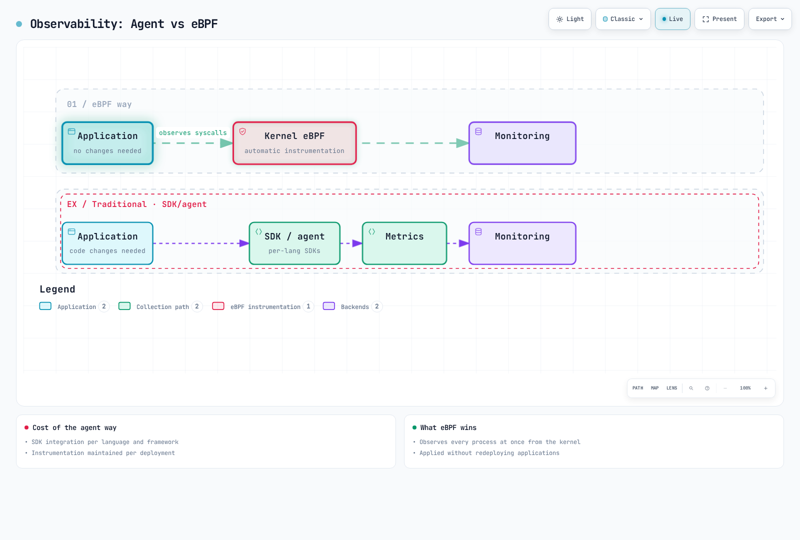
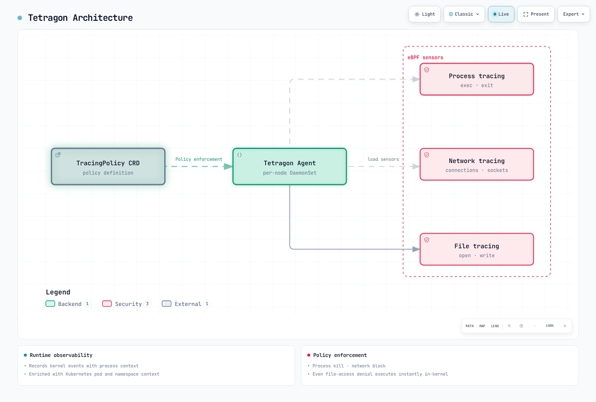

# Fundamentos de eBPF y aplicaciones en Kubernetes

> **Versiones compatibles**: Requisitos de kernel/BTF/helpers específicos de cada función; consulte las matrices de compatibilidad de las herramientas y Kubernetes
> **Última actualización**: October 16, 2026

eBPF es una tecnología revolucionaria que permite ejecutar programas aislados dentro del kernel de Linux. Este documento abarca desde los conceptos básicos de eBPF hasta sus aplicaciones prácticas en entornos Kubernetes.

## Tabla de contenido

* [1. Introducción a eBPF](#1-introduction-to-ebpf)
* [2. Arquitectura de eBPF](#2-ebpf-architecture)
* [3. Tipos de programas eBPF](#3-ebpf-program-types)
* [4. Herramientas de desarrollo de eBPF](#4-ebpf-development-tools)
* [5. eBPF y las redes de Kubernetes](#5-ebpf-and-kubernetes-networking)
* [6. Observabilidad basada en eBPF](#6-ebpf-based-observability)
* [7. Seguridad basada en eBPF](#7-ebpf-based-security)
* [8. Ejemplos prácticos de eBPF](#8-practical-ebpf-examples)
* [9. Limitaciones y consideraciones de eBPF](#9-ebpf-limitations-and-considerations)
* [10. Próximos pasos](#10-next-steps)

## Configuración del entorno de laboratorio

Para seguir los ejemplos de este documento, se necesita el siguiente entorno.

### Requisitos previos
- Un kernel de una distribución con mantenimiento que incluya el BTF, los helpers y los tipos de conexión necesarios para cada ejemplo
- bpftool, bcc-tools
- Clúster de Kubernetes (opcional)

Los ejemplos de bpftrace se comprobaron con la sintaxis del lenguaje oficial0.27 (args.field). Los paquetes de las distribuciones pueden ser más antiguos; use la sintaxis y las funciones correspondientes a esos paquetes. Verifique los campos de los tracepoints con bpftrace -lv o con los archivos de formato de tracefs. Las sondas de funciones dependen de las versiones del kernel o de las bibliotecas y de la arquitectura. Durante esta auditoría no se ejecutó ningún tracing ni se realizó ninguna conexión.

### Configuración del entorno

```bash
# Install required packages on Ubuntu/Debian
sudo apt-get update
sudo apt-get install -y bpfcc-tools python3-bpfcc bpftrace
# Install bpftool for this distribution/kernel separately:
# Debian provides the bpftool package; Ubuntu uses matching linux-tools packages.

# Check kernel version
uname -r

# Verify eBPF feature support
sudo bpftool feature probe kernel
```

---

<span id="1-introduction-to-ebpf"></span>

## 1. Introducción a eBPF

### 1.1 ¿Qué es eBPF?

**eBPF (extended Berkeley Packet Filter)** es una tecnología que permite ejecutar de forma segura programas definidos por el usuario dentro del kernel de Linux. Originalmente se diseñó como BPF para filtrar paquetes de red, pero se ha ampliado y ahora se utiliza en varias áreas, como redes, seguridad, tracing y análisis del rendimiento.

> **Concepto clave**: eBPF permite ampliar y observar el comportamiento del kernel sin modificar el código fuente del kernel ni cargar módulos del kernel.


[🔍 Ver diagrama interactivo](https://www.atomai.click/kubernetes-docs/archmaps/en-basics-05-ebpf-fundamentals-0.html)

### 1.2 Evolución de BPF tradicional a eBPF

**BPF original (1992)**:
- Desarrollado en UC Berkeley
- Dedicado a la captura y el filtrado de paquetes de red
- 2 registros de 32 bits
- El BPF clásico de Linux suele limitar los programas a4096 instrucciones; esto no constituye una especificación histórica universal de BPF

**eBPF (2014~)**:
- Compatibilidad con arquitecturas de 64 bits
- 11 registros
- Almacenamiento de estado mediante Maps
- Compatibilidad con varios puntos de conexión
- Rendimiento nativo mediante compilación JIT

| Función | BPF tradicional | eBPF |
|---------|-----------------|------|
| Registros | 2 (32 bits) | 11 (64 bits) |
| Límites de instrucciones | Límite habitual de Linux: 4096 | Depende del kernel y los privilegios; el tamaño del programa y la complejidad del verificador son distintos |
| Compatibilidad con mapas | Ninguna | Varios tipos de mapas |
| Caso de uso | Filtrado de paquetes | Programación de propósito general para el kernel |
| Capacidades de llamada | Ninguna | Funciones helper, llamadas BPF-to-BPF |
| Estado persistente | No hay mapas persistentes (existe almacenamiento temporal durante una ejecución) | Posible mediante mapas |

### 1.3 Por qué eBPF es revolucionario

eBPF es revolucionario por las siguientes razones:

1. **Ampliación de funciones sin modificar el kernel**: amplía las funciones del kernel sin cambiar su código fuente
2. **Ejecución segura**: el verificador comprueba propiedades definidas de seguridad de memoria y flujo de control
3. **Alto rendimiento**: rendimiento de nivel de código nativo mediante compilación JIT
4. **Carga dinámica**: carga y descarga programas sin reiniciar
5. **Estabilidad en producción**: las comprobaciones de ejecución acotada reducen el riesgo; aun así, es necesario validar la corrección, los errores del kernel/JIT y el impacto operativo


[🔍 Ver diagrama interactivo](https://www.atomai.click/kubernetes-docs/archmaps/en-basics-05-ebpf-fundamentals-1.html)

### 1.4 Comparación entre eBPF y los módulos del kernel

| Aspecto | eBPF | Módulo del kernel |
|--------|------|---------------|
| **Seguridad** | Comprobaciones de seguridad del verificador dentro de su modelo | Puede provocar una caída del kernel |
| **Portabilidad** | CO-RE reubica tipos de kernel compatibles; los helpers, hooks, semántica y BTF siguen limitando la portabilidad | Requiere recompilar para cada versión del kernel |
| **Carga** | Carga y descarga dinámicas | Requiere insmod/rmmod |
| **Privilegios** | CAP_BPF/CAP_SYS_ADMIN, además de permisos específicos del hook | Se requieren privilegios de root |
| **Depuración** | Limitada | Es posible la depuración completa del kernel |
| **Rendimiento** | Optimizado mediante compilación JIT | Rendimiento nativo |
| **Alcance de las funciones** | Solo puntos de conexión designados | Ilimitado |
| **Dificultad de desarrollo** | Relativamente fácil | Requiere un alto nivel de experiencia |

---

<span id="2-ebpf-architecture"></span>

## 2. Arquitectura de eBPF

### 2.1 Flujo de ejecución de eBPF


[🔍 Ver diagrama interactivo](https://www.atomai.click/kubernetes-docs/archmaps/en-basics-05-ebpf-fundamentals-2.html)

### 2.2 Verificador

El verificador es un mecanismo de seguridad fundamental de eBPF. Comprueba lo siguiente antes de que un programa se ejecute en el kernel:

**Elementos de verificación**:
- Terminación/flujo de control acotado; los bucles acotados son compatibles con kernels adecuados
- Ausencia de accesos a memoria fuera de los límites
- Ausencia de uso de variables no inicializadas
- Llamadas correctas a funciones helper
- Garantía de terminación del programa

```c
// XDP fragments; compile as separate programs with linux/bpf.h and bpf_helpers.h.
SEC("xdp")
int bad_example(struct xdp_md *ctx) {
    unsigned char *data = (void *)(long)ctx->data;
    // No data_end check: the verifier cannot prove this packet byte exists.
    return data[0] == 0 ? XDP_DROP : XDP_PASS;
}

SEC("xdp")
int good_example(struct xdp_md *ctx) {
    unsigned char *data = (void *)(long)ctx->data;
    void *data_end = (void *)(long)ctx->data_end;
    if ((void *)(data + 1) > data_end)
        return XDP_PASS;
    return data[0] == 0 ? XDP_DROP : XDP_PASS;
}
```

### 2.3 Compilador JIT

El compilador JIT (Just-In-Time) convierte el bytecode eBPF en código máquina nativo:

```bash
# Check JIT compiler status
cat /proc/sys/net/core/bpf_jit_enable

# Enable JIT compiler (0: disabled, 1: enabled, 2: debug mode)
echo 1 | sudo tee /proc/sys/net/core/bpf_jit_enable
```

Algunos kernels aplican CONFIG_BPF_JIT_ALWAYS_ON; la disponibilidad y la posibilidad de escritura de este sysctl dependen de la configuración del kernel. El modo de depuración2 escribe trazas en el registro del kernel y no es el valor predeterminado para producción.

**Ventajas de la compilación JIT**:
- La afirmación original de una aceleración de 4–5x no está respaldada aquí por una fuente; la aceleración real depende del programa, la arquitectura y el kernel
- Ejecución directa como instrucciones nativas de la CPU
- Aplicación de optimizaciones específicas de cada arquitectura

### 2.4 Mapas de eBPF

Los mapas de eBPF son estructuras de datos para compartir información entre el kernel y el espacio de usuario y almacenar estado.

**Tipos principales de mapas**:

| Tipo de mapa | Descripción | Caso de uso |
|----------|-------------|----------|
| `BPF_MAP_TYPE_HASH` | Tabla hash | Almacenamiento clave-valor, seguimiento de conexiones |
| `BPF_MAP_TYPE_ARRAY` | Matriz de tamaño fijo | Acceso por índice, valores de configuración |
| `BPF_MAP_TYPE_PERF_EVENT_ARRAY` | Matriz de eventos | Envío de eventos al espacio de usuario |
| `BPF_MAP_TYPE_RINGBUF` | Búfer circular | Transmisión de eventos de alto rendimiento |
| `BPF_MAP_TYPE_LRU_HASH` | Hash LRU | Caché, expulsión automática de entradas |
| `BPF_MAP_TYPE_PERCPU_ARRAY` | Matriz por CPU | Menor contención entre CPU para las estadísticas |
| `BPF_MAP_TYPE_LPM_TRIE` | Trie LPM | Coincidencia de direcciones IP, enrutamiento |

```c
// Hash map definition example
struct {
    __uint(type, BPF_MAP_TYPE_HASH);
    __uint(max_entries, 1024);
    __type(key, __u32);      // Key: Process ID
    __type(value, __u64);    // Value: Counter
} packet_count SEC(".maps");
```

### 2.5 Funciones helper

Los programas eBPF acceden a las funciones del kernel mediante las funciones helper que proporciona el kernel.

**Funciones helper principales**:

Estas son firmas simplificadas de referencia de la API. En los programas reales, incluya libbpf bpf_helpers.h en lugar de volver a declararlas. La disponibilidad de los helpers depende del tipo de programa y del kernel.

```text
// Map manipulation
void *bpf_map_lookup_elem(void *map, const void *key);
long bpf_map_update_elem(void *map, const void *key, const void *value, u64 flags);
long bpf_map_delete_elem(void *map, const void *key);

// Time-related
u64 bpf_ktime_get_ns(void);  // Monotonic nanoseconds since boot, excluding suspend; not wall-clock time

// Packet manipulation
long bpf_skb_load_bytes(const void *skb, u32 offset, void *to, u32 len);
long bpf_xdp_adjust_head(struct xdp_md *xdp_md, int delta);

// Tracing
long bpf_probe_read_kernel(void *dst, u32 size, const void *src);
long bpf_probe_read_user(void *dst, u32 size, const void *src);
long bpf_trace_printk(const char *fmt, u32 fmt_size, ...);

// Process information
u64 bpf_get_current_pid_tgid(void);    // Get PID/TGID
u64 bpf_get_current_uid_gid(void);     // Get UID/GID
long bpf_get_current_comm(void *buf, u32 size);  // Process name
```

### 2.6 Ciclo de vida de un programa


[🔍 Ver diagrama interactivo](https://www.atomai.click/kubernetes-docs/archmaps/en-basics-05-ebpf-fundamentals-3.html)

---

Los ejemplos en C son programas o fragmentos independientes. Proporcione vmlinux.h o los tipos UAPI pertinentes, y libbpf bpf_helpers.h, bpf_endian.h, bpf_tracing.h y bpf_core_read.h según sea necesario. BPF_KPROBE/BPF_UPROBE requieren la arquitectura de destino correcta y la ABI real de conexión. Valide la carga y la conexión en un entorno aislado; ninguna de las dos se realizó durante esta auditoría. Los ejemplos de LSM basados en rutas permiten el acceso si se producen errores de lectura y no abarcan alias, enlaces duros ni otros protocolos; son didácticos, no controles de acceso completos.

<span id="3-ebpf-program-types"></span>

## 3. Tipos de programas eBPF

### 3.1 XDP (eXpress Data Path)

XDP es la forma más rápida de procesar paquetes en el nivel del controlador de red.


[🔍 Ver diagrama interactivo](https://www.atomai.click/kubernetes-docs/archmaps/en-basics-05-ebpf-fundamentals-4.html)

**Modos de operación de XDP**:
| Modo | Descripción | Rendimiento |
|------|-------------|-------------|
| XDP nativo | Se ejecuta en la ruta de recepción compatible del controlador | Baja sobrecarga; depende del controlador y la carga de trabajo |
| XDP descargado | Se ejecuta en hardware NIC compatible | Limitaciones de hardware e instrucciones; mida el rendimiento de la carga de trabajo |
| XDP genérico | Alternativa basada en skb en la pila | Más sobrecarga que el modo nativo en casos habituales |

```c
#include <linux/bpf.h>
#include <linux/if_ether.h>
#include <linux/ip.h>
#include <linux/tcp.h>
#include <linux/in.h>
#include <bpf/bpf_helpers.h>
#include <bpf/bpf_endian.h>

// Demonstration only: untagged, non-fragmented IPv4 TCP.
// VLAN, IPv6 and fragments pass through; this is not a complete firewall.
static __always_inline int packet_action(void *data, void *data_end) {
    struct ethhdr *eth = data;
    if ((void *)(eth + 1) > data_end || eth->h_proto != bpf_htons(ETH_P_IP))
        return XDP_PASS;
    struct iphdr *ip = (void *)(eth + 1);
    if ((void *)(ip + 1) > data_end || ip->version != 4 || ip->ihl < 5)
        return XDP_PASS;
    __u32 ihl = (__u32)ip->ihl * 4;
    __u32 ip_len = bpf_ntohs(ip->tot_len);
    if ((void *)ip + ihl > data_end || ip_len < ihl || (void *)ip + ip_len > data_end)
        return XDP_PASS;
    if (ip->protocol != IPPROTO_TCP || (bpf_ntohs(ip->frag_off) & 0x3fffU))
        return XDP_PASS;
    if (ip_len < ihl + sizeof(struct tcphdr))
        return XDP_PASS;
    struct tcphdr *tcp = (void *)ip + ihl;
    if ((void *)(tcp + 1) > data_end || tcp->doff < 5)
        return XDP_PASS;
    __u32 tcp_len = (__u32)tcp->doff * 4;
    if (ihl + tcp_len > ip_len || (void *)tcp + tcp_len > data_end)
        return XDP_PASS;
    return tcp->dest == bpf_htons(8080) ? XDP_DROP : XDP_PASS;
}

SEC("xdp")
int xdp_drop_port(struct xdp_md *ctx) {
    return packet_action((void *)(long)ctx->data, (void *)(long)ctx->data_end);
}
char LICENSE[] SEC("license") = "GPL";
```

### 3.2 TC (Traffic Control)

Los programas TC se ejecutan en la capa de control de tráfico de la pila de red.

```bash
# TC program attachment example
set -e
: "${LAB_IFACE:?Select an isolated test veth interface, never a production interface}"
tc qdisc show dev "$LAB_IFACE"
# This assumes a fresh lab interface with no clsact qdisc.
sudo tc qdisc add dev "$LAB_IFACE" clsact
sudo tc filter add dev "$LAB_IFACE" ingress pref 49152 bpf da obj tc_prog.o sec classifier
sudo tc filter add dev "$LAB_IFACE" egress pref 49152 bpf da obj tc_prog.o sec classifier
# Cleanup only the filters created by this example, after the exercise:
# sudo tc filter del dev "$LAB_IFACE" ingress pref 49152
# sudo tc filter del dev "$LAB_IFACE" egress pref 49152
```

**Comparación entre TC y XDP**:
| Función | XDP | TC |
|---------|-----|-----|
| Ubicación de ejecución | Nivel del controlador | Pila de red |
| Rendimiento | Máximo | Alto |
| Acceso a SKB | No es posible | Posible |
| Dirección | Solo ingreso | Ingreso y egreso |
| Modificación de paquetes | Limitada | Flexible |

### 3.3 Kprobes/Uprobes

Kprobes y Uprobes realizan tracing dinámico de las llamadas a funciones.

```c
// Kprobe example: Trace tcp_connect function
SEC("kprobe/tcp_connect")
int BPF_KPROBE(trace_tcp_connect, struct sock *sk) {
    u32 pid = bpf_get_current_pid_tgid() >> 32;

    // Get destination IP address
    u32 daddr = BPF_CORE_READ(sk, __sk_common.skc_daddr);
    u16 dport = BPF_CORE_READ(sk, __sk_common.skc_dport);

    bpf_printk("PID %d connecting to %pI4:%d\n", pid, &daddr, bpf_ntohs(dport));
    return 0;
}

// Uprobe example: Trace malloc function
// The userspace loader must select the real libc path, PID and malloc symbol.
SEC("uprobe")
int BPF_UPROBE(trace_malloc, size_t size) {
    u32 pid = bpf_get_current_pid_tgid() >> 32;
    bpf_printk("PID %d malloc(%zu)\n", pid, size);
    return 0;
}
```

### 3.4 Tracepoints

Los tracepoints son puntos de tracing estáticos predefinidos en el kernel.

```bash
# Check available tracepoints
sudo ls /sys/kernel/tracing/events/

# Tracepoints in specific categories
sudo ls /sys/kernel/tracing/events/sched/
sudo ls /sys/kernel/tracing/events/syscalls/
```

```c
// Tracepoint example: Trace process execution
SEC("tracepoint/sched/sched_process_exec")
int handle_exec(struct trace_event_raw_sched_process_exec *ctx) {
    char comm[16];
    bpf_get_current_comm(&comm, sizeof(comm));

    u32 pid = bpf_get_current_pid_tgid() >> 32;
    bpf_printk("Process started: %s (PID: %d)\n", comm, pid);

    return 0;
}
```

### 3.5 LSM (Linux Security Module) BPF

LSM BPF aplica dinámicamente políticas de seguridad.

```c
// LSM BPF example: Restrict file opening
SEC("lsm/file_open")
int BPF_PROG(restrict_file_open, struct file *file, int ret) {
    if (ret != 0)
        return ret;

    char path[256];
    if (bpf_d_path(&file->f_path, path, sizeof(path)) < 0)
        return 0;  // Demo fails open on unresolved paths; not a complete access policy.

    // Block access to /etc/shadow
    if (bpf_strncmp(path, 11, "/etc/shadow") == 0)
        return -EACCES;

    return 0;
}
```

### 3.6 Filtro de socket

Filtra paquetes en el nivel del socket.

```c
// Socket Filter example
SEC("socket")
int socket_filter(struct __sk_buff *skb) {
    // Allow only IPv4 packets
    if (skb->protocol != bpf_htons(ETH_P_IP))
        return 0;  // Drop

    return skb->len;  // Return packet length (allow)
}
```

### 3.7 Programas Cgroup

Controla los recursos y las redes de los contenedores.

```c
// Cgroup socket program example: Block external connections
SEC("cgroup/connect4")
int restrict_connect(struct bpf_sock_addr *ctx) {
    // Block connections that are not to local network
    __u32 dst = bpf_ntohl(ctx->user_ip4);

    // Allow only 10.0.0.0/8 range
    if ((dst & 0xff000000U) != 0x0a000000U)
        return 0;  // Deny connection

    return 1;  // Allow connection
}
```

---

<span id="4-ebpf-development-tools"></span>

## 4. Herramientas de desarrollo de eBPF

### 4.1 bpftool

bpftool administra programas y mapas BPF. Actualice solo los mapas creados para este laboratorio; los mapas activos de CNI o de seguridad afectan a las cargas de trabajo en ejecución. La actualización hexadecimal siguiente presupone una clave u32 y un valor u64 little-endian que coinciden con el ejemplo de mapa anterior.

```bash
# List loaded eBPF programs
sudo bpftool prog list

# Program details
sudo bpftool prog show id <ID>

# Program dump (bytecode)
sudo bpftool prog dump xlated id <ID>

# JIT compiled code dump
sudo bpftool prog dump jited id <ID>

# Map list
sudo bpftool map list

# Query map contents
sudo bpftool map dump id <MAP_ID>

# Add value to map
sudo bpftool map update id <MAP_ID> key hex 01 00 00 00 value hex ff 00 00 00 00 00 00 00

# Check kernel eBPF features
sudo bpftool feature probe kernel

# BTF (BPF Type Format) information
sudo bpftool btf list
```

### 4.2 bpftrace

bpftrace es un lenguaje de tracing de alto nivel al estilo de DTrace.

```bash
# Installation
sudo apt-get install -y bpftrace

# System call count
sudo bpftrace -e 'tracepoint:raw_syscalls:sys_enter { @[comm] = count(); }'

# Read bytes per process
sudo bpftrace -e 'tracepoint:syscalls:sys_exit_read /args.ret > 0/ { @bytes[comm] = sum(args.ret); }'

# File open tracing
sudo bpftrace -e 'tracepoint:syscalls:sys_enter_openat { printf("%s opened %s\n", comm, str(args.filename)); }'

# TCP connection tracing
sudo bpftrace -e 'kprobe:tcp_connect { printf("%s -> %s\n", ntop(((struct sock *)arg0)->__sk_common.skc_rcv_saddr), ntop(((struct sock *)arg0)->__sk_common.skc_daddr)); }'

# Latency histogram
sudo bpftrace -e 'kprobe:vfs_read { @start[tid] = nsecs; } kretprobe:vfs_read /@start[tid]/ { @ns = hist(nsecs - @start[tid]); delete(@start[tid]); }'
```

**Comandos breves útiles de bpftrace**:

```bash
# Top CPU-consuming processes
sudo bpftrace -e 'profile:hz:99 { @[comm] = count(); }'

# Block I/O latency
sudo biolatency-bpfcc 1 10  # Maintained request correlation; avoids dev/sector collisions

# New process tracing
sudo bpftrace -e 'tracepoint:sched:sched_process_exec { printf("%-10d %-16s\n", pid, comm); }'

# Memory allocation tracing
sudo bpftrace -e 'tracepoint:kmem:kmalloc { @bytes = hist(args.bytes_alloc); }'
```

### 4.3 BCC (BPF Compiler Collection)

BCC ofrece compilación y carga de BPF en C y suele incluir BPF en C en sus herramientas de tracing en Python.

```bash
# Installation
sudo apt-get install -y bpfcc-tools python3-bpfcc

# Included tools
dpkg -L bpfcc-tools | head -40
```

**Herramientas principales de BCC**:

| Herramienta | Descripción |
|------|-------------|
| `execsnoop` | Realiza tracing de la ejecución de procesos nuevos |
| `opensnoop` | Realiza tracing de la apertura de archivos |
| `biolatency` | Latencia de E/S de bloques |
| `tcpconnect` | Realiza tracing de conexiones TCP |
| `tcpaccept` | Realiza tracing de conexiones TCP entrantes |
| `tcpretrans` | Realiza tracing de retransmisiones TCP |
| `runqlat` | Latencia de la cola de ejecución de la CPU |
| `profile` | Creación de perfiles de CPU |
| `funccount` | Número de llamadas a funciones |
| `trace` | Tracing general de funciones |

```bash
# Usage examples
sudo execsnoop-bpfcc    # Trace process execution
sudo tcpconnect-bpfcc   # Trace TCP connections
sudo biolatency-bpfcc   # Disk I/O latency
sudo profile-bpfcc -F 99 10  # CPU profiling for 10 seconds
```

### 4.4 libbpf y CO-RE

libbpf es una biblioteca C para cargar programas eBPF y admite CO-RE (Compile Once, Run Everywhere).

**Ventajas de CO-RE**:
- Ejecutar programas eBPF compilados en varias versiones del kernel
- Reubicación de estructuras mediante BTF (BPF Type Format)
- Menor dependencia de los encabezados del kernel

```c
// Independent tracing program. Generate vmlinux.h from the target kernel's BTF.
#include "vmlinux.h"
#include <bpf/bpf_helpers.h>
#include <bpf/bpf_core_read.h>

SEC("tracepoint/syscalls/sys_enter_openat")
int trace_openat(struct trace_event_raw_sys_enter *ctx) {
    const char *filename = (const char *)BPF_CORE_READ(ctx, args[1]);
    char fname[256];
    if (bpf_probe_read_user_str(fname, sizeof(fname), filename) < 0)
        return 0;
    __u32 tgid = bpf_get_current_pid_tgid() >> 32;
    bpf_printk("TGID %u opened: %s", tgid, fname);
    return 0;
}
char LICENSE[] SEC("license") = "GPL";
```

**Generación y verificación de BTF**:

```bash
# Check BTF support
ls /sys/kernel/btf/vmlinux

# Generate vmlinux.h (for CO-RE development)
bpftool btf dump file /sys/kernel/btf/vmlinux format c > vmlinux.h

# Check program BTF information
bpftool prog show id <ID> --pretty
```

---

<span id="5-ebpf-and-kubernetes-networking"></span>

## 5. eBPF y las redes de Kubernetes

### 5.1 Cilium: CNI basado en eBPF

Cilium es el CNI de Kubernetes (Container Network Interface) más representativo que utiliza eBPF.


[🔍 Ver diagrama interactivo](https://www.atomai.click/kubernetes-docs/archmaps/en-basics-05-ebpf-fundamentals-5.html)

#### Sustitución de kube-proxy

Cilium puede sustituir a kube-proxy en una configuración compatible. Los esquemas siguientes describen la selección del backend para flujos nuevos; los flujos establecidos pueden usar seguimiento de conexiones. El enrutamiento, la tunelización y la traducción NAT siguen dependiendo del plano de datos elegido.

**kube-proxy tradicional (modo iptables)**:
```
Packet → Netfilter → iptables rule evaluation → DNAT → Routing
```

**Modo eBPF de Cilium**:
```
New flow → eBPF backend lookup → Configured routing/tunneling/NAT
```

```bash
# New, isolated self-managed lab only: configure the cluster for the selected
# CNI/proxy mode before bootstrap. Do not delete kube-proxy on a live cluster.
helm repo add cilium https://helm.cilium.io
helm repo update cilium
: "${CILIUM_CHART_VERSION:?Select a chart compatible with this Kubernetes/kernel}"
: "${CILIUM_VALUES_FILE:?Provide reviewed IPAM/routing/platform values}"
: "${API_SERVER_IP:?Set a directly reachable API endpoint, not the Service IP}"
: "${API_SERVER_PORT:?Set the API endpoint port}"
helm install cilium cilium/cilium --version "$CILIUM_CHART_VERSION" \
  --namespace kube-system -f "$CILIUM_VALUES_FILE" \
  --set kubeProxyReplacement=true \
  --set k8sServiceHost="$API_SERVER_IP" --set k8sServicePort="$API_SERVER_PORT"
cilium status --wait
# Existing clusters require the Cilium migration procedure and a tested rollback plan.

```

#### Política de red

Cilium usa eBPF para la aplicación de políticas L3/L4; las políticas HTTP/L7 requieren un procesamiento compatible mediante proxy (por ejemplo, Envoy). La visibilidad de DNS utiliza el proxy DNS. Los registros HTTP/DNS de Hubble requieren que estén habilitadas las opciones de visibilidad correspondientes.

```yaml
# Cilium network policy example
apiVersion: cilium.io/v2
kind: CiliumNetworkPolicy
metadata:
  name: allow-http-only
spec:
  endpointSelector:
    matchLabels:
      app: web
  ingress:
    - fromEndpoints:
        - matchLabels:
            app: frontend
      toPorts:
        - ports:
            - port: "80"
              protocol: TCP
          rules:
            http:
              - method: GET
                path: "/api/.*"
```

#### Balanceo de carga

```yaml
# Cilium LoadBalancer service example
apiVersion: v1
kind: Service
metadata:
  name: my-service
  annotations:
    lbipam.cilium.io/ips: "192.168.1.100"
spec:
  type: LoadBalancer
  selector:
    app: my-app
  ports:
    - port: 80
      targetPort: 8080
```

La IP solicitada debe pertenecer a un CiliumLoadBalancerIPPool administrado por un administrador. LB IPAM solo asigna direcciones; para que sean accesibles externamente se requiere publicidad BGP/L2 u otra configuración de balanceador de carga.

### 5.2 Modo eBPF de Calico

Calico admite un plano de datos eBPF. El parche siguiente presupone que existe una instalación compatible de Calico Operator y constituye solo un paso de su procedimiento de migración. Configure el acceso directo a la API y valide el enrutamiento y la reversión antes de cambiar cualquier proxy de Service.

```bash
# Enable Calico eBPF mode
kubectl patch installation.operator.tigera.io default --type merge -p '{"spec":{"calicoNetwork":{"linuxDataplane":"BPF"}}}'
```

**Funciones del modo eBPF de Calico**:
- Conservación de la IP de origen
- Compatibilidad con Direct Server Return (DSR)
- Políticas de endpoint del host
- Cifrado WireGuard opcional, si se configura por separado y es compatible; no se habilita únicamente al seleccionar eBPF

### 5.3 Comparación de rendimiento: iptables frente a eBPF

| Aspecto | iptables | eBPF |
|--------|----------|------|
| **Escalabilidad** | O(n): proporcional al número de servicios | Promedio O(1) para búsquedas hash; depende del tipo de mapa |
| **Latencia** | Depende de la estructura de reglas y la carga de trabajo | Depende del tipo de mapa, la carga de trabajo y el plano de datos |
| **Uso de CPU** | Depende de la carga de trabajo y la configuración | Depende de la carga de trabajo y la configuración |
| **Actualizaciones** | kube-proxy moderno puede actualizar las reglas de Service/endpoint modificadas | Actualizaciones de mapas; el costo depende de la implementación |
| **Observabilidad** | Limitada | Integración con Hubble |
| **Memoria** | Reglas, endpoints y estado de seguimiento de conexiones | Mapas, endpoints y estado de seguimiento de conexiones |

**Resultados de las pruebas de rendimiento** (basados en 1000 servicios):

Las cifras originales siguientes no incluyen una fuente, el hardware, las versiones del kernel/CNI ni la metodología. No se han vuelto a medir y no permiten establecer el rendimiento actual ni una aceleración general. Para reproducirlas se necesitan el método y el entorno originales.

```
| Metric                  | iptables    | eBPF      | Improvement |
|------------------------|-------------|-----------|-------------|
| Connection setup time  | 2.5ms       | 0.3ms     | 8.3x        |
| CPU usage              | 15%         | 3%        | 5x          |
| Memory usage           | 256MB       | 32MB      | 8x          |
| Connections per second | 50,000      | 250,000   | 5x          |
```

```bash
# Check Cilium status
cilium status

# Check eBPF maps
kubectl -n kube-system exec ds/cilium -c cilium-agent -- cilium-dbg bpf lb list
kubectl -n kube-system exec ds/cilium -c cilium-agent -- cilium-dbg bpf ct list global

# Network policy status
kubectl get ciliumnetworkpolicies,ciliumclusterwidenetworkpolicies -A
```

---

<span id="6-ebpf-based-observability"></span>

## 6. Observabilidad basada en eBPF

eBPF permite observar en profundidad el comportamiento del sistema y de las aplicaciones. A diferencia de la supervisión tradicional basada en agentes, eBPF recopila datos en el nivel del kernel y proporciona información más detallada con menor sobrecarga.

### 6.1 Hubble: observabilidad de red de Cilium

Hubble proporciona observabilidad de red para Cilium. Instale una CLI de Hubble compatible, habilite Relay y establezca el reenvío de puertos antes de usar los ejemplos de la CLI. La visibilidad L7 requiere la configuración de proxy pertinente.


[🔍 Ver diagrama interactivo](https://www.atomai.click/kubernetes-docs/archmaps/en-basics-05-ebpf-fundamentals-6.html)

```bash
# Use the installed, reviewed chart version; this is not a chart-version upgrade.
: "${CILIUM_CHART_VERSION:?Set the installed compatible chart version}"
# Install Hubble
helm upgrade cilium cilium/cilium --version "$CILIUM_CHART_VERSION" \
  --namespace kube-system \
  --reuse-values \
  --set hubble.enabled=true \
  --set hubble.relay.enabled=true \
  --set hubble.ui.enabled=true

# First run cilium hubble port-forward in a separate terminal.
# Use Hubble CLI
hubble observe --pod my-pod
hubble observe --namespace default
hubble observe --protocol http
hubble observe --verdict DROPPED

# Observe traffic between specific services
hubble observe --from-pod default/frontend --to-pod default/backend

# Real-time network flow monitoring
hubble observe -f --type trace

# Generate service map
# Service maps are provided by Hubble UI; use the UI port-forward below.
```

**Acceso a la interfaz de usuario de Hubble**:

```bash
# Port forwarding
kubectl port-forward -n kube-system svc/hubble-ui 12000:80

# Access http://localhost:12000 in browser
```

### 6.2 Pixie: observabilidad con instrumentación automática

Pixie usa eBPF para recopilar telemetría automáticamente, sin modificar el código de la aplicación.

**Funciones de Pixie**:
- Análisis automático de protocolos (HTTP, gRPC, MySQL, PostgreSQL, Kafka, etc.)
- Generación automática de mapas de servicios
- Tracing distribuido
- Creación de perfiles de CPU
- Registro dinámico

```bash
# Install Pixie
px deploy

# Pixie CLI query examples
# HTTP request latency
px run px/http_data

# Traffic between services
px run px/service_stats

# Slow request analysis
px run px/slow_http_requests --help
# Use the parameters advertised by the installed script bundle.

# Pod resource usage
px run px/pods
```

**Ejemplo de PxL (Pixie Query Language)**:

```python
# Find slow HTTP requests
import px

df = px.DataFrame(table='http_events', start_time='-5m')
df.namespace = df.ctx['namespace']
df.pod = df.ctx['pod']
df = df[df.latency > 100000000]  # Over 100ms
df = df.groupby(['namespace', 'pod', 'req_path']).agg(
    count=('latency', px.count),
    avg_latency=('latency', px.mean),
    latency_quantiles=('latency', px.quantiles)
)
df.p99_latency_ns = px.pluck_float64(df.latency_quantiles, 'p99')
px.display(df)
```

### 6.3 Coroot: supervisión «sin código»

Coroot usa eBPF para supervisar automáticamente los sistemas de aplicaciones compatibles, una vez configurados los agentes, el almacenamiento, los permisos y las fuentes de datos.

```bash
# Install Coroot with Helm
helm repo add coroot https://coroot.github.io/helm-charts
# The old coroot/coroot chart is deprecated; use the operator and CE resource chart.
: "${COROOT_OPERATOR_VERSION:?Select a reviewed operator chart version}"
: "${COROOT_CE_VERSION:?Select a compatible CE chart version}"
helm install coroot-operator coroot/coroot-operator -n coroot --create-namespace \
  --version "$COROOT_OPERATOR_VERSION"
helm install coroot coroot/coroot-ce -n coroot --version "$COROOT_CE_VERSION"
```

**Funciones de Coroot**:
- Detección automática de servicios
- Generación automática de mapas de dependencias
- Supervisión de SLO
- Detección de anomalías
- Análisis de causa raíz

### 6.4 Kepler: supervisión del consumo de energía

Las primeras versiones de Kepler usaban eBPF, pero se **reescribió a partir de la versión 0.10.0** en torno al acceso de solo lectura al /proc y /sys del host, RAPL/powercap y la atribución de energía basada en el uso de CPU. Ya no requiere CAP_BPF, por lo que el Kepler actual no es un ejemplo que dependa de instrumentación eBPF. Las versiones0.9 y anteriores son código heredado obsoleto, con métricas y métodos de implementación distintos.

Compruebe que el hardware o la VM expongan sensores de energía. Los valores de contenedores/Pod atribuyen la energía medida en el nodo, en lugar de medir directamente cada contenedor con un medidor de energía. Sumar zonas RAPL anidadas contabiliza la energía dos veces. Verifique la compatibilidad experimental específica de cada versión con GPU/HWMon/plataforma.

```bash
: "${KEPLER_CHART_VERSION:?Select a reviewed current Kepler chart}"
helm install kepler oci://quay.io/sustainable_computing_io/charts/kepler \
  --version "$KEPLER_CHART_VERSION" --namespace kepler --create-namespace
kubectl get pods -n kepler
# Run port-forward in a separate terminal; then query metrics from this machine.
kubectl port-forward -n kepler service/kepler 28282:28282
# curl --fail http://localhost:28282/metrics | grep kepler_node_cpu_watts
```

Ejemplos de métricas actuales de CPU: `kepler_node_cpu_joules_total`, `kepler_container_cpu_joules_total`, `kepler_pod_cpu_watts`. Verifique la cobertura real de los sensores y las etiquetas de zona.

### 6.5 Comparación entre agentes tradicionales e instrumentación eBPF

Los valores del 5–15% y <1% conservan las afirmaciones originales, que no citaban fuentes; no son rangos de sobrecarga verificados. eBPF también necesita agentes en espacio de usuario, búferes y analizadores de protocolos. No todos los agentes tradicionales requieren cambios en el código, y las herramientas eBPF no cubren automáticamente todas las aplicaciones o protocolos.

| Aspecto | Agentes tradicionales | Instrumentación eBPF |
|--------|-------------------|---------------------|
| **Sobrecarga** | Alta (5-15%) | Baja (<1%) |
| **Modificación del código** | Depende del modelo de SDK/agente | A menudo innecesaria para las fuentes de datos compatibles |
| **Cobertura** | Depende de la instrumentación y el agente | Hooks, protocolos y visibilidad compatibles; no es automáticamente completa |
| **Implementación** | Depende de la aplicación, el nodo o el recopilador | Habitualmente agentes de nodo; también importa la compatibilidad de la aplicación |
| **Privilegios** | Depende del agente | Capacidades y acceso al host, según el programa y el hook |
| **Profundidad de los datos** | Depende de la aplicación y el host | Kernel y sondas de espacio de usuario compatibles |
| **Compatibilidad con protocolos** | Depende de la herramienta | Automática solo para analizadores, bibliotecas y visibilidad compatibles |



[🔍 Ver diagrama interactivo](https://www.atomai.click/kubernetes-docs/archmaps/en-basics-05-ebpf-fundamentals-7.html)

---

<span id="7-ebpf-based-security"></span>

## 7. Seguridad basada en eBPF

### 7.1 Tetragon: seguridad en tiempo de ejecución

Tetragon es una solución de seguridad en tiempo de ejecución basada en eBPF proporcionada por el proyecto Cilium.



[🔍 Ver diagrama interactivo](https://www.atomai.click/kubernetes-docs/archmaps/en-basics-05-ebpf-fundamentals-8.html)

```bash
# Install Tetragon
helm repo add cilium https://helm.cilium.io
: "${TETRAGON_CHART_VERSION:?Select a compatible reviewed chart version}"
helm install tetragon cilium/tetragon -n kube-system --version "$TETRAGON_CHART_VERSION"

# Observe events
kubectl logs -n kube-system -l app.kubernetes.io/name=tetragon -c export-stdout -f | tetra getevents -o compact
```

Cree Pod de prueba en ebpf-lab y con la etiqueta app=ebpf-demo. Estos ejemplos usan la observación Post en lugar de enviar SIGKILL a todo el host. La denegación preventiva requiere pruebas independientes del comportamiento compatible de LSM/Override.

**Ejemplos de TracingPolicy**:

```yaml
apiVersion: cilium.io/v1alpha1
kind: TracingPolicyNamespaced
metadata:
  name: sensitive-file-access
  namespace: ebpf-lab
spec:
  kprobes:
  - call: security_file_open
    syscall: false
    args:
    - index: 0
      type: file
    selectors:
    - matchArgs:
      - index: 0
        operator: Prefix
        values:
        - /etc/shadow
        - /etc/passwd
        - /etc/sudoers
      matchActions:
      - action: Post
  podSelector:
    matchLabels:
      app: ebpf-demo
```

```yaml
apiVersion: cilium.io/v1alpha1
kind: TracingPolicyNamespaced
metadata:
  name: observe-outbound
  namespace: ebpf-lab
spec:
  kprobes:
  - call: tcp_connect
    syscall: false
    args:
    - index: 0
      type: sock
    selectors:
    - matchArgs:
      - index: 0
        operator: NotDAddr
        values:
        - 10.0.0.0/8
      matchActions:
      - action: Post
  podSelector:
    matchLabels:
      app: ebpf-demo
```

### 7.2 Falco: detección de anomalías basada en eBPF

Falco es un proyecto de CNCF que usa eBPF para detectar comportamientos anómalos en tiempo de ejecución.

```bash
# Install Falco (eBPF driver)
helm repo add falcosecurity https://falcosecurity.github.io/charts
# Save the following Falco rule examples as ./ebpf-lab-rules.yaml before installation.
: "${FALCO_CHART_VERSION:?Select a compatible reviewed chart version}"
helm install falco falcosecurity/falco --version "$FALCO_CHART_VERSION" \
  --namespace falco --create-namespace \
  --set driver.kind=modern_ebpf \
  --set-file 'customRules.ebpf-lab-rules\.yaml=./ebpf-lab-rules.yaml'
```

**Ejemplos de reglas de Falco**:

```yaml
# Detect reading of /etc/shadow
- rule: eBPF lab read sensitive file
  desc: Detect reading of sensitive files
  condition: >
    open_read and
    fd.name in (/etc/shadow, /etc/sudoers) and
    not proc.name in (systemd, sudo, login)
  output: >
    Sensitive file opened (file=%fd.name user=%user.name
    process=%proc.name container=%container.name)
  priority: WARNING

# Detect shell execution in container
- rule: eBPF lab shell in container
  desc: Detect shell execution in container
  condition: >
    spawned_process and
    container and
    proc.name in (bash, sh, zsh, dash) and
    proc.pname != containerd-shim
  output: >
    Shell spawned in container (container=%container.name
    shell=%proc.name parent=%proc.pname)
  priority: NOTICE

# Detect privilege escalation
- rule: eBPF lab privilege escalation
  desc: Detect privilege escalation attempts
  condition: >
    spawned_process and
    proc.name in (sudo, su, doas) and
    container
  output: >
    Privilege escalation attempt (user=%user.name
    command=%proc.cmdline container=%container.name)
  priority: WARNING
```

### 7.3 seccomp-bpf: filtrado de llamadas al sistema

Los filtros seccomp usan la ABI de espacio de usuario de BPF clásico, no los helpers ni mapas habituales de los programas eBPF. El entorno de ejecución del contenedor interpreta los perfiles JSON de OCI para crear filtros de llamadas al sistema.

```yaml
# Apply seccomp profile in Kubernetes Pod
apiVersion: v1
kind: Pod
metadata:
  name: secure-pod
spec:
  securityContext:
    seccompProfile:
      type: RuntimeDefault  # or Localhost
  containers:
    - name: app
      image: nginx:1.30.6
```

**Perfil seccomp personalizado**:

Lo siguiente es un **esquema de formato** para un ejemplo mínimo de x86-64, no un perfil que pueda ejecutar NGINX ni una aplicación de propósito general. Prefiera RuntimeDefault; derive y pruebe mediante regresiones una lista de permitidos personalizada para la arquitectura, el entorno de ejecución y la carga de trabajo reales. Una lista amplia de llamadas mount/reboot/module/BPF permitidas no es un valor predeterminado seguro.

```json
{
  "defaultAction": "SCMP_ACT_ERRNO",
  "architectures": [
    "SCMP_ARCH_X86_64"
  ],
  "syscalls": [
    {
      "names": [
        "read",
        "write",
        "exit",
        "exit_group",
        "rt_sigreturn"
      ],
      "action": "SCMP_ACT_ALLOW"
    }
  ]
}
```

### 7.4 LSM BPF: políticas de seguridad dinámicas

LSM BPF combina Linux Security Module con eBPF para aplicar políticas de seguridad dinámicamente.

```c
// LSM BPF example: Restrict executable files
SEC("lsm/bprm_check_security")
int BPF_PROG(restrict_exec, struct linux_binprm *bprm, int ret) {
    if (ret != 0)
        return ret;
    char filename[256];
    if (bpf_probe_read_kernel_str(filename, sizeof(filename), bprm->filename) < 0)
        return 0;  // Demo fails open on read error; define a real policy explicitly.

    // Block execution from /tmp
    if (bpf_strncmp(filename, 5, "/tmp/") == 0)
        return -EPERM;

    return 0;
}

// LSM BPF example: Restrict network sockets
SEC("lsm/socket_connect")
int BPF_PROG(restrict_connect, struct socket *sock, struct sockaddr *address, int addrlen, int ret) {
    if (ret != 0)
        return ret;

    if (addrlen < sizeof(struct sockaddr_in) || address->sa_family != AF_INET)
        return 0;  // This example handles IPv4 only.
    struct sockaddr_in *addr = (struct sockaddr_in *)address;

    // Block connection to specific port
    if (bpf_ntohs(addr->sin_port) == 6666)
        return -EACCES;

    return 0;
}
```

---

<span id="8-practical-ebpf-examples"></span>

## 8. Ejemplos prácticos de eBPF

### 8.1 Análisis del rendimiento del sistema con bpftrace

**Tracing de conexiones TCP**:

```bash
# TCP connection tracing
sudo bpftrace -e '
tracepoint:sock:inet_sock_set_state /args.protocol == 6 && args.newstate == 1/ {
    if (args.family == 2) {
        printf("IPv4 %s:%d -> %s:%d established\n", ntop(args.saddr), args.sport, ntop(args.daddr), args.dport);
    } else if (args.family == 10) {
        printf("IPv6 %s:%d -> %s:%d established\n", ntop(args.saddr_v6), args.sport, ntop(args.daddr_v6), args.dport);
    }
}'
```

**Análisis de latencia de llamadas al sistema**:

```bash
# Read system call latency histogram
sudo bpftrace -e '
tracepoint:syscalls:sys_enter_read { @start[tid] = nsecs; }
tracepoint:syscalls:sys_exit_read /@start[tid]/ {
    @latency = hist((nsecs - @start[tid]) / 1000);
    delete(@start[tid]);
}'
```

**Análisis de E/S de disco**:

```bash
# Block I/O request tracing
sudo bpftrace -e '
tracepoint:block:block_rq_issue {
    printf("%s %s %d\n",
        comm,
        str(args.rwbs),
        args.nr_sector / 2);
}'

# I/O latency histogram
sudo biolatency-bpfcc 1 10
```

### 8.2 Observación de flujos de red con Cilium Hubble

```bash
# Real-time network flow observation
hubble observe -f

# Specific namespace traffic
hubble observe --namespace production

# Filter HTTP traffic only
hubble observe --protocol http

# Analyze dropped packets
hubble observe --verdict DROPPED

# DNS query tracing
hubble observe --protocol dns

# Traffic between specific Pods
hubble observe --from-pod default/frontend --to-pod default/backend

# Detailed analysis with JSON output
hubble observe --namespace default -o json | jq '.flow.destination.pod_name'

# Count retained flow observations, not unique connections or all traffic.
# Relay returns up to the requested count per Hubble instance.
hubble observe --namespace default --last 1000 -o jsonpb | \
  jq -r '.flow | "\(.source.pod_name // .source.identity) -> \(.destination.pod_name // .destination.identity)"' | \
  sort | uniq -c | sort -rn | head -20
```

### 8.3 Supervisión de seguridad de procesos con Tetragon

```bash
# Real-time Tetragon event monitoring
kubectl logs -n kube-system -l app.kubernetes.io/name=tetragon -c export-stdout -f | \
  tetra getevents -o compact

# Filter process execution events only
kubectl logs -n kube-system -l app.kubernetes.io/name=tetragon -c export-stdout -f | \
  tetra getevents -o compact --event-types PROCESS_EXEC

# Events from specific namespace
kubectl logs -n kube-system -l app.kubernetes.io/name=tetragon -c export-stdout -f | \
  tetra getevents -o json | jq 'select(.process_exec.process.pod.namespace == "default")'
```

**Política de supervisión del acceso a archivos**:

```yaml
apiVersion: cilium.io/v1alpha1
kind: TracingPolicyNamespaced
metadata:
  name: file-access-monitor
  namespace: ebpf-lab
spec:
  kprobes:
  - call: security_file_open
    syscall: false
    return: false
    args:
    - index: 0
      type: file
    selectors:
    - matchArgs:
      - index: 0
        operator: Prefix
        values:
        - /etc/
        - /var/run/secrets/
      matchActions:
      - action: Post
  podSelector:
    matchLabels:
      app: ebpf-demo
```

### 8.4 Análisis de latencia con eBPF

**Latencia de funciones, conexiones y resolución de nombres**:

```bash
# libc read() function duration; this is not an HTTP-request latency metric
sudo funclatency-bpfcc 'c:read' -i 1

# TCP handshake latency
sudo tcpconnlat-bpfcc  # Active TCP connection establishment latency

# DNS lookup latency
sudo gethostlatency-bpfcc  # libc name-resolution latency; includes cache/NSS work
```

Lo siguiente es un ejemplo de ruta de x86-64 glibc. Primero, resuelva la ruta del proceso o de la biblioteca de destino (los espacios de nombres de montaje de los contenedores pueden ser distintos). La duración de malloc/tcp_sendmsg es la latencia de una función, no la latencia de extremo a extremo de una solicitud.

**Script de análisis del rendimiento de aplicaciones**:

```bash
#!/bin/bash
# app-latency-analysis.bt

sudo bpftrace -e '
BEGIN {
    printf("Tracing application latency... Hit Ctrl-C to end.\n");
}

uprobe:/usr/lib/x86_64-linux-gnu/libc.so.6:malloc {
    @malloc_start[tid] = nsecs;
}

uretprobe:/usr/lib/x86_64-linux-gnu/libc.so.6:malloc /@malloc_start[tid]/ {
    @malloc_ns = hist(nsecs - @malloc_start[tid]);
    delete(@malloc_start[tid]);
}

kprobe:tcp_sendmsg {
    @send_start[tid] = nsecs;
}

kretprobe:tcp_sendmsg /@send_start[tid]/ {
    @tcp_send_ns = hist(nsecs - @send_start[tid]);
    delete(@send_start[tid]);
}

END {
    printf("\n=== Malloc Latency ===\n");
    print(@malloc_ns);
    printf("\n=== TCP Send Latency ===\n");
    print(@tcp_send_ns);
}
'
```

---

<span id="9-ebpf-limitations-and-considerations"></span>

## 9. Limitaciones y consideraciones de eBPF

### 9.1 Limitaciones técnicas

| Limitación | Valor | Descripción |
|------------|-------|-------------|
| **Tamaño de pila** | 512 bytes | Límite de espacio de almacenamiento para variables locales |
| **Límites de instrucciones** | Depende de los privilegios y del kernel | Los límites de longitud del programa y de instrucciones procesadas por el verificador son distintos; el presupuesto de complejidad de upstream es1million |
| **Máximo de llamadas anidadas** | 8 niveles | Profundidad de llamadas a funciones BPF-to-BPF |
| **Número de entradas del mapa** | Varía según el tipo de mapa | Depende de los límites de memoria |
| **Tamaño del programa** | Límites del kernel/verificador/JIT | No lo determina el tipo de mapa |

**Solución alternativa para el límite de tamaño de pila**:

```c
// Bad example: Exceeds stack size
int bad_function(void *ctx) {
    volatile char buffer[1024] = {};  // Exceeds stack size!
    buffer[0] = 1;
    return buffer[1023];
}

// Good example: Use map
struct {
    __uint(type, BPF_MAP_TYPE_PERCPU_ARRAY);
    __uint(max_entries, 1);
    __type(key, __u32);
    __type(value, char[1024]);
} buffer_map SEC(".maps");

int good_function(void *ctx) {
    __u32 key = 0;
    char *buffer = bpf_map_lookup_elem(&buffer_map, &key);
    if (!buffer)
        return 0;
    // Use buffer
    return 0;
}
```

### 9.2 Limitaciones de los bucles

El verificador de eBPF limita los bucles para garantizar que los programas terminen.

```c
// Potential verifier-complexity problem if n has no small proven bound.
for (int i = 0; i < n; i++) {  // Runtime values can still have provable bounds
    // ...
}

// Allowed by verifier: Bounded loop (kernel 5.3+)
#pragma clang loop unroll(disable)
for (int i = 0; i < 100 && i < n; i++) {  // Upper bound specified
    // ...
}

// Allowed by verifier: Compile-time unrolling
#pragma unroll
for (int i = 0; i < 10; i++) {
    // ...
}

// Using bpf_loop helper (kernel 5.17+)
static int callback(u32 index, void *ctx) {
    // Iteration work
    return 0;
}

int main_prog(void *ctx) {
    bpf_loop(1000, callback, NULL, 0);
    return 0;
}
```

### 9.3 Compatibilidad con versiones del kernel

| Función | Versión mínima del kernel |
|---------|----------------------|
| eBPF básico | 3.18 |
| XDP | 4.8 |
| BTF | 4.18 |
| CO-RE | BTF/libbpf/helpers compatibles; no existe un mínimo universal determinado solo por la versión del kernel |
| Búfer circular BPF | 5.8 |
| Bucles BPF | 5.3 |
| LSM BPF | 5.7 |
| Helper bpf_loop | 5.17 |

```bash
# Check kernel version
uname -r

# Check eBPF feature support
sudo bpftool feature probe kernel

# Check BTF support
ls /sys/kernel/btf/vmlinux
```

### 9.4 Dificultades de depuración

La depuración de programas eBPF difiere de los métodos tradicionales:

**Métodos de depuración**:

```c
// bpf_printk (for debugging, impacts performance)
bpf_printk("value = %d\n", value);

```

```bash
# Read tracefs (mount/location is distribution-specific).
sudo cat /sys/kernel/tracing/trace_pipe
```

```bash
# Check verifier log (on load failure)
sudo bpftool prog load my_prog.o /sys/fs/bpf/my_prog -d

# Check program statistics
sudo bpftool -j prog show id <ID> | jq '.run_time_ns, .run_cnt'
# Runtime statistics require kernel.bpf_stats_enabled or a BPF stats FD; disabled by default and adds overhead.

# Dump map contents
sudo bpftool map dump id <MAP_ID>
```

### 9.5 Requisitos de privilegios

| Privilegio | Propósito |
|-----------|---------|
| `CAP_BPF` | Cargar programas eBPF (kernel 5.8+) |
| `CAP_SYS_ADMIN` | Privilegios eBPF tradicionales |
| `CAP_PERFMON` | Conectarse a eventos de supervisión del rendimiento |
| `CAP_NET_ADMIN` | Conectarse a programas XDP/TC |

```bash
# Check privileges
capsh --print

# Run program with specific privileges
sudo setcap cap_bpf,cap_perfmon+ep ./my_bpf_loader
```

El Pod siguiente ilustra los campos de capacidades; no es un agente completo validado. Compruebe por separado la compatibilidad del kernel/BTF/tipo de programa, los permisos de seccomp para bpf/perf_event_open, LSM/lockdown, los montajes/propiedad de hostPath, PSS y los permisos RBAC que se necesiten. Añadir capacidades por sí solo no permite cargar todos los programas.

**Configuración de privilegios en Kubernetes**:

```yaml
apiVersion: v1
kind: Pod
metadata:
  name: ebpf-pod
spec:
  containers:
    - name: ebpf-container
      image: my-ebpf-app
      securityContext:
        capabilities:
          add:
            - BPF
            - PERFMON
            - NET_ADMIN
        privileged: false
      volumeMounts:
        - name: bpf-maps
          mountPath: /sys/fs/bpf
        - name: debug
          mountPath: /sys/kernel/debug
  volumes:
    - name: bpf-maps
      hostPath:
        path: /sys/fs/bpf
    - name: debug
      hostPath:
        path: /sys/kernel/debug
```

### 9.6 Consideraciones de seguridad

Aunque eBPF es una herramienta potente, conlleva riesgos de seguridad:

- **Fuga de información**: puede acceder a datos confidenciales
- **Ataques DoS**: puede provocar una degradación del rendimiento
- **Escalada de privilegios**: es posible que haya vulnerabilidades si se configura incorrectamente

**Prácticas recomendadas de seguridad**:

```bash
# Inspect first. 0 enables unprivileged bpf(); 1 disables until reboot; 2 disables reversibly.
sysctl kernel.unprivileged_bpf_disabled
# On a kernel supporting value 2, disable only if currently enabled.
if [ "$(sysctl -n kernel.unprivileged_bpf_disabled)" = 0 ]; then
  sudo sysctl -w kernel.unprivileged_bpf_disabled=2
fi
# Inspect the real JIT-hardening setting; choose changes through host configuration management.
sysctl net.core.bpf_jit_harden
```

---

<span id="10-next-steps"></span>

## 10. Próximos pasos

### 10.1 Cuestionario relacionado

Para comprobar su comprensión de este documento, pruebe el siguiente cuestionario:

- [Cuestionario sobre los fundamentos de eBPF](../quizzes/basics/05-ebpf-fundamentals-quiz.md)

### 10.2 Recursos de aprendizaje avanzado

**Documentación y recursos oficiales**:
- [eBPF.io](https://ebpf.io) - Documentación oficial de eBPF
- [Documentación de Cilium](https://docs.cilium.io) - Documentación oficial de Cilium
- [Herramientas de rendimiento de BPF](https://www.brendangregg.com/bpf-performance-tools-book.html) - Libro de Brendan Gregg sobre herramientas de rendimiento de BPF

**Entornos prácticos**:
- [Tutorial de eBPF](https://github.com/lizrice/learning-ebpf) - Tutorial de eBPF de Liz Rice
- [Tutorial de BCC](https://github.com/iovisor/bcc/blob/master/docs/tutorial.md) - Tutorial oficial de BCC
- [Tutorial de bpftrace](https://github.com/iovisor/bpftrace/blob/master/docs/tutorial_one_liners.md) - Tutorial de comandos breves de bpftrace

**Comunidad**:
- [eBPF Summit](https://ebpf.io/events/?conference=eBPF%20Summit) - Conferencia anual de eBPF
- [Slack de Cilium](https://slack.cilium.io/) - Comunidad de Cilium

### 10.3 Documentos relacionados

Para consultar contenido avanzado relacionado con este documento, consulte lo siguiente:

| Tema | Enlace al documento | Descripción |
|-------|---------------|-------------|
| Introducción a Cilium | [Descripción general de Cilium](../networking/cilium/01-introduction.md) | Introducción al CNI basado en eBPF |
| Análisis detallado de eBPF | [Análisis técnico detallado de eBPF](../networking/cilium/02-ebpf.md) | Técnicas avanzadas de eBPF |
| Redes | [Redes de Cilium](../networking/cilium/03-networking.md) | Implementación de redes con eBPF |
| Seguridad | [Seguridad de Cilium](../networking/cilium/06-security-visibility.md) | Seguridad basada en eBPF |
| Redes de Kubernetes | [Services y redes](../core/03-services-networking.md) | Conceptos básicos de redes |

### 10.4 Lista de comprobación práctica

Lista de comprobación para aprender eBPF:

```
[ ] Use bpftool to check loaded eBPF programs
[ ] Run system call tracing with bpftrace
[ ] Analyze network traffic with BCC tools
[ ] Install Cilium and observe network with Hubble
[ ] Monitor security events with Tetragon
[ ] Write and load a simple XDP program
```

---

## Resumen

eBPF es una tecnología revolucionaria que permite ampliar y observar de forma segura el comportamiento del kernel de Linux. A continuación se resumen los contenidos principales de este documento:

1. **Conceptos básicos de eBPF**: programas aislados que se ejecutan de forma segura dentro del kernel
2. **Arquitectura**: compuesta por el verificador, el compilador JIT, los mapas y las funciones helper
3. **Tipos de programas**: XDP, TC, Kprobes, Tracepoints, LSM BPF, etc.
4. **Herramientas de desarrollo**: bpftool, bpftrace, BCC, libbpf
5. **Aplicaciones en Kubernetes**: redes de alto rendimiento con Cilium y modo eBPF de Calico
6. **Observabilidad**: observación profunda del sistema mediante Hubble, Pixie y Coroot
7. **Seguridad**: seguridad en tiempo de ejecución mediante Tetragon, Falco y seccomp-bpf
8. **Limitaciones**: tener en cuenta el tamaño de pila, los bucles y la compatibilidad con las versiones del kernel

eBPF es una tecnología fundamental que marca el futuro de las redes, la seguridad y la observabilidad en entornos nativos de la nube.

> Los ejemplos de Falco dependen de las macros open_read/open_write/spawned_process/container del conjunto de reglas predeterminado. Cargue el archivo adicional mediante la configuración customRules/falco.rules_files del chart instalado. Falco detecta y genera alertas; estas reglas no deniegan el acceso. Los metadatos de contenedores/Kubernetes pueden llegar con retraso, y las lecturas legítimas de tokens de ServiceAccount también coinciden, así que pruebe las excepciones adecuadas.

## Referencias de verificación

- https://www.kernel.org/doc/html/latest/admin-guide/sysctl/kernel.html
- https://www.kernel.org/doc/html/latest/admin-guide/sysctl/net.html
- https://github.com/torvalds/linux/blob/master/include/linux/bpf.h
- https://github.com/torvalds/linux/blob/master/include/linux/filter.h
- https://github.com/torvalds/linux/blob/master/include/uapi/linux/bpf.h
- https://github.com/torvalds/linux/blob/master/kernel/bpf/syscall.c
- https://docs.kernel.org/bpf/prog_lsm.html
- https://docs.kernel.org/userspace-api/seccomp_filter.html
- https://github.com/torvalds/linux/blob/master/include/trace/events/sock.h
- https://github.com/bpftrace/bpftrace/blob/v0.27.0/docs/language.md
- https://github.com/bpftrace/bpftrace/blob/v0.27.0/docs/stdlib.md
- https://packages.debian.org/trixie/arm64/bpfcc-tools/filelist
- https://github.com/iovisor/bcc/blob/master/tools/tcpconnlat.py
- https://github.com/iovisor/bcc/blob/master/tools/gethostlatency.py
- https://github.com/libbpf/bpftool/blob/main/docs/bpftool-map.rst
- https://github.com/cilium/cilium/blob/v1.20.1/Documentation/network/kubernetes/kubeproxy-free.rst
- https://github.com/cilium/cilium/blob/v1.20.1/Documentation/network/lb-ipam.rst
- https://github.com/cilium/cilium/blob/v1.20.1/install/kubernetes/cilium/values.yaml
- https://github.com/cilium/cilium/blob/v1.20.1/hubble/cmd/observe/observe.go
- https://github.com/cilium/cilium/blob/v1.20.1/hubble/pkg/printer/printer_test.go
- https://github.com/cilium/tetragon/blob/main/docs/content/en/docs/concepts/enforcement/_index.md
- https://github.com/cilium/tetragon/blob/main/docs/content/en/docs/concepts/tracing-policy/selectors.md
- https://github.com/cilium/tetragon/blob/main/pkg/k8s/apis/cilium.io/v1alpha1/tracing_policy_types.go
- https://github.com/cilium/tetragon/blob/main/cmd/tetra/getevents/getevents.go
- https://github.com/cilium/tetragon/blob/main/examples/tracingpolicy/lsm_file_open.yaml
- https://github.com/cilium/tetragon/blob/main/install/kubernetes/tetragon/crds-yaml/cilium.io_tracingpoliciesnamespaced.yaml
- https://github.com/sustainable-computing-io/kepler/blob/main/README.md
- https://github.com/sustainable-computing-io/kepler/blob/main/docs/user/metrics.md
- https://github.com/coroot/helm-charts/blob/main/charts/coroot/Chart.yaml
- https://github.com/coroot/helm-charts/blob/main/charts/operator/Chart.yaml
- https://github.com/coroot/helm-charts/blob/main/charts/coroot-ce/Chart.yaml
- https://docs.px.dev/reference/pxl/udf/quantiles/
- https://github.com/pixie-io/pixie/blob/main/src/pixie_cli/pkg/cmd/run.go
- https://github.com/pixie-io/pixie/blob/main/src/pxl_scripts/px/http_data/data.pxl
- https://falco.org/docs/reference/rules/supported-fields/
- https://github.com/falcosecurity/charts/blob/master/charts/falco/values.yaml
- https://github.com/falcosecurity/rules/blob/main/rules/falco_rules.yaml
