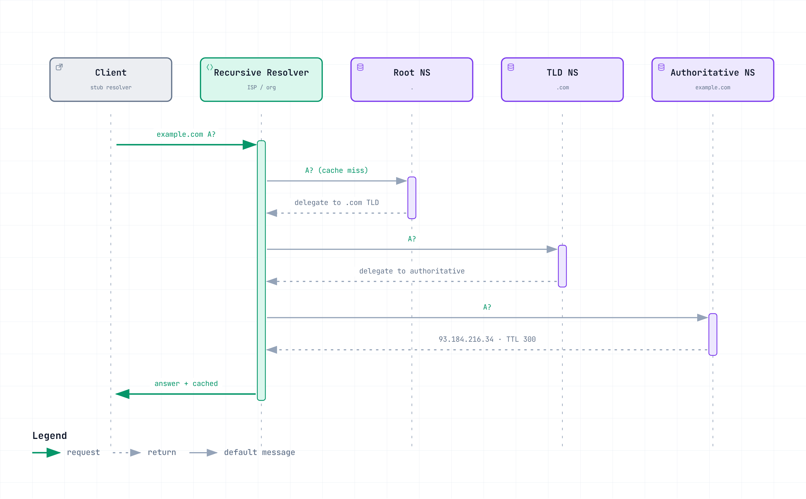

# Fundamentos de redes, parte 3: Diez protocolos de aplicación

> **Última actualización**: 14 de septiembre de 2026

::: tip Esta es una serie de cinco partes
[Parte 1: El modelo por capas, las capas de enlace y enrutamiento](./06-network-fundamentals-part1.md) ·
[Parte 2: La capa de transporte y TLS](./06-network-fundamentals-part2.md) ·
**Parte 3: Protocolos de aplicación** *(este documento)* ·
[Parte 4: El recorrido de una solicitud y la nube](./06-network-fundamentals-part4.md) ·
[Parte 5: Dispositivos de red, LAN y WAN](./06-network-fundamentals-part5.md)
:::

Los protocolos de transporte proporcionan flujos o datagramas; los protocolos de aplicación los convierten en servicios. Esta parte abarca la resolución de nombres (DNS y DoH), la inicialización (DHCP), el acceso operativo (SSH), el correo (SMTP) y HTTP/3, WebSocket, WebRTC, gRPC y MQTT.

---

## 5. Capa de aplicación: servicios reales

### DNS

**Definición:** El sistema de directorio distribuido que resuelve nombres de dominio en direcciones IP y otros registros.

**Cómo funciona:** DNS utiliza delegación jerárquica. Si no encuentra una respuesta en la caché, un resolvedor recursivo sigue las referencias desde el servidor raíz, pasando por el TLD, hasta los servidores de nombres autoritativos, o reenvía la consulta a otro resolvedor. Las respuestas almacenadas en caché pueden evitar parte o todo ese trabajo. Los registros A/AAAA contienen direcciones, los registros CNAME contienen alias, los registros MX indican servidores de correo y los registros TXT contienen texto que utilizan varios protocolos.

**En la práctica:** DNS está distribuido, pero un resolvedor, proveedor o configuración puede convertirse en una dependencia compartida. Para la conmutación por error de DNS, ten en cuenta la detección de fallos, las actualizaciones de registros, el TTL de las respuestas que ya están en caché, el almacenamiento en caché de las aplicaciones y las conexiones existentes. Reducir el TTL ahora no acorta el TTL de una respuesta antigua que ya está en caché. Algunos resolvedores también sirven respuestas obsoletas cuando se cumplen condiciones de fallo definidas (RFC 8767). Mide cada etapa; un TTL breve por sí solo no garantiza el tiempo de conmutación por error. Los balanceadores de carga y anycast pueden complementar DNS, cada uno con sus propios límites de detección de estado y convergencia.

**Tipos de registros comunes de un vistazo:**

| Tipo | Propósito | Nota |
|---|---|---|
| A / AAAA | Dominio → IPv4 / IPv6 | Lo básico |
| CNAME | Alias → nombre canónico | No puede coexistir con SOA/NS en el ápice; ALIAS/ANAME específicos del proveedor o Alias de Route 53 pueden ofrecer una asignación del ápice a destinos compatibles |
| MX | Servidor receptor de correo | Gana el número de prioridad más bajo |
| TXT | Cadenas arbitrarias | SPF/DKIM/DMARC, verificación de propiedad del dominio |
| NS | Servidores de nombres delegados | Delegación de subzonas |
| SRV | Ubicación del servicio (host+puerto) | Descubrimiento para algunos protocolos |
| CAA | Restringir las autoridades de certificación autorizadas | Requiere que la CA lo aplique; no impide por sí solo todas las emisiones incorrectas |

**DNSSEC y DoH resuelven problemas distintos.** DNSSEC autentica los datos DNS firmados y su integridad a través de una cadena de confianza validada; no cifra las consultas. DoH utiliza HTTPS para autenticar el resolvedor elegido y proteger la confidencialidad y la integridad en el tramo cliente–resolvedor. No demuestra que un resolvedor malicioso o equivocado haya devuelto datos autoritativos. Se pueden utilizar juntos.



[🔍 Ver diagrama interactivo](https://www.atomai.click/kubernetes-docs/archmaps/en-basics-06-network-fundamentals-part3-0.html)

### DoH

**Definición:** Consultas DNS encapsuladas y transportadas a través de HTTPS.

**Cómo funciona:** El DNS tradicional suele utilizar el puerto 53 de UDP **y TCP** sin cifrar. DoH transporta mensajes DNS a través de HTTPS, protegiéndolos de la inspección pasiva y la modificación en ese tramo. Los extremos del resolvedor y los metadatos del tráfico aún pueden revelar el uso de DoH; el resolvedor elegido puede ver las consultas.

**En la práctica:** Un resolvedor público de DoH seleccionado por separado puede eludir el filtrado y el registro del resolvedor de la organización, e impedir la resolución de nombres privados. DoH no desactiva las políticas de forma inherente: un resolvedor de DoH administrado puede aplicar registros y filtros, y las políticas del navegador o del sistema operativo pueden seleccionar resolvedores aprobados. Prueba el DNS dividido y las políticas de los extremos en vez de dar por sentado que siempre es necesario desactivar el cifrado.

### DHCP

**Definición:** El protocolo que asigna automáticamente a los hosts una dirección IP y la configuración de red.

**Cómo funciona:** Un intercambio inicial **DHCPv4** común es DORA: Discover → Offer → Request → Acknowledge. Una difusión local o un retransmisor DHCP localiza un servidor. La concesión puede incluir una dirección IPv4, una máscara de subred, una puerta de enlace y la configuración de DNS. La renovación puede utilizar un intercambio más breve. DHCPv6 utiliza mensajes diferentes; la información de enrutador predeterminado de IPv6 normalmente proviene de Router Advertisements, y SLAAC es otro mecanismo de configuración de direcciones.

**En la práctica:** En la nube, gran parte de esto queda abstraído, pero vuelve a aparecer en el conjunto de opciones DHCP de la VPC, donde se configuran los servidores DNS y los nombres de dominio. Si falla la resolución de nombres en una configuración híbrida que utiliza DNS local, este es el ajuste que debes comprobar.

### SSH

**Definición:** El protocolo que proporciona acceso remoto cifrado a la shell y túneles.

**Cómo funciona:** El servidor se autentica con su clave de host, un intercambio de claves deriva las claves de sesión y, después, se autentica el usuario (con clave pública o contraseña). Todo el tráfico posterior se cifra. Además de las shells remotas, SSH admite reenvío de puertos, SFTP y reenvío del agente.

**En la práctica:** Restringe el reenvío según la política de acceso y valida las claves de host del servidor. Un host comprometido con acceso a un socket de agente reenviado puede solicitar firmas/autenticación al agente; por lo general, el reenvío no copia allí el material de la clave privada. Prefiere un host de salto (`ProxyJump`) cuando el reenvío del agente no sea necesario. Las claves sin formato no caducan por sí mismas, pero OpenSSH admite periodos de validez de certificados y restricciones de caducidad en `authorized_keys`. Elimina el acceso de quienes ya no formen parte del equipo y rota o revoca las credenciales.

AWS Systems Manager Session Manager puede proporcionar acceso a la shell sin puertos SSH entrantes ni distribución de claves SSH, siempre que el nodo administrado, los permisos de IAM y la conectividad con el servicio estén configurados. CloudTrail registra la actividad de la API; el registro del contenido de la shell en CloudWatch Logs/S3 requiere configuración. **El registro del contenido de la sesión no está disponible para las sesiones SSH ni de reenvío de puertos de Session Manager.** El acceso basado en IAM no implica por sí mismo que se registre cada comando.

### SMTP

**Definición:** El protocolo que retransmite mensajes entre servidores de correo.

**Cómo funciona:** Los clientes envían correo a un servidor de envío, y los servidores SMTP retransmiten y reciben mensajes, normalmente mediante una consulta MX para el enrutamiento. IMAP y POP3 permiten a los usuarios recuperar o acceder a mensajes ya almacenados en un buzón; no sustituyen la recepción en el lado del servidor de SMTP.

**En la práctica:** La autenticación SMTP y TLS protegen el envío y el transporte, pero por sí solos no demuestran cuál es el dominio del remitente que aparece en el mensaje. Hay tres mecanismos de dominio complementarios importantes:

- **SPF**: autoriza hosts de envío para la identidad MAIL FROM o HELO del sobre; esto no corresponde automáticamente al encabezado From visible.
- **DKIM**: verifica una firma del contenido del mensaje incluido, utilizando la clave DNS del dominio firmante; el dominio firmante puede diferir del dominio From visible.
- **DMARC**: exige que el dominio From visible coincida con la identidad SPF **o** DKIM que haya superado la validación, y publica la política de tratamiento y generación de informes solicitada.

Configura SPF, DKIM y DMARC conjuntamente cuando corresponda, supervisa los informes y ten en cuenta el comportamiento del reenvío y las listas de correo. DMARC puede superar la validación con uno de los mecanismos alineados. Estos controles no garantizan la entrega ni eliminan la suplantación del nombre visible o de dominios parecidos; los receptores también aplican sus propias políticas.

### HTTP/3

**Definición:** La tercera versión principal de HTTP, que se ejecuta sobre QUIC.

**Cómo funciona:** Las versiones comparten la semántica de HTTP, pero HTTP/3 utiliza flujos QUIC y su propio encuadre y mapeo. Elimina la dependencia del orden entre flujos de TCP; las pérdidas dentro de un flujo, las dependencias de QPACK y el control de congestión compartido aún pueden retrasar el trabajo. Un protocolo de enlace completo típico tarda aproximadamente 1 RTT, y la migración compatible puede mantener una conexión cuando cambia la dirección. QPACK reemplaza a HPACK para admitir flujos entregados de forma independiente.

**En la práctica:** Los clientes pueden detectar HTTP/3 mediante `Alt-Svc`, conocimiento previo o registros DNS de HTTPS que anuncien un protocolo compatible. `Alt-Svc` puede conocerse a través de una conexión TCP previa; un cliente compatible con el registro HTTPS puede detectar HTTP/3 antes de ese intercambio. Ninguno de los métodos garantiza que sea posible conectarse ni que se consiga una reducción concreta de la latencia.

La entrega independiente y los protocolos de enlace integrados pueden ser útiles en rutas con pérdidas o alta latencia. La latencia, el rendimiento y el costo de CPU reales dependen de la implementación, las descargas de procesamiento, la carga de trabajo y las condiciones de la red. Mide el tráfico representativo de dispositivos móviles y centros de datos en vez de suponer que la mejora o el deterioro serán universales.

**Las tres generaciones, una al lado de la otra:**

| | HTTP/1.1 | HTTP/2 | HTTP/3 |
|---|---|---|---|
| Transporte | TCP | TCP | QUIC (UDP) |
| Solicitudes por conexión | Secuenciales o canalizadas con respuestas ordenadas | Multiplexadas | Multiplexadas |
| Bloqueo HOL | Respuestas ordenadas y entrega de TCP | Orden de TCP entre flujos | Sin orden de TCP entre flujos; persisten otros bloqueos |
| Compresión de encabezados | Ninguna | HPACK | QPACK |
| Cifrado | Opcional (HTTPS) | TLS para HTTPS; también existe HTTP/2 sin cifrar | TLS 1.3 integrado en QUIC |

La multiplexación cambia dónde surgen las dependencias de orden; HTTP/3 reduce una fuente de bloqueo, pero no elimina todas las dependencias de planificación, control de flujo o aplicación.

#### Cómo leer solicitudes y respuestas HTTP/1.1 {#http11-message-structure}

Las versiones de HTTP comparten métodos, códigos de estado y semántica de campos. HTTP/1.1 hace visibles estos conceptos como **línea inicial → líneas de campos de encabezado → línea en blanco → cuerpo opcional**. Un cuerpo puede contener texto o datos binarios; «HTTP/1.1 textual» describe su línea inicial y sus encabezados, no todos los datos de la carga útil.

Estos son **mensajes HTTP/1.1 ilustrativos, no una salida capturada ni una receta de comandos**. Para facilitar la lectura, la representación utiliza saltos de línea LF. En la red, la línea inicial y cada línea de encabezado terminan en **CRLF (`\r\n`)**, y un CRLF adicional termina la sección de encabezados. Cada cuerpo que aparece a continuación tiene exactamente **5 bytes ASCII**, `hello`, **sin salto de línea final**; el salto de línea de la representación antes de la cerca de cierre no forma parte del cuerpo.

Cliente → servidor:

```http
POST /echo HTTP/1.1
Host: example.test
Content-Type: text/plain; charset=utf-8
Content-Length: 5

hello
```

Servidor → cliente:

```http
HTTP/1.1 200 OK
Date: Mon, 14 Sep 2026 00:00:00 GMT
Content-Type: text/plain; charset=utf-8
Content-Length: 5

hello
```

| Elemento | Cómo leerlo |
|---|---|
| Línea de solicitud | `POST` es el método, `/echo` es el destino de la solicitud (en este caso, una ruta) y `HTTP/1.1` es la versión. El campo obligatorio `Host` proporciona el nombre de host de destino y el puerto opcional (la autoridad). |
| Línea de estado | `HTTP/1.1` es la versión, `200` es el código de estado y `OK` es una frase descriptiva opcional. Utiliza el código para interpretar el resultado. |
| Campos de encabezado | Las líneas `Nombre: valor` contienen metadatos; los nombres de campo no distinguen entre mayúsculas y minúsculas. `Content-Type` describe el tipo de medio de la representación y, en este caso, su juego de caracteres. |
| Línea en blanco | Termina la sección de encabezados. No especifica dónde termina un cuerpo posterior. |
| Cuerpo | Los bytes del contenido. Aquí, `Content-Length: 5` delimita cinco bytes, sin contar la línea inicial, los encabezados ni el separador. Cuenta bytes, no caracteres Unicode. |

**El significado y el encuadre responden preguntas distintas.** Un método expresa la acción solicitada: GET recupera una representación, HEAD solicita metadatos de respuesta correspondientes sin contenido de respuesta y POST pide al destino que procese el contenido proporcionado. Las clases de estado resumen el resultado: 1xx informativo, 2xx éxito, 3xx redirección, 4xx error del cliente y 5xx error del servidor. `Content-Type` explica cómo interpretar el contenido; no lo delimita. Consulta [RFC 9110](https://www.rfc-editor.org/rfc/rfc9110.html) para conocer esta semántica compartida.

El encuadre de HTTP/1.1 determina cuántos bytes pertenecen a este mensaje en un flujo TCP reutilizable. En un mensaje ordinario con cuerpo, un `Content-Length` válido sin `Transfer-Encoding` proporciona su longitud. Con `Transfer-Encoding: chunked`, los tamaños de los fragmentos y el fragmento final de tamaño cero, seguidos de los tráileres que haya y la línea en blanco final, delimitan el cuerpo. El emisor no debe enviar ambos campos. Algunas respuestas utilizan el cierre de la conexión como delimitador; los límites de los paquetes TCP nunca delimitan mensajes HTTP.

Las reglas de métodos y estados se aplican primero: las respuestas a HEAD y las respuestas con estados 1xx, 204 o 304 no tienen cuerpo de mensaje, aunque los metadatos permitidos describan una representación. Una respuesta satisfactoria a CONNECT inicia un túnel. Una solicitud sin longitud ni codificación de transferencia no tiene cuerpo. Estas distinciones impiden interpretar el siguiente mensaje como contenido ([RFC 9112 §§2–6](https://www.rfc-editor.org/rfc/rfc9112.html)).

**HTTP/2 y HTTP/3 conservan el significado, pero utilizan encuadre binario**, incluidos los marcos HEADERS y DATA, en lugar de estas líneas iniciales textuales y límites CRLF. HTTP/2 utiliza TCP; HTTP/3 asigna mensajes a flujos QUIC. Ninguno utiliza la codificación de transferencia en fragmentos de HTTP/1.1. Una herramienta puede presentar campos decodificados como texto legible sin mostrar su codificación real en la red ([RFC 9113](https://www.rfc-editor.org/rfc/rfc9113.html), [RFC 9114](https://www.rfc-editor.org/rfc/rfc9114.html)).

Con HTTPS, TLS protege los encabezados y cuerpos HTTP durante el tránsito; una captura pasiva sin secretos de sesión no revela este texto sin cifrar ([RFC 8446 §5](https://www.rfc-editor.org/rfc/rfc8446.html#section-5)). QUIC también protege los datos de aplicación de HTTP/3. Inspecciona los mensajes decodificados en un extremo autorizado o en un punto de terminación TLS, e identifica qué tramo de la conexión estás observando.

> 📎 Continúa con el [laboratorio de mensajes HTTP en Linux](../networking/07-linux-network-diagnostics.md#http-message-lab) antes de aplicar estas mismas distinciones a los servicios de contenedores, Kubernetes Ingress o los balanceadores de carga de AWS.

### WebSocket

**Definición:** Un protocolo de aplicación para la mensajería bidireccional a través de una sola conexión.

**Cómo funciona:** El protocolo de enlace de HTTP/1.1 utiliza `Upgrade` y una respuesta correcta `101`. HTTP/2 y HTTP/3 utilizan Extended CONNECT en su lugar (RFC 8441 y 9220), cuando se admite. Una vez establecida, cualquiera de los pares puede enviar mensajes WebSocket sin recurrir repetidamente a consultas HTTP.

**En la práctica:** Planifica las conexiones de larga duración: tráfico de latido dentro del tiempo de espera de inactividad pertinente, drenaje gradual durante las versiones operativas y retroceso de reconexión con variación aleatoria. Cada socket permanece en la instancia que lo aloja. Un estado compartido de la aplicación o la mensajería, como Redis Pub/Sub, puede entregar eventos entre instancias, pero no transfiere sockets activos ni garantiza por sí solo una entrega duradera. Comprueba el protocolo de enlace utilizado por la versión HTTP negociada y la compatibilidad del proxy.

### WebRTC

**Definición:** API y protocolos para medios y datos en tiempo real entre extremos compatibles, incluidos navegadores y servidores multimedia.

**Cómo funciona:** NAT puede impedir la conectividad directa, pero dos pares detrás de NAT aún pueden conectarse. ICE intercambia y comprueba candidatos de host, de tipo server-reflexive (detectados mediante STUN) y retransmitidos (TURN). La señalización de la aplicación transporta las descripciones de sesión y los candidatos. La ruta seleccionada depende de las comprobaciones de conectividad y de la política. Los medios utilizan SRTP, normalmente con establecimiento de claves DTLS-SRTP; los canales de datos utilizan SCTP sobre DTLS.

**En la práctica:** El uso de retransmisión TURN contribuye al ancho de banda y a los costos de infraestructura; la señalización, STUN y otros servicios siguen teniendo costos incluso cuando la ruta de medios es directa. La asignación y el filtrado de NAT, así como el comportamiento del firewall, influyen en la conectividad, por lo que la etiqueta «NAT simétrico» por sí sola no demuestra de forma universal que sea inevitable usar una retransmisión. Presupuesta una alternativa TURN y prueba redes reales. Un SFU es un diseño multiparte común que intercambia ancho de banda y capacidad de cómputo del servidor por una menor carga de subida del cliente frente a una malla completa de pares.

### gRPC

**Definición:** Un marco de RPC cuyo transporte nativo estándar utiliza HTTP/2, comúnmente con esquemas de servicios y mensajes de Protocol Buffers.

**Cómo funciona:** Las definiciones de Protocol Buffers pueden generar código de cliente y servidor, y admitir RPC unario, de transmisión del servidor, de transmisión del cliente y de transmisión bidireccional. La codificación binaria puede ser compacta, pero el tamaño y la velocidad en comparación con JSON dependen de los datos, la implementación y la compresión; no son garantías del protocolo.

**En la práctica:** gRPC nativo funciona bien para muchas API de servicios. Las API de los navegadores no exponen todo lo que requiere gRPC nativo, por lo que los clientes de navegador suelen utilizar gRPC-Web con un servidor compatible o un proxy de traducción; los modos de transmisión disponibles dependen de esa implementación. Utiliza herramientas compatibles con esquemas para la inspección y la depuración.

Un canal gRPC puede utilizar **cero o más conexiones HTTP/2**, y muchas RPC pueden compartir una conexión de larga duración. El balanceo L4 selecciona un backend por conexión, por lo que un grupo pequeño de conexiones puede concentrar el tráfico RPC; no garantiza su distribución por RPC. Considera una política adecuada del lado del cliente o un proxy L7 que entienda gRPC (que puede formar parte de una malla de servicios). Los flujos establecidos siguen asociados al backend seleccionado. Para la evolución del esquema, reserva los números y nombres de los campos eliminados de Protocol Buffers y nunca reutilices sus números.

> 📎 Para el manejo de gRPC en Istio, consulta [gRPC avanzado en Istio](../service-mesh/istio/advanced/05-grpc.md).

### MQTT

**Definición:** Un protocolo ligero de mensajería de publicación y suscripción.

**Cómo funciona:** Los clientes se conectan a un agente y publican o se suscriben a temas. Un encabezado fijo puede ocupar apenas 2 bytes, pero los paquetes reales también pueden necesitar encabezados variables, propiedades y cargas útiles. Los niveles QoS 0/1/2 ofrecen entrega de protocolo como máximo una vez, al menos una vez y exactamente una vez **en el tramo pertinente entre emisor y receptor**. La entrega del publicador al agente y la del agente al suscriptor son independientes. Un mensaje Will configurado puede publicarse en determinadas condiciones de desconexión; Will Delay de MQTT 5 y el comportamiento de reconexión afectan al momento en que aparece.

**En la práctica:** Elige el nivel QoS según la tolerancia a pérdidas o duplicados y el costo. Una entrega satisfactoria de QoS 2 normalmente intercambia PUBLISH, PUBREC, PUBREL y PUBCOMP; no garantiza que los efectos secundarios de la base de datos de una aplicación ni que todo un flujo de trabajo empresarial se ejecuten exactamente una vez. QoS 1 junto con la deduplicación en la aplicación es una posible compensación. Planifica la disponibilidad del agente, la persistencia del estado de sesiones y mensajes, y la recuperación para el producto elegido. Utiliza TLS y un esquema adecuado de autenticación y autorización de dispositivos; los certificados de cliente son una opción que requiere aprovisionamiento y rotación.


**Referencias principales**: [DoH](https://www.rfc-editor.org/rfc/rfc8484.html), [DNS serve-stale](https://www.rfc-editor.org/rfc/rfc8767.html), [OpenSSH](https://man.openbsd.org/ssh), [Session Manager](https://docs.aws.amazon.com/systems-manager/latest/userguide/session-manager.html), [DMARC](https://www.rfc-editor.org/rfc/rfc7489.html), [HTTP/3](https://www.rfc-editor.org/rfc/rfc9114.html), [ICE](https://www.rfc-editor.org/rfc/rfc8445.html), [rendimiento de gRPC](https://grpc.io/docs/guides/performance/), [MQTT 5.0](https://docs.oasis-open.org/mqtt/mqtt/v5.0/os/mqtt-v5.0-os.html).
---

**Siguiente:** [Parte 4: El recorrido de una solicitud y la nube](./06-network-fundamentals-part4.md)
