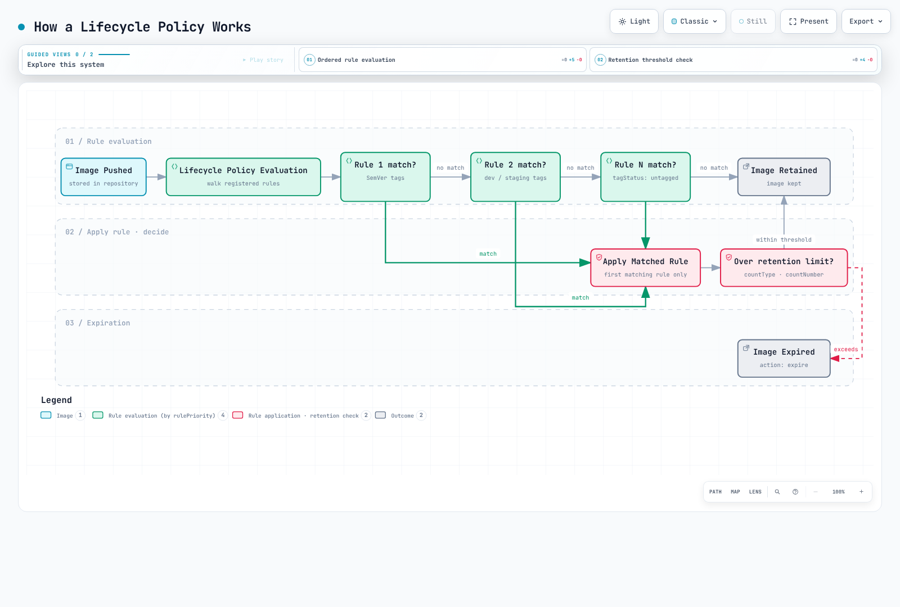

# Amazon ECR (Elastic Container Registry)

> **Última actualización**: 16 de octubre de 2026

## Descripción general de ECR

Amazon Elastic Container Registry (ECR) es un servicio de registro de contenedores completamente administrado que ofrece AWS. Evita operar tu propia infraestructura de registro de contenedores y, al mismo tiempo, se integra estrechamente con los servicios de AWS, especialmente Amazon EKS.

Salvo que se indique lo contrario, los ejemplos de CLI/CDK/IAM/ciclo de vida se dirigen a ECR Private. Son configuraciones alternativas, no un único script para ejecutar a ciegas. Elige un método de creación en vez de crear dos veces el mismo repositorio. Los ejemplos de análisis/consulta requieren un repositorio y un tag de imagen existentes. Configura las credenciales de AWS y sustituye los identificadores de cuenta/recurso de muestra.

```bash
export AWS_REGION=us-east-1
export AWS_DEFAULT_REGION="$AWS_REGION"
```

### Arquitectura

ECR funciona como un servicio regional con dos ofertas distintas:


[🔍 Ver diagrama interactivo](https://www.atomai.click/kubernetes-docs/archmaps/en-container-registry-02-amazon-ecr-0.html)

**ECR Private**: para imágenes de contenedores internas con control de acceso basado en IAM. Las imágenes se almacenan por región y se pueden replicar entre regiones.

**ECR Public**: para distribuir imágenes públicas. Los endpoints de API de administración están disponibles en `us-east-1` y `us-west-2`; las imágenes usan URL globales `public.ecr.aws`. La ubicación `us-east-1` del diagrama es un ejemplo, no el único endpoint.

### Precios

| Componente | Precio |
|-----------|-------|
| **Almacenamiento** | Precios por región/clase de almacenamiento; los ejemplos oficiales de almacenamiento estándar usan $0.10/GB-mes |
| **Transferencia a cómputo AWS admitido en la misma región** | Sin cargo de transferencia de ECR; los cargos de servicios de red son independientes |
| **Transferencia entre regiones/a Internet** | Comprueba origen, destino, niveles y franquicias; no hay una tarifa universal de $0.02/GB |
| **ECR Public** | El almacenamiento, la transferencia anónima y la autenticada tienen franquicias gratuitas distintas |
| **Análisis básico** | Gratis |
| **Análisis mejorado** | Se aplica el precio de Amazon Inspector |

También pueden aplicarse costos de AWS Signer, KMS y endpoints de VPC. Usa los [precios actuales de ECR](https://aws.amazon.com/ecr/pricing/) para un cálculo real y la [lista de endpoints públicos](https://docs.aws.amazon.com/general/latest/gr/ecr-public.html) para las regiones de API.

### Consideraciones sobre servicios regionales

ECR es un servicio regional. Consecuencias clave:

- Las imágenes enviadas a `us-east-1` no están disponibles automáticamente en `eu-west-1`.
- Las descargas entre regiones generan cargos de transferencia de datos.
- Usa replicación para despliegues multirregión.
- Los endpoints de VPC son específicos de cada región.

## Creación y configuración del repositorio

### AWS CLI

```bash
# Create a basic repository
aws ecr create-repository \
  --repository-name myapp \
  --region us-east-1

# Alternative example using a separate repository; the KMS key must exist
aws ecr create-repository \
  --repository-name myapp-secure \
  --image-tag-mutability IMMUTABLE \
  --image-scanning-configuration scanOnPush=true \
  --encryption-configuration encryptionType=KMS,kmsKey=alias/ecr-key \
  --tags Key=Environment,Value=production Key=Team,Value=platform \
  --region us-east-1
```

### AWS CDK (TypeScript)

```typescript
import * as cdk from 'aws-cdk-lib';
import * as ecr from 'aws-cdk-lib/aws-ecr';
import * as kms from 'aws-cdk-lib/aws-kms';
import { Construct } from 'constructs';

export class EcrStack extends cdk.Stack {
  constructor(scope: Construct, id: string, props?: cdk.StackProps) {
    super(scope, id, props);

    // KMS key for encryption
    const ecrKey = new kms.Key(this, 'EcrKey', {
      description: 'KMS key for ECR encryption',
      enableKeyRotation: true,
      alias: 'ecr-key',
    });

    // ECR Repository
    const repository = new ecr.Repository(this, 'MyAppRepo', {
      repositoryName: 'myapp',
      imageScanOnPush: true,
      imageTagMutability: ecr.TagMutability.IMMUTABLE,
      encryption: ecr.RepositoryEncryption.KMS,
      encryptionKey: ecrKey,
      lifecycleRules: [
        {
          rulePriority: 1,
          description: 'Keep last 100 production images',
          tagStatus: ecr.TagStatus.TAGGED,
          tagPatternList: ['v*'],
          maxImageCount: 100,
        },
        {
          rulePriority: 2,
          description: 'Expire untagged images after 3 days',
          tagStatus: ecr.TagStatus.UNTAGGED,
          maxImageAge: cdk.Duration.days(3),
        },
      ],
    });

    // Output repository URI
    new cdk.CfnOutput(this, 'RepositoryUri', {
      value: repository.repositoryUri,
      description: 'ECR Repository URI',
    });
  }
}
```

### Ajustes del repositorio

#### Mutabilidad de tags de imagen

| Ajuste | Descripción | Caso de uso |
|---------|-------------|----------|
| `MUTABLE` (predeterminado) | Se pueden sobrescribir los tags | Desarrollo, compilaciones CI |
| `IMMUTABLE` | No se pueden sobrescribir tags existentes | Referencias estables a lanzamientos mientras esos tags existan |
| `IMMUTABLE_WITH_EXCLUSION` | Solo se pueden sobrescribir los tags de excepción coincidentes | Alias mutables explícitos, como latest |

```bash
# Update existing repository to immutable
aws ecr put-image-tag-mutability \
  --repository-name myapp \
  --image-tag-mutability IMMUTABLE
```

#### Opciones de cifrado

| Tipo | Descripción | Costo |
|------|-------------|------|
| `AES256` (predeterminado) | Claves de cifrado administradas por Amazon S3 (SSE-S3) | Sin cargo separado por clave KMS |
| `KMS` | Clave ECR administrada por AWS o una clave KMS administrada por el cliente especificada | Se aplican los cargos correspondientes de KMS |

Ventajas del cifrado KMS:
- Auditar el uso de claves mediante CloudTrail.
- Control de acceso granular.
- Compatibilidad con la rotación de claves.
- Administración explícita del ciclo de vida de la clave.

La clave debe estar en la región del repositorio. No se puede cambiar la configuración de cifrado de un repositorio existente; planifica la migración a un repositorio nuevo e inspecciona `cdk diff` antes de cambiar la infraestructura.

#### Análisis al publicar

| Tipo de análisis | Descripción | Costo |
|-----------|-------------|------|
| Análisis básico | Análisis de CVE del SO con tecnología nativa de AWS | Gratis |
| Análisis mejorado | Amazon Inspector con supervisión continua | Precio de Inspector |

```bash
# Inspect existing rules before replacing account/region registry configuration
aws ecr get-registry-scanning-configuration
# Isolated-registry example; merge existing production rules rather than dropping them
aws ecr put-registry-scanning-configuration \
  --scan-type ENHANCED \
  --rules '[{"repositoryFilters":[{"filter":"*","filterType":"WILDCARD"}],"scanFrequency":"CONTINUOUS_SCAN"}]'

# Check scan findings
aws ecr describe-image-scan-findings \
  --repository-name myapp \
  --image-id imageTag=v1.0.0
```

Para una configuración nueva de análisis básico, usa reglas `BASIC` a nivel de registro con filtros `SCAN_ON_PUSH`. El ajuste `imageScanOnPush`/CLI a nivel de repositorio que aparece en los ejemplos de creación es una configuración heredada por compatibilidad. El análisis básico está limitado por imagen durante cada período de 24 horas; espera a que termine el análisis antes de interpretar los hallazgos. El análisis mejorado sigue los criterios de elegibilidad y la duración del nuevo análisis configurados.

#### Firma de imágenes

ECR admite firma automática administrada por AWS Signer y firma desde el cliente, por ejemplo con Notation. Almacenar firmas no aplica automáticamente políticas de admisión en EKS: configura por separado identidades/claves confiables, verificación de digest y política de admisión. Consulta [firma de imágenes de ECR](https://docs.aws.amazon.com/AmazonECR/latest/userguide/image-signing.html).

Los publicadores en un repositorio con firma administrada también necesitan los permisos de perfil de firma requeridos, por ejemplo `signer:SignPayload`. Los ejemplos IAM siguientes que solo cubren ECR no conceden esos permisos adicionales.

## Autenticación y control de acceso

### Inicio de sesión de Docker con AWS CLI

```bash
# Standard login (uses default profile)
aws ecr get-login-password --region us-east-1 | \
  docker login --username AWS --password-stdin 123456789012.dkr.ecr.us-east-1.amazonaws.com

# Login with specific profile
aws ecr get-login-password --region us-east-1 --profile production | \
  docker login --username AWS --password-stdin 123456789012.dkr.ecr.us-east-1.amazonaws.com

# Login script for CI/CD
#!/bin/bash
ACCOUNT_ID=$(aws sts get-caller-identity --query Account --output text)
REGION=${AWS_REGION:-us-east-1}
aws ecr get-login-password --region $REGION | \
  docker login --username AWS --password-stdin ${ACCOUNT_ID}.dkr.ecr.${REGION}.amazonaws.com
```

### Helper de credenciales de Docker

Instala y configura el helper de credenciales de ECR para la autenticación automática:

```bash
# Install on Amazon Linux 2023; check upstream instructions for other distributions
sudo yum install -y amazon-ecr-credential-helper

# Install on Ubuntu / Debian
sudo apt-get install -y amazon-ecr-credential-helper

# Install on macOS
brew install docker-credential-helper-ecr

# Merge the following fragment into Docker config; do not overwrite other credentials/settings.
```

```json
{
  "credHelpers": {
    "123456789012.dkr.ecr.us-east-1.amazonaws.com": "ecr-login",
    "public.ecr.aws": "ecr-login"
  }
}
```

### Políticas IAM

#### Política básica de descarga

```json
{
  "Version": "2012-10-17",
  "Statement": [
    {
      "Effect": "Allow",
      "Action": [
        "ecr:GetAuthorizationToken"
      ],
      "Resource": "*"
    },
    {
      "Effect": "Allow",
      "Action": [
        "ecr:BatchCheckLayerAvailability",
        "ecr:GetDownloadUrlForLayer",
        "ecr:BatchGetImage"
      ],
      "Resource": "arn:aws:ecr:us-east-1:123456789012:repository/myapp"
    }
  ]
}
```

#### Política completa de publicación/descarga

```json
{
  "Version": "2012-10-17",
  "Statement": [
    {
      "Effect": "Allow",
      "Action": [
        "ecr:GetAuthorizationToken"
      ],
      "Resource": "*"
    },
    {
      "Effect": "Allow",
      "Action": [
        "ecr:BatchCheckLayerAvailability",
        "ecr:GetDownloadUrlForLayer",
        "ecr:BatchGetImage",
        "ecr:PutImage",
        "ecr:InitiateLayerUpload",
        "ecr:UploadLayerPart",
        "ecr:CompleteLayerUpload"
      ],
      "Resource": "arn:aws:ecr:us-east-1:123456789012:repository/*"
    }
  ]
}
```

#### Política para canalización CI/CD

```json
{
  "Version": "2012-10-17",
  "Statement": [
    {
      "Sid": "ECRAuth",
      "Effect": "Allow",
      "Action": "ecr:GetAuthorizationToken",
      "Resource": "*"
    },
    {
      "Sid": "ECRPushPull",
      "Effect": "Allow",
      "Action": [
        "ecr:BatchCheckLayerAvailability",
        "ecr:GetDownloadUrlForLayer",
        "ecr:BatchGetImage",
        "ecr:PutImage",
        "ecr:InitiateLayerUpload",
        "ecr:UploadLayerPart",
        "ecr:CompleteLayerUpload",
        "ecr:DescribeImages",
        "ecr:DescribeRepositories",
        "ecr:ListImages"
      ],
      "Resource": [
        "arn:aws:ecr:us-east-1:123456789012:repository/myapp",
        "arn:aws:ecr:us-east-1:123456789012:repository/myapp-*"
      ]
    },
    {
      "Sid": "ECRScanResults",
      "Effect": "Allow",
      "Action": [
        "ecr:DescribeImageScanFindings"
      ],
      "Resource": "arn:aws:ecr:us-east-1:123456789012:repository/myapp"
    }
  ]
}
```

### Acceso entre cuentas

#### Política de repositorio (cuenta de origen)

```json
{
  "Version": "2012-10-17",
  "Statement": [
    {
      "Sid": "AllowCrossAccountPull",
      "Effect": "Allow",
      "Principal": {
        "AWS": [
          "arn:aws:iam::111111111111:root",
          "arn:aws:iam::222222222222:root"
        ]
      },
      "Action": [
        "ecr:GetDownloadUrlForLayer",
        "ecr:BatchGetImage",
        "ecr:BatchCheckLayerAvailability"
      ]
    },
    {
      "Sid": "AllowCrossAccountPush",
      "Effect": "Allow",
      "Principal": {
        "AWS": "arn:aws:iam::333333333333:role/ci-cd-role"
      },
      "Action": [
        "ecr:GetDownloadUrlForLayer",
        "ecr:BatchGetImage",
        "ecr:BatchCheckLayerAvailability",
        "ecr:PutImage",
        "ecr:InitiateLayerUpload",
        "ecr:UploadLayerPart",
        "ecr:CompleteLayerUpload"
      ]
    }
  ]
}
```

#### Política IAM de la cuenta de destino

```json
{
  "Version": "2012-10-17",
  "Statement": [
    {
      "Sid": "ECRAuth",
      "Effect": "Allow",
      "Action": "ecr:GetAuthorizationToken",
      "Resource": "*"
    },
    {
      "Sid": "CrossAccountPull",
      "Effect": "Allow",
      "Action": [
        "ecr:BatchCheckLayerAvailability",
        "ecr:GetDownloadUrlForLayer",
        "ecr:BatchGetImage"
      ],
      "Resource": "arn:aws:ecr:us-east-1:123456789012:repository/myapp"
    }
  ]
}
```

## Análisis detallado de políticas de ciclo de vida

Las políticas de ciclo de vida de ECR automatizan la limpieza de imágenes para optimizar los costos de almacenamiento y mantener los repositorios ordenados. Comprender cómo se evalúan las reglas es fundamental para diseñar políticas eficaces.

### Orden de evaluación de reglas

Las políticas de ciclo de vida **evalúan primero todas las reglas** y después aplican los resultados según prioridad:

1. La evaluación ocurre sin tener en cuenta la prioridad; un valor numérico menor de `rulePriority` tiene prioridad de aplicación más alta.
2. Una imagen que cumple los requisitos de tags de una regla con prioridad más alta no puede expirar por una regla de prioridad menor.
3. Como máximo, una regla expira o archiva cada imagen. Los recuentos se refieren a digests de imágenes, no a la cantidad de tags.
4. Las prioridades deben ser únicas. Los conjuntos de prefijos y las reglas de imágenes sin tag deben cumplir las restricciones del servicio para la clase de almacenamiento elegida; una regla `any` va al final.



[🔍 Ver diagrama interactivo](https://www.atomai.click/kubernetes-docs/archmaps/en-container-registry-02-amazon-ecr-1.html)

### Criterios de selección

| Parámetro | Descripción | Valores |
|-----------|-------------|--------|
| `tagStatus` | Filtra por presencia de tag | `tagged`, `untagged`, `any` |
| `tagPrefixList` | Coincide con tags que empiezan por prefijos | `["v1.", "release-"]` |
| `tagPatternList` | Comodín `*` documentado; varios patrones se combinan con AND | `["v*"]` |
| `countType` | Cómo contar imágenes | `imageCountMoreThan`, `sinceImagePushed` |
| `countUnit` | Unidad de `sinceImagePushed` | `days` |
| `countNumber` | Umbral del tipo de recuento seleccionado | Entero positivo |

Esto no es una expresión regular ni una coincidencia completa de glob de Unix: no uses `?`, `[0-9]`, `^` o `$` para validar SemVer. Se permiten como máximo cuatro comodines `*` por cadena. Estos ejemplos usan tags de lanzamiento `v1.2.3` validados por CI y los seleccionan con `v*`. Cubren la expiración de imágenes activas; consulta las [reglas actuales del ciclo de vida](https://docs.aws.amazon.com/AmazonECR/latest/userguide/LifecyclePolicies.html) para conocer tiempos de archivado/restauración, artefactos de referencia y tipos de recuento adicionales.

### Estrategia A: repositorios separados (recomendada)

El enfoque más claro es separar las imágenes de producción y desarrollo en distintos repositorios con políticas de ciclo de vida propias.

#### Repositorio de producción (`myapp-prod`)

```bash
aws ecr create-repository \
  --repository-name myapp-prod \
  --image-tag-mutability IMMUTABLE \
  --image-scanning-configuration scanOnPush=true
```

Política de ciclo de vida: conserva las últimas 100 versiones SemVer:

```json
{
  "rules": [
    {
      "rulePriority": 1,
      "description": "Keep newest 100 v-prefixed release image digests; CI validates the version format",
      "selection": {
        "tagStatus": "tagged",
        "tagPatternList": [
          "v*"
        ],
        "countType": "imageCountMoreThan",
        "countNumber": 100
      },
      "action": {
        "type": "expire"
      }
    },
    {
      "rulePriority": 2,
      "description": "Expire untagged images after 1 day",
      "selection": {
        "tagStatus": "untagged",
        "countType": "sinceImagePushed",
        "countUnit": "days",
        "countNumber": 1
      },
      "action": {
        "type": "expire"
      }
    }
  ]
}
```

```bash
aws ecr put-lifecycle-policy \
  --repository-name myapp-prod \
  --lifecycle-policy-text file://lifecycle-policy-prod.json
```

#### Repositorio de desarrollo (`myapp-dev`)

```bash
aws ecr create-repository \
  --repository-name myapp-dev \
  --image-tag-mutability MUTABLE \
  --image-scanning-configuration scanOnPush=true
```

Política de ciclo de vida: expira imágenes etiquetadas después de 60 días:

Esta es una política basada solo en antigüedad, no garantiza conservar una cantidad mínima. Añadir una regla de recuento con menor prioridad no es una red de seguridad. Protege por separado los digests activos y de reversión.

```json
{
  "rules": [
    {
      "rulePriority": 1,
      "description": "Expire tagged development images older than 60 days",
      "selection": {
        "tagStatus": "tagged",
        "tagPatternList": [
          "*"
        ],
        "countType": "sinceImagePushed",
        "countUnit": "days",
        "countNumber": 60
      },
      "action": {
        "type": "expire"
      }
    },
    {
      "rulePriority": 2,
      "description": "Expire untagged images after 3 days",
      "selection": {
        "tagStatus": "untagged",
        "countType": "sinceImagePushed",
        "countUnit": "days",
        "countNumber": 3
      },
      "action": {
        "type": "expire"
      }
    }
  ]
}
```

```bash
aws ecr put-lifecycle-policy \
  --repository-name myapp-dev \
  --lifecycle-policy-text file://lifecycle-policy-dev.json
```

### Estrategia B: un repositorio con reglas de prioridad

Cuando no sea práctico usar repositorios separados, usa uno solo con reglas de prioridad ordenadas cuidadosamente.

```json
{
  "rules": [
    {
      "rulePriority": 1,
      "description": "Keep newest 100 v-prefixed release image digests; CI validates the version format",
      "selection": {
        "tagStatus": "tagged",
        "tagPatternList": [
          "v*"
        ],
        "countType": "imageCountMoreThan",
        "countNumber": 100
      },
      "action": {
        "type": "expire"
      }
    },
    {
      "rulePriority": 2,
      "description": "Expire dev-* images older than 60 days",
      "selection": {
        "tagStatus": "tagged",
        "tagPatternList": [
          "dev-*"
        ],
        "countType": "sinceImagePushed",
        "countUnit": "days",
        "countNumber": 60
      },
      "action": {
        "type": "expire"
      }
    },
    {
      "rulePriority": 3,
      "description": "Expire stage-* images older than 60 days",
      "selection": {
        "tagStatus": "tagged",
        "tagPatternList": [
          "stage-*"
        ],
        "countType": "sinceImagePushed",
        "countUnit": "days",
        "countNumber": 60
      },
      "action": {
        "type": "expire"
      }
    },
    {
      "rulePriority": 4,
      "description": "Expire staging-* images older than 60 days",
      "selection": {
        "tagStatus": "tagged",
        "tagPatternList": [
          "staging-*"
        ],
        "countType": "sinceImagePushed",
        "countUnit": "days",
        "countNumber": 60
      },
      "action": {
        "type": "expire"
      }
    },
    {
      "rulePriority": 9,
      "description": "Expire untagged images after 3 days",
      "selection": {
        "tagStatus": "untagged",
        "countType": "sinceImagePushed",
        "countUnit": "days",
        "countNumber": 3
      },
      "action": {
        "type": "expire"
      }
    }
  ]
}
```

#### Limitación importante: combinar cantidad mínima y antigüedad

**Importante**: una regla selecciona un tipo de recuento. Las reglas de expiración independientes no son una expresión booleana general de retención que garantice directamente «conservar imágenes de menos de 60 días O entre las 10 más recientes». Las reglas independientes dev/stage seleccionan grupos de tags distintos; eso no equivale a combinar condiciones de retención para las mismas imágenes.

Con la política anterior, la regla de prioridad 2 expirará TODAS las imágenes dev/staging con más de 60 días, aunque solo haya 5 imágenes dev en el repositorio. ECR no puede expresar «expira si tiene más de 60 días Y existen más de 10 imágenes».

**Casos en que importa esta limitación**:

| Caso | Imágenes dev | Comportamiento | Problema |
|----------|-----------|----------|---------|
| Desarrollo activo | 50 imágenes (3 con más de 60 días) | Expira 3 imágenes antiguas | Esperado ✓ |
| Desarrollo lento | 8 imágenes (5 con más de 60 días) | Expira 5 imágenes antiguas | ¡Solo quedan 3! |
| Proyecto inactivo | 10 imágenes (todas con más de 60 días) | Expiran TODAS las imágenes | ¡No queda ninguna! |

Separar los repositorios aísla los entornos, pero no crea un predicado compuesto de antigüedad/cantidad para las mismas imágenes. Para ese requisito se necesita un proceso de decisión personalizado; el siguiente ejemplo es de solo lectura.

### Estrategia C: vista previa de candidatos de retención de solo lectura

Un proceso personalizado puede calcular condiciones de retención combinadas, pero calcular candidatos y eliminarlos son operaciones separadas. Este ejemplo nunca llama a una API de eliminación. Define `REPOSITORY_NAME`, concede solo el permiso `ecr:DescribeImages` del repositorio pertinente y usa una versión de boto3 compatible con el modelo ECR actual. De forma conservadora, considera imágenes ordinarias que solo tengan tags dev/stage y excluye tags de lanzamiento/desconocidos, índices, firmas y digests protegidos explícitamente.

#### Arquitectura

```
┌─────────────────┐     ┌───────────────────┐     ┌─────────────────┐
│ EventBridge     │────▶│ Lambda Function   │────▶│ ECR             │
│ (Optional)      │     │ (Read-only report)│     │ (describe-images)│
└─────────────────┘     └───────────────────┘     └─────────────────┘
```

#### Función Lambda (Python)

El ejemplo conserva una cantidad mínima y un período reciente. Antes de añadir cualquier mecanismo de eliminación, comprueba independientemente las cargas de trabajo activas, referencias de manifiestos, necesidades de reversión y cambios concurrentes de tags. Si el inventario supera 10 000 registros, falla explícitamente en vez de decidir con datos parciales.

```python
# ecr_retention_preview.py -- read-only candidate report, never deletes images
import os
from datetime import datetime, timedelta, timezone

import boto3

ecr = boto3.client("ecr")


def retention_candidates(images, now, min_images=10, max_age_days=60, protected_digests=()):
    if type(min_images) is not int or min_images < 1:
        raise ValueError("min_images must be a positive integer")
    if type(max_age_days) is not int or max_age_days < 1:
        raise ValueError("max_age_days must be a positive integer")
    if not isinstance(now, datetime) or now.tzinfo is None:
        raise ValueError("now must be timezone-aware")
    if isinstance(protected_digests, str):
        raise ValueError("protected_digests must be a collection, not a string")
    protected = set(protected_digests)
    by_digest = {image["imageDigest"]: image for image in images if image.get("imageDigest")}
    eligible = []
    manifests = {
        "application/vnd.docker.distribution.manifest.v2+json",
        "application/vnd.oci.image.manifest.v1+json",
    }
    configs = {
        None,
        "application/vnd.docker.container.image.v1+json",
        "application/vnd.oci.image.config.v1+json",
    }
    for digest, image in by_digest.items():
        tags = image.get("imageTags") or []
        timestamp = image.get("lastActivatedAt") or image.get("imagePushedAt")
        if digest in protected or not tags:
            continue
        # A dev tag must not hide a release/protected tag on the same digest.
        if not all(tag.startswith(("dev-", "stage-", "staging-")) for tag in tags):
            continue
        # This example does not classify indexes, signatures or unknown artifacts.
        if image.get("imageManifestMediaType") not in manifests:
            continue
        if image.get("artifactMediaType") not in configs:
            continue
        if not isinstance(timestamp, datetime) or timestamp.tzinfo is None:
            continue
        eligible.append((timestamp, digest, tags))
    eligible.sort(reverse=True, key=lambda item: item[0])
    cutoff = now - timedelta(days=max_age_days)
    return [
        {"imageDigest": digest, "imageTags": tags, "timestamp": timestamp.isoformat()}
        for timestamp, digest, tags in eligible[min_images:]
        if timestamp < cutoff
    ]


def lambda_handler(event, context):
    repository = os.environ["REPOSITORY_NAME"]
    images = []
    paginator = ecr.get_paginator("describe_images")
    for page in paginator.paginate(repositoryName=repository, filter={"imageStatus": "ACTIVE"}):
        images.extend(page.get("imageDetails", []))
        if len(images) > 10000:
            raise ValueError("Inventory too large for this example; use a paged batch workflow")
    candidates = retention_candidates(
        images,
        datetime.now(timezone.utc),
        event.get("min_images", 10),
        event.get("max_age_days", 60),
        event.get("protected_digests", []),
    )
    return {
        "repository": repository,
        "dry_run": True,
        "candidate_count": len(candidates),
        "candidates_requiring_review": candidates,
    }
```

### Simulación de la política de ciclo de vida

Previsualiza siempre los efectos de la política antes de aplicarla:

```bash
# Start a lifecycle policy preview
aws ecr start-lifecycle-policy-preview \
  --repository-name myapp \
  --lifecycle-policy-text file://lifecycle-policy.json

aws ecr wait lifecycle-policy-preview-complete --repository-name myapp

# Check preview results
aws ecr get-lifecycle-policy-preview \
  --repository-name myapp

```

Estructura de respuesta ilustrativa (abreviada):

```json
{
    "registryId": "123456789012",
    "repositoryName": "myapp",
    "lifecyclePolicyText": "...",
    "status": "COMPLETE",
    "previewResults": [
        {
            "imageTags": ["v1.0.0"],
            "imageDigest": "sha256:abc123...",
            "imagePushedAt": "2024-01-15T10:30:00Z",
            "action": {
                "type": "EXPIRE"
            },
            "appliedRulePriority": 1
        }
    ]
}
```

## Estrategia de tags multientorno

### Convenciones de tags

| Patrón de tag | Descripción | Ejemplo | Entorno |
|-------------|-------------|---------|-------------|
| `vX.Y.Z` | Lanzamiento estable validado por CI | `v1.2.3` | Producción |
| `stage-X.Y.Z-rc.N` | Candidato a lanzamiento | `stage-1.2.3-rc.1` | Preparación |
| `stage-X.Y.Z-beta.N` | Versión beta | `stage-1.2.3-beta.2` | Preproducción |
| `dev-<sha>` | SHA de Git (desarrollo) | `dev-abc123f` | Desarrollo |
| `staging-<sha>` | SHA de Git (preparación) | `staging-abc123f` | Preparación |
| `<branch>-<sha>` | Rama + SHA | `feature-auth-abc123f` | Rama de funcionalidad |
| `latest` | Compilación más reciente | `latest` | Nunca en producción |

### Flujo de promoción

```
Development → Staging → Production

┌─────────────┐     ┌─────────────┐     ┌─────────────┐
│ abc123f-dev │────▶│abc123f-stage│────▶│   v1.2.3    │
└─────────────┘     └─────────────┘     └─────────────┘
       │                   │                   │
       ▼                   ▼                   ▼
   myapp-dev          myapp-staging        myapp-prod
  (Repository)        (Repository)        (Repository)
```

### Script de tags para CI/CD

```bash
#!/bin/bash
# build-and-push.sh - Example tagging strategy

set -e

ACCOUNT_ID=$(aws sts get-caller-identity --query Account --output text)
REGION=${AWS_REGION:-us-east-1}
ECR_BASE="${ACCOUNT_ID}.dkr.ecr.${REGION}.amazonaws.com"

# Login to ECR
aws ecr get-login-password --region $REGION | \
  docker login --username AWS --password-stdin $ECR_BASE

# Get version info
GIT_SHA=$(git rev-parse --short HEAD)
GIT_BRANCH=$(git rev-parse --abbrev-ref HEAD)
BUILD_DATE=$(date -u +%Y%m%d)

# Determine environment and tags
case "$GIT_BRANCH" in
  main|master)
    # Production release - requires VERSION env var
    if [ -z "${VERSION:-}" ]; then
      echo "ERROR: VERSION environment variable required for production builds"
      exit 1
    fi
    REPO="${ECR_BASE}/myapp-prod"
    RELEASE_VERSION=${VERSION#v}
    [[ "$RELEASE_VERSION" =~ ^(0|[1-9][0-9]*)\.(0|[1-9][0-9]*)\.(0|[1-9][0-9]*)$ ]] || exit 1
    TAGS=("v$RELEASE_VERSION" "v$RELEASE_VERSION-${GIT_SHA}")
    ;;
  staging)
    REPO="${ECR_BASE}/myapp-staging"
    TAGS=("staging-${GIT_SHA}" "staging-${BUILD_DATE}")
    ;;
  develop)
    REPO="${ECR_BASE}/myapp-dev"
    TAGS=("dev-${GIT_SHA}" "dev-latest")
    ;;
  feature/*|bugfix/*)
    REPO="${ECR_BASE}/myapp-dev"
    BRANCH_SLUG=$(printf '%s' "$GIT_BRANCH" | sed 's/[^a-zA-Z0-9_.-]/-/g' | cut -c1-90)
    TAGS=("dev-${BRANCH_SLUG}-${GIT_SHA}")
    ;;
  *)
    echo "Unknown branch: $GIT_BRANCH"
    exit 1
    ;;
esac

# Build image
docker build -t myapp:local \
  --build-arg BUILD_DATE=$BUILD_DATE \
  --build-arg GIT_SHA=$GIT_SHA \
  --build-arg VERSION=${VERSION:-$GIT_SHA} \
  .

# Tag and push
for TAG in "${TAGS[@]}"; do
  docker tag myapp:local "${REPO}:${TAG}"
  docker push "${REPO}:${TAG}"
  echo "Pushed: ${REPO}:${TAG}"
done
```

### Buenas prácticas para tags inmutables

Habilita tags inmutables en los repositorios de producción para evitar sobrescrituras accidentales:

```bash
# Enable immutable tags
aws ecr put-image-tag-mutability \
  --repository-name myapp-prod \
  --image-tag-mutability IMMUTABLE

# Pushing a different digest under an existing immutable tag fails
docker push 123456789012.dkr.ecr.us-east-1.amazonaws.com/myapp-prod:v1.0.0
# Error: tag invalid: The image tag 'v1.0.0' already exists...
```

## Integración con EKS

### Identidad de descarga de imágenes frente a identidad de la carga de trabajo

La descarga de la imagen ocurre **antes** de iniciar el contenedor de la aplicación y la realiza kubelet/el entorno de ejecución del nodo. Kubelet no hereda las credenciales SDK IRSA o Pod Identity de la aplicación.

| Entorno de ejecución | Permisos iniciales para descargar imágenes ECR |
|---|---|
| Nodos EC2 administrados/autoadministrados | Permisos ECR de descarga del rol IAM del nodo |
| EKS Auto Mode | Permisos ECR de descarga del rol de nodo Auto Mode |
| Fargate | Rol de ejecución de Pod de Fargate |
| Proveedor/Secret configurado por separado | Ese proveedor o `imagePullSecrets` del mismo namespace |

Comprueba el [rol del nodo](https://docs.aws.amazon.com/eks/latest/userguide/create-node-role.html), por ejemplo `AmazonEC2ContainerRegistryPullOnly`. El [rol de ejecución de Fargate](https://docs.aws.amazon.com/eks/latest/userguide/pod-execution-role.html) no lo asumen directamente los contenedores de aplicaciones. Las descargas entre cuentas también necesitan autorización de política de repositorio e IAM del llamador.

### Dónde se aplican IRSA y Pod Identity

Un Pod de compilación u operaciones que ya esté en ejecución puede usar su rol de carga de trabajo para llamar API ECR o publicar imágenes. Esto no sustituye la identidad de descarga inicial de arranque. IRSA necesita configuración de confianza/OIDC; Pod Identity necesita un runtime compatible, Agent, confianza de rol y asociación de ServiceAccount. Sigue la [documentación de identidad de cargas de trabajo de EKS](https://docs.aws.amazon.com/eks/latest/userguide/pod-identities.html).

### Entornos que necesitan imagePullSecrets

Los tokens de autorización ECR duran 12 horas. El siguiente script independiente requiere AWS CLI, Python 3 y kubectl. Construye la configuración nueva antes de actualizar Kubernetes y **no elimina primero el Secret existente**. El Secret y el Pod deben compartir namespace, y el llamador debe tener credenciales para la API de Kubernetes.

```bash
#!/usr/bin/env bash
set -euo pipefail
: "${AWS_REGION:?Set the ECR region}"
ECR_ACCOUNT_ID=${ECR_ACCOUNT_ID:-$(aws sts get-caller-identity --query Account --output text)}
export ECR_REGISTRY="$ECR_ACCOUNT_ID.dkr.ecr.$AWS_REGION.amazonaws.com"
PULL_SECRET_NAMESPACE=${PULL_SECRET_NAMESPACE:-default}
registry_secret_file=$(mktemp)
trap 'rm -f "$registry_secret_file"' EXIT
# Build the config before touching Kubernetes; an AWS failure keeps the old Secret.
aws ecr get-login-password --region "$AWS_REGION" | python3 -c '
import base64, json, os, sys
password = sys.stdin.read().strip()
if not password:
    raise SystemExit("No ECR password returned")
auth = base64.b64encode(("AWS:" + password).encode()).decode()
json.dump({"auths": {os.environ["ECR_REGISTRY"]: {"auth": auth}}}, sys.stdout)
' > "$registry_secret_file"
kubectl create secret generic ecr-secret \
  --namespace "$PULL_SECRET_NAMESPACE" \
  --type=kubernetes.io/dockerconfigjson \
  --from-file=.dockerconfigjson="$registry_secret_file" \
  --dry-run=client -o yaml | \
  kubectl apply --server-side --field-manager=ecr-credentials-sync -f -
```

Un CronJob también necesita una imagen probada que incluya las tres herramientas, permiso IAM `ecr:GetAuthorizationToken`, permisos get/create/patch sobre el Secret de destino, un intervalo de renovación inferior a 12 horas y supervisión de fallos. La imagen AWS CLI por sí sola no incluye kubectl. No hagas que la imagen propia del trabajo de renovación dependa del Secret que está por vencer. Resuelve deliberadamente los conflictos de field-manager en vez de sobrescribir otro controlador con `--force-conflicts`.

### Endpoints privados de VPC

Usa endpoints de VPC para conectividad AWS privada; esto no constituye un entorno completamente aislado de la red. Consulta la [guía actual de endpoints](https://docs.aws.amazon.com/AmazonECR/latest/userguide/vpc-endpoints.html) para las primeras descargas PTC, capas extranjeras de Windows y otras dependencias. Los endpoints habituales para imágenes privadas son:

- **ecr.api**: endpoint de interfaz para llamadas a la API ECR
- **ecr.dkr**: endpoint de interfaz para el protocolo de registro Docker
- **s3**: endpoint de gateway para acceder al almacenamiento de capas de imágenes

```bash
# Create VPC Endpoints (AWS CLI)
aws ec2 create-vpc-endpoint \
  --vpc-id vpc-12345678 \
  --service-name com.amazonaws.us-east-1.ecr.api \
  --vpc-endpoint-type Interface \
  --subnet-ids subnet-11111111 subnet-22222222 \
  --security-group-ids sg-12345678 \
  --private-dns-enabled

aws ec2 create-vpc-endpoint \
  --vpc-id vpc-12345678 \
  --service-name com.amazonaws.us-east-1.ecr.dkr \
  --vpc-endpoint-type Interface \
  --subnet-ids subnet-11111111 subnet-22222222 \
  --security-group-ids sg-12345678 \
  --private-dns-enabled

aws ec2 create-vpc-endpoint \
  --vpc-id vpc-12345678 \
  --service-name com.amazonaws.us-east-1.s3 \
  --vpc-endpoint-type Gateway \
  --route-table-ids rtb-12345678
```

### Caché pull-through

ECR Pull-Through Cache puede reducir las descargas upstream repetidas. Las fallas de caché y las actualizaciones todavía dependen de la disponibilidad y política upstream; una caché no evita incondicionalmente los límites de frecuencia.


[🔍 Ver diagrama interactivo](https://www.atomai.click/kubernetes-docs/archmaps/en-container-registry-02-amazon-ecr-2.html)

#### Registros upstream admitidos

| Registro upstream | Prefijo ECR | Requiere autenticación | Notas |
|---|---|---|---|
| Docker Hub | `docker-hub` | Sí (Secrets Manager) | Reduce descargas repetidas; siguen aplicándose las políticas upstream |
| Quay.io | `quay` | No | Imágenes de Red Hat/CoreOS |
| GitHub Container Registry | `ghcr` | Sí (Secrets Manager) | Imágenes de GitHub Actions |
| registry.k8s.io | `k8s` | No | Componentes principales de Kubernetes |
| ECR Public | `ecr-public` | No | Imágenes públicas de AWS |

#### Configuración de Secrets Manager (para registros autenticados)

```bash
# Store Docker Hub credentials
aws secretsmanager create-secret \
  --name ecr-pullthroughcache/docker-hub \
  --secret-string '{"username":"your-dockerhub-username","accessToken":"dckr_pat_xxxxx"}'

# Store GitHub Container Registry credentials
aws secretsmanager create-secret \
  --name ecr-pullthroughcache/ghcr \
  --secret-string '{"username":"your-github-username","accessToken":"ghp_xxxxx"}'
```

#### Creación de reglas de caché pull-through

```bash
# Docker Hub cache rule
aws ecr create-pull-through-cache-rule \
  --ecr-repository-prefix docker-hub \
  --upstream-registry-url registry-1.docker.io \
  --credential-arn "$(aws secretsmanager describe-secret --secret-id ecr-pullthroughcache/docker-hub --region "$AWS_REGION" --query ARN --output text)" \
  --region "$AWS_REGION"

# Quay.io cache rule
aws ecr create-pull-through-cache-rule \
  --ecr-repository-prefix quay \
  --upstream-registry-url quay.io

# GitHub Container Registry cache rule
aws ecr create-pull-through-cache-rule \
  --ecr-repository-prefix ghcr \
  --upstream-registry-url ghcr.io \
  --credential-arn "$(aws secretsmanager describe-secret --secret-id ecr-pullthroughcache/ghcr --region "$AWS_REGION" --query ARN --output text)" \
  --region "$AWS_REGION"

# Kubernetes registry cache rule
aws ecr create-pull-through-cache-rule \
  --ecr-repository-prefix k8s \
  --upstream-registry-url registry.k8s.io

# ECR Public cache rule
aws ecr create-pull-through-cache-rule \
  --ecr-repository-prefix ecr-public \
  --upstream-registry-url public.ecr.aws
```

#### Política IAM para caché pull-through

Este ejemplo cubre a los llamadores que descargan/importan desde la caché; administrar la creación de reglas es aparte. ECR recupera los secretos upstream mediante su rol vinculado al servicio, así que no concedas a los clientes de descarga normales acceso general a esos secretos. Consulta [permisos PTC](https://docs.aws.amazon.com/AmazonECR/latest/userguide/pull-through-cache-iam.html).

```json
{
  "Version": "2012-10-17",
  "Statement": [
    {
      "Sid": "RegistryAuthentication",
      "Effect": "Allow",
      "Action": "ecr:GetAuthorizationToken",
      "Resource": "*"
    },
    {
      "Sid": "ReadCachedImages",
      "Effect": "Allow",
      "Action": [
        "ecr:BatchGetImage",
        "ecr:GetDownloadUrlForLayer",
        "ecr:BatchCheckLayerAvailability"
      ],
      "Resource": [
        "arn:aws:ecr:us-east-1:123456789012:repository/docker-hub/*",
        "arn:aws:ecr:us-east-1:123456789012:repository/quay/*",
        "arn:aws:ecr:us-east-1:123456789012:repository/ghcr/*",
        "arn:aws:ecr:us-east-1:123456789012:repository/k8s/*",
        "arn:aws:ecr:us-east-1:123456789012:repository/ecr-public/*"
      ]
    },
    {
      "Sid": "ImportCacheMisses",
      "Effect": "Allow",
      "Action": [
        "ecr:BatchImportUpstreamImage",
        "ecr:CreateRepository"
      ],
      "Resource": [
        "arn:aws:ecr:us-east-1:123456789012:repository/docker-hub/*",
        "arn:aws:ecr:us-east-1:123456789012:repository/quay/*",
        "arn:aws:ecr:us-east-1:123456789012:repository/ghcr/*",
        "arn:aws:ecr:us-east-1:123456789012:repository/k8s/*",
        "arn:aws:ecr:us-east-1:123456789012:repository/ecr-public/*"
      ]
    }
  ]
}
```

#### Validación

```bash
# Verify cache rules
aws ecr describe-pull-through-cache-rules

# Test pull (Docker Hub nginx)
docker pull 123456789012.dkr.ecr.us-east-1.amazonaws.com/docker-hub/library/nginx:1.30.6

# Verify cached repository was created
aws ecr describe-repositories \
  --repository-names docker-hub/library/nginx

# Test Kubernetes registry image
docker pull 123456789012.dkr.ecr.us-east-1.amazonaws.com/k8s/pause:3.10
```

#### Usa referencias explícitas de imágenes de caché

Usa la URI real de caché ECR en las referencias de imágenes de Pod/Helm/Kustomize. Pegar una URL ECR en ajustes obsoletos `registry.mirrors` no constituye una configuración completa de réplica transparente. Ese diseño también requiere los ajustes actuales de hosts de containerd, mapeo de prefijos, TLS y autenticación ECR funcional.

## Replicación entre regiones

### Configuración

```bash
# Enable replication in registry settings
aws ecr put-replication-configuration \
  --replication-configuration '{
    "rules": [
      {
        "destinations": [
          {
            "region": "eu-west-1",
            "registryId": "123456789012"
          },
          {
            "region": "ap-northeast-1",
            "registryId": "123456789012"
          }
        ],
        "repositoryFilters": [
          {
            "filter": "myapp",
            "filterType": "PREFIX_MATCH"
          }
        ]
      }
    ]
  }'
```

### Consideraciones de recuperación ante desastres

La replicación es asíncrona. Las imágenes existentes no se rellenan automáticamente: pueden replicarse los envíos o restauraciones posteriores a la configuración. Los ajustes, políticas y reglas de ciclo de vida del repositorio se configuran por separado en el destino, por ejemplo mediante plantillas de creación. Las eliminaciones no sirven para sincronizar la retención entre regiones.

Hay que medir RTO/RPO para el proceso de recuperación completo. La inmutabilidad de tags no protege contra la eliminación, y el almacenamiento S3 conectado no constituye automáticamente un entorno aislado. Antes de declarar lista la recuperación, comprueba el digest requerido en el destino, los permisos/retención independientes y la referencia regional de imagen de la carga de trabajo.

### Configuración de descarga entre regiones

Kubernetes no expande variables de entorno del shell dentro del campo `image`. Usa una URI de registro concreta o renderiza un overlay. El valor de base de marcador siguiente debe desplegarse mediante un overlay regional apropiado y el repositorio/imagen de destino ya deben existir.

```yaml
# base/deployment.yaml
apiVersion: apps/v1
kind: Deployment
metadata:
  name: myapp
spec:
  selector:
    matchLabels:
      app: myapp
  template:
    metadata:
      labels:
        app: myapp
    spec:
      containers:
      - name: app
        image: myapp:v1.0.0
```

```yaml
# base/kustomization.yaml
apiVersion: kustomize.config.k8s.io/v1beta1
kind: Kustomization
resources:
- deployment.yaml
```

```yaml
# overlays/us-east-1/kustomization.yaml
apiVersion: kustomize.config.k8s.io/v1beta1
kind: Kustomization
resources:
- ../../base
images:
- name: myapp
  newName: 123456789012.dkr.ecr.us-east-1.amazonaws.com/myapp
```

```yaml
# overlays/eu-west-1/kustomization.yaml
apiVersion: kustomize.config.k8s.io/v1beta1
kind: Kustomization
resources:
- ../../base
images:
- name: myapp
  newName: 123456789012.dkr.ecr.eu-west-1.amazonaws.com/myapp
```

Renderiza con `kubectl kustomize overlays/eu-west-1` e inspecciona la URI de imagen antes de aplicarla al contexto de clúster previsto. En este ejemplo, la configuración de replicación usa un prefijo de repositorio `myapp`; en producción, elige el alcance real que se pretende.

## Supervisión y optimización de costos

### Métricas de CloudWatch y hallazgos de análisis

La métrica nativa de repositorio ECR en `AWS/ECR` es `RepositoryPullCount`, con la dimensión `RepositoryName`. Usa la [lista documentada de métricas](https://docs.aws.amazon.com/AmazonECR/latest/userguide/ecr-repository-metrics.html). Una alarma basada en una supuesta métrica nativa `ImagePushCount` o `ImageScanFindingsSeverityCounts` no supervisaría los datos previstos.

```bash
# Linux example using GNU date: repository pulls during the last seven days
aws cloudwatch get-metric-statistics \
  --namespace AWS/ECR --metric-name RepositoryPullCount \
  --dimensions Name=RepositoryName,Value=myapp \
  --start-time "$(date -u -d '7 days ago' +%Y-%m-%dT%H:%M:%SZ)" \
  --end-time "$(date -u +%Y-%m-%dT%H:%M:%SZ)" \
  --period 86400 --statistics Sum --region "$AWS_REGION"

# Query findings through ECR/Inspector APIs
aws ecr describe-image-scan-findings \
  --repository-name myapp --image-id imageTag=v1.0.0 \
  --query '{status:imageScanStatus.status,counts:imageScanFindings.findingSeverityCounts}' --region "$AWS_REGION"
```

Usa la finalización del análisis básico o eventos de hallazgos de Inspector mediante EventBridge para las notificaciones. Si se necesita una alarma numérica de CloudWatch, publica explícitamente una métrica personalizada a partir de esos eventos/respuestas de API. No confundas esa métrica personalizada con una métrica nativa de ECR. Los hallazgos ausentes/nulos no significan que haya cero vulnerabilidades; comprueba el estado y elegibilidad del análisis.

### Estrategias de optimización de costos

#### 1. Revisa los tamaños lógicos de imagen

Los tamaños sumados de metadatos pueden contar dos veces las capas compartidas y omitir otras categorías facturables, como el almacenamiento de archivo. No conviertas directamente estos totales en una factura de almacenamiento ni en ahorros declarados.

```bash
# Active-image metadata sizes are logical totals, not billed unique-layer storage.
aws ecr describe-repositories --region "$AWS_REGION" --output json | \
  jq -r '.repositories[].repositoryName' | while IFS= read -r repo; do
    size=$(aws ecr describe-images --repository-name "$repo" \
      --region "$AWS_REGION" --output json | \
      jq '[.imageDetails[].imageSizeInBytes // 0] | add // 0')
    printf '%s: %s logical image bytes\n' "$repo" "$size"
  done
```

#### 2. Revisa las imágenes sin tag

```bash
# Read-only inventory; untagged does not mean unreferenced or safe to delete.
aws ecr list-images --repository-name myapp --filter tagStatus=UNTAGGED --output json
```

#### 3. Audita los tamaños de imagen

```bash
# List largest images
aws ecr describe-images --repository-name myapp \
  --query 'sort_by(imageDetails, &imageSizeInBytes)[-10:].{Tag:imageTags[0],Size:imageSizeInBytes,Pushed:imagePushedAt}' \
  --output table
```

#### 4. Optimiza los tamaños de imagen

```dockerfile
# Multi-stage build to reduce image size
FROM golang:1.27.2 AS builder
WORKDIR /app
COPY . .
RUN CGO_ENABLED=0 go build -o /app/server

FROM gcr.io/distroless/static-debian12
COPY --from=builder /app/server /server
ENTRYPOINT ["/server"]
```

#### 5. Supervisión de costos

Usa Cost Explorer/CUR desde un contexto de facturación autorizado. La fecha final es exclusiva. Un filtro del servicio ECR no incluye cargos facturados por separado de Inspector, Signer, KMS o redes.

```bash
: "${START_DATE:?Set inclusive YYYY-MM-DD start}"
: "${END_DATE:?Set exclusive YYYY-MM-DD end}"
# Discover the exact billing service name rather than hard-coding a legacy label.
aws ce get-dimension-values --region us-east-1 \
  --time-period Start="$START_DATE",End="$END_DATE" \
  --dimension SERVICE --search-string 'Container Registry'

: "${ECR_BILLING_SERVICE:?Set the returned service name}"
aws ce get-cost-and-usage --region us-east-1 \
  --time-period Start="$START_DATE",End="$END_DATE" \
  --granularity MONTHLY --metrics UnblendedCost \
  --filter "$(jq -nc --arg service "$ECR_BILLING_SERVICE" \
    '{Dimensions:{Key:"SERVICE",Values:[$service]}}')"
```

### Flujo de limpieza

Usa la vista previa de candidatos de solo lectura anterior y una lista permitida explícita de repositorios. Antes de autorizar una eliminación, vuelve a comprobar digests activos/de reversión, referencias multiarquitectura, firmas y replicación. `BatchDeleteImage` acepta como máximo 100 ID por solicitud y puede devolver fallos por imagen. Nunca envíes directamente a eliminación un resultado ilimitado de `list-images` ni trates una respuesta parcial como éxito completo.

## Resumen

Amazon ECR ofrece un registro de contenedores sólido y completamente administrado que se integra sin problemas con el ecosistema AWS. Puntos clave:

### Estrategia de repositorios

- Usa **repositorios separados** para producción y desarrollo cuando sea posible.
- Habilita **tags inmutables** en repositorios de producción.
- Implementa pronto **políticas de ciclo de vida** para controlar costos.

### Seguridad

- Usa credenciales de ejecución de nodo/Fargate para descargar inicialmente imágenes; usa IRSA/Pod Identity para el acceso API de cargas de trabajo.
- Habilita **análisis al publicar** con análisis mejorado para producción.
- Configura **endpoints de VPC** para conectividad privada y valida las dependencias de red restantes.
- Revisa los resultados de análisis y bloquea despliegues de imágenes vulnerables.

### Administración de costos

- Las políticas de ciclo de vida son esenciales para controlar costos.
- Supervisa las imágenes sin tag y límpialas con regularidad.
- Usa caché pull-through para reducir dependencias externas.
- Ajusta el tamaño de las imágenes con compilaciones multietapa.

### Alta disponibilidad

- Configura **replicación entre regiones** para las imágenes críticas.
- Prueba periódicamente los procedimientos de recuperación ante desastres.
- Usa endpoints regionales para reducir la latencia.

## Referencias

- [Guía del usuario de Amazon ECR](https://docs.aws.amazon.com/AmazonECR/latest/userguide/)
- [Políticas de ciclo de vida de ECR](https://docs.aws.amazon.com/AmazonECR/latest/userguide/LifecyclePolicies.html)
- [Registros privados ECR](https://docs.aws.amazon.com/AmazonECR/latest/userguide/Registries.html)
- [Buenas prácticas EKS - Seguridad](https://aws.github.io/aws-eks-best-practices/security/docs/)
- [Precios ECR](https://aws.amazon.com/ecr/pricing/)
- [Amazon Inspector con ECR](https://docs.aws.amazon.com/inspector/latest/user/scanning-ecr.html)
