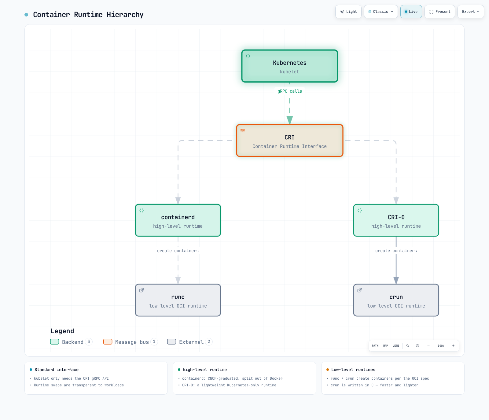
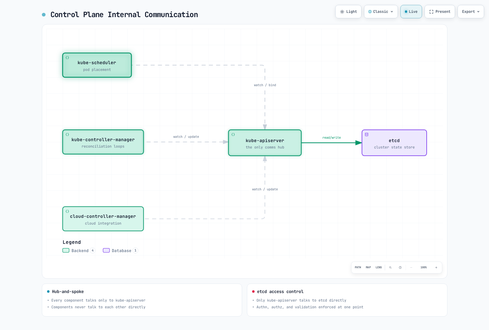
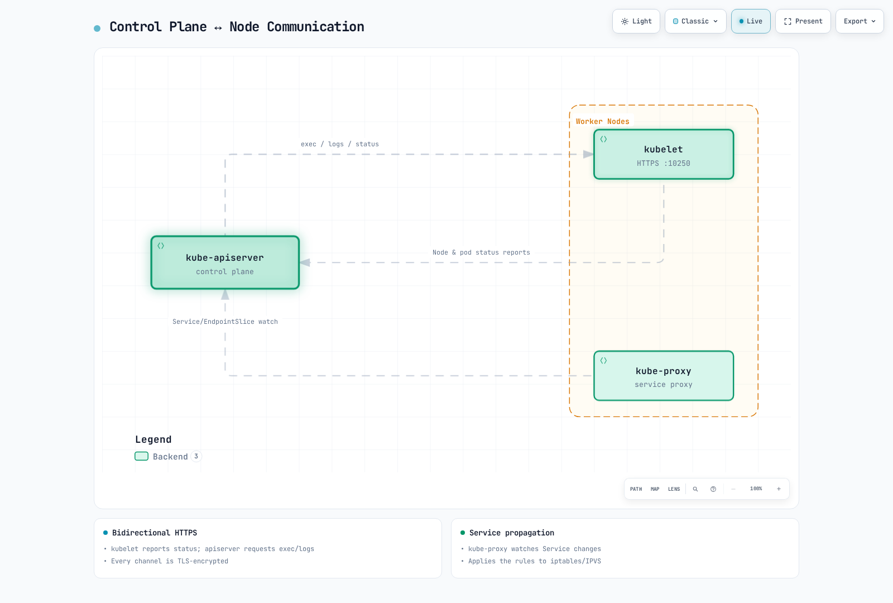
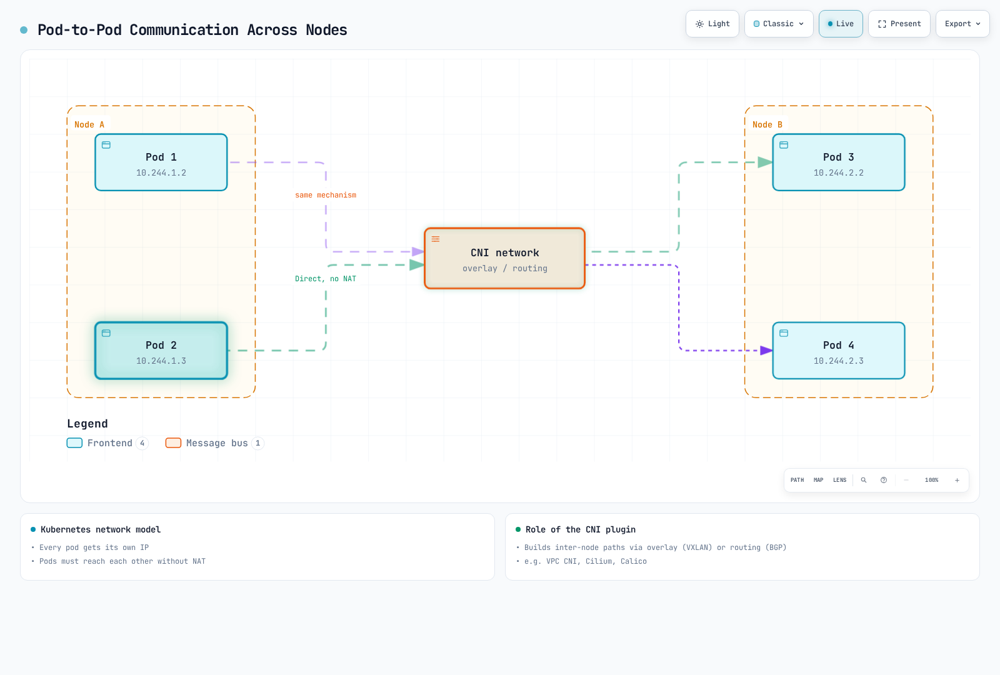
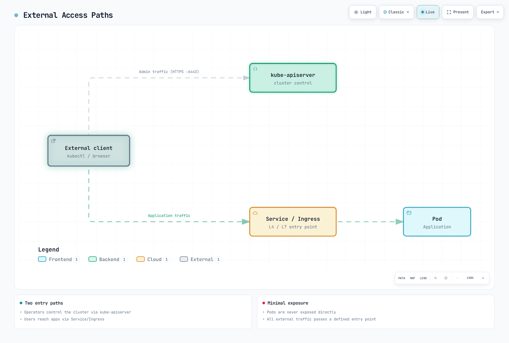
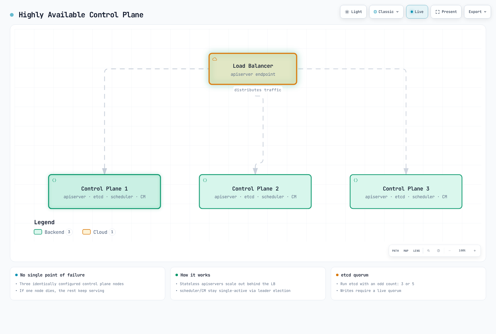
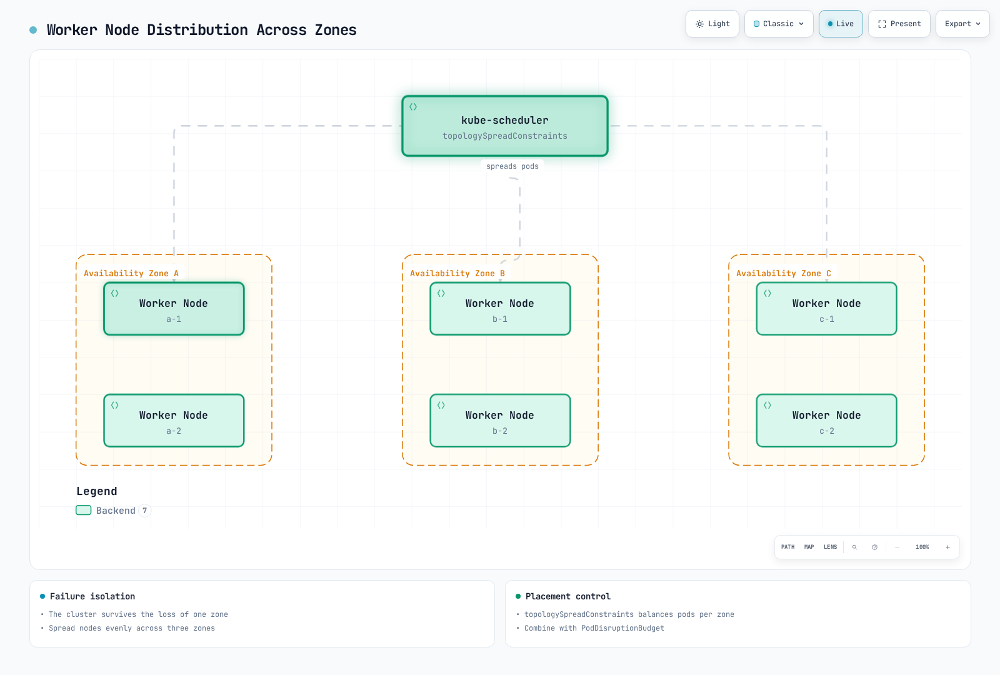
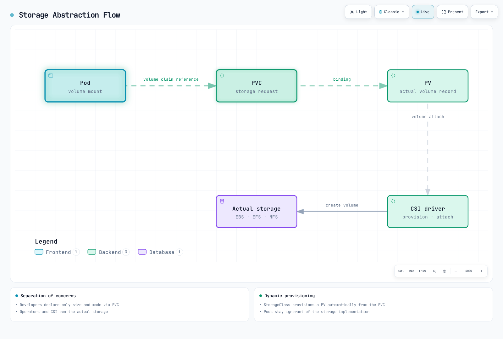
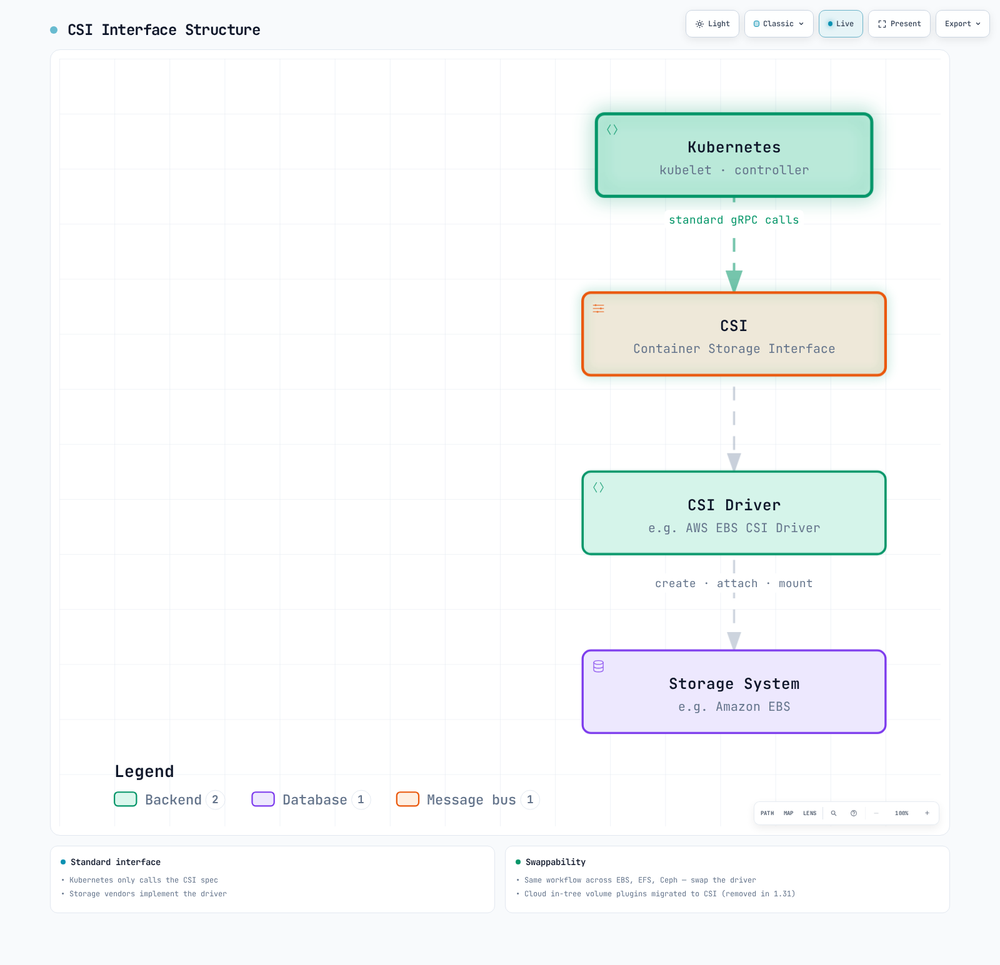
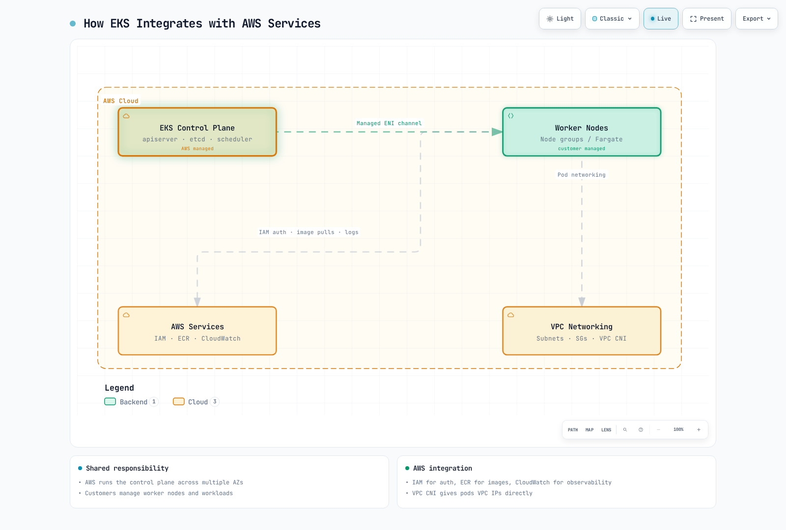

# Arquitectura del clúster

> **Versiones compatibles**: Kubernetes 1.35, 1.36, 1.37
> **Última actualización**: 16 de noviembre de 2026

El encabezado de versiones se refiere a Kubernetes upstream. El proyecto mantiene ramas de lanzamiento para las tres versiones menores más recientes (1.35–1.37). Kubernetes upstream 1.34 está en modo de mantenimiento y sigue recibiendo versiones de parche hasta el fin de su ciclo de vida, el **27 de octubre de 2026**, una fecha distinta de la fecha en que finaliza el soporte de AWS en EKS.

A fecha del 12 de octubre de 2026, el soporte estándar de EKS cubre las versiones 1.34–1.37; EKS 1.37 estuvo disponible a partir del 1 de octubre de 2026. Consulta el [estado de las versiones de Kubernetes](https://kubernetes.io/releases/) y el [ciclo de vida de EKS](https://docs.aws.amazon.com/eks/latest/userguide/kubernetes-versions.html) antes de elegir una versión.

Los comandos de los componentes que aparecen a continuación ilustran clústeres autogestionados; EKS administra su plano de control. Las etiquetas de imagen y los ID de infraestructura son ejemplos: selecciona imágenes compatibles y mantenidas, y sustituye los marcadores de posición antes de usarlos.

## Configuración del entorno de laboratorio

Para practicar los conceptos de este documento, necesitas las siguientes herramientas y entorno:

### Herramientas necesarias
- kubectl cuya versión menor esté a una versión menor de la del servidor de API
- Un clúster de Kubernetes funcional (EKS, minikube, kind, etc.)

### Configuración del entorno de desarrollo local

```bash
# Install minikube (for local development)
curl -LO https://storage.googleapis.com/minikube/releases/latest/minikube-linux-amd64
sudo install minikube-linux-amd64 /usr/local/bin/minikube

# Start cluster
minikube start

# Check cluster status
kubectl cluster-info

# Check control plane components
kubectl get pods -n kube-system
```

## Descripción general de la arquitectura del clúster

> **Concepto fundamental**: un clúster de Kubernetes consta del plano de control y los nodos de trabajo, cada uno compuesto por varios componentes que desempeñan funciones específicas.

Un clúster de Kubernetes consta de un conjunto de nodos (máquinas virtuales o físicas) para ejecutar aplicaciones en contenedores. En términos generales, el clúster se divide en el plano de control y los nodos de trabajo.

### Diagrama de la arquitectura del clúster


[🔍 Ver diagrama interactivo](https://www.atomai.click/kubernetes-docs/archmaps/en-core-01-cluster-architecture-0.html)

**Componentes del plano de control**:
- **kube-apiserver**: interfaz que expone la API de Kubernetes
- **etcd**: almacén de clave-valor que guarda el estado de la API de Kubernetes
- **kube-scheduler**: selecciona los nodos donde se ejecutarán los pods recién creados
- **kube-controller-manager**: ejecuta controladores que administran el estado del clúster
- **cloud-controller-manager**: interactúa con las API del proveedor de servicios en la nube

**Componentes del nodo de trabajo**:
- **kubelet**: agente que se ejecuta en cada nodo y administra la ejecución de contenedores
- **kube-proxy**: mantiene las reglas de red y reenvía conexiones
- **Entorno de ejecución de contenedores**: ejecuta contenedores (containerd, CRI-O, etc.)

## Componentes del plano de control

El plano de control es el «cerebro» del clúster de Kubernetes: administra y controla el estado general del clúster. Los componentes del plano de control suelen ejecutarse en máquinas dedicadas y pueden replicarse en varias instancias para ofrecer alta disponibilidad.

### Detalles de los componentes del plano de control

| Componente | Funciones principales | Destinos de comunicación | Configuración de alta disponibilidad |
|-----------|---------------|----------------------|--------------------------------|
| **kube-apiserver** | - Proporciona la API de Kubernetes<br>- Autenticación y autorización<br>- Procesamiento de solicitudes de API | - Todos los componentes<br>- etcd | Escalado horizontal con varias instancias |
| **etcd** | - Almacena datos del clúster<br>- Almacén distribuido de clave-valor<br>- Garantiza la coherencia | - kube-apiserver | Clúster multinodo |
| **kube-scheduler** | - Decisiones de ubicación de Pod<br>- Evalúa los recursos de los nodos<br>- Aplica afinidad/anti-afinidad | - kube-apiserver | Configuración activo-en espera |
| **kube-controller-manager** | - Controlador de nodos<br>- Controlador de replicación<br>- Controlador de Endpoint<br>- Controlador de cuentas de servicio | - kube-apiserver | Configuración activo-en espera |
| **cloud-controller-manager** | - Integración con el proveedor de servicios en la nube<br>- Ciclo de vida de los nodos<br>- Enrutamiento y balanceo de carga | - kube-apiserver<br>- API de la nube | Configuración activo-en espera |

### Flujo de comunicación del plano de control

1. El usuario o un controlador envía una solicitud a kube-apiserver
2. kube-apiserver realiza la autenticación, la autorización y la admisión
3. kube-apiserver lee o escribe datos en etcd
4. Los controladores y el scheduler observan el estado del clúster a través de kube-apiserver
5. kubelet informa del estado del nodo a kube-apiserver

### kube-apiserver

kube-apiserver es la interfaz del plano de control que expone la API de Kubernetes. Todas las solicitudes internas y externas se procesan a través de este servidor de API.

**Funciones principales**:
- Proporciona una API REST
- Autenticación y autorización
- Validación y procesamiento de solicitudes
- Comunicación con etcd
- Escalado horizontal (puede ampliarse a varias instancias)

**Principales opciones de configuración y marcas**:
```bash
# Basic configuration example
kube-apiserver \
  --advertise-address=192.168.1.10 \
  --allow-privileged=true \
  --authorization-mode=Node,RBAC \
  --client-ca-file=/etc/kubernetes/pki/ca.crt \
  --enable-admission-plugins=NodeRestriction \
  --enable-bootstrap-token-auth=true \
  --etcd-servers=https://127.0.0.1:2379 \
  --etcd-cafile=/etc/kubernetes/pki/etcd/ca.crt \
  --etcd-certfile=/etc/kubernetes/pki/apiserver-etcd-client.crt \
  --etcd-keyfile=/etc/kubernetes/pki/apiserver-etcd-client.key \
  --kubelet-client-certificate=/etc/kubernetes/pki/apiserver-kubelet-client.crt \
  --kubelet-client-key=/etc/kubernetes/pki/apiserver-kubelet-client.key \
  --service-account-key-file=/etc/kubernetes/pki/sa.pub \
  --service-account-signing-key-file=/etc/kubernetes/pki/sa.key \
  --service-account-issuer=https://kubernetes.default.svc.cluster.local \
  --service-cluster-ip-range=10.96.0.0/12 \
  --tls-cert-file=/etc/kubernetes/pki/apiserver.crt \
  --tls-private-key-file=/etc/kubernetes/pki/apiserver.key
```

**Seguridad del servidor de API**:
- Comunicación segura mediante certificados TLS
- Admite distintos métodos de autenticación (certificados X.509, tokens de cuentas de servicio, OIDC, webhooks, etc.)
- Administración de permisos mediante RBAC (control de acceso basado en roles)
- Validación y modificación de solicitudes mediante controladores de admisión

### etcd

etcd es un almacén de clave-valor coherente y de alta disponibilidad que guarda el estado de la API de Kubernetes. Actúa como la «fuente de verdad» de Kubernetes.

**Características principales**:
- Sistema distribuido
- Coherencia sólida (utiliza el algoritmo de consenso Raft)
- Alta disponibilidad (se puede configurar con varios nodos)
- Almacenamiento seguro de datos
- Función de observación para supervisar cambios

**Configuración de un clúster etcd**:
```bash
# etcd cluster configuration example (3 nodes)
etcd \
  --name etcd-1 \
  --initial-advertise-peer-urls https://192.168.1.11:2380 \
  --listen-peer-urls https://192.168.1.11:2380 \
  --listen-client-urls https://192.168.1.11:2379,https://127.0.0.1:2379 \
  --advertise-client-urls https://192.168.1.11:2379 \
  --initial-cluster-token etcd-cluster \
  --initial-cluster etcd-1=https://192.168.1.11:2380,etcd-2=https://192.168.1.12:2380,etcd-3=https://192.168.1.13:2380 \
  --initial-cluster-state new \
  --data-dir=/var/lib/etcd \
  --cert-file=/etc/kubernetes/pki/etcd/server.crt \
  --key-file=/etc/kubernetes/pki/etcd/server.key \
  --trusted-ca-file=/etc/kubernetes/pki/etcd/ca.crt \
  --client-cert-auth=true \
  --peer-cert-file=/etc/kubernetes/pki/etcd/peer.crt \
  --peer-key-file=/etc/kubernetes/pki/etcd/peer.key \
  --peer-trusted-ca-file=/etc/kubernetes/pki/etcd/ca.crt \
  --peer-client-cert-auth=true
```

**Copia de seguridad y recuperación de etcd**:
```bash
# etcd backup
ETCDCTL_API=3 etcdctl snapshot save snapshot.db \
  --endpoints=https://127.0.0.1:2379 \
  --cacert=/etc/kubernetes/pki/etcd/ca.crt \
  --cert=/etc/kubernetes/pki/etcd/server.crt \
  --key=/etc/kubernetes/pki/etcd/server.key

# etcd recovery
etcdutl snapshot restore snapshot.db \
  --bump-revision=1000000000 --mark-compacted \
  --data-dir=/var/lib/etcd-restore \
  --name=etcd-1 \
  --initial-cluster=etcd-1=https://192.168.1.11:2380 \
  --initial-cluster-token=etcd-cluster \
  --initial-advertise-peer-urls=https://192.168.1.11:2380
```

**Optimización del rendimiento de etcd**:
- Optimización de E/S de disco (se recomienda SSD)
- Asignación adecuada de memoria
- Compactación y desfragmentación periódicas
- Número adecuado de nodos etcd según el tamaño del clúster (normalmente 3 o 5)

#### Actualización de julio de 2026: lanzamiento de etcd v3.7.0

El 8 de julio de 2026, SIG etcd lanzó etcd v3.7.0. Novedades destacadas:

- **RangeStream**: transmite resultados de rangos grandes en fragmentos, en lugar de almacenar toda la respuesta en la memoria (una función muy solicitada)
- **Mejoras de rendimiento**: solicitudes de rango que solo devuelven claves optimizadas y concesiones más rápidas y fiables
- Elimina los últimos vestigios de v2store heredado y completa una importante revisión de protobuf
- Incluye versiones actualizadas de dependencias principales: bbolt v1.5.0 y raft v3.7.0

Consulta el [anuncio oficial](https://kubernetes.io/blog/2026/07/08/announcing-etcd-3.7/) y el [registro de cambios de etcd v3.7](https://github.com/etcd-io/etcd/blob/main/CHANGELOG/CHANGELOG-3.7.md) para obtener más información.

#### Actualización de noviembre de 2026: etcd de 24 GB en el plano de control aprovisionado de Amazon EKS

En los servicios administrados, la capacidad de etcd también depende del nivel del servicio. El 11 de noviembre de 2026, AWS anunció que los niveles 4XL y 8XL de Amazon EKS Provisioned Control Plane ahora ofrecen una **base de datos etcd de 24 GB**, frente a los 16 GB anteriores. Cuando la base de datos etcd se llena, ya no se pueden añadir ni cambiar objetos del clúster, por lo que este margen adicional beneficia a las cargas de trabajo que crean y actualizan muchos objetos, como el entrenamiento y la inferencia de IA/ML a gran escala, el procesamiento por lotes y las canalizaciones de CI/CD. La base de datos más grande se aplica al elegir el nivel 4XL u 8XL en EKS 1.34 o posterior; los clústeres existentes en esos niveles la reciben automáticamente, sin que se requiera ninguna acción, y está disponible en todas las regiones comerciales de AWS donde se ofrece Provisioned Control Plane. Consulta el [anuncio](https://aws.amazon.com/about-aws/whats-new/2026/11/amazon-eks-provisioned-control-plane-larger-etcd-database/) para obtener más información.

### kube-scheduler

kube-scheduler es el componente del plano de control que selecciona los nodos donde se ejecutarán los pods recién creados.

**Proceso de planificación**:
1. **Filtrado**: identifica los nodos que pueden ejecutar el pod
   - Requisitos de recursos (CPU, memoria)
   - Selectores de nodo, afinidad de nodo
   - Taints y tolerations
   - Restricciones de volúmenes

2. **Puntuación**: asigna puntuaciones a los nodos adecuados
   - Utilización de recursos
   - Interafinidad/anti-afinidad entre pods
   - Proximidad de los datos
   - Balanceo de carga entre nodos

3. **Vinculación**: asigna el pod al nodo óptimo

**Configuración de scheduler**:
```bash
# Basic configuration example
kube-scheduler \
  --kubeconfig=/etc/kubernetes/scheduler.conf \
  --leader-elect=true \
  --v=2
```

**Perfiles y plugins de scheduler**:
- Perfiles de scheduler predeterminados
- Perfiles de scheduler personalizados
- Puntos de extensión de scheduler (filter, score, bind, etc.)
- Compatibilidad con varios schedulers

**Política de planificación**:
```yaml
# Scheduling policy example
apiVersion: kubescheduler.config.k8s.io/v1
kind: KubeSchedulerConfiguration
profiles:
- schedulerName: default-scheduler
  pluginConfig:
  - name: NodeResourcesFit
    args:
      scoringStrategy:
        type: MostAllocated
        resources:
        - name: cpu
          weight: 1
        - name: memory
          weight: 1
```

### kube-controller-manager

kube-controller-manager es el componente del plano de control que ejecuta varios procesos de controlador. Cada controlador administra un aspecto concreto del clúster.

**Controladores principales**:
- **Controlador de nodos**: supervisa el estado de los nodos y responde a sus cambios
- **Controlador de replicación**: mantiene el número de réplicas de Pod
- **Controlador de EndpointSlice**: realiza un seguimiento de los backends de Service en los EndpointSlices
- **Controladores de cuentas de servicio y tokens**: crean ServiceAccounts predeterminadas y mantienen los Secrets de tokens heredados que se solicitan explícitamente; los Pods actuales utilizan tokens de TokenRequest de corta duración
- **Controlador de Job**: administra tareas puntuales
- **Controlador de CronJob**: administra tareas programadas
- **Controlador de DaemonSet**: garantiza que determinados pods se ejecuten en todos los nodos
- **Controlador de StatefulSet**: administra aplicaciones con estado
- **Controlador de PV**: administra volúmenes persistentes
- **Controlador de Namespace**: administra el ciclo de vida de los namespaces
- **Recolector de basura**: elimina objetos huérfanos

**Configuración de Controller Manager**:
```bash
# Basic configuration example
kube-controller-manager \
  --kubeconfig=/etc/kubernetes/controller-manager.conf \
  --leader-elect=true \
  --use-service-account-credentials=true \
  --root-ca-file=/etc/kubernetes/pki/ca.crt \
  --service-account-private-key-file=/etc/kubernetes/pki/sa.key \
  --cluster-signing-cert-file=/etc/kubernetes/pki/ca.crt \
  --cluster-signing-key-file=/etc/kubernetes/pki/ca.key \
  --controllers=*,bootstrapsigner,tokencleaner
```

**Funcionamiento de los controladores**:
1. Los controladores observan continuamente el estado del clúster a través del servidor de API
2. Detectan diferencias entre el estado actual y el deseado
3. Realizan operaciones para conciliar las diferencias
4. Informan al servidor de API sobre los cambios de estado

### cloud-controller-manager

cloud-controller-manager es el componente del plano de control que contiene la lógica de control específica de la nube. Esto permite separar el núcleo de Kubernetes de las API de los proveedores de servicios en la nube.

**Controladores principales**:
- **Controlador de nodos**: comprueba el estado de los nodos mediante la API del proveedor de servicios en la nube
- **Controlador de rutas**: configura rutas en entornos de nube
- **Controlador de Service**: crea, actualiza y elimina balanceadores de carga de la nube

El aprovisionamiento y la conexión del almacenamiento en la nube utilizan controladores CSI; kubelet y los plugins CSI de nodo se encargan de los montajes. Estas tareas no son responsabilidad de cloud-controller-manager.

**Implementaciones de proveedores de servicios en la nube**:
- AWS Cloud Controller Manager
- Azure Cloud Controller Manager
- GCP Cloud Controller Manager
- OpenStack Cloud Controller Manager
- vSphere Cloud Controller Manager

**Configuración de Cloud Controller Manager**:
```bash
# AWS Cloud Controller Manager example
cloud-controller-manager \
  --cloud-provider=aws \
  --cloud-config=/etc/kubernetes/cloud-config \
  --kubeconfig=/etc/kubernetes/cloud-controller-manager.conf \
  --leader-elect=true
```

**Ventajas de Cloud Controller Manager**:
- Separa el código específico del proveedor de servicios en la nube del núcleo de Kubernetes
- Los proveedores de servicios en la nube pueden desarrollar sus propias funciones de manera independiente
- Permite añadir funciones de nube sin cambiar el núcleo de Kubernetes

## Componentes del nodo

Los nodos son las máquinas de trabajo del clúster de Kubernetes que ejecutan aplicaciones en contenedores. Cada nodo está administrado por el plano de control y consta de varios componentes.

### kubelet

kubelet es un agente que se ejecuta en cada nodo y administra los contenedores dentro de los pods. kubelet recibe PodSpecs mediante varios mecanismos y garantiza que los contenedores se ejecuten correctamente de acuerdo con esas especificaciones.

**Funciones principales**:
- Ejecuta contenedores según PodSpec
- Supervisa e informa del estado de los contenedores
- Administra el ciclo de vida de los contenedores
- Administra los montajes de volúmenes
- Informa del estado del nodo
- Realiza comprobaciones de estado de los contenedores

**Configuración de kubelet**:
```bash
# Basic configuration example
kubelet \
  --kubeconfig=/etc/kubernetes/kubelet.conf \
  --config=/var/lib/kubelet/config.yaml \
  --container-runtime-endpoint=unix:///run/containerd/containerd.sock
```

**Ejemplo de archivo de configuración de kubelet**:
```yaml
# /var/lib/kubelet/config.yaml
apiVersion: kubelet.config.k8s.io/v1beta1
kind: KubeletConfiguration
address: 0.0.0.0
authentication:
  anonymous:
    enabled: false
  webhook:
    cacheTTL: 2m0s
    enabled: true
  x509:
    clientCAFile: /etc/kubernetes/pki/ca.crt
authorization:
  mode: Webhook
  webhook:
    cacheAuthorizedTTL: 5m0s
    cacheUnauthorizedTTL: 30s
cgroupDriver: systemd
clusterDomain: cluster.local
cpuManagerPolicy: none
evictionHard:
  memory.available: 100Mi
  nodefs.available: 10%
  nodefs.inodesFree: 5%
failSwapOn: true
healthzBindAddress: 127.0.0.1
healthzPort: 10248
```

**Pods estáticos**: el manifiesto que aparece a continuación es un fragmento, no una instalación completa del plano de control; también requiere redes del host, certificados, montajes y la configuración completa del servidor de API.
kubelet puede ejecutar pods estáticos que administra directamente, sin pasar por el servidor de API. Esto se usa principalmente para ejecutar componentes del plano de control.

```yaml
# /etc/kubernetes/manifests/kube-apiserver.yaml
apiVersion: v1
kind: Pod
metadata:
  name: kube-apiserver
  namespace: kube-system
spec:
  containers:
  - name: kube-apiserver
    image: registry.k8s.io/kube-apiserver:v1.37.1
    command:
    - kube-apiserver
    - --advertise-address=192.168.1.10
    # ... additional flags
```

### kube-proxy

kube-proxy es un proxy de red que se ejecuta en cada nodo e implementa el concepto de Service de Kubernetes. Mantiene reglas de red en los nodos y reenvía conexiones.

**Funciones principales**:
- Mantiene reglas de red para las IP y los puertos de Service
- Reenvía conexiones
- Implementa el balanceo de carga
- Admite el descubrimiento de servicios

**Modos de funcionamiento**:
1. **iptables**: modo predeterminado de Linux; instala reglas de procesamiento de paquetes en el kernel
2. **nftables**: estable desde v1.33; comprueba la compatibilidad del kernel y de CNI
3. **IPVS**: modo heredado de Linux, obsoleto desde v1.35; migra a una alternativa compatible
4. **kernelspace**: modo de Windows

El antiguo modo `userspace` se eliminó. Algunas implementaciones de red sustituyen por completo a kube-proxy.

**Configuración de kube-proxy**:
```bash
# Basic configuration example
kube-proxy \
  --config=/var/lib/kube-proxy/config.conf \
  --hostname-override=node1
```

**Ejemplo de archivo de configuración de kube-proxy**:
```yaml
# /var/lib/kube-proxy/config.conf
apiVersion: kubeproxy.config.k8s.io/v1alpha1
kind: KubeProxyConfiguration
bindAddress: 0.0.0.0
clientConnection:
  acceptContentTypes: ""
  burst: 10
  contentType: application/vnd.kubernetes.protobuf
  kubeconfig: /var/lib/kube-proxy/kubeconfig.conf
  qps: 5
clusterCIDR: 10.244.0.0/16
configSyncPeriod: 15m0s
conntrack:
  maxPerCore: 32768
  min: 131072
  tcpCloseWaitTimeout: 1h0m0s
  tcpEstablishedTimeout: 24h0m0s
enableProfiling: false
healthzBindAddress: 0.0.0.0:10256
hostnameOverride: node1
iptables:
  masqueradeAll: false
  masqueradeBit: 14
  minSyncPeriod: 0s
  syncPeriod: 30s
ipvs:
  excludeCIDRs: null
  minSyncPeriod: 0s
  scheduler: ""
  syncPeriod: 30s
mode: "iptables"
```

**Comparación de los modos IPVS e iptables**:

| Característica | Modo iptables | Modo IPVS |
|----------------|---------------|-----------|
| Rendimiento | El rendimiento disminuye cuando hay muchos servicios | Mejor rendimiento en clústeres grandes |
| Algoritmos de balanceo de carga | Selección aleatoria del backend de forma predeterminada | Se admiten varios algoritmos (rr, lc, dh, sh, sed, nq) |
| Implementación | Cadenas de filtrado de paquetes de red | Basada en tablas hash |
| Requisitos del kernel | Módulos predeterminados del kernel | Se requiere el módulo IPVS del kernel |

### Entorno de ejecución de contenedores

Un entorno de ejecución de contenedores es un software que ejecuta contenedores. Kubernetes admite varios entornos de ejecución de contenedores a través de Container Runtime Interface (CRI).

**Principales entornos de ejecución de contenedores**:
1. **containerd**: entorno de ejecución de contenedores ligero (actualmente, el más utilizado)
2. **CRI-O**: entorno de ejecución ligero diseñado específicamente para Kubernetes
3. **Docker Engine**: requiere un adaptador CRI externo, como cri-dockerd; dockershim, integrado, se eliminó en v1.24. Las imágenes OCI creadas con Docker siguen funcionando con containerd/CRI-O.

**Estructura de capas del entorno de ejecución de contenedores**:



[🔍 Ver diagrama interactivo](https://www.atomai.click/kubernetes-docs/archmaps/en-core-01-cluster-architecture-1.html)

**Ejemplo de configuración de containerd 1.x** (2.x utiliza distintos ID de plugin; genera los valores predeterminados para la versión instalada):
```toml
# /etc/containerd/config.toml
version = 2

[plugins]
  [plugins."io.containerd.grpc.v1.cri"]
    sandbox_image = "registry.k8s.io/pause:3.10"
    [plugins."io.containerd.grpc.v1.cri".containerd]
      default_runtime_name = "runc"
      [plugins."io.containerd.grpc.v1.cri".containerd.runtimes]
        [plugins."io.containerd.grpc.v1.cri".containerd.runtimes.runc]
          runtime_type = "io.containerd.runc.v2"
          [plugins."io.containerd.grpc.v1.cri".containerd.runtimes.runc.options]
            SystemdCgroup = true
```

**Ejemplo de configuración de CRI-O**:
```toml
# /etc/crio/crio.conf
[crio]
root = "/var/lib/containers/storage"
runroot = "/var/run/containers/storage"
storage_driver = "overlay"
storage_option = ["overlay.mountopt=nodev"]

[crio.runtime]
default_runtime = "runc"
conmon = "/usr/bin/conmon"
conmon_cgroup = "pod"
cgroup_manager = "systemd"

[crio.image]
pause_image = "registry.k8s.io/pause:3.10"
```

### Componentes complementarios

Los complementos son componentes adicionales que amplían la funcionalidad de los clústeres de Kubernetes. Entre los complementos importantes se incluyen:

1. **Plugins de red CNI**: implementan las redes de los pods
   - Calico, Cilium, Flannel, etc.

2. **DNS**: proporciona el servicio DNS dentro del clúster
   - CoreDNS (predeterminado)

3. **Panel**: proporciona una interfaz de usuario web
   - Headlamp (Kubernetes Dashboard está archivado)

4. **Ingress Controller**: administra el enrutamiento HTTP/HTTPS
   - Traefik, HAProxy, etc.

5. **Metrics Server**: recopila métricas de uso de recursos
   - Metrics Server

6. **Registro y supervisión**: recopilación de registros y supervisión
   - Prometheus, Grafana, Elasticsearch, Fluentd, Kibana, etc.

**Ejemplo de configuración de CoreDNS**:
```yaml
apiVersion: v1
kind: ConfigMap
metadata:
  name: coredns
  namespace: kube-system
data:
  Corefile: |
    .:53 {
        errors
        health {
            lameduck 5s
        }
        ready
        kubernetes cluster.local in-addr.arpa ip6.arpa {
            pods insecure
            fallthrough in-addr.arpa ip6.arpa
            ttl 30
        }
        prometheus :9153
        forward . /etc/resolv.conf {
            max_concurrent 1000
        }
        cache 30
        loop
        reload
        loadbalance
    }
```

**Ejemplo de configuración de Calico CNI**:
```yaml
apiVersion: v1
kind: ConfigMap
metadata:
  name: calico-config
  namespace: kube-system
data:
  calico_backend: "bird"
  cni_network_config: |-
    {
      "name": "k8s-pod-network",
      "cniVersion": "0.3.1",
      "plugins": [
        {
          "type": "calico",
          "log_level": "info",
          "datastore_type": "kubernetes",
          "nodename": "__KUBERNETES_NODE_NAME__",
          "mtu": __CNI_MTU__,
          "ipam": {
            "type": "calico-ipam"
          },
          "policy": {
            "type": "k8s"
          },
          "kubernetes": {
            "kubeconfig": "__KUBECONFIG_FILEPATH__"
          }
        },
        {
          "type": "portmap",
          "snat": true,
          "capabilities": {"portMappings": true}
        }
      ]
    }
```

## Rutas de comunicación del clúster

En un clúster de Kubernetes se produce comunicación entre distintos componentes. Comprender estas rutas de comunicación es importante para el diseño, la seguridad y la resolución de problemas del clúster.

### Comunicación interna del plano de control



[🔍 Ver diagrama interactivo](https://www.atomai.click/kubernetes-docs/archmaps/en-core-01-cluster-architecture-2.html)

La comunicación entre los componentes del plano de control es la siguiente:

1. **kube-apiserver y etcd**: kube-apiserver se comunica con etcd para almacenar y recuperar el estado del clúster.
   - Protocolo: gRPC
   - Puerto: 2379/TCP
   - Seguridad: autenticación basada en certificados TLS

2. **kube-scheduler y kube-apiserver**: kube-scheduler se comunica con kube-apiserver para planificar pods.
   - Protocolo: HTTPS
   - Puerto: 6443/TCP (kube-apiserver)
   - Seguridad: autenticación basada en certificados TLS

3. **kube-controller-manager y kube-apiserver**: los controladores se comunican con kube-apiserver para observar y modificar el estado del clúster.
   - Protocolo: HTTPS
   - Puerto: 6443/TCP (kube-apiserver)
   - Seguridad: autenticación basada en certificados TLS

4. **cloud-controller-manager y kube-apiserver**: el controlador de nube se comunica con kube-apiserver para observar el estado del clúster y administrar los recursos de la nube.
   - Protocolo: HTTPS
   - Puerto: 6443/TCP (kube-apiserver)
   - Seguridad: autenticación basada en certificados TLS

### Comunicación entre el plano de control y los nodos



[🔍 Ver diagrama interactivo](https://www.atomai.click/kubernetes-docs/archmaps/en-core-01-cluster-architecture-3.html)

La comunicación entre el plano de control y los nodos es la siguiente:

1. **kube-apiserver → kubelet**: el servidor de API llama a la API de kubelet para obtener registros, ejecutar comandos o adjuntarse a contenedores, y reenviar puertos.
   - Protocolo: HTTPS
   - Puerto: 10250/TCP (kubelet)
   - Seguridad: autenticación basada en certificados TLS

2. **kubelet y kube-apiserver**: kubelet se comunica con kube-apiserver para observar los PodSpecs asignados, registrar el nodo e informar del estado y los eventos del nodo y los Pod.
   - Protocolo: HTTPS
   - Puerto: 6443/TCP (kube-apiserver)
   - Seguridad: autenticación basada en certificados TLS

3. **kube-proxy y kube-apiserver**: kube-proxy se comunica con kube-apiserver para recuperar información de Service.
   - Protocolo: HTTPS
   - Puerto: 6443/TCP (kube-apiserver)
   - Seguridad: autenticación basada en certificados TLS

### Comunicación entre nodos



[🔍 Ver diagrama interactivo](https://www.atomai.click/kubernetes-docs/archmaps/en-core-01-cluster-architecture-4.html)

La comunicación entre nodos es la siguiente:

1. **Comunicación Pod a Pod**: los pods se comunican entre sí a través de la red proporcionada por los plugins CNI.
   - Protocolo: depende de la aplicación (TCP, UDP, etc.)
   - Puerto: depende de la aplicación
   - Seguridad: se puede controlar mediante políticas de red

2. **Comunicación entre pods de distintos nodos**: el plugin CNI gestiona la comunicación entre pods de nodos diferentes.
   - Protocolo: depende de la aplicación (TCP, UDP, etc.)
   - Puerto: depende de la aplicación
   - Seguridad: se puede controlar mediante políticas de red

### Comunicación externa



[🔍 Ver diagrama interactivo](https://www.atomai.click/kubernetes-docs/archmaps/en-core-01-cluster-architecture-5.html)

La comunicación con entidades externas es la siguiente:

1. **Cliente y kube-apiserver**: los usuarios y sistemas externos interactúan con el clúster a través de kube-apiserver.
   - Protocolo: HTTPS
   - Puerto: 6443/TCP (kube-apiserver)
   - Seguridad: certificados TLS, tokens, autenticación de usuarios, etc.

2. **Tráfico externo y Services**: el tráfico externo accede a las aplicaciones del clúster a través de Services de tipo NodePort o LoadBalancer, o mediante Ingress.
   - Protocolo: HTTP, HTTPS, TCP, UDP, etc.
   - Puerto: depende de la configuración de Service
   - Seguridad: depende de la configuración de Ingress Controller y Service

### Seguridad de las comunicaciones

La seguridad de las comunicaciones dentro de un clúster de Kubernetes se implementa mediante los siguientes métodos:

1. **Certificados TLS**: toda la comunicación entre los componentes del plano de control se cifra con certificados TLS.
2. **Autenticación y autorización**: todas las solicitudes al servidor de API pasan por procesos de autenticación y autorización.
3. **Políticas de red**: la comunicación Pod a Pod se puede restringir mediante políticas de red.
4. **Secrets cifrados**: los Secrets almacenados en etcd se pueden cifrar.

**Ejemplo de cifrado de datos de API en reposo** (configura el servidor de API con `--encryption-provider-config`; vuelve a escribir los Secrets existentes para cifrarlos):
```yaml
apiVersion: apiserver.config.k8s.io/v1
kind: EncryptionConfiguration
resources:
  - resources:
    - secrets
    providers:
    - aescbc:
        keys:
        - name: key1
          secret: <base64-encoded-key>
    - identity: {}
```

### Configuración de clúster de alta disponibilidad

Los clústeres de Kubernetes de alta disponibilidad (HA) están diseñados para eliminar puntos únicos de fallo y continuar funcionando sin interrupciones del servicio.

### Alta disponibilidad del plano de control

La alta disponibilidad del plano de control se implementa mediante los siguientes métodos:

1. **Varios nodos de plano de control**: normalmente se implementan 3 o 5 nodos de plano de control para disponer de redundancia
2. **Clúster etcd**: se implementa un clúster compuesto por varias instancias de etcd (normalmente 3 o 5)
3. **Balanceador de carga**: se coloca un balanceador de carga delante de los servidores de API para distribuir el tráfico

**Arquitectura de alta disponibilidad del plano de control**:



[🔍 Ver diagrama interactivo](https://www.atomai.click/kubernetes-docs/archmaps/en-core-01-cluster-architecture-6.html)

**Configuración de un clúster etcd**:


[🔍 Ver diagrama interactivo](https://www.atomai.click/kubernetes-docs/archmaps/en-core-01-cluster-architecture-7.html)

### Alta disponibilidad de los nodos de trabajo

La alta disponibilidad de los nodos de trabajo se implementa mediante los siguientes métodos:

1. **Varios nodos de trabajo**: distribuir las cargas de trabajo entre varios nodos de trabajo
2. **Recuperación automática de nodos**: utilizar las funciones de recuperación automática del proveedor de servicios en la nube
3. **Escalado automático**: escalar automáticamente los nodos mediante Cluster Autoscaler
4. **Varias zonas de disponibilidad**: implementar nodos en varias zonas de disponibilidad

**Implementación distribuida de nodos de trabajo**:



[🔍 Ver diagrama interactivo](https://www.atomai.click/kubernetes-docs/archmaps/en-core-01-cluster-architecture-8.html)

### Alta disponibilidad de las aplicaciones

La alta disponibilidad de las aplicaciones se implementa mediante los siguientes métodos:

1. **ReplicaSet/Deployment**: ejecutar varias réplicas de Pod
2. **Reglas de distribución de pods**: distribuir los pods entre varios nodos mediante anti-afinidad de Pod
3. **PodDisruptionBudget**: garantizar una disponibilidad mínima durante las interrupciones planificadas
4. **Service y balanceo de carga**: distribuir el tráfico entre varios pods

**Ejemplo de anti-afinidad de Pod**:
```yaml
apiVersion: apps/v1
kind: Deployment
metadata:
  name: web-server
spec:
  replicas: 3
  selector:
    matchLabels:
      app: web-server
  template:
    metadata:
      labels:
        app: web-server
    spec:
      affinity:
        podAntiAffinity:
          requiredDuringSchedulingIgnoredDuringExecution:
          - labelSelector:
              matchExpressions:
              - key: app
                operator: In
                values:
                - web-server
            topologyKey: "kubernetes.io/hostname"
      containers:
      - name: web-server
        image: nginx:1.30.6
```

**Ejemplo de PodDisruptionBudget**:
```yaml
apiVersion: policy/v1
kind: PodDisruptionBudget
metadata:
  name: web-server-pdb
spec:
  minAvailable: 2
  selector:
    matchLabels:
      app: web-server
```

### Estrategia de recuperación ante desastres

Las estrategias de recuperación ante desastres para clústeres de Kubernetes se implementan mediante los siguientes métodos:

1. **Copia de seguridad y recuperación de etcd**: establecer procedimientos periódicos para crear copias de seguridad de los datos de etcd y recuperarlos
2. **Implementación multirregional**: implementar clústeres en varias regiones
3. **Federación de clústeres**: administrar varios clústeres mediante una federación
4. **Copia de seguridad continua**: realizar copias de seguridad continuas de los datos de las aplicaciones

**Ejemplo de script de copia de seguridad de etcd**:
```bash
#!/bin/bash
ETCDCTL_API=3 etcdctl snapshot save /backup/etcd-snapshot-$(date +%Y%m%d-%H%M%S).db \
  --endpoints=https://127.0.0.1:2379 \
  --cacert=/etc/kubernetes/pki/etcd/ca.crt \
  --cert=/etc/kubernetes/pki/etcd/server.crt \
  --key=/etc/kubernetes/pki/etcd/server.key
```

**Procedimiento de recuperación de etcd (clústeres autogestionados)**:

1. Valida la instantánea con `etcdutl snapshot status`. Restáurala en un directorio de datos nuevo con una versión compatible de `etcdutl`, como se muestra arriba.
2. Antes de cambiar los directorios de datos, detén todas las instancias del servidor de API y los procesos etcd afectados siguiendo el runbook del clúster. Detener solo kubelet no detiene los contenedores de Pods estáticos que ya están en ejecución.
3. Para recuperar varios miembros, restaura la misma instantánea en cada miembro con un nombre y una URL de par únicos, y la misma pertenencia completa de `--initial-cluster`. El ejemplo de un solo miembro que aparece arriba no sirve como procedimiento de recuperación de alta disponibilidad.
4. Usa `--bump-revision` y `--mark-compacted` para las cachés de observación de Kubernetes; elige un incremento que supere las revisiones posteriores a la instantánea (el valor mostrado es un ejemplo).
5. Actualiza el hostPath del Pod estático de etcd para que apunte al directorio restaurado, reinicia etcd, verifica el cuórum y el estado, y luego reinicia los servidores de API y los controladores. Conserva los datos originales y la copia de seguridad hasta que finalice la verificación.

Sigue la [guía de recuperación de etcd](https://etcd.io/docs/v3.6/op-guide/recovery/). Los usuarios de EKS no operan ni restauran directamente etcd del plano de control administrado.

## Redes del clúster

Las redes de Kubernetes permiten la comunicación entre pods, Services y el mundo exterior. El modelo de redes de Kubernetes presupone que cada pod tiene una dirección IP única y puede comunicarse con todos los demás pods sin NAT.

### Modelo de redes

El modelo de redes de Kubernetes tiene los siguientes requisitos:

1. **Comunicación Pod a Pod**: todos los pods deben poder comunicarse entre sí sin NAT
2. **Comunicación de nodo a Pod**: los agentes de nodo deben poder comunicarse con los Pods de ese nodo
3. **Comunicación de Pod con el exterior**: la conectividad externa depende del enrutamiento, del uso de NAT cuando sea necesario y de las políticas de seguridad y salida; no se exige que todos los Pod puedan acceder a Internet

### CNI (Container Network Interface)

CNI es una interfaz estándar para implementar redes en Kubernetes. Hay varios plugins CNI, cada uno con características y características de rendimiento distintas.

**Principales plugins CNI**:

1. **Calico**: redes basadas en BGP, compatibilidad con políticas de red
   - Características: alto rendimiento, políticas de red, cifrado y compatibilidad con eBPF
   - Casos de uso: clústeres grandes y entornos centrados en la seguridad

2. **Cilium**: redes y seguridad basadas en eBPF
   - Características: políticas de seguridad L3-L7, alto rendimiento y observabilidad
   - Casos de uso: microservicios y entornos centrados en la seguridad

3. **Flannel**: red superpuesta sencilla
   - Características: configuración sencilla y poco peso
   - Casos de uso: clústeres pequeños y entornos de desarrollo

4. **Weave Net (histórico)**: el proyecto se archivó en junio de 2024; evalúa alternativas mantenidas para nuevas implementaciones.

**Ejemplo de configuración de CNI (Calico)**:
```yaml
apiVersion: v1
kind: ConfigMap
metadata:
  name: calico-config
  namespace: kube-system
data:
  calico_backend: "bird"
  cni_network_config: |-
    {
      "name": "k8s-pod-network",
      "cniVersion": "0.3.1",
      "plugins": [
        {
          "type": "calico",
          "log_level": "info",
          "datastore_type": "kubernetes",
          "nodename": "__KUBERNETES_NODE_NAME__",
          "mtu": __CNI_MTU__,
          "ipam": {
            "type": "calico-ipam"
          },
          "policy": {
            "type": "k8s"
          },
          "kubernetes": {
            "kubeconfig": "__KUBECONFIG_FILEPATH__"
          }
        },
        {
          "type": "portmap",
          "snat": true,
          "capabilities": {"portMappings": true}
        }
      ]
    }
```

### Redes de Service

Los Services de Kubernetes proporcionan endpoints estables para un conjunto de pods. Hay varios tipos de Service, como ClusterIP, NodePort, LoadBalancer y ExternalName.

**Componentes de las redes de Service**:

1. **ClusterIP**: IP virtual accesible únicamente dentro del clúster
2. **kube-proxy**: enruta el tráfico dirigido a las IP de Service hacia los pods
3. **CoreDNS**: servicio DNS para el descubrimiento de servicios

**Flujo de las redes de Service**:
```
Client -> kernel rules programmed by kube-proxy (ClusterIP DNAT) -> Pod
```

**Ejemplo de Service**:
```yaml
apiVersion: v1
kind: Service
metadata:
  name: my-service
spec:
  selector:
    app: my-app
  ports:
  - port: 80
    targetPort: 8080
  type: ClusterIP
```

### Redes de Ingress

Ingress administra el enrutamiento HTTP y HTTPS desde fuera del clúster hasta los Services que están dentro de él. Los Ingress controllers implementan los recursos Ingress.

**Principales Ingress controllers**:
1. **Ingress/Gateway controllers mantenidos**: comprueba el ciclo de vida del controlador y la compatibilidad con Gateway API
2. **AWS Load Balancer Controller**: aprovisiona ALB para Ingress
3. **Traefik**: enrutador perimetral nativo de la nube
4. **HAProxy Ingress**: controlador de Ingress basado en HAProxy

**Flujo de las redes de Ingress**:
```
Client -> Ingress Controller -> Service -> Pod
```

La comunidad retiró ingress-nginx en marzo de 2026; consulta el [aviso de retirada](https://kubernetes.io/blog/2025/11/11/ingress-nginx-retirement/). Este ejemplo requiere que haya un controlador Traefik instalado con una IngressClass llamada `traefik`; `/app` se reenvía sin cambios.

**Ejemplo de Ingress**:
```yaml
apiVersion: networking.k8s.io/v1
kind: Ingress
metadata:
  name: my-ingress
spec:
  ingressClassName: traefik
  rules:
  - host: example.com
    http:
      paths:
      - path: /app
        pathType: Prefix
        backend:
          service:
            name: my-service
            port:
              number: 80
```

### Políticas de red

Las políticas de red permiten controlar la comunicación entre pods. De forma predeterminada, todos los pods pueden comunicarse entre sí, pero las políticas de red pueden restringir esa comunicación.

**Ejemplo de política de red**:
```yaml
apiVersion: networking.k8s.io/v1
kind: NetworkPolicy
metadata:
  name: db-network-policy
spec:
  podSelector:
    matchLabels:
      role: db
  policyTypes:
  - Ingress
  - Egress
  ingress:
  - from:
    - podSelector:
        matchLabels:
          role: frontend
    ports:
    - protocol: TCP
      port: 3306
  egress:
  - to:
    - podSelector:
        matchLabels:
          role: monitoring
    ports:
    - protocol: TCP
      port: 9090
```

### Resolución de problemas de red

Herramientas y comandos habituales para solucionar problemas de red en Kubernetes:

1. **ping, traceroute**: pruebas básicas de conectividad de red
2. **tcpdump**: captura y análisis de paquetes de red
3. **netstat, ss**: comprobar el estado de las conexiones de red
4. **nslookup, dig**: pruebas de consultas DNS
5. **kubectl exec**: ejecutar comandos de red dentro de los pods

**Ejemplo de depuración de red**:
```bash
# Test network connectivity within a pod
kubectl exec -it <pod-name> -- ping <target-ip>

# Test DNS lookup within a pod
kubectl exec -it <pod-name> -- nslookup <service-name>

# Capture network packets within a pod
kubectl exec -it <pod-name> -- tcpdump -i eth0 -n

# Check service endpoints
kubectl get endpointslices -l kubernetes.io/service-name=<service-name>
```

## Almacenamiento del clúster

El almacenamiento de Kubernetes proporciona persistencia de datos para las aplicaciones en contenedores. Kubernetes ofrece varias opciones y abstracciones de almacenamiento para ayudar a las aplicaciones a utilizar el almacenamiento de forma eficiente.

### Arquitectura de almacenamiento

La arquitectura de almacenamiento de Kubernetes consta de los siguientes componentes:

1. **Volumes**: directorios que se pueden montar en contenedores dentro de los pods
2. **Persistent Volumes (PV)**: recursos de almacenamiento del clúster
3. **Persistent Volume Claims (PVC)**: solicitudes de almacenamiento de los usuarios
4. **Storage Classes**: definen «clases» o tipos de almacenamiento
5. **CSI (Container Storage Interface)**: interfaz estándar para sistemas de almacenamiento

**Flujo de la arquitectura de almacenamiento**:



[🔍 Ver diagrama interactivo](https://www.atomai.click/kubernetes-docs/archmaps/en-core-01-cluster-architecture-9.html)

### Tipos de volumen

Kubernetes admite varios tipos de volumen:

1. **Volúmenes efímeros**:
   - **emptyDir**: comienza como un directorio vacío y se elimina cuando se elimina el pod
   - **configMap**: monta ConfigMap como volumen
   - **secret**: monta Secret como volumen
   - **downwardAPI**: expone como archivos información sobre el pod y el contenedor

2. **Volúmenes persistentes**:
   - **Almacenamiento en bloques de la nube mediante CSI**: AWS EBS, Azure Disk y GCE Persistent Disk; sus implementaciones heredadas integradas en el árbol de código se han eliminado
   - **nfs**: volúmenes NFS
   - **csi**: volúmenes a través de controladores CSI

**Ejemplo de volumen**:
```yaml
apiVersion: v1
kind: Pod
metadata:
  name: test-pd
spec:
  containers:
  - name: test-container
    image: nginx
    volumeMounts:
    - mountPath: /test-pd
      name: test-volume
  volumes:
  - name: test-volume
    persistentVolumeClaim:
      claimName: test-pvc
```

### Persistent Volumes y Claims

Los Persistent Volumes (PV) son recursos de almacenamiento del clúster que aprovisionan los administradores o que se aprovisionan dinámicamente mediante Storage Classes. Los Persistent Volume Claims (PVC) son solicitudes de almacenamiento de los usuarios.

Primero, instala el controlador EBS CSI con los permisos de IAM necesarios. Para el PV estático que aparece a continuación, sustituye el ID del volumen y la zona por los de un volumen EBS existente y su zona real. EBS no se puede montar en Fargate; EKS Auto Mode utiliza `ebs.csi.eks.amazonaws.com` en su lugar.

**Ejemplo de Persistent Volume**:
```yaml
apiVersion: v1
kind: PersistentVolume
metadata:
  name: pv-example
spec:
  capacity:
    storage: 10Gi
  accessModes:
    - ReadWriteOnce
  persistentVolumeReclaimPolicy: Retain
  storageClassName: standard
  csi:
    driver: ebs.csi.aws.com
    volumeHandle: vol-0123456789abcdef0
    fsType: ext4
  nodeAffinity:
    required:
      nodeSelectorTerms:
      - matchExpressions:
        - key: topology.kubernetes.io/zone
          operator: In
          values: [ap-northeast-2a]
```

**Ejemplo de Persistent Volume Claim**:
```yaml
apiVersion: v1
kind: PersistentVolumeClaim
metadata:
  name: pvc-example
spec:
  accessModes:
    - ReadWriteOnce
  resources:
    requests:
      storage: 5Gi
  storageClassName: standard
```

### Storage Classes

Las Storage Classes describen las «clases» de almacenamiento que ofrecen los administradores. Permiten el aprovisionamiento dinámico de PV cuando se solicitan PVC.

**Ejemplo de Storage Class**:
```yaml
apiVersion: storage.k8s.io/v1
kind: StorageClass
metadata:
  name: standard
provisioner: ebs.csi.aws.com
parameters:
  type: gp3
  csi.storage.k8s.io/fstype: ext4
  encrypted: "true"
reclaimPolicy: Delete
allowVolumeExpansion: true
volumeBindingMode: WaitForFirstConsumer
```

### CSI (Container Storage Interface)

CSI proporciona una interfaz estándar entre Kubernetes y los sistemas de almacenamiento. Mediante CSI, los proveedores de almacenamiento pueden desarrollar sus propios controladores de almacenamiento sin modificar el código de Kubernetes.

**Arquitectura de CSI**:



[🔍 Ver diagrama interactivo](https://www.atomai.click/kubernetes-docs/archmaps/en-core-01-cluster-architecture-10.html)

**Ejemplo de implementación de un controlador CSI**:
```yaml
apiVersion: storage.k8s.io/v1
kind: StorageClass
metadata:
  name: ebs-sc
provisioner: ebs.csi.aws.com
parameters:
  type: gp3
  csi.storage.k8s.io/fstype: ext4
  encrypted: "true"
volumeBindingMode: WaitForFirstConsumer
```

### Prácticas recomendadas de almacenamiento

Prácticas recomendadas para utilizar el almacenamiento de Kubernetes:

1. **Elegir el tipo de almacenamiento adecuado**: selecciona un tipo de almacenamiento que se ajuste a las características de la carga de trabajo
2. **Usar el aprovisionamiento dinámico**: utiliza el aprovisionamiento dinámico mediante Storage Classes
3. **Elegir los modos de acceso adecuados**: selecciona modos de acceso que se ajusten a los requisitos de la carga de trabajo
4. **Establecer solicitudes y límites de recursos**: solicita una capacidad de almacenamiento adecuada
5. **Establecer una estrategia de copia de seguridad y recuperación**: prepara estrategias de copia de seguridad y recuperación para los datos críticos
6. **Supervisar el almacenamiento**: supervisa el uso y el rendimiento del almacenamiento

## Escalabilidad del clúster

La escalabilidad de un clúster de Kubernetes se refiere a su capacidad para gestionar cargas y requisitos crecientes. La escalabilidad se puede implementar mediante el escalado horizontal (ampliación) y el escalado vertical (aumento de capacidad).

### Límites de tamaño del clúster

Las [directrices de Kubernetes upstream para clústeres grandes](https://kubernetes.io/docs/setup/best-practices/cluster-large/) describen un límite de compatibilidad probado: 5000 nodos, 150 000 Pods en total, 300 000 contenedores en total y 110 Pods por nodo. Estos criterios se aplican conjuntamente; no son límites universales e inamovibles de la API. No existe un límite general de 20 contenedores por Pod. La capacidad de Service también depende del rango de direcciones y del plano de datos. Los límites y las cuotas de redes de la nube pueden ser más bajos.

### Escalado horizontal

El escalado horizontal aumenta la capacidad del clúster al añadir más nodos.

**Escalado automático de nodos**:
Kubernetes Cluster Autoscaler ajusta automáticamente el número de nodos en función de los requisitos de la carga de trabajo.

```yaml
# AWS Auto Scaling Group tags example
tags:
  k8s.io/cluster-autoscaler/enabled: "true"
  k8s.io/cluster-autoscaler/my-cluster: "owned"
```

**Fragmento de implementación de Cluster Autoscaler (ejemplo de clúster v1.36)**: selecciona una versión corregida que coincida con la versión menor del clúster. Proporciona la ServiceAccount, RBAC de Kubernetes y un rol de IAM dedicado; este fragmento no es una instalación completa.
```yaml
apiVersion: apps/v1
kind: Deployment
metadata:
  name: cluster-autoscaler
  namespace: kube-system
spec:
  replicas: 1
  selector:
    matchLabels:
      app: cluster-autoscaler
  template:
    metadata:
      labels:
        app: cluster-autoscaler
    spec:
      containers:
      - name: cluster-autoscaler
        image: registry.k8s.io/autoscaling/cluster-autoscaler:v1.36.1
        command:
        - ./cluster-autoscaler
        - --cloud-provider=aws
        - --nodes=2:10:my-asg-group
        - --scale-down-unneeded-time=10m
```

**Karpenter**:
Karpenter es una nueva herramienta de escalado automático de nodos desarrollada por AWS que permite aprovisionar nodos de forma más rápida y eficiente.

```yaml
apiVersion: karpenter.sh/v1
kind: NodePool
metadata:
  name: default
spec:
  template:
    spec:
      requirements:
        - key: karpenter.sh/capacity-type
          operator: In
          values: ["spot", "on-demand"]
      nodeClassRef:
        group: karpenter.k8s.aws
        kind: EC2NodeClass
        name: default-class
  limits:
    cpu: 1000
    memory: 1000Gi
---
apiVersion: karpenter.k8s.aws/v1
kind: EC2NodeClass
metadata:
  name: default-class
spec:
  role: KarpenterNodeRole-my-cluster
  amiSelectorTerms:
    - alias: al2023@latest
  subnetSelectorTerms:
    - tags:
        karpenter.sh/discovery: my-cluster
  securityGroupSelectorTerms:
    - tags:
        karpenter.sh/discovery: my-cluster
```

### Escalado vertical

El escalado vertical de las cargas de trabajo ajusta las solicitudes de CPU y memoria de los Pod. VPA no cambia el tamaño del nodo subyacente; la capacidad adicional del nodo debe aprovisionarse por separado.

**Vertical Pod Autoscaler (VPA)**:
VPA ajusta automáticamente las solicitudes de CPU y memoria de los pods.

```yaml
apiVersion: autoscaling.k8s.io/v1
kind: VerticalPodAutoscaler
metadata:
  name: my-app-vpa
spec:
  targetRef:
    apiVersion: "apps/v1"
    kind: Deployment
    name: my-app
  updatePolicy:
    updateMode: "Recreate"
  resourcePolicy:
    containerPolicies:
    - containerName: '*'
      minAllowed:
        cpu: 100m
        memory: 50Mi
      maxAllowed:
        cpu: 1
        memory: 500Mi
```

### Escalado de aplicaciones

El escalado en el nivel de aplicación se implementa ajustando el número de réplicas de Pod.

**Horizontal Pod Autoscaler (HPA)**:
HPA ajusta automáticamente el número de réplicas de Pod en función de la utilización de CPU o de métricas personalizadas.

```yaml
apiVersion: autoscaling/v2
kind: HorizontalPodAutoscaler
metadata:
  name: my-app-hpa
spec:
  scaleTargetRef:
    apiVersion: apps/v1
    kind: Deployment
    name: my-app
  minReplicas: 2
  maxReplicas: 10
  metrics:
  - type: Resource
    resource:
      name: cpu
      target:
        type: Utilization
        averageUtilization: 80
```

**KEDA (Kubernetes Event-driven Autoscaling)**:
KEDA proporciona escalado automático basado en eventos, lo que permite escalar en función de varios orígenes de eventos.

```yaml
apiVersion: keda.sh/v1alpha1
kind: ScaledObject
metadata:
  name: my-app-scaledobject
spec:
  scaleTargetRef:
    name: my-app
  minReplicaCount: 0
  maxReplicaCount: 10
  triggers:
  - type: kafka
    metadata:
      bootstrapServers: kafka.svc:9092
      consumerGroup: my-group
      topic: my-topic
      lagThreshold: "10"
```

### Prácticas recomendadas de escalabilidad

Prácticas recomendadas para la escalabilidad de clústeres de Kubernetes:

1. **Establecer solicitudes y límites de recursos**: configura solicitudes y límites de recursos adecuados para todos los pods
2. **Estrategia de grupos de nodos**: configura varios grupos de nodos para distintas características de las cargas de trabajo
3. **Configurar el escalado automático**: configura correctamente Cluster Autoscaler, HPA y VPA
4. **Ubicación eficiente de los pods**: utiliza afinidad de nodo y afinidad/anti-afinidad de Pod
5. **Supervisión del clúster**: supervisa continuamente el uso de recursos y el rendimiento
6. **Pruebas de carga**: realiza pruebas de carga con regularidad para validar las estrategias de escalado

## Seguridad del clúster

La seguridad de un clúster de Kubernetes debe implementarse en varias capas. Esto incluye autenticación, autorización, políticas de red, seguridad de los pods y más.

### Autenticación

Métodos para autenticar el acceso al servidor de API de Kubernetes:

1. **Certificados X.509**: autenticación mediante certificados de cliente TLS
2. **Tokens de cuentas de servicio**: tokens para acceder al servidor de API desde los pods
3. **OpenID Connect (OIDC)**: autenticación mediante proveedores de identidad externos
4. **Autenticación de tokens mediante webhook**: autenticación a través de servicios de autenticación externos
5. **Proxy de autenticación**: autenticación a través de proxies de autenticación

**Ejemplo de kubeconfig**:
```yaml
apiVersion: v1
kind: Config
clusters:
- name: my-cluster
  cluster:
    certificate-authority-data: <CA-DATA>
    server: https://api.my-cluster.example.com
users:
- name: admin
  user:
    client-certificate-data: <CERT-DATA>
    client-key-data: <KEY-DATA>
contexts:
- name: my-context
  context:
    cluster: my-cluster
    user: admin
current-context: my-context
```

### Autorización

Métodos para controlar las acciones de los usuarios autenticados:

1. **RBAC (Role-Based Access Control)**: control de acceso basado en roles
2. **ABAC (Attribute-Based Access Control)**: control de acceso basado en atributos
3. **Autorización de nodos**: autorización especial para los nodos
4. **Autorización mediante webhook**: autorización a través de servicios externos

**Ejemplo de RBAC**:
```yaml
# Role definition
apiVersion: rbac.authorization.k8s.io/v1
kind: Role
metadata:
  namespace: default
  name: pod-reader
rules:
- apiGroups: [""]
  resources: ["pods"]
  verbs: ["get", "watch", "list"]
---
# Role binding
apiVersion: rbac.authorization.k8s.io/v1
kind: RoleBinding
metadata:
  name: read-pods
  namespace: default
subjects:
- kind: User
  name: jane
  apiGroup: rbac.authorization.k8s.io
roleRef:
  kind: Role
  name: pod-reader
  apiGroup: rbac.authorization.k8s.io
```

### Seguridad de red

Métodos para proteger el tráfico de red dentro del clúster:

1. **Políticas de red**: controlar la comunicación Pod a Pod
2. **Comunicación cifrada**: cifrar las comunicaciones mediante TLS
3. **Malla de servicios**: mejorar la seguridad de red mediante Istio, Linkerd, etc.

**Ejemplo de política de red**:
```yaml
apiVersion: networking.k8s.io/v1
kind: NetworkPolicy
metadata:
  name: default-deny-all
spec:
  podSelector: {}
  policyTypes:
  - Ingress
  - Egress
```

### Seguridad de los pods

Implementación de seguridad en el nivel del Pod:

1. **Contexto de seguridad del Pod**: ajustes de seguridad en el nivel del Pod y del contenedor
2. **Estándares de seguridad de los pods**: definen los requisitos de seguridad de los pods
3. **Perfiles de seccomp**: restricciones de llamadas al sistema
4. **AppArmor/SELinux**: control de acceso obligatorio

**Ejemplo de contexto de seguridad del Pod**:
```yaml
apiVersion: v1
kind: Pod
metadata:
  name: security-context-pod
spec:
  securityContext:
    runAsUser: 1000
    runAsGroup: 3000
    fsGroup: 2000
  containers:
  - name: app
    image: myapp:1.0
    securityContext:
      allowPrivilegeEscalation: false
      capabilities:
        drop:
        - ALL
```

### Administración de Secrets

Métodos para administrar información confidencial de forma segura:

1. **Secrets de Kubernetes**: utilizar los recursos básicos de Secret
2. **etcd cifrado**: cifrar los Secrets almacenados en etcd
3. **Administración externa de Secrets**: utilizar HashiCorp Vault, AWS Secrets Manager, etc.

**Ejemplo de configuración de etcd cifrado**:
```yaml
apiVersion: apiserver.config.k8s.io/v1
kind: EncryptionConfiguration
resources:
  - resources:
    - secrets
    providers:
    - aescbc:
        keys:
        - name: key1
          secret: <base64-encoded-key>
    - identity: {}
```

### Prácticas recomendadas de seguridad

Prácticas recomendadas para la seguridad de los clústeres de Kubernetes:

1. **Principio de privilegios mínimos**: concede solo los privilegios mínimos necesarios
2. **Actualizaciones periódicas**: actualiza periódicamente el clúster y sus componentes
3. **Aislamiento de red**: restringe la comunicación Pod a Pod mediante políticas de red
4. **Seguridad de las imágenes**: utiliza solo imágenes de confianza e implementa análisis de vulnerabilidades
5. **Registros de auditoría**: habilita los registros de auditoría de la actividad del clúster
6. **Referencias de seguridad**: cumple estándares de seguridad como las referencias de CIS

## Actualizaciones del clúster

Las actualizaciones de clústeres de Kubernetes son necesarias para aplicar nuevas funciones, parches de seguridad y correcciones de errores. Las actualizaciones deben planificarse y ejecutarse cuidadosamente.

### Actualización de agosto de 2026: lanzamiento de Kubernetes v1.37 «Garhwal»

[Kubernetes v1.37 «Garhwal»](https://kubernetes.io/blog/2026/08/26/kubernetes-v1-37-release/) se lanzó según lo previsto el 26 de agosto de 2026. Esta versión incluye 67 mejoras: 16 pasaron a Estable, 23 pasaron a Beta, 27 entraron en Alfa y 1 corresponde a una obsolescencia o retirada. Novedades destacadas:

- **Los certificados de Pod y ClusterTrustBundles pasan a Estable**: la función PodCertificate, que emite y rota automáticamente certificados X.509 para cargas de trabajo como alternativa a los tokens de cuenta de servicio, y el recurso ClusterTrustBundle para distribuir anclas de confianza ya son funciones estándar ([artículo detallado](https://kubernetes.io/blog/2026/08/28/kubernetes-v1-37-pod-certificates-and-cluster-trust-bundles/))
- **La API de métricas (metrics.k8s.io) alcanza la disponibilidad general (GA)**: la API de métricas de recursos utilizada por `kubectl top` y HPA ha pasado a Estable ([artículo detallado](https://kubernetes.io/blog/2026/08/27/kubernetes-v1-37-metrics-api-ga/))
- También pasan a **Estable** varias funciones de DRA (Dynamic Resource Allocation), la inicialización resiliente de watchcache y más; pasan a **Beta** el escalado de HPA a cero, la configuración de control de admisión basada en manifiestos y más; pasan a **Alfa** la creación de puntos de control y la restauración en el nivel de Pod, y más
- **Obsolescencias**: kube-dns y `kubectl run --filename/-f` están obsoletos; el modo `ipvs` de kube-proxy, obsoleto desde v1.35, ahora tiene programada su desactivación predeterminada en v1.40 y su retirada en v1.43 ([KEP-5495](https://kep.k8s.io/5495)); además, los Pods estáticos ya no pueden hacer referencia a Secrets ni ConfigMaps. También continúa el avance de la retirada de la compatibilidad con cgroup v1.

Antes de actualizar, asegúrate de revisar las obsolescencias y retiradas en las [notas oficiales de la versión](https://github.com/kubernetes/kubernetes/blob/master/CHANGELOG/CHANGELOG-1.37.md).

### Actualización de septiembre de 2026: v1.37.1 y otras versiones de parche periódicas

El 23 de septiembre de 2026 se publicaron versiones de parche para todas las versiones menores compatibles: [v1.37.1](https://github.com/kubernetes/kubernetes/releases/tag/v1.37.1), v1.36.5, v1.35.9 y v1.34.12. v1.37.1 es una versión rutinaria de corrección de errores: actualiza la compilación a Go 1.26.8 y corrige, entre otros, un error por el que un DeviceTaintRule sin `spec.deviceSelector` hacía que todos los dispositivos DRA fueran imposibles de planificar, y un pánico que podía terminar kube-proxy (winkernel) de Windows al enumerar un balanceador de carga HNS sin asignaciones de puertos.

Esa semana también se publicó el artículo detallado sobre v1.37 [Seguimiento de la última vez que se utilizó un PersistentVolumeClaim (Beta)](https://kubernetes.io/blog/2026/09/21/kubernetes-v1-37-pvc-last-used-time/): la puerta de función `PersistentVolumeClaimUnusedSinceTime` pasó a Beta (habilitada de forma predeterminada), por lo que el controlador de protección de PVC ahora añade una condición `Unused` a cada PVC. Así puedes identificar PVC huérfanos a los que no hace referencia ningún pod en ejecución, sin herramientas personalizadas.
### Actualización de septiembre de 2026: análisis detallados de las funciones de v1.37

Entre el 14 y el 16 de septiembre de 2026, el blog de Kubernetes publicó una serie de artículos detallados sobre las funciones de v1.37:

- **[Memory QoS pasa a Beta](https://kubernetes.io/blog/2026/09/14/kubernetes-v1-37-memory-qos-graduates-to-beta/)**: la puerta de función `MemoryQoS` ahora está en Beta y habilitada de forma predeterminada en kubelets v1.37. En los nodos Linux que ejecutan cgroup v2, utiliza el controlador de memoria para ofrecer al kernel mejores indicaciones sobre cómo tratar la memoria de los contenedores. La configuración predeterminada de kubelet no escribe valores para `memory.high`/`memory.min`/`memory.low`, por lo que nada cambia hasta que se configuran explícitamente campos como `memoryThrottlingFactor`.
- **[Los administradores de recursos en el nivel de Pod pasan a Beta](https://kubernetes.io/blog/2026/09/15/kubernetes-v1-37-pod-level-resource-managers-beta/)** (deshabilitados de forma predeterminada): Topology Manager, CPU Manager y Memory Manager de kubelet ahora pueden utilizar directamente declaraciones de recursos en el nivel de Pod (`.spec.resources`) para ubicar recursos alineados con NUMA. Esto permite una asignación híbrida: núcleos exclusivos para los contenedores principales y sidecars ligeros que comparten un grupo aislado para el Pod.
- **[Refuerzo de la seguridad del almacenamiento de contenedores](https://kubernetes.io/blog/2026/09/16/kubernetes-v1-37-hardening-container-storage/)**: los nuevos modos de permisos de `emptyDir` y las opciones de montaje bind (`noexec`, `nosuid`, `nodev`) permiten aplicar políticas de seguridad, como prohibir la ejecución de binarios arbitrarios desde volúmenes con permisos de escritura, directamente en Kubernetes y sin soluciones alternativas.

### Estrategias de actualización

Estrategias para actualizar clústeres de Kubernetes:

1. **Actualización Blue/Green**: crear por separado un clúster con una nueva versión y migrar las cargas de trabajo
2. **Actualización in situ**: actualizar directamente el clúster existente
3. **Actualización Canary**: actualizar primero solo algunos nodos para validar el cambio

### Orden de actualización

Orden habitual para actualizar clústeres de Kubernetes:

1. **Actualización del plano de control**: kube-apiserver, kube-controller-manager, kube-scheduler, etcd
2. **Actualización de DNS y CNI**: CoreDNS, plugins CNI y otros complementos importantes
3. **Actualización de nodos de trabajo**: actualizar los nodos de trabajo secuencialmente

**Secuencia de actualización con kubeadm**:

Sigue la [guía de actualización de kubeadm específica de la versión](https://kubernetes.io/docs/tasks/administer-cluster/kubeadm/kubeadm-upgrade/) y configura el repositorio de paquetes `pkgs.k8s.io` de la versión menor de destino. Actualiza solo una versión menor a la vez.

1. Haz una copia de seguridad de etcd y verifica la compatibilidad de los complementos. Actualiza `kubeadm` en el primer nodo del plano de control, ejecuta `kubeadm upgrade plan` y luego `kubeadm upgrade apply <target-version>`.
2. En los nodos adicionales del plano de control, actualiza `kubeadm` y ejecuta `kubeadm upgrade node`.
3. Drena cada nodo antes de actualizar kubelet; actualiza los paquetes de kubelet/kubectl a la versión de parche elegida, vuelve a cargar systemd, reinicia kubelet, verifica que el nodo esté listo y desmarca el nodo para que vuelva a programarse.
4. En los nodos de trabajo, actualiza `kubeadm`, ejecuta `kubeadm upgrade node` y, a continuación, realiza la secuencia de drenaje, actualización de kubelet y habilitación del nodo para la programación. No actualices kubelet a una versión posterior a la del servidor de API.

### Consideraciones para las actualizaciones

Aspectos que deben tenerse en cuenta al actualizar clústeres de Kubernetes:

1. **Cambios en la API**: comprueba los cambios en la API de las nuevas versiones
2. **Feature gates**: comprueba las nuevas feature gates y los cambios en los valores predeterminados
3. **Dependencias**: comprueba la compatibilidad de componentes dependientes, como CNI y CSI
4. **Tiempo de inactividad**: planifica el tiempo de inactividad previsto durante las actualizaciones
5. **Plan de reversión**: establece un plan de reversión por si surgen problemas

### Prácticas recomendadas para las actualizaciones

Prácticas recomendadas para actualizar clústeres de Kubernetes:

1. **Probar primero en un entorno de pruebas**: valida la actualización en un entorno de pruebas antes de actualizar producción
2. **Actualización gradual**: actualiza una versión menor a la vez
3. **Copia de seguridad**: haz una copia de seguridad de los datos de etcd antes de la actualización
4. **Documentación**: documenta los procedimientos y los resultados de la actualización
5. **Supervisión**: supervisa el estado del clúster durante y después de la actualización
6. **Ventana de actualización**: realiza las actualizaciones durante periodos de poco tráfico

## Arquitectura de clústeres de Amazon EKS

Amazon EKS (Elastic Kubernetes Service) es un servicio administrado de Kubernetes proporcionado por AWS. EKS ofrece todas las funciones básicas de Kubernetes y añade integración con los servicios de AWS y una administración simplificada.

### Descripción general de la arquitectura de EKS

Los clústeres de EKS constan de los siguientes componentes:

1. **Plano de control de EKS**: plano de control de Kubernetes administrado por AWS
2. **Nodos de EKS**: nodos de trabajo administrados por los usuarios (instancias EC2)
3. **Grupos de nodos administrados de EKS**: grupos de nodos administrados por AWS
4. **Perfiles de Fargate de EKS**: entorno sin servidor para ejecutar contenedores
5. **VPC y subredes**: VPC y subredes para las redes del clúster

**Diagrama de la arquitectura de EKS**:



[🔍 Ver diagrama interactivo](https://www.atomai.click/kubernetes-docs/archmaps/en-core-01-cluster-architecture-11.html)

### Plano de control de EKS

AWS administra el plano de control de EKS y proporciona alta disponibilidad en varias zonas de disponibilidad.

**Características principales**:
1. **Servicio administrado**: AWS administra el mantenimiento y las actualizaciones del plano de control
2. **Alta disponibilidad**: se implementa en varias zonas de disponibilidad
3. **Escalado automático**: se escala automáticamente en función de la carga
4. **Seguridad**: se integra con los servicios de seguridad de AWS

### Tipos de nodos de EKS

EKS admite varios tipos de nodos:

1. **Nodos autogestionados**: los usuarios administran directamente las instancias EC2
2. **Grupos de nodos administrados**: AWS administra el ciclo de vida de los nodos
3. **Fargate**: entorno sin servidor para ejecutar contenedores
4. **EKS Auto Mode**: AWS administra el cómputo y la infraestructura integrada
5. **EKS Hybrid Nodes**: nodos locales administrados por el cliente

Bottlerocket es un sistema operativo para nodos, no un tipo independiente de administración de cómputo.

**Ejemplo de grupo de nodos administrado**:
```yaml
apiVersion: eksctl.io/v1alpha5
kind: ClusterConfig
metadata:
  name: my-cluster
  region: ap-northeast-2
managedNodeGroups:
  - name: ng-1
    instanceType: m5.large
    desiredCapacity: 3
    minSize: 2
    maxSize: 5
    volumeSize: 80
    privateNetworking: true
    labels:
      role: worker
    tags:
      nodegroup-role: worker
```

### Redes de EKS

Las redes de EKS se basan en Amazon VPC e incluyen los siguientes componentes:

1. **Plugin VPC CNI**: integración con las redes de AWS VPC
2. **Grupos de seguridad**: seguridad de red en los niveles de nodo y Pod
3. **Integración con balanceadores de carga**: integración con ELB, ALB y NLB
4. **VPC Endpoints**: comunicación privada con los servicios de AWS

**Ejemplo de configuración del complemento VPC CNI** (valores de configuración JSON, no un ConfigMap):

```json
{
  "enableNetworkPolicy": "true",
  "env": {
    "WARM_IP_TARGET": "5",
    "MINIMUM_IP_TARGET": "10"
  }
}
```

Combina estos valores con la configuración del complemento instalado y valida su esquema antes de actualizarlo. La compatibilidad con Pod ENI utiliza la variable de entorno `ENABLE_POD_ENI` y también requiere nodos compatibles, permisos de IAM y una SecurityGroupPolicy; una clave de ConfigMap por sí sola no la habilita. Consulta la [configuración de políticas de red](https://docs.aws.amazon.com/eks/latest/userguide/cni-network-policy-configure.html).

### Almacenamiento de EKS

EKS se integra con varios servicios de almacenamiento de AWS:

1. **Controlador EBS CSI**: administración de volúmenes de Amazon EBS
2. **Controlador EFS CSI**: administración de sistemas de archivos de Amazon EFS
3. **Controlador FSx for Lustre CSI**: administración de sistemas de archivos de FSx for Lustre
4. **S3**: almacenamiento de objetos

**Ejemplo de controlador EBS CSI**:
```yaml
apiVersion: storage.k8s.io/v1
kind: StorageClass
metadata:
  name: ebs-sc
provisioner: ebs.csi.aws.com
parameters:
  type: gp3
  encrypted: "true"
volumeBindingMode: WaitForFirstConsumer
```

### Seguridad de EKS

EKS se integra con los servicios de seguridad de AWS para ofrecer una sólida protección:

1. **Integración con IAM**: integración de AWS IAM y RBAC de Kubernetes
2. **Seguridad de VPC**: grupos de seguridad de VPC y listas de control de acceso a la red
3. **AWS KMS**: integración con KMS para cifrar Secrets
4. **AWS WAF**: integración con el firewall de aplicaciones web
5. **AWS Shield**: protección contra DDoS

**Ejemplo de cuenta de servicio con rol de IAM**:
```yaml
apiVersion: v1
kind: ServiceAccount
metadata:
  name: s3-reader
  namespace: default
  annotations:
    eks.amazonaws.com/role-arn: arn:aws:iam::123456789012:role/s3-reader-role
```

### Supervisión y registro de EKS

EKS se integra con los servicios de supervisión y registro de AWS:

1. **CloudWatch Container Insights**: supervisión de contenedores
2. **CloudWatch Logs**: recopilación y análisis de registros
3. **X-Ray**: rastreo distribuido
4. **Prometheus y Grafana**: integración con herramientas de supervisión de código abierto

**Ejemplo de CloudWatch Container Insights**:
```yaml
apiVersion: v1
kind: Namespace
metadata:
  name: amazon-cloudwatch
---
apiVersion: apps/v1
kind: DaemonSet
metadata:
  name: cloudwatch-agent
  namespace: amazon-cloudwatch
spec:
  selector:
    matchLabels:
      name: cloudwatch-agent
  template:
    metadata:
      labels:
        name: cloudwatch-agent
    spec:
      containers:
      - name: cloudwatch-agent
        image: amazon/cloudwatch-agent:1.300073.0b1828
        # ... additional configuration
```

### Optimización de costes de EKS

Métodos para optimizar los costes de los clústeres de EKS:

1. **Instancias Spot**: utilizar instancias Spot rentables
2. **Fargate**: reducir los costes de recursos inactivos mediante la ejecución de contenedores sin servidor
3. **Escalado automático**: optimizar los recursos mediante Cluster Autoscaler
4. **Procesadores Graviton**: utilizar instancias Graviton basadas en ARM
5. **Optimización de las solicitudes de recursos**: establecer solicitudes y límites de recursos adecuados

**Ejemplo de grupo de nodos con instancias Spot**:
```yaml
apiVersion: eksctl.io/v1alpha5
kind: ClusterConfig
metadata:
  name: my-cluster
  region: ap-northeast-2
managedNodeGroups:
  - name: spot-ng
    instanceTypes: ["m5.large", "m5a.large", "m5d.large", "m5ad.large"]
    spot: true
    desiredCapacity: 3
    minSize: 2
    maxSize: 10
```

## Más información

Para profundizar en la arquitectura del clúster descrita en este documento, consulta los siguientes temas:

- [Introducción a Kubernetes](../basics/04-kubernetes-introduction.md) - Conceptos básicos e historia de Kubernetes
- [Pods y cargas de trabajo](./02-pods-and-workloads.md) - Administración de las cargas de trabajo que se ejecutan en el clúster
- [Services y redes](./03-services-networking.md) - Configuración de las redes dentro del clúster
- [Planificación, preempción y desalojo](./08-scheduling-preemption-eviction.md) - Cómo se ubican los pods en los nodos
- [Administración del clúster](./09-cluster-administration.md) - Operación y administración del clúster
- [Introducción a EKS](../eks/01-eks-introduction.md) - Descripción general del servicio Amazon EKS
- [Creación de clústeres de EKS](../eks/02-eks-cluster-creation-part1.md) - Cómo crear clústeres de EKS

### Aprendizaje práctico y avanzado

- [Tutoriales oficiales de Kubernetes](https://kubernetes.io/docs/tutorials/) - Aprendizaje mediante prácticas
- [Kubernetes The Hard Way](https://github.com/kelseyhightower/kubernetes-the-hard-way) - Creación manual de un clúster de Kubernetes
- [Redes con Cilium](../networking/cilium/01-introduction.md) - Funciones avanzadas de redes y seguridad

## Conclusión

En este documento hemos examinado la arquitectura de los clústeres de Kubernetes, sus componentes principales y cómo trabajan en conjunto. También hemos tratado aspectos importantes como las redes, el almacenamiento, la escalabilidad, la seguridad y las actualizaciones del clúster, así como la arquitectura de los clústeres de Amazon EKS.

Comprender la arquitectura de los clústeres de Kubernetes es la base para diseñarlos, implementarlos y operarlos de forma eficaz. Con estos conocimientos, puedes crear entornos de Kubernetes estables, escalables y con mayor seguridad.

## Cuestionario

Para comprobar lo que has aprendido en este capítulo, prueba el [cuestionario sobre arquitectura del clúster](../quizzes/core/01-cluster-architecture-quiz.md).

## Referencias

- [Documentación oficial de Kubernetes](https://kubernetes.io/docs/)
- [Documentación de Amazon EKS](https://docs.aws.amazon.com/eks/)
- [Kubernetes The Hard Way](https://github.com/kelseyhightower/kubernetes-the-hard-way)
- [Kubernetes Patterns](https://www.oreilly.com/library/view/kubernetes-patterns/9781492050278/)
- [Kubernetes Up & Running](https://www.oreilly.com/library/view/kubernetes-up-and/9781492046523/)
- [Kubernetes Best Practices](https://www.oreilly.com/library/view/kubernetes-best-practices/9781492056461/)
