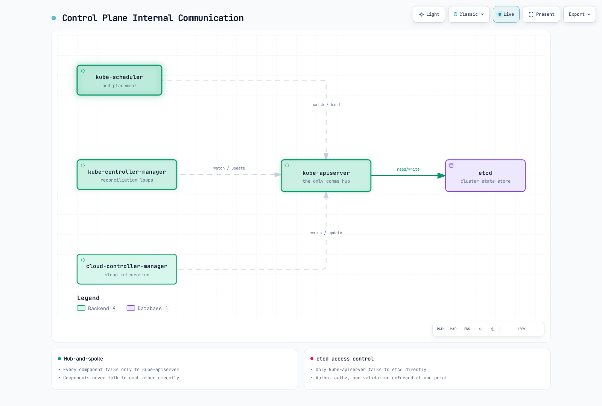
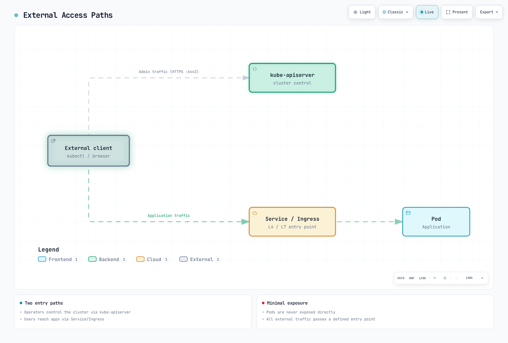
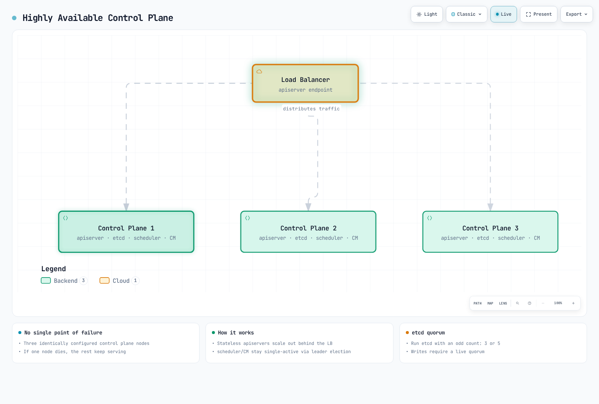
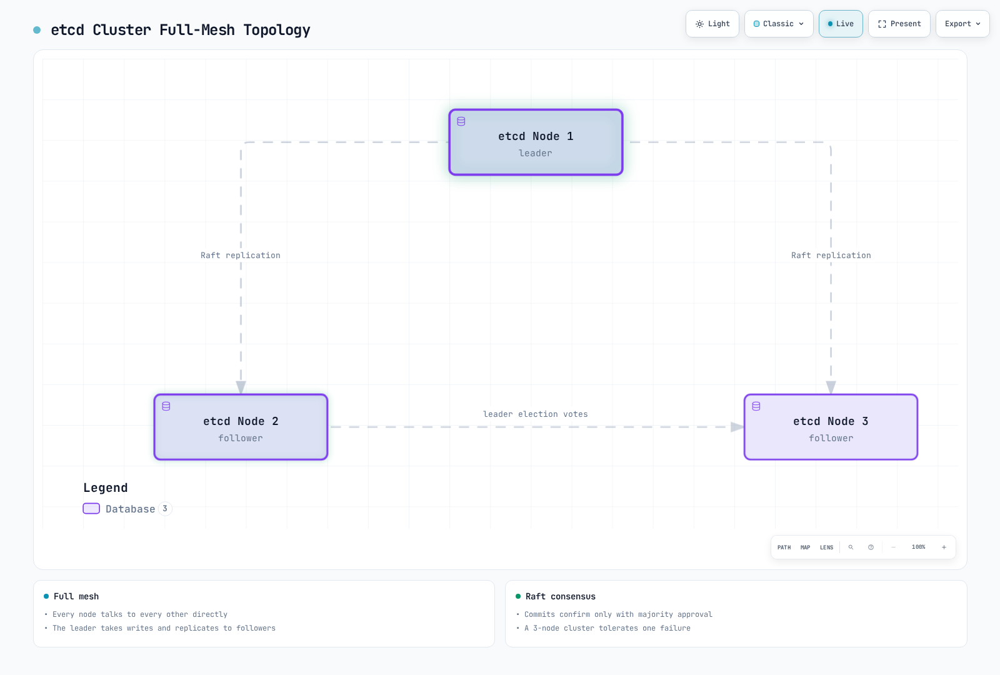
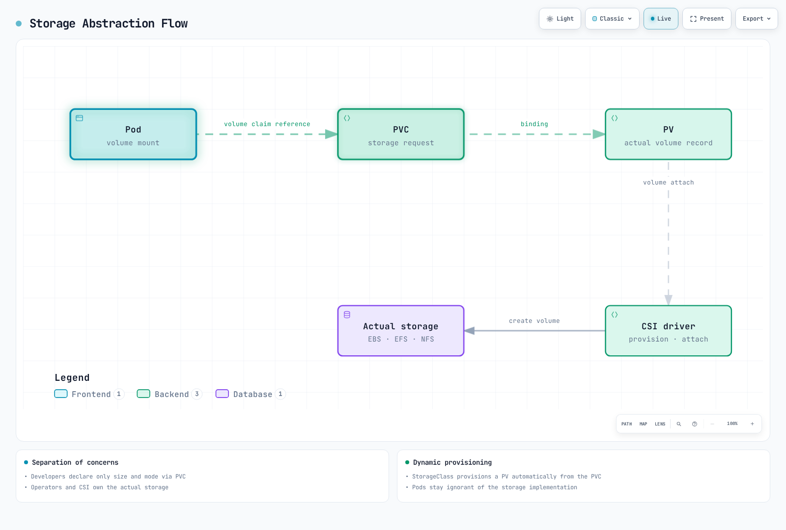

# Arquitectura del clúster

> **Versiones compatibles**: Kubernetes 1.35, 1.36, 1.37
> **Última actualización**: 16 de octubre de 2026

El encabezado de versiones se refiere al proyecto original de Kubernetes. El proyecto mantiene ramas de publicación para las tres versiones menores más recientes (1.35–1.37). La versión 1.34 está en modo de mantenimiento y sigue recibiendo parches hasta el fin de su ciclo de vida el **27 de octubre de 2026**, una fecha distinta del fin de soporte de AWS en EKS.

A fecha de 12 de octubre de 2026, el soporte estándar de EKS cubre las versiones 1.34–1.37; EKS 1.37 pasó a estar disponible el 1 de octubre de 2026. Consulta el [estado de las versiones de Kubernetes](https://kubernetes.io/releases/) y el [ciclo de vida de EKS](https://docs.aws.amazon.com/eks/latest/userguide/kubernetes-versions.html) antes de seleccionar una versión.

Los comandos de los componentes que aparecen a continuación ilustran clústeres autogestionados; EKS administra su plano de control. Las etiquetas de imagen y los ID de infraestructura son ejemplos: selecciona imágenes compatibles y mantenidas, y reemplaza los marcadores de posición antes de usarlos.

## Configuración del entorno de laboratorio

Para practicar los conceptos de este documento, necesitas las siguientes herramientas y entorno:

### Herramientas necesarias
- kubectl con una diferencia máxima de una versión menor respecto al servidor de API
- Un clúster de Kubernetes en funcionamiento (EKS, minikube, kind, etc.)

### Configuración del entorno de desarrollo local

```bash
# Install minikube (for local development)
curl -LO https://storage.googleapis.com/minikube/releases/latest/minikube-linux-amd64
sudo install minikube-linux-amd64 /usr/local/bin/minikube

# Start cluster
minikube start

# Check cluster status
kubectl cluster-info

# Check control plane components
kubectl get pods -n kube-system
```

## Descripción general de la arquitectura del clúster

> **Concepto principal**: Un clúster de Kubernetes consta del plano de control y de los nodos de trabajo, cada uno compuesto por varios componentes que desempeñan funciones específicas.

Un clúster de Kubernetes consta de un conjunto de nodos (máquinas virtuales o físicas) que ejecutan aplicaciones en contenedores. En términos generales, el clúster se divide en el plano de control y los nodos de trabajo.

### Diagrama de la arquitectura del clúster


[🔍 Ver diagrama interactivo](https://www.atomai.click/kubernetes-docs/archmaps/en-core-01-cluster-architecture-0.html)

**Componentes del plano de control**:
- **kube-apiserver**: Interfaz que expone la API de Kubernetes
- **etcd**: Almacén de clave-valor que guarda el estado de la API de Kubernetes
- **kube-scheduler**: Selecciona los nodos donde se ejecutarán los nuevos Pods
- **kube-controller-manager**: Ejecuta controladores que administran el estado del clúster
- **cloud-controller-manager**: Interactúa con las API de los proveedores de nube

**Componentes de los nodos de trabajo**:
- **kubelet**: Agente que se ejecuta en cada nodo y administra la ejecución de contenedores
- **kube-proxy**: Mantiene las reglas de red y reenvía conexiones
- **Entorno de ejecución de contenedores**: Ejecuta contenedores (containerd, CRI-O, etc.)

## Componentes del plano de control

El plano de control actúa como el «cerebro» del clúster de Kubernetes y administra y controla su estado general. Los componentes del plano de control suelen ejecutarse en máquinas dedicadas y pueden replicarse en varias instancias para proporcionar alta disponibilidad.

### Detalles de los componentes del plano de control

| Componente | Funciones principales | Destinos de comunicación | Configuración de alta disponibilidad |
|-----------|---------------|----------------------|--------------------------------|
| **kube-apiserver** | - Proporciona la API de Kubernetes<br>- Autenticación y autorización<br>- Procesamiento de solicitudes de API | - Todos los componentes<br>- etcd | Escalado horizontal con varias instancias |
| **etcd** | - Almacena datos del clúster<br>- Almacén distribuido de clave-valor<br>- Garantiza la coherencia | - kube-apiserver | Clúster de varios nodos |
| **kube-scheduler** | - Decisiones de ubicación de Pods<br>- Evalúa los recursos de los nodos<br>- Aplica afinidad/antiafinidad | - kube-apiserver | Configuración con una instancia activa y otra en espera |
| **kube-controller-manager** | - Controlador de nodos<br>- Controlador de replicación<br>- Controlador de Endpoint<br>- Controlador de ServiceAccount | - kube-apiserver | Configuración con una instancia activa y otra en espera |
| **cloud-controller-manager** | - Integración con el proveedor de nube<br>- Ciclo de vida de los nodos<br>- Enrutamiento y balanceo de carga | - kube-apiserver<br>- API de la nube | Configuración con una instancia activa y otra en espera |

### Flujo de comunicación del plano de control

1. El usuario o un controlador envía una solicitud a kube-apiserver
2. kube-apiserver realiza la autenticación, la autorización y la admisión
3. kube-apiserver lee/escribe datos en etcd
4. Los controladores y el scheduler observan el estado del clúster a través de kube-apiserver
5. kubelet informa el estado del nodo a kube-apiserver

### kube-apiserver

kube-apiserver es la interfaz del plano de control que expone la API de Kubernetes. Todas las solicitudes internas y externas se procesan a través de este servidor de API.

**Funciones principales**:
- Proporciona una API REST
- Autenticación y autorización
- Validación y procesamiento de solicitudes
- Comunicación con etcd
- Escalabilidad horizontal (puede escalarse a varias instancias)

**Principales opciones de arranque y configuración**:
```bash
# Basic configuration example
kube-apiserver \
  --advertise-address=192.168.1.10 \
  --allow-privileged=true \
  --authorization-mode=Node,RBAC \
  --client-ca-file=/etc/kubernetes/pki/ca.crt \
  --enable-admission-plugins=NodeRestriction \
  --enable-bootstrap-token-auth=true \
  --etcd-servers=https://127.0.0.1:2379 \
  --etcd-cafile=/etc/kubernetes/pki/etcd/ca.crt \
  --etcd-certfile=/etc/kubernetes/pki/apiserver-etcd-client.crt \
  --etcd-keyfile=/etc/kubernetes/pki/apiserver-etcd-client.key \
  --kubelet-client-certificate=/etc/kubernetes/pki/apiserver-kubelet-client.crt \
  --kubelet-client-key=/etc/kubernetes/pki/apiserver-kubelet-client.key \
  --service-account-key-file=/etc/kubernetes/pki/sa.pub \
  --service-account-signing-key-file=/etc/kubernetes/pki/sa.key \
  --service-account-issuer=https://kubernetes.default.svc.cluster.local \
  --service-cluster-ip-range=10.96.0.0/12 \
  --tls-cert-file=/etc/kubernetes/pki/apiserver.crt \
  --tls-private-key-file=/etc/kubernetes/pki/apiserver.key
```

**Seguridad del servidor de API**:
- Comunicación segura mediante certificados TLS
- Admite varios métodos de autenticación (certificados X.509, tokens de ServiceAccount, OIDC, webhooks, etc.)
- Administración de permisos mediante RBAC (control de acceso basado en roles)
- Validación y modificación de solicitudes mediante controladores de admisión

### etcd

etcd es un almacén de clave-valor coherente y de alta disponibilidad que guarda el estado de la API de Kubernetes. Actúa como la «fuente de verdad» de Kubernetes.

**Características principales**:
- Sistema distribuido
- Consistencia fuerte (usa el algoritmo de consenso Raft)
- Alta disponibilidad (puede configurarse con varios nodos)
- Almacenamiento seguro de datos
- Observación continua (watch) para detectar cambios

**Configuración del clúster etcd**:
```bash
# etcd cluster configuration example (3 nodes)
etcd \
  --name etcd-1 \
  --initial-advertise-peer-urls https://192.168.1.11:2380 \
  --listen-peer-urls https://192.168.1.11:2380 \
  --listen-client-urls https://192.168.1.11:2379,https://127.0.0.1:2379 \
  --advertise-client-urls https://192.168.1.11:2379 \
  --initial-cluster-token etcd-cluster \
  --initial-cluster etcd-1=https://192.168.1.11:2380,etcd-2=https://192.168.1.12:2380,etcd-3=https://192.168.1.13:2380 \
  --initial-cluster-state new \
  --data-dir=/var/lib/etcd \
  --cert-file=/etc/kubernetes/pki/etcd/server.crt \
  --key-file=/etc/kubernetes/pki/etcd/server.key \
  --trusted-ca-file=/etc/kubernetes/pki/etcd/ca.crt \
  --client-cert-auth=true \
  --peer-cert-file=/etc/kubernetes/pki/etcd/peer.crt \
  --peer-key-file=/etc/kubernetes/pki/etcd/peer.key \
  --peer-trusted-ca-file=/etc/kubernetes/pki/etcd/ca.crt \
  --peer-client-cert-auth=true
```

**Copia de seguridad y recuperación de etcd**:
```bash
# etcd backup
ETCDCTL_API=3 etcdctl snapshot save snapshot.db \
  --endpoints=https://127.0.0.1:2379 \
  --cacert=/etc/kubernetes/pki/etcd/ca.crt \
  --cert=/etc/kubernetes/pki/etcd/server.crt \
  --key=/etc/kubernetes/pki/etcd/server.key

# etcd recovery
etcdutl snapshot restore snapshot.db \
  --bump-revision=1000000000 --mark-compacted \
  --data-dir=/var/lib/etcd-restore \
  --name=etcd-1 \
  --initial-cluster=etcd-1=https://192.168.1.11:2380 \
  --initial-cluster-token=etcd-cluster \
  --initial-advertise-peer-urls=https://192.168.1.11:2380
```

**Optimización del rendimiento de etcd**:
- Optimización de E/S de disco (se recomienda SSD)
- Asignación de memoria adecuada
- Compactación y desfragmentación periódicas
- Número adecuado de nodos etcd según el tamaño del clúster (normalmente 3 o 5)

#### Actualización de julio de 2026: lanzamiento de etcd v3.7.0

El 8 de julio de 2026, SIG etcd lanzó etcd v3.7.0. Novedades destacadas:

- **RangeStream**: transmite resultados de consultas de rango extensas por fragmentos, sin mantener toda la respuesta en memoria (una función solicitada desde hace mucho tiempo)
- **Mejoras de rendimiento**: solicitudes de rango optimizadas que solo devuelven claves; concesiones más rápidas y confiables
- Elimina los últimos vestigios del antiguo v2store y completa una importante renovación de protobuf
- Incluye dependencias principales actualizadas: bbolt v1.5.0 y raft v3.7.0

Consulta el [anuncio oficial](https://kubernetes.io/blog/2026/07/08/announcing-etcd-3.7/) y el [registro de cambios de etcd v3.7](https://github.com/etcd-io/etcd/blob/main/CHANGELOG/CHANGELOG-3.7.md) para obtener más detalles.

### kube-scheduler

kube-scheduler es el componente del plano de control que selecciona los nodos donde se ejecutarán los Pods recién creados.

**Proceso de planificación**:
1. **Filtrado**: Identificación de los nodos en los que puede ejecutarse el Pod
   - Requisitos de recursos (CPU, memoria)
   - Selectores de nodo, afinidad de nodo
   - Taints y tolerancias
   - Restricciones de volúmenes

2. **Puntuación**: Asignación de puntuaciones a los nodos adecuados
   - Utilización de recursos
   - Afinidad y antiafinidad entre Pods
   - Localidad de los datos
   - Balanceo de carga entre nodos

3. **Vinculación**: Asignación del Pod al nodo óptimo

**Configuración del planificador**:
```bash
# Basic configuration example
kube-scheduler \
  --kubeconfig=/etc/kubernetes/scheduler.conf \
  --leader-elect=true \
  --v=2
```

**Perfiles y complementos del planificador**:
- Perfiles predeterminados del planificador
- Perfiles personalizados del planificador
- Puntos de extensión del planificador (filter, score, bind, etc.)
- Compatibilidad con varios planificadores

**Política de planificación**:
```yaml
# Scheduling policy example
apiVersion: kubescheduler.config.k8s.io/v1
kind: KubeSchedulerConfiguration
profiles:
- schedulerName: default-scheduler
  pluginConfig:
  - name: NodeResourcesFit
    args:
      scoringStrategy:
        type: MostAllocated
        resources:
        - name: cpu
          weight: 1
        - name: memory
          weight: 1
```

### kube-controller-manager

kube-controller-manager es el componente del plano de control que ejecuta varios procesos de controlador. Cada controlador administra un aspecto específico del clúster.

**Controladores principales**:
- **Controlador de nodos**: Supervisa y responde al estado de los nodos
- **Controlador de replicación**: Mantiene la cantidad de réplicas de Pods
- **Controlador de EndpointSlice**: Realiza un seguimiento de los backends de Service en EndpointSlices
- **Controladores de ServiceAccount y tokens**: Crean los ServiceAccount predeterminados y mantienen los Secrets de tokens heredados solicitados explícitamente; los Pods actuales usan tokens TokenRequest de corta duración
- **Controlador de Job**: Administra tareas de ejecución única
- **Controlador de CronJob**: Administra tareas programadas
- **Controlador de DaemonSet**: Garantiza que determinados Pods se ejecuten en todos los nodos
- **Controlador de StatefulSet**: Administra aplicaciones con estado
- **Controlador de PV**: Administra volúmenes persistentes
- **Controlador de Namespace**: Administra el ciclo de vida de los Namespace
- **Recolector de basura**: Limpia objetos huérfanos

**Configuración del administrador de controladores**:
```bash
# Basic configuration example
kube-controller-manager \
  --kubeconfig=/etc/kubernetes/controller-manager.conf \
  --leader-elect=true \
  --use-service-account-credentials=true \
  --root-ca-file=/etc/kubernetes/pki/ca.crt \
  --service-account-private-key-file=/etc/kubernetes/pki/sa.key \
  --cluster-signing-cert-file=/etc/kubernetes/pki/ca.crt \
  --cluster-signing-key-file=/etc/kubernetes/pki/ca.key \
  --controllers=*,bootstrapsigner,tokencleaner
```

**Funcionamiento de los controladores**:
1. Los controladores observan continuamente el estado del clúster a través del servidor de API
2. Detectan las diferencias entre el estado actual y el deseado
3. Realizan operaciones para reconciliar el estado actual con el deseado
4. Informan los cambios de estado al servidor de API

### cloud-controller-manager

cloud-controller-manager es el componente del plano de control que contiene la lógica de control específica de la nube. Esto permite separar el núcleo de Kubernetes de las API de los proveedores de nube.

**Controladores principales**:
- **Controlador de nodos**: Comprueba el estado de los nodos mediante la API del proveedor de nube
- **Controlador de rutas**: Configura rutas en entornos de nube
- **Controlador de Service**: Crea, actualiza y elimina balanceadores de carga en la nube

El aprovisionamiento y la conexión de almacenamiento en la nube utilizan controladores CSI; kubelet y los complementos de nodo CSI gestionan los montajes. Estas tareas no son responsabilidad de cloud-controller-manager.

**Implementaciones de proveedores de nube**:
- AWS Cloud Controller Manager
- Azure Cloud Controller Manager
- GCP Cloud Controller Manager
- OpenStack Cloud Controller Manager
- vSphere Cloud Controller Manager

**Configuración de Cloud Controller Manager**:
```bash
# AWS Cloud Controller Manager example
cloud-controller-manager \
  --cloud-provider=aws \
  --cloud-config=/etc/kubernetes/cloud-config \
  --kubeconfig=/etc/kubernetes/cloud-controller-manager.conf \
  --leader-elect=true
```

**Ventajas de Cloud Controller Manager**:
- Separación del código específico de los proveedores de nube del núcleo de Kubernetes
- Los proveedores de nube pueden desarrollar sus propias funciones de forma independiente
- Añade funciones para la nube sin cambiar el núcleo de Kubernetes

## Componentes de los nodos

Los nodos son las máquinas de trabajo del clúster de Kubernetes que ejecutan aplicaciones en contenedores. Cada nodo está administrado por el plano de control y consta de varios componentes.

### kubelet

kubelet es un agente que se ejecuta en cada nodo y administra los contenedores dentro de los Pods. kubelet recibe PodSpecs mediante varios mecanismos y garantiza que los contenedores se ejecuten correctamente de acuerdo con esas especificaciones.

**Funciones principales**:
- Ejecuta contenedores según PodSpec
- Supervisa e informa el estado de los contenedores
- Administra el ciclo de vida de los contenedores
- Administra los montajes de volúmenes
- Informa el estado del nodo
- Realiza comprobaciones de estado de los contenedores

**Configuración de kubelet**:
```bash
# Basic configuration example
kubelet \
  --kubeconfig=/etc/kubernetes/kubelet.conf \
  --config=/var/lib/kubelet/config.yaml \
  --container-runtime-endpoint=unix:///run/containerd/containerd.sock
```

**Ejemplo de archivo de configuración de kubelet**:
```yaml
# /var/lib/kubelet/config.yaml
apiVersion: kubelet.config.k8s.io/v1beta1
kind: KubeletConfiguration
address: 0.0.0.0
authentication:
  anonymous:
    enabled: false
  webhook:
    cacheTTL: 2m0s
    enabled: true
  x509:
    clientCAFile: /etc/kubernetes/pki/ca.crt
authorization:
  mode: Webhook
  webhook:
    cacheAuthorizedTTL: 5m0s
    cacheUnauthorizedTTL: 30s
cgroupDriver: systemd
clusterDomain: cluster.local
cpuManagerPolicy: none
evictionHard:
  memory.available: 100Mi
  nodefs.available: 10%
  nodefs.inodesFree: 5%
failSwapOn: true
healthzBindAddress: 127.0.0.1
healthzPort: 10248
```

**Pods estáticos**: El manifiesto que aparece a continuación es un fragmento, no una instalación completa del plano de control; también requiere redes del host, certificados, montajes y la configuración completa del servidor de API.
kubelet puede ejecutar Pods estáticos que administra directamente, sin pasar por el servidor de API. Esto se utiliza principalmente para ejecutar componentes del plano de control.

```yaml
# /etc/kubernetes/manifests/kube-apiserver.yaml
apiVersion: v1
kind: Pod
metadata:
  name: kube-apiserver
  namespace: kube-system
spec:
  containers:
  - name: kube-apiserver
    image: registry.k8s.io/kube-apiserver:v1.37.1
    command:
    - kube-apiserver
    - --advertise-address=192.168.1.10
    # ... additional flags
```

### kube-proxy

kube-proxy es un proxy de red que se ejecuta en cada nodo e implementa el concepto de Service de Kubernetes. Mantiene reglas de red en los nodos y reenvía conexiones.

**Funciones principales**:
- Mantiene reglas de red para las IP y los puertos de Service
- Reenvía conexiones
- Implementa el balanceo de carga
- Admite el descubrimiento de servicios

**Modos de funcionamiento**:
1. **iptables**: Modo predeterminado de Linux; instala reglas de procesamiento de paquetes en el kernel
2. **nftables**: Estable desde v1.33; comprueba la compatibilidad del kernel y de CNI
3. **IPVS**: Modo heredado de Linux, obsoleto desde v1.35; migra a una alternativa compatible
4. **kernelspace**: Modo de Windows

El antiguo modo `userspace` se eliminó. Algunas implementaciones de red sustituyen por completo a kube-proxy.

**Configuración de kube-proxy**:
```bash
# Basic configuration example
kube-proxy \
  --config=/var/lib/kube-proxy/config.conf \
  --hostname-override=node1
```

**Ejemplo de archivo de configuración de kube-proxy**:
```yaml
# /var/lib/kube-proxy/config.conf
apiVersion: kubeproxy.config.k8s.io/v1alpha1
kind: KubeProxyConfiguration
bindAddress: 0.0.0.0
clientConnection:
  acceptContentTypes: ""
  burst: 10
  contentType: application/vnd.kubernetes.protobuf
  kubeconfig: /var/lib/kube-proxy/kubeconfig.conf
  qps: 5
clusterCIDR: 10.244.0.0/16
configSyncPeriod: 15m0s
conntrack:
  maxPerCore: 32768
  min: 131072
  tcpCloseWaitTimeout: 1h0m0s
  tcpEstablishedTimeout: 24h0m0s
enableProfiling: false
healthzBindAddress: 0.0.0.0:10256
hostnameOverride: node1
iptables:
  masqueradeAll: false
  masqueradeBit: 14
  minSyncPeriod: 0s
  syncPeriod: 30s
ipvs:
  excludeCIDRs: null
  minSyncPeriod: 0s
  scheduler: ""
  syncPeriod: 30s
mode: "iptables"
```

**Comparación entre los modos IPVS e iptables**:

| Característica | Modo iptables | Modo IPVS |
|----------------|---------------|-----------|
| Rendimiento | El rendimiento se degrada cuando hay muchos Service | Mejor rendimiento en clústeres grandes |
| Algoritmos de balanceo de carga | Selección aleatoria de backend de forma predeterminada | Admite varios algoritmos (rr, lc, dh, sh, sed, nq) |
| Implementación | Cadenas de filtrado de paquetes de red | Basado en tablas hash |
| Requisitos del kernel | Módulos predeterminados del kernel | Se requiere el módulo IPVS del kernel |

### Entorno de ejecución de contenedores

El entorno de ejecución de contenedores es el software que ejecuta los contenedores. Kubernetes admite varios entornos de ejecución mediante Container Runtime Interface (CRI).

**Principales entornos de ejecución de contenedores**:
1. **containerd**: Entorno de ejecución de contenedores ligero (actualmente, el más utilizado)
2. **CRI-O**: Entorno de ejecución ligero diseñado específicamente para Kubernetes
3. **Docker Engine**: Requiere un adaptador CRI externo, como cri-dockerd; el dockershim integrado se eliminó en v1.24. Las imágenes OCI creadas con Docker siguen funcionando con containerd/CRI-O.

**Estructura por capas del entorno de ejecución de contenedores**:


[🔍 Ver diagrama interactivo](https://www.atomai.click/kubernetes-docs/archmaps/en-core-01-cluster-architecture-1.html)

**Ejemplo de configuración de containerd 1.x** (2.x utiliza identificadores de complemento diferentes; genera valores predeterminados para la versión instalada):
```toml
# /etc/containerd/config.toml
version = 2

[plugins]
  [plugins."io.containerd.grpc.v1.cri"]
    sandbox_image = "registry.k8s.io/pause:3.10"
    [plugins."io.containerd.grpc.v1.cri".containerd]
      default_runtime_name = "runc"
      [plugins."io.containerd.grpc.v1.cri".containerd.runtimes]
        [plugins."io.containerd.grpc.v1.cri".containerd.runtimes.runc]
          runtime_type = "io.containerd.runc.v2"
          [plugins."io.containerd.grpc.v1.cri".containerd.runtimes.runc.options]
            SystemdCgroup = true
```

**Ejemplo de configuración de CRI-O**:
```toml
# /etc/crio/crio.conf
[crio]
root = "/var/lib/containers/storage"
runroot = "/var/run/containers/storage"
storage_driver = "overlay"
storage_option = ["overlay.mountopt=nodev"]

[crio.runtime]
default_runtime = "runc"
conmon = "/usr/bin/conmon"
conmon_cgroup = "pod"
cgroup_manager = "systemd"

[crio.image]
pause_image = "registry.k8s.io/pause:3.10"
```

### Componentes complementarios

Los complementos son componentes adicionales que amplían la funcionalidad de los clústeres de Kubernetes. Algunos complementos importantes son:

1. **Complementos de red CNI**: Implementan la red de Pods
   - Calico, Cilium, Flannel, etc.

2. **DNS**: Proporciona el servicio DNS dentro del clúster
   - CoreDNS (predeterminado)

3. **Dashboard**: Proporciona una interfaz de usuario web
   - Headlamp (Kubernetes Dashboard está archivado)

4. **Ingress Controller**: Administra el enrutamiento HTTP/HTTPS
   - Traefik, HAProxy, etc.

5. **Metrics Server**: Recopila métricas de uso de recursos
   - Metrics Server

6. **Registro y supervisión**: Recopilación de registros y supervisión
   - Prometheus, Grafana, Elasticsearch, Fluentd, Kibana, etc.

**Ejemplo de configuración de CoreDNS**:
```yaml
apiVersion: v1
kind: ConfigMap
metadata:
  name: coredns
  namespace: kube-system
data:
  Corefile: |
    .:53 {
        errors
        health {
            lameduck 5s
        }
        ready
        kubernetes cluster.local in-addr.arpa ip6.arpa {
            pods insecure
            fallthrough in-addr.arpa ip6.arpa
            ttl 30
        }
        prometheus :9153
        forward . /etc/resolv.conf {
            max_concurrent 1000
        }
        cache 30
        loop
        reload
        loadbalance
    }
```

**Ejemplo de configuración de CNI de Calico**:
```yaml
apiVersion: v1
kind: ConfigMap
metadata:
  name: calico-config
  namespace: kube-system
data:
  calico_backend: "bird"
  cni_network_config: |-
    {
      "name": "k8s-pod-network",
      "cniVersion": "0.3.1",
      "plugins": [
        {
          "type": "calico",
          "log_level": "info",
          "datastore_type": "kubernetes",
          "nodename": "__KUBERNETES_NODE_NAME__",
          "mtu": __CNI_MTU__,
          "ipam": {
            "type": "calico-ipam"
          },
          "policy": {
            "type": "k8s"
          },
          "kubernetes": {
            "kubeconfig": "__KUBECONFIG_FILEPATH__"
          }
        },
        {
          "type": "portmap",
          "snat": true,
          "capabilities": {"portMappings": true}
        }
      ]
    }
```

## Rutas de comunicación del clúster

La comunicación entre los distintos componentes tiene lugar dentro de un clúster de Kubernetes. Comprender estas rutas de comunicación es importante para el diseño, la seguridad y la resolución de problemas del clúster.

### Comunicación interna del plano de control



[🔍 Ver diagrama interactivo](https://www.atomai.click/kubernetes-docs/archmaps/en-core-01-cluster-architecture-2.html)

La comunicación entre los componentes del plano de control es la siguiente:

1. **kube-apiserver y etcd**: kube-apiserver se comunica con etcd para almacenar y recuperar el estado del clúster.
   - Protocolo: gRPC
   - Puerto: 2379/TCP
   - Seguridad: Autenticación basada en certificados TLS

2. **kube-scheduler y kube-apiserver**: kube-scheduler se comunica con kube-apiserver para asignar los Pods a nodos.
   - Protocolo: HTTPS
   - Puerto: 6443/TCP (kube-apiserver)
   - Seguridad: Autenticación basada en certificados TLS

3. **kube-controller-manager y kube-apiserver**: Los controladores se comunican con kube-apiserver para observar y modificar el estado del clúster.
   - Protocolo: HTTPS
   - Puerto: 6443/TCP (kube-apiserver)
   - Seguridad: Autenticación basada en certificados TLS

4. **cloud-controller-manager y kube-apiserver**: El controlador de nube se comunica con kube-apiserver para observar el estado del clúster y administrar los recursos de la nube.
   - Protocolo: HTTPS
   - Puerto: 6443/TCP (kube-apiserver)
   - Seguridad: Autenticación basada en certificados TLS

### Comunicación entre el plano de control y los nodos


[🔍 Ver diagrama interactivo](https://www.atomai.click/kubernetes-docs/archmaps/en-core-01-cluster-architecture-3.html)

La comunicación entre el plano de control y los nodos es la siguiente:

1. **kube-apiserver → kubelet**: El servidor de API llama a la API de kubelet para obtener registros, ejecutar comandos o conectarse a procesos (exec/attach) y reenviar puertos.
   - Protocolo: HTTPS
   - Puerto: 10250/TCP (kubelet)
   - Seguridad: Autenticación basada en certificados TLS

2. **kubelet y kube-apiserver**: kubelet se comunica con kube-apiserver para observar los PodSpecs asignados, registrar el nodo e informar el estado y los eventos de los nodos y Pods.
   - Protocolo: HTTPS
   - Puerto: 6443/TCP (kube-apiserver)
   - Seguridad: Autenticación basada en certificados TLS

3. **kube-proxy y kube-apiserver**: kube-proxy se comunica con kube-apiserver para recuperar información de Service.
   - Protocolo: HTTPS
   - Puerto: 6443/TCP (kube-apiserver)
   - Seguridad: Autenticación basada en certificados TLS

### Comunicación entre nodos


[🔍 Ver diagrama interactivo](https://www.atomai.click/kubernetes-docs/archmaps/en-core-01-cluster-architecture-4.html)

La comunicación entre nodos es la siguiente:

1. **Comunicación entre Pods**: Los Pods se comunican entre sí a través de la red proporcionada por los complementos CNI.
   - Protocolo: Depende de la aplicación (TCP, UDP, etc.)
   - Puerto: Depende de la aplicación
   - Seguridad: Se puede controlar mediante políticas de red

2. **Comunicación entre Pods de distintos nodos**: El complemento CNI gestiona la comunicación entre Pods de diferentes nodos.
   - Protocolo: Depende de la aplicación (TCP, UDP, etc.)
   - Puerto: Depende de la aplicación
   - Seguridad: Se puede controlar mediante políticas de red

### Comunicación externa



[🔍 Ver diagrama interactivo](https://www.atomai.click/kubernetes-docs/archmaps/en-core-01-cluster-architecture-5.html)

La comunicación con entidades externas es la siguiente:

1. **Cliente y kube-apiserver**: Los usuarios y los sistemas externos interactúan con el clúster a través de kube-apiserver.
   - Protocolo: HTTPS
   - Puerto: 6443/TCP (kube-apiserver)
   - Seguridad: Certificados TLS, tokens, autenticación de usuarios, etc.

2. **Tráfico externo y Service**: El tráfico externo accede a las aplicaciones dentro del clúster mediante servicios NodePort, LoadBalancer o Ingress.
   - Protocolo: HTTP, HTTPS, TCP, UDP, etc.
   - Puerto: Depende de la configuración del Service
   - Seguridad: Depende de la configuración de Ingress Controller y Service

### Seguridad de las comunicaciones

La seguridad de las comunicaciones dentro de un clúster de Kubernetes se implementa mediante los siguientes métodos:

1. **Certificados TLS**: Todas las comunicaciones entre los componentes del plano de control se cifran con certificados TLS.
2. **Autenticación y autorización**: Todas las solicitudes al servidor de API pasan por procesos de autenticación y autorización.
3. **Políticas de red**: La comunicación entre Pods se puede restringir mediante políticas de red.
4. **Secrets cifrados**: Los Secrets almacenados en etcd se pueden cifrar.

**Ejemplo de cifrado de datos de API en reposo** (configura el servidor de API con `--encryption-provider-config`; vuelve a escribir los Secrets existentes para cifrarlos):
```yaml
apiVersion: apiserver.config.k8s.io/v1
kind: EncryptionConfiguration
resources:
  - resources:
    - secrets
    providers:
    - aescbc:
        keys:
        - name: key1
          secret: <base64-encoded-key>
    - identity: {}
```

### Configuración de clúster de alta disponibilidad

Los clústeres de Kubernetes de alta disponibilidad (HA) están diseñados para eliminar puntos únicos de fallo y seguir funcionando sin interrupciones del servicio.

### Alta disponibilidad del plano de control

La alta disponibilidad del plano de control se implementa mediante los siguientes métodos:

1. **Varios nodos del plano de control**: Normalmente, se despliegan 3 o 5 nodos del plano de control para proporcionar redundancia
2. **Clúster etcd**: Se despliega un clúster compuesto por varias instancias de etcd (normalmente 3 o 5)
3. **Balanceador de carga**: Se coloca un balanceador de carga delante de los servidores de API para distribuir el tráfico

**Arquitectura del plano de control de alta disponibilidad**:



[🔍 Ver diagrama interactivo](https://www.atomai.click/kubernetes-docs/archmaps/en-core-01-cluster-architecture-6.html)

**Configuración del clúster etcd**:



[🔍 Ver diagrama interactivo](https://www.atomai.click/kubernetes-docs/archmaps/en-core-01-cluster-architecture-7.html)

### Alta disponibilidad de los nodos de trabajo

La alta disponibilidad de los nodos de trabajo se implementa mediante los siguientes métodos:

1. **Varios nodos de trabajo**: Distribuye las cargas de trabajo entre varios nodos de trabajo
2. **Recuperación automática de nodos**: Utiliza las funciones de recuperación automática del proveedor de nube
3. **Escalado automático**: Escalado automático de nodos mediante Cluster Autoscaler
4. **Varias zonas de disponibilidad**: Despliega nodos en varias zonas de disponibilidad

**Despliegue distribuido de nodos de trabajo**:


[🔍 Ver diagrama interactivo](https://www.atomai.click/kubernetes-docs/archmaps/en-core-01-cluster-architecture-8.html)

### Alta disponibilidad de aplicaciones

La alta disponibilidad de las aplicaciones se implementa mediante los siguientes métodos:

1. **ReplicaSet/Deployment**: Ejecutar varias réplicas de Pods
2. **Reglas de distribución de Pods**: Distribuir Pods entre varios nodos mediante la antiafinidad de Pods
3. **PodDisruptionBudget**: Garantizar una disponibilidad mínima durante las interrupciones planificadas
4. **Service y balanceo de carga**: Distribuir el tráfico entre varios Pods

**Ejemplo de antiafinidad de Pods**:
```yaml
apiVersion: apps/v1
kind: Deployment
metadata:
  name: web-server
spec:
  replicas: 3
  selector:
    matchLabels:
      app: web-server
  template:
    metadata:
      labels:
        app: web-server
    spec:
      affinity:
        podAntiAffinity:
          requiredDuringSchedulingIgnoredDuringExecution:
          - labelSelector:
              matchExpressions:
              - key: app
                operator: In
                values:
                - web-server
            topologyKey: "kubernetes.io/hostname"
      containers:
      - name: web-server
        image: nginx:1.30.6
```

**Ejemplo de PodDisruptionBudget**:
```yaml
apiVersion: policy/v1
kind: PodDisruptionBudget
metadata:
  name: web-server-pdb
spec:
  minAvailable: 2
  selector:
    matchLabels:
      app: web-server
```

### Estrategia de recuperación ante desastres

Las estrategias de recuperación ante desastres para clústeres de Kubernetes se implementan mediante los siguientes métodos:

1. **Copia de seguridad y recuperación de etcd**: Establece procedimientos periódicos de copia de seguridad y recuperación de datos de etcd
2. **Despliegue en varias regiones**: Despliega clústeres en varias regiones
3. **Federación de clústeres**: Administra varios clústeres en una federación
4. **Copia de seguridad continua**: Realiza copias de seguridad continuas de los datos de las aplicaciones

**Ejemplo de script de copia de seguridad de etcd**:
```bash
#!/bin/bash
ETCDCTL_API=3 etcdctl snapshot save /backup/etcd-snapshot-$(date +%Y%m%d-%H%M%S).db \
  --endpoints=https://127.0.0.1:2379 \
  --cacert=/etc/kubernetes/pki/etcd/ca.crt \
  --cert=/etc/kubernetes/pki/etcd/server.crt \
  --key=/etc/kubernetes/pki/etcd/server.key
```

**Procedimiento de recuperación de etcd (clústeres autogestionados)**:

1. Valida la instantánea con `etcdutl snapshot status`. Restáurala en un directorio de datos nuevo con una versión compatible de `etcdutl`, como se muestra arriba.
2. Antes de cambiar los directorios de datos, detén todas las instancias del servidor de API y los procesos etcd afectados siguiendo el procedimiento operativo del clúster. Detener kubelet por sí solo no detiene los contenedores de Pods estáticos existentes.
3. Para recuperar varios miembros, restaura la misma instantánea en cada uno, con un nombre y una URL de par únicos y la misma lista completa de miembros en `--initial-cluster`. El ejemplo anterior de un solo miembro no es un procedimiento de recuperación de alta disponibilidad.
4. Usa `--bump-revision` y `--mark-compacted` para las cachés de observación (watch) de Kubernetes; elige un incremento que supere las revisiones acumuladas desde la instantánea (el valor mostrado es un ejemplo).
5. Actualiza el hostPath del Pod estático de etcd para que apunte al directorio restaurado, reinicia etcd, verifica el quórum y el estado, y después reinicia los servidores de API y los controladores. Conserva los datos originales y la copia de seguridad hasta completar la verificación.

Sigue la [guía de recuperación de etcd](https://etcd.io/docs/v3.6/op-guide/recovery/). Los usuarios de EKS no operan ni restauran directamente el etcd del plano de control administrado.

## Redes del clúster

Las redes de Kubernetes permiten la comunicación entre Pods, Service y el mundo exterior. El modelo de red de Kubernetes supone que cada Pod tiene una dirección IP única y puede comunicarse con los demás sin NAT.

### Modelo de red

El modelo de red de Kubernetes tiene los siguientes requisitos:

1. **Comunicación entre Pods**: Todos los Pods deben poder comunicarse con los demás sin NAT
2. **Comunicación entre nodos y Pods**: Los agentes de nodo deben poder comunicarse con los Pods de ese nodo
3. **Comunicación entre Pods y sistemas externos**: La conectividad externa depende del enrutamiento, de NAT cuando sea necesario y de las políticas de seguridad/salida; no es un requisito que todos los Pods puedan acceder a Internet

### CNI (Container Network Interface)

CNI es una interfaz estándar para implementar redes en Kubernetes. Existen varios complementos CNI, cada uno con características y rendimiento diferentes.

**Principales complementos CNI**:

1. **Calico**: Redes basadas en BGP y compatibilidad con políticas de red
   - Características: Alto rendimiento, políticas de red, cifrado y compatibilidad con eBPF
   - Casos de uso: Clústeres grandes y entornos centrados en la seguridad

2. **Cilium**: Redes y seguridad basadas en eBPF
   - Características: Políticas de seguridad L3-L7, alto rendimiento y observabilidad
   - Casos de uso: Microservicios y entornos centrados en la seguridad

3. **Flannel**: Red superpuesta sencilla
   - Características: Configuración sencilla y bajo consumo de recursos
   - Casos de uso: Clústeres pequeños y entornos de desarrollo

4. **Weave Net (histórico)**: El proyecto se archivó en junio de 2024; evalúa alternativas mantenidas para nuevos despliegues.

**Ejemplo de configuración CNI (Calico)**:
```yaml
apiVersion: v1
kind: ConfigMap
metadata:
  name: calico-config
  namespace: kube-system
data:
  calico_backend: "bird"
  cni_network_config: |-
    {
      "name": "k8s-pod-network",
      "cniVersion": "0.3.1",
      "plugins": [
        {
          "type": "calico",
          "log_level": "info",
          "datastore_type": "kubernetes",
          "nodename": "__KUBERNETES_NODE_NAME__",
          "mtu": __CNI_MTU__,
          "ipam": {
            "type": "calico-ipam"
          },
          "policy": {
            "type": "k8s"
          },
          "kubernetes": {
            "kubeconfig": "__KUBECONFIG_FILEPATH__"
          }
        },
        {
          "type": "portmap",
          "snat": true,
          "capabilities": {"portMappings": true}
        }
      ]
    }
```

### Redes de Service

Los Service de Kubernetes proporcionan endpoints estables para un conjunto de Pods. Los Service tienen varios tipos, como ClusterIP, NodePort, LoadBalancer y ExternalName.

**Componentes de las redes de Service**:

1. **ClusterIP**: IP virtual accesible únicamente dentro del clúster
2. **kube-proxy**: Enruta el tráfico de las IP de Service a los Pods
3. **CoreDNS**: Servicio DNS para el descubrimiento de servicios

**Flujo de red de Service**:
```
Client -> kernel rules programmed by kube-proxy (ClusterIP DNAT) -> Pod
```

**Ejemplo de Service**:
```yaml
apiVersion: v1
kind: Service
metadata:
  name: my-service
spec:
  selector:
    app: my-app
  ports:
  - port: 80
    targetPort: 8080
  type: ClusterIP
```

### Redes de Ingress

Ingress administra el enrutamiento HTTP y HTTPS desde fuera del clúster hasta los Service dentro del clúster. Los controladores de Ingress implementan los recursos de Ingress.

**Principales controladores de Ingress**:
1. **Controladores de Ingress/Gateway mantenidos**: Comprueba el ciclo de vida del controlador y la compatibilidad con Gateway API
2. **AWS Load Balancer Controller**: Aprovisiona ALB para Ingress
3. **Traefik**: Enrutador perimetral nativo de la nube
4. **HAProxy Ingress**: Controlador de Ingress basado en HAProxy

**Flujo de red de Ingress**:
```
Client -> Ingress Controller -> Service -> Pod
```

El proyecto comunitario ingress-nginx se retiró en marzo de 2026; consulta el [aviso de retirada](https://kubernetes.io/blog/2025/11/11/ingress-nginx-retirement/). Este ejemplo requiere un controlador Traefik instalado con una IngressClass llamada `traefik`; `/app` se reenvía sin cambios.

**Ejemplo de Ingress**:
```yaml
apiVersion: networking.k8s.io/v1
kind: Ingress
metadata:
  name: my-ingress
spec:
  ingressClassName: traefik
  rules:
  - host: example.com
    http:
      paths:
      - path: /app
        pathType: Prefix
        backend:
          service:
            name: my-service
            port:
              number: 80
```

### Políticas de red

Las políticas de red permiten controlar la comunicación entre Pods. De forma predeterminada, todos los Pods pueden comunicarse entre sí, pero las políticas de red pueden restringir esta comunicación.

**Ejemplo de política de red**:
```yaml
apiVersion: networking.k8s.io/v1
kind: NetworkPolicy
metadata:
  name: db-network-policy
spec:
  podSelector:
    matchLabels:
      role: db
  policyTypes:
  - Ingress
  - Egress
  ingress:
  - from:
    - podSelector:
        matchLabels:
          role: frontend
    ports:
    - protocol: TCP
      port: 3306
  egress:
  - to:
    - podSelector:
        matchLabels:
          role: monitoring
    ports:
    - protocol: TCP
      port: 9090
```

### Resolución de problemas de red

Herramientas y comandos habituales para solucionar problemas de redes de Kubernetes:

1. **ping, traceroute**: Pruebas básicas de conectividad de red
2. **tcpdump**: Captura y análisis de paquetes de red
3. **netstat, ss**: Comprobación del estado de las conexiones de red
4. **nslookup, dig**: Pruebas de resolución DNS
5. **kubectl exec**: Ejecución de comandos de red dentro de Pods

**Ejemplo de depuración de red**:
```bash
# Test network connectivity within a pod
kubectl exec -it <pod-name> -- ping <target-ip>

# Test DNS lookup within a pod
kubectl exec -it <pod-name> -- nslookup <service-name>

# Capture network packets within a pod
kubectl exec -it <pod-name> -- tcpdump -i eth0 -n

# Check service endpoints
kubectl get endpointslices -l kubernetes.io/service-name=<service-name>
```

## Almacenamiento del clúster

El almacenamiento de Kubernetes proporciona persistencia de datos para las aplicaciones en contenedores. Kubernetes proporciona varias opciones y abstracciones de almacenamiento para ayudar a las aplicaciones a utilizarlo de manera eficiente.

### Arquitectura de almacenamiento

La arquitectura de almacenamiento de Kubernetes consta de los siguientes componentes:

1. **Volúmenes**: Directorios que se pueden montar en los contenedores dentro de los Pods
2. **Persistent Volumes (PV)**: Recursos de almacenamiento del clúster
3. **Persistent Volume Claims (PVC)**: Solicitudes de almacenamiento de los usuarios
4. **Storage Classes**: Definen «clases» o tipos de almacenamiento
5. **CSI (Container Storage Interface)**: Interfaz estándar con los sistemas de almacenamiento

**Flujo de la arquitectura de almacenamiento**:



[🔍 Ver diagrama interactivo](https://www.atomai.click/kubernetes-docs/archmaps/en-core-01-cluster-architecture-9.html)

### Tipos de volúmenes

Kubernetes admite varios tipos de volúmenes:

1. **Volúmenes efímeros**:
   - **emptyDir**: Se crea como un directorio vacío y se elimina cuando se elimina el Pod
   - **configMap**: Monta ConfigMap como volumen
   - **secret**: Monta Secret como volumen
   - **downwardAPI**: Expone información del Pod y del contenedor como archivos

2. **Volúmenes persistentes**:
   - **Almacenamiento en bloques de nube mediante CSI**: AWS EBS, Azure Disk y GCE Persistent Disk; se eliminaron sus antiguas implementaciones integradas en el código de Kubernetes
   - **nfs**: Volúmenes NFS
   - **csi**: Volúmenes mediante controladores CSI

**Ejemplo de volumen**:
```yaml
apiVersion: v1
kind: Pod
metadata:
  name: test-pd
spec:
  containers:
  - name: test-container
    image: nginx
    volumeMounts:
    - mountPath: /test-pd
      name: test-volume
  volumes:
  - name: test-volume
    persistentVolumeClaim:
      claimName: test-pvc
```

### Volúmenes persistentes y solicitudes de almacenamiento

Persistent Volumes (PV) son recursos de almacenamiento del clúster que aprovisionan los administradores o que se aprovisionan dinámicamente mediante Storage Classes. Persistent Volume Claims (PVC) son solicitudes de almacenamiento de los usuarios.

Instala primero el controlador EBS CSI con los permisos de IAM necesarios. Para el PV estático que aparece a continuación, reemplaza el ID del volumen y la zona por los de un volumen EBS existente y su zona real. EBS no se puede montar en Fargate; EKS Auto Mode utiliza `ebs.csi.eks.amazonaws.com` en su lugar.

**Ejemplo de Persistent Volume**:
```yaml
apiVersion: v1
kind: PersistentVolume
metadata:
  name: pv-example
spec:
  capacity:
    storage: 10Gi
  accessModes:
    - ReadWriteOnce
  persistentVolumeReclaimPolicy: Retain
  storageClassName: standard
  csi:
    driver: ebs.csi.aws.com
    volumeHandle: vol-0123456789abcdef0
    fsType: ext4
  nodeAffinity:
    required:
      nodeSelectorTerms:
      - matchExpressions:
        - key: topology.kubernetes.io/zone
          operator: In
          values: [ap-northeast-2a]
```

**Ejemplo de Persistent Volume Claim**:
```yaml
apiVersion: v1
kind: PersistentVolumeClaim
metadata:
  name: pvc-example
spec:
  accessModes:
    - ReadWriteOnce
  resources:
    requests:
      storage: 5Gi
  storageClassName: standard
```

### Storage Classes

Las Storage Classes describen las «clases» de almacenamiento que proporcionan los administradores. Permiten aprovisionar PV de forma dinámica cuando se solicitan PVC.

**Ejemplo de Storage Class**:
```yaml
apiVersion: storage.k8s.io/v1
kind: StorageClass
metadata:
  name: standard
provisioner: ebs.csi.aws.com
parameters:
  type: gp3
  csi.storage.k8s.io/fstype: ext4
  encrypted: "true"
reclaimPolicy: Delete
allowVolumeExpansion: true
volumeBindingMode: WaitForFirstConsumer
```

### CSI (Container Storage Interface)

CSI proporciona una interfaz estándar entre Kubernetes y los sistemas de almacenamiento. Gracias a CSI, los proveedores de almacenamiento pueden desarrollar sus propios controladores de almacenamiento sin modificar el código de Kubernetes.

**Arquitectura de CSI**:


[🔍 Ver diagrama interactivo](https://www.atomai.click/kubernetes-docs/archmaps/en-core-01-cluster-architecture-10.html)

**Ejemplo de despliegue de un controlador CSI**:
```yaml
apiVersion: storage.k8s.io/v1
kind: StorageClass
metadata:
  name: ebs-sc
provisioner: ebs.csi.aws.com
parameters:
  type: gp3
  csi.storage.k8s.io/fstype: ext4
  encrypted: "true"
volumeBindingMode: WaitForFirstConsumer
```

### Prácticas recomendadas de almacenamiento

Prácticas recomendadas para usar el almacenamiento de Kubernetes:

1. **Elige el tipo de almacenamiento adecuado**: Selecciona un tipo de almacenamiento que se ajuste a las características de la carga de trabajo
2. **Usa el aprovisionamiento dinámico**: Utiliza el aprovisionamiento dinámico mediante Storage Classes
3. **Elige los modos de acceso adecuados**: Selecciona modos de acceso que se ajusten a los requisitos de la carga de trabajo
4. **Establece solicitudes y límites de recursos**: Solicita una capacidad de almacenamiento adecuada
5. **Establece una estrategia de copia de seguridad y recuperación**: Prepara estrategias de copia de seguridad y recuperación para los datos críticos
6. **Supervisa el almacenamiento**: Supervisa el uso y el rendimiento del almacenamiento

## Escalabilidad del clúster

La escalabilidad de un clúster de Kubernetes se refiere a su capacidad para gestionar cargas y requisitos crecientes. Puede implementarse mediante escalado horizontal (añadir nodos) y vertical (aumento de capacidad).

### Límites de tamaño del clúster

La [guía de clústeres grandes](https://kubernetes.io/docs/setup/best-practices/cluster-large/) del proyecto original describe un conjunto de condiciones probado: 5000 nodos, 150 000 Pods en total, 300 000 contenedores en total y 110 Pods por nodo. Estos criterios se aplican conjuntamente; no son límites estrictos universales de la API. No existe un límite general de 20 contenedores por Pod. La capacidad de los Service también depende del rango de direcciones y del plano de datos. Los límites y las cuotas de red del proveedor de nube pueden ser inferiores.

### Escalado horizontal

El escalado horizontal aumenta la capacidad del clúster mediante la incorporación de nodos.

**Escalado automático de nodos**:
Kubernetes Cluster Autoscaler ajusta automáticamente la cantidad de nodos según los requisitos de las cargas de trabajo.

```yaml
# AWS Auto Scaling Group tags example
tags:
  k8s.io/cluster-autoscaler/enabled: "true"
  k8s.io/cluster-autoscaler/my-cluster: "owned"
```

**Fragmento de despliegue de Cluster Autoscaler (ejemplo de clúster v1.36)**: Selecciona una versión con parches que coincida con la versión menor del clúster. Proporciona la ServiceAccount, RBAC de Kubernetes y un rol de IAM dedicado; este fragmento no constituye una instalación completa.
```yaml
apiVersion: apps/v1
kind: Deployment
metadata:
  name: cluster-autoscaler
  namespace: kube-system
spec:
  replicas: 1
  selector:
    matchLabels:
      app: cluster-autoscaler
  template:
    metadata:
      labels:
        app: cluster-autoscaler
    spec:
      containers:
      - name: cluster-autoscaler
        image: registry.k8s.io/autoscaling/cluster-autoscaler:v1.36.1
        command:
        - ./cluster-autoscaler
        - --cloud-provider=aws
        - --nodes=2:10:my-asg-group
        - --scale-down-unneeded-time=10m
```

**Karpenter**:
Karpenter es una herramienta nueva de escalado automático de nodos desarrollada por AWS que ofrece un aprovisionamiento de nodos más rápido y eficiente.

```yaml
apiVersion: karpenter.sh/v1
kind: NodePool
metadata:
  name: default
spec:
  template:
    spec:
      requirements:
        - key: karpenter.sh/capacity-type
          operator: In
          values: ["spot", "on-demand"]
      nodeClassRef:
        group: karpenter.k8s.aws
        kind: EC2NodeClass
        name: default-class
  limits:
    cpu: 1000
    memory: 1000Gi
---
apiVersion: karpenter.k8s.aws/v1
kind: EC2NodeClass
metadata:
  name: default-class
spec:
  role: KarpenterNodeRole-my-cluster
  amiSelectorTerms:
    - alias: al2023@latest
  subnetSelectorTerms:
    - tags:
        karpenter.sh/discovery: my-cluster
  securityGroupSelectorTerms:
    - tags:
        karpenter.sh/discovery: my-cluster
```

### Escalado vertical

El escalado vertical de las cargas de trabajo ajusta las solicitudes de CPU/memoria de los Pods. VPA no cambia el tamaño del nodo subyacente; la capacidad adicional de los nodos debe aprovisionarse por separado.

**Vertical Pod Autoscaler (VPA)**:
VPA ajusta automáticamente las solicitudes de CPU y memoria de los Pods.

```yaml
apiVersion: autoscaling.k8s.io/v1
kind: VerticalPodAutoscaler
metadata:
  name: my-app-vpa
spec:
  targetRef:
    apiVersion: "apps/v1"
    kind: Deployment
    name: my-app
  updatePolicy:
    updateMode: "Recreate"
  resourcePolicy:
    containerPolicies:
    - containerName: '*'
      minAllowed:
        cpu: 100m
        memory: 50Mi
      maxAllowed:
        cpu: 1
        memory: 500Mi
```

### Escalado de aplicaciones

El escalado a nivel de aplicación se implementa ajustando el número de réplicas de Pods.

**Horizontal Pod Autoscaler (HPA)**:
HPA ajusta automáticamente la cantidad de réplicas de Pods según la utilización de CPU o las métricas personalizadas.

```yaml
apiVersion: autoscaling/v2
kind: HorizontalPodAutoscaler
metadata:
  name: my-app-hpa
spec:
  scaleTargetRef:
    apiVersion: apps/v1
    kind: Deployment
    name: my-app
  minReplicas: 2
  maxReplicas: 10
  metrics:
  - type: Resource
    resource:
      name: cpu
      target:
        type: Utilization
        averageUtilization: 80
```

**KEDA (Kubernetes Event-driven Autoscaling)**:
KEDA proporciona escalado automático basado en eventos, lo que permite escalar según distintas fuentes de eventos.

```yaml
apiVersion: keda.sh/v1alpha1
kind: ScaledObject
metadata:
  name: my-app-scaledobject
spec:
  scaleTargetRef:
    name: my-app
  minReplicaCount: 0
  maxReplicaCount: 10
  triggers:
  - type: kafka
    metadata:
      bootstrapServers: kafka.svc:9092
      consumerGroup: my-group
      topic: my-topic
      lagThreshold: "10"
```

### Prácticas recomendadas de escalabilidad

Prácticas recomendadas para la escalabilidad de clústeres de Kubernetes:

1. **Establece solicitudes y límites de recursos**: Establece solicitudes y límites de recursos adecuados para todos los Pods
2. **Estrategia de grupos de nodos**: Configura varios grupos de nodos para distintas características de las cargas de trabajo
3. **Configura el escalado automático**: Configura correctamente Cluster Autoscaler, HPA y VPA
4. **Ubicación eficiente de Pods**: Utiliza la afinidad de nodos y la afinidad/antiafinidad de Pods
5. **Supervisión del clúster**: Supervisa continuamente el uso de recursos y el rendimiento
6. **Pruebas de carga**: Realiza pruebas de carga periódicas para validar las estrategias de escalado

## Seguridad del clúster

La seguridad del clúster de Kubernetes debe implementarse en varias capas. Esto incluye autenticación, autorización, políticas de red, seguridad de Pods y más.

### Autenticación

Métodos para autenticar el acceso al servidor de API de Kubernetes:

1. **Certificados X.509**: Autenticación mediante certificados de cliente TLS
2. **Tokens de ServiceAccount**: Tokens para acceder al servidor de API desde los Pods
3. **OpenID Connect (OIDC)**: Autenticación mediante proveedores de identidad externos
4. **Autenticación de tokens mediante webhook**: Autenticación a través de servicios externos
5. **Proxy de autenticación**: Autenticación mediante proxies de autenticación

**Ejemplo de kubeconfig**:
```yaml
apiVersion: v1
kind: Config
clusters:
- name: my-cluster
  cluster:
    certificate-authority-data: <CA-DATA>
    server: https://api.my-cluster.example.com
users:
- name: admin
  user:
    client-certificate-data: <CERT-DATA>
    client-key-data: <KEY-DATA>
contexts:
- name: my-context
  context:
    cluster: my-cluster
    user: admin
current-context: my-context
```

### Autorización

Métodos para controlar las acciones de los usuarios autenticados:

1. **RBAC (Role-Based Access Control)**: Control de acceso basado en roles
2. **ABAC (Attribute-Based Access Control)**: Control de acceso basado en atributos
3. **Autorización de nodos**: Autorización especial para los nodos
4. **Autorización mediante webhook**: Autorización a través de servicios externos

**Ejemplo de RBAC**:
```yaml
# Role definition
apiVersion: rbac.authorization.k8s.io/v1
kind: Role
metadata:
  namespace: default
  name: pod-reader
rules:
- apiGroups: [""]
  resources: ["pods"]
  verbs: ["get", "watch", "list"]
---
# Role binding
apiVersion: rbac.authorization.k8s.io/v1
kind: RoleBinding
metadata:
  name: read-pods
  namespace: default
subjects:
- kind: User
  name: jane
  apiGroup: rbac.authorization.k8s.io
roleRef:
  kind: Role
  name: pod-reader
  apiGroup: rbac.authorization.k8s.io
```

### Seguridad de red

Métodos para proteger el tráfico de red dentro del clúster:

1. **Políticas de red**: Controlan la comunicación entre Pods
2. **Comunicación cifrada**: Cifrado de las comunicaciones mediante TLS
3. **Malla de servicios**: Seguridad de red avanzada mediante Istio, Linkerd, etc.

**Ejemplo de política de red**:
```yaml
apiVersion: networking.k8s.io/v1
kind: NetworkPolicy
metadata:
  name: default-deny-all
spec:
  podSelector: {}
  policyTypes:
  - Ingress
  - Egress
```

### Seguridad de Pods

Implementación de seguridad a nivel de Pod:

1. **Contexto de seguridad del Pod**: Configuración de seguridad a nivel de Pod y contenedor
2. **Estándares de seguridad de Pods**: Definen los requisitos de seguridad de los Pods
3. **Perfiles seccomp**: Restricciones de llamadas al sistema
4. **AppArmor/SELinux**: Control de acceso obligatorio

**Ejemplo de contexto de seguridad de Pod**:
```yaml
apiVersion: v1
kind: Pod
metadata:
  name: security-context-pod
spec:
  securityContext:
    runAsUser: 1000
    runAsGroup: 3000
    fsGroup: 2000
  containers:
  - name: app
    image: myapp:1.0
    securityContext:
      allowPrivilegeEscalation: false
      capabilities:
        drop:
        - ALL
```

### Administración de Secrets

Métodos para administrar de forma segura la información confidencial:

1. **Secrets de Kubernetes**: Usa recursos Secret básicos
2. **etcd cifrado**: Cifra los Secrets almacenados en etcd
3. **Administración externa de Secrets**: Utiliza HashiCorp Vault, AWS Secrets Manager, etc.

**Ejemplo de configuración de etcd cifrado**:
```yaml
apiVersion: apiserver.config.k8s.io/v1
kind: EncryptionConfiguration
resources:
  - resources:
    - secrets
    providers:
    - aescbc:
        keys:
        - name: key1
          secret: <base64-encoded-key>
    - identity: {}
```

### Prácticas recomendadas de seguridad

Prácticas recomendadas para la seguridad de clústeres de Kubernetes:

1. **Principio de privilegio mínimo**: Concede solo los privilegios mínimos necesarios
2. **Actualizaciones periódicas**: Actualiza periódicamente el clúster y sus componentes
3. **Aislamiento de red**: Restringe la comunicación entre Pods mediante políticas de red
4. **Seguridad de imágenes**: Usa únicamente imágenes de confianza e implementa análisis de vulnerabilidades
5. **Registro de auditoría**: Habilita los registros de auditoría de la actividad del clúster
6. **Criterios de evaluación de seguridad**: Cumple estándares de seguridad como los benchmarks CIS

## Actualizaciones del clúster

Las actualizaciones de clústeres de Kubernetes son necesarias para aplicar nuevas funciones, parches de seguridad y correcciones de errores. Deben planificarse y ejecutarse cuidadosamente.

### Actualización de agosto de 2026: lanzamiento de Kubernetes v1.37 «Garhwal»

[Kubernetes v1.37 «Garhwal»](https://kubernetes.io/blog/2026/08/26/kubernetes-v1-37-release/) se lanzó según lo previsto el 26 de agosto de 2026. La versión incluye 67 mejoras: 16 pasaron a Estable, 23 pasaron a Beta, 27 se incorporaron como Alpha y 1 corresponde a una obsolescencia/eliminación. Novedades destacadas:

- **Los certificados de Pod y ClusterTrustBundles pasan a Estable**: la función PodCertificate, que emite y rota automáticamente certificados X.509 para cargas de trabajo como alternativa a los tokens de ServiceAccount, y el recurso ClusterTrustBundle para distribuir anclas de confianza son ahora funciones estándar ([publicación detallada](https://kubernetes.io/blog/2026/08/28/kubernetes-v1-37-pod-certificates-and-cluster-trust-bundles/))
- **La API Metrics (metrics.k8s.io) pasa a disponibilidad general (GA)**: la API de métricas de recursos que usan `kubectl top` y HPA pasó a estable ([publicación detallada](https://kubernetes.io/blog/2026/08/27/kubernetes-v1-37-metrics-api-ga/))
- También pasan a **Estable** varias funciones de DRA (asignación dinámica de recursos), la inicialización resiliente de watchcache y más / **Beta**: escalado de HPA a cero, configuración del control de admisión basada en manifiestos y más / **Alpha**: checkpoint y restauración a nivel de Pod y más
- **Obsolescencias**: kube-dns y `kubectl run --filename/-f` quedaron obsoletos; el modo `ipvs` de kube-proxy, ya obsoleto en v1.35, ahora tiene programada la desactivación predeterminada en v1.40 y su eliminación en v1.43 ([KEP-5495](https://kep.k8s.io/5495)); además, los Pods estáticos ya no pueden hacer referencia a Secrets ni ConfigMaps. También continúa avanzando la eliminación de la compatibilidad con cgroup v1.

Antes de actualizar, asegúrate de revisar las obsolescencias y eliminaciones en las [notas oficiales de la versión](https://github.com/kubernetes/kubernetes/blob/master/CHANGELOG/CHANGELOG-1.37.md).

### Actualización de septiembre de 2026: v1.37.1 y otras versiones de parche periódicas

El 23 de septiembre de 2026 se publicaron versiones de parche para todas las versiones menores compatibles: [v1.37.1](https://github.com/kubernetes/kubernetes/releases/tag/v1.37.1), v1.36.5, v1.35.9 y v1.34.12. v1.37.1 es una versión periódica de corrección de errores: actualiza la compilación a Go 1.26.8 y corrige, entre otros problemas, un error por el que un DeviceTaintRule sin `spec.deviceSelector` impedía programar todos los dispositivos DRA, y un fallo que podía terminar kube-proxy de Windows (winkernel) al enumerar un balanceador de carga HNS sin asignaciones de puertos.

Esa semana también se publicó la entrada de análisis detallado de v1.37 [Seguimiento de cuándo se usó por última vez un PersistentVolumeClaim (Beta)](https://kubernetes.io/blog/2026/09/21/kubernetes-v1-37-pvc-last-used-time/): el mecanismo de activación `PersistentVolumeClaimUnusedSinceTime` pasó a Beta (habilitada de forma predeterminada), por lo que el controlador de protección de PVC ahora añade la condición `Unused` a cada PVC. Esto permite identificar PVC huérfanos a los que no hace referencia ningún Pod en ejecución sin herramientas personalizadas.
### Actualización de septiembre de 2026: análisis detallado de las funciones de v1.37

Entre el 14 y el 16 de septiembre de 2026, el blog de Kubernetes publicó una serie de entradas de análisis detallado sobre las funciones de v1.37:

- **[Memory QoS pasa a Beta](https://kubernetes.io/blog/2026/09/14/kubernetes-v1-37-memory-qos-graduates-to-beta/)**: el mecanismo de activación `MemoryQoS` ahora está en Beta y habilitada de forma predeterminada en los kubelet de v1.37. En nodos Linux que ejecutan cgroup v2, utiliza el controlador de memoria para orientar mejor al kernel sobre cómo tratar la memoria de los contenedores. La configuración predeterminada de kubelet no escribe valores `memory.high`/`memory.min`/`memory.low`, por lo que nada cambia hasta que configures explícitamente campos como `memoryThrottlingFactor`.
- **[Los administradores de recursos a nivel de Pod pasan a Beta](https://kubernetes.io/blog/2026/09/15/kubernetes-v1-37-pod-level-resource-managers-beta/)** (deshabilitados de forma predeterminada): Topology Manager, CPU Manager y Memory Manager de kubelet ahora pueden usar directamente las declaraciones de recursos a nivel de Pod (`.spec.resources`) para ubicar cargas alineadas con NUMA. Esto permite una asignación híbrida: núcleos exclusivos para contenedores principales mientras los sidecars ligeros comparten un conjunto de recursos aislado para el Pod.
- **[Refuerzo de la seguridad del almacenamiento de contenedores](https://kubernetes.io/blog/2026/09/16/kubernetes-v1-37-hardening-container-storage/)**: los nuevos modos de permisos de `emptyDir` y las opciones de montaje bind (`noexec`, `nosuid`, `nodev`) permiten aplicar políticas de seguridad, como prohibir la ejecución de binarios arbitrarios desde volúmenes con permisos de escritura, directamente en Kubernetes y sin soluciones alternativas.

### Estrategias de actualización

Estrategias para actualizar clústeres de Kubernetes:

1. **Actualización Blue/Green**: Crea por separado un clúster con una versión nueva y migra las cargas de trabajo
2. **Actualización in situ**: Actualiza directamente el clúster existente
3. **Actualización canary**: Actualiza primero solo algunos nodos para validar

### Orden de actualización

Orden habitual para actualizar clústeres de Kubernetes:

1. **Actualización del plano de control**: kube-apiserver, kube-controller-manager, kube-scheduler, etcd
2. **Actualización de DNS y CNI**: CoreDNS, complementos CNI y otros complementos principales
3. **Actualización de nodos de trabajo**: Actualización secuencial de los nodos de trabajo

**Secuencia de actualización con kubeadm**:

Sigue la [guía de actualización de kubeadm específica de la versión](https://kubernetes.io/docs/tasks/administer-cluster/kubeadm/kubeadm-upgrade/) y configura el repositorio de paquetes `pkgs.k8s.io` de la versión menor de destino. Actualiza solo una versión menor a la vez.

1. Haz una copia de seguridad de etcd y verifica la compatibilidad de los complementos. Actualiza `kubeadm` en el primer nodo del plano de control, ejecuta `kubeadm upgrade plan` y luego `kubeadm upgrade apply <target-version>`.
2. En los demás nodos del plano de control, actualiza `kubeadm` y ejecuta `kubeadm upgrade node`.
3. Vacía cada nodo antes de actualizar su kubelet; actualiza los paquetes de kubelet/kubectl a la versión de parche elegida, recarga systemd, reinicia kubelet, comprueba que esté listo y vuelve a permitir la asignación de Pods al nodo.
4. En los nodos de trabajo, actualiza `kubeadm`, ejecuta `kubeadm upgrade node` y luego sigue la secuencia de vaciado del nodo, actualización de kubelet y habilitación de nuevas asignaciones. Mantén kubelet en una versión que no sea posterior a la del servidor de API.

### Consideraciones para la actualización

Consideraciones para actualizar clústeres de Kubernetes:

1. **Cambios en la API**: Comprueba los cambios de API en las versiones nuevas
2. **Activación de funciones**: Comprueba los nuevos mecanismos de activación de funciones y los cambios en los valores predeterminados
3. **Dependencias**: Comprueba la compatibilidad de componentes dependientes, como CNI y CSI
4. **Tiempo de inactividad**: Planifica el tiempo de inactividad previsto durante las actualizaciones
5. **Plan de reversión**: Establece un plan de reversión por si surgen problemas

### Prácticas recomendadas para las actualizaciones

Prácticas recomendadas para actualizar clústeres de Kubernetes:

1. **Prueba primero en un entorno de pruebas**: Valida la actualización en un entorno de pruebas antes de actualizar producción
2. **Actualización gradual**: Actualiza una versión menor a la vez
3. **Copia de seguridad**: Haz una copia de seguridad de los datos de etcd antes de la actualización
4. **Documentación**: Documenta los procedimientos y resultados de la actualización
5. **Supervisión**: Supervisa el estado del clúster durante y después de la actualización
6. **Ventana de actualización**: Realiza las actualizaciones durante períodos de poco tráfico

## Arquitectura de clústeres de Amazon EKS

Amazon EKS (Elastic Kubernetes Service) es un servicio administrado de Kubernetes proporcionado por AWS. EKS proporciona las funciones básicas de Kubernetes y añade integración con los servicios de AWS y facilita su administración.

### Descripción general de la arquitectura de EKS

Los clústeres de EKS constan de los siguientes componentes:

1. **Plano de control de EKS**: Plano de control de Kubernetes administrado por AWS
2. **Nodos de EKS**: Nodos de trabajo administrados por los usuarios (instancias EC2)
3. **Grupos de nodos administrados de EKS**: Grupos de nodos administrados por AWS
4. **Perfiles de Fargate de EKS**: Entorno sin servidor para ejecutar contenedores
5. **VPC y subredes**: VPC y subredes para las redes del clúster

**Diagrama de la arquitectura de EKS**:


[🔍 Ver diagrama interactivo](https://www.atomai.click/kubernetes-docs/archmaps/en-core-01-cluster-architecture-11.html)

### Plano de control de EKS

AWS administra el plano de control de EKS, que proporciona alta disponibilidad en varias zonas de disponibilidad.

**Características principales**:
1. **Servicio administrado**: AWS administra el mantenimiento y las actualizaciones del plano de control
2. **Alta disponibilidad**: Se despliega en varias zonas de disponibilidad
3. **Escalado automático**: Escala automáticamente según la carga
4. **Seguridad**: Integración con los servicios de seguridad de AWS

### Tipos de nodos de EKS

EKS admite varios tipos de nodos:

1. **Nodos autogestionados**: Los usuarios administran directamente las instancias EC2
2. **Grupos de nodos administrados**: AWS administra el ciclo de vida de los nodos
3. **Fargate**: Entorno sin servidor para ejecutar contenedores
4. **EKS Auto Mode**: AWS administra el cómputo y la infraestructura integrada
5. **EKS Hybrid Nodes**: Nodos en instalaciones propias administrados por el cliente

Bottlerocket es un sistema operativo de nodo, no un tipo independiente de administración de cómputo.

**Ejemplo de grupo de nodos administrado**:
```yaml
apiVersion: eksctl.io/v1alpha5
kind: ClusterConfig
metadata:
  name: my-cluster
  region: ap-northeast-2
managedNodeGroups:
  - name: ng-1
    instanceType: m5.large
    desiredCapacity: 3
    minSize: 2
    maxSize: 5
    volumeSize: 80
    privateNetworking: true
    labels:
      role: worker
    tags:
      nodegroup-role: worker
```

### Redes de EKS

Las redes de EKS se basan en Amazon VPC e incluyen los siguientes componentes:

1. **Complemento VPC CNI**: Integración con las redes de AWS VPC
2. **Grupos de seguridad**: Seguridad de red a nivel de nodo y Pod
3. **Integración con balanceadores de carga**: Integración con ELB, ALB y NLB
4. **Endpoints de VPC**: Comunicación privada con los servicios de AWS

**Ejemplo de configuración del complemento VPC CNI** (valores de configuración JSON, no un ConfigMap):

```json
{
  "enableNetworkPolicy": "true",
  "env": {
    "WARM_IP_TARGET": "5",
    "MINIMUM_IP_TARGET": "10"
  }
}
```

Combina estos valores con la configuración del complemento instalado y valida su esquema antes de actualizarlo. El uso de Pod ENI requiere la variable de entorno `ENABLE_POD_ENI` y también requiere nodos compatibles, permisos de IAM y una SecurityGroupPolicy; una clave de ConfigMap por sí sola no la habilita. Consulta la [configuración de políticas de red](https://docs.aws.amazon.com/eks/latest/userguide/cni-network-policy-configure.html).

### Almacenamiento de EKS

EKS se integra con varios servicios de almacenamiento de AWS:

1. **Controlador EBS CSI**: Administración de volúmenes de Amazon EBS
2. **Controlador EFS CSI**: Administración de sistemas de archivos de Amazon EFS
3. **Controlador FSx for Lustre CSI**: Administración de sistemas de archivos FSx for Lustre
4. **S3**: Almacenamiento de objetos

**Ejemplo de controlador EBS CSI**:
```yaml
apiVersion: storage.k8s.io/v1
kind: StorageClass
metadata:
  name: ebs-sc
provisioner: ebs.csi.aws.com
parameters:
  type: gp3
  encrypted: "true"
volumeBindingMode: WaitForFirstConsumer
```

### Seguridad de EKS

EKS se integra con los servicios de seguridad de AWS para proporcionar una seguridad sólida:

1. **Integración con IAM**: Integración de AWS IAM y RBAC de Kubernetes
2. **Seguridad de VPC**: Grupos de seguridad de VPC y ACL de red
3. **AWS KMS**: Integración con KMS para el cifrado de Secrets
4. **AWS WAF**: Integración con el firewall de aplicaciones web
5. **AWS Shield**: Protección contra ataques DDoS

**Ejemplo de ServiceAccount con rol de IAM**:
```yaml
apiVersion: v1
kind: ServiceAccount
metadata:
  name: s3-reader
  namespace: default
  annotations:
    eks.amazonaws.com/role-arn: arn:aws:iam::123456789012:role/s3-reader-role
```

### Supervisión y registro de EKS

EKS se integra con los servicios de supervisión y registro de AWS:

1. **CloudWatch Container Insights**: Supervisión de contenedores
2. **CloudWatch Logs**: Recopilación y análisis de registros
3. **X-Ray**: Trazado distribuido
4. **Prometheus y Grafana**: Integración con herramientas de supervisión de código abierto

**Ejemplo de CloudWatch Container Insights**:
```yaml
apiVersion: v1
kind: Namespace
metadata:
  name: amazon-cloudwatch
---
apiVersion: apps/v1
kind: DaemonSet
metadata:
  name: cloudwatch-agent
  namespace: amazon-cloudwatch
spec:
  selector:
    matchLabels:
      name: cloudwatch-agent
  template:
    metadata:
      labels:
        name: cloudwatch-agent
    spec:
      containers:
      - name: cloudwatch-agent
        image: amazon/cloudwatch-agent:1.300073.0b1828
        # ... additional configuration
```

### Optimización de costos de EKS

Métodos para optimizar los costos de los clústeres de EKS:

1. **Instancias Spot**: Utiliza instancias Spot para reducir costos
2. **Fargate**: Reduce los costos de recursos inactivos con la ejecución de contenedores sin servidor
3. **Escalado automático**: Optimiza los recursos mediante Cluster Autoscaler
4. **Procesadores Graviton**: Utiliza instancias Graviton basadas en ARM
5. **Optimización de solicitudes de recursos**: Establece solicitudes y límites de recursos adecuados

**Ejemplo de grupo de nodos con instancias Spot**:
```yaml
apiVersion: eksctl.io/v1alpha5
kind: ClusterConfig
metadata:
  name: my-cluster
  region: ap-northeast-2
managedNodeGroups:
  - name: spot-ng
    instanceTypes: ["m5.large", "m5a.large", "m5d.large", "m5ad.large"]
    spot: true
    desiredCapacity: 3
    minSize: 2
    maxSize: 10
```

## Más información

Para profundizar en la arquitectura del clúster descrita en este documento, consulta los siguientes temas:

- [Introducción a Kubernetes](../basics/04-kubernetes-introduction.md) - Conceptos básicos e historia de Kubernetes
- [Pods y cargas de trabajo](./02-pods-and-workloads.md) - Administración de las cargas de trabajo que se ejecutan en el clúster
- [Services y redes](./03-services-networking.md) - Configuración de redes dentro del clúster
- [Planificación, desalojo por prioridad y expulsión](./08-scheduling-preemption-eviction.md) - Cómo se ubican los Pods en los nodos
- [Administración de clústeres](./09-cluster-administration.md) - Operación y administración del clúster
- [Introducción a EKS](../eks/01-eks-introduction.md) - Descripción general del servicio Amazon EKS
- [Creación de clústeres de EKS](../eks/02-eks-cluster-creation-part1.md) - Cómo crear clústeres de EKS

### Aprendizaje práctico y avanzado

- [Tutoriales oficiales de Kubernetes](https://kubernetes.io/docs/tutorials/) - Aprendizaje mediante práctica
- [Kubernetes The Hard Way](https://github.com/kelseyhightower/kubernetes-the-hard-way) - Creación manual de un clúster de Kubernetes
- [Redes con Cilium](../networking/cilium/01-introduction.md) - Funciones avanzadas de redes y seguridad

## Conclusión

En este documento, hemos examinado la arquitectura de los clústeres de Kubernetes, sus componentes principales y la manera en que colaboran. También hemos abordado aspectos importantes como las redes, el almacenamiento, la escalabilidad, la seguridad y las actualizaciones del clúster, además de la arquitectura de los clústeres de Amazon EKS.

Comprender la arquitectura de los clústeres de Kubernetes es la base para diseñar, implementar y operar clústeres de manera eficaz. Con estos conocimientos, puedes crear entornos de Kubernetes estables, escalables y con seguridad reforzada.

## Cuestionario

Para poner a prueba lo que aprendiste en este capítulo, prueba el [Cuestionario sobre la arquitectura del clúster](../quizzes/core/01-cluster-architecture-quiz.md).

## Referencias

- [Documentación oficial de Kubernetes](https://kubernetes.io/docs/)
- [Documentación de Amazon EKS](https://docs.aws.amazon.com/eks/)
- [Kubernetes The Hard Way](https://github.com/kelseyhightower/kubernetes-the-hard-way)
- [Kubernetes Patterns](https://www.oreilly.com/library/view/kubernetes-patterns/9781492050278/)
- [Kubernetes Up & Running](https://www.oreilly.com/library/view/kubernetes-up-and/9781492046523/)
- [Kubernetes Best Practices](https://www.oreilly.com/library/view/kubernetes-best-practices/9781492056461/)
