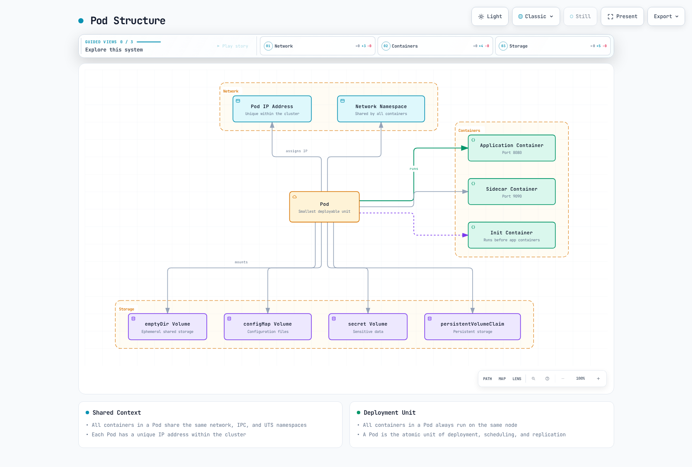

# Pods y cargas de trabajo de Kubernetes

> **Versiones compatibles**: Kubernetes 1.35, 1.36, 1.37
> **Última actualización**: 12 de octubre de 2026

Este documento explica los Pods, la unidad básica de ejecución de Kubernetes, y los recursos que los administran. Describe sus conceptos, características y casos de uso, incluidos Deployment, StatefulSet y DaemonSet.

## Configuración del entorno de laboratorio

Para seguir los ejemplos, necesita las siguientes herramientas y un entorno de Kubernetes:

### Herramientas necesarias
- kubectl con una diferencia máxima de una versión menor respecto al servidor de la API
- Un clúster de Kubernetes funcional (EKS, minikube, kind, etc.)

### Desplegar la aplicación de ejemplo

```bash
# Create namespace
kubectl create namespace workloads-demo

# Create a simple deployment
kubectl -n workloads-demo apply -f - <<EOF
apiVersion: apps/v1
kind: Deployment
metadata:
  name: nginx-deployment
  labels:
    app: nginx
spec:
  replicas: 3
  selector:
    matchLabels:
      app: nginx
  template:
    metadata:
      labels:
        app: nginx
    spec:
      containers:
      - name: nginx
        image: nginx:1.30.6
        ports:
        - containerPort: 80
        resources:
          requests:
            memory: "64Mi"
            cpu: "100m"
          limits:
            memory: "128Mi"
            cpu: "200m"
EOF

# Check deployment status
kubectl -n workloads-demo get deployments,pods
```

## Tabla de contenido
- [Conceptos de Pod](#pod-concepts)
- [Ciclo de vida de Pod](#pod-lifecycle)
- [Patrones de diseño de Pod](#pod-design-patterns)
- [Resumen de recursos de carga de trabajo](#workload-resources-overview)
- [ReplicaSet](#replicaset)
- [Deployment](#deployment)
- [StatefulSet](#statefulset)
- [DaemonSet](#daemonset)
- [Jobs y CronJobs](#jobs-and-cronjobs)

## Conceptos de Pod {#pod-concepts}

> **Concepto clave**: Un Pod es la unidad de ejecución más pequeña que puede desplegarse en Kubernetes. Agrupa contenedores que comparten almacenamiento y red.

Un Pod es la unidad de ejecución más pequeña que puede desplegarse en Kubernetes. Agrupa uno o más contenedores que comparten almacenamiento y red y se planifican juntos.

### Características de Pod

1. **Contexto compartido**: Los contenedores comparten la red del Pod y, normalmente, el espacio de IPC; para compartir el espacio de nombres de procesos se necesita `shareProcessNamespace: true`. Cada contenedor conserva su propio sistema de archivos raíz.
2. **Mismo nodo**: Todos los contenedores de un Pod se ejecutan en el mismo nodo.
3. **Dirección IP única**: Cada Pod tiene una dirección IP única dentro del clúster.
4. **Carácter efímero**: Los Pods son efímeros y pueden sustituirse por otros nuevos si fallan.
5. **Unidad atómica**: El Pod es la unidad de despliegue, planificación y replicación.

### Estructura de Pod

Un Pod consta de los siguientes componentes:

1. **Contenedores**: Uno o más contenedores que se ejecutan dentro del Pod
2. **Volúmenes**: Almacenamiento compartido por los contenedores dentro del Pod
3. **Red**: Dirección IP y puertos asignados al Pod
4. **Especificación del contenedor**: Imagen de contenedor, variables de entorno, requisitos de recursos, etc.



[🔍 Ver diagrama interactivo](https://www.atomai.click/kubernetes-docs/archmaps/en-core-02-pods-and-workloads-0.html)

### Ejemplo de Pod

```yaml
apiVersion: v1
kind: Pod
metadata:
  name: multi-container-pod
  labels:
    app: web
spec:
  containers:
  - name: web
    image: nginx:1.30.6
    ports:
    - containerPort: 80
    volumeMounts:
    - name: shared-data
      mountPath: /usr/share/nginx/html
  - name: content-updater
    image: alpine
    command: ["/bin/sh", "-c"]
    args:
    - |
      while true; do
        echo "Current time: $(date)" > /content/index.html;
        sleep 10;
      done
    volumeMounts:
    - name: shared-data
      mountPath: /content
  volumes:
  - name: shared-data
    emptyDir: {}
```

### Ejemplo práctico: Pod de aplicación web

El siguiente Pod contiene una aplicación web y un contenedor sidecar:

```yaml
apiVersion: v1
kind: Pod
metadata:
  name: web-app
  labels:
    app: web
    environment: production
spec:
  containers:
  - name: web-application
    image: nginx:1.30.6
    volumeMounts:
    - name: log-volume
      mountPath: /var/log/nginx
    ports:
    - containerPort: 80
    resources:
      requests:
        memory: "128Mi"
        cpu: "100m"
      limits:
        memory: "256Mi"
        cpu: "500m"
  - name: log-collector
    image: fluentd:v1.19-debian-1
    volumeMounts:
    - name: log-volume
      mountPath: /var/log/nginx
    resources:
      requests:
        memory: "64Mi"
        cpu: "50m"
      limits:
        memory: "128Mi"
        cpu: "100m"
  volumes:
  - name: log-volume
    emptyDir: {}
```

El ejemplo muestra cómo:
- Ejecutar Nginx como contenedor principal
- Ejecutar Fluentd como sidecar para recopilar logs
- Compartir un volumen de logs entre ambos contenedores
- Establecer las solicitudes y los límites de recursos de cada contenedor

Esta configuración permite ejecutar juntos contenedores estrechamente relacionados y separar funciones como logging, monitorización o proxy en una arquitectura de microservicios.

Estos manifiestos muestran cómo conectar los volúmenes de logs. Fluentd también necesita una fuente de entrada tail y una configuración de salida explícitas; montar un directorio no basta para recopilar sus logs. Las imágenes y la configuración sirven de ejemplo y no son recomendaciones de versiones para producción. Los sidecars nativos se definen en `initContainers` con `restartPolicy: Always`, una función estable desde la versión 1.33. Un Pod convencional con varios contenedores no garantiza su orden de arranque o apagado.

### Definición de Pod

Los Pods se definen mediante manifiestos YAML o JSON. El siguiente ejemplo muestra una definición básica:

```yaml
apiVersion: v1
kind: Pod
metadata:
  name: nginx-pod
  labels:
    app: nginx
spec:
  containers:
  - name: nginx
    image: nginx:1.30.6
    ports:
    - containerPort: 80
    resources:
      requests:
        memory: "64Mi"
        cpu: "250m"
      limits:
        memory: "128Mi"
        cpu: "500m"
```

### Pods de un solo contenedor frente a Pods multi-contenedor

**Pods de un solo contenedor**:
- Son el caso de uso más común
- Contienen un único contenedor de aplicación
- Tienen una estructura sencilla

**Pods con varios contenedores**:
- Agrupan contenedores estrechamente relacionados
- Permiten la comunicación local entre contenedores mediante localhost
- Comparten datos mediante volúmenes
- Sus contenedores se escalan y se ubican juntos

### Patrones de Pod multi-contenedor

1. **Patrón Sidecar**: Contenedor auxiliar que amplía la funcionalidad del contenedor principal
   - Ejemplos: recolector de logs, sincronización de archivos, proxy

```yaml
apiVersion: v1
kind: Pod
metadata:
  name: web-with-sidecar
spec:
  containers:
  - name: web
    image: nginx:1.30.6
    volumeMounts:
    - name: logs
      mountPath: /var/log/nginx
  - name: log-collector
    image: fluentd:v1.19-debian-1
    volumeMounts:
    - name: logs
      mountPath: /var/log/nginx
  volumes:
  - name: logs
    emptyDir: {}
```

2. **Patrón Ambassador**: Contenedor que actúa como proxy para servicios externos
   - Ejemplos: proxy de base de datos, sidecar de service mesh

```yaml
apiVersion: v1
kind: Pod
metadata:
  name: app-with-ambassador
spec:
  containers:
  - name: app
    image: myapp:1.0
  - name: ambassador
    image: envoyproxy/envoy:v1.20.0
    ports:
    - containerPort: 9901
```

3. **Patrón Adapter**: Contenedor que estandariza la salida del contenedor principal
   - Ejemplos: conversión de formato de logs, conversión de métricas

```yaml
apiVersion: v1
kind: Pod
metadata:
  name: app-with-adapter
spec:
  containers:
  - name: app
    image: myapp:1.0
    volumeMounts:
    - name: app-logs
      mountPath: /var/log/app
  - name: adapter
    image: adapter:1.0
    volumeMounts:
    - name: app-logs
      mountPath: /var/log/app
  volumes:
  - name: app-logs
    emptyDir: {}
```

4. **Patrón de contenedor init**: Contenedor que se ejecuta antes de que se inicie el contenedor principal
   - Ejemplos: creación de archivos de configuración, migración de base de datos, configuración de permisos

```yaml
apiVersion: v1
kind: Pod
metadata:
  name: app-with-init
spec:
  initContainers:
  - name: init-db
    image: busybox:1.34
    command: ['sh', '-c', 'until nslookup db; do echo waiting for db; sleep 2; done;']
  containers:
  - name: app
    image: myapp:1.0
```

### Redes de Pod

Los contenedores dentro de un Pod tienen las siguientes características de red:

1. **Misma dirección IP**: Todos los contenedores del Pod comparten su dirección IP.
2. **Puertos compartidos**: Comparten el espacio de puertos; normalmente no pueden escuchar en la misma combinación de IP, protocolo y puerto.
3. **Comunicación local**: Pueden comunicarse entre sí mediante localhost.
4. **Comunicación entre Pods**: Cada Pod tiene una IP única y puede comunicarse directamente con otros Pods.

### Almacenamiento de Pod

Los Pods pueden utilizar diversos tipos de volúmenes para almacenar y compartir datos:

1. **emptyDir**: Volumen temporal creado cuando se crea el Pod y eliminado cuando se elimina el Pod
2. **hostPath**: Volumen montado desde el sistema de archivos del nodo host al Pod
3. **persistentVolumeClaim**: Volumen que solicita almacenamiento persistente
4. **configMap**: ConfigMap montado como volumen
5. **secret**: Secret montado como volumen
6. **projected**: Varias fuentes de volumen asignadas al mismo directorio

```yaml
apiVersion: v1
kind: Pod
metadata:
  name: pod-with-volumes
spec:
  containers:
  - name: app
    image: myapp:1.0
    volumeMounts:
    - name: data
      mountPath: /data
    - name: config
      mountPath: /etc/config
  volumes:
  - name: data
    emptyDir: {}
  - name: config
    configMap:
      name: app-config
```

## Ciclo de vida de Pod {#pod-lifecycle}

Los Pods atraviesan distintas etapas desde su creación hasta su terminación. Conocerlas ayuda a mantener la estabilidad y disponibilidad de la aplicación.

### Fases de Pod

Los Pods pasan por las siguientes fases:

1. **Pending**: El Pod ha sido aceptado por el clúster, pero todavía no se han configurado uno o más contenedores
2. **Running**: El Pod se ha asociado a un nodo, se han creado todos los contenedores y al menos uno se está ejecutando o iniciando/reiniciando
3. **Succeeded**: Todos los contenedores del Pod han finalizado correctamente y no se reiniciarán
4. **Failed**: Todos los contenedores del Pod han finalizado y al menos uno ha terminado con error
5. **Unknown**: No se pudo obtener el estado del Pod por algún motivo

### Estados de contenedor

Cada contenedor dentro de un Pod puede tener los siguientes estados:

1. **Waiting**: El contenedor todavía no se ejecuta; por ejemplo, está descargando la imagen o esperando dependencias
2. **Running**: El proceso se ejecuta, pero eso no demuestra por sí solo que la aplicación esté sana o preparada para atender solicitudes
3. **Terminated**: El contenedor ha finalizado su ejecución o ha fallado

### Condiciones de Pod

Los Pods indican su estado de forma más específica mediante las siguientes condiciones:

1. **PodScheduled**: Indica si el Pod se ha asignado a un nodo
2. **ContainersReady**: Indica si todos sus contenedores están preparados
3. **Initialized**: Los contenedores de inicialización convencionales han terminado y los reiniciables, usados como sidecars nativos, han arrancado
4. **Ready**: Indica si el Pod puede atender solicitudes e incorporarse al conjunto de destinos de los servicios

### Sondas de los contenedores

Kubernetes ofrece las siguientes sondas para comprobar el estado de los contenedores:

1. **livenessProbe**: Comprueba si el contenedor está vivo y provoca su reinicio si falla
2. **readinessProbe**: Comprueba si está preparado para atender solicitudes y lo excluye del tráfico del servicio si falla
3. **startupProbe**: Comprueba si la aplicación ha arrancado y mantiene deshabilitadas las otras sondas hasta que tenga éxito

```yaml
apiVersion: v1
kind: Pod
metadata:
  name: pod-with-probes
spec:
  containers:
  - name: app
    image: myapp:1.0
    ports:
    - containerPort: 8080
    livenessProbe:
      httpGet:
        path: /healthz
        port: 8080
      initialDelaySeconds: 30
      periodSeconds: 10
      timeoutSeconds: 5
      failureThreshold: 3
    readinessProbe:
      httpGet:
        path: /ready
        port: 8080
      initialDelaySeconds: 5
      periodSeconds: 5
    startupProbe:
      httpGet:
        path: /startup
        port: 8080
      failureThreshold: 30
      periodSeconds: 10
```

### Proceso de terminación de Pod

Cuando se termina un Pod, ocurre el siguiente proceso:

1. **Solicitud de eliminación**: Un usuario o controlador solicita al servidor de API que elimine el Pod
2. **Inicio del período de terminación**: Se establece el período de terminación, de 30 segundos por defecto
3. **Actualización de la API**: El servidor de API registra la marca de tiempo de eliminación del Pod
4. **Actualización del endpoint**: Los EndpointSlices lo marcan como en terminación y no preparado; el cambio se propaga al mismo tiempo que el nodo realiza el apagado
5. **Señal de detención**: kubelet ejecuta el hook preStop, si existe, dentro del período de gracia y solicita al runtime que envíe la señal de detención, normalmente SIGTERM, salvo que la imagen o el contenedor la hayan sustituido
6. **Espera del apagado ordenado**: La aplicación dispone de tiempo para terminar de forma ordenada
7. **Señal SIGKILL**: Si los contenedores no terminan dentro del período permitido, se envía SIGKILL
8. **Limpieza de recursos**: kubelet limpia los recursos del Pod

### Contenedores init

Los contenedores init son contenedores especiales que se ejecutan antes de que se inicien los contenedores de aplicación de un Pod:

1. **Ejecución secuencial**: Los contenedores de inicialización se ejecutan uno a uno, en el orden definido
2. **Dependencia previa**: Cada uno empieza cuando el anterior termina correctamente
3. **Reinicio tras un fallo**: Si falla, se reinicia según la política de reinicio del Pod
4. **Finalidad**: Preparar la aplicación, comprobar dependencias o configurar permisos antes de su arranque

```yaml
apiVersion: v1
kind: Pod
metadata:
  name: init-pod
spec:
  initContainers:
  - name: init-myservice
    image: busybox:1.34
    command: ['sh', '-c', 'until nslookup myservice; do echo waiting for myservice; sleep 2; done;']
  - name: init-mydb
    image: busybox:1.34
    command: ['sh', '-c', 'until nslookup mydb; do echo waiting for mydb; sleep 2; done;']
  containers:
  - name: app
    image: myapp:1.0
```

### Interrupción de Pod

Las interrupciones de Pod se pueden dividir en voluntarias o involuntarias:

1. **Interrupciones voluntarias**: Interrupciones realizadas por administradores del clúster o herramientas de automatización
   - Drenaje de nodos
   - Actualizaciones de Deployment
   - Eliminación de Pod

2. **Interrupciones involuntarias**: Las causadas por fallos de hardware, fallos críticos del kernel, particiones de red u otros problemas similares

PodDisruptionBudget limita los desalojos voluntarios realizados mediante la API Eviction, como los de un drenaje de nodos. La eliminación directa de Pods y las actualizaciones progresivas de Deployment no pasan por esa protección: configure por separado la disponibilidad durante el despliegue. El presupuesto no evita los fallos involuntarios.

## Patrones de diseño de Pod {#pod-design-patterns}

Al diseñar Pods, estos patrones y buenas prácticas pueden mejorar la estabilidad, la escalabilidad y el mantenimiento de la aplicación.

### Principio de responsabilidad única

Los Pods deben seguir el principio de responsabilidad única:

1. **Una función principal**: Cada Pod debe tener una función o proceso principal
2. **Escalado independiente**: Diseñe cada función para que pueda escalar de forma independiente
3. **Ciclo de vida propio**: Diseñe cada función para que pueda tener su propio ciclo de vida

### Plantillas de Pod

Las plantillas de Pod describen los Pods que crearán recursos como Deployment o StatefulSet:

```yaml
apiVersion: apps/v1
kind: Deployment
metadata:
  name: nginx-deployment
spec:
  replicas: 3
  selector:
    matchLabels:
      app: nginx
  template:  # Pod template starts
    metadata:
      labels:
        app: nginx
    spec:
      containers:
      - name: nginx
        image: nginx:1.30.6
        ports:
        - containerPort: 80
  # Pod template ends
```

### Afinidad y antiafinidad de Pod

La afinidad y antiafinidad de Pod son reglas que controlan en qué nodos se programan los Pods:

1. **Afinidad de Pod**: Ubica el Pod en el mismo nodo o dominio de topología que determinados Pods
2. **Antiafinidad de Pod**: Lo ubica en un nodo o dominio de topología distinto

```yaml
apiVersion: v1
kind: Pod
metadata:
  name: web-pod
spec:
  affinity:
    podAffinity:
      requiredDuringSchedulingIgnoredDuringExecution:
      - labelSelector:
          matchExpressions:
          - key: app
            operator: In
            values:
            - cache
        topologyKey: "kubernetes.io/hostname"
    podAntiAffinity:
      preferredDuringSchedulingIgnoredDuringExecution:
      - weight: 100
        podAffinityTerm:
          labelSelector:
            matchExpressions:
            - key: app
              operator: In
              values:
              - web
          topologyKey: "kubernetes.io/hostname"
  containers:
  - name: web
    image: nginx:1.30.6
```

### Afinidad de nodo

La afinidad de nodo restringe los nodos en los que puede planificarse un Pod:

```yaml
apiVersion: v1
kind: Pod
metadata:
  name: gpu-pod
spec:
  affinity:
    nodeAffinity:
      requiredDuringSchedulingIgnoredDuringExecution:
        nodeSelectorTerms:
        - matchExpressions:
          - key: gpu
            operator: In
            values:
            - "true"
  containers:
  - name: gpu-container
    image: gpu-app:1.0
```

### Taints y tolerancias

Los taints de un nodo impiden planificar en él determinados Pods. Las tolerancias de un Pod permiten que se planifique en nodos que tengan esos taints:

```bash
# Apply taint to node
kubectl taint nodes node1 key=value:NoSchedule
```

```yaml
# Apply toleration to Pod
apiVersion: v1
kind: Pod
metadata:
  name: tolerant-pod
spec:
  tolerations:
  - key: "key"
    operator: "Equal"
    value: "value"
    effect: "NoSchedule"
  containers:
  - name: app
    image: myapp:1.0
```

### Solicitudes y límites de recursos

Configurar las solicitudes y los límites de recursos de los contenedores ayuda a utilizar los recursos del clúster de forma eficiente y mantener su estabilidad:

```yaml
apiVersion: v1
kind: Pod
metadata:
  name: resource-pod
spec:
  containers:
  - name: app
    image: myapp:1.0
    resources:
      requests:
        memory: "64Mi"
        cpu: "250m"
      limits:
        memory: "128Mi"
        cpu: "500m"
```

### Contexto de seguridad de Pod

El contexto de seguridad define configuraciones de seguridad en el nivel de Pod o de contenedor:

```yaml
apiVersion: v1
kind: Pod
metadata:
  name: security-pod
spec:
  securityContext:
    runAsUser: 1000
    runAsGroup: 3000
    fsGroup: 2000
  containers:
  - name: app
    image: myapp:1.0
    securityContext:
      allowPrivilegeEscalation: false
      capabilities:
        drop:
        - ALL
```

### Prioridad y preempción de Pods

Cuando los recursos del clúster no bastan, la prioridad y la preempción determinan qué Pods se planifican y cuáles se desalojan para ceder recursos:

```yaml
# Priority class definition
apiVersion: scheduling.k8s.io/v1
kind: PriorityClass
metadata:
  name: high-priority
value: 1000000
globalDefault: false
description: "This priority class should be used for critical pods only."
---
# Pod using priority class
apiVersion: v1
kind: Pod
metadata:
  name: high-priority-pod
spec:
  priorityClassName: high-priority
  containers:
  - name: app
    image: myapp:1.0
```

## Resumen de recursos de carga de trabajo {#workload-resources-overview}

Kubernetes proporciona diversos recursos de carga de trabajo para gestionar Pods. Cada recurso de carga de trabajo está diseñado para casos de uso y requisitos específicos.

### Tipos de recursos de carga de trabajo

Los principales recursos de carga de trabajo de Kubernetes son:

1. **ReplicaSet**: Mantiene un número especificado de réplicas de Pod
2. **Deployment**: Gestiona ReplicaSets para proporcionar actualizaciones declarativas
3. **StatefulSet**: Recurso para aplicaciones que requieren persistencia de estado
4. **DaemonSet**: Ejecuta una copia de un Pod en todos los nodos
5. **Job**: Tareas de una sola vez que terminan después de completarse
6. **CronJob**: Ejecuta Jobs periódicamente según una programación

### Criterios de selección de recursos de carga de trabajo

Criterios para seleccionar el recurso de carga de trabajo adecuado:

1. **Persistencia de estado**: Si la aplicación necesita mantener el estado
2. **Patrón de ejecución**: Si se ejecuta continuamente, una sola vez o periódicamente
3. **Requisitos de despliegue**: Requisitos para actualizaciones continuas, despliegues blue/green, etc.
4. **Cobertura de nodos**: Si necesita ejecutarse en todos los nodos
5. **Requisitos de escalabilidad**: Si se necesita escalado horizontal

## ReplicaSet

Un ReplicaSet mantiene el número especificado de réplicas de un Pod. Si un Pod falla o se elimina, el controlador crea un reemplazo.

### Características principales de ReplicaSet

1. **Mantener réplicas de Pod**: Mantiene el número especificado de réplicas de Pod
2. **Selección de Pod**: Identifica los Pods que se deben gestionar mediante selectores de etiquetas
3. **Creación de Pod**: Crea nuevos Pods cuando es necesario
4. **Eliminación de Pod**: Elimina los Pods sobrantes

### Definición de ReplicaSet

```yaml
apiVersion: apps/v1
kind: ReplicaSet
metadata:
  name: frontend
  labels:
    app: guestbook
    tier: frontend
spec:
  replicas: 3
  selector:
    matchLabels:
      tier: frontend
  template:
    metadata:
      labels:
        tier: frontend
    spec:
      containers:
      - name: php-redis
        image: gcr.io/google_samples/gb-frontend:v3
        resources:
          requests:
            cpu: 100m
            memory: 100Mi
        ports:
        - containerPort: 80
```

### Funcionamiento de ReplicaSet

1. **Coincidencia de selector de etiquetas**: ReplicaSet identifica los Pods que coinciden con el selector de etiquetas
2. **Comprobar el estado actual**: Verifica el número de Pods que se están ejecutando actualmente
3. **Comparar con el estado deseado**: Compara el recuento actual de Pods con el número de réplicas deseado
4. **Acciones de ajuste**: Crea o elimina Pods según sea necesario

### ReplicaSet frente a Replication Controller

ReplicaSet es el sucesor de Replication Controller y proporciona selectores de etiquetas más potentes:

1. **Replication Controller**: Admite solo selectores basados en igualdad (p. ej., app=nginx)
2. **ReplicaSet**: Admite selectores basados en conjuntos (p. ej., app in (nginx, apache))

### Casos de uso de ReplicaSet

Normalmente se administran ReplicaSets mediante Deployments. También pueden usarse directamente en los siguientes casos:

1. **Replicación sencilla**: Mantener réplicas de Pods
2. **Actualizaciones personalizadas**: Implementar mecanismos de actualización propios
3. **Compatibilidad con sistemas heredados**: Administrar aplicaciones heredadas

## Deployment

Un Deployment administra ReplicaSets para actualizar Pods de forma declarativa. Permite realizar actualizaciones progresivas, reversiones y cambios en el número de réplicas.

### Características principales de Deployment

1. **Actualizaciones declarativas**: Se declara el estado deseado y el Deployment ajusta el estado actual
2. **Actualizaciones progresivas**: Permite actualizar la aplicación sin interrupción del servicio
3. **Reversión**: Facilita volver a versiones anteriores
4. **Escalado**: Ajusta el número de réplicas de la aplicación
5. **Historial de despliegues**: Conserva los registros de las versiones desplegadas

### Definición de Deployment

```yaml
apiVersion: apps/v1
kind: Deployment
metadata:
  name: nginx-deployment
  labels:
    app: nginx
spec:
  replicas: 3
  selector:
    matchLabels:
      app: nginx
  strategy:
    type: RollingUpdate
    rollingUpdate:
      maxSurge: 1
      maxUnavailable: 0
  template:
    metadata:
      labels:
        app: nginx
    spec:
      containers:
      - name: nginx
        image: nginx:1.30.6
        ports:
        - containerPort: 80
        resources:
          requests:
            cpu: 100m
            memory: 100Mi
          limits:
            cpu: 200m
            memory: 200Mi
        livenessProbe:
          httpGet:
            path: /
            port: 80
          initialDelaySeconds: 30
          periodSeconds: 10
        readinessProbe:
          httpGet:
            path: /
            port: 80
          initialDelaySeconds: 5
          periodSeconds: 5
```

### Estrategias de actualización de Deployment

Los Deployments proporcionan dos estrategias de actualización:

1. **RollingUpdate**: Actualiza los Pods gradualmente para desplegar sin interrumpir el servicio; es la estrategia predeterminada
   - **maxSurge**: Número máximo de Pods adicionales por encima del número deseado
   - **maxUnavailable**: Número máximo de Pods que pueden no estar disponibles durante la actualización

2. **Recreate**: Elimina todos los Pods existentes antes de crear Pods nuevos (provoca tiempo de inactividad temporal)

### Reversión de Deployment

Los Deployments admiten la reversión a versiones anteriores:

```bash
# Check deployment history
kubectl -n workloads-demo rollout history deployment/nginx-deployment

# Check details of specific version
kubectl -n workloads-demo rollout history deployment/nginx-deployment --revision=2

# Rollback to previous version
kubectl -n workloads-demo rollout undo deployment/nginx-deployment

# Rollback to specific version
kubectl -n workloads-demo rollout undo deployment/nginx-deployment --to-revision=2
```

### Escalado de Deployment

Los Deployments se pueden escalar fácilmente:

```bash
# Imperative scaling
kubectl -n workloads-demo scale deployment/nginx-deployment --replicas=5

# Declarative scaling (after modifying YAML file)
kubectl apply -f deployment.yaml
```

### Pausar y reanudar Deployment

Las actualizaciones de un Deployment pueden pausarse y reanudarse:

```bash
# Pause rollout
kubectl -n workloads-demo rollout pause deployment/nginx-deployment

# Apply multiple changes
kubectl -n workloads-demo set image deployment/nginx-deployment nginx=nginx:1.30.6-alpine
kubectl -n workloads-demo set resources deployment/nginx-deployment -c=nginx --limits=cpu=200m,memory=256Mi

# Resume rollout
kubectl -n workloads-demo rollout resume deployment/nginx-deployment
```

### Estado de Deployment

Las condiciones de un Deployment incluyen `Progressing`, `Available` y `ReplicaFailure`. Una actualización bloqueada puede mostrar `Progressing=False` con el motivo `ProgressDeadlineExceeded`; Kubernetes no la revierte automáticamente. «Complete» describe que la actualización terminó, no un tipo de condición.

## StatefulSet

StatefulSet es un recurso de carga de trabajo para aplicaciones que requieren persistencia de estado. Asigna identificadores únicos a cada Pod y proporciona identificadores de red estables y almacenamiento persistente.

### Características principales de StatefulSet

1. **Identidad de red estable y única**: Los nombres de los Pods y sus nombres de host se conservan después de reinicios
2. **Almacenamiento estable y persistente**: Cada Pod mantiene el acceso al mismo almacenamiento al volver a planificarse
3. **Despliegue y escalado secuenciales**: Los Pods se crean, actualizan y eliminan en orden
4. **Actualizaciones progresivas automáticas**: Los Pods se actualizan en orden

### Definición de StatefulSet

```yaml
apiVersion: apps/v1
kind: StatefulSet
metadata:
  name: web
spec:
  selector:
    matchLabels:
      app: nginx
  serviceName: "nginx"
  replicas: 3
  updateStrategy:
    type: RollingUpdate
  podManagementPolicy: OrderedReady
  template:
    metadata:
      labels:
        app: nginx
    spec:
      containers:
      - name: nginx
        image: nginx:1.30.6
        ports:
        - containerPort: 80
          name: web
        volumeMounts:
        - name: www
          mountPath: /usr/share/nginx/html
  volumeClaimTemplates:
  - metadata:
      name: www
    spec:
      accessModes: [ "ReadWriteOnce" ]
      storageClassName: "standard"
      resources:
        requests:
          storage: 1Gi
```

### Identificadores de Pod de StatefulSet

StatefulSet asigna identificadores únicos a los Pods en el siguiente formato:
```
<StatefulSet name>-<ordinal index>
```

Por ejemplo, un StatefulSet `web` crea Pods como `web-0`, `web-1`, `web-2`.

### Service headless de un StatefulSet

Los StatefulSets suelen usarse con un Service headless, configurado con clusterIP: None. Este crea registros DNS para cada Pod:

```yaml
apiVersion: v1
kind: Service
metadata:
  name: nginx
  labels:
    app: nginx
spec:
  ports:
  - port: 80
    name: web
  clusterIP: None
  selector:
    app: nginx
```

Cada Pod obtiene así un nombre DNS con el siguiente formato:
```
<Pod name>.<service name>.<namespace>.svc.cluster.local
```

Ejemplo: `web-0.nginx.default.svc.cluster.local`

### Almacenamiento de StatefulSet

Los StatefulSets usan `volumeClaimTemplates` para crear automáticamente solicitudes de volumen persistente, o PVC, para cada Pod. Estas se conservan cuando el Pod vuelve a planificarse.

### Estrategias de actualización de StatefulSet

Los StatefulSets proporcionan dos estrategias de actualización:

1. **RollingUpdate**: Actualiza los Pods en orden (predeterminado)
2. **OnDelete**: Actualiza solo cuando se eliminan los Pods

### Política de gestión de Pod

Los StatefulSets proporcionan dos políticas de gestión de Pod:

1. **OrderedReady**: Crea y termina los Pods en orden (predeterminado)
2. **Parallel**: Crea y termina los Pods en paralelo

### Casos de uso de StatefulSet

Los StatefulSets son adecuados para las siguientes aplicaciones:

1. **Bases de datos**: MySQL, PostgreSQL, MongoDB, etc.
2. **Sistemas distribuidos**: Kafka, ZooKeeper, Elasticsearch, etc.
3. **Colas de mensajes**: RabbitMQ, etc.
4. **Otras aplicaciones con estado**: Servidores de archivos, almacenes de sesiones, etc.

### Ejemplo de StatefulSet: instancia MySQL persistente

El ejemplo muestra una identidad estable y un PVC para una sola instancia de MySQL. **No** configura la replicación ni la conmutación automática por fallo de la base de datos. Aumentar `replicas` crearía bases de datos independientes. Cree `mysql-secret` con una clave `password` en el mismo namespace y proporcione una StorageClass predeterminada, o indique expresamente una adecuada. Use una versión de parche o una imagen fijada por digest de MySQL 8.4 que haya probado. Para cambiar las credenciales, debe rotarlas en la base de datos; actualizar el Secret no basta.

```yaml
apiVersion: v1
kind: Service
metadata:
  name: mysql
spec:
  clusterIP: None
  selector:
    app: mysql
  ports:
  - name: mysql
    port: 3306
---
apiVersion: apps/v1
kind: StatefulSet
metadata:
  name: mysql
spec:
  serviceName: mysql
  replicas: 1
  selector:
    matchLabels:
      app: mysql
  podManagementPolicy: OrderedReady
  template:
    metadata:
      labels:
        app: mysql
    spec:
      containers:
      - name: mysql
        image: mysql:8.4
        env:
        - name: MYSQL_ROOT_PASSWORD
          valueFrom:
            secretKeyRef:
              name: mysql-secret
              key: password
        ports:
        - name: mysql
          containerPort: 3306
        startupProbe:
          tcpSocket:
            port: mysql
          periodSeconds: 10
          failureThreshold: 60
        readinessProbe:
          exec:
            command:
            - sh
            - -c
            - 'MYSQL_PWD="$MYSQL_ROOT_PASSWORD" mysql -h 127.0.0.1 -u root -e "SELECT 1"'
          periodSeconds: 10
          timeoutSeconds: 5
        resources:
          requests:
            cpu: 500m
            memory: 1Gi
          limits:
            memory: 2Gi
        volumeMounts:
        - name: data
          mountPath: /var/lib/mysql
  volumeClaimTemplates:
  - metadata:
      name: data
    spec:
      accessModes: [ReadWriteOnce]
      resources:
        requests:
          storage: 10Gi
```

Para configurar la replicación y la promoción de un líder, use un operador de bases de datos o un procedimiento de replicación probado por separado. StatefulSet por sí solo no ofrece esas funciones. El [tutorial de replicación del proyecto](https://kubernetes.io/docs/tasks/run-application/run-replicated-stateful-application/) usa expresamente valores predeterminados inseguros para enseñar el concepto y no constituye una configuración de producción.

## DaemonSet

Un DaemonSet mantiene una copia de un Pod en todos los nodos, o en los nodos seleccionados. Cuando se incorpora un nodo al clúster, añade el Pod correspondiente; cuando se retira, elimina su Pod.

### Características principales de DaemonSet

1. **Ejecutar en todos los nodos**: Ejecuta Pods en todos los nodos del clúster
2. **Selección de nodos**: Puede ejecutarse solo en nodos específicos mediante selectores de nodos
3. **Despliegue automático**: Despliega automáticamente Pods cuando se añaden nodos nuevos
4. **Limpieza automática**: Limpia automáticamente los Pods cuando se eliminan nodos

### Definición de DaemonSet

```yaml
apiVersion: apps/v1
kind: DaemonSet
metadata:
  name: fluentd-elasticsearch
  namespace: kube-system
  labels:
    k8s-app: fluentd-logging
spec:
  selector:
    matchLabels:
      name: fluentd-elasticsearch
  updateStrategy:
    type: RollingUpdate
    rollingUpdate:
      maxUnavailable: 1
  template:
    metadata:
      labels:
        name: fluentd-elasticsearch
    spec:
      tolerations:
      - key: node-role.kubernetes.io/control-plane
        effect: NoSchedule
      containers:
      - name: fluentd-elasticsearch
        image: quay.io/fluentd_elasticsearch/fluentd:v2.5.2
        resources:
          limits:
            memory: 200Mi
          requests:
            cpu: 100m
            memory: 200Mi
        volumeMounts:
        - name: varlog
          mountPath: /var/log
          readOnly: true
      terminationGracePeriodSeconds: 30
      volumes:
      - name: varlog
        hostPath:
          path: /var/log
```

Para runtimes CRI, configure el recolector para analizar los logs de CRI bajo `/var/log/pods`, normalmente enlazados desde `/var/log/containers`, en lugar de los logs JSON de Docker. El recolector necesita su propia configuración de entrada y salida y los permisos de RBAC correspondientes.

### Estrategias de actualización de DaemonSet

Los DaemonSets proporcionan dos estrategias de actualización:

1. **RollingUpdate**: Actualiza los Pods secuencialmente (predeterminado)
   - **maxUnavailable**: Número máximo de Pods no disponibles durante la actualización

2. **OnDelete**: Actualiza solo cuando se eliminan los Pods

### Selección de nodos de DaemonSet

Los DaemonSets se pueden configurar para ejecutarse solo en nodos específicos:

```yaml
spec:
  template:
    spec:
      nodeSelector:
        disk: ssd
```

### Tolerancias de DaemonSet para taints

Los DaemonSets pueden configurar tolerancias para ejecutarse en nodos con taints:

```yaml
spec:
  template:
    spec:
      tolerations:
      - key: node-role.kubernetes.io/control-plane
        effect: NoSchedule
```

### Casos de uso de DaemonSet

Los DaemonSets se utilizan para los siguientes fines:

1. **Recolectores de logs**: Fluentd, Logstash, etc.
2. **Agentes de monitorización**: Prometheus Node Exporter, Datadog Agent, etc.
3. **Plugins de red**: Calico, Cilium, etc.
4. **Daemons de almacenamiento**: Ceph, GlusterFS, etc.
5. **Agentes de seguridad**: Falco, Sysdig, etc.

### Ejemplo de DaemonSet: Prometheus Node Exporter

```yaml
apiVersion: apps/v1
kind: DaemonSet
metadata:
  name: node-exporter
  namespace: monitoring
  labels:
    app: node-exporter
spec:
  selector:
    matchLabels:
      app: node-exporter
  template:
    metadata:
      labels:
        app: node-exporter
    spec:
      hostNetwork: true
      hostPID: true
      containers:
      - name: node-exporter
        image: prom/node-exporter:v1.3.1
        args:
        - --path.procfs=/host/proc
        - --path.sysfs=/host/sys
        - --path.rootfs=/host/root
        - --web.listen-address=:9100
        ports:
        - containerPort: 9100
          protocol: TCP
          name: http
        resources:
          limits:
            cpu: 250m
            memory: 180Mi
          requests:
            cpu: 102m
            memory: 180Mi
        volumeMounts:
        - name: proc
          mountPath: /host/proc
          readOnly: true
        - name: sys
          mountPath: /host/sys
          readOnly: true
        - name: root
          mountPath: /host/root
          readOnly: true
      tolerations:
      - operator: "Exists"
      volumes:
      - name: proc
        hostPath:
          path: /proc
      - name: sys
        hostPath:
          path: /sys
      - name: root
        hostPath:
          path: /
```

## Jobs y CronJobs {#jobs-and-cronjobs}

Los Jobs y CronJobs ejecutan tareas que deben terminar o repetirse periódicamente.

### Job

Un Job crea uno o más Pods y continúa hasta que el número especificado de Pods haya terminado correctamente.

#### Características principales de Job

1. **Seguimiento de la finalización**: Cuenta los Pods que terminan correctamente; alcanzar los límites de reintentos o de tiempo puede hacer que el Job falle
2. **Ejecución paralela**: Puede ejecutar varios Pods a la vez
3. **Reintentos**: Reintenta automáticamente los Pods que fallan
4. **Limpieza al terminar**: Permite limpiar los Pods después de completar el Job

#### Definición de Job

```yaml
apiVersion: batch/v1
kind: Job
metadata:
  name: pi
spec:
  completions: 5      # Number of Pods that must successfully complete
  parallelism: 2      # Number of Pods to run in parallel
  backoffLimit: 4     # Number of retries on failure
  activeDeadlineSeconds: 100  # Job time limit (seconds)
  ttlSecondsAfterFinished: 100  # Deletion time after completion (seconds)
  template:
    spec:
      containers:
      - name: pi
        image: perl:5.34
        command: ["perl", "-Mbignum=bpi", "-wle", "print bpi(2000)"]
        resources:
          requests:
            cpu: 100m
            memory: 50Mi
          limits:
            cpu: 100m
            memory: 100Mi
      restartPolicy: Never  # or OnFailure
```

#### Modos de finalización de Job

Los Jobs proporcionan dos modos de finalización:

1. **NonIndexed**: Modo estándar; el Job termina cuando el número especificado de Pods completa su ejecución correctamente
2. **Indexed**: Asigna a cada Pod un índice a partir de 0 para ejecutar tareas asociadas a índices concretos

```yaml
apiVersion: batch/v1
kind: Job
metadata:
  name: indexed-job
spec:
  completions: 5
  parallelism: 3
  completionMode: Indexed  # Enable Indexed mode
  template:
    spec:
      containers:
      - name: worker
        image: busybox:1.34
        command: ["sh", "-c", "echo Processing item ${JOB_COMPLETION_INDEX}"]
      restartPolicy: Never
```

#### Casos de uso de Job

Los Jobs se utilizan para los siguientes fines:

1. **Procesamiento por lotes**: Procesamiento de datos, tareas ETL
2. **Tareas de cálculo**: Cálculos científicos, renderizado
3. **Migraciones de base de datos**: Actualizaciones de esquema
4. **Tareas administrativas de una sola vez**: Copias de seguridad, tareas de limpieza

### CronJob

Los CronJobs crean Jobs periódicamente según un calendario, de forma similar a cron en Linux.

#### Características principales de CronJob

1. **Ejecución programada**: Define el calendario mediante expresiones cron
2. **Gestión de Jobs**: Crea Jobs según ese calendario
3. **Política de concurrencia**: Define qué sucede si el Job anterior sigue ejecutándose
4. **Límite del historial**: Restringe cuántos Jobs terminados se conservan

#### Definición de CronJob

```yaml
apiVersion: batch/v1
kind: CronJob
metadata:
  name: hello
spec:
  schedule: "*/1 * * * *"  # Run every minute
  timeZone: "America/New_York"  # Timezone (stable since Kubernetes 1.27)
  concurrencyPolicy: Forbid  # Allow, Forbid, Replace
  successfulJobsHistoryLimit: 3
  failedJobsHistoryLimit: 1
  startingDeadlineSeconds: 60
  jobTemplate:
    spec:
      template:
        spec:
          containers:
          - name: hello
            image: busybox:1.34
            command:
            - /bin/sh
            - -c
            - date; echo Hello from the Kubernetes cluster
          restartPolicy: OnFailure
```

#### Expresión cron

Las expresiones cron tienen el siguiente formato:
```
+------------------- minute (0 - 59)
| +----------------- hour (0 - 23)
| | +--------------- day of month (1 - 31)
| | | +------------- month (1 - 12)
| | | | +----------- day of week (0 - 6) (Sunday to Saturday; use 0 for Sunday)
| | | | |
| | | | |
* * * * *
```

Ejemplos comunes de expresiones cron:
- `*/5 * * * *`: Cada 5 minutos
- `0 * * * *`: Cada hora en punto
- `0 0 * * *`: Todos los días a medianoche
- `0 0 * * 0`: Todos los domingos a medianoche
- `0 0 1 * *`: El primer día de cada mes a medianoche
- `0 0 1 1 *`: El 1 de enero a medianoche cada año

#### Política de concurrencia

Los CronJobs proporcionan tres políticas de concurrencia:

1. **Allow**: Se pueden ejecutar varios Jobs simultáneamente (predeterminado)
2. **Forbid**: Omite el Job nuevo si el Job anterior aún está en ejecución
3. **Replace**: Reemplaza el Job anterior por uno nuevo si todavía está en ejecución

#### Casos de uso de CronJob

Los CronJobs se utilizan para los siguientes fines:

1. **Copias de seguridad regulares**: Copias de seguridad de bases de datos, creación de snapshots
2. **Sincronización de datos**: Sincronización periódica de datos
3. **Generación de informes**: Generación de informes diarios/semanales/mensuales
4. **Tareas de limpieza**: Limpieza de archivos temporales, rotación de logs
5. **Notificaciones y monitorización**: Comprobaciones de estado, envío de alertas

#### Ejemplo de CronJob: copia de seguridad de base de datos

```yaml
apiVersion: batch/v1
kind: CronJob
metadata:
  name: database-backup
spec:
  schedule: "0 2 * * *"
  timeZone: "Etc/UTC"
  concurrencyPolicy: Forbid
  successfulJobsHistoryLimit: 3
  failedJobsHistoryLimit: 1
  jobTemplate:
    spec:
      template:
        spec:
          containers:
          - name: backup
            image: postgres:14
            env:
            - name: PGHOST
              value: postgres-service
            - name: PGUSER
              valueFrom:
                secretKeyRef:
                  name: postgres-secret
                  key: username
            - name: PGPASSWORD
              valueFrom:
                secretKeyRef:
                  name: postgres-secret
                  key: password
            command:
            - /bin/sh
            - -c
            - |
              set -eu
              backup_file="/backup/db-$(date +%Y%m%d-%H%M%S).dump"
              trap 'rm -f "$backup_file.partial"' EXIT
              pg_dump -Fc > "$backup_file.partial"
              pg_restore --list "$backup_file.partial" > /dev/null
              mv "$backup_file.partial" "$backup_file"
              find /backup -maxdepth 1 -type f -name 'db-*.dump' -mtime +7 -delete
            volumeMounts:
            - name: backup-volume
              mountPath: /backup
          restartPolicy: OnFailure
          volumes:
          - name: backup-volume
            persistentVolumeClaim:
              claimName: backup-pvc
```

La programación de un CronJob es aproximada: las tareas deben tolerar ejecuciones duplicadas. `Forbid` solo se aplica a los Jobs creados por el mismo CronJob. Los límites del historial eliminan objetos Job y Pod, no los archivos de las copias de seguridad. El ejemplo se ejecuta a las 02:00 UTC y necesita `backup-pvc`, `postgres-secret` y una base de datos accesible. La versión principal de `pg_dump` debe ser igual o posterior a la del servidor. Indique `PGDATABASE` si difiere de `PGUSER` y pruebe las restauraciones reales por separado.

## Conclusión

El capítulo describe los Pods y los recursos que los administran: Deployment, StatefulSet, DaemonSet, Job y CronJob. Cada recurso responde a necesidades distintas; elegir el adecuado permite desplegar y administrar las aplicaciones de forma eficiente.

## Cuestionario

Para comprobar lo aprendido, complete el [cuestionario de Pods y cargas de trabajo](../quizzes/core/02-pods-and-workloads-quiz.md).
