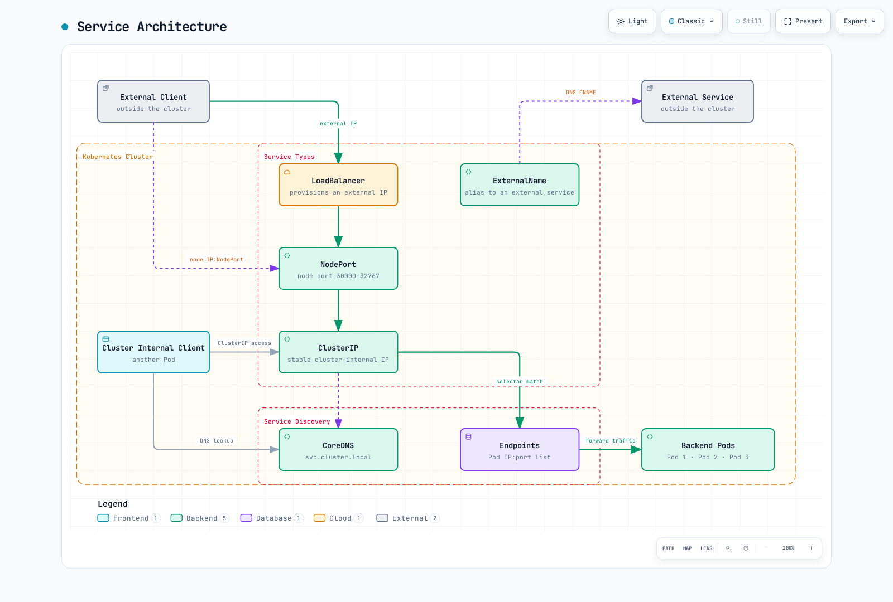
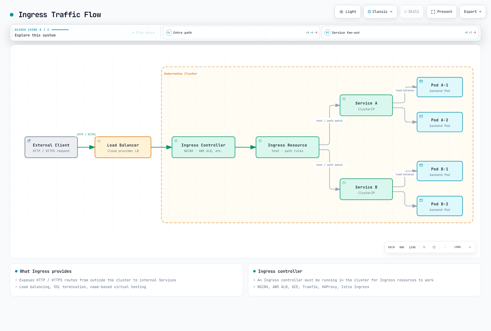

# Servicios y redes

> **Versiones compatibles**: Kubernetes 1.35, 1.36, 1.37
> **Última actualización**: 16 de octubre de 2026

En Kubernetes, un Service es una capa de abstracción que proporciona un único punto de acceso a un conjunto de Pods. En este capítulo, exploraremos en detalle los conceptos de redes de Kubernetes, incluidos varios tipos de Service, Ingress, políticas de red y mucho más.

## Configuración del entorno de laboratorio

Para seguir los ejemplos de este documento, necesitarás las siguientes herramientas y el siguiente entorno:

### Herramientas necesarias
- kubectl con una diferencia máxima de una versión menor respecto al servidor de API
- Un clúster de Kubernetes en funcionamiento (EKS, minikube, kind, etc.)

### Implementar una aplicación de ejemplo

```bash
# Create namespace
kubectl create namespace networking-demo

# Deploy a simple application
kubectl -n networking-demo apply -f - <<EOF
apiVersion: apps/v1
kind: Deployment
metadata:
  name: web-app
  labels:
    app: web
spec:
  replicas: 3
  selector:
    matchLabels:
      app: web
  template:
    metadata:
      labels:
        app: web
    spec:
      containers:
      - name: nginx
        image: nginx:1.30.6
        ports:
        - containerPort: 80
---
apiVersion: v1
kind: Service
metadata:
  name: web-service
spec:
  selector:
    app: web
  ports:
  - port: 80
    targetPort: 80
  type: ClusterIP
EOF

# Verify services
kubectl -n networking-demo get svc,pods
```

## Tabla de contenido

1. [Tipos de Service](#service-types)
2. [Ingress](#ingress)
3. [Endpoints](#endpoints)
4. [Detección de servicios](#service-discovery)
5. [CoreDNS](#coredns)
6. [Políticas de red](#network-policies)
7. [Malla de servicios](#service-mesh)
8. [CNI (Interfaz de red de contenedores)](#cnicontainer-network-interface)
9. [Cilium](#cilium)
   - [Introducción a Cilium](#introduction-to-cilium)
   - [Tecnología eBPF](#ebpf-technology)
   - [Modelo de redes de Cilium](#cilium-networking-model)
   - [Políticas de red de Cilium](#cilium-network-policies)
   - [Visibilidad de red con Hubble](#network-visibility-with-hubble)
   - [Configuración de Cilium en Amazon EKS](#configuring-cilium-on-amazon-eks)

## Tipos de Service {#service-types}

> **Concepto clave**: Los Service de Kubernetes proporcionan endpoints de red estables para un conjunto de Pods y controlan el acceso interno y externo mediante varios tipos.

Kubernetes proporciona distintos tipos de Service para admitir varias formas de exponer aplicaciones.

### Arquitectura de Service



[🔍 Ver diagrama interactivo](https://www.atomai.click/kubernetes-docs/archmaps/en-core-03-services-networking-0.html)

### Comparación de tipos de Service

| Tipo de Service | Ámbito de acceso | IP externa | Caso de uso | Características |
|-------------|-------------|-------------|----------|----------|
| **ClusterIP** | Interno al clúster | No | Comunicación interna entre microservicios | Tipo de Service predeterminado, accesible solo dentro del clúster |
| **NodePort** | Externo al clúster | No | Entornos de desarrollo y pruebas | Acceso mediante un puerto específico (30000-32767) en todos los nodos |
| **LoadBalancer** | Externo al clúster | Sí | Servicios externos de producción | Aprovisiona un balanceador de carga del proveedor de nube |
| **ExternalName** | Interno al clúster | No | Alias interno para servicios externos | Redirección mediante un registro DNS CNAME |
| **Headless** | Interno al clúster | No | Cuando se necesita acceso directo a la IP del Pod | Service especial sin ClusterIP |

### ClusterIP

ClusterIP es el tipo de Service más básico: proporciona una dirección IP fija a la que solo se puede acceder dentro del clúster.

```yaml
apiVersion: v1
kind: Service
metadata:
  name: my-service
spec:
  selector:
    app: MyApp
  ports:
  - protocol: TCP
    port: 80
    targetPort: 9376
  type: ClusterIP  # Default, can be omitted
```

### NodePort

Los Service de tipo NodePort permiten acceder al Service mediante un puerto específico en todos los nodos.

```yaml
apiVersion: v1
kind: Service
metadata:
  name: my-service
spec:
  selector:
    app: MyApp
  ports:
  - protocol: TCP
    port: 80        # Port used within cluster
    targetPort: 9376 # Pod's port
    nodePort: 30007  # Port exposed on nodes (30000-32767)
  type: NodePort
```

### LoadBalancer

Los Service de tipo LoadBalancer aprovisionan un balanceador de carga del proveedor de nube para exponer el Service externamente.

```yaml
apiVersion: v1
kind: Service
metadata:
  name: my-service
  annotations:
    service.beta.kubernetes.io/aws-load-balancer-type: external
    service.beta.kubernetes.io/aws-load-balancer-nlb-target-type: ip
    service.beta.kubernetes.io/aws-load-balancer-scheme: internet-facing
spec:
  selector:
    app: MyApp
  ports:
  - port: 80
    targetPort: 9376
  type: LoadBalancer
```

Este ejemplo requiere AWS Load Balancer Controller, sus permisos de IAM, subredes adecuadas e IP de Pod enrutables. Aprovisiona un NLB accesible desde Internet. También es posible usar balanceadores de carga internos; AWS puede devolver un nombre de host DNS en lugar de una IP. EKS Auto Mode utiliza una clase y un controlador independientes, además de una configuración propia.

### ExternalName

Los Service de tipo ExternalName proporcionan un alias para servicios externos.

```yaml
apiVersion: v1
kind: Service
metadata:
  name: my-service
spec:
  type: ExternalName
  externalName: my.database.example.com
```

Este Service asigna el nombre DNS `my-service` a `my.database.example.com`.

### Service Headless

Un Service headless es un Service sin una IP de clúster que crea registros DNS para cada Pod.

```yaml
apiVersion: v1
kind: Service
metadata:
  name: my-service
spec:
  clusterIP: None  # Headless service
  selector:
    app: MyApp
  ports:
  - port: 80
    targetPort: 9376
```

Este Service no asigna una IP de clúster y crea registros DNS para cada Pod.

### IP externa

`externalIPs` expone este Service en direcciones IP administradas por un administrador y ya enrutadas a los nodos; no asigna direcciones ni selecciona un backend externo. Está obsoleto desde la versión v1.36. Para configuraciones nuevas, es preferible usar un balanceador de carga compatible o una implementación de Gateway. La dirección de documentación que aparece a continuación debe sustituirse por una dirección que controles.

```yaml
apiVersion: v1
kind: Service
metadata:
  name: my-service
spec:
  selector:
    app: MyApp
  ports:
  - port: 80
    targetPort: 9376
  externalIPs:
  - 198.51.100.32
```

## Ingress

Ingress es un objeto de API que expone rutas HTTP y HTTPS desde fuera del clúster hacia los Service dentro del clúster. Ingress proporciona balanceo de carga, terminación SSL y alojamiento virtual basado en nombres.



[🔍 Ver diagrama interactivo](https://www.atomai.click/kubernetes-docs/archmaps/en-core-03-services-networking-1.html)

### Controlador de Ingress

Para usar recursos de Ingress, debe haber un controlador de Ingress en ejecución en el clúster. Hay varios controladores de Ingress:

- AWS Load Balancer Controller
- GCE Ingress Controller
- Traefik
- HAProxy
- Istio Ingress

ingress-nginx de la comunidad dejó de mantenerse en marzo de 2026 ([aviso](https://kubernetes.io/blog/2025/11/11/ingress-nginx-retirement/)). Los ejemplos genéricos que aparecen a continuación suponen que hay instalado un controlador Traefik y la clase `traefik` IngressClass. Ingress es una API de configuración, no un salto de procesamiento de paquetes; el controlador configura el proxy o balanceador de carga real.

### Ingress básico

```yaml
apiVersion: networking.k8s.io/v1
kind: Ingress
metadata:
  name: minimal-ingress
spec:
  ingressClassName: traefik  # Ingress controller class to use
  rules:
  - host: example.com
    http:
      paths:
      - path: /
        pathType: Prefix
        backend:
          service:
            name: example-service
            port:
              number: 80
```

Este Ingress enruta todas las solicitudes al host `example.com` hacia `example-service:80`.

### Enrutamiento basado en rutas

```yaml
apiVersion: networking.k8s.io/v1
kind: Ingress
metadata:
  name: path-based-ingress
spec:
  ingressClassName: traefik
  rules:
  - host: example.com
    http:
      paths:
      - path: /api
        pathType: Prefix
        backend:
          service:
            name: api-service
            port:
              number: 80
      - path: /web
        pathType: Prefix
        backend:
          service:
            name: web-service
            port:
              number: 80
```

Este Ingress enruta las solicitudes que empiezan por `example.com/api` a `api-service` y las que empiezan por `example.com/web` a `web-service`.

### Alojamiento virtual basado en nombres

```yaml
apiVersion: networking.k8s.io/v1
kind: Ingress
metadata:
  name: name-based-ingress
spec:
  ingressClassName: traefik
  rules:
  - host: foo.example.com
    http:
      paths:
      - path: /
        pathType: Prefix
        backend:
          service:
            name: foo-service
            port:
              number: 80
  - host: bar.example.com
    http:
      paths:
      - path: /
        pathType: Prefix
        backend:
          service:
            name: bar-service
            port:
              number: 80
```

Este Ingress enruta las solicitudes a `foo.example.com` hacia `foo-service` y las solicitudes a `bar.example.com` hacia `bar-service`.

### Configuración de TLS

```yaml
apiVersion: networking.k8s.io/v1
kind: Ingress
metadata:
  name: tls-ingress
spec:
  ingressClassName: traefik
  tls:
  - hosts:
    - example.com
    secretName: example-tls
  rules:
  - host: example.com
    http:
      paths:
      - path: /
        pathType: Prefix
        backend:
          service:
            name: example-service
            port:
              number: 80
```

Este Ingress termina las conexiones HTTPS a `example.com` mediante el certificado TLS almacenado en el secreto `example-tls`.

Creación de un secreto TLS:

```bash
kubectl create secret tls example-tls --cert=path/to/cert.crt --key=path/to/key.key
```

### AWS Load Balancer Controller

En AWS EKS, puedes usar AWS Load Balancer Controller para aprovisionar Application Load Balancers.

```yaml
apiVersion: networking.k8s.io/v1
kind: Ingress
metadata:
  name: alb-ingress
  annotations:
    alb.ingress.kubernetes.io/scheme: internet-facing
    alb.ingress.kubernetes.io/target-type: ip
    alb.ingress.kubernetes.io/listen-ports: '[{"HTTP": 80}, {"HTTPS": 443}]'
    alb.ingress.kubernetes.io/ssl-redirect: "443"
    alb.ingress.kubernetes.io/certificate-arn: arn:aws:acm:region:account-id:certificate/certificate-id
spec:
  ingressClassName: alb
  rules:
  - host: example.com
    http:
      paths:
      - path: /
        pathType: Prefix
        backend:
          service:
            name: example-service
            port:
              number: 80
```

Este Ingress usa AWS ALB para gestionar las solicitudes a `example.com`.

## Endpoints

La API heredada `v1/Endpoints` está obsoleta desde la versión v1.33. Para nuevas integraciones, usa EndpointSlices de `discovery.k8s.io/v1`. Estos objetos describen los backends; el tráfico no pasa por los objetos de API.

Endpoints son recursos que almacenan las direcciones IP y los puertos de los Pods a los que apunta un Service. Cuando hay Pods que coinciden con el selector del Service, Kubernetes crea y administra automáticamente el objeto Endpoints.

```yaml
apiVersion: v1
kind: Endpoints
metadata:
  name: my-service
subsets:
- addresses:
  - ip: 192.168.1.1
  ports:
  - port: 9376
```

Para usar backends manuales, crea un Service llamado `my-service` **sin selector** y con puertos coincidentes; de lo contrario, el controlador podría sobrescribir los datos del backend. Se recomienda usar un EndpointSlice administrado manualmente, como el que se muestra a continuación.

### EndpointSlice

EndpointSlice es una alternativa escalable a Endpoints que ofrece un mejor rendimiento en clústeres grandes.

```yaml
apiVersion: discovery.k8s.io/v1
kind: EndpointSlice
metadata:
  name: my-service-abc
  labels:
    kubernetes.io/service-name: my-service
    endpointslice.kubernetes.io/managed-by: docs.example.com
addressType: IPv4
ports:
- name: ""
  protocol: TCP
  port: 9376
endpoints:
- addresses:
  - "10.1.2.3"
  conditions:
    ready: true
  hostname: pod-1
  nodeName: node-1
  zone: us-west-2a
```

## Detección de servicios {#service-discovery}

Kubernetes proporciona dos métodos principales para detectar servicios:

1. **Variables de entorno**: Kubernetes inyecta variables de entorno para los servicios activos en los Pods cuando se crean.
2. **DNS**: Kubernetes proporciona registros DNS para los servicios mediante el servidor DNS del clúster.

### Variables de entorno

Con `enableServiceLinks: true`, kubelet agrega variables para los Service con ClusterIP que ya están presentes en el espacio de nombres del Pod cuando se inician sus contenedores. Estas variables no se actualizan dinámicamente; es preferible usar DNS para los Service que se crean posteriormente. Por ejemplo, si hay un Service llamado `my-service`, se crean las siguientes variables de entorno:

```
MY_SERVICE_SERVICE_HOST=10.0.0.11
MY_SERVICE_SERVICE_PORT=80
```

### DNS

El DNS de Kubernetes crea registros DNS para los servicios. Los Pods pueden acceder a los servicios mediante el nombre del Service.

- Service normal: `my-service.my-namespace.svc.cluster.local`
- Pod de un Service headless: `pod-name.my-service.my-namespace.svc.cluster.local`

## CoreDNS

CoreDNS es un servidor DNS flexible y extensible que se utiliza como servidor DNS en los clústeres de Kubernetes.

### Configuración de CoreDNS

CoreDNS se configura mediante un ConfigMap:

```yaml
apiVersion: v1
kind: ConfigMap
metadata:
  name: coredns
  namespace: kube-system
data:
  Corefile: |
    .:53 {
        errors
        health {
            lameduck 5s
        }
        ready
        kubernetes cluster.local in-addr.arpa ip6.arpa {
            pods insecure
            fallthrough in-addr.arpa ip6.arpa
            ttl 30
        }
        prometheus :9153
        forward . /etc/resolv.conf
        cache 30
        loop
        reload
        loadbalance
    }
```

Esta configuración ofrece las siguientes funciones:

- `errors`: Registro de errores
- `health`: Endpoint de comprobación de estado
- `ready`: Endpoint de comprobación de disponibilidad
- `kubernetes`: Registros DNS para servicios y Pods de Kubernetes
- `prometheus`: Exposición de métricas de Prometheus
- `forward`: Reenvío de consultas DNS externas
- `cache`: Almacenamiento en caché de respuestas DNS
- `loop`: Detección de bucles
- `reload`: Recarga automática cuando cambian los archivos de configuración
- `loadbalance`: Balanceo de carga

### Política de DNS

La política DNS de un Pod se puede configurar mediante el campo `dnsPolicy`:

- `ClusterFirst`: Predeterminada; usa primero el servidor DNS de Kubernetes y reenvía las consultas a los servidores de nombres ascendentes si no encuentra coincidencias.
- `Default`: Hereda la configuración DNS del nodo en el que se ejecuta el Pod.
- `ClusterFirstWithHostNet`: Política recomendada para los Pods con `hostNetwork: true`.
- `None`: Toda la configuración DNS debe proporcionarse mediante el campo `dnsConfig`.

```yaml
apiVersion: v1
kind: Pod
metadata:
  name: custom-dns
spec:
  containers:
  - name: nginx
    image: nginx
  dnsPolicy: "None"
  dnsConfig:
    nameservers:
    - 1.1.1.1
    - 8.8.8.8
    searches:
    - ns1.svc.cluster.local
    - my.dns.search.suffix
    options:
    - name: ndots
      value: "2"
    - name: edns0
```

## Políticas de red {#network-policies}

Las políticas de red permiten controlar la comunicación entre Pods. Para usarlas, el complemento de red debe ser compatible con ellas (por ejemplo, Calico o Cilium).


[🔍 Ver diagrama interactivo](https://www.atomai.click/kubernetes-docs/archmaps/en-core-03-services-networking-2.html)

### Política de red básica

```yaml
apiVersion: networking.k8s.io/v1
kind: NetworkPolicy
metadata:
  name: default-deny-ingress
spec:
  podSelector: {}  # Applies to all Pods
  policyTypes:
  - Ingress
```

Esta política aísla el tráfico de entrada a los Pods de su propio espacio de nombres. Las NetworkPolicies estándar son aditivas: el tráfico permitido por otra política sigue estando permitido. El complemento debe aplicar las políticas; tanto la salida de origen como la entrada de destino deben permitir una conexión. El tráfico de nodos tiene excepciones documentadas.

### Permitir el tráfico de entrada a Pods específicos

```yaml
apiVersion: networking.k8s.io/v1
kind: NetworkPolicy
metadata:
  name: allow-nginx-ingress
spec:
  podSelector:
    matchLabels:
      app: nginx
  policyTypes:
  - Ingress
  ingress:
  - from:
    - podSelector:
        matchLabels:
          access: allowed
    ports:
    - protocol: TCP
      port: 80
```

Esta política de red permite el tráfico de entrada por el puerto TCP 80 desde Pods con la etiqueta `access: allowed` hacia Pods con la etiqueta `app: nginx`.

### Política basada en espacios de nombres

```yaml
apiVersion: networking.k8s.io/v1
kind: NetworkPolicy
metadata:
  name: allow-from-prod-namespace
spec:
  podSelector:
    matchLabels:
      app: db
  policyTypes:
  - Ingress
  ingress:
  - from:
    - namespaceSelector:
        matchLabels:
          purpose: production
```

Esta política de red permite el tráfico de entrada desde todos los Pods de los espacios de nombres con la etiqueta `purpose: production` hacia los Pods con la etiqueta `app: db`.

### Política de salida

```yaml
apiVersion: networking.k8s.io/v1
kind: NetworkPolicy
metadata:
  name: limit-egress
spec:
  podSelector:
    matchLabels:
      app: frontend
  policyTypes:
  - Egress
  egress:
  - to:
    - podSelector:
        matchLabels:
          app: api
    ports:
    - protocol: TCP
      port: 8080
  - to:
    - namespaceSelector:
        matchLabels:
          purpose: monitoring
```

Esta política de red permite el tráfico de salida desde los Pods con la etiqueta `app: frontend` hacia el puerto TCP 8080 de los Pods con la etiqueta `app: api`, así como hacia todos los Pods de los espacios de nombres con la etiqueta `purpose: monitoring`.

El ejemplo de salida también bloquea el DNS, a menos que otra política lo permita. Si las aplicaciones usan nombres de Service, agrega acceso TCP/UDP por el puerto 53 a los endpoints DNS del clúster; ten en cuenta NodeLocal DNS si está instalado.

### Política basada en CIDR

```yaml
apiVersion: networking.k8s.io/v1
kind: NetworkPolicy
metadata:
  name: allow-external-traffic
spec:
  podSelector:
    matchLabels:
      app: web
  policyTypes:
  - Ingress
  ingress:
  - from:
    - ipBlock:
        cidr: 192.168.1.0/24
        except:
        - 192.168.1.1/32
```

Esta política de red permite el tráfico de entrada desde el bloque CIDR `192.168.1.0/24` (excepto 192.168.1.1) hacia los Pods con la etiqueta `app: web`.

## Malla de servicios {#service-mesh}

Una malla de servicios es una capa de infraestructura que administra la comunicación entre microservicios. Las mallas de servicios ofrecen funciones como la detección de servicios, el balanceo de carga, el cifrado, la autenticación, la autorización y la observabilidad.


[🔍 Ver diagrama interactivo](https://www.atomai.click/kubernetes-docs/archmaps/en-core-03-services-networking-3.html)

### Istio

Istio es una de las implementaciones populares de malla de servicios. El diagrama muestra el modo sidecar de Istio, que inyecta Envoy en los Pods inscritos. Istio también ofrece el modo ambient, con un plano de datos diferente.

#### VirtualService de Istio

```yaml
apiVersion: networking.istio.io/v1
kind: VirtualService
metadata:
  name: reviews
spec:
  hosts:
  - reviews
  http:
  - match:
    - headers:
        end-user:
          exact: jason
    route:
    - destination:
        host: reviews
        subset: v2
  - route:
    - destination:
        host: reviews
        subset: v1
```

Este VirtualService enruta las solicitudes que incluyen el encabezado `end-user: jason` al subconjunto `v2` del Service `reviews` y todas las demás solicitudes al subconjunto `v1`.

#### DestinationRule de Istio

```yaml
apiVersion: networking.istio.io/v1
kind: DestinationRule
metadata:
  name: reviews
spec:
  host: reviews
  trafficPolicy:
    loadBalancer:
      simple: RANDOM
  subsets:
  - name: v1
    labels:
      version: v1
  - name: v2
    labels:
      version: v2
    trafficPolicy:
      loadBalancer:
        simple: ROUND_ROBIN
```

Este DestinationRule define dos subconjuntos (`v1` y `v2`) para el Service `reviews` y establece políticas de balanceo de carga para cada subconjunto.

### Linkerd

Linkerd es una malla de servicios ligera que se caracteriza por su sencillez de instalación y uso.

#### Perfil de Service de Linkerd

Este es un ejemplo heredado. Desde Linkerd 2.16, los tipos de Gateway API sustituyen a ServiceProfiles, que se mantienen por compatibilidad. Consulta la [referencia actual](https://linkerd.io/2-edge/reference/service-profiles/).

```yaml
apiVersion: linkerd.io/v1alpha2
kind: ServiceProfile
metadata:
  name: nginx.default.svc.cluster.local
  namespace: default
spec:
  routes:
  - name: GET /
    condition:
      method: GET
      pathRegex: /
    responseClasses:
    - condition:
        status:
          min: 500
          max: 599
      isFailure: true
  retryBudget:
    retryRatio: 0.2
    minRetriesPerSecond: 10
    ttl: 10s
```

Este ServiceProfile define rutas y políticas de reintento para el Service `nginx`.

<span id="cnicontainer-network-interface"></span>

## CNI (Interfaz de red de contenedores)

Los complementos CNI configuran las interfaces de red de los Pods y el direccionamiento IP. La aplicación de NetworkPolicy es opcional y depende del complemento.

## Cilium


[🔍 Ver diagrama interactivo](https://www.atomai.click/kubernetes-docs/archmaps/en-core-03-services-networking-4.html)

[Detalles de Cilium](../networking/cilium/README.md)

### Introducción a Cilium {#introduction-to-cilium}

Cilium es software de código abierto que aprovecha la potente tecnología eBPF del kernel de Linux para proporcionar conectividad de red, seguridad y observabilidad a las aplicaciones en contenedores. Su integración actual con Kubernetes proporciona redes, seguridad y observabilidad mediante un complemento CNI y controladores.

#### Características principales

- **Basado en eBPF**: Proporciona funciones de redes y seguridad de alto rendimiento mediante un plano de datos programable dentro del kernel
- **Redes con reconocimiento de API**: Admite políticas de seguridad de red con reconocimiento de API en las capas L3-L7
- **Integración con Kubernetes**: Proporciona una implementación CNI (Interfaz de red de contenedores) para Kubernetes
- **Balanceo de carga distribuido**: Balanceo de carga distribuido para una comunicación eficiente entre servicios
- **Visibilidad de red**: Supervisión y solución de problemas de los flujos de red mediante Hubble
- **Compatibilidad con varios clústeres**: Compatibilidad con redes y políticas de seguridad entre clústeres

#### Aspectos diferenciadores de Cilium

Cilium ofrece varias ventajas únicas en comparación con otras soluciones CNI.

**Diferencias técnicas**:
- **Uso de eBPF**: Alto rendimiento y flexibilidad mediante un plano de datos programable dentro del kernel
- **Redes con reconocimiento de API**: Compatibilidad con políticas de red hasta la capa L7
- **XDP (eXpress Data Path)**: Optimización del rendimiento del procesamiento de paquetes
- **Sustitución de kube-proxy**: Balanceo de carga de Service más eficiente
- **Integración con Hubble**: Potente herramienta de observabilidad de red

**Ventajas según el caso de uso**:
- **Arquitectura de microservicios**: Políticas de red detalladas y observabilidad
- **Implementación en varios clústeres**: Redes fluidas entre clústeres
- **Entornos centrados en la seguridad**: Políticas de seguridad de red sólidas
- **Requisitos de alto rendimiento**: Plano de datos optimizado
- **Integración con mallas de servicios**: Integración con mallas de servicios como Istio

### Tecnología eBPF {#ebpf-technology}

eBPF (extended Berkeley Packet Filter) es una tecnología que permite ejecutar programas de forma segura dentro del kernel de Linux. Cilium usa eBPF para implementar funciones de redes, seguridad y observabilidad.

#### Características principales de eBPF

1. **Ejecución dentro del kernel**: Los programas eBPF se ejecutan directamente dentro del kernel y ofrecen un alto rendimiento.
2. **Seguridad**: El verificador comprueba las restricciones de seguridad del programa antes de cargarlo; esto no garantiza protección frente a errores del kernel ni a una lógica de políticas incorrecta.
3. **Carga dinámica**: Los programas eBPF se pueden cargar y descargar sin reiniciar el kernel.
4. **Maps**: Los maps de eBPF se usan para almacenar datos y compartirlos entre el espacio de usuario y el espacio del kernel.

#### Uso de eBPF en Cilium

Cilium usa eBPF de las siguientes maneras:

1. **Plano de datos de red**: Los programas eBPF procesan y enrutan paquetes de red.
2. **Aplicación de políticas**: Los programas eBPF aplican políticas de red.
3. **Balanceo de carga**: Los programas eBPF realizan el balanceo de carga de los servicios.
4. **Observabilidad**: Los programas eBPF recopilan métricas de los flujos de red.

#### eBPF frente a los enfoques de redes tradicionales

| Característica | eBPF | Enfoque tradicional (iptables) |
|---------|------|--------------------------------|
| Rendimiento | Muy alto | Medio |
| Escalabilidad | Muy alta | Limitada |
| Programabilidad | Alta | Limitada |
| Observabilidad | Alta | Limitada |
| Complejidad de implementación | Alta | Media |

### Modelo de redes de Cilium {#cilium-networking-model}

Cilium admite varios modelos de redes que se pueden configurar para adaptarse a distintos entornos y requisitos.

#### Redes superpuestas

Cilium implementa redes superpuestas de forma predeterminada mediante VXLAN, pero también admite otros protocolos de encapsulación, como Geneve.

**Cómo funciona**:
1. Los paquetes se crean en el nodo de origen.
2. Cilium encapsula el paquete envolviendo el paquete original con encabezados de encapsulación.
3. El paquete encapsulado se transmite al nodo de destino a través de la red física.
4. En el nodo de destino, Cilium desencapsula el paquete para extraer el paquete original.
5. El paquete extraído se entrega al contenedor de destino.

**Ventajas**:
- Compatibilidad con la infraestructura de red existente
- Independencia de la topología de red
- El direccionamiento de los Pods es independiente de la red subyacente; aun así, los clústeres conectados necesitan un plan de direccionamiento compatible y sin superposiciones

**Desventajas**:
- Impacto en el rendimiento debido a la sobrecarga de la encapsulación
- Reducción del tamaño de MTU
- Mayor uso de CPU

#### Enrutamiento nativo

El enrutamiento nativo usa enrutamiento directo sin encapsulación. En este modo, la infraestructura de red subyacente debe poder enrutar las direcciones IP de los Pods.

**Cómo funciona**:
1. Cada nodo anuncia el bloque CIDR de los Pods que se ejecutan en él.
2. Las tablas de enrutamiento se configuran para dirigir cada bloque CIDR de Pod al nodo correspondiente.
3. Los paquetes se enrutan directamente al nodo de destino sin encapsulación.

**Ventajas**:
- Sin sobrecarga de encapsulación
- Mejor rendimiento de red
- Menor uso de CPU

**Desventajas**:
- Dependencia de la infraestructura de red subyacente
- Restricciones de topología de red
- Complejidad en la administración de direcciones IP

#### Selección del modo de enrutamiento

Selecciona explícitamente la encapsulación o el enrutamiento nativo para la implementación. No des por hecho que las rutas nativas fallidas pasan automáticamente a un túnel; configura el enrutamiento y cualquier migración según la versión de Cilium elegida.

#### Modo AWS ENI

En AWS EKS, Cilium puede aprovechar las interfaces de red elásticas (ENI) de AWS para asignar direcciones IP nativas de la VPC a los Pods.

**Características principales**:
- Asigna direcciones IP nativas de la VPC a los Pods
- Redes nativas de la VPC sin red superpuesta
- Integración con grupos de seguridad y políticas de red de AWS
- Mejor rendimiento de red

### Políticas de red de Cilium {#cilium-network-policies}

Cilium amplía las políticas de red de Kubernetes para proporcionar políticas de seguridad de red detalladas en las capas L3-L7.

#### Políticas L3/L4

Cilium admite políticas de red estándar de Kubernetes para definir políticas basadas en direcciones IP, puertos y protocolos.

```yaml
apiVersion: "cilium.io/v2"
kind: CiliumNetworkPolicy
metadata:
  name: "l3-l4-policy"
spec:
  endpointSelector:
    matchLabels:
      app: myapp
  ingress:
  - fromEndpoints:
    - matchLabels:
        app: frontend
    toPorts:
    - ports:
      - port: "80"
        protocol: TCP
```

Esta política permite el tráfico de entrada por el puerto TCP 80 desde Pods con la etiqueta `app: frontend` hacia Pods con la etiqueta `app: myapp`.

#### Políticas L7

Cilium admite políticas L7, como reglas HTTP, mediante un proxy Envoy en espacio de usuario junto con eBPF. La inspección L7 no se realiza íntegramente dentro del kernel; consulta las limitaciones de protocolos y cifrado para la versión instalada.

```yaml
apiVersion: "cilium.io/v2"
kind: CiliumNetworkPolicy
metadata:
  name: "l7-policy"
spec:
  endpointSelector:
    matchLabels:
      app: myapp
  ingress:
  - fromEndpoints:
    - matchLabels:
        app: frontend
    toPorts:
    - ports:
      - port: "80"
        protocol: TCP
      rules:
        http:
        - method: "GET"
          path: "/api/v1/products"
```

Esta política permite únicamente solicitudes HTTP GET a la ruta `/api/v1/products` desde Pods con la etiqueta `app: frontend` hacia Pods con la etiqueta `app: myapp`.

#### Políticas para todo el clúster

Cilium admite políticas de red para todo el clúster que definen reglas aplicables a todos los Pods.

```yaml
apiVersion: "cilium.io/v2"
kind: CiliumClusterwideNetworkPolicy
metadata:
  name: "cluster-wide-policy"
spec:
  endpointSelector:
    matchLabels: {}  # Applies to all Pods
  ingress:
  - fromEndpoints:
    - matchLabels:
        io.kubernetes.pod.namespace: kube-system
```

Esta política permite el tráfico de entrada desde los Pods del espacio de nombres `kube-system` hacia todos los Pods.

### Visibilidad de red con Hubble {#network-visibility-with-hubble}

Hubble es la capa de observabilidad de Cilium, que usa eBPF para supervisar los flujos de red y solucionar problemas.

#### Características principales de Hubble

1. **Supervisión de flujos de red**: Supervisa en tiempo real la comunicación entre Pods.
2. **Mapa de dependencias de servicios**: Visualiza las dependencias entre servicios.
3. **Observación de seguridad**: Detecta infracciones de las políticas de red.
4. **Análisis del rendimiento**: Analiza la latencia y el caudal de la red.
5. **Solución de problemas**: Diagnostica problemas de conectividad de red.

#### Arquitectura de Hubble

Hubble consta de los siguientes componentes:

1. **Servidor Hubble**: Servidor integrado en el agente de Cilium que recopila datos de flujos de red.
2. **Hubble Relay**: Agrega datos de varios servidores Hubble.
3. **Interfaz de usuario de Hubble**: Interfaz web para visualizar los flujos de red.
4. **CLI de Hubble**: Herramienta de línea de comandos para consultar los flujos de red.

#### Ejemplos de uso de Hubble

```bash
# Install Hubble CLI
curl -L --remote-name-all https://github.com/cilium/hubble/releases/latest/download/hubble-linux-amd64.tar.gz
sudo tar xzvfC hubble-linux-amd64.tar.gz /usr/local/bin
rm hubble-linux-amd64.tar.gz

# Enable Hubble
cilium hubble enable

# Run in a separate terminal and keep it open
cilium hubble port-forward

# Observe network flows
hubble observe

# Observe HTTP requests
hubble observe --protocol http

# Observe network flows for specific Pod
hubble observe --pod default/myapp-pod

# Observe network policy violations
hubble observe --verdict DROPPED
```

### Configuración de Cilium en Amazon EKS {#configuring-cilium-on-amazon-eks}

Hay varias formas de configurar Cilium en Amazon EKS. Aquí veremos algunos métodos de configuración comunes.

#### Elegir el modo CNI antes de la instalación

Usa un clúster de prueba EKS desechable y selecciona una versión de Cilium compatible con su versión de Kubernetes. Sigue la [guía oficial de instalación en EKS](https://docs.cilium.io/en/stable/installation/k8s-install-helm/); lo siguiente son **fragmentos de valores** de Helm, no comandos completos de instalación o migración.

Para **AWS VPC CNI chaining**, conserva `aws-node` como IPAM y usa:

```yaml
cni:
  chainingMode: aws-cni
  exclusive: false
enableIPv4Masquerade: false
routingMode: native
```

Los Pods existentes deben volver a crearse mediante un despliegue gradual controlado para que se aplique la nueva cadena CNI. Revisa las limitaciones de las funciones de chaining antes de activar la política L7 o la sustitución de kube-proxy.

Para **Cilium ENI IPAM**, Cilium administra las ENI en lugar de VPC CNI:

```yaml
eni:
  enabled: true
ipam:
  mode: eni
routingMode: native
```

Este modo requiere permisos para la API de EC2 y evitar que `aws-node` administre los mismos nodos, siguiendo el procedimiento oficial de instalación o migración. No lo apliques sobre una instalación de VPC CNI en ejecución sin seguir esos pasos. EKS Auto Mode y Fargate administran sus redes por separado.

Después de la instalación, valida con `cilium status --wait` y la prueba de conectividad en el clúster de prueba aislado. Fija la versión del chart y conserva los valores revisados para las actualizaciones.

#### Activar Hubble

```bash
# Enable Hubble
cilium hubble enable --ui

# Access Hubble UI
kubectl port-forward -n kube-system svc/hubble-ui 12000:80
```

#### Ejemplo de política de red de Cilium

```yaml
apiVersion: "cilium.io/v2"
kind: CiliumNetworkPolicy
metadata:
  name: "eks-app-policy"
spec:
  endpointSelector:
    matchLabels:
      app: api
  ingress:
  - fromEndpoints:
    - matchLabels:
        app: frontend
    toPorts:
    - ports:
      - port: "8080"
        protocol: TCP
      rules:
        http:
        - method: "GET"
          path: "/api/v1/.*"
  egress:
  - toEndpoints:
    - matchLabels:
        app: database
    toPorts:
    - ports:
      - port: "3306"
        protocol: TCP
```

Esta política permite únicamente solicitudes HTTP GET a la ruta `/api/v1/` desde Pods con la etiqueta `app: frontend` hacia Pods con la etiqueta `app: api`, y permite el tráfico de salida por el puerto TCP 3306 desde Pods con la etiqueta `app: api` hacia Pods con la etiqueta `app: database`.

#### Optimización de Cilium en EKS

1. **Configuración del grupo de nodos**:
   - Selecciona tipos de instancia que proporcionen suficientes ENI y direcciones IP
   - Configura un número máximo de Pods adecuado

2. **Optimización del rendimiento**:
   - Usa el modo de enrutamiento directo
   - Activa la aceleración XDP
   - Activa el algoritmo de control de congestión BBR

3. **Supervisión y registro**:
   - Activa Hubble
   - Recopila métricas de Prometheus
   - Integra con CloudWatch

## Conclusión

En este capítulo, aprendimos sobre los Service y las redes de Kubernetes. Los Service proporcionan endpoints estables para un conjunto de Pods, e Ingress enruta el tráfico externo hacia los Service del clúster. Las políticas de red controlan la comunicación entre Pods y las mallas de servicios administran la comunicación entre servicios en arquitecturas de microservicios. También exploramos cómo implementar funciones de red avanzadas mediante CNI y Cilium.

Comprender y aprovechar las funciones de red de Kubernetes te permite crear aplicaciones seguras y escalables.

En el próximo capítulo, aprenderemos sobre las opciones de almacenamiento de Kubernetes.

## Referencias

- [Documentación oficial de Kubernetes: Services](https://kubernetes.io/docs/concepts/services-networking/service/)
- [Documentación oficial de Kubernetes: Ingress](https://kubernetes.io/docs/concepts/services-networking/ingress/)
- [Documentación oficial de Kubernetes: políticas de red](https://kubernetes.io/docs/concepts/services-networking/network-policies/)
- [Documentación oficial de Kubernetes: DNS para Services y Pods](https://kubernetes.io/docs/concepts/services-networking/dns-pod-service/)
- [Documentación oficial de Istio](https://istio.io/latest/docs/)
- [Documentación oficial de Linkerd](https://linkerd.io/2-edge/overview/)
- [Documentación oficial de Cilium](https://docs.cilium.io/)
- [Documentación oficial de CNI](https://github.com/containernetworking/cni)

## Cuestionario

Para comprobar lo que aprendiste en este capítulo, prueba el [cuestionario sobre servicios y redes](../quizzes/core/03-services-networking-quiz.md).
