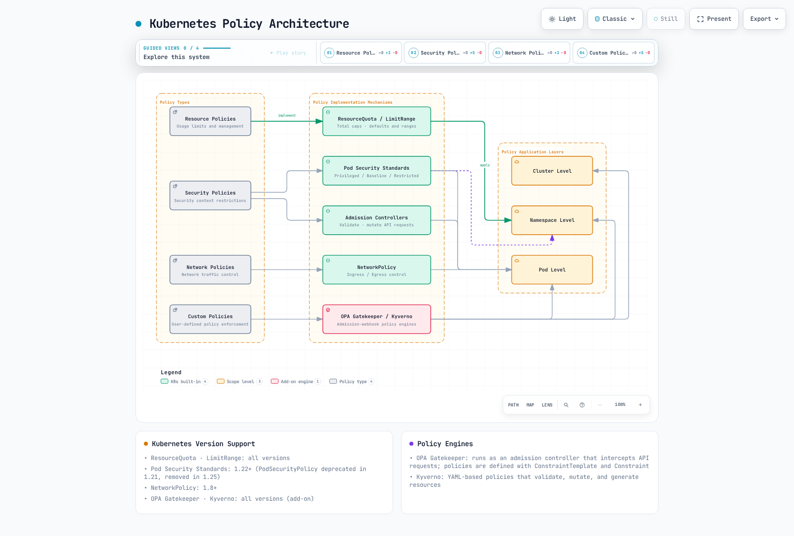
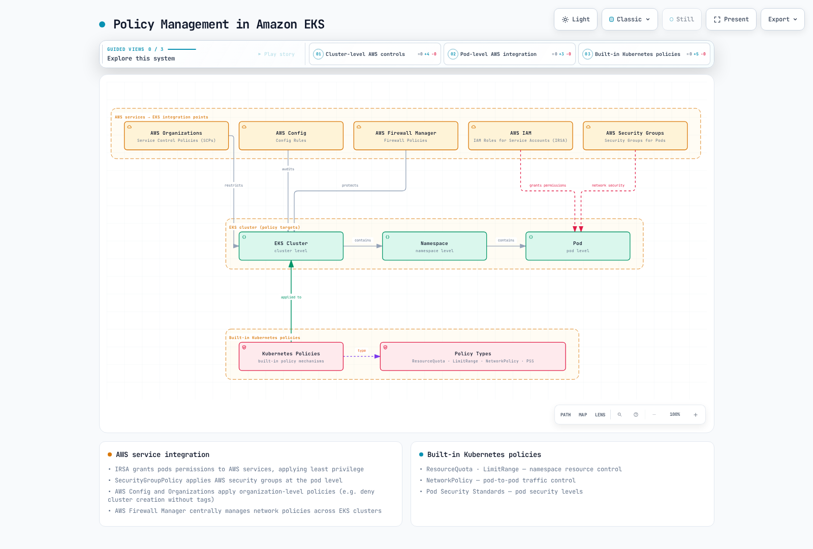

# Políticas de Kubernetes

> **Versiones compatibles**: Kubernetes 1.35 - 1.37
> **Última actualización**: October 16, 2026

En Kubernetes, las políticas son conjuntos de reglas que controlan y regulan el comportamiento de los clústeres y las cargas de trabajo. Mediante las políticas, puedes administrar diversos aspectos, como la seguridad, el uso de recursos y la comunicación de red. En este capítulo, aprenderemos sobre los distintos tipos de políticas en Kubernetes, cómo implementarlas y cómo administrar políticas en Amazon EKS.

## Configuración del entorno de laboratorio

Para seguir los ejemplos de este documento, necesitas las siguientes herramientas y el siguiente entorno:

### Herramientas necesarias
- kubectl con una diferencia máxima de una versión menor respecto de la del servidor de API
- Un clúster de Kubernetes en funcionamiento (EKS, minikube, kind, etc.)
- Kyverno CLI (opcional)
- OPA Gatekeeper (opcional)

### Configuración de ejemplo de políticas

```bash
# Create namespace
kubectl create namespace policy-demo

# Create resource quota
kubectl -n policy-demo apply -f - <<EOF
apiVersion: v1
kind: ResourceQuota
metadata:
  name: demo-quota
spec:
  hard:
    requests.cpu: "1"
    requests.memory: 1Gi
    limits.cpu: "2"
    limits.memory: 2Gi
    pods: "10"
EOF

# Create network policy
kubectl -n policy-demo apply -f - <<EOF
apiVersion: networking.k8s.io/v1
kind: NetworkPolicy
metadata:
  name: default-deny
spec:
  podSelector: {}
  policyTypes:
  - Ingress
  - Egress
EOF

# Verify policies
kubectl -n policy-demo get resourcequota,networkpolicy
```

## Arquitectura de las políticas de Kubernetes



[🔍 Ver diagrama interactivo](https://www.atomai.click/kubernetes-docs/archmaps/en-core-07-policies-0.html)

## Comparación de tipos de políticas

| Tipo de política | Mecanismo de implementación | Nivel de aplicación | Propósito principal | Compatibilidad con versiones de Kubernetes |
|------------|--------------------------|-------------------|-----------------|---------------------------|
| **Políticas de recursos** | ResourceQuota, LimitRange | Espacio de nombres | Limitación y administración del uso de recursos | Todas las versiones |
| **Políticas de seguridad** | Pod Security Standards, Pod Security Admission (PSP eliminado) | Pod, espacio de nombres | Restricciones del contexto de seguridad | PSP eliminado: 1.25; PSA estable: 1.25 |
| **Políticas de red** | NetworkPolicy | Pod | Control del tráfico de red | 1.8+ |
| **Políticas personalizadas** | OPA Gatekeeper, Kyverno | Clúster, espacio de nombres, Pod | Aplicación de políticas definidas por el usuario | Depende de la compatibilidad del motor instalado |

## Políticas de recursos

Las políticas de recursos son mecanismos para limitar y administrar los recursos informáticos (CPU, memoria, etc.) y la cantidad de objetos (pods, servicios, etc.) dentro de un clúster de Kubernetes.

### ResourceQuota

ResourceQuota limita la cantidad total de recursos que se pueden utilizar en un espacio de nombres.

```yaml
apiVersion: v1
kind: ResourceQuota
metadata:
  name: compute-resources
  namespace: dev
spec:
  hard:
    requests.cpu: "1"
    requests.memory: 1Gi
    limits.cpu: "2"
    limits.memory: 2Gi
    pods: "10"
    services: "5"
    persistentvolumeclaims: "5"
    secrets: "10"
    configmaps: "10"
```

### LimitRange

LimitRange establece valores predeterminados para las solicitudes y los límites de los contenedores, y valida los límites de recursos de los contenedores, Pods o PVC. Las entradas de Pod y PVC no inyectan valores predeterminados de solicitud/límite.

```yaml
apiVersion: v1
kind: LimitRange
metadata:
  name: limit-mem-cpu-per-container
  namespace: dev
spec:
  limits:
  - default:
      cpu: 500m
      memory: 512Mi
    defaultRequest:
      cpu: 100m
      memory: 256Mi
    max:
      cpu: "1"
      memory: 1Gi
    min:
      cpu: 50m
      memory: 128Mi
    type: Container
```

## Tabla de contenido
1. [Descripción general de las políticas](#policy-overview)
2. [Políticas de asignación de recursos](#resource-allocation-policies)
3. [Políticas de seguridad de Pod](#pod-security-policies)
4. [Políticas de red](#network-policies)
5. [Cuotas de recursos](#resource-quotas)
6. [LimitRange](#limitrange)
7. [Motores de políticas](#policy-engines)
8. [Administración de políticas en Amazon EKS](#policy-management-in-amazon-eks)
9. [Prácticas recomendadas para las políticas](#policy-best-practices)
10. [Conclusión](#conclusion)

## Descripción general de las políticas {#policy-overview}

Las políticas de Kubernetes permiten a los administradores de clúster definir restricciones para los recursos y las cargas de trabajo dentro del clúster. Las políticas se utilizan con los siguientes propósitos:

1. **Mejorar la seguridad**: Evitar operaciones no autorizadas y aplicar las prácticas recomendadas de seguridad
2. **Administrar recursos**: Limitar el uso de recursos y garantizar una distribución equitativa de estos
3. **Cumplimiento**: Garantizar el cumplimiento de las políticas y normativas de la organización
4. **Estandarización**: Aplicar prácticas uniformes de configuración e implementación

Kubernetes puede implementar distintos tipos de políticas mediante recursos integrados (por ejemplo, NetworkPolicy, ResourceQuota, LimitRange) o motores de políticas de terceros (por ejemplo, OPA Gatekeeper, Kyverno).

## Políticas de asignación de recursos {#resource-allocation-policies}

Las políticas de asignación de recursos controlan la cantidad de recursos, como CPU y memoria, que pueden utilizar los pods y los contenedores.


[🔍 Ver diagrama interactivo](https://www.atomai.click/kubernetes-docs/archmaps/en-core-07-policies-1.html)

### Solicitudes y límites de recursos

Puedes administrar el uso de recursos mediante la configuración de solicitudes y límites de recursos para los pods y contenedores:

```yaml
apiVersion: v1
kind: Pod
metadata:
  name: resource-demo
spec:
  containers:
  - name: resource-demo-container
    image: nginx
    resources:
      requests:
        memory: "64Mi"
        cpu: "250m"
      limits:
        memory: "128Mi"
        cpu: "500m"
```

- **requests**: Reserva para la planificación y dato de entrada para la asignación de recursos en tiempo de ejecución; el uso real puede ser menor
- **limits**: Restricción en tiempo de ejecución: la CPU se limita mediante throttling; el exceso de memoria puede provocar la terminación por OOM

Configurar solicitudes y límites de recursos ofrece las siguientes ventajas:

1. **Garantía de recursos**: El planificador tiene en cuenta la capacidad solicitada; esto no garantiza la disponibilidad
2. **Aislamiento de recursos**: Evita que un Pod monopolice los recursos de otro Pod
3. **Planificación eficiente**: El planificador tiene en cuenta la capacidad de recursos del nodo al ubicar los pods

### Clases de QoS (calidad del servicio)

Kubernetes asigna automáticamente clases de QoS en función de la configuración de solicitudes y límites de recursos del Pod:

1. **Guaranteed**: Todos los contenedores tienen solicitudes y límites de CPU y memoria iguales en una configuración a nivel de contenedor
2. **Burstable**: Al menos un contenedor tiene solicitudes de recursos configuradas, pero no cumple las condiciones de Guaranteed
3. **BestEffort**: Ningún contenedor tiene solicitudes ni límites de recursos configurados

La expulsión por presión en el nodo tiene en cuenta si el uso supera las solicitudes, la prioridad del Pod y el uso relativo. Por lo general, BestEffort está más expuesto que Guaranteed, pero la QoS por sí sola no establece un orden estricto. Los recursos a nivel de Pod también pueden afectar la QoS; consulta los [criterios oficiales de QoS](https://kubernetes.io/docs/concepts/workloads/pods/pod-qos/).

## Políticas de seguridad de Pod {#pod-security-policies}

Pod Security Policy (PSP) quedó obsoleto a partir de Kubernetes 1.21 y se eliminó por completo en la versión 1.25. En su lugar, se introdujeron Pod Security Standards y Pod Security Admission.


[🔍 Ver diagrama interactivo](https://www.atomai.click/kubernetes-docs/archmaps/en-core-07-policies-2.html)

### Pod Security Standards

Pod Security Standards define tres niveles de políticas:

1. **Privileged**: Sin restricciones; se permiten todos los permisos
2. **Baseline**: Bloquea las vías conocidas de escalada de privilegios
3. **Restricted**: Política de seguridad con un endurecimiento estricto

### Pod Security Admission

Pod Security Admission aplica Pod Security Standards mediante etiquetas de espacio de nombres:

```yaml
apiVersion: v1
kind: Namespace
metadata:
  name: my-namespace
  labels:
    pod-security.kubernetes.io/enforce: restricted
    pod-security.kubernetes.io/audit: restricted
    pod-security.kubernetes.io/warn: restricted
```

Significado de cada etiqueta:
- **enforce**: Bloquea la creación de pods que infringen la política
- **audit**: Registra las infracciones en los registros de auditoría
- **warn**: Muestra mensajes de advertencia sobre las infracciones

## Políticas de red {#network-policies}

Network Policy permite controlar la comunicación entre pods. De forma predeterminada, todos los pods de un clúster de Kubernetes pueden comunicarse entre sí, pero las políticas de red pueden restringirla.


[🔍 Ver diagrama interactivo](https://www.atomai.click/kubernetes-docs/archmaps/en-core-07-policies-3.html)

```yaml
apiVersion: networking.k8s.io/v1
kind: NetworkPolicy
metadata:
  name: api-allow
  namespace: default
spec:
  podSelector:
    matchLabels:
      app: api
  policyTypes:
  - Ingress
  - Egress
  ingress:
  - from:
    - podSelector:
        matchLabels:
          app: frontend
    ports:
    - protocol: TCP
      port: 8080
  egress:
  - to:
    - podSelector:
        matchLabels:
          app: database
    ports:
    - protocol: TCP
      port: 5432
```

En el ejemplo anterior:
- Define una política de red para los pods con `app=api`
- Solo permite el tráfico entrante desde los pods con `app=frontend` en el puerto 8080
- Solo permite el tráfico saliente hacia los pods con `app=database` en el puerto 5432

Para usar políticas de red, el complemento de red del clúster debe admitirlas. Los complementos CNI como Calico, Cilium y Antrea admiten políticas de red.

Los selectores de Pod sin un selector de espacio de nombres se limitan al espacio de nombres de la política. Las NetworkPolicies estándar son aditivas; otra política puede permitir más tráfico, y tanto el egress de origen como el ingress de destino deben permitir la conexión. El ejemplo también bloquea DNS, a menos que otra regla de egress permita TCP/UDP 53 hacia los endpoints DNS del clúster.

### Tipos de políticas de red

1. **Política de Ingress**: Controla el tráfico que llega al Pod
2. **Política de Egress**: Controla el tráfico que sale del Pod
3. **Política de Ingress y Egress**: Controla el tráfico en ambas direcciones

### Selectores de políticas de red

Las políticas de red pueden filtrar el tráfico mediante distintos selectores:

1. **podSelector**: Selecciona según las etiquetas de Pod
2. **namespaceSelector**: Selecciona según las etiquetas del espacio de nombres
3. **ipBlock**: Selecciona según los rangos CIDR de IP

```yaml
# Example combining multiple selectors
ingress:
- from:
  - podSelector:
      matchLabels:
        app: frontend
    namespaceSelector:
      matchLabels:
        env: prod
  - ipBlock:
      cidr: 172.17.0.0/16
      except:
      - 172.17.1.0/24
```

## Cuotas de recursos {#resource-quotas}

ResourceQuota limita la cantidad total de recursos que se pueden utilizar en un espacio de nombres. Esto evita que un equipo monopolice todos los recursos cuando varios equipos o proyectos comparten los recursos del clúster.


[🔍 Ver diagrama interactivo](https://www.atomai.click/kubernetes-docs/archmaps/en-core-07-policies-4.html)

```yaml
apiVersion: v1
kind: ResourceQuota
metadata:
  name: compute-resources
  namespace: team-a
spec:
  hard:
    pods: "10"
    requests.cpu: "4"
    requests.memory: 8Gi
    limits.cpu: "8"
    limits.memory: 16Gi
```

En el ejemplo anterior:
- El espacio de nombres `team-a` puede crear un máximo de 10 Pods que no estén en estado terminal
- La suma de todas las solicitudes de CPU de los pods no puede superar 4 núcleos
- La suma de todas las solicitudes de memoria de los pods no puede superar 8Gi
- La suma de todos los límites de CPU de los pods no puede superar 8 núcleos
- La suma de todos los límites de memoria de los pods no puede superar 16Gi

### Cuota de cantidad de objetos

Las cuotas de recursos también pueden limitar la cantidad de objetos que se pueden crear en un espacio de nombres, además de la CPU y la memoria:

```yaml
apiVersion: v1
kind: ResourceQuota
metadata:
  name: object-counts
  namespace: team-b
spec:
  hard:
    configmaps: "10"
    persistentvolumeclaims: "5"
    replicationcontrollers: "20"
    secrets: "10"
    services: "10"
    services.loadbalancers: "2"
```

### Cuota de clases de prioridad

También puedes establecer cuotas para pods de clases de prioridad específicas:

Usa una cuota separada para cada clase de prioridad; no existen claves como `pods.high`. Crea las PriorityClasses correspondientes antes de planificar los Pods.

```yaml
apiVersion: v1
kind: ResourceQuota
metadata:
  name: high-priority-quota
  namespace: team-c
spec:
  hard:
    pods: "5"
  scopeSelector:
    matchExpressions:
    - operator: In
      scopeName: PriorityClass
      values: ["high"]
---
apiVersion: v1
kind: ResourceQuota
metadata:
  name: medium-priority-quota
  namespace: team-c
spec:
  hard:
    pods: "3"
  scopeSelector:
    matchExpressions:
    - operator: In
      scopeName: PriorityClass
      values: ["medium"]
---
apiVersion: v1
kind: ResourceQuota
metadata:
  name: low-priority-quota
  namespace: team-c
spec:
  hard:
    pods: "2"
  scopeSelector:
    matchExpressions:
    - operator: In
      scopeName: PriorityClass
      values: ["low"]
```

## LimitRange

LimitRange aplica valores predeterminados cuando faltan solicitudes o límites de contenedor, y valida los valores mínimos y máximos durante la admisión. No cambia el tamaño de los Pods existentes ni proporciona valores predeterminados para las entradas de Pod/PVC.

```yaml
apiVersion: v1
kind: LimitRange
metadata:
  name: cpu-limit-range
  namespace: default
spec:
  limits:
  - default:
      cpu: 1
      memory: 512Mi
    defaultRequest:
      cpu: 500m
      memory: 256Mi
    max:
      cpu: 2
      memory: 1Gi
    min:
      cpu: 100m
      memory: 128Mi
    type: Container
```

En el ejemplo anterior:
- **default**: Límite predeterminado que se aplica cuando un contenedor no tiene un límite explícito
- **defaultRequest**: Solicitud predeterminada que se aplica cuando un contenedor no tiene una solicitud explícita
- **max**: Límite máximo que puede establecer un contenedor
- **min**: Solicitud mínima que puede establecer un contenedor

LimitRange puede aplicarse a los siguientes tipos de recursos:
- Container
- Pod
- PersistentVolumeClaim

## Motores de políticas {#policy-engines}

El ecosistema de Kubernetes cuenta con varios motores de políticas que pueden implementar políticas más complejas y flexibles.


[🔍 Ver diagrama interactivo](https://www.atomai.click/kubernetes-docs/archmaps/en-core-07-policies-5.html)

### OPA Gatekeeper

OPA (Open Policy Agent) Gatekeeper es un proyecto de código abierto para definir y aplicar políticas en clústeres de Kubernetes. Gatekeeper funciona como un controlador de admisión de Kubernetes que intercepta las solicitudes enviadas al servidor de API y aplica las políticas.

Gatekeeper consta de los siguientes componentes:

1. **ConstraintTemplate**: Plantilla que define la lógica de la política
2. **Constraint**: Instancia de ConstraintTemplate que aplica la política a recursos específicos

```yaml
# ConstraintTemplate example
apiVersion: templates.gatekeeper.sh/v1
kind: ConstraintTemplate
metadata:
  name: k8srequiredlabelkeys
spec:
  crd:
    spec:
      names:
        kind: K8sRequiredLabelKeys
      validation:
        openAPIV3Schema:
          type: object
          properties:
            labels:
              type: array
              items:
                type: string
  targets:
    - target: admission.k8s.gatekeeper.sh
      rego: |
        package k8srequiredlabelkeys
        violation[{"msg": msg, "details": {"missing_labels": missing}}] {
          provided := {label | input.review.object.metadata.labels[label]}
          required := {label | label := input.parameters.labels[_]}
          missing := required - provided
          count(missing) > 0
          msg := sprintf("missing required labels: %v", [missing])
        }
```

```yaml
# Constraint example
apiVersion: constraints.gatekeeper.sh/v1beta1
kind: K8sRequiredLabelKeys
metadata:
  name: require-app-label
spec:
  match:
    kinds:
      - apiGroups: [""]
        kinds: ["Pod"]
  parameters:
    labels: ["app", "owner"]
```

### Kyverno

Kyverno es un motor de políticas nativo de Kubernetes que puede validar, modificar y generar recursos de Kubernetes mediante políticas basadas en YAML. Puedes escribir políticas con una sintaxis similar a la de los recursos de Kubernetes, sin tener que aprender el lenguaje Rego.

```yaml
# Kyverno policy example
apiVersion: kyverno.io/v1
kind: ClusterPolicy
metadata:
  name: require-labels
spec:
  rules:
  - name: check-for-labels
    match:
      any:
      - resources:
          kinds:
          - Pod
    validate:
      failureAction: Enforce
      message: "The labels 'app' and 'owner' are required."
      pattern:
        metadata:
          labels:
            app: "?*"
            owner: "?*"
```

Kyverno admite los siguientes tipos de políticas:

1. **Validate**: Valida que los recursos cumplan condiciones específicas
2. **Mutate**: Modifica recursos automáticamente
3. **Generate**: Crea automáticamente otros recursos cuando se crea un recurso
4. **Verify Images**: Valida las firmas de imágenes
5. **Clean Up**: CleanupPolicy/ClusterCleanupPolicy programa la eliminación de los recursos que coinciden; esto es independiente de la recolección de basura mediante referencias de propietario

### Kubewarden

Kubewarden es un motor de políticas basado en WebAssembly que permite escribir políticas en distintos lenguajes de programación. Las políticas se compilan en módulos de WebAssembly y se ejecutan en el servidor de políticas de Kubewarden.

```yaml
# Kubewarden policy example
apiVersion: policies.kubewarden.io/v1
kind: ClusterAdmissionPolicy
metadata:
  name: require-labels
spec:
  module: "registry://ghcr.io/kubewarden/policies/safe-labels:<tested-tag>"
  mutating: false
  rules:
  - apiGroups: [""]
    apiVersions: ["v1"]
    resources: ["pods"]
    operations:
    - CREATE
    - UPDATE
  settings:
    mandatory_labels:
      - app
      - owner
```

Instala los motores de políticas, sus CRD y los servidores de políticas antes de crear estos recursos. El ejemplo de Gatekeeper define deliberadamente `K8sRequiredLabelKeys` para evitar conflictos con la plantilla de biblioteca más completa `K8sRequiredLabels`. Para Kubewarden, selecciona una etiqueta o un digest publicado y probado de safe-labels, y usa la configuración `mandatory_labels`; `<tested-tag>` es un marcador de posición.

## Administración de políticas en Amazon EKS {#policy-management-in-amazon-eks}

En Amazon EKS, puedes administrar políticas mediante los mecanismos de políticas predeterminados de Kubernetes junto con diversos servicios de AWS.



[🔍 Ver diagrama interactivo](https://www.atomai.click/kubernetes-docs/archmaps/en-core-07-policies-6.html)

### Integración con AWS IAM

Amazon EKS puede conceder permisos a los pods para acceder a servicios de AWS mediante IAM Roles for Service Accounts (IRSA). Esto permite aplicar el principio de privilegio mínimo.

```bash
# Create OIDC provider
eksctl utils associate-iam-oidc-provider --cluster my-cluster --approve

# Create IAM role and link to service account
eksctl create iamserviceaccount \
  --name my-service-account \
  --namespace default \
  --cluster my-cluster \
  --attach-policy-arn arn:aws:iam::123456789012:policy/ReadApplicationBucket \
  --approve
```

Crea la política administrada por el cliente indicada, con acceso de lectura limitado al bucket/prefijo requerido; EKS Pod Identity también está disponible en los recursos de cómputo compatibles. IAM controla el acceso a la API de AWS, no la autorización de recursos de Kubernetes.

### AWS Security Groups for Pods

Amazon EKS permite aplicar grupos de seguridad de AWS a nivel de Pod. Esto permite controlar con mayor precisión la comunicación entre pods.

```yaml
apiVersion: vpcresources.k8s.aws/v1beta1
kind: SecurityGroupPolicy
metadata:
  name: allow-db-access
  namespace: default
spec:
  podSelector:
    matchLabels:
      app: web
  securityGroups:
    groupIds:
      - sg-0123456789abcdef0
```

Sustituye el ID del grupo de seguridad por un grupo de la VPC del clúster cuyas reglas permitan el tráfico requerido de la aplicación y DNS. Los grupos de seguridad de Pod requieren una configuración compatible de VPC CNI, permisos de IAM y recursos de cómputo compatibles; no son compatibles con Windows ni con EKS Auto Mode.

### AWS Config y AWS Organizations

AWS Config evalúa el cumplimiento de los recursos; por sí solo, no deniega CreateCluster. Una política de control de servicios (SCP) de Organizations puede denegar la creación si falta una etiqueta obligatoria en la solicitud, en las cuentas miembro o unidades organizativas donde se aplique, por ejemplo:

```json
{
  "Version": "2012-10-17",
  "Statement": [
    {
      "Effect": "Deny",
      "Action": "eks:CreateCluster",
      "Resource": "*",
      "Condition": {
        "Null": {
          "aws:RequestTag/Environment": "true"
        }
      }
    }
  ]
}
```

### AWS Firewall Manager

Firewall Manager administra de forma centralizada las protecciones compatibles de AWS, como WAF, los grupos de seguridad de VPC, Network Firewall y DNS Firewall. No concilia objetos NetworkPolicy de Kubernetes; adminístralos mediante herramientas de políticas de Kubernetes/GitOps.

## Prácticas recomendadas para las políticas {#policy-best-practices}

Estas son algunas prácticas recomendadas para administrar eficazmente las políticas en clústeres de Kubernetes.

### Diseño de políticas

1. **Principio de privilegio mínimo**: Diseña políticas que concedan solo los permisos mínimos necesarios.
2. **Aplicación gradual**: No apliques todas las políticas a la vez; aplícalas gradualmente para minimizar el impacto.
3. **Modo de auditoría**: Ejecuta las políticas en modo de auditoría antes de aplicarlas para evaluar su impacto.
4. **Documentación clara**: Documenta claramente el propósito y el impacto de cada política.

### Administración de recursos

1. **Aislamiento de espacios de nombres**: Separa los espacios de nombres por equipo o proyecto y establece cuotas de recursos adecuadas para cada uno.
2. **Límites predeterminados**: Usa LimitRange para establecer límites de recursos predeterminados para todos los contenedores.
3. **Consideración de la clase de QoS**: Establece clases de QoS adecuadas según la importancia de la carga de trabajo.

### Seguridad de red

1. **Política de denegación predeterminada**: Establece políticas que denieguen todo el tráfico de forma predeterminada y permitan explícitamente solo la comunicación necesaria.
2. **Políticas granulares**: Establece políticas de red que controlen con precisión la comunicación entre pods.
3. **Revisión periódica**: Revisa y actualiza las políticas de red con regularidad.

### Automatización de políticas

1. **Integración con CI/CD**: Integra la validación de políticas en las canalizaciones de CI/CD para detectar infracciones antes de la implementación.
2. **Pruebas de políticas**: Prueba primero las políticas en un entorno de prueba y, si no hay problemas, aplícalas en producción.
3. **Control de versiones de políticas**: Administra las políticas como código y utiliza sistemas de control de versiones para hacer seguimiento de los cambios.

## Conclusión

Las políticas de Kubernetes son herramientas eficaces para controlar la seguridad, el uso de recursos y la comunicación de red de los clústeres y las cargas de trabajo. Puedes crear un marco de políticas adaptado a las necesidades de tu organización combinando mecanismos de políticas integrados (ResourceQuota, LimitRange, NetworkPolicy, etc.) con motores de políticas de terceros (OPA Gatekeeper, Kyverno, etc.).

Al usar Amazon EKS, puedes reforzar aún más la administración de políticas aprovechando diversos servicios de AWS (IAM, Security Groups, AWS Config, AWS Organizations, AWS Firewall Manager, etc.). Al integrar estos servicios, puedes administrar eficazmente la seguridad, el cumplimiento y los recursos de los clústeres y las cargas de trabajo.

Las políticas son un área en constante evolución, por lo que es importante revisarlas y actualizarlas con regularidad para responder a las nuevas amenazas y necesidades. También se recomienda administrarlas como código y automatizarlas para mejorar la uniformidad y la eficiencia.

## Cuestionario

Para comprobar lo que has aprendido en este capítulo, prueba el [cuestionario sobre políticas](../quizzes/core/07-policies-quiz.md).

## Referencias

- [Documentación oficial de Kubernetes: Resource Quotas](https://kubernetes.io/docs/concepts/policy/resource-quotas/)
- [Documentación oficial de Kubernetes: LimitRange](https://kubernetes.io/docs/concepts/policy/limit-range/)
- [Documentación oficial de Kubernetes: Network Policies](https://kubernetes.io/docs/concepts/services-networking/network-policies/)
- [Documentación oficial de Kubernetes: Pod Security Standards](https://kubernetes.io/docs/concepts/security/pod-security-standards/)
- [Documentación oficial de Kubernetes: Pod Security Admission](https://kubernetes.io/docs/concepts/security/pod-security-admission/)
- [Documentación oficial de OPA Gatekeeper](https://open-policy-agent.github.io/gatekeeper/website/docs/)
- [Documentación oficial de Kyverno](https://kyverno.io/docs/)
- [Documentación oficial de Kubewarden](https://docs.kubewarden.io/)
- [Documentación oficial de Amazon EKS: IAM Roles for Service Accounts](https://docs.aws.amazon.com/eks/latest/userguide/iam-roles-for-service-accounts.html)
- [Documentación oficial de Amazon EKS: Security Groups for Pods](https://docs.aws.amazon.com/eks/latest/userguide/security-groups-for-pods.html)
- [Documentación oficial de AWS Config](https://docs.aws.amazon.com/config/latest/developerguide/WhatIsConfig.html)
- [Documentación oficial de AWS Organizations](https://docs.aws.amazon.com/organizations/latest/userguide/orgs_introduction.html)
- [Documentación oficial de AWS Firewall Manager](https://docs.aws.amazon.com/waf/latest/developerguide/fms-chapter.html)
