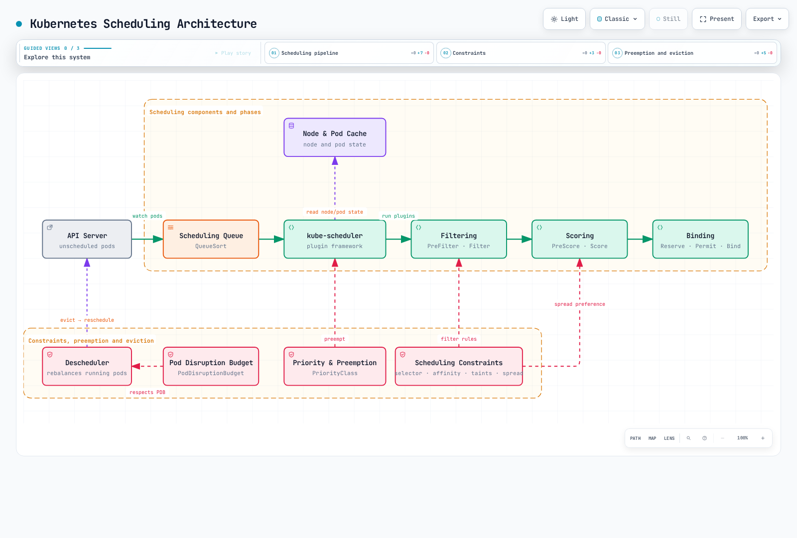
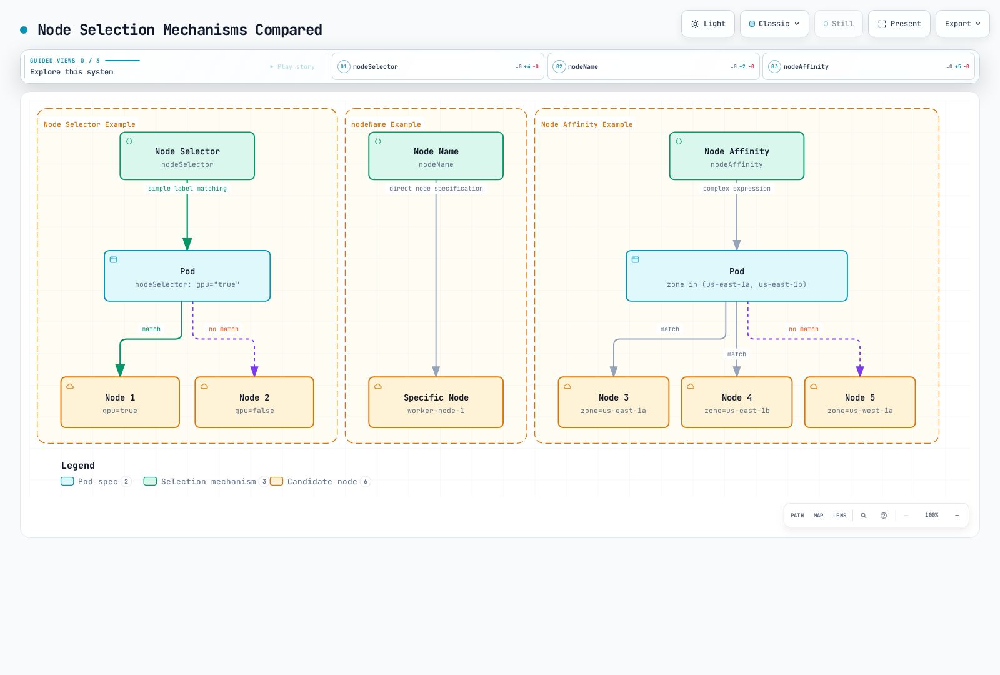

# Programación, desalojo por prioridad y expulsión en Kubernetes

> **Versiones compatibles**: Kubernetes 1.34 - 1.37 (ejemplo de Descheduler v0.37)
> **Última actualización**: October 16, 2026

En Kubernetes, la programación es el proceso de colocar Pods en nodos adecuados. El desalojo por prioridad es el proceso de eliminar Pods de menor prioridad para hacer espacio para Pods de mayor prioridad, y la expulsión termina un Pod; su controlador de carga de trabajo puede crear un reemplazo que el programador coloca por separado. En este capítulo, aprenderemos sobre los mecanismos de programación de Kubernetes, la selección de nodos, el desalojo por prioridad, la expulsión y los métodos de optimización de la programación en Amazon EKS.

## Configuración del entorno de laboratorio

Para seguir los ejemplos de este documento, necesitas las siguientes herramientas y el siguiente entorno:

### Herramientas necesarias
- kubectl dentro de una versión secundaria de la del servidor de API
- Un clúster de Kubernetes funcional (EKS, minikube, kind, etc.)
- Un clúster con varios nodos (para pruebas de programación)

### Configuración del ejemplo de programación

```bash
# Create namespace
kubectl create namespace scheduling-demo

# Add labels to nodes (if you have multiple nodes)
kubectl label nodes <node-name> disktype=ssd
kubectl label nodes <node-name> gpu=true

# Create a pod using node affinity
kubectl -n scheduling-demo apply -f - <<EOF
apiVersion: v1
kind: Pod
metadata:
  name: nginx-ssd
  labels:
    app: nginx
spec:
  affinity:
    nodeAffinity:
      requiredDuringSchedulingIgnoredDuringExecution:
        nodeSelectorTerms:
        - matchExpressions:
          - key: disktype
            operator: In
            values:
            - ssd
  containers:
  - name: nginx
    image: nginx
EOF

# Create priority class
kubectl apply -f - <<EOF
apiVersion: scheduling.k8s.io/v1
kind: PriorityClass
metadata:
  name: high-priority
value: 1000000
globalDefault: false
description: "This priority class should be used for critical service pods only."
EOF

# Create Pod Disruption Budget (PDB)
kubectl -n scheduling-demo apply -f - <<EOF
apiVersion: policy/v1
kind: PodDisruptionBudget
metadata:
  name: nginx-pdb
spec:
  minAvailable: 1
  selector:
    matchLabels:
      app: nginx
EOF
```

## Arquitectura de programación de Kubernetes



[🔍 Ver diagrama interactivo](https://www.atomai.click/kubernetes-docs/archmaps/en-core-08-scheduling-preemption-eviction-0.html)

## Comparación de conceptos de programación

| Concepto | Propósito | Casos de uso | Versión de Kubernetes |
|---------|---------|-----------|-------------------|
| **Selector de nodo** | Colocar Pods en nodos con etiquetas específicas | Selección sencilla de nodos | Todas las versiones |
| **Afinidad de nodo** | Definir reglas complejas de selección de nodos | Selección avanzada de nodos | 1.6+ |
| **Afinidad de Pods** | Colocar Pods cerca de otros Pods | Ubicar juntos servicios relacionados | 1.6+ |
| **Antiafinidad de Pods** | Colocar Pods lejos de otros Pods | Garantizar alta disponibilidad | 1.6+ |
| **Taints y tolerations** | Permitir solo ciertos Pods en los nodos | Nodos dedicados, aislamiento de nodos | 1.6+ |
| **Restricciones de distribución de topología** | Distribuir Pods entre dominios de topología | Distribución entre zonas de disponibilidad | 1.16+ (GA en 1.19) |
| **Prioridad y desalojo por prioridad** | Dar prioridad a las cargas de trabajo importantes | Garantías para servicios críticos | 1.8+ (GA en 1.14) |
| **Presupuesto de interrupción de Pods** | Limitar los Pods interrumpidos simultáneamente | Garantizar alta disponibilidad | 1.4+ (GA en 1.21) |

## Conceptos básicos de programación

> **Concepto clave**: El programador de Kubernetes es un componente del plano de control que selecciona el nodo óptimo para ejecutar Pods y opera en dos fases: filtrado y puntuación.

### Proceso de programación

1. **Fase de filtrado (predicados)**
   - Identifica un conjunto adecuado de nodos donde se puede ejecutar el Pod
   - Tiene en cuenta los requisitos de recursos, los selectores de nodo, las reglas de afinidad, los taints/tolerations, etc.
   - Excluye un nodo si no se cumple alguna condición

2. **Fase de puntuación (prioridades)**
   - Asigna puntuaciones a los nodos que superaron el filtrado
   - Tiene en cuenta la utilización de recursos, la distribución de Pods, las preferencias de afinidad, etc.
   - Selecciona el nodo con la puntuación más alta

3. **Fase de vinculación**
   - Asigna el Pod al nodo seleccionado
   - Actualiza la información de vinculación en el servidor de API

## Tabla de contenido
1. [Descripción general de la programación](#scheduling-overview)
2. [Cómo funciona el programador](#how-the-scheduler-works)
3. [Selección de nodos](#node-selection)
4. [Afinidad y antiafinidad de Pods](#pod-affinity-and-anti-affinity)
5. [Taints y tolerations](#taints-and-tolerations)
6. [Afinidad de nodo](#node-affinity)
7. [Prioridad de Pods y desalojo por prioridad](#pod-priority-and-preemption)
8. [Expulsión de Pods](#pod-eviction)
9. [Presupuesto de interrupción de Pods (PDB)](#pod-disruption-budget-pdb)
10. [Expulsión por presión en el nodo](#node-pressure-eviction)
11. [TopologySpreadConstraints](#topologyspreadconstraints)
12. [Costo de eliminación de Pods](#pod-deletion-cost)
13. [Descheduler](#descheduler)
14. [Optimización de la programación en Amazon EKS](#scheduling-optimization-in-amazon-eks)
15. [Prácticas recomendadas de programación](#scheduling-best-practices)
16. [Conclusión](#conclusion)

## Descripción general de la programación

El programador de Kubernetes es un componente del plano de control que coloca Pods en nodos adecuados. El programador tiene en cuenta diversos factores para determinar el nodo óptimo donde colocar los Pods:

1. **Requisitos de recursos**: CPU, memoria y otros recursos solicitados por el Pod
2. **Restricciones de hardware/software/políticas**: selectores de nodo, afinidad de nodo, taints, etc.
3. **Especificaciones de afinidad/antiafinidad**: relaciones de colocación con otros Pods
4. **Localidad de los datos**: colocar Pods cerca de los datos
5. **Interferencia entre cargas de trabajo**: minimizar la interferencia entre distintas cargas de trabajo
6. **Objetivos personalizados**: la programación que tiene en cuenta los plazos o la interferencia entre cargas de trabajo requiere lógica personalizada adecuada; el programador predeterminado no infiere los plazos de las aplicaciones

### Proceso de programación

El proceso de programación se divide, en términos generales, en dos fases:

1. **Filtrado**: identifica un conjunto de nodos donde se puede ejecutar el Pod
   - Comprueba si se cumplen los requisitos de recursos
   - Comprueba restricciones como selectores de nodo, afinidad y taints

2. **Puntuación**: asigna puntuaciones a los nodos filtrados para seleccionar el nodo óptimo
   - Equilibrio de la utilización de recursos
   - Afinidad/antiafinidad entre Pods
   - Localidad de los datos
   - Taints/tolerations

## Cómo funciona el programador

El programador de Kubernetes opera mediante el siguiente proceso:


[🔍 Ver diagrama interactivo](https://www.atomai.click/kubernetes-docs/archmaps/en-core-08-scheduling-preemption-eviction-1.html)

1. **Supervisión de la cola de Pods**: el programador supervisa el servidor de API en busca de Pods sin programar.
2. **Filtrado de nodos**: identifica un conjunto de nodos donde se puede ejecutar el Pod.
3. **Puntuación de nodos**: asigna puntuaciones a los nodos filtrados.
4. **Selección de nodo**: selecciona el nodo con la puntuación más alta.
5. **Vinculación**: vincula el Pod al nodo seleccionado.

### Complementos de programación

El programador de Kubernetes está diseñado para ser extensible mediante una arquitectura de complementos. Varios complementos operan en distintas etapas del proceso de programación:

1. **Complementos de filtrado**: descartan los nodos donde no se puede ejecutar el Pod
   - NodeResourcesFit: comprueba la capacidad de recursos del nodo
   - NodeName: comprueba el campo nodeName del Pod
   - NodeUnschedulable: comprueba si se puede programar en el nodo
   - TaintToleration: comprueba los taints y las tolerations

2. **Complementos de puntuación**: asignan puntuaciones a los nodos
   - NodeResourcesBalancedAllocation: tiene en cuenta el equilibrio del uso de recursos
   - ImageLocality: tiene en cuenta la localidad de las imágenes
   - InterPodAffinity: tiene en cuenta la afinidad entre Pods
   - NodeAffinity: tiene en cuenta la afinidad de nodo

### Estrategia de puntuación de NodeResourcesFit: LeastAllocated frente a MostAllocated

`NodeResourcesFit` es tanto un complemento de filtrado (¿el nodo tiene suficiente CPU/memoria asignable para el Pod?) como un complemento de puntuación. El comportamiento de su complemento de puntuación se controla mediante `scoringStrategy.type`, configurado a través de `KubeSchedulerConfiguration`:

- **`LeastAllocated`** (predeterminado): asigna puntuaciones más altas a los nodos cuanto *menos* recursos tengan asignados. Los nuevos Pods se dirigen a los nodos más vacíos para distribuir la carga de manera uniforme.
- **`MostAllocated`**: asigna puntuaciones más altas a los nodos cuanto *más* recursos tengan asignados (siempre que el Pod todavía quepa). Los nuevos Pods se agrupan primero en los nodos más ocupados y dejan los demás nodos intactos o vacíos.
- **`RequestedToCapacityRatio`**: una curva configurable entre ambas estrategias, útil para recursos extendidos como las GPU, cuando se necesita una forma personalizada en lugar de un mínimo/máximo puro.

```yaml
apiVersion: kubescheduler.config.k8s.io/v1
kind: KubeSchedulerConfiguration
profiles:
- schedulerName: most-allocated-scheduler
  pluginConfig:
  - name: NodeResourcesFit
    args:
      scoringStrategy:
        type: MostAllocated
        resources:
        - name: cpu
          weight: 1
        - name: memory
          weight: 1
```

El plano de control de Amazon EKS está totalmente administrado, por lo que no puedes editar directamente `KubeSchedulerConfiguration` del kube-scheduler predeterminado. Para usar `MostAllocated`, ejecuta un segundo programador (un `Deployment` que ejecute el binario `kube-scheduler` con esta configuración, vinculado a `system:kube-scheduler`/`system:volume-scheduler` mediante un `ServiceAccount` dedicado) y dirige Pods específicos a él con `spec.schedulerName`, como se muestra más abajo en [Varios programadores](#multiple-schedulers), siguiendo el mismo patrón que en [Crear un programador personalizado](../scheduling/01-custom-scheduler-part1.md).

**Prueba verificada: comportamiento de distribución frente a empaquetado compacto.** Para confirmar la diferencia práctica, se preparó un clúster `kind` desechable de 3 nodos de trabajo (`kubectl version` v1.37.0, aislado y eliminado tras la prueba; no se afectó ninguna infraestructura compartida) con una carga de referencia desigual mediante Pods de relleno fijados con `nodeName` (16 CPU asignables por nodo): `worker`=12 Pods (75%), `worker2`=6 Pods (37%), `worker3`=0 Pods (0%). Luego se programaron seis Pods idénticos de 1 CPU dos veces, una con el programador predeterminado (`LeastAllocated`) y otra con un segundo programador configurado con `MostAllocated`, usando el mismo estado inicial:

| Programador / estrategia | Dónde quedaron los 6 Pods nuevos | Utilización final de CPU (worker / worker2 / worker3) |
|---|---|---|
| Predeterminado (`LeastAllocated`) | Los 6 en `worker3` (el nodo más vacío) | 75% / 37% / 37% (los tres nodos ahora están ocupados) |
| `MostAllocated` | 3 en `worker`, 3 en `worker2` (los dos nodos más ocupados) | 93% / 56% / 0% (`worker3` quedó completamente inactivo) |

`LeastAllocated` aumentó la carga de `worker3` hasta igualar a `worker2`, por lo que todos los nodos terminan parcialmente utilizados y ninguno puede reducirse de forma segura. `MostAllocated` siguió concentrando la carga en los nodos ya ocupados y dejó `worker3` intacto: exactamente el nodo que un autoescalador de clúster o un proceso de consolidación de Karpenter terminaría después.

Por eso se suele recomendar `MostAllocated` para las **cargas de trabajo por lotes o los trabajos de corta duración** que se ejecutan junto con Karpenter o Cluster Autoscaler: empaquetar los trabajos en menos nodos maximiza la cantidad de nodos que quedan completamente inactivos y pasan a ser aptos para la consolidación, lo que reduce directamente el costo de cómputo. `LeastAllocated` sigue siendo la mejor opción predeterminada para servicios de larga duración sensibles a la latencia, ya que distribuir la carga deja capacidad disponible en cada nodo para absorber picos de tráfico o un `kubectl drain` sin concentrar la presión en un único nodo saturado.

Reproduce esta comparación exacta, paso a paso, en el [Laboratorio de estrategias de puntuación del programador](../labs/core/08-scheduling-preemption-eviction-lab.md).

### Varios programadores

Kubernetes puede ejecutar varios programadores al mismo tiempo. Esto permite implementar lógica de programación personalizada para cargas de trabajo específicas.

```yaml
apiVersion: v1
kind: Pod
metadata:
  name: custom-scheduled-pod
spec:
  schedulerName: my-custom-scheduler
  containers:
  - name: container
    image: nginx
```

En el ejemplo anterior, el campo `schedulerName` especifica el programador que programará el Pod.

## Selección de nodos

Kubernetes proporciona varios mecanismos para colocar Pods en nodos específicos.



[🔍 Ver diagrama interactivo](https://www.atomai.click/kubernetes-docs/archmaps/en-core-08-scheduling-preemption-eviction-2.html)

### Selector de nodo

El selector de nodo es la manera más sencilla de restringir la colocación de Pods a nodos con etiquetas específicas.

```yaml
apiVersion: v1
kind: Pod
metadata:
  name: gpu-pod
spec:
  nodeSelector:
    gpu: "true"
  containers:
  - name: gpu-container
    image: busybox:1.36
    command: ["sh", "-c", "sleep 3600"]
    resources:
      limits:
        nvidia.com/gpu: 1
```

En el ejemplo anterior, el Pod solo se coloca en nodos con la etiqueta `gpu=true`.

El ejemplo de GPU solo prueba la programación: el nodo debe tener realmente una GPU y un complemento de dispositivo funcional que anuncie `nvidia.com/gpu`. Una etiqueta `gpu=true` por sí sola no asigna recursos de GPU.

### nodeName

Puedes usar el campo `nodeName` para colocar directamente un Pod en un nodo específico. Este método omite el programador y, por lo general, no se recomienda.

```yaml
apiVersion: v1
kind: Pod
metadata:
  name: specific-node-pod
spec:
  nodeName: worker-node-1
  containers:
  - name: container
    image: nginx
```

En el ejemplo anterior, el Pod se coloca directamente en el nodo llamado `worker-node-1`.

## Afinidad y antiafinidad de Pods

La afinidad y la antiafinidad de Pods permiten colocarlos según las relaciones entre Pods.


[🔍 Ver diagrama interactivo](https://www.atomai.click/kubernetes-docs/archmaps/en-core-08-scheduling-preemption-eviction-3.html)

### Afinidad de Pods

La afinidad de Pods hace que los Pods se coloquen en el mismo nodo o dominio de topología que otros Pods con etiquetas específicas.

```yaml
apiVersion: v1
kind: Pod
metadata:
  name: frontend
spec:
  affinity:
    podAffinity:
      requiredDuringSchedulingIgnoredDuringExecution:
      - labelSelector:
          matchExpressions:
          - key: app
            operator: In
            values:
            - cache
        topologyKey: kubernetes.io/hostname
  containers:
  - name: frontend
    image: nginx
```

En el ejemplo anterior, el Pod `frontend` se coloca en el mismo host que los Pods con la etiqueta `app=cache`.

### Antiafinidad de Pods

La antiafinidad de Pods hace que los Pods se coloquen en un nodo o dominio de topología distinto al de otros Pods con etiquetas específicas.

```yaml
apiVersion: v1
kind: Pod
metadata:
  name: frontend
  labels:
    app: frontend
spec:
  affinity:
    podAntiAffinity:
      requiredDuringSchedulingIgnoredDuringExecution:
      - labelSelector:
          matchExpressions:
          - key: app
            operator: In
            values:
            - frontend
        topologyKey: kubernetes.io/hostname
  containers:
  - name: frontend
    image: nginx
```

En el ejemplo anterior, el Pod `frontend` se coloca en un host distinto al de otros Pods con la etiqueta `app=frontend`. Esto es útil para distribuir instancias de una misma aplicación entre varios nodos con el fin de lograr una alta disponibilidad.

### Tipos de afinidad

La afinidad y la antiafinidad de Pods tienen dos tipos:

1. **requiredDuringSchedulingIgnoredDuringExecution**: requisito estricto que debe cumplirse durante la programación
2. **preferredDuringSchedulingIgnoredDuringExecution**: requisito flexible que se prefiere, pero no es obligatorio

```yaml
# preferredDuringSchedulingIgnoredDuringExecution example
affinity:
  podAffinity:
    preferredDuringSchedulingIgnoredDuringExecution:
    - weight: 100
      podAffinityTerm:
        labelSelector:
          matchExpressions:
          - key: app
            operator: In
            values:
            - cache
        topologyKey: kubernetes.io/hostname
```

En el ejemplo anterior, el campo `weight` indica el peso de esta preferencia. Si hay varias preferencias, las de mayor peso se consideran más importantes.

## Taints y tolerations

Los taints y las tolerations son mecanismos que permiten a los nodos rechazar determinados Pods.


[🔍 Ver diagrama interactivo](https://www.atomai.click/kubernetes-docs/archmaps/en-core-08-scheduling-preemption-eviction-4.html)

### Taints

Los taints se aplican a los nodos para restringir la programación de Pods en ellos.

```bash
# Add taint to node
kubectl taint nodes node1 key=value:NoSchedule
```

Hay tres efectos de taint:

1. **NoSchedule**: los Pods sin tolerations no se programan en el nodo
2. **PreferNoSchedule**: se procura no programar en el nodo Pods sin tolerations
3. **NoExecute**: los Pods sin tolerations se expulsan del nodo

### Tolerations

Las tolerations se aplican a los Pods para permitir su programación en nodos con taints.

```yaml
apiVersion: v1
kind: Pod
metadata:
  name: nginx
spec:
  tolerations:
  - key: "key"
    operator: "Equal"
    value: "value"
    effect: "NoSchedule"
  containers:
  - name: nginx
    image: nginx
```

En el ejemplo anterior, el Pod se puede programar en nodos con el taint `key=value:NoSchedule`.

### Casos de uso

Casos de uso habituales de taints y tolerations:

1. **Nodos dedicados**: designar nodos para ejecutar solo cargas de trabajo específicas
2. **Hardware especializado**: administrar nodos con hardware especializado, como GPU
3. **Mantenimiento de nodos**: impedir que se programen nuevos Pods en nodos en mantenimiento
4. **Problemas en los nodos**: expulsar Pods de nodos con problemas

### Taints predeterminados

Kubernetes aplica taints predeterminados a algunos nodos:

- **node.kubernetes.io/not-ready**: el nodo no está listo
- **node.kubernetes.io/unreachable**: no se puede acceder al nodo
- **node.kubernetes.io/memory-pressure**: el nodo tiene presión de memoria
- **node.kubernetes.io/disk-pressure**: el nodo tiene presión de disco
- **node.kubernetes.io/pid-pressure**: el nodo tiene presión de PID
- **node.kubernetes.io/network-unavailable**: la red del nodo no está disponible
- **node.kubernetes.io/unschedulable**: no se puede programar en el nodo

## Afinidad de nodo

La afinidad de nodo ofrece una manera más expresiva de colocar Pods en conjuntos específicos de nodos. Permite especificar condiciones más complejas que un selector de nodo.

### Tipos de afinidad de nodo

La afinidad de nodo tiene dos tipos:

1. **requiredDuringSchedulingIgnoredDuringExecution**: requisito estricto que debe cumplirse durante la programación
2. **preferredDuringSchedulingIgnoredDuringExecution**: requisito flexible que se prefiere, pero no es obligatorio

```yaml
apiVersion: v1
kind: Pod
metadata:
  name: with-node-affinity
spec:
  affinity:
    nodeAffinity:
      requiredDuringSchedulingIgnoredDuringExecution:
        nodeSelectorTerms:
        - matchExpressions:
          - key: topology.kubernetes.io/zone
            operator: In
            values:
            - us-west-2a
            - us-west-2b
      preferredDuringSchedulingIgnoredDuringExecution:
      - weight: 1
        preference:
          matchExpressions:
          - key: another-node-label-key
            operator: In
            values:
            - another-node-label-value
  containers:
  - name: with-node-affinity
    image: nginx
```

En el ejemplo anterior, el Pod solo se coloca en nodos donde la etiqueta `topology.kubernetes.io/zone` tiene el valor `us-west-2a` o `us-west-2b`. Además, se prefiere colocarlo en nodos con la etiqueta `another-node-label-key=another-node-label-value`.

### Operadores

La afinidad de nodo admite varios operadores:

- **In**: el valor de la etiqueta coincide con uno de los valores especificados
- **NotIn**: el valor de la etiqueta no coincide con los valores especificados
- **Exists**: existe una etiqueta con la clave especificada
- **DoesNotExist**: no existe una etiqueta con la clave especificada
- **Gt**: el valor de la etiqueta es mayor que el valor especificado
- **Lt**: el valor de la etiqueta es menor que el valor especificado

## Prioridad de Pods y desalojo por prioridad

Kubernetes ofrece funciones de prioridad y desalojo por prioridad de Pods para garantizar que las cargas de trabajo importantes puedan obtener recursos del clúster.


[🔍 Ver diagrama interactivo](https://www.atomai.click/kubernetes-docs/archmaps/en-core-08-scheduling-preemption-eviction-5.html)

### PriorityClass

PriorityClass define la importancia relativa de los Pods. Cuanto mayor sea el valor de prioridad, más importante será el Pod.

```yaml
apiVersion: scheduling.k8s.io/v1
kind: PriorityClass
metadata:
  name: high-priority
value: 1000000
globalDefault: false
description: "This priority class should be used for critical workloads."
```

En el ejemplo anterior, el campo `value` indica el valor de prioridad. Cuanto mayor sea el valor, mayor será la prioridad. Si el campo `globalDefault` se establece en `true`, esta clase de prioridad se aplica a los Pods que no especifican una clase de prioridad.

### Aplicación de PriorityClass a los Pods

Para aplicar una clase de prioridad a un Pod, usa el campo `priorityClassName`.

```yaml
apiVersion: v1
kind: Pod
metadata:
  name: high-priority-pod
spec:
  priorityClassName: high-priority
  containers:
  - name: container
    image: nginx
```

### Desalojo por prioridad

El desalojo por prioridad es el proceso de eliminar Pods de menor prioridad para programar Pods de mayor prioridad. Cuando el programador no puede encontrar un nodo para programar un Pod de mayor prioridad, desaloja Pods de menor prioridad para obtener recursos.

Proceso de desalojo por prioridad:
1. El programador no puede encontrar un nodo para programar un Pod de mayor prioridad
2. El programador selecciona un nodo para eliminar Pods de menor prioridad mediante el desalojo por prioridad
3. Solicita la eliminación de los Pods seleccionados de menor prioridad a través de la API; kubelet/runtime realizan la terminación
4. Cuando los Pods terminan correctamente, programa el Pod de mayor prioridad en ese nodo

### Consideraciones sobre el desalojo por prioridad

Aspectos que se deben tener en cuenta al usar el desalojo por prioridad:

1. **Período de terminación gradual**: los Pods desalojados por prioridad atraviesan el proceso de terminación gradual durante el tiempo especificado en `terminationGracePeriodSeconds`
2. **PodDisruptionBudget**: el programador intenta evitar incumplimientos, pero el desalojo por prioridad puede incumplir un PDB si no hay víctimas adecuadas que permitan evitarlo
3. **Clases de prioridad del sistema**: Kubernetes proporciona clases de prioridad para componentes del sistema
   - `system-cluster-critical`: Pods críticos para el funcionamiento del clúster
   - `system-node-critical`: Pods críticos para el funcionamiento del nodo

## Expulsión de Pods

La expulsión termina un Pod; su controlador de carga de trabajo puede crear un reemplazo que el programador coloca por separado. La expulsión puede ocurrir por varios motivos.


[🔍 Ver diagrama interactivo](https://www.atomai.click/kubernetes-docs/archmaps/en-core-08-scheduling-preemption-eviction-6.html)

### Tipos de expulsión

1. **Expulsión por kube-controller-manager**:
   - El taint-eviction-controller gestiona los taints NoExecute. Normalmente, los Pods reciben tolerations de 300 segundos para los estados not-ready/unreachable; la expulsión sigue la configuración de sus tolerations
   - Cuando un nodo está en estado Unreachable

2. **Expulsión por kubelet**:
   - Escasez de recursos del nodo (memoria, disco, etc.)
   - Los fallos de hardware pueden provocar que un nodo deje de estar disponible; no son una señal genérica de expulsión por presión de kubelet

3. **Expulsión iniciada por el usuario**:
   - Ejecución del comando `kubectl drain`
   - Tareas de mantenimiento de nodos

### Señales de expulsión de kubelet

kubelet supervisa las siguientes señales de expulsión:

1. **memory.available**: memoria disponible
2. **nodefs.available**: espacio disponible en el sistema de archivos del nodo
3. **nodefs.inodesFree**: inodos disponibles en el sistema de archivos del nodo
4. **imagefs.available**: espacio disponible en el sistema de archivos de imágenes
5. **imagefs.inodesFree**: inodos disponibles en el sistema de archivos de imágenes
6. **pid.available**: identificadores de proceso disponibles

Se pueden establecer umbrales suaves y estrictos para cada señal:

- **Umbral suave**: expulsa Pods después de `grace-period` cuando se supera el umbral
- **Umbral estricto**: expulsa Pods inmediatamente cuando se supera el umbral

```yaml
# kubelet configuration example
evictionHard:
  memory.available: "100Mi"
  nodefs.available: "10%"
  nodefs.inodesFree: "5%"
  imagefs.available: "15%"
  imagefs.inodesFree: "5%"
evictionSoft:
  memory.available: "200Mi"
  nodefs.available: "15%"
evictionSoftGracePeriod:
  memory.available: "1m"
  nodefs.available: "2m"
evictionMaxPodGracePeriod: 30
evictionPressureTransitionPeriod: "30s"
```

### Prioridad de expulsión

kubelet ordena los candidatos según si el uso supera las solicitudes, luego según la prioridad del Pod y, por último, según el uso relativo a las solicitudes. No expulsa simplemente primero todos los Pods BestEffort, luego todos los Burstable y después todos los Guaranteed. La presión de disco/PID tiene restricciones contables distintas; QoS no es un orden de expulsión universal.

## Presupuesto de interrupción de Pods (PDB)

El presupuesto de interrupción de Pods (PDB) es una forma de mantener la disponibilidad de las aplicaciones durante interrupciones voluntarias. El PDB limita la cantidad de Pods que pueden interrumpirse simultáneamente.


[🔍 Ver diagrama interactivo](https://www.atomai.click/kubernetes-docs/archmaps/en-core-08-scheduling-preemption-eviction-7.html)

### Definición de PDB

```yaml
apiVersion: policy/v1
kind: PodDisruptionBudget
metadata:
  name: frontend-pdb
spec:
  minAvailable: 2
  selector:
    matchLabels:
      app: frontend
```

o

```yaml
apiVersion: policy/v1
kind: PodDisruptionBudget
metadata:
  name: frontend-pdb
spec:
  maxUnavailable: 1
  selector:
    matchLabels:
      app: frontend
```

En los ejemplos anteriores:
- `minAvailable`: cantidad mínima de Pods que siempre deben estar disponibles
- `maxUnavailable`: cantidad máxima de Pods que pueden estar no disponibles al mismo tiempo
- `selector`: selector de etiquetas que selecciona los Pods a los que se aplica el PDB

### Funcionamiento del PDB

1. Cuando ocurren interrupciones voluntarias, como el vaciado de un nodo, Kubernetes comprueba el PDB
2. Si se cumplen las condiciones del PDB, se procede con la expulsión del Pod
3. Si no se cumplen las condiciones del PDB, se deniega la expulsión del Pod

Los PDB controlan las solicitudes a la API de expulsión, como las operaciones normales de vaciado y de Descheduler. La eliminación directa de Pods, los despliegues graduales de controladores y la expulsión por presión en el nodo omiten este control. `minAvailable: 2` y `maxUnavailable: 1` son equivalentes únicamente para una carga de trabajo con tres réplicas deseadas; ninguna de las dos opciones crea capacidad de reemplazo.

### Prácticas recomendadas para PDB

1. **Configura un PDB para todas las cargas de trabajo críticas**: configura un PDB para todas las cargas de trabajo que requieran alta disponibilidad
2. **Elige valores adecuados**: selecciona valores de `minAvailable` o `maxUnavailable` apropiados para las características de la carga de trabajo
3. **Ten en cuenta el número de réplicas**: `minAvailable` puede ser igual al número de réplicas para bloquear expulsiones voluntarias, pero el mantenimiento podría detenerse; configura deliberadamente el margen de interrupción permitido
4. **Realiza pruebas periódicas**: prueba el funcionamiento del PDB mediante el vaciado de nodos y tareas similares

## Expulsión por presión en el nodo

La expulsión por presión en el nodo es un mecanismo que expulsa Pods cuando escasean los recursos del nodo.

### Estado de las condiciones del nodo

kubelet informa los siguientes estados de condición del nodo:

1. **MemoryPressure**: el nodo tiene poca memoria
2. **DiskPressure**: el nodo tiene poco espacio en disco
3. **PIDPressure**: el nodo tiene pocos identificadores de proceso

Cuando se producen estas condiciones, kubelet expulsa Pods para recuperar recursos.

### Configuración de la política de expulsión

Las políticas de expulsión se pueden establecer en la configuración de kubelet:

```yaml
# kubelet configuration example
evictionHard:
  memory.available: "100Mi"
  nodefs.available: "10%"
  nodefs.inodesFree: "5%"
  imagefs.available: "15%"
  imagefs.inodesFree: "5%"
evictionSoft:
  memory.available: "200Mi"
  nodefs.available: "15%"
evictionSoftGracePeriod:
  memory.available: "1m"
  nodefs.available: "2m"
evictionMinimumReclaim:
  memory.available: "50Mi"
  nodefs.available: "5%"
evictionMaxPodGracePeriod: 30
evictionPressureTransitionPeriod: "30s"
```

En el ejemplo anterior:
- `evictionMinimumReclaim`: cantidad mínima de recursos que se deben recuperar después de la expulsión
- `evictionPressureTransitionPeriod`: tiempo de espera entre transiciones del estado de presión

## TopologySpreadConstraints

TopologySpreadConstraints permiten controlar de forma precisa cómo se distribuyen los Pods entre dominios de topología, como zonas de disponibilidad, nodos o regiones. Esta función ofrece más flexibilidad que la antiafinidad de Pods para lograr una alta disponibilidad y un uso eficiente de los recursos.


[🔍 Ver diagrama interactivo](https://www.atomai.click/kubernetes-docs/archmaps/en-core-08-scheduling-preemption-eviction-8.html)

### Campos clave

| Campo | Descripción | Obligatorio |
|-------|-------------|----------|
| **maxSkew** | Para DoNotSchedule, diferencia permitida entre un dominio objetivo y el mínimo global; ScheduleAnyway usa la desviación como preferencia | Sí |
| **topologyKey** | Clave de etiqueta del nodo que define los dominios de topología | Sí |
| **whenUnsatisfiable** | Acción cuando no se pueden satisfacer las restricciones: `DoNotSchedule` o `ScheduleAnyway` | Sí |
| **labelSelector** | Selecciona los Pods que se contabilizan; normalmente se especifica junto con las etiquetas coincidentes de los Pods | No (null no coincide con ningún Pod) |
| **minDomains** | Cantidad mínima de dominios aptos para calcular la desviación (estable desde v1.30) | No |
| **matchLabelKeys** | Claves de etiqueta del Pod que se deben comparar para calcular la distribución (1.27+) | No |

### Opciones de whenUnsatisfiable

- **DoNotSchedule**: el programador no programa el Pod si no se puede satisfacer la restricción (restricción estricta)
- **ScheduleAnyway**: el programador sigue programando el Pod y da mayor prioridad a los nodos que minimizan la desviación (restricción flexible)

### Ejemplo de distribución entre zonas de disponibilidad en EKS

```yaml
apiVersion: apps/v1
kind: Deployment
metadata:
  name: web-app
spec:
  replicas: 6
  selector:
    matchLabels:
      app: web
  template:
    metadata:
      labels:
        app: web
    spec:
      topologySpreadConstraints:
      - maxSkew: 1
        topologyKey: topology.kubernetes.io/zone
        whenUnsatisfiable: DoNotSchedule
        labelSelector:
          matchLabels:
            app: web
      - maxSkew: 1
        topologyKey: kubernetes.io/hostname
        whenUnsatisfiable: ScheduleAnyway
        labelSelector:
          matchLabels:
            app: web
      containers:
      - name: web
        image: nginx:1.30.6
        resources:
          requests:
            cpu: 100m
            memory: 128Mi
```

Esta configuración garantiza que:
1. Los Pods se distribuyan uniformemente entre las zonas de disponibilidad (restricción estricta)
2. Se prefiera distribuir los Pods entre los nodos de cada zona (restricción flexible)

### minDomains y matchLabelKeys

```yaml
apiVersion: apps/v1
kind: Deployment
metadata:
  name: app-with-min-domains
spec:
  replicas: 4
  selector:
    matchLabels:
      app: distributed-app
  template:
    metadata:
      labels:
        app: distributed-app
        version: v1
    spec:
      topologySpreadConstraints:
      - maxSkew: 1
        topologyKey: topology.kubernetes.io/zone
        whenUnsatisfiable: DoNotSchedule
        labelSelector:
          matchLabels:
            app: distributed-app
        minDomains: 3
        matchLabelKeys:
        - version
      containers:
      - name: app
        image: myapp:v1
```

- **minDomains**: si hay menos de 3 dominios aptos, el mínimo global pasa a ser cero. Con maxSkew 1, todavía se puede programar un Pod coincidente en cada dominio apto; los Pods adicionales pueden quedar en estado Pending. No bloquea todos los Pods de inmediato.
- **matchLabelKeys**: usa automáticamente en el selector el valor de la etiqueta `version` del Pod, lo que permite distribuir cada revisión sin modificar el selector.

### Ventajas frente a la antiafinidad de Pods

| Aspecto | TopologySpreadConstraints | Antiafinidad de Pods |
|--------|---------------------------|-------------------|
| **Flexibilidad** | Permite una desviación controlada (maxSkew > 1) | Binaria: mismo dominio o dominio diferente |
| **Restricciones flexibles** | `ScheduleAnyway` para el mejor esfuerzo | `preferredDuringScheduling`, pero con menos control |
| **Varios niveles** | Varias restricciones con distintos topologyKeys | Requiere reglas anidadas complejas |
| **Rendimiento** | Mejor rendimiento del programador a escala | Puede ralentizar la programación con muchos Pods |
| **Caso de uso** | Distribución uniforme con tolerancia | Separación estricta |

## Costo de eliminación de Pods

El costo de eliminación de Pods es una preferencia de mejor esfuerzo que usa el controlador ReplicaSet al reducir la escala. HPA cambia el número deseado de réplicas; no selecciona Pods individuales como víctimas. La anotación no protege Jobs/StatefulSets, no impide la expulsión ni garantiza el orden de eliminación.

### Cómo funciona

Cuando un controlador (como HPA o una reducción manual de escala) necesita reducir las réplicas, tiene en cuenta lo siguiente:
1. Primero se eliminan los Pods con menor costo de eliminación
2. El costo de eliminación predeterminado es 0
3. Intervalo válido: -2147483648 a 2147483647

### Ejemplo básico

```yaml
apiVersion: v1
kind: Pod
metadata:
  name: worker-pod
  annotations:
    controller.kubernetes.io/pod-deletion-cost: "100"
spec:
  containers:
  - name: worker
    image: worker:latest
```

### Control de prioridad al reducir la escala de HPA

Usa el costo de eliminación para proteger Pods importantes durante la reducción de escala de HPA:

```yaml
apiVersion: apps/v1
kind: Deployment
metadata:
  name: web-service
spec:
  replicas: 5
  selector:
    matchLabels:
      app: web
  template:
    metadata:
      labels:
        app: web
      # Lower cost pods are deleted first during scale-down
      annotations:
        controller.kubernetes.io/pod-deletion-cost: "0"
    spec:
      containers:
      - name: web
        image: nginx:1.30.6
```

### Patrón de protección de caché

Ejecuta la caché con solicitudes de CPU explícitas si se va a escalar mediante HPA basado en la utilización de CPU. Lo siguiente es un ejemplo de programación, no una configuración de Redis completa para producción:

```yaml
apiVersion: apps/v1
kind: Deployment
metadata:
  name: cache-service
spec:
  replicas: 3
  selector:
    matchLabels:
      app: cache
  template:
    metadata:
      labels:
        app: cache
    spec:
      automountServiceAccountToken: false
      containers:
      - name: cache
        image: redis:7
        resources:
          requests:
            cpu: 100m
            memory: 128Mi
```

Después de medir el estado real de calentamiento de la caché, un operador/controlador autorizado puede anotar una vez un Pod seleccionado propiedad de ReplicaSet antes de reducir la escala:

```bash
kubectl -n default annotate pod "$CACHE_POD" \
  controller.kubernetes.io/pod-deletion-cost="1000" --overwrite
```

Asigna a `CACHE_POD` el nombre de un Pod de caché real. Escribir anotaciones con frecuencia genera carga en la API. Un actualizador personalizado necesitaría herramientas cliente tanto de Redis como de Kubernetes, además de permisos de modificación de Pods estrictamente acotados; el tiempo transcurrido por sí solo no demuestra que la caché esté caliente. Este ejemplo no instala ningún actualizador.

### Casos de uso prácticos

1. **Cachés con estado administradas por un ReplicaSet**: preferir conservar las réplicas calientes
2. **Elección de líder**: mantener los Pods líderes en ejecución durante más tiempo
3. **Drenaje de conexiones**: dar tiempo a las conexiones de larga duración
4. **Calentamiento de caché**: conservar los Pods con cachés calientes
5. **Limitaciones**: los controladores Job y StatefulSet no usan esta preferencia

## Descheduler

Descheduler es un componente de Kubernetes que expulsa Pods de los nodos para que el programador pueda volver a programarlos en nodos más adecuados. A diferencia del programador, que solo coloca nuevos Pods, Descheduler ayuda a mantener una ubicación óptima de los Pods a lo largo del tiempo.


[🔍 Ver diagrama interactivo](https://www.atomai.click/kubernetes-docs/archmaps/en-core-08-scheduling-preemption-eviction-9.html)

### Por qué se necesita reprogramar

1. **Cambios en el clúster**: se agregan nodos nuevos o cambian las etiquetas de nodo
2. **Deriva de los Pods**: la ubicación inicial se vuelve subóptima con el tiempo
3. **Incumplimientos de afinidad**: se infringen reglas tras cambios en el clúster
4. **Desequilibrio de recursos**: algunos nodos están sobreutilizados y otros infrautilizados
5. **Pods fallidos**: Pods atascados en bucles de reinicio

### Estrategias clave

| Estrategia | Descripción | Caso de uso |
|----------|-------------|----------|
| **RemoveDuplicates** | Elimina Pods duplicados del mismo nodo | Garantizar alta disponibilidad después de fallos de nodo |
| **LowNodeUtilization** | Mueve Pods de nodos sobreutilizados a nodos infrautilizados | Equilibrar los recursos del clúster |
| **RemovePodsHavingTooManyRestarts** | Expulsa Pods con demasiados reinicios | Limpiar Pods problemáticos |
| **PodLifeTime** | Expulsa Pods que superan la antigüedad especificada | Forzar una nueva programación |
| **RemovePodsViolatingInterPodAntiAffinity** | Expulsa Pods que incumplen las reglas de antiafinidad | Restablecer el cumplimiento de las reglas de afinidad |
| **RemovePodsViolatingNodeAffinity** | Expulsa Pods que incumplen las reglas de afinidad de nodo | Restablecer el cumplimiento de las reglas de afinidad |
| **RemovePodsViolatingTopologySpreadConstraint** | Expulsa Pods que incumplen las restricciones de distribución | Restablecer una distribución uniforme |

### Instalación con Helm

Descheduler v0.37.0 es la versión de ejemplo verificada, dirigida a Kubernetes v1.37 y a las dos versiones secundarias anteriores de su ventana de pruebas. Comprueba la matriz de compatibilidad antes de aplicarla a otra versión. Guarda los valores de Helm revisados en `descheduler-values.yaml` con `schedule` y `deschedulerPolicy.profiles` (los perfiles de política que se muestran abajo); los valores antiguos `strategies.*.enabled` no configuran esta API.

```bash
helm repo add descheduler https://kubernetes-sigs.github.io/descheduler/
helm upgrade --install descheduler descheduler/descheduler \
  --version 0.37.0 --namespace kube-system \
  --values descheduler-values.yaml
```

### Configuración de DeschedulerPolicy

```yaml
apiVersion: descheduler/v1alpha2
kind: DeschedulerPolicy
profiles:
- name: default
  pluginConfig:
  - name: DefaultEvictor
    args:
      nodeFit: true
  - name: RemoveDuplicates
    args:
      excludeOwnerKinds: [StatefulSet]
  - name: LowNodeUtilization
    args:
      thresholds:
        cpu: 20
        memory: 20
        pods: 20
      targetThresholds:
        cpu: 50
        memory: 50
        pods: 50
  - name: RemovePodsHavingTooManyRestarts
    args:
      podRestartThreshold: 100
      includingInitContainers: true
  - name: PodLifeTime
    args:
      maxPodLifeTimeSeconds: 86400
      labelSelector:
        matchLabels:
          app.kubernetes.io/lifecycle: ephemeral
  - name: RemovePodsViolatingNodeAffinity
    args:
      nodeAffinityType: [requiredDuringSchedulingIgnoredDuringExecution]
  - name: RemovePodsViolatingTopologySpreadConstraint
    args:
      constraints: [DoNotSchedule]
  plugins:
    balance:
      enabled:
      - RemoveDuplicates
      - LowNodeUtilization
      - RemovePodsViolatingTopologySpreadConstraint
    deschedule:
      enabled:
      - RemovePodsHavingTooManyRestarts
      - PodLifeTime
      - RemovePodsViolatingNodeAffinity
```

### Respeto de los PDB

Descheduler respeta los presupuestos de interrupción de Pods (PDB). Si la expulsión de un Pod incumpliera un PDB, Descheduler no lo expulsaría:

```yaml
apiVersion: policy/v1
kind: PodDisruptionBudget
metadata:
  name: web-pdb
spec:
  minAvailable: 2
  selector:
    matchLabels:
      app: web
```

Con este PDB, Descheduler garantiza que al menos 2 Pods con la etiqueta `app: web` sigan disponibles durante las operaciones de reprogramación.

La política anterior es un archivo de configuración de Descheduler, no un objeto de API para kubectl apply. Usa complementos Balance para redistribuir grupos y complementos Deschedule para tomar decisiones por Pod. LowNodeUtilization normalmente evalúa las solicitudes de recursos, en lugar del uso real de CPU, y la expulsión no garantiza que el Pod de reemplazo termine en otro lugar. Revisa las medidas de seguridad y prueba en modo de ejecución simulada antes de habilitar expulsiones recurrentes.

### Ejemplo de CronJob de Descheduler

```yaml
apiVersion: batch/v1
kind: CronJob
metadata:
  name: descheduler
  namespace: kube-system
spec:
  schedule: "*/30 * * * *"
  concurrencyPolicy: Forbid
  jobTemplate:
    spec:
      template:
        spec:
          serviceAccountName: descheduler
          containers:
          - name: descheduler
            image: registry.k8s.io/descheduler/descheduler:v0.37.0
            args:
            - --policy-config-file=/policy/policy.yaml
            - --v=3
            volumeMounts:
            - name: policy
              mountPath: /policy
          volumes:
          - name: policy
            configMap:
              name: descheduler-policy
          restartPolicy: OnFailure
```

El CronJob independiente es una alternativa a Helm, no una instalación adicional. Requiere la ServiceAccount/RBAC `descheduler` y un ConfigMap `descheduler-policy` con la clave `policy.yaml`; usa los manifiestos/gráficos oficiales para proporcionar estos requisitos previos.

> **Análisis detallado**: para obtener información detallada sobre programadores personalizados, consulta:
> - [Programador personalizado, parte 1: conceptos básicos](../scheduling/01-custom-scheduler-part1.md)
> - [Programador personalizado, parte 2: implementación](../scheduling/02-custom-scheduler-part2.md)
> - [Programador personalizado, parte 3: funciones avanzadas](../scheduling/03-custom-scheduler-part3.md)

## Optimización de la programación en Amazon EKS

En Amazon EKS, puedes optimizar las cargas de trabajo mediante las funciones de programación de Kubernetes.


[🔍 Ver diagrama interactivo](https://www.atomai.click/kubernetes-docs/archmaps/en-core-08-scheduling-preemption-eviction-11.html)

### Grupos de nodos y tipos de instancia

En EKS, puedes proporcionar recursos adecuados para las cargas de trabajo mediante distintos grupos de nodos y tipos de instancia:

1. **Distintos tipos de instancia**: optimizados para cómputo, memoria, almacenamiento, etc.
2. **Instancias Spot**: instancias Spot para cargas de trabajo rentables
3. **Instancias GPU**: instancias GPU para cargas de trabajo de IA/ML

Puedes usar etiquetas de nodo y taints para colocar cargas de trabajo específicas en grupos de nodos específicos:

Usa una configuración de eksctl revisada para el clúster existente, con la Región correspondiente, una instancia/AMI GPU compatible y los permisos de IAM necesarios:

```yaml
# gpu-nodegroup.yaml
apiVersion: eksctl.io/v1alpha5
kind: ClusterConfig
metadata:
  name: my-cluster
  region: us-west-2
managedNodeGroups:
- name: gpu-nodes
  instanceType: p3.2xlarge
  desiredCapacity: 1
  privateNetworking: true
  labels:
    workload-type: gpu
  taints:
  - key: gpu
    value: "true"
    effect: NoSchedule
```

```bash
eksctl create nodegroup --config-file=gpu-nodegroup.yaml
```

### Distribución entre zonas de disponibilidad

En EKS, puedes distribuir las cargas de trabajo entre varias zonas de disponibilidad mediante la antiafinidad de Pods y las restricciones de distribución de topología:

```yaml
apiVersion: apps/v1
kind: Deployment
metadata:
  name: web-server
spec:
  replicas: 3
  selector:
    matchLabels:
      app: web
  template:
    metadata:
      labels:
        app: web
    spec:
      topologySpreadConstraints:
      - maxSkew: 1
        topologyKey: topology.kubernetes.io/zone
        whenUnsatisfiable: DoNotSchedule
        labelSelector:
          matchLabels:
            app: web
      containers:
      - name: web
        image: nginx
```

En el ejemplo anterior, `topologySpreadConstraints` distribuye los Pods de manera uniforme entre varias zonas de disponibilidad.

### Escalado automático con Karpenter

En Amazon EKS, puedes usar Karpenter para aprovisionar automáticamente nodos adecuados para las cargas de trabajo:

```yaml
apiVersion: karpenter.sh/v1
kind: NodePool
metadata:
  name: default
spec:
  template:
    spec:
      requirements:
        - key: karpenter.sh/capacity-type
          operator: In
          values: ["spot", "on-demand"]
        - key: kubernetes.io/arch
          operator: In
          values: ["amd64", "arm64"]
      nodeClassRef:
        group: karpenter.k8s.aws
        kind: EC2NodeClass
        name: default-class
  limits:
    cpu: 1000
    memory: 1000Gi
  disruption:
    consolidationPolicy: WhenEmpty
    consolidateAfter: 30s
---
apiVersion: karpenter.k8s.aws/v1
kind: EC2NodeClass
metadata:
  name: default-class
spec:
  role: KarpenterNodeRole-my-cluster
  amiSelectorTerms:
    - alias: al2023@latest
  subnetSelectorTerms:
    - tags:
        karpenter.sh/discovery: my-cluster
  securityGroupSelectorTerms:
    - tags:
        karpenter.sh/discovery: my-cluster
```

Karpenter optimiza los costos seleccionando el tipo de instancia óptimo para los requisitos de recursos de los Pods.

### Optimización de solicitudes y límites de recursos

Es importante optimizar las solicitudes y los límites de recursos de las cargas de trabajo en EKS:

1. **Vertical Pod Autoscaler (VPA)**: optimiza las solicitudes de recursos según el uso real de recursos de la carga de trabajo
2. **Goldilocks**: visualiza las recomendaciones de VPA para facilitar la optimización de las solicitudes de recursos
3. **Cuotas de recursos**: limita el uso de recursos por espacio de nombres

```yaml
# VPA example
apiVersion: autoscaling.k8s.io/v1
kind: VerticalPodAutoscaler
metadata:
  name: frontend-vpa
spec:
  targetRef:
    apiVersion: apps/v1
    kind: Deployment
    name: frontend
  updatePolicy:
    updateMode: "Recreate"
```

## Prácticas recomendadas de programación

Prácticas recomendadas para optimizar la programación en Kubernetes y EKS:

1. **Configura solicitudes y límites de recursos adecuados**:
   - Configura las solicitudes de recursos según el uso real de recursos de la carga de trabajo
   - Configura límites de recursos adecuados para las cargas de trabajo importantes
   - Usa VPA para optimizar automáticamente las solicitudes de recursos

2. **Distribución de las cargas de trabajo**:
   - Usa la antiafinidad de Pods para distribuir cargas de trabajo importantes entre varios nodos
   - Usa restricciones de distribución de topología para distribuir cargas de trabajo entre varias zonas de disponibilidad
   - Usa la afinidad de nodo para colocar cargas de trabajo específicas en nodos específicos

3. **Optimización de los recursos de los nodos**:
   - Usa distintos tipos de instancia para proporcionar recursos adecuados a las cargas de trabajo
   - Usa instancias Spot para optimizar los costos
   - Usa Karpenter para aprovisionar automáticamente nodos adecuados para las cargas de trabajo

4. **Configuración de PDB**:
   - Configura un PDB para las cargas de trabajo importantes
   - Selecciona valores de `minAvailable` o `maxUnavailable` adecuados para las características de la carga de trabajo
   - Prueba periódicamente el funcionamiento del PDB

5. **Configuración de prioridad y desalojo por prioridad**:
   - Configura clases de prioridad altas para las cargas de trabajo importantes
   - Usa las clases de prioridad `system-cluster-critical` o `system-node-critical` para los componentes del sistema
   - Comprende y prueba el impacto del desalojo por prioridad

6. **Taints y tolerations de nodos**:
   - Configura nodos dedicados para cargas de trabajo especializadas
   - Aplica taints a los nodos en mantenimiento
   - Configura tolerations adecuadas

## Conclusión

Los mecanismos de programación, desalojo por prioridad y expulsión de Kubernetes cumplen funciones importantes en la gestión eficiente de los recursos del clúster y el mantenimiento de la disponibilidad de las cargas de trabajo. Al comprender y utilizar estas funciones, puedes optimizar y operar de forma fiable las cargas de trabajo en clústeres de Amazon EKS.

La optimización de la programación es un proceso continuo, y los ajustes deben realizarse de manera constante según las características de las cargas de trabajo y el estado del clúster. Es importante hacer un seguimiento del uso de recursos del clúster mediante herramientas de supervisión y ajustar las políticas de programación según sea necesario.

## Cuestionario

Para comprobar lo que aprendiste en este capítulo, prueba el [Cuestionario sobre programación, desalojo por prioridad y expulsión](../quizzes/core/08-scheduling-preemption-eviction-quiz.md).
