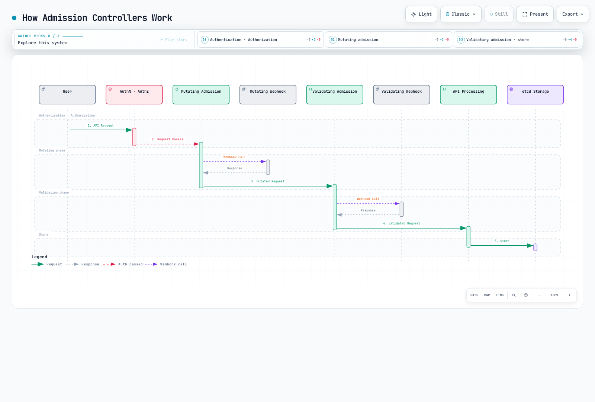

# Extender Kubernetes

> **Versiones upstream de Kubernetes revisadas**: Kubernetes 1.35, 1.36, 1.37
> **Última actualización**: October 12, 2026

Kubernetes es una plataforma diseñada teniendo en cuenta la extensibilidad, lo que permite ampliar su funcionalidad de varias maneras. En este capítulo, exploraremos los distintos métodos para extender Kubernetes y cómo aprovechar las funciones de extensión en Amazon EKS.

## Tabla de contenido
1. [Descripción general de las extensiones de Kubernetes](#kubernetes-extension-overview)
2. [Recursos personalizados](#custom-resources)
3. [Patrón de operador](#operator-pattern)
4. [Controladores de admisión](#admission-controllers)
5. [Extensiones del servidor de API](#api-server-extensions)
6. [Extensiones del Scheduler](#scheduler-extensions)
7. [Cloud Controller Manager](#cloud-controller-manager)
8. [CSI (Container Storage Interface)](#csi-container-storage-interface)
9. [CNI (Container Network Interface)](#cni-container-network-interface)
10. [Complementos de dispositivos](#device-plugins)
11. [Funciones de extensión en Amazon EKS](#extension-features-in-amazon-eks)
12. [Prácticas recomendadas](#best-practices)
13. [Conclusión](#conclusion)

## Descripción general de las extensiones de Kubernetes {#kubernetes-extension-overview}

Kubernetes proporciona varios puntos de extensión para ampliar y personalizar su funcionalidad básica. Los principales puntos de extensión son:

1. **Recursos personalizados**: Definir nuevos tipos de objetos de API
2. **Operadores**: Combinar recursos personalizados y controladores para administrar aplicaciones complejas
3. **Controladores de admisión**: Interceptar, modificar o validar solicitudes de API
4. **Extensiones del servidor de API**: Agregar nuevos endpoints al servidor de API
5. **Extensiones del Scheduler**: Personalizar la lógica de programación de los Pod
6. **Cloud Controller Manager**: Integrar funciones específicas de los proveedores de nube
7. **CSI (Container Storage Interface)**: Integrar sistemas de almacenamiento
8. **CNI (Container Network Interface)**: Integrar soluciones de redes
9. **Complementos de dispositivos**: Integrar hardware especializado

El siguiente diagrama muestra los principales puntos de extensión de Kubernetes:


[🔍 Ver diagrama interactivo](https://www.atomai.click/kubernetes-docs/archmaps/en-core-11-extending-kubernetes-0.html)

### Cómo elegir un método de extensión

Aspectos que debes tener en cuenta al elegir un método de extensión adecuado:

1. **Caso de uso**: El tipo de funcionalidad que quieres ampliar
2. **Complejidad**: Complejidad de la implementación y el mantenimiento
3. **Impacto en el rendimiento**: Impacto de la extensión en el rendimiento del clúster
4. **Compatibilidad con las actualizaciones**: Compatibilidad con las actualizaciones de versión de Kubernetes
5. **Compatibilidad con la comunidad**: Nivel de apoyo de la comunidad para el método de extensión

## Recursos personalizados {#custom-resources}

Los recursos personalizados permiten ampliar la API de Kubernetes para definir nuevos tipos de objetos.

El siguiente diagrama muestra cómo funcionan los recursos personalizados:


[🔍 Ver diagrama interactivo](https://www.atomai.click/kubernetes-docs/archmaps/en-core-11-extending-kubernetes-1.html)

### Definiciones de recursos personalizados (CRD)

Una CRD es la forma más sencilla de definir nuevos tipos de recursos:

```yaml
apiVersion: apiextensions.k8s.io/v1
kind: CustomResourceDefinition
metadata:
  name: backups.example.com
spec:
  group: example.com
  names:
    kind: Backup
    listKind: BackupList
    plural: backups
    singular: backup
    shortNames:
    - bk
  scope: Namespaced
  versions:
  - name: v1
    served: true
    storage: true
    schema:
      openAPIV3Schema:
        type: object
        properties:
          spec:
            type: object
            properties:
              source:
                type: string
              destination:
                type: string
              schedule:
                type: string
            required:
            - source
            - destination
          status:
            type: object
            properties:
              phase:
                type: string
              lastBackupTime:
                type: string
                format: date-time
    subresources:
      status: {}
    additionalPrinterColumns:
    - name: Status
      type: string
      jsonPath: .status.phase
    - name: Age
      type: date
      jsonPath: .metadata.creationTimestamp
```

En el ejemplo anterior, definimos un nuevo tipo de recurso llamado `Backup` y especificamos el esquema del recurso y columnas adicionales para mostrar.

### Crear instancias de recursos personalizados

Cuando la condición Established de la CRD sea verdadera, crea una instancia. Una CRD almacena y valida los datos; no ejecuta copias de seguridad sin un controlador.

```yaml
apiVersion: example.com/v1
kind: Backup
metadata:
  name: daily-backup
spec:
  source: /data
  destination: s3://my-bucket/backups
  schedule: "0 0 * * *"
```

### Validación de recursos personalizados

Puedes validar recursos personalizados mediante esquemas OpenAPI v3 en las CRD:

```yaml
openAPIV3Schema:
  type: object
  properties:
    spec:
      type: object
      properties:
        replicas:
          type: integer
          minimum: 1
          maximum: 10
        image:
          type: string
          minLength: 1
      required:
      - replicas
      - image
```

En el ejemplo anterior, el campo `replicas` debe ser un entero entre 1 y 10, y el campo `image` no puede estar vacío; la disponibilidad de la imagen y las comprobaciones de firma requieren una política independiente.

### Administración de versiones

Las CRD admiten varias versiones para permitir la evolución de la API:

```yaml
versions:
- name: v1alpha1
  served: true
  storage: false
- name: v1beta1
  served: true
  storage: false
- name: v1
  served: true
  storage: true
```

En el ejemplo anterior, se ofrecen tres versiones: `v1alpha1`, `v1beta1` y `v1`, pero las nuevas escrituras usan `v1`. Este es un fragmento de versiones: incluye un esquema estructural para cada versión. Los objetos existentes no se reescriben automáticamente; migra el almacenamiento antes de quitar una entrada antigua de storedVersions.

### Webhooks de conversión

Puedes usar webhooks de conversión para gestionar conversiones entre distintas versiones:

```yaml
# Merge this spec fragment into the complete CRD above.
spec:
  conversion:
    strategy: Webhook
    webhook:
      clientConfig:
        service:
          namespace: default
          name: example-conversion-webhook
          path: /convert
        caBundle: <base64-encoded-ca-cert>
      conversionReviewVersions:
      - v1
```

## Patrón de operador {#operator-pattern}

El patrón de operador permite automatizar el conocimiento operativo de aplicaciones complejas mediante la combinación de recursos personalizados y controladores.

El siguiente diagrama muestra cómo funciona el patrón de operador:


[🔍 Ver diagrama interactivo](https://www.atomai.click/kubernetes-docs/archmaps/en-core-11-extending-kubernetes-2.html)

### Conceptos de operadores

Un operador consta de los siguientes componentes:

1. **Definición de recursos personalizados (CRD)**: Define el esquema de los recursos que se administrarán
2. **Controlador**: Lógica que supervisa los recursos personalizados y los reconcilia con el estado deseado
3. **Cliente de la API de Kubernetes**: Cliente para interactuar con la API de Kubernetes

### Ejemplo de operador

Ejemplo de operador de bases de datos:

```yaml
# Custom Resource Definition
apiVersion: apiextensions.k8s.io/v1
kind: CustomResourceDefinition
metadata:
  name: databases.example.com
spec:
  group: example.com
  names:
    kind: Database
    listKind: DatabaseList
    plural: databases
    singular: database
    shortNames:
    - db
  scope: Namespaced
  versions:
  - name: v1
    served: true
    storage: true
    schema:
      openAPIV3Schema:
        type: object
        properties:
          spec:
            type: object
            properties:
              engine:
                type: string
                enum:
                - mysql
                - postgresql
              version:
                type: string
              storageSize:
                type: string
              replicas:
                type: integer
                minimum: 1
            required:
            - engine
            - version
            - storageSize
          status:
            type: object
            properties:
              phase:
                type: string
              endpoint:
                type: string
    subresources:
      status: {}
```

```yaml
# Database Instance
apiVersion: example.com/v1
kind: Database
metadata:
  name: my-db
spec:
  engine: postgresql
  version: "17"
  storageSize: 10Gi
  replicas: 3
```

### Herramientas de desarrollo de operadores

Herramientas para desarrollar operadores:

1. **Operator SDK**: Desarrolla operadores con Go, Ansible o Helm
2. **KUDO (Kubernetes Universal Declarative Operator)**: Desarrolla operadores de forma declarativa
3. **Kubebuilder**: Framework de desarrollo de operadores basado en Go
4. **Metacontroller**: Desarrollo de operadores basado en webhooks

#### Ejemplo de Operator SDK

Crear un operador con Operator SDK:

```bash
: "${OPERATOR_IMAGE:?Set a registry image tag or digest you control}"
# Install a reviewed supported Operator SDK release and verify its checksum first.

# Create new operator project
operator-sdk init --domain example.com --repo github.com/example/database-operator

# Create API
operator-sdk create api --group database --version v1 --kind Database --resource --controller

# Implement controller (main.go, controllers/database_controller.go, etc.)

# Build and deploy operator
make docker-build docker-push IMG="$OPERATOR_IMAGE"
make deploy IMG="$OPERATOR_IMAGE"
```

### Operadores populares

Operadores populares de código abierto:

1. **Prometheus Operator**: Administra la pila de supervisión de Prometheus
2. **Elasticsearch Operator**: Administra clústeres de Elasticsearch
3. **CoreOS etcd Operator (archivado)**: Ejemplo histórico de automatización de etcd; no es una recomendación de instalación actual.
4. **PostgreSQL Operator**: Administra bases de datos PostgreSQL
5. **OpenTelemetry Operator**: Implementa Jaeger v2; el antiguo Jaeger Operator solo admite Jaeger v1, que ya está retirado.
6. **Strimzi Kafka Operator**: Administra clústeres de Apache Kafka
7. **Istio in-cluster Operator (eliminado en 1.24)**: Ejemplo histórico; usa los flujos de instalación compatibles con Helm/istioctl.
## Controladores de admisión {#admission-controllers}

Los controladores de admisión son complementos que interceptan las solicitudes al servidor de API de Kubernetes y las modifican o validan.

El siguiente diagrama muestra cómo funcionan los controladores de admisión:



[🔍 Ver diagrama interactivo](https://www.atomai.click/kubernetes-docs/archmaps/en-core-11-extending-kubernetes-3.html)

### Tipos de controladores de admisión

Kubernetes tiene dos tipos de controladores de admisión:

1. **Controladores de admisión de mutación**: Pueden modificar recursos
2. **Controladores de admisión de validación**: Solo pueden validar recursos

### Controladores de admisión integrados

Kubernetes incluye varios controladores de admisión:

1. **NamespaceLifecycle**: Impide crear recursos en espacios de nombres que se están eliminando
2. **LimitRanger**: Establece límites predeterminados de recursos para los Pod y contenedores
3. **ServiceAccount**: Establece como predeterminada y valida la cuenta de servicio del Pod e inyecta un volumen de token proyectado, salvo que el montaje automático esté deshabilitado; otros controladores crean las cuentas predeterminadas.
4. **DefaultStorageClass**: Asigna la clase de almacenamiento predeterminada a los PVC
5. **ResourceQuota**: Limita el uso de recursos por espacio de nombres
6. **PodSecurity**: Aplica los estándares de seguridad de los Pod del espacio de nombres; PodSecurityPolicy se eliminó en 1.25.
7. **NodeRestriction**: Limita los recursos que los nodos pueden modificar

### Controladores de admisión de webhook

Puedes usar controladores de admisión de webhook para implementar lógica personalizada:

```yaml
# Mutating Webhook Configuration
apiVersion: admissionregistration.k8s.io/v1
kind: MutatingWebhookConfiguration
metadata:
  name: pod-mutating-webhook
webhooks:
- name: pod-mutator.example.com
  clientConfig:
    service:
      namespace: default
      name: pod-mutating-webhook
      path: "/mutate"
    caBundle: <base64-encoded-ca-cert>
  rules:
  - apiGroups: [""]
    apiVersions: ["v1"]
    resources: ["pods"]
    operations: ["CREATE"]
    scope: "Namespaced"
  admissionReviewVersions: ["v1"]
  sideEffects: None
  timeoutSeconds: 5
```

```yaml
# Validating Webhook Configuration
apiVersion: admissionregistration.k8s.io/v1
kind: ValidatingWebhookConfiguration
metadata:
  name: pod-validating-webhook
webhooks:
- name: pod-validator.example.com
  clientConfig:
    service:
      namespace: default
      name: pod-validating-webhook
      path: "/validate"
    caBundle: <base64-encoded-ca-cert>
  rules:
  - apiGroups: [""]
    apiVersions: ["v1"]
    resources: ["pods"]
    operations: ["CREATE", "UPDATE"]
    scope: "Namespaced"
  admissionReviewVersions: ["v1"]
  sideEffects: None
  timeoutSeconds: 5
```

### Implementación del servidor de webhook

Estos fragmentos de Go pertenecen a un mismo archivo e implementan controladores AdmissionReview v1. Conecta /mutate y /validate mediante HTTPS con un certificado y un paquete de CA que coincidan con el Service. No producen efectos secundarios externos y son seguros para la ejecución en seco; limita la configuración del webhook a los espacios de nombres previstos. La comprobación de etiquetas es un ejemplo de política, no una validación completa de referencias de imágenes o firmas.

```go
package main

import (
    "encoding/json"
    "net/http"
    "strings"
    admissionv1 "k8s.io/api/admission/v1"
    corev1 "k8s.io/api/core/v1"
    metav1 "k8s.io/apimachinery/pkg/apis/meta/v1"
)

func readPodReview(w http.ResponseWriter, r *http.Request) (*admissionv1.AdmissionRequest, *corev1.Pod, bool) {
    if r.Method != http.MethodPost || r.Body == nil {
        http.Error(w, "POST body required", http.StatusBadRequest)
        return nil, nil, false
    }
    var review admissionv1.AdmissionReview
    if err := json.NewDecoder(http.MaxBytesReader(w, r.Body, 2<<20)).Decode(&review); err != nil {
        http.Error(w, "Invalid AdmissionReview JSON", http.StatusBadRequest)
        return nil, nil, false
    }
    req := review.Request
    if review.APIVersion != "admission.k8s.io/v1" || review.Kind != "AdmissionReview" || req == nil || req.UID == "" {
        http.Error(w, "AdmissionReview v1 request and UID required", http.StatusBadRequest)
        return nil, nil, false
    }
    if req.Kind.Group != "" || req.Kind.Version != "v1" || req.Kind.Kind != "Pod" ||
        (req.Operation != admissionv1.Create && req.Operation != admissionv1.Update) {
        http.Error(w, "Only Pod CREATE/UPDATE is supported", http.StatusBadRequest)
        return nil, nil, false
    }
    var pod corev1.Pod
    if err := json.Unmarshal(req.Object.Raw, &pod); err != nil {
        http.Error(w, "Invalid Pod JSON", http.StatusBadRequest)
        return nil, nil, false
    }
    return req, &pod, true
}

func writeReview(w http.ResponseWriter, response admissionv1.AdmissionResponse) {
    review := admissionv1.AdmissionReview{
        TypeMeta: metav1.TypeMeta{APIVersion: "admission.k8s.io/v1", Kind: "AdmissionReview"},
        Response: &response,
    }
    data, err := json.Marshal(review)
    if err != nil {
        http.Error(w, "Response encoding failed", http.StatusInternalServerError)
        return
    }
    w.Header().Set("Content-Type", "application/json")
    _, _ = w.Write(data)
}

func writePatch(w http.ResponseWriter, req *admissionv1.AdmissionRequest, patches []map[string]interface{}) {
    response := admissionv1.AdmissionResponse{UID: req.UID, Allowed: true}
    if len(patches) > 0 {
        data, err := json.Marshal(patches)
        if err != nil {
            http.Error(w, "Patch encoding failed", http.StatusInternalServerError)
            return
        }
        patchType := admissionv1.PatchTypeJSONPatch
        response.PatchType, response.Patch = &patchType, data
    }
    writeReview(w, response)
}

func deny(w http.ResponseWriter, req *admissionv1.AdmissionRequest, message string) {
    writeReview(w, admissionv1.AdmissionResponse{
        UID: req.UID, Allowed: false,
        Result: &metav1.Status{Status: "Failure", Reason: metav1.StatusReasonForbidden, Code: 403, Message: message},
    })
}
func mutateHandler(w http.ResponseWriter, r *http.Request) {
    req, pod, ok := readPodReview(w, r)
    if !ok { return }
    if pod.Labels["injected-by"] == "mutating-webhook" {
        writePatch(w, req, nil)
        return
    }
    if pod.Labels == nil { pod.Labels = map[string]string{} }
    pod.Labels["injected-by"] = "mutating-webhook"
    // Add the whole map, preserving existing labels. Works when labels was absent.
    writePatch(w, req, []map[string]interface{}{{"op": "add", "path": "/metadata/labels", "value": pod.Labels}})
}
```

```go
func validateHandler(w http.ResponseWriter, r *http.Request) {
    req, pod, ok := readPodReview(w, r)
    if !ok { return }
    images := []string{}
    for _, c := range pod.Spec.Containers { images = append(images, c.Image) }
    for _, c := range pod.Spec.InitContainers { images = append(images, c.Image) }
    for _, c := range pod.Spec.EphemeralContainers { images = append(images, c.Image) }
    for _, image := range images {
        if strings.Contains(image, "@") { continue } // Digest references have no implicit latest tag.
        last := image[strings.LastIndex(image, "/")+1:]
        if !strings.Contains(last, ":") || strings.HasSuffix(last, ":latest") {
            deny(w, req, "Use an explicit non-latest tag or digest for every container")
            return
        }
    }
    writeReview(w, admissionv1.AdmissionResponse{UID: req.UID, Allowed: true})
}
```

### Proyectos populares de controladores de admisión

1. **OPA Gatekeeper**: Aplicación de políticas con Open Policy Agent
2. **Kyverno**: Motor de políticas basado en YAML
3. **Istio**: Inyección de sidecar de Service mesh
4. **cert-manager**: Administración de certificados TLS

## Extensiones del servidor de API {#api-server-extensions}

Las extensiones del servidor de API permiten agregar nuevos endpoints al servidor de API de Kubernetes.

### Servidores de API de extensión

Los servidores de API de extensión son servidores que se ejecutan por separado del servidor de API de Kubernetes y proporcionan API personalizadas:

```yaml
# APIService Definition
apiVersion: apiregistration.k8s.io/v1
kind: APIService
metadata:
  name: v1.example.com
spec:
  group: example.com
  version: v1
  groupPriorityMinimum: 1000
  versionPriority: 15
  service:
    name: example-api
    namespace: default
  caBundle: <base64-encoded-ca-cert>
```

### Implementación de un servidor de API de extensión

Un servidor de API de extensión consta de los siguientes componentes:

1. **Servidor de API**: Proporciona una interfaz similar a la del servidor de API de Kubernetes
2. **Controladores de recursos**: Gestionan las solicitudes de tipos de recursos específicos
3. **Backend de almacenamiento**: Almacena los datos de los recursos

Este es un esquema de implementación, no un programa independiente. Empieza con la versión oficial de sample-apiserver que coincida con tus dependencias de k8s.io; configura el servicio seguro, la autenticación y autorización delegadas, los tipos example.com/v1 reales, el almacenamiento y el contexto de apagado. El grupo y la versión de APIService deben coincidir con los del servidor.

```go
// Extension API Server Example
func main() {
    // Server configuration
    config := genericapiserver.NewRecommendedConfig(apiserver.Codecs)
    config.OpenAPIConfig = genericapiserver.DefaultOpenAPIConfig(
        sampleopenapi.GetOpenAPIDefinitions,
        openapi.NewDefinitionNamer(apiserver.Scheme),
    )
    config.EnableIndex = true
    config.EnableDiscovery = true

    // Create server
    server, err := config.Complete().New("sample-apiserver", genericapiserver.NewEmptyDelegate())
    if err != nil {
        log.Fatalf("Error creating server: %v", err)
    }

    // Set API group info
    apiGroupInfo := genericapiserver.NewDefaultAPIGroupInfo(
        samplev1.GroupName,
        apiserver.Scheme,
        metav1.ParameterCodec,
        apiserver.Codecs,
    )

    // Set storage
    apiGroupInfo.VersionedResourcesStorageMap["v1"] = map[string]rest.Storage{
        "widgets": NewWidgetStorage(),
    }

    // Install API group
    if err := server.InstallAPIGroup(&apiGroupInfo); err != nil {
        log.Fatalf("Error installing API group: %v", err)
    }

    // Run server
    if err := server.PrepareRun().Run(stopCh); err != nil {
        log.Fatalf("Error running server: %v", err)
    }
}
```

### Capa de agregación

La capa de agregación hace que varios servidores de API parezcan un solo servidor de API:

```
                                   +-----------------+
                                   |                 |
                                   |  kube-apiserver |
                                   |                 |
                                   +-------+---------+
                                           |
                                           v
                      +--------------------+--------------------+
                      |                                         |
                      |                                         |
          +-----------v-----------+               +------------v------------+
          |                       |               |                         |
          |  metrics-server       |               |  example-apiserver      |
          |                       |               |                         |
          +-----------------------+               +-------------------------+
```

## Extensiones del Scheduler {#scheduler-extensions}

Las extensiones del Scheduler permiten personalizar el comportamiento del Scheduler de Kubernetes.

### Framework del Scheduler

El framework del Scheduler, introducido en Kubernetes 1.15, permite ampliar varias etapas del flujo de programación mediante complementos:

1. **Ordenación de la cola**: Ordena los Pod de la cola de programación
2. **Pre-filter**: Comprueba el estado del Pod y del clúster antes del filtrado
3. **Filter**: Filtra los nodos que no pueden ejecutar el Pod
4. **Post-filter**: Realiza acciones después del filtrado
5. **Pre-score**: Realiza acciones antes de calcular la puntuación
6. **Score**: Asigna puntuaciones a los nodos
7. **Normalización de la puntuación**: Normaliza las puntuaciones
8. **Reserve**: Reserva recursos para el Pod
9. **Permit**: Permite, deniega o retrasa la programación del Pod
10. **Pre-bind**: Realiza acciones antes de la vinculación
11. **Bind**: Vincula el Pod a un nodo
12. **Post-bind**: Realiza acciones después de la vinculación

### Configuración del Scheduler

Ejemplo de configuración del Scheduler:

```yaml
apiVersion: kubescheduler.config.k8s.io/v1
kind: KubeSchedulerConfiguration
leaderElection:
  leaderElect: true
profiles:
- schedulerName: custom-scheduler
  pluginConfig:
  - name: NodeResourcesFit
    args:
      scoringStrategy:
        type: MostAllocated
        resources:
        - name: cpu
          weight: 1
        - name: memory
          weight: 1
```

### Scheduler personalizado

El siguiente Deployment requiere una imagen compilada de custom-scheduler, un ConfigMap llamado custom-scheduler-config que contenga el config.yaml anterior y un ServiceAccount con RBAC revisado para programación/Lease. Usa la autenticación dentro del clúster; un worker no puede montar el scheduler.conf de un plano de control administrado. El schedulerName debe coincidir con el del Pod.

```yaml
apiVersion: apps/v1
kind: Deployment
metadata:
  name: custom-scheduler
  namespace: kube-system
spec:
  replicas: 1
  selector:
    matchLabels:
      app: custom-scheduler
  template:
    metadata:
      labels:
        app: custom-scheduler
    spec:
      serviceAccountName: custom-scheduler
      nodeSelector:
        kubernetes.io/os: linux
      containers:
      - name: custom-scheduler
        image: example/custom-scheduler:REPLACE_WITH_TESTED_RELEASE
        command: [/custom-scheduler, --config=/etc/scheduler/config.yaml]
        volumeMounts:
        - name: config
          mountPath: /etc/scheduler
          readOnly: true
      volumes:
      - name: config
        configMap:
          name: custom-scheduler-config
```

Especificar un Scheduler personalizado para un Pod:

```yaml
apiVersion: v1
kind: Pod
metadata:
  name: custom-scheduled-pod
spec:
  schedulerName: custom-scheduler
  containers:
  - name: container
    image: nginx:1.30.6
```

## Cloud Controller Manager

Cloud Controller Manager proporciona una interfaz entre Kubernetes y los proveedores de nube.

### Componentes de Cloud Controller Manager

Cloud Controller Manager consta de los siguientes controladores:

1. **Controlador de nodos**: Actualiza la información de los nodos mediante las API del proveedor de nube
2. **Controlador de rutas**: Configura rutas en redes de nube
3. **Controlador de Service**: Crea, actualiza y elimina balanceadores de carga de nube

### AWS Cloud Controller Manager

El CCM externo de AWS está pensado para **Kubernetes autoadministrado en AWS**. Elige una versión de cloud-provider-aws compatible con Kubernetes y sigue su procedimiento para clústeres existentes en cuanto a ServiceAccount/RBAC, IAM, etiquetas del clúster, nombres de nodos y requisitos previos de migración de `--cloud-provider=external`. Su repositorio de imágenes es `registry.k8s.io/provider-aws/cloud-controller-manager`. Las entradas arbitrarias de cloud.conf no pueden sustituir el etiquetado de VPC/subredes.

No puedes instalar este DaemonSet en el plano de control administrado por AWS de EKS ni montar su scheduler.conf. En EKS, usa la integración de nube administrada por el servicio y las capacidades compatibles de AWS Load Balancer Controller o Auto Mode, con un único controlador responsable de cada recurso.

## CSI (Container Storage Interface)

CSI proporciona una interfaz estándar entre Kubernetes y los sistemas de almacenamiento.

El siguiente diagrama muestra la arquitectura y el funcionamiento de CSI:


[🔍 Ver diagrama interactivo](https://www.atomai.click/kubernetes-docs/archmaps/en-core-11-extending-kubernetes-4.html)

### Arquitectura de CSI

CSI consta de los siguientes componentes:

1. **Complemento de controlador CSI**: Gestiona la creación, eliminación y las instantáneas de volúmenes, entre otras operaciones.
2. **Complemento de nodo CSI**: Gestiona el montaje y desmontaje de volúmenes, entre otras operaciones.
3. **Controlador CSI**: Implementación que se integra con sistemas de almacenamiento específicos

```
+-------------------+
|                   |
|  Kubernetes       |
|  (External        |
|   Provisioner)    |
|                   |
+--------+----------+
         |
         | gRPC
         v
+--------+----------+
|                   |
|  CSI Driver       |
|                   |
+--------+----------+
         |
         | Storage Protocol
         v
+--------+----------+
|                   |
|  Storage System   |
|                   |
+-------------------+
```

### Implementación del controlador CSI

Lo siguiente es una plantilla para autores de controladores, no una instalación completa. Proporciona la imagen y los argumentos del controlador, versiones compatibles de sidecar, ServiceAccounts/RBAC y el registro CSIDriver del proveedor. NodePlugin se ejecuta en Linux y requiere las rutas del host y los privilegios documentados.

```yaml
# CSI Controller Service
apiVersion: apps/v1
kind: Deployment
metadata:
  name: csi-controller
spec:
  replicas: 1
  selector:
    matchLabels:
      app: csi-controller
  template:
    metadata:
      labels:
        app: csi-controller
    spec:
      serviceAccountName: csi-controller
      nodeSelector:
        kubernetes.io/os: linux
      containers:
      - name: csi-provisioner
        image: registry.k8s.io/sig-storage/csi-provisioner:REPLACE_WITH_COMPATIBLE_RELEASE
        args:
        - "--csi-address=$(ADDRESS)"
        - "--v=5"
        env:
        - name: ADDRESS
          value: /var/lib/csi/sockets/pluginproxy/csi.sock
        volumeMounts:
        - name: socket-dir
          mountPath: /var/lib/csi/sockets/pluginproxy/
      - name: csi-attacher
        image: registry.k8s.io/sig-storage/csi-attacher:REPLACE_WITH_COMPATIBLE_RELEASE
        args:
        - "--csi-address=$(ADDRESS)"
        - "--v=5"
        env:
        - name: ADDRESS
          value: /var/lib/csi/sockets/pluginproxy/csi.sock
        volumeMounts:
        - name: socket-dir
          mountPath: /var/lib/csi/sockets/pluginproxy/
      - name: csi-driver
        image: example/csi-driver:v1.0.0
        args:
        - "--endpoint=$(CSI_ENDPOINT)"
        - "--nodeid=$(NODE_ID)"
        env:
        - name: CSI_ENDPOINT
          value: unix:///var/lib/csi/sockets/pluginproxy/csi.sock
        - name: NODE_ID
          valueFrom:
            fieldRef:
              fieldPath: spec.nodeName
        volumeMounts:
        - name: socket-dir
          mountPath: /var/lib/csi/sockets/pluginproxy/
      volumes:
      - name: socket-dir
        emptyDir: {}

---
# CSI Node Service
apiVersion: apps/v1
kind: DaemonSet
metadata:
  name: csi-node
spec:
  selector:
    matchLabels:
      app: csi-node
  template:
    metadata:
      labels:
        app: csi-node
    spec:
      serviceAccountName: csi-node
      nodeSelector:
        kubernetes.io/os: linux
      hostNetwork: true
      containers:
      - name: csi-node-driver-registrar
        image: registry.k8s.io/sig-storage/csi-node-driver-registrar:REPLACE_WITH_COMPATIBLE_RELEASE
        args:
        - "--csi-address=$(ADDRESS)"
        - "--kubelet-registration-path=$(DRIVER_REG_SOCK_PATH)"
        - "--v=5"
        env:
        - name: ADDRESS
          value: /csi/csi.sock
        - name: DRIVER_REG_SOCK_PATH
          value: /var/lib/kubelet/plugins/example.csi.k8s.io/csi.sock
        volumeMounts:
        - name: plugin-dir
          mountPath: /csi
        - name: registration-dir
          mountPath: /registration
      - name: csi-driver
        image: example/csi-driver:v1.0.0
        args:
        - "--endpoint=$(CSI_ENDPOINT)"
        - "--nodeid=$(NODE_ID)"
        env:
        - name: CSI_ENDPOINT
          value: unix:///csi/csi.sock
        - name: NODE_ID
          valueFrom:
            fieldRef:
              fieldPath: spec.nodeName
        securityContext:
          privileged: true
        volumeMounts:
        - name: plugin-dir
          mountPath: /csi
        - name: pods-mount-dir
          mountPath: /var/lib/kubelet/pods
          mountPropagation: "Bidirectional"
      volumes:
      - name: plugin-dir
        hostPath:
          path: /var/lib/kubelet/plugins/example.csi.k8s.io
          type: DirectoryOrCreate
      - name: registration-dir
        hostPath:
          path: /var/lib/kubelet/plugins_registry
          type: Directory
      - name: pods-mount-dir
        hostPath:
          path: /var/lib/kubelet/pods
          type: Directory
```

### StorageClass y PVC

Ejemplo de StorageClass y PVC que usan un controlador CSI:

```yaml
# Storage Class
apiVersion: storage.k8s.io/v1
kind: StorageClass
metadata:
  name: example-csi
provisioner: example.csi.k8s.io
parameters:
  type: ssd
  csi.storage.k8s.io/fstype: ext4
reclaimPolicy: Delete
allowVolumeExpansion: true
volumeBindingMode: WaitForFirstConsumer

---
# PVC
apiVersion: v1
kind: PersistentVolumeClaim
metadata:
  name: example-pvc
spec:
  accessModes:
  - ReadWriteOnce
  resources:
    requests:
      storage: 10Gi
  storageClassName: example-csi
```

### Controladores CSI populares

1. **AWS EBS CSI Driver**: Administración de volúmenes AWS EBS
2. **AWS EFS CSI Driver**: Administración de sistemas de archivos AWS EFS
3. **GCE PD CSI Driver**: Administración de discos persistentes de Google Compute Engine
4. **Azure Disk CSI Driver**: Administración de discos de Azure
5. **Ceph RBD CSI Driver**: Administración de volúmenes Ceph RBD
6. **NFS CSI Driver**: Administración de volúmenes NFS

## CNI (Container Network Interface)

CNI proporciona una interfaz estándar entre Kubernetes y las soluciones de redes.

El siguiente diagrama muestra la arquitectura y el funcionamiento de CNI:


[🔍 Ver diagrama interactivo](https://www.atomai.click/kubernetes-docs/archmaps/en-core-11-extending-kubernetes-5.html)

### Arquitectura de CNI

CNI consta de los siguientes componentes:

1. **Complemento CNI**: Configura las interfaces de red de los contenedores
2. **Complemento IPAM**: Asignación y administración de direcciones IP
3. **Meta-complemento**: Combina varios complementos

```
+-------------------+
|                   |
|  Kubernetes       |
|  CRI runtime      |
|  (via kubelet)    |
+--------+----------+
         |
         | CNI Spec
         v
+--------+----------+
|                   |
|  CNI Plugin       |
|                   |
+--------+----------+
         |
         | Network Configuration
         v
+--------+----------+
|                   |
|  Network          |
|                   |
+-------------------+
```

### Configuración del complemento CNI

Este ejemplo de bridge/host-local de un solo nodo ilustra el contrato de CNI; un clúster necesita subredes únicas por nodo y enrutamiento entre nodos. El tiempo de ejecución de CRI llama a CNI; kubelet moderno no lo hace directamente.

```json
{
  "cniVersion": "0.4.0",
  "name": "example-network",
  "type": "bridge",
  "bridge": "cni0",
  "isGateway": true,
  "ipMasq": true,
  "ipam": {
    "type": "host-local",
    "subnet": "10.244.0.0/24",
    "routes": [
      { "dst": "0.0.0.0/0" }
    ]
  }
}
```

### Complementos CNI populares

1. **Calico**: CNI con funciones mejoradas de políticas de red y seguridad
2. **Flannel**: Proporciona redes overlay sencillas
3. **Cilium**: Solución de redes y seguridad basada en eBPF
4. **Weave Net (archivado)**: Proyecto histórico de redes entre varios hosts; evalúa alternativas mantenidas.
5. **AWS VPC CNI**: CNI integrado con AWS VPC
6. **Azure CNI**: CNI integrado con redes virtuales de Azure
7. **Antrea**: Solución de redes basada en Open vSwitch

### Instalación del complemento CNI

Ejemplo de instalación del complemento CNI de Calico:

```bash
# Use the official Calico installation guide for your distribution.
# Select a supported release and inspect the operator/custom-resources manifests.
# Do not install a second primary CNI over an existing cluster network.
kubectl get nodes -o wide
kubectl -n kube-system get daemonsets
```

## Complementos de dispositivos {#device-plugins}

Los complementos de dispositivos proporcionan una interfaz entre Kubernetes y el hardware especializado.

### Arquitectura de los complementos de dispositivos

Los complementos de dispositivos constan de los siguientes componentes:

1. **Servidor del complemento de dispositivos**: Gestiona la detección, asignación e inicialización de dispositivos, entre otras operaciones.
2. **kubelet**: Se comunica con los complementos de dispositivos para asignar dispositivos a los Pod

```
+-------------------+
|                   |
|  Kubernetes       |
|  (kubelet)        |
|                   |
+--------+----------+
         |
         | Device Plugin API
         v
+--------+----------+
|                   |
|  Device Plugin    |
|                   |
+--------+----------+
         |
         | Device Management
         v
+--------+----------+
|                   |
|  Hardware Device  |
|                   |
+-------------------+
```

### Complemento de dispositivos GPU de NVIDIA

Ejemplo de implementación del complemento de dispositivos GPU de NVIDIA:

Primero, configura controladores NVIDIA, Container Toolkit y tiempo de ejecución de contenedores compatibles. Fija una versión probada del chart oficial de Helm del complemento de dispositivos de NVIDIA y selecciona nodos GPU Linux. Evita una instalación duplicada si GPU Operator o Auto Mode ya administra el complemento.

### Pod que solicita una GPU

Ejemplo de Pod que solicita una GPU:

```yaml
apiVersion: v1
kind: Pod
metadata:
  name: gpu-pod
spec:
  restartPolicy: Never
  nodeSelector:
    kubernetes.io/os: linux
  containers:
  - name: cuda-container
    image: nvidia/cuda:REPLACE_WITH_DRIVER_COMPATIBLE_TAG
    command: ["nvidia-smi"]
    resources:
      limits:
        nvidia.com/gpu: 1
```

### Complementos de dispositivos populares

1. **Complemento de dispositivos GPU de NVIDIA**: Administración de GPU de NVIDIA
2. **Complemento de dispositivos GPU de AMD**: Administración de GPU de AMD
3. **Complemento de dispositivos FPGA**: Administración de dispositivos FPGA
4. **Complemento de dispositivos InfiniBand**: Administración de dispositivos InfiniBand
5. **Complemento de dispositivos de red SR-IOV**: Administración de dispositivos de red SR-IOV

## Funciones de extensión en Amazon EKS {#extension-features-in-amazon-eks}

La compatibilidad de versiones de EKS difiere de la de upstream. A fecha de 2026-10-12, la compatibilidad estándar de EKS abarca de 1.34 a 1.37; comprueba también la matriz de compatibilidad de cada complemento y controlador.

Amazon EKS admite varias funciones de extensión para ampliar las capacidades de los clústeres de Kubernetes.

El siguiente diagrama muestra la arquitectura de las funciones de extensión en Amazon EKS:


[🔍 Ver diagrama interactivo](https://www.atomai.click/kubernetes-docs/archmaps/en-core-11-extending-kubernetes-6.html)

### Complementos de EKS

Amazon EKS proporciona los siguientes complementos:

1. **Amazon VPC CNI**: Redes integradas con AWS VPC
2. **CoreDNS**: Servicio DNS dentro del clúster
3. **kube-proxy**: Proxy de red
4. **Amazon EBS CSI Driver**: Administración de volúmenes EBS
5. **AWS Load Balancer Controller**: Se instala por separado con Helm/manifiestos compatibles; no des por hecho que todas las extensiones son complementos administrados por EKS.

```bash
set -euo pipefail
: "${CLUSTER_NAME:?Set cluster name}"
KUBERNETES_VERSION=$(aws eks describe-cluster --name "$CLUSTER_NAME" --query cluster.version --output text)
aws eks list-addons --cluster-name "$CLUSTER_NAME"
aws eks describe-addon-versions --addon-name amazon-ebs-csi-driver --kubernetes-version "$KUBERNETES_VERSION"
# Choose a compatible version and prepare the controller's scoped IAM role first.
: "${ADDON_VERSION:?Set reviewed compatible add-on version}"
: "${EBS_ROLE_ARN:?Set EBS CSI IRSA role ARN}"
aws eks create-addon --cluster-name "$CLUSTER_NAME" --addon-name amazon-ebs-csi-driver \
  --addon-version "$ADDON_VERSION" --service-account-role-arn "$EBS_ROLE_ARN"
# For an existing installation, use update-addon instead of create-addon.
# To stop EKS management while retaining the workload (not uninstall it):
# aws eks delete-addon --cluster-name "$CLUSTER_NAME" --addon-name amazon-ebs-csi-driver --preserve
```

### AWS Controllers for Kubernetes (ACK)

ACK es un conjunto de operadores que permite administrar recursos de AWS desde Kubernetes:

```bash
set -euo pipefail
: "${ACK_VERSION:?Set a reviewed S3 controller chart version}"
: "${AWS_REGION:?Set target service region}"
# First prepare ack-s3-controller ServiceAccount with scoped IRSA/Pod Identity permissions.
helm upgrade --install ack-s3-controller oci://public.ecr.aws/aws-controllers-k8s/s3-chart \
  --version "$ACK_VERSION" --namespace ack-system --create-namespace \
  --set aws.region="$AWS_REGION" --set serviceAccount.create=false \
  --set serviceAccount.name=ack-s3-controller
# Creating a Bucket CR provisions a real AWS resource: review IAM, naming and retention first.
```

El siguiente ejemplo de Bucket aprovisiona un recurso real de AWS cuando el controlador y los permisos de IAM están configurados. Sustituye el nombre por un valor único globalmente y revisa la configuración del ciclo de vida y la retención. La eliminación del objeto de Kubernetes puede eliminar el bucket; configura la política de eliminación del controlador según tus requisitos de retención de datos.

```yaml
apiVersion: s3.services.k8s.aws/v1alpha1
kind: Bucket
metadata:
  name: example-bucket
spec:
  name: replace-with-your-globally-unique-bucket-name
```

### AWS Load Balancer Controller

AWS Load Balancer Controller integra los Service y los ingress de Kubernetes con los balanceadores de carga de AWS:

```yaml
# ALB Ingress example
apiVersion: networking.k8s.io/v1
kind: Ingress
metadata:
  name: example-ingress
  annotations:
    alb.ingress.kubernetes.io/scheme: internet-facing
    alb.ingress.kubernetes.io/target-type: ip
spec:
  ingressClassName: alb
  rules:
  - host: example.com
    http:
      paths:
      - path: /
        pathType: Prefix
        backend:
          service:
            name: example-service
            port:
              number: 80
```

### Roles de IAM para Service Accounts (IRSA)

IRSA permite que los Pod accedan de forma segura a los servicios de AWS al asociar roles de AWS IAM con Service Accounts de Kubernetes:

```bash
# Create OIDC provider
: "${S3_READ_POLICY_ARN:?Set a customer-managed policy restricted to your bucket/prefix}"
eksctl utils associate-iam-oidc-provider \
  --cluster my-cluster \
  --approve

# Create IAM role and service account
eksctl create iamserviceaccount \
  --cluster my-cluster \
  --namespace default \
  --name my-service-account \
  --attach-policy-arn "$S3_READ_POLICY_ARN" \
  --approve

# Pod using service account
cat <<EOF | kubectl apply -f -
apiVersion: v1
kind: Pod
metadata:
  name: s3-reader
spec:
  serviceAccountName: my-service-account
  restartPolicy: Never
  containers:
  - name: aws-cli
    image: public.ecr.aws/aws-cli/aws-cli:REPLACE_WITH_TESTED_RELEASE
    command: [aws]
    args: [sts, get-caller-identity]
EOF
```

## Prácticas recomendadas {#best-practices}

Veamos las prácticas recomendadas que debes tener en cuenta al implementar funciones de extensión de Kubernetes.

### Prácticas recomendadas de diseño

1. **Usar interfaces estándar**: Usa interfaces estándar como CSI y CNI siempre que sea posible
2. **Diseño declarativo de API**: Diseña API declarativas en lugar de imperativas
3. **Seguir los principios de diseño de Kubernetes**: Sigue principios como el patrón de controlador y la activación por nivel
4. **Administración de versiones**: Administra las versiones de API y mantén la compatibilidad
5. **Principio de privilegio mínimo**: Concede solo los permisos mínimos necesarios

### Prácticas recomendadas de implementación

1. **Aprovechar bibliotecas reutilizables**: Aprovecha bibliotecas como client-go y controller-runtime
2. **Gestión adecuada de errores**: Gestiona y registra adecuadamente las situaciones de error
3. **Retroceso exponencial**: Usa el retroceso exponencial para los reintentos
4. **Establecer límites de recursos**: Establece límites de memoria y CPU
5. **Informes de estado**: Informa correctamente del estado de los recursos

### Prácticas recomendadas de implementación en producción

1. **Despliegue gradual**: Despliega gradualmente en lugar de cambiar todo de una vez
2. **Administración de versiones**: Evita usar la etiqueta latest para las imágenes
3. **Comprobaciones de estado**: Configura sondas de disponibilidad y actividad adecuadas
4. **Registro y supervisión**: Configura un registro y una supervisión completos
5. **Documentación**: Documenta las API y su uso

### Prácticas recomendadas de seguridad

1. **Principio de privilegio mínimo**: Concede solo los permisos mínimos necesarios
2. **Usar RBAC**: Configura políticas RBAC adecuadas
3. **Políticas de red**: Configura políticas de red adecuadas
4. **Análisis de imágenes**: Analiza las imágenes de contenedor para detectar vulnerabilidades
5. **Administración de secretos**: Administra los secretos de forma segura

### Prácticas recomendadas específicas de EKS

1. **Usar complementos administrados**: Usa complementos administrados por EKS siempre que sea posible
2. **Usar IRSA**: Usa IRSA para administrar los permisos de IAM por Pod
3. **Configuración de VPC CNI**: Configura VPC CNI según los requisitos de red
4. **Grupos de seguridad**: Configura grupos de seguridad adecuados
5. **Optimización de costos**: Selecciona tipos y tamaños de instancias adecuados

## Conclusión

Kubernetes proporciona varios puntos de extensión para ampliar y personalizar su funcionalidad básica. Los recursos personalizados, los operadores, los controladores de admisión, las extensiones del servidor de API, las extensiones del Scheduler, CSI, CNI y los complementos de dispositivos permiten adaptar Kubernetes a distintos entornos y requisitos.

Amazon EKS admite estas funciones de extensión y también proporciona funciones específicas de AWS, como los complementos de EKS, ACK, AWS Load Balancer Controller e IRSA, para simplificar la integración entre Kubernetes y los servicios de AWS.

Al implementar funciones de extensión de Kubernetes, es importante seguir las prácticas recomendadas, como usar interfaces estándar, diseñar API declarativas y aplicar el principio de privilegio mínimo. Esto permite crear entornos de Kubernetes estables y escalables.

## Cuestionario

Para comprobar lo que has aprendido en este capítulo, prueba el [Cuestionario sobre cómo extender Kubernetes](../quizzes/core/11-extending-kubernetes-quiz.md).

## Referencias de verificación

- https://kubernetes.io/releases/
- https://kubernetes.io/docs/reference/access-authn-authz/admission-controllers/
- https://kubernetes.io/docs/reference/access-authn-authz/extensible-admission-controllers/
- https://kubernetes.io/docs/tasks/extend-kubernetes/custom-resources/custom-resource-definitions/
- https://kubernetes.io/docs/tasks/extend-kubernetes/custom-resources/custom-resource-definition-versioning/
- https://kubernetes.io/docs/tasks/extend-kubernetes/configure-aggregation-layer/
- https://kubernetes.io/docs/concepts/scheduling-eviction/scheduling-framework/
- https://github.com/kubernetes/kubernetes/blob/v1.37.0/pkg/scheduler/apis/config/types.go
- https://github.com/kubernetes/cloud-provider-aws/blob/master/docs/prerequisites.md
- https://github.com/kubernetes/cloud-provider-aws/blob/master/examples/existing-cluster/base/aws-cloud-controller-manager-daemonset.yaml
- https://github.com/kubernetes-sigs/kubebuilder/blob/master/README.md
- https://github.com/operator-framework/operator-sdk/blob/master/README.md
- https://github.com/NVIDIA/k8s-device-plugin/blob/main/README.md
- https://github.com/jaegertracing/jaeger-operator/blob/main/README.md
- https://istio.io/latest/blog/2024/in-cluster-operator-deprecation-announcement/
- https://docs.aws.amazon.com/eks/latest/userguide/eks-add-ons.html
- https://docs.aws.amazon.com/eks/latest/userguide/lbc-helm.html
- https://docs.aws.amazon.com/eks/latest/userguide/kubernetes-versions-standard.html
- https://github.com/aws-controllers-k8s/community/blob/main/docs/content/docs/user-docs/install.md
- https://github.com/aws-controllers-k8s/s3-controller/blob/main/helm/values.yaml
