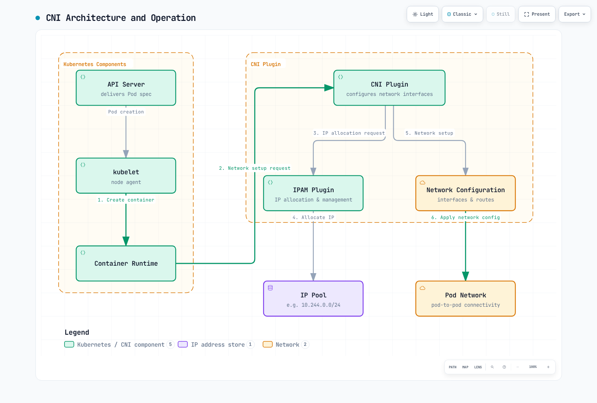
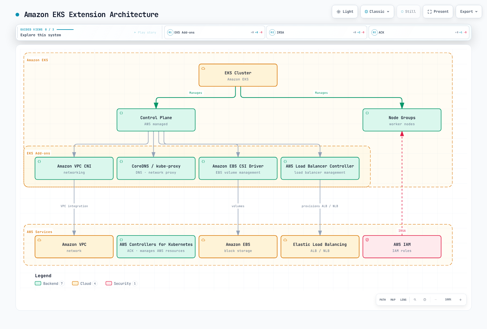

# Extensión de Kubernetes

> **Versiones de Kubernetes upstream revisadas**: Kubernetes 1.35, 1.36, 1.37
> **Última actualización**: October 12, 2026

Kubernetes es una plataforma diseñada pensando en la extensibilidad, lo que permite ampliar su funcionalidad de varias maneras. En este capítulo, exploraremos los diversos métodos para extender Kubernetes y cómo aprovechar las características de extensión en Amazon EKS.

## Tabla de contenido
1. [Descripción general de extensiones de Kubernetes](#kubernetes-extension-overview)
2. [Recursos personalizados](#custom-resources)
3. [Patrón Operator](#operator-pattern)
4. [Controladores de admisión](#admission-controllers)
5. [Extensiones de API Server](#api-server-extensions)
6. [Extensiones de Scheduler](#scheduler-extensions)
7. [Cloud Controller Manager](#cloud-controller-manager)
8. [CSI (Container Storage Interface)](#csi-container-storage-interface)
9. [CNI (Container Network Interface)](#cni-container-network-interface)
10. [Device Plugins](#device-plugins)
11. [Características de extensión en Amazon EKS](#extension-features-in-amazon-eks)
12. [Prácticas recomendadas](#best-practices)
13. [Conclusión](#conclusion)

## Descripción general de extensiones de Kubernetes

Kubernetes proporciona varios puntos de extensión para ampliar y personalizar su funcionalidad base. Los puntos de extensión principales son:

1. **Recursos personalizados**: Definir nuevos tipos de objetos API
2. **Operators**: Combinar recursos personalizados y controladores para administrar aplicaciones complejas
3. **Controladores de admisión**: Interceptar, modificar o validar solicitudes de API
4. **Extensiones de API Server**: Agregar nuevos endpoints a API Server
5. **Extensiones de Scheduler**: Personalizar la lógica de programación de Pods
6. **Cloud Controller Manager**: Integrar características específicas de proveedores de nube
7. **CSI (Container Storage Interface)**: Integrar sistemas de almacenamiento
8. **CNI (Container Network Interface)**: Integrar soluciones de red
9. **Device Plugins**: Integrar hardware especial

El siguiente diagrama muestra los puntos de extensión principales en Kubernetes:


[🔍 Ver diagrama interactivo](https://www.atomai.click/kubernetes-docs/archmaps/en-core-11-extending-kubernetes-0.html)

### Elegir un método de extensión

Consideraciones al elegir un método de extensión adecuado:

1. **Caso de uso**: El tipo de funcionalidad que desea extender
2. **Complejidad**: Complejidad de la implementación y el mantenimiento
3. **Impacto en el rendimiento**: Impacto de la extensión en el rendimiento del clúster
4. **Compatibilidad de actualización**: Compatibilidad con las actualizaciones de versión de Kubernetes
5. **Soporte de la comunidad**: Nivel de soporte de la comunidad para el método de extensión

## Recursos personalizados

Los recursos personalizados son una manera de extender la API de Kubernetes para definir nuevos tipos de objetos.

El siguiente diagrama muestra cómo funcionan los recursos personalizados:


[🔍 Ver diagrama interactivo](https://www.atomai.click/kubernetes-docs/archmaps/en-core-11-extending-kubernetes-1.html)

### Definiciones de recursos personalizados (CRD)

CRD es la forma más sencilla de definir nuevos tipos de recursos:

```yaml
apiVersion: apiextensions.k8s.io/v1
kind: CustomResourceDefinition
metadata:
  name: backups.example.com
spec:
  group: example.com
  names:
    kind: Backup
    listKind: BackupList
    plural: backups
    singular: backup
    shortNames:
    - bk
  scope: Namespaced
  versions:
  - name: v1
    served: true
    storage: true
    schema:
      openAPIV3Schema:
        type: object
        properties:
          spec:
            type: object
            properties:
              source:
                type: string
              destination:
                type: string
              schedule:
                type: string
            required:
            - source
            - destination
          status:
            type: object
            properties:
              phase:
                type: string
              lastBackupTime:
                type: string
                format: date-time
    subresources:
      status: {}
    additionalPrinterColumns:
    - name: Status
      type: string
      jsonPath: .status.phase
    - name: Age
      type: date
      jsonPath: .metadata.creationTimestamp
```

En el ejemplo anterior, definimos un nuevo tipo de recurso llamado `Backup` y especificamos el esquema del recurso y columnas de impresión adicionales.

### Creación de instancias de recursos personalizados

Después de que la condición Established de CRD sea verdadera, cree una instancia. Un CRD almacena y valida datos; no ejecuta copias de seguridad sin un controlador.

```yaml
apiVersion: example.com/v1
kind: Backup
metadata:
  name: daily-backup
spec:
  source: /data
  destination: s3://my-bucket/backups
  schedule: "0 0 * * *"
```

### Validación de recursos personalizados

Puede validar recursos personalizados mediante esquemas OpenAPI v3 en CRD:

```yaml
openAPIV3Schema:
  type: object
  properties:
    spec:
      type: object
      properties:
        replicas:
          type: integer
          minimum: 1
          maximum: 10
        image:
          type: string
          minLength: 1
      required:
      - replicas
      - image
```

En el ejemplo anterior, el campo `replicas` debe ser un entero entre 1 y 10, y el campo `image` no debe estar vacío; las comprobaciones de disponibilidad y firma de imágenes requieren una política independiente.

### Gestión de versiones

Los CRD admiten múltiples versiones para permitir la evolución de la API:

```yaml
versions:
- name: v1alpha1
  served: true
  storage: false
- name: v1beta1
  served: true
  storage: false
- name: v1
  served: true
  storage: true
```

En el ejemplo anterior, se sirven tres versiones, `v1alpha1`, `v1beta1` y `v1`, pero las nuevas escrituras usan `v1`. Este es un fragmento de versiones: incluya un esquema estructural para cada versión. Los objetos existentes no se reescriben automáticamente; migre el almacenamiento antes de eliminar una entrada antigua de storedVersions.

### Webhooks de conversión

Puede usar webhooks de conversión para manejar conversiones entre diferentes versiones:

```yaml
# Merge this spec fragment into the complete CRD above.
spec:
  conversion:
    strategy: Webhook
    webhook:
      clientConfig:
        service:
          namespace: default
          name: example-conversion-webhook
          path: /convert
        caBundle: <base64-encoded-ca-cert>
      conversionReviewVersions:
      - v1
```

## Patrón Operator

El patrón Operator es una manera de automatizar el conocimiento operativo de aplicaciones complejas mediante la combinación de recursos personalizados y controladores.

El siguiente diagrama muestra cómo funciona el patrón Operator:


[🔍 Ver diagrama interactivo](https://www.atomai.click/kubernetes-docs/archmaps/en-core-11-extending-kubernetes-2.html)

### Conceptos de Operator

Un Operator consta de los siguientes componentes:

1. **Custom Resource Definition (CRD)**: Define el esquema de los recursos que se administrarán
2. **Controller**: Lógica que supervisa los recursos personalizados y los reconcilia con el estado deseado
3. **Cliente de API de Kubernetes**: Cliente para interactuar con la API de Kubernetes

### Ejemplo de Operator

Ejemplo de Operator de base de datos:

```yaml
# Custom Resource Definition
apiVersion: apiextensions.k8s.io/v1
kind: CustomResourceDefinition
metadata:
  name: databases.example.com
spec:
  group: example.com
  names:
    kind: Database
    listKind: DatabaseList
    plural: databases
    singular: database
    shortNames:
    - db
  scope: Namespaced
  versions:
  - name: v1
    served: true
    storage: true
    schema:
      openAPIV3Schema:
        type: object
        properties:
          spec:
            type: object
            properties:
              engine:
                type: string
                enum:
                - mysql
                - postgresql
              version:
                type: string
              storageSize:
                type: string
              replicas:
                type: integer
                minimum: 1
            required:
            - engine
            - version
            - storageSize
          status:
            type: object
            properties:
              phase:
                type: string
              endpoint:
                type: string
    subresources:
      status: {}
```

```yaml
# Database Instance
apiVersion: example.com/v1
kind: Database
metadata:
  name: my-db
spec:
  engine: postgresql
  version: "17"
  storageSize: 10Gi
  replicas: 3
```

### Herramientas de desarrollo de Operators

Herramientas para desarrollar Operators:

1. **Operator SDK**: Desarrollar Operators mediante Go, Ansible o Helm
2. **KUDO (Kubernetes Universal Declarative Operator)**: Desarrollar Operators de forma declarativa
3. **Kubebuilder**: Marco de desarrollo de Operators basado en Go
4. **Metacontroller**: Desarrollo de Operators basado en webhooks

#### Ejemplo de Operator SDK

Creación de un Operator mediante Operator SDK:

```bash
: "${OPERATOR_IMAGE:?Set a registry image tag or digest you control}"
# Install a reviewed supported Operator SDK release and verify its checksum first.

# Create new operator project
operator-sdk init --domain example.com --repo github.com/example/database-operator

# Create API
operator-sdk create api --group database --version v1 --kind Database --resource --controller

# Implement controller (main.go, controllers/database_controller.go, etc.)

# Build and deploy operator
make docker-build docker-push IMG="$OPERATOR_IMAGE"
make deploy IMG="$OPERATOR_IMAGE"
```

### Operators populares

Operators populares de código abierto:

1. **Prometheus Operator**: Administra la pila de monitorización de Prometheus
2. **Elasticsearch Operator**: Administra clústeres de Elasticsearch
3. **CoreOS etcd Operator (archivado)**: Ejemplo histórico de automatización de etcd; no es una recomendación de instalación actual.
4. **PostgreSQL Operator**: Administra bases de datos PostgreSQL
5. **OpenTelemetry Operator**: Implementa Jaeger v2; el anterior Jaeger Operator solo admite el Jaeger v1 retirado.
6. **Strimzi Kafka Operator**: Administra clústeres de Apache Kafka
7. **Istio in-cluster Operator (eliminado en 1.24)**: Ejemplo histórico; use flujos de instalación compatibles de Helm/istioctl.
## Controladores de admisión

Los controladores de admisión son plugins que interceptan solicitudes al API Server de Kubernetes y las modifican o validan.

El siguiente diagrama muestra cómo funcionan los controladores de admisión:


[🔍 Ver diagrama interactivo](https://www.atomai.click/kubernetes-docs/archmaps/en-core-11-extending-kubernetes-3.html)

### Tipos de controladores de admisión

Kubernetes tiene dos tipos de controladores de admisión:

1. **Controladores de admisión mutantes**: Pueden modificar recursos
2. **Controladores de admisión de validación**: Solo pueden validar recursos

### Controladores de admisión integrados

Kubernetes tiene varios controladores de admisión integrados:

1. **NamespaceLifecycle**: Evita la creación de recursos en namespaces que se están eliminando
2. **LimitRanger**: Establece límites de recursos predeterminados para Pods y contenedores
3. **ServiceAccount**: Establece o valida de forma predeterminada la ServiceAccount del Pod e inyecta un volumen de token proyectado, salvo que se desactive el montaje automático; otros controladores crean cuentas predeterminadas.
4. **DefaultStorageClass**: Asigna una clase de almacenamiento predeterminada a los PVC
5. **ResourceQuota**: Limita el uso de recursos por namespace
6. **PodSecurity**: Impone los Pod Security Standards del namespace; PodSecurityPolicy se eliminó en 1.25.
7. **NodeRestriction**: Limita los recursos que los nodos pueden modificar

### Controladores de admisión de webhooks

Puede utilizar controladores de admisión de webhooks para implementar lógica personalizada:

```yaml
# Mutating Webhook Configuration
apiVersion: admissionregistration.k8s.io/v1
kind: MutatingWebhookConfiguration
metadata:
  name: pod-mutating-webhook
webhooks:
- name: pod-mutator.example.com
  clientConfig:
    service:
      namespace: default
      name: pod-mutating-webhook
      path: "/mutate"
    caBundle: <base64-encoded-ca-cert>
  rules:
  - apiGroups: [""]
    apiVersions: ["v1"]
    resources: ["pods"]
    operations: ["CREATE"]
    scope: "Namespaced"
  admissionReviewVersions: ["v1"]
  sideEffects: None
  timeoutSeconds: 5
```

```yaml
# Validating Webhook Configuration
apiVersion: admissionregistration.k8s.io/v1
kind: ValidatingWebhookConfiguration
metadata:
  name: pod-validating-webhook
webhooks:
- name: pod-validator.example.com
  clientConfig:
    service:
      namespace: default
      name: pod-validating-webhook
      path: "/validate"
    caBundle: <base64-encoded-ca-cert>
  rules:
  - apiGroups: [""]
    apiVersions: ["v1"]
    resources: ["pods"]
    operations: ["CREATE", "UPDATE"]
    scope: "Namespaced"
  admissionReviewVersions: ["v1"]
  sideEffects: None
  timeoutSeconds: 5
```

### Implementación del servidor de webhooks

Estos fragmentos de Go pertenecen a un solo archivo e implementan manejadores AdmissionReview v1. Conecte /mutate y /validate a HTTPS con un certificado que coincida con el Service y un paquete de CA. No realizan efectos secundarios externos y son seguros para dry-run; limite la configuración de webhook a los namespaces previstos. La comprobación de tags es un ejemplo de política, no una validación completa de referencia o firma de imágenes.

```go
package main

import (
    "encoding/json"
    "net/http"
    "strings"
    admissionv1 "k8s.io/api/admission/v1"
    corev1 "k8s.io/api/core/v1"
    metav1 "k8s.io/apimachinery/pkg/apis/meta/v1"
)

func readPodReview(w http.ResponseWriter, r *http.Request) (*admissionv1.AdmissionRequest, *corev1.Pod, bool) {
    if r.Method != http.MethodPost || r.Body == nil {
        http.Error(w, "POST body required", http.StatusBadRequest)
        return nil, nil, false
    }
    var review admissionv1.AdmissionReview
    if err := json.NewDecoder(http.MaxBytesReader(w, r.Body, 2<<20)).Decode(&review); err != nil {
        http.Error(w, "Invalid AdmissionReview JSON", http.StatusBadRequest)
        return nil, nil, false
    }
    req := review.Request
    if review.APIVersion != "admission.k8s.io/v1" || review.Kind != "AdmissionReview" || req == nil || req.UID == "" {
        http.Error(w, "AdmissionReview v1 request and UID required", http.StatusBadRequest)
        return nil, nil, false
    }
    if req.Kind.Group != "" || req.Kind.Version != "v1" || req.Kind.Kind != "Pod" ||
        (req.Operation != admissionv1.Create && req.Operation != admissionv1.Update) {
        http.Error(w, "Only Pod CREATE/UPDATE is supported", http.StatusBadRequest)
        return nil, nil, false
    }
    var pod corev1.Pod
    if err := json.Unmarshal(req.Object.Raw, &pod); err != nil {
        http.Error(w, "Invalid Pod JSON", http.StatusBadRequest)
        return nil, nil, false
    }
    return req, &pod, true
}

func writeReview(w http.ResponseWriter, response admissionv1.AdmissionResponse) {
    review := admissionv1.AdmissionReview{
        TypeMeta: metav1.TypeMeta{APIVersion: "admission.k8s.io/v1", Kind: "AdmissionReview"},
        Response: &response,
    }
    data, err := json.Marshal(review)
    if err != nil {
        http.Error(w, "Response encoding failed", http.StatusInternalServerError)
        return
    }
    w.Header().Set("Content-Type", "application/json")
    _, _ = w.Write(data)
}

func writePatch(w http.ResponseWriter, req *admissionv1.AdmissionRequest, patches []map[string]interface{}) {
    response := admissionv1.AdmissionResponse{UID: req.UID, Allowed: true}
    if len(patches) > 0 {
        data, err := json.Marshal(patches)
        if err != nil {
            http.Error(w, "Patch encoding failed", http.StatusInternalServerError)
            return
        }
        patchType := admissionv1.PatchTypeJSONPatch
        response.PatchType, response.Patch = &patchType, data
    }
    writeReview(w, response)
}

func deny(w http.ResponseWriter, req *admissionv1.AdmissionRequest, message string) {
    writeReview(w, admissionv1.AdmissionResponse{
        UID: req.UID, Allowed: false,
        Result: &metav1.Status{Status: "Failure", Reason: metav1.StatusReasonForbidden, Code: 403, Message: message},
    })
}
func mutateHandler(w http.ResponseWriter, r *http.Request) {
    req, pod, ok := readPodReview(w, r)
    if !ok { return }
    if pod.Labels["injected-by"] == "mutating-webhook" {
        writePatch(w, req, nil)
        return
    }
    if pod.Labels == nil { pod.Labels = map[string]string{} }
    pod.Labels["injected-by"] = "mutating-webhook"
    // Add the whole map, preserving existing labels. Works when labels was absent.
    writePatch(w, req, []map[string]interface{}{{"op": "add", "path": "/metadata/labels", "value": pod.Labels}})
}
```

```go
func validateHandler(w http.ResponseWriter, r *http.Request) {
    req, pod, ok := readPodReview(w, r)
    if !ok { return }
    images := []string{}
    for _, c := range pod.Spec.Containers { images = append(images, c.Image) }
    for _, c := range pod.Spec.InitContainers { images = append(images, c.Image) }
    for _, c := range pod.Spec.EphemeralContainers { images = append(images, c.Image) }
    for _, image := range images {
        if strings.Contains(image, "@") { continue } // Digest references have no implicit latest tag.
        last := image[strings.LastIndex(image, "/")+1:]
        if !strings.Contains(last, ":") || strings.HasSuffix(last, ":latest") {
            deny(w, req, "Use an explicit non-latest tag or digest for every container")
            return
        }
    }
    writeReview(w, admissionv1.AdmissionResponse{UID: req.UID, Allowed: true})
}
```

### Proyectos populares de controladores de admisión

1. **OPA Gatekeeper**: Aplicación de políticas mediante Open Policy Agent
2. **Kyverno**: Motor de políticas basado en YAML
3. **Istio**: Inyección de sidecar de Service mesh
4. **cert-manager**: Gestión de certificados TLS

## Extensiones de API Server

Las extensiones de API Server son una manera de agregar nuevos endpoints al API Server de Kubernetes.

### API Servers de extensión

Los API Servers de extensión son servidores que se ejecutan por separado del API Server de Kubernetes y proporcionan API personalizadas:

```yaml
# APIService Definition
apiVersion: apiregistration.k8s.io/v1
kind: APIService
metadata:
  name: v1.example.com
spec:
  group: example.com
  version: v1
  groupPriorityMinimum: 1000
  versionPriority: 15
  service:
    name: example-api
    namespace: default
  caBundle: <base64-encoded-ca-cert>
```

### Implementación de API Server de extensión

Un API Server de extensión consta de los siguientes componentes:

1. **API Server**: Proporciona una interfaz similar al API Server de Kubernetes
2. **Manejadores de recursos**: Gestionan solicitudes para tipos de recursos específicos
3. **Backend de almacenamiento**: Almacena datos de recursos

Este es un esquema de implementación, no un programa independiente. Comience con la versión oficial de sample-apiserver que coincida con sus dependencias k8s.io; configure el servicio seguro, la autenticación/autorización delegada, los tipos reales example.com/v1, el almacenamiento y el contexto de apagado. El grupo/versión de APIService debe coincidir con el servidor.

```go
// Extension API Server Example
func main() {
    // Server configuration
    config := genericapiserver.NewRecommendedConfig(apiserver.Codecs)
    config.OpenAPIConfig = genericapiserver.DefaultOpenAPIConfig(
        sampleopenapi.GetOpenAPIDefinitions,
        openapi.NewDefinitionNamer(apiserver.Scheme),
    )
    config.EnableIndex = true
    config.EnableDiscovery = true

    // Create server
    server, err := config.Complete().New("sample-apiserver", genericapiserver.NewEmptyDelegate())
    if err != nil {
        log.Fatalf("Error creating server: %v", err)
    }

    // Set API group info
    apiGroupInfo := genericapiserver.NewDefaultAPIGroupInfo(
        samplev1.GroupName,
        apiserver.Scheme,
        metav1.ParameterCodec,
        apiserver.Codecs,
    )

    // Set storage
    apiGroupInfo.VersionedResourcesStorageMap["v1"] = map[string]rest.Storage{
        "widgets": NewWidgetStorage(),
    }

    // Install API group
    if err := server.InstallAPIGroup(&apiGroupInfo); err != nil {
        log.Fatalf("Error installing API group: %v", err)
    }

    // Run server
    if err := server.PrepareRun().Run(stopCh); err != nil {
        log.Fatalf("Error running server: %v", err)
    }
}
```

### Capa de agregación

La capa de agregación hace que múltiples API Servers aparezcan como un único API Server:

```
                                   +-----------------+
                                   |                 |
                                   |  kube-apiserver |
                                   |                 |
                                   +-------+---------+
                                           |
                                           v
                      +--------------------+--------------------+
                      |                                         |
                      |                                         |
          +-----------v-----------+               +------------v------------+
          |                       |               |                         |
          |  metrics-server       |               |  example-apiserver      |
          |                       |               |                         |
          +-----------------------+               +-------------------------+
```

## Extensiones de Scheduler

Las extensiones de Scheduler son una manera de personalizar el comportamiento del Scheduler de Kubernetes.

### Framework de Scheduler

El framework de Scheduler introducido en Kubernetes 1.15 permite extender varias etapas del pipeline de programación mediante plugins:

1. **Queue Sort**: Ordenar Pods en la cola de programación
2. **Pre-filter**: Comprobar el estado del Pod y del clúster antes del filtrado
3. **Filter**: Filtrar los nodos que no pueden ejecutar el Pod
4. **Post-filter**: Realizar acciones después del filtrado
5. **Pre-score**: Realizar acciones antes del cálculo de la puntuación
6. **Score**: Asignar puntuaciones a los nodos
7. **Normalize Score**: Normalizar puntuaciones
8. **Reserve**: Reservar recursos para el Pod
9. **Permit**: Permitir, denegar o retrasar la programación del Pod
10. **Pre-bind**: Realizar acciones antes de la vinculación
11. **Bind**: Vincular el Pod a un nodo
12. **Post-bind**: Realizar acciones después de la vinculación

### Configuración de Scheduler

Ejemplo de configuración de Scheduler:

```yaml
apiVersion: kubescheduler.config.k8s.io/v1
kind: KubeSchedulerConfiguration
leaderElection:
  leaderElect: true
profiles:
- schedulerName: custom-scheduler
  pluginConfig:
  - name: NodeResourcesFit
    args:
      scoringStrategy:
        type: MostAllocated
        resources:
        - name: cpu
          weight: 1
        - name: memory
          weight: 1
```

### Scheduler personalizado

El siguiente Deployment requiere una imagen custom-scheduler compilada, un ConfigMap denominado custom-scheduler-config que contenga el config.yaml anterior y una ServiceAccount con RBAC de programación/Lease revisado. Use autenticación dentro del clúster; un worker no puede montar el scheduler.conf de un plano de control administrado. El schedulerName debe coincidir con el Pod.

```yaml
apiVersion: apps/v1
kind: Deployment
metadata:
  name: custom-scheduler
  namespace: kube-system
spec:
  replicas: 1
  selector:
    matchLabels:
      app: custom-scheduler
  template:
    metadata:
      labels:
        app: custom-scheduler
    spec:
      serviceAccountName: custom-scheduler
      nodeSelector:
        kubernetes.io/os: linux
      containers:
      - name: custom-scheduler
        image: example/custom-scheduler:REPLACE_WITH_TESTED_RELEASE
        command: [/custom-scheduler, --config=/etc/scheduler/config.yaml]
        volumeMounts:
        - name: config
          mountPath: /etc/scheduler
          readOnly: true
      volumes:
      - name: config
        configMap:
          name: custom-scheduler-config
```

Especificación de un Scheduler personalizado para un Pod:

```yaml
apiVersion: v1
kind: Pod
metadata:
  name: custom-scheduled-pod
spec:
  schedulerName: custom-scheduler
  containers:
  - name: container
    image: nginx:1.30.4
```

## Cloud Controller Manager

Cloud Controller Manager proporciona una interfaz entre Kubernetes y los proveedores de nube.

### Componentes de Cloud Controller Manager

Cloud Controller Manager consta de los siguientes controladores:

1. **Node Controller**: Actualiza la información de los nodos mediante API de proveedores de nube
2. **Route Controller**: Configura rutas en redes de nube
3. **Service Controller**: Crea, actualiza y elimina balanceadores de carga de nube

### AWS Cloud Controller Manager

El AWS CCM externo es para **Kubernetes autogestionado en AWS**. Elija una versión de cloud-provider-aws compatible con Kubernetes y siga su procedimiento de clúster existente para los requisitos previos de ServiceAccount/RBAC, IAM, etiquetas de clúster, nombres de nodos y migración de `--cloud-provider=external`. Su repositorio de imágenes es `registry.k8s.io/provider-aws/cloud-controller-manager`. Las entradas arbitrarias de cloud.conf no pueden sustituir el etiquetado de VPC/subnet.

No puede instalar este DaemonSet en el plano de control de EKS administrado por AWS ni montar su scheduler.conf. En EKS, use la integración de nube administrada por el servicio y las capacidades compatibles de AWS Load Balancer Controller o Auto Mode, con un propietario de controlador por recurso.

## CSI (Container Storage Interface)

CSI proporciona una interfaz estándar entre Kubernetes y los sistemas de almacenamiento.

El siguiente diagrama muestra la arquitectura y el funcionamiento de CSI:


[🔍 Ver diagrama interactivo](https://www.atomai.click/kubernetes-docs/archmaps/en-core-11-extending-kubernetes-4.html)

### Arquitectura de CSI

CSI consta de los siguientes componentes:

1. **CSI Controller Plugin**: Gestiona la creación, eliminación, snapshots de volúmenes, etc.
2. **CSI Node Plugin**: Gestiona el montaje, desmontaje de volúmenes, etc.
3. **CSI Driver**: Implementación que se integra con sistemas de almacenamiento específicos

```
+-------------------+
|                   |
|  Kubernetes       |
|  (External        |
|   Provisioner)    |
|                   |
+--------+----------+
         |
         | gRPC
         v
+--------+----------+
|                   |
|  CSI Driver       |
|                   |
+--------+----------+
         |
         | Storage Protocol
         v
+--------+----------+
|                   |
|  Storage System   |
|                   |
+-------------------+
```

### Implementación de CSI Driver

Lo siguiente es una plantilla para autores de drivers, no una instalación completa. Proporcione la imagen y los argumentos del driver, versiones de sidecar compatibles, ServiceAccounts/RBAC y el registro de CSIDriver del proveedor. NodePlugin se ejecuta en Linux y requiere las rutas de host y privilegios documentados.

```yaml
# CSI Controller Service
apiVersion: apps/v1
kind: Deployment
metadata:
  name: csi-controller
spec:
  replicas: 1
  selector:
    matchLabels:
      app: csi-controller
  template:
    metadata:
      labels:
        app: csi-controller
    spec:
      serviceAccountName: csi-controller
      nodeSelector:
        kubernetes.io/os: linux
      containers:
      - name: csi-provisioner
        image: registry.k8s.io/sig-storage/csi-provisioner:REPLACE_WITH_COMPATIBLE_RELEASE
        args:
        - "--csi-address=$(ADDRESS)"
        - "--v=5"
        env:
        - name: ADDRESS
          value: /var/lib/csi/sockets/pluginproxy/csi.sock
        volumeMounts:
        - name: socket-dir
          mountPath: /var/lib/csi/sockets/pluginproxy/
      - name: csi-attacher
        image: registry.k8s.io/sig-storage/csi-attacher:REPLACE_WITH_COMPATIBLE_RELEASE
        args:
        - "--csi-address=$(ADDRESS)"
        - "--v=5"
        env:
        - name: ADDRESS
          value: /var/lib/csi/sockets/pluginproxy/csi.sock
        volumeMounts:
        - name: socket-dir
          mountPath: /var/lib/csi/sockets/pluginproxy/
      - name: csi-driver
        image: example/csi-driver:v1.0.0
        args:
        - "--endpoint=$(CSI_ENDPOINT)"
        - "--nodeid=$(NODE_ID)"
        env:
        - name: CSI_ENDPOINT
          value: unix:///var/lib/csi/sockets/pluginproxy/csi.sock
        - name: NODE_ID
          valueFrom:
            fieldRef:
              fieldPath: spec.nodeName
        volumeMounts:
        - name: socket-dir
          mountPath: /var/lib/csi/sockets/pluginproxy/
      volumes:
      - name: socket-dir
        emptyDir: {}

---
# CSI Node Service
apiVersion: apps/v1
kind: DaemonSet
metadata:
  name: csi-node
spec:
  selector:
    matchLabels:
      app: csi-node
  template:
    metadata:
      labels:
        app: csi-node
    spec:
      serviceAccountName: csi-node
      nodeSelector:
        kubernetes.io/os: linux
      hostNetwork: true
      containers:
      - name: csi-node-driver-registrar
        image: registry.k8s.io/sig-storage/csi-node-driver-registrar:REPLACE_WITH_COMPATIBLE_RELEASE
        args:
        - "--csi-address=$(ADDRESS)"
        - "--kubelet-registration-path=$(DRIVER_REG_SOCK_PATH)"
        - "--v=5"
        env:
        - name: ADDRESS
          value: /csi/csi.sock
        - name: DRIVER_REG_SOCK_PATH
          value: /var/lib/kubelet/plugins/example.csi.k8s.io/csi.sock
        volumeMounts:
        - name: plugin-dir
          mountPath: /csi
        - name: registration-dir
          mountPath: /registration
      - name: csi-driver
        image: example/csi-driver:v1.0.0
        args:
        - "--endpoint=$(CSI_ENDPOINT)"
        - "--nodeid=$(NODE_ID)"
        env:
        - name: CSI_ENDPOINT
          value: unix:///csi/csi.sock
        - name: NODE_ID
          valueFrom:
            fieldRef:
              fieldPath: spec.nodeName
        securityContext:
          privileged: true
        volumeMounts:
        - name: plugin-dir
          mountPath: /csi
        - name: pods-mount-dir
          mountPath: /var/lib/kubelet/pods
          mountPropagation: "Bidirectional"
      volumes:
      - name: plugin-dir
        hostPath:
          path: /var/lib/kubelet/plugins/example.csi.k8s.io
          type: DirectoryOrCreate
      - name: registration-dir
        hostPath:
          path: /var/lib/kubelet/plugins_registry
          type: Directory
      - name: pods-mount-dir
        hostPath:
          path: /var/lib/kubelet/pods
          type: Directory
```

### Clase de almacenamiento y PVC

Ejemplo de clase de almacenamiento y PVC mediante CSI Driver:

```yaml
# Storage Class
apiVersion: storage.k8s.io/v1
kind: StorageClass
metadata:
  name: example-csi
provisioner: example.csi.k8s.io
parameters:
  type: ssd
  csi.storage.k8s.io/fstype: ext4
reclaimPolicy: Delete
allowVolumeExpansion: true
volumeBindingMode: WaitForFirstConsumer

---
# PVC
apiVersion: v1
kind: PersistentVolumeClaim
metadata:
  name: example-pvc
spec:
  accessModes:
  - ReadWriteOnce
  resources:
    requests:
      storage: 10Gi
  storageClassName: example-csi
```

### CSI Drivers populares

1. **AWS EBS CSI Driver**: Gestión de volúmenes AWS EBS
2. **AWS EFS CSI Driver**: Gestión de sistemas de archivos AWS EFS
3. **GCE PD CSI Driver**: Gestión de discos persistentes de Google Compute Engine
4. **Azure Disk CSI Driver**: Gestión de discos de Azure
5. **Ceph RBD CSI Driver**: Gestión de volúmenes Ceph RBD
6. **NFS CSI Driver**: Gestión de volúmenes NFS

## CNI (Container Network Interface)

CNI proporciona una interfaz estándar entre Kubernetes y las soluciones de red.

El siguiente diagrama muestra la arquitectura y el funcionamiento de CNI:



[🔍 Ver diagrama interactivo](https://www.atomai.click/kubernetes-docs/archmaps/en-core-11-extending-kubernetes-5.html)

### Arquitectura de CNI

CNI consta de los siguientes componentes:

1. **CNI Plugin**: Configura las interfaces de red de contenedores
2. **IPAM Plugin**: Asignación y gestión de direcciones IP
3. **Meta Plugin**: Combina varios plugins

```
+-------------------+
|                   |
|  Kubernetes       |
|  CRI runtime      |
|  (via kubelet)    |
+--------+----------+
         |
         | CNI Spec
         v
+--------+----------+
|                   |
|  CNI Plugin       |
|                   |
+--------+----------+
         |
         | Network Configuration
         v
+--------+----------+
|                   |
|  Network          |
|                   |
+-------------------+
```

### Configuración de CNI Plugin

Este ejemplo de bridge/host-local para un solo nodo ilustra el contrato de CNI; un clúster necesita subredes únicas por nodo y enrutamiento entre nodos. CNI es llamado por el runtime CRI, no directamente por kubelet moderno.

```json
{
  "cniVersion": "0.4.0",
  "name": "example-network",
  "type": "bridge",
  "bridge": "cni0",
  "isGateway": true,
  "ipMasq": true,
  "ipam": {
    "type": "host-local",
    "subnet": "10.244.0.0/24",
    "routes": [
      { "dst": "0.0.0.0/0" }
    ]
  }
}
```

### CNI Plugins populares

1. **Calico**: CNI con políticas de red y características de seguridad mejoradas
2. **Flannel**: Proporciona redes superpuestas sencillas
3. **Cilium**: Solución de red y seguridad basada en eBPF
4. **Weave Net (archivado)**: Proyecto histórico de redes multi-host; evalúe alternativas mantenidas.
5. **AWS VPC CNI**: CNI integrado con AWS VPC
6. **Azure CNI**: CNI integrado con redes virtuales de Azure
7. **Antrea**: Solución de red basada en Open vSwitch

### Instalación de CNI Plugin

Ejemplo de instalación del plugin CNI Calico:

```bash
# Use the official Calico installation guide for your distribution.
# Select a supported release and inspect the operator/custom-resources manifests.
# Do not install a second primary CNI over an existing cluster network.
kubectl get nodes -o wide
kubectl -n kube-system get daemonsets
```

## Device Plugins

Los Device Plugins proporcionan una interfaz entre Kubernetes y hardware especial.

### Arquitectura de Device Plugin

Los Device Plugins constan de los siguientes componentes:

1. **Servidor de Device Plugin**: Gestiona el descubrimiento, la asignación, la inicialización de dispositivos, etc.
2. **kubelet**: Se comunica con los Device Plugins para asignar dispositivos a Pods

```
+-------------------+
|                   |
|  Kubernetes       |
|  (kubelet)        |
|                   |
+--------+----------+
         |
         | Device Plugin API
         v
+--------+----------+
|                   |
|  Device Plugin    |
|                   |
+--------+----------+
         |
         | Device Management
         v
+--------+----------+
|                   |
|  Hardware Device  |
|                   |
+-------------------+
```

### NVIDIA GPU Device Plugin

Ejemplo de implementación de NVIDIA GPU Device Plugin:

Primero configure drivers de NVIDIA compatibles, Container Toolkit y el runtime de contenedores. Fije una versión probada del Helm chart oficial de device-plugin de NVIDIA y seleccione nodos GPU Linux. Evite una instalación duplicada cuando GPU Operator o Auto Mode ya sea propietario del plugin.

### Pod de solicitud de GPU

Ejemplo de Pod que solicita GPU:

```yaml
apiVersion: v1
kind: Pod
metadata:
  name: gpu-pod
spec:
  restartPolicy: Never
  nodeSelector:
    kubernetes.io/os: linux
  containers:
  - name: cuda-container
    image: nvidia/cuda:REPLACE_WITH_DRIVER_COMPATIBLE_TAG
    command: ["nvidia-smi"]
    resources:
      limits:
        nvidia.com/gpu: 1
```

### Device Plugins populares

1. **NVIDIA GPU Device Plugin**: Gestión de GPU NVIDIA
2. **AMD GPU Device Plugin**: Gestión de GPU AMD
3. **FPGA Device Plugin**: Gestión de dispositivos FPGA
4. **InfiniBand Device Plugin**: Gestión de dispositivos InfiniBand
5. **SR-IOV Network Device Plugin**: Gestión de dispositivos de red SR-IOV

## Características de extensión en Amazon EKS

El soporte de versiones de EKS difiere del upstream. A fecha de 2026-10-12, el soporte estándar de EKS cubre 1.34–1.37; compruebe también cada matriz de compatibilidad de add-on/controlador.

Amazon EKS admite varias características de extensión para ampliar la funcionalidad de los clústeres de Kubernetes.

El siguiente diagrama muestra la arquitectura de características de extensión en Amazon EKS:



[🔍 Ver diagrama interactivo](https://www.atomai.click/kubernetes-docs/archmaps/en-core-11-extending-kubernetes-6.html)

### Add-ons de EKS

Amazon EKS proporciona los siguientes add-ons:

1. **Amazon VPC CNI**: Redes integradas con AWS VPC
2. **CoreDNS**: Servicio DNS dentro del clúster
3. **kube-proxy**: Proxy de red
4. **Amazon EBS CSI Driver**: Gestión de volúmenes EBS
5. **AWS Load Balancer Controller**: Se instala por separado con Helm/manifests compatibles; no suponga que cada extensión sea un add-on administrado de EKS.

```bash
set -euo pipefail
: "${CLUSTER_NAME:?Set cluster name}"
KUBERNETES_VERSION=$(aws eks describe-cluster --name "$CLUSTER_NAME" --query cluster.version --output text)
aws eks list-addons --cluster-name "$CLUSTER_NAME"
aws eks describe-addon-versions --addon-name amazon-ebs-csi-driver --kubernetes-version "$KUBERNETES_VERSION"
# Choose a compatible version and prepare the controller's scoped IAM role first.
: "${ADDON_VERSION:?Set reviewed compatible add-on version}"
: "${EBS_ROLE_ARN:?Set EBS CSI IRSA role ARN}"
aws eks create-addon --cluster-name "$CLUSTER_NAME" --addon-name amazon-ebs-csi-driver \
  --addon-version "$ADDON_VERSION" --service-account-role-arn "$EBS_ROLE_ARN"
# For an existing installation, use update-addon instead of create-addon.
# To stop EKS management while retaining the workload (not uninstall it):
# aws eks delete-addon --cluster-name "$CLUSTER_NAME" --addon-name amazon-ebs-csi-driver --preserve
```

### AWS Controllers for Kubernetes (ACK)

ACK es una colección de Operators que permite administrar recursos de AWS desde Kubernetes:

```bash
set -euo pipefail
: "${ACK_VERSION:?Set a reviewed S3 controller chart version}"
: "${AWS_REGION:?Set target service region}"
# First prepare ack-s3-controller ServiceAccount with scoped IRSA/Pod Identity permissions.
helm upgrade --install ack-s3-controller oci://public.ecr.aws/aws-controllers-k8s/s3-chart \
  --version "$ACK_VERSION" --namespace ack-system --create-namespace \
  --set aws.region="$AWS_REGION" --set serviceAccount.create=false \
  --set serviceAccount.name=ack-s3-controller
# Creating a Bucket CR provisions a real AWS resource: review IAM, naming and retention first.
```

El siguiente ejemplo de Bucket aprovisiona un recurso de AWS real cuando se configuran el controlador y los permisos de IAM. Sustituya el nombre por un valor globalmente único y revise la configuración de ciclo de vida/retención. Eliminar el objeto de Kubernetes puede eliminar el bucket; configure la política de eliminación del controlador según sus requisitos de retención de datos.

```yaml
apiVersion: s3.services.k8s.aws/v1alpha1
kind: Bucket
metadata:
  name: example-bucket
spec:
  name: replace-with-your-globally-unique-bucket-name
```

### AWS Load Balancer Controller

AWS Load Balancer Controller integra los Services e Ingresses de Kubernetes con balanceadores de carga de AWS:

```yaml
# ALB Ingress example
apiVersion: networking.k8s.io/v1
kind: Ingress
metadata:
  name: example-ingress
  annotations:
    alb.ingress.kubernetes.io/scheme: internet-facing
    alb.ingress.kubernetes.io/target-type: ip
spec:
  ingressClassName: alb
  rules:
  - host: example.com
    http:
      paths:
      - path: /
        pathType: Prefix
        backend:
          service:
            name: example-service
            port:
              number: 80
```

### IAM Roles for Service Accounts (IRSA)

IRSA permite que los Pods accedan de forma segura a servicios de AWS asociando roles de AWS IAM con ServiceAccounts de Kubernetes:

```bash
# Create OIDC provider
: "${S3_READ_POLICY_ARN:?Set a customer-managed policy restricted to your bucket/prefix}"
eksctl utils associate-iam-oidc-provider \
  --cluster my-cluster \
  --approve

# Create IAM role and service account
eksctl create iamserviceaccount \
  --cluster my-cluster \
  --namespace default \
  --name my-service-account \
  --attach-policy-arn "$S3_READ_POLICY_ARN" \
  --approve

# Pod using service account
cat <<EOF | kubectl apply -f -
apiVersion: v1
kind: Pod
metadata:
  name: s3-reader
spec:
  serviceAccountName: my-service-account
  restartPolicy: Never
  containers:
  - name: aws-cli
    image: public.ecr.aws/aws-cli/aws-cli:REPLACE_WITH_TESTED_RELEASE
    command: [aws]
    args: [sts, get-caller-identity]
EOF
```

## Prácticas recomendadas

Exploremos las prácticas recomendadas que se deben considerar al implementar características de extensión de Kubernetes.

### Prácticas recomendadas de diseño

1. **Usar interfaces estándar**: Use interfaces estándar como CSI y CNI cuando sea posible
2. **Diseño de API declarativa**: Diseñe API declarativas en lugar de imperativas
3. **Seguir los principios de diseño de Kubernetes**: Siga principios como el patrón Controller y level-triggering
4. **Gestión de versiones**: Gestione las versiones de API y mantenga la compatibilidad
5. **Principio de mínimo privilegio**: Otorgue solo los permisos mínimos necesarios

### Prácticas recomendadas de implementación

1. **Aprovechar bibliotecas reutilizables**: Aproveche bibliotecas como client-go y controller-runtime
2. **Manejo adecuado de errores**: Maneje y registre adecuadamente las situaciones de error
3. **Backoff exponencial**: Use backoff exponencial para los reintentos
4. **Establecer límites de recursos**: Establezca límites de memoria y CPU
5. **Informes de estado**: Informe con precisión el estado de los recursos

### Prácticas recomendadas de despliegue

1. **Despliegue gradual**: Realice el despliegue gradualmente en lugar de cambiar todo de una vez
2. **Gestión de versiones**: Evite usar el tag latest para las imágenes
3. **Health checks**: Configure probes de liveness y readiness adecuadas
4. **Registro y monitorización**: Configure un registro y una monitorización integrales
5. **Documentación**: Documente las API y su uso

### Prácticas recomendadas de seguridad

1. **Principio de mínimo privilegio**: Otorgue solo los permisos mínimos necesarios
2. **Usar RBAC**: Configure políticas RBAC adecuadas
3. **Network Policies**: Configure políticas de red adecuadas
4. **Escaneo de imágenes**: Analice las imágenes de contenedores en busca de vulnerabilidades
5. **Gestión de secretos**: Administre los secretos de forma segura

### Prácticas recomendadas específicas de EKS

1. **Usar add-ons administrados**: Use add-ons administrados por EKS cuando sea posible
2. **Usar IRSA**: Use IRSA para la gestión de permisos IAM por Pod
3. **Configuración de VPC CNI**: Configure VPC CNI según los requisitos de red
4. **Security Groups**: Configure Security Groups adecuados
5. **Optimización de costes**: Seleccione tipos y tamaños de instancia adecuados

## Conclusión

Kubernetes proporciona varios puntos de extensión para ampliar y personalizar su funcionalidad base. Los recursos personalizados, Operators, controladores de admisión, extensiones de API Server, extensiones de Scheduler, CSI, CNI y Device Plugins permiten adaptar Kubernetes a diversos entornos y requisitos.

Amazon EKS admite estas características de extensión y, además, proporciona características específicas de AWS como add-ons de EKS, ACK, AWS Load Balancer Controller e IRSA para simplificar la integración entre Kubernetes y los servicios de AWS.

Al implementar características de extensión de Kubernetes, es importante seguir prácticas recomendadas como el uso de interfaces estándar, el diseño de API declarativa y el principio de mínimo privilegio. Esto permite crear entornos de Kubernetes estables y escalables.

## Cuestionario

Para comprobar lo que aprendió en este capítulo, pruebe el [Cuestionario de extensión de Kubernetes](../quizzes/core/11-extending-kubernetes-quiz.md).

## Referencias de verificación

- https://kubernetes.io/releases/
- https://kubernetes.io/docs/reference/access-authn-authz/admission-controllers/
- https://kubernetes.io/docs/reference/access-authn-authz/extensible-admission-controllers/
- https://kubernetes.io/docs/tasks/extend-kubernetes/custom-resources/custom-resource-definitions/
- https://kubernetes.io/docs/tasks/extend-kubernetes/custom-resources/custom-resource-definition-versioning/
- https://kubernetes.io/docs/tasks/extend-kubernetes/configure-aggregation-layer/
- https://kubernetes.io/docs/concepts/scheduling-eviction/scheduling-framework/
- https://github.com/kubernetes/kubernetes/blob/v1.37.0/pkg/scheduler/apis/config/types.go
- https://github.com/kubernetes/cloud-provider-aws/blob/master/docs/prerequisites.md
- https://github.com/kubernetes/cloud-provider-aws/blob/master/examples/existing-cluster/base/aws-cloud-controller-manager-daemonset.yaml
- https://github.com/kubernetes-sigs/kubebuilder/blob/master/README.md
- https://github.com/operator-framework/operator-sdk/blob/master/README.md
- https://github.com/NVIDIA/k8s-device-plugin/blob/main/README.md
- https://github.com/jaegertracing/jaeger-operator/blob/main/README.md
- https://istio.io/latest/blog/2024/in-cluster-operator-deprecation-announcement/
- https://docs.aws.amazon.com/eks/latest/userguide/eks-add-ons.html
- https://docs.aws.amazon.com/eks/latest/userguide/lbc-helm.html
- https://docs.aws.amazon.com/eks/latest/userguide/kubernetes-versions-standard.html
- https://github.com/aws-controllers-k8s/community/blob/main/docs/content/docs/user-docs/install.md
- https://github.com/aws-controllers-k8s/s3-controller/blob/main/helm/values.yaml