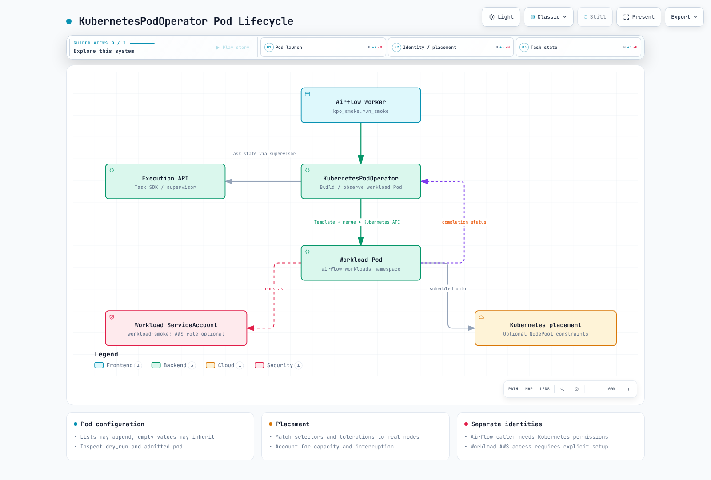

# Parte 3: Patrones de DAG y KubernetesPodOperator

> **Referencia de revisión**: Airflow 3.3.1 / proveedor cncf-kubernetes 10.21.0
> **Último parche upstream comprobado**: Airflow 3.3.2; los ejemplos siguen en 3.3.1 · 12 de octubre de 2026

## 1. Executors, KPO y cantidad física de Pods

KubernetesPodOperator (KPO) permite que una tarea de Airflow cree y supervise un Pod de carga de trabajo independiente. Puede ejecutarse a través de CeleryExecutor, KubernetesExecutor u otro executor compatible. El entorno de la tarea de Airflow necesita el proveedor, pero **el Pod de carga de trabajo no necesita tener Airflow instalado por el mero hecho de serlo**.

| Ejecución nueva habitual | Pods recién creados y recursos compartidos |
| --- | --- |
| CeleryExecutor + KPO | Un proceso de worker existente ejecuta KPO y crea un Pod de carga de trabajo; varias tareas pueden compartir el Pod del worker |
| KubernetesExecutor + KPO | Crea un Pod para el ejecutor de tareas de Airflow y otro Pod de carga de trabajo de KPO |

Por lo tanto, cambiar el executor puede modificar la cantidad física de Pods. Dos funciones de ejecución lógicas no implican que la cantidad de Pods se mantenga igual. Los reintentos/la reconexión pueden reutilizar Pods o crear intentos adicionales; el modo diferible puede liberar una ranura de worker mientras un triggerer sigue observando. No se garantiza que haya exactamente dos Pods activos.

## 2. La precedencia también incluye el comportamiento de combinación

El proveedor 10.21.0 construye el Pod de la siguiente manera:

1. Selecciona `pod_template_file` cuando está presente. No combina además `pod_template_dict` de la misma llamada.
2. De lo contrario, selecciona `pod_template_dict` o comienza con `full_pod_spec`/un Pod vacío.
3. Combina la plantilla elegida con `full_pod_spec` y, después, con el Pod construido por KPO.
4. Las etiquetas de Airflow, el manejo de secretos/XCom, `pod_mutation_hook` y la admisión o asignación de valores predeterminados en el servidor pueden modificar aún más el resultado.

Los valores no vacíos especificados, como la imagen/el namespace, generalmente prevalecen sobre la plantilla, pero no todos los campos se sustituyen de forma sencilla. La ejecución de los métodos de combinación de la versión publicada confirma lo siguiente:

| Entrada | Resultado |
| --- | --- |
| Imagen no vacía | Sobrescribe la imagen de la plantilla |
| `command` o `tolerations` vacíos | Pueden conservar los valores de la plantilla |
| El valor `False` de automount sobrescribe un valor `True` de la plantilla | El valor `False` puede conservar el valor `True`; inspecciona el Pod final |
| Las listas, como `env`/`volume_mounts` | Pueden concatenarse; una lista vacía no necesariamente elimina la lista base |
| `container_resources` con solo límites | No conserva las solicitudes anteriores |
| `node_selector` no vacío | Puede reemplazar todo el selector anterior |
| Etiquetas de metadatos | Se combinan por clave |
| Contenedores de inicialización | Se combinan los que tienen el mismo nombre y se añaden los demás |

Usa **`container_resources=V1ResourceRequirements(...)`** para los recursos de los contenedores de Kubernetes. No confundas los argumentos de recursos genéricos con esta configuración. Inspecciona la salida de `dry_run` y los Pods admitidos en la práctica, no solo la plantilla original.

## 3. Preparar un DAG pequeño y ejecutable

Primero, prepara la ruta de Airflow y distribución de DAG de la Parte 2. Este ejemplo imprime un ID de ejecución y no accede a S3, por lo que no necesita un rol de datos de AWS. Las cargas de trabajo reales necesitan su propia imagen, paquetes y permisos de datos.

En `workload-access.yaml`, configura el sujeto de RoleBinding para que sea la **cuenta de servicio del worker de Airflow que realmente ejecuta KPO**. El ejemplo usa `airflow-worker` en el namespace `airflow`. Esta cuenta es distinta de la cuenta de servicio del Pod de carga de trabajo.

```yaml
apiVersion: v1
kind: Namespace
metadata:
  name: airflow-workloads
---
apiVersion: v1
kind: ServiceAccount
metadata:
  name: workload-smoke
  namespace: airflow-workloads
automountServiceAccountToken: false
---
apiVersion: rbac.authorization.k8s.io/v1
kind: Role
metadata:
  name: airflow-kpo
  namespace: airflow-workloads
rules:
- apiGroups:
  - ''
  resources:
  - pods
  verbs:
  - create
  - get
  - list
  - watch
  - patch
  - delete
- apiGroups:
  - ''
  resources:
  - pods/log
  verbs:
  - get
---
apiVersion: rbac.authorization.k8s.io/v1
kind: RoleBinding
metadata:
  name: airflow-kpo-worker
  namespace: airflow-workloads
subjects:
- kind: ServiceAccount
  name: airflow-worker
  namespace: airflow
roleRef:
  apiGroup: rbac.authorization.k8s.io
  kind: Role
  name: airflow-kpo
```

El Role está limitado al namespace de la carga de trabajo, pero puede afectar a todos los recursos de Pods que coincidan en ese namespace. Usa límites de confianza y controles de admisión para impedir que quienes escriben DAG no confiables seleccionen identidades privilegiadas o especificaciones de Pod peligrosas. Este ejemplo síncrono no necesita permiso de XCom `exec`. Si se añade un sidecar de XCom o el modo diferible, hay que revisar los permisos `pods/exec` y los derechos de observación del triggerer.

Distribuye estos archivos juntos en el paquete de DAG:

```text
dags/
  kpo_smoke.py
  templates/
    base-pod-template.yaml
```

KPO completa `templates/base-pod-template.yaml`; no es una implementación de Pod independiente. La configuración de recursos, sistema de archivos y UID se ajusta a la carga de trabajo de este ejemplo.

```yaml
apiVersion: v1
kind: Pod
metadata:
  labels:
    app: airflow-kpo-smoke
spec:
  serviceAccountName: workload-smoke
  automountServiceAccountToken: false
  restartPolicy: Never
  securityContext:
    runAsNonRoot: true
    runAsUser: 65532
    seccompProfile:
      type: RuntimeDefault
  containers:
  - name: base
    image: python:3.12-slim
    resources:
      requests:
        cpu: 100m
        memory: 64Mi
      limits:
        cpu: 500m
        memory: 128Mi
    securityContext:
      allowPrivilegeEscalation: false
      readOnlyRootFilesystem: true
      capabilities:
        drop:
        - ALL
```

`kpo_smoke.py` define un DAG real que puede detectarse. Resuelve la plantilla en relación con el archivo del paquete en el worker, en lugar de presuponer que existe una ruta universal `/opt/airflow/dags`.

```python
from datetime import datetime, timedelta, timezone
from pathlib import Path

from airflow.sdk import Asset, DAG
from airflow.providers.cncf.kubernetes.operators.pod import KubernetesPodOperator
from kubernetes.client import models as k8s

TEMPLATES = Path(__file__).parent / "templates"
smoke_completed = Asset("demo://kpo-smoke-completed")

with DAG(
    dag_id="kpo_smoke",
    schedule=None,
    start_date=datetime(2026, 9, 1, tzinfo=timezone.utc),
    catchup=False,
) as dag:
    run_smoke = KubernetesPodOperator(
        task_id="run_smoke",
        name="kpo-smoke",
        namespace="airflow-workloads",
        in_cluster=True,
        pod_template_file=str(TEMPLATES / "base-pod-template.yaml"),
        service_account_name="workload-smoke",
        image="python:3.12-slim",
        cmds=["python", "-B", "-c"],
        arguments=["import sys; print('KPO_SMOKE_OK run_id=' + sys.argv[1])", "{{ run_id }}"],
        container_resources=k8s.V1ResourceRequirements(
            requests={"cpu": "250m", "memory": "128Mi"},
            limits={"cpu": "500m", "memory": "256Mi"},
        ),
        random_name_suffix=True,
        reattach_on_restart=True,
        deferrable=False,
        get_logs=True,
        do_xcom_push=False,
        startup_timeout_seconds=120,
        active_deadline_seconds=180,
        execution_timeout=timedelta(minutes=5),
        on_finish_action="delete_pod",
        on_kill_action="delete_pod",
        outlets=[smoke_completed],
    )

if __name__ == "__main__":
    run_smoke.dry_run()
```

En un entorno de Airflow con el proveedor instalado, `python kpo_smoke.py` imprime la configuración del Pod. Con el namespace especificado y XCom desactivado, este ejemplo evita la inicialización de un cliente de Kubernetes activo en la ruta `dry_run` de la versión 10.21.0. Los argumentos Jinja y las etiquetas de las instancias de tarea siguen necesitando el contexto de ejecución real; `dry_run` no equivale a la admisión final ni a una ejecución correcta.

`run_id` se pasa como argumento independiente del comando. Las ejecuciones de DAG activadas por un Asset pueden no tener contexto temporal, como `logical_date`/`ds`; por lo tanto, no des por sentado que `{{ ds }}` existe para todas las tareas.

Aplica el namespace/RBAC, verifica la entrega y el análisis sintáctico del DAG y, después, activa `kpo_smoke` mediante la UI o la CLI. Inspecciona el estado de la tarea, los registros `KPO_SMOKE_OK` y la imagen, la cuenta de servicio y los recursos del Pod real. La eliminación tras una ejecución correcta es el comportamiento configurado; para conservar registros, se necesita la configuración de registro remoto de la Parte 5.

### Eliminación, finalización forzada y reinicio

El proveedor 10.21.0 acepta `is_delete_operator_pod`, pero no usa ese argumento en su constructor. `False` no solicita de forma fiable que se conserve el Pod. Configura **`on_finish_action`** y **`on_kill_action`** para sus respectivas rutas. La reconexión reanuda la observación de un Pod existente tras un reinicio; no garantiza que las escrituras externas ocurran exactamente una vez.

## 4. Nodos dedicados y acceso a AWS

Cuando sea necesario, añade selectores/afinidad obligatoria y tolerations que coincidan con un NodePool preparado. Las tolerations permiten la asignación a pesar de los taints, pero no la fuerzan. Los pools dedicados no impiden la reclamación de instancias Spot, los fallos de nodos, la presión en disco ni otras interrupciones; además, otras cargas de trabajo pueden tolerar el mismo taint.

Para trabajar realmente con S3, prepara la confianza OIDC de IRSA o las asociaciones/el Agent de Pod Identity, los permisos de IAM y los SDK/proveedores compatibles para la cuenta de servicio de la carga de trabajo. Una anotación o una cadena `service_account_name` por sí solas no bastan para completar el acceso a S3. Inspecciona otras fuentes de credenciales, como las variables de entorno, IMDS y la cadena predeterminada del SDK. La duración del Pod tampoco tiene por qué coincidir con el vencimiento de las credenciales temporales. Separa RBAC de Kubernetes de los permisos de datos de AWS y prueba tanto el acceso permitido como el denegado.

## 5. Paquetes de DAG y versiones de código al volver a ejecutar

Los paquetes suministran el código de los DAG y archivos relacionados a los procesadores y workers. En la actualidad, LocalDagBundle y S3DagBundle/GCSDagBundle no versionan los paquetes. Esto no garantiza que una instantánea del código tomada durante el análisis sintáctico coincida con el código que el worker leerá más adelante. GitDagBundle admite el versionado; git-sync también sigue siendo compatible.

Ni siquiera un paquete versionado obliga a que cada nueva ejecución use el commit original. En 3.3.1, el orden de selección es:

1. `run_on_latest_version` explícito en la solicitud de la API.
2. El valor `rerun_with_latest_version` del DAG.
3. El valor global `[core] rerun_with_latest_version`.
4. Si no está configurado, el valor predeterminado alternativo por llamada: `False` para limpiar/volver a ejecutar, `True` para backfill.

`disable_bundle_versioning` desactiva por separado el seguimiento en las ejecuciones; los valores predeterminados para volver a ejecutar no pueden conservar una versión que no se haya seguido. Conservar un commit de Git tampoco permite reproducir resultados si cambian las imágenes, los paquetes, los datos externos o la configuración. Conserva el historial/acceso al repositorio y fija las dependencias de ejecución según sea necesario.

Los argumentos de los paquetes pueden exponerse mediante la API de configuración. Haz referencia a Airflow Connections o a mecanismos de credenciales adecuados en lugar de incluir tokens en `repo_url`.



[Diagrama interactivo](https://www.atomai.click/kubernetes-docs/archmaps/en-data-on-eks-airflow-03-dag-patterns-0.html)

## 6. Integración con Spark, dbt y Asset

KPO puede ejecutar dbt empaquetado u otras cargas de trabajo de CLI. Spark ofrece varias vías de integración:

| Vía | Qué verificar |
| --- | --- |
| SparkKubernetesOperator | API/CRD de SparkApplication y compatibilidad del proveedor, RBAC del llamador, observación/eliminación del driver |
| SparkSubmitOperator o una imagen que envía trabajos mediante KPO | Entorno de ejecución/autenticación de spark-submit, roles de driver/executor y gestión de finalización/fallos |
| Cliente CustomObjects o servicio de envío | Namespace explícito, identidad de ejecución única y contratos de estado/reintentos/eliminación |

El método antiguo de aplicar una SparkApplication con un nombre fijo y después esperar únicamente a que el estado sea COMPLETED puede confundir un estado COMPLETED anterior con una ejecución nueva correcta. También puede esperar en el namespace equivocado y no gestionar con rapidez un fallo terminal. Esa combinación no se usa aquí como configuración de referencia ejecutable.

Un operador nativo no es automáticamente compatible con todas las combinaciones de versiones. El SparkKubernetesOperator revisado de la versión 10.21.0 añade `spec.labels` durante la configuración de reconexión, pero la CRD Kubeflow 2.5.2 del capítulo de Spark no incluye ese campo. La validación o eliminación de campos por parte del servidor puede afectar al comportamiento: valida el **CR final generado**. La ruta de cancelación (`kill`) de esa versión elimina el CR de Spark; `delete_on_termination=False` no lo conserva en esa ruta. Validar solo el YAML de entrada no es una prueba de integración.

`demo://kpo-smoke-completed`, del DAG básico, es un **evento Asset de demostración** que se emite tras una ejecución correcta. No detecta automáticamente objetos de S3 ni valida datos. Un DAG posterior puede usar `schedule=[smoke_completed]`, pero los pipelines reales solo deberían emitir su evento de salida cuando los datos previstos ya estén confirmados.

## Alcance de la validación

El comportamiento de combinación se comprobó ejecutando las funciones de combinación publicadas sin modificarlas, con modelos reales de Python para Kubernetes. Las comprobaciones del constructor son análisis del código fuente/AST. Esto no constituye una prueba completada de ejecución o recuperación de una tarea de Airflow, de la API de Kubernetes, de IAM/S3 ni de un clúster de Spark.

- [Operadores del proveedor de Kubernetes 10.21.0](https://airflow.apache.org/docs/apache-airflow-providers-cncf-kubernetes/10.21.0/operators.html)
- [Implementación de KPO](https://github.com/apache/airflow/blob/providers-cncf-kubernetes/10.21.0/providers/cncf/kubernetes/src/airflow/providers/cncf/kubernetes/operators/pod.py)
- [Implementación publicada de combinación de PodGenerator](https://github.com/apache/airflow/blob/providers-cncf-kubernetes/10.21.0/providers/cncf/kubernetes/src/airflow/providers/cncf/kubernetes/pod_generator.py)
- [Paquetes de DAG y selección de la versión al volver a ejecutar](https://airflow.apache.org/docs/apache-airflow/3.3.1/administration-and-deployment/dag-bundles.html)
- [Contexto de plantilla y fechas lógicas](https://airflow.apache.org/docs/apache-airflow/3.3.1/templates-ref.html)
- [Implementación de SparkKubernetesOperator](https://github.com/apache/airflow/blob/providers-cncf-kubernetes/10.21.0/providers/cncf/kubernetes/src/airflow/providers/cncf/kubernetes/operators/spark_kubernetes.py)
- [CRD Kubeflow SparkApplication 2.5.2](https://github.com/kubeflow/spark-operator/blob/v2.5.2/config/crd/bases/sparkoperator.k8s.io_sparkapplications.yaml)

[Parte 4: Integración con MWAA](04-mwaa-integration.md)

[README](README.md)

[Cuestionario](../../quizzes/data-on-eks/airflow/03-dag-patterns-quiz.md)
