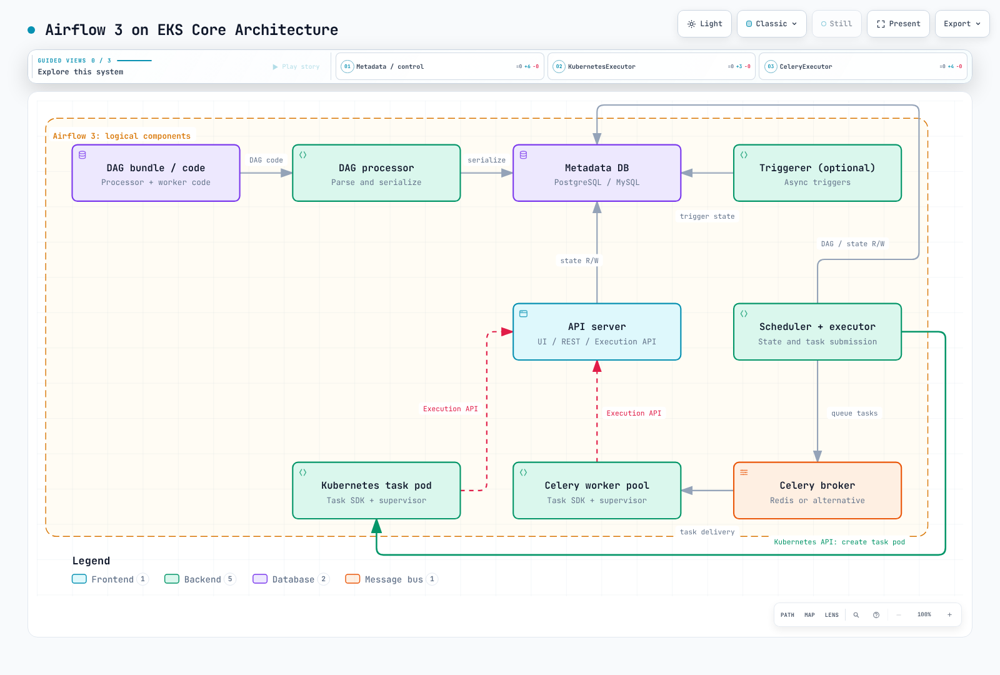

# Análisis profundo de Airflow en EKS

> **Versión de referencia de la revisión**: Airflow 3.3.1 · chart oficial de Helm 1.22.0
> **Último parche upstream comprobado**: Airflow 3.3.2 (17 de septiembre de 2026); los ejemplos siguen en 3.3.1 · 12 de octubre de 2026

Apache Airflow define las dependencias de los flujos de trabajo como DAG y programa,
ejecuta y supervisa sus tareas. En EKS, el comportamiento de los pods por tarea depende del **executor y
del operador**, no solo de instalar un chart de Helm.

Airflow 2 llegó al fin de su vida útil el 22 de abril de 2026. Para implementaciones
nuevas, usa una versión 3.x con mantenimiento. El chart 1.22.0 usa **Airflow 3.2.2** de forma
predeterminada, así que verifica por separado las versiones del chart, la imagen y la
configuración de Airflow. Esta serie revisa el comportamiento de 3.3.1 y renderiza el chart
con esa versión especificada.

La versión upstream 3.3.2 se publicó el 17 de septiembre de 2026. Un token Bearer explícito
tiene prioridad sobre una cookie de sesión, y un token Bearer no válido rechaza la solicitud
incluso cuando también hay una cookie válida. Esto puede afectar a los clientes de API que
combinan cookies del navegador con credenciales de servicio.

Los ejemplos y las comprobaciones de Helm de esta serie siguen en 3.3.1 y no se han
vuelto a validar con 3.3.2.

## Arquitectura principal

- El scheduler y el executor deciden y envían el trabajo de las tareas, y actualizan el estado de los metadatos.
- El procesador de DAG obligatorio analiza y serializa los bundles de DAG. Los workers también necesitan el código de las tareas a través del bundle correspondiente o de la vía de distribución de código.
- El servidor de API proporciona las rutas de la UI, la REST API y la Task Execution API. Un runtime supervisado del Python Task SDK usa esa API para acceder al estado y a Connection/Variable/XCom.
- El triggerer ejecuta **triggers** mientras las tareas aplazables esperan. Es opcional en una implementación mínima que no use el aplazamiento.
- Los backends de metadatos incluyen PostgreSQL y MySQL. Esta serie usa PostgreSQL como ejemplo, no como única opción. Redis tampoco es la única opción de broker para Celery.

[Diagrama interactivo](https://www.atomai.click/kubernetes-docs/archmaps/en-data-on-eks-airflow-readme-0.html)

Los bundles de DAG no sustituyen a git-sync en todos los casos. El chart oficial sigue
admitiendo git-sync; distingue entre la entrega y el versionado de bundles. La separación
del análisis tampoco elimina toda latencia, los cuellos de botella de la base de datos ni
las preocupaciones de alta disponibilidad.

## Serie

1. [Arquitectura de Airflow en Kubernetes](01-architecture.md): componentes, Execution API, bases de datos/brokers y executors.
2. [Implementación con Helm y elección del executor](02-helm-deployment.md): chart oficial, versiones, conexiones y escalado de workers.
3. [Patrones de DAG y KubernetesPodOperator](03-dag-patterns.md): pods, entrega de código, bundles y Spark/dbt.
4. [Integración con Amazon MWAA](04-mwaa-integration.md): alcance del servicio administrado, integración con EKS, versiones y costo.
5. [Operaciones y seguridad](05-operations.md): alta disponibilidad, migraciones, secretos, registros, observabilidad y comprobaciones de recuperación.

- [Arquitectura de Airflow 3.3.1](https://airflow.apache.org/docs/apache-airflow/3.3.1/core-concepts/overview.html)
- [Notas de la versión de Airflow 3.3.2](https://airflow.apache.org/docs/apache-airflow/3.3.2/release_notes.html)
- [Versiones admitidas y ciclo de vida](https://airflow.apache.org/docs/apache-airflow/3.3.1/installation/supported-versions.html)
- [Requisitos previos de Airflow](https://airflow.apache.org/docs/apache-airflow/3.3.1/installation/prerequisites.html)
- [Configuración e historial de executor](https://airflow.apache.org/docs/apache-airflow/3.3.1/core-concepts/executor/index.html)
- [Bundles de DAG](https://airflow.apache.org/docs/apache-airflow/3.3.1/administration-and-deployment/dag-bundles.html)
- [Operadores aplazables y triggers](https://airflow.apache.org/docs/apache-airflow/3.3.1/authoring-and-scheduling/deferring.html)

[Cuestionario](../../quizzes/data-on-eks/airflow/01-architecture-quiz.md)
