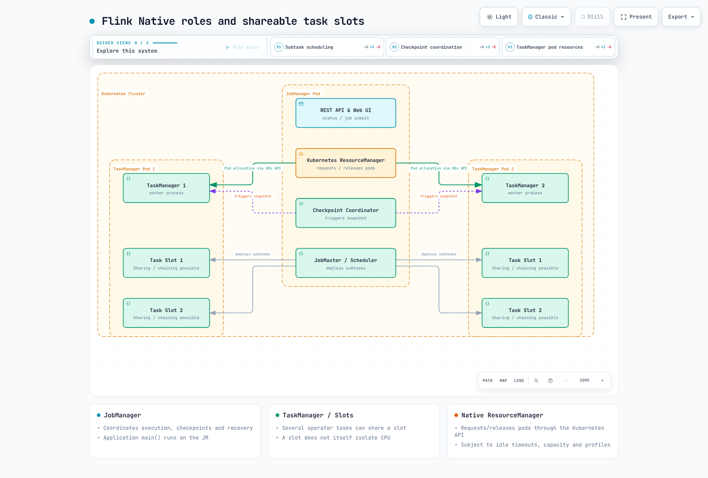

# Parte 1: Arquitectura de Flink en Kubernetes

> **Última actualización**: 12 de septiembre de 2026. Ejemplos de integración: Flink 2.2.1 / Java 17 / Operator 1.15.0.

Este capítulo explica los roles del clúster y el dimensionamiento de recursos. Prepara una versión de EKS/Kubernetes con soporte vigente, una versión compatible de kubectl, una distribución de Flink y acceso de cliente. La Parte 2 abarca la instalación, las cuentas de servicio, RBAC y los recursos del Operator. Los requisitos mínimos históricos de Kubernetes no son matrices de soporte actuales.

## 1. JobManager, TaskManager y cliente

| Rol | Responsabilidad |
| --- | --- |
| Client | Según la ruta de envío, ejecuta el método main() de la aplicación para crear un grafo o solicita la ejecución de la aplicación en el clúster |
| JobManager | Dispatcher, ResourceManager y JobMaster por trabajo coordinan el envío, los slots, la ejecución, los checkpoints y la recuperación |
| TaskManager | Ejecuta los subprocesos de tareas, intercambia y almacena en búfer los datos y procesa el estado |
| Kubernetes ResourceManager | Solicita y libera Pods de TaskManager mediante la API de Kubernetes en el modo Native |

El JobManager no siempre crea el grafo inicial en todos los modos de implementación.
El modo Application ejecuta main() en el JobManager; el envío normal mediante Session CLI de Flink 2.2 crea el grafo en el cliente. Los TaskManager procesan normalmente los registros de los operadores, pero main() de la aplicación es código del usuario: no des por sentado que el JobManager permanece siempre ligero.

### Slots, encadenamiento de operadores y uso compartido de slots

Un slot de tarea es una unidad de asignación de recursos del TaskManager. La configuración clásica de slots fijos divide la memoria administrada, pero **no proporciona por sí misma aislamiento de CPU**.
Cada TaskManager es una JVM que puede alojar varios subprocesos de tareas.

Flink puede **encadenar** sub tareas de operadores en una sola tarea/subproceso. Las distintas tareas de un mismo trabajo también pueden compartir slots mediante **grupos de uso compartido de slots**.
Por lo tanto, cuatro slots no significan un máximo de cuatro sub tareas de operadores.

| Supuestos del ejemplo | Cálculo sencillo de slots |
| --- | --- |
| source(4) → map(4) → sink(2), todos en un grupo de uso compartido | Pueden caber en 4 slots, el paralelismo máximo |
| source/map en el grupo A y sink en el grupo B | La ejecución simultánea de ambos grupos requiere 4 + 2 = 6 slots |

Son ejemplos sencillos de streaming con requisitos compatibles de grupo y recursos.
Ten en cuenta por separado la programación por lotes, los perfiles de recursos detallados, otros trabajos y el encadenamiento. Con dos slots por TM, cuatro slots necesitan al menos dos TM y seis slots necesitan al menos tres. También deben caber la CPU real, la red, el tamaño del estado y el margen disponible.



[Diagrama interactivo](https://www.atomai.click/kubernetes-docs/archmaps/en-data-on-eks-flink-01-architecture-0.html)

## 2. Application/Session selecciona el ciclo de vida y el uso compartido del clúster

| Modo | main() y ciclo de vida del clúster | Límite operativo |
| --- | --- | --- |
| Application | Ejecuta main() en un clúster dedicado a una aplicación; el ciclo de vida del clúster sigue al de esa aplicación | Un main() puede crear varios trabajos, por lo que no siempre hay un clúster por trabajo |
| Session | Envía aplicaciones/trabajos a un clúster existente; la CLI normal de 2.2 ejecuta main() en el cliente | Los trabajos comparten capacidad de JM/TM; un fallo de TM puede afectar a varios trabajos |

El modo Application separa las JVM y los ciclos de vida entre aplicaciones, pero no aísla por completo los nodos compartidos de EKS, la red, el almacenamiento ni las cuotas de API. Varios trabajos de una misma aplicación también comparten su clúster. La base de referencia de 2.2 documenta HA de Application para aplicaciones de una sola ejecución; comprueba los límites específicos de versión para aplicaciones con varios trabajos en lugar de aplicar retroactivamente las mejoras de 2.3.

El modo Session puede reutilizar los recursos asignados y evitar la sobrecarga de inicio del clúster.
No garantiza la ejecución inmediata si no hay slots libres, y siguen siendo relevantes los fallos y la contención compartidos.

Per-Job era el modelo histórico de grafos creados en el cliente y clústeres específicos para cada trabajo.
No es una opción de Native Kubernetes. Las opciones actuales de Kubernetes que se tratan aquí son Application y Session, no tres modos compatibles.

## 3. Native/Standalone es un eje independiente de gestión de recursos

Application/Session y Native/Standalone son clasificaciones distintas.
Operator 1.15.0 admite clústeres Application/Session y la **implementación Native/Standalone**.

| Aspecto | Native | Standalone |
| --- | --- | --- |
| Gestión de Pods TM | El Kubernetes ResourceManager del JM solicita y libera Pods mediante la API | Un administrador externo, como Operator, reconcilia los recursos de Kubernetes |
| Permisos de ejecución | Se necesitan permisos de API de Kubernetes para la gestión nativa de recursos | Es posible la gestión externa; comprueba aparte los permisos de API para funciones adicionales como HA |
| Cambios de réplicas | Los determinan las demandas de slots de Flink, la política de inactividad y los límites | Los puede gestionar Operator u otros controladores, no solo la edición manual de YAML |

Native es la ruta predeterminada habitual, pero Standalone no es simplemente un modo heredado descartado. Selecciona el modo mediante CR `spec.mode` y evalúa dónde deben residir los privilegios de creación de recursos y qué límites de funciones se aplican. Esto no elimina automáticamente toda interacción con la API de Kubernetes ni aísla por completo el código que no sea de confianza.

La asignación nativa de TaskManager también depende de los perfiles de recursos, los límites y los tiempos de espera por inactividad. El valor predeterminado de 2.2.1 para `resourcemanager.taskmanager-timeout` es 30 segundos.
La finalización de un trabajo o un menor paralelismo no elimina de inmediato una cantidad estrictamente proporcional de Pods/nodos. Karpenter/Cluster Autoscaler gestiona la capacidad de los nodos en una capa independiente.

### Forma actual de envío mediante CLI

Este es un **envío Native Application sin Operator**, después de preparar el espacio de nombres y flink ServiceAccount/RBAC según la Parte 2.
No permitas que un CR de Operator y la CLI administren el mismo ID de clúster.
El ejemplo incluido de máquina de estados es de larga duración; no es una prueba rápida de procesamiento por lotes que termina.

```bash
# Illustration after namespace/ServiceAccount/RBAC preparation from Part 2.
# Use the Flink 2.2.1 distribution and a cluster ID not owned by an Operator CR.
./bin/flink run \
  --target kubernetes-application \
  -Dkubernetes.cluster-id=flink-cli-example \
  -Dkubernetes.container.image.ref=flink:2.2.1-java17 \
  -Dkubernetes.namespace=data-processing \
  -Dkubernetes.jobmanager.service-account=flink \
  -Dtaskmanager.numberOfTaskSlots=2 \
  -p 2 \
  local:///opt/flink/examples/streaming/StateMachineExample.jar
```

La CLI de 2.2 usa `run --target kubernetes-application`. No copies la acción antigua `run-application`. `image.ref` es la clave actual; `container.image` es un alias obsoleto. El URI local identifica el JAR dentro de esta imagen de ejemplo. Verifica los permisos del cliente/JM, la descarga de imágenes, DNS, la capacidad y los resultados reales de REST/registros.

## 4. Alcance del entorno de ejecución y de la validación

Java 17 es la opción de imagen recomendada/predeterminada para esta base de referencia.
Los metadatos oficiales de las imágenes también muestran variantes de Java 11, así que es incorrecto afirmar que se eliminaron todas las imágenes Java 11 de la versión 2.x. La documentación de 2.2 describe el soporte de Java 21 como experimental; no todos los JDK arbitrarios posteriores a 17 tienen el mismo nivel de soporte.
Haz coincidir también el bytecode de la aplicación, los conectores y los ajustes de reflexión.

Se comprobaron la arquitectura, el despacho de la CLI y sus claves de configuración, el código fuente de Operator y los metadatos de etiquetas de imagen. Aquí no se crearon clústeres ni se enviaron trabajos mediante CLI, y tampoco se realizaron pruebas de HA o rendimiento.

## Referencias

- [Versiones de Flink y compatibilidad de conectores](https://flink.apache.org/downloads/)
- [Arquitectura de Flink 2.2](https://nightlies.apache.org/flink/flink-docs-release-2.2/docs/concepts/flink-architecture/)
- [Modos de implementación de Flink 2.2](https://nightlies.apache.org/flink/flink-docs-release-2.2/docs/deployment/overview/)
- [Implementación Native Kubernetes](https://nightlies.apache.org/flink/flink-docs-release-2.2/docs/deployment/resource-providers/native_kubernetes/)
- [Compatibilidad con Java](https://nightlies.apache.org/flink/flink-docs-release-2.2/docs/deployment/java_compatibility/)
- [Modos de implementación de Operator 1.15.0](https://github.com/apache/flink-kubernetes-operator/blob/release-1.15.0/docs/content/docs/custom-resource/overview.md)

[Parte 2: Operator](02-flink-kubernetes-operator.md)

[README](README.md)

[Cuestionario](../../quizzes/data-on-eks/flink/01-architecture-quiz.md)
