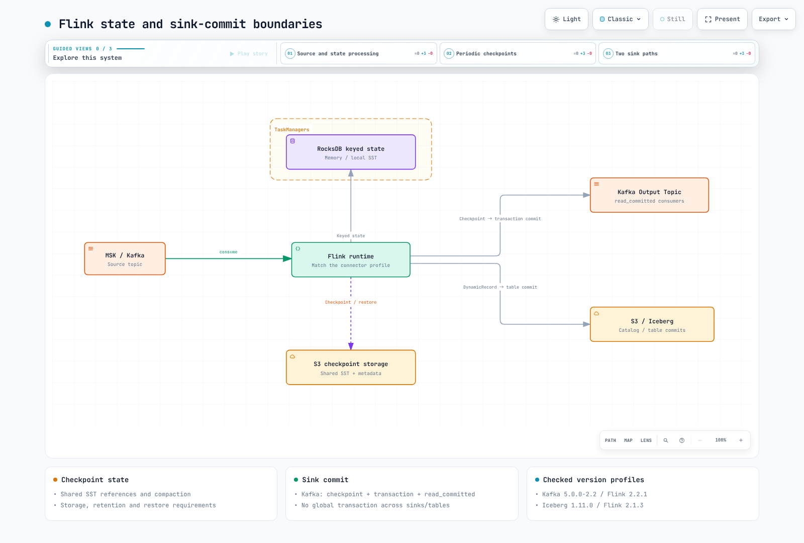

# Parte 3: estado, checkpoints y patrones de streaming

> **Última actualización**: 12 de septiembre de 2026. Operator 1.15.0. Los ejemplos de Kafka usan Flink 2.2.1; los ejemplos de Iceberg usan una combinación distinta con Flink 2.1.3.

El estado son los datos que recuerdan las agregaciones, las uniones y la deduplicación. No todas las ventanas retienen cada registro de entrada: las agregaciones incrementales SUM/COUNT pueden conservar acumuladores. El procesamiento sin estado también puede perder o duplicar resultados si se producen fallos al reproducir la fuente, confirmar la recepción o escribir externamente. Valida en conjunto el **estado interno, las fuentes reproducibles y las garantías de confirmación del sink**.

## 1. Fija primero combinaciones compatibles

| Ejemplo | Flink | Dependencias adicionales |
| --- | --- | --- |
| Sink/SQL de Kafka | 2.2.1 / Java 17 | flink-connector-kafka 5.0.0-2.2, connector-base y los módulos necesarios de SQL/runtime/formato |
| Sink dinámico de Iceberg | 2.1.3 / Java 17 | iceberg-flink-runtime-2.1 1.11.0 |

La distribución oficial de Iceberg 1.11.0 enumera JAR de runtime para Flink 2.1, 2.0 y 1.20. No se presenta un JAR 2.1 para Flink 2.2.1 como combinación validada.
Los helpers de Java que aparecen abajo compilan con sus respectivas combinaciones; para ejecutarlos aún hacen falta las fuentes, la seguridad, los catálogos y la configuración de almacenamiento.

## 2. Los backends de estado son distintos del almacenamiento de checkpoints

| Backend | Características | Límites que debes examinar |
| --- | --- | --- |
| HashMap | Estado con clave almacenado como objetos del heap de la JVM | Heap, GC y coste de serialización; mídelo para la carga de trabajo |
| EmbeddedRocksDB | Estado serializado con clave en RocksDB local; utiliza memoria nativa/caché y disco | Requiere memoria gestionada/nativa, E/S y CPU, además de disco |
| ForSt | Estado desagregado mediante SST en un sistema de archivos remoto y caché local | Experimental en 2.2; comprueba las API de estado asíncrono y las restricciones de snapshots |

RocksDB no significa que haya exactamente una instancia por slot ni que todos los objetos de estado del operador/usuario estén fuera del heap. Los operadores con clave pueden tener backends separados; varias instancias de un slot pueden compartir presupuestos/cachés de memoria gestionada. El estado de operador, los temporizadores, los búferes y los objetos de usuario también consumen memoria.

Evita fijar un umbral arbitrario en MB que obligue a usar RocksDB. Compara la forma del estado, la serialización, el GC/E/S y los tiempos de checkpoint/restauración. ForSt también admite snapshots incrementales, por lo que la incrementalidad no es exclusiva de RocksDB. Este laboratorio usa RocksDB.

### Qué reducen los checkpoints incrementales

Los checkpoints de RocksDB conservan los archivos SST nuevos y sus metadatos, y hacen referencia a los SST compartidos que se pueden reutilizar. No calculan directamente diferencias entre cambios lógicos de claves. La compactación puede reescribir archivos grandes aunque el cambio lógico sea pequeño.

La restauración necesita todos los archivos a los que hace referencia el checkpoint elegido, no la reproducción secuencial de todos los checkpoints históricos. Los checkpoints completos no siempre son archivos únicos. La restauración de SST nativos puede evitar reconstruir RocksDB desde el estado canónico de clave/valor, pero el volumen transferido, la cantidad de archivos, la red y la E/S pueden acelerar o ralentizar la recuperación.
No elimines por separado archivos compartidos de S3 a los que todavía hagan referencia checkpoints activos.

## 3. Requisitos reales para conservar el estado en S3

Usa el Operator, el namespace de procesamiento de datos y el Role/flink creado por el chart de la Parte 2.
Prepara el bucket/prefijo y el rol de IAM, y sustituye los valores de ejemplo que aparecen abajo.
Verifica los permisos de lectura/escritura/listado, limpieza/eliminación, multipart y KMS, si corresponde, para cada ruta.
Una anotación de cuenta de servicio no crea un rol de IAM ni configura la relación de confianza de OIDC.

```yaml
apiVersion: v1
kind: ServiceAccount
metadata:
  name: flink-state
  namespace: data-processing
  annotations:
    eks.amazonaws.com/role-arn: arn:aws:iam::123456789012:role/flink-state-checkpoints
---
apiVersion: rbac.authorization.k8s.io/v1
kind: RoleBinding
metadata:
  name: flink-state
  namespace: data-processing
roleRef:
  apiGroup: rbac.authorization.k8s.io
  kind: Role
  name: flink
subjects:
- kind: ServiceAccount
  name: flink-state
  namespace: data-processing
```

Este FlinkDeployment usa IRSA, habilita el plugin S3 para JM/TM y usa emptyDir para los archivos RocksDB locales. El estado recuperable tras perder un pod/nodo reside en S3. fsGroup coincide con el UID/GID 9999 de flink en esta imagen.

Hay una limitación importante de versión: el plugin S3 de Hadoop 2.2.1 revisado contiene **Hadoop 3.3.4 y AWS SDK for Java 1.12.779**. El SDK 1.x llegó al fin del soporte el 31 de diciembre de 2025. Este ejemplo usa las clases de credenciales v1 reales del artefacto; no es una configuración v2 del SDK validada. En producción, evalúa el soporte/seguridad del sistema de archivos upstream y las alternativas compatibles de runtime/conectores. No sustituyas indiscriminadamente JAR aislados ni nombres de clases de proveedores entre generaciones del SDK.

```yaml
apiVersion: flink.apache.org/v1beta1
kind: FlinkDeployment
metadata:
  name: flink-state-demo
  namespace: data-processing
spec:
  image: flink:2.2.1-java17
  flinkVersion: v2_2
  mode: native
  flinkConfiguration:
    taskmanager.numberOfTaskSlots: '2'
    state.backend.type: rocksdb
    state.backend.rocksdb.localdir: /opt/flink/state
    execution.checkpointing.storage: filesystem
    execution.checkpointing.dir: s3://replace-with-your-bucket/flink-state-demo/checkpoints
    execution.checkpointing.savepoint-dir: s3://replace-with-your-bucket/flink-state-demo/savepoints
    execution.checkpointing.interval: 2 s
    execution.checkpointing.mode: EXACTLY_ONCE
    execution.checkpointing.timeout: 10 min
    execution.checkpointing.min-pause: 30 s
    execution.checkpointing.incremental: 'true'
    execution.checkpointing.num-retained: '3'
    execution.checkpointing.externalized-checkpoint-retention: RETAIN_ON_CANCELLATION
    high-availability.type: org.apache.flink.kubernetes.highavailability.KubernetesHaServicesFactory
    high-availability.storageDir: s3://replace-with-your-bucket/flink-state-demo/ha
    fs.s3a.aws.credentials.provider: com.amazonaws.auth.WebIdentityTokenCredentialsProvider
  serviceAccount: flink-state
  jobManager:
    resource:
      memory: 2048m
      cpu: 1
  taskManager:
    resource:
      memory: 2048m
      cpu: 1
  job:
    jarURI: local:///opt/flink/examples/streaming/StateMachineExample.jar
    parallelism: 2
    upgradeMode: last-state
    state: running
    args:
    - --backend
    - rocksdb
    - --checkpoint-dir
    - s3://replace-with-your-bucket/flink-state-demo/checkpoints
    - --incremental-checkpoints
    - 'true'
  podTemplate:
    spec:
      securityContext:
        fsGroup: 9999
      containers:
      - name: flink-main-container
        env:
        - name: ENABLE_BUILT_IN_PLUGINS
          value: flink-s3-fs-hadoop-2.2.1.jar
        volumeMounts:
        - name: rocksdb-local
          mountPath: /opt/flink/state
      volumes:
      - name: rocksdb-local
        emptyDir: {}
```

StateMachineExample fija explícitamente el intervalo de checkpoint en **dos segundos en el código**. La configuración del ejemplo coincide con ese valor. min-pause=30 segundos y la duración del checkpoint implican que los snapshots reales no se producen con una periodicidad fija de dos segundos.
El código de la aplicación puede anular un valor de configuración de 60 segundos; inspecciona los ajustes efectivos del runtime.

Para Pod Identity, prepara la asociación de cuenta de servicio, el Agent y la red en lugar de la configuración de IRSA. Con este artefacto v1, verifica una ruta de credenciales de contenedor como com.amazonaws.auth.DefaultAWSCredentialsProviderChain.
La versión 1.12.779 cumple el mínimo documentado para Pod Identity, 1.12.746, pero sigue siendo un SDK sin soporte. Inspecciona también las fuentes anteriores de credenciales de entorno/IRSA/otros.

Después del despliegue, verifica los checkpoints completados, los archivos de datos/metadatos de S3, el reinicio/restauración y los resultados de la aplicación; no te limites a comprobar el estado Running. EmptyDir no es una copia de seguridad duradera. En esta revisión no se ejecutaron un despliegue real en AWS ni una recuperación tras fallo.

## 4. Ciclo de vida de checkpoints y savepoints

| Aspecto | Checkpoint | Savepoint |
| --- | --- | --- |
| Propósito habitual | Estado/posiciones de fuentes para recuperarse de fallos | Punto deliberado de restauración, actualización o bifurcación |
| Activación | Solicitud periódica o explícita | Solicitud del usuario/Operator; la automatización puede crearlos periódicamente |
| Retención | Cantidad, retención externalizada y política de terminación del job | Política del usuario/Operator y propiedad de la restauración |
| Formato/almacenamiento | Almacenamiento de JobManager o del sistema de archivos, entre otras opciones | Formatos canónicos/nativos y almacenamiento accesible |

Los savepoints no son automáticamente permanentes y los checkpoints no siempre están en S3.
El formato canónico apunta a la portabilidad entre backends; el formato nativo es específico del backend.
Valida el esquema del estado, los UID, los serializadores, el paralelismo máximo y la compatibilidad de versiones.

Los modos de restauración CLAIM/NO_CLAIM afectan la propiedad del snapshot y la responsabilidad de eliminarlo.
El primer checkpoint de RocksDB después de una restauración NO_CLAIM puede ser completo para establecer la independencia. No elimines un snapshot mientras la recuperación aún dependa de él.
El último estado del Operator puede usar metadatos HA accesibles o el último checkpoint/savepoint; no siempre consiste en un único archivo de checkpoint más reciente.

### Solicita un savepoint nuevo mediante un CR único

generateName asigna un nombre nuevo al crear el recurso y evita reutilizar uno completado que podría confundirse con un snapshot nuevo.

```yaml
apiVersion: flink.apache.org/v1beta1
kind: FlinkStateSnapshot
metadata:
  generateName: flink-state-before-upgrade-
  namespace: data-processing
spec:
  jobReference:
    kind: FlinkDeployment
    name: flink-state-demo
  savepoint:
    formatType: CANONICAL
    disposeOnDelete: false
```
```bash
kubectl create -f savepoint.yaml
kubectl get flinkstatesnapshots -n data-processing --watch
```

Inspecciona status.state=COMPLETED y status.path del CR nuevo. Investiga el estado del error/job si el resultado es FAILED o ABANDONED. disposeOnDelete=false es la opción de retención de este ejemplo, distinta del valor predeterminado true y de las políticas de limpieza del Operator. Registra quién elimina los archivos retenidos.

## 5. La garantía exactly-once de Kafka requiere checkpoints, transacciones y consumidores

KafkaSink EXACTLY_ONCE confirma transacciones de Kafka en coordinación con la finalización de los checkpoints. Requiere fuentes reproducibles, estado recuperable y una configuración correcta del sink; los consumidores posteriores deben usar read_committed.
No crea una transacción atómica global entre todas las subtareas, particiones y otros sistemas de sink.
Una transacción de Kafka puede abarcar temas/particiones; las transacciones separadas de varias subtareas del sink no forman una única transacción para todo el checkpoint de Flink.

Este helper compila con Kafka connector 5.0.0-2.2 y Flink 2.2.1.
Quien lo invoque proporciona el flujo de entrada, los servidores bootstrap reales, los ajustes del productor TLS/SASL y el timeout, y ejecuta la aplicación. No es una receta para instalar un clúster de Kafka.

```java
import java.util.Properties;
import org.apache.flink.api.common.serialization.SimpleStringSchema;
import org.apache.flink.connector.base.DeliveryGuarantee;
import org.apache.flink.connector.kafka.sink.KafkaRecordSerializationSchema;
import org.apache.flink.connector.kafka.sink.KafkaSink;
import org.apache.flink.streaming.api.datastream.DataStream;

public final class KafkaExample {
    private KafkaExample() {}

    public static void attach(
            DataStream<String> input,
            String bootstrapServers,
            String transactionalIdPrefix,
            int transactionTimeoutMs,
            Properties securityProperties) {
        if (transactionTimeoutMs <= 0 || transactionalIdPrefix.isBlank()) {
            throw new IllegalArgumentException("Positive timeout and a unique stable prefix are required");
        }
        Properties producer = new Properties();
        producer.putAll(securityProperties);
        producer.setProperty("transaction.timeout.ms", Integer.toString(transactionTimeoutMs));
        input.getExecutionEnvironment().enableCheckpointing(60_000);

        KafkaSink<String> sink = KafkaSink.<String>builder()
                .setBootstrapServers(bootstrapServers)
                .setKafkaProducerConfig(producer)
                .setRecordSerializer(KafkaRecordSerializationSchema.<String>builder()
                        .setTopic("orders-enriched")
                        .setValueSerializationSchema(new SimpleStringSchema())
                        .build())
                .setDeliveryGuarantee(DeliveryGuarantee.EXACTLY_ONCE)
                .setTransactionalIdPrefix(transactionalIdPrefix)
                .build();
        input.sinkTo(sink).name("orders-enriched").uid("orders-enriched-sink");
    }
}
```

transactionalIdPrefix debe ser único entre sinks/jobs independientes y simultáneos en el mismo clúster de Kafka, y estable tras los reinicios. Cambiarlo puede dejar transacciones anteriores sin abortar y bloquear el avance de read_committed hasta que venza el timeout.
Compartirlo a ciegas entre ejecuciones blue/green puede causar fencing/conflictos.

El builder 5.0.0 establece por defecto un timeout de transacción de **una hora**. Ajústalo al máximo permitido por el broker y deja tiempo suficiente para los peores casos de checkpoints/reinicios/recuperación.
Una etiqueta de configuración no puede restablecer las garantías exactly-once cuando vence la transacción.

Un intervalo de checkpoint de 60 segundos no limita a 60 segundos la latencia añadida. Contribuyen la espera, la duración del checkpoint, la confirmación, los fallos/reintentos y el retraso del consumidor.
Los intervalos cortos aumentan la carga de confirmaciones/metadatos. El modo de nombres INCREMENTING predeterminado crea ID nuevos; el modo opcional POOLING reutiliza ID y requiere Kafka 3+, permisos adicionales de lectura de temas y un procedimiento de migración documentado. No todas las configuraciones crean ID de transacción nuevos indefinidamente.

## 6. Sink dinámico de Iceberg: API reales y un runtime separado

Este helper está dirigido a Iceberg 1.11.0 / Flink 2.1.3.
Los campos de entrada RowData son target_table STRING, id BIGINT y value STRING; es **solo de inserción**. Quien lo invoque proporciona un CatalogLoader configurado para el catálogo, el warehouse y la autenticación. Restringe los nombres de las tablas de destino a valores confiables/permitidos.

```java
import org.apache.flink.streaming.api.datastream.DataStream;
import org.apache.flink.table.data.GenericRowData;
import org.apache.flink.table.data.RowData;
import org.apache.iceberg.DistributionMode;
import org.apache.iceberg.PartitionSpec;
import org.apache.iceberg.Schema;
import org.apache.iceberg.catalog.TableIdentifier;
import org.apache.iceberg.flink.CatalogLoader;
import org.apache.iceberg.flink.sink.dynamic.DynamicIcebergSink;
import org.apache.iceberg.flink.sink.dynamic.DynamicRecord;
import org.apache.iceberg.types.Types;

public final class IcebergExample {
    private IcebergExample() {}
    private static final Schema PAYLOAD_SCHEMA = new Schema(
            Types.NestedField.required(1, "id", Types.LongType.get()),
            Types.NestedField.optional(2, "value", Types.StringType.get()));

    // Insert-only input RowData: target_table STRING, id BIGINT, value STRING.
    // The caller supplies an authenticated, authorized CatalogLoader.
    public static void attach(DataStream<RowData> input, CatalogLoader catalogLoader) {
        input.getExecutionEnvironment().enableCheckpointing(60_000);
        DynamicIcebergSink.forInput(input)
                .generator((row, out) -> {
                    TableIdentifier target = TableIdentifier.of("docs", row.getString(0).toString());
                    GenericRowData payload = GenericRowData.of(
                            row.getLong(1), row.isNullAt(2) ? null : row.getString(2));
                    out.collect(new DynamicRecord(
                            target, "main", PAYLOAD_SCHEMA, payload,
                            PartitionSpec.unpartitioned(), DistributionMode.HASH, 2));
                })
                .catalogLoader(catalogLoader)
                .uidPrefix("docs-dynamic-iceberg")
                .writeParallelism(2)
                .append();
    }
}
```

La API real es forInput → generator → catalogLoader → append.
Un generator emite cero o más registros a un Collector en lugar de devolver un solo registro. El ejemplo antiguo con forRecords/withTableIdentifierSelector/withSchemaEvolutionEnabled no existía en esta versión.

Cada DynamicRecord proporciona un destino, un esquema, RowData y una especificación de partición.
La evolución sigue los cambios compatibles y la configuración; no resuelve automáticamente cambios arbitrarios de nombre/tipo. Las actualizaciones/eliminaciones CDC requieren validar RowKind, campos de igualdad, upsert y el formato de tabla. No uses este helper de solo inserción como procesador CDC completo. Las confirmaciones en varias tablas y las salidas simultáneas de Kafka/Iceberg no conforman una confirmación atómica global.

Para una ingesta más sencilla, considera MSK → Firehose → S3 Tables/Iceberg o un sink de MSK Connect. Comprueba las fuentes/redes compatibles, la autenticación, el catálogo/formato de tabla, las operaciones/clave de fila, el almacenamiento en búfer y la gestión de fallos. Por ejemplo, la documentación de Firehose para Iceberg indica requisitos de V2/Parquet/MOR. La infraestructura gestionada no elimina la necesidad de validar la configuración, los esquemas y la semántica de entrega.



[Diagrama interactivo](https://www.atomai.click/kubernetes-docs/archmaps/en-data-on-eks-flink-03-state-checkpointing-streaming-0.html)

## 7. SQL, atributos temporales y datos tardíos

SQL/Table API expresa transformaciones/agregaciones relacionales; DataStream expone estado personalizado, temporizadores y lógica de operadores. SQL también ofrece funciones avanzadas y DataStream no permite omitir arbitrariamente las barreras de checkpoint/backpressure.
Comprueba las API públicas 2.x y los JAR de conectores/formatos. Kafka/Iceberg/JDBC no siempre vienen incluidos y no todas las API históricas de Scala siguen siendo compatibles.

Este ejemplo de planificación incluye la definición de la tabla y el watermark.
Antes de ejecutarlo, adapta los campos JSON y la codificación de tiempo a los ajustes de seguridad del broker y a la fuente real.

```sql
-- Schema/planning example. Supply real broker/authentication settings before execution.
CREATE TEMPORARY TABLE orders (
  customer_id STRING,
  amount DECIMAL(12,2),
  event_time TIMESTAMP(3),
  WATERMARK FOR event_time AS event_time - INTERVAL '5' SECOND
) WITH (
  'connector' = 'kafka',
  'topic' = 'orders',
  'properties.bootstrap.servers' = 'kafka.example.invalid:9093',
  'properties.group.id' = 'docs-orders',
  'scan.startup.mode' = 'earliest-offset',
  'format' = 'json'
);

SELECT window_start, window_end, customer_id, SUM(amount) AS total_amount
FROM TABLE(TUMBLE(TABLE orders, DESCRIPTOR(event_time), INTERVAL '1' MINUTE))
GROUP BY window_start, window_end, customer_id;
```

El planner de Flink 2.2.1 acepta esta consulta y rechaza una columna TIMESTAMP simple sin el atributo de watermark/tiempo. Esta es una validación de planificación, no una lectura de Kafka ni una prueba ejecutada del resultado de una ventana.

Un watermark estima el avance del tiempo de evento; no garantiza que no lleguen eventos más antiguos. Las marcas de tiempo de eventos no aparecen automáticamente en todos los registros. Configura la extracción de marcas de tiempo, la estrategia de watermark y la inactividad de entradas.
Las entradas lentas/inactivas pueden detener el avance, mientras que las entradas reanudadas pueden producir datos tardíos.

- Tumbling: ventanas de tamaño fijo que no se solapan.
- Sliding: tamaño fijo más un intervalo de avance; los intervalos menores producen solapamiento.
- Session: se basa en brechas de tiempo de evento y el avance del watermark, no solo en un temporizador de inactividad de reloj.

Con DataStream, allowedLateness>0 permite que el estado retenido de una ventana acepte registros tardíos y genere resultados actualizados. Después de la limpieza, los registros tardíos se descartan o se envían a una salida lateral de datos tardíos configurada explícitamente. allowedLateness por sí solo no crea esa salida. No generalices el comportamiento de ventanas SQL a partir de esta opción de DataStream.

## Alcance de la validación

Los dos helpers Java específicos del runtime se compilaron con release 17 como destino.
Las comprobaciones abarcaron la planificación SQL con watermark válido/ausente, las clases de credenciales v1 en el archivo del plugin S3, la estructura CRD/YAML y el código fuente publicado.
Las herramientas Java locales usaron Corretto 21; no se ejecutaron clústeres Java 17, conexiones a AWS/Kafka/Iceberg, CDC ni pruebas de recuperación tras fallos.

## Referencias

- [Backends de estado de Flink 2.2](https://nightlies.apache.org/flink/flink-docs-release-2.2/docs/ops/state/state_backends/)
- [Configuración de checkpoints](https://nightlies.apache.org/flink/flink-docs-release-2.2/docs/dev/datastream/fault-tolerance/checkpointing/)
- [Savepoints y propiedad](https://nightlies.apache.org/flink/flink-docs-release-2.2/docs/ops/state/savepoints/)
- [Plugins del sistema de archivos S3](https://nightlies.apache.org/flink/flink-docs-release-2.2/docs/deployment/filesystems/s3/)
- [Dependencias del plugin S3](https://github.com/apache/flink/blob/release-2.2.1/flink-filesystems/flink-s3-fs-base/pom.xml)
- [StateMachineExample incluido](https://github.com/apache/flink/blob/release-2.2.1/flink-examples/flink-examples-streaming/src/main/java/org/apache/flink/streaming/examples/statemachine/StateMachineExample.java)
- [Snapshots del Operator](https://github.com/apache/flink-kubernetes-operator/blob/release-1.15.0/docs/content/docs/custom-resource/snapshots.md)
- [Sink del conector Kafka 5.0.0](https://github.com/apache/flink-connector-kafka/blob/v5.0.0/flink-connector-kafka/src/main/java/org/apache/flink/connector/kafka/sink/KafkaSink.java)
- [Nombres de transacción de Kafka](https://github.com/apache/flink-connector-kafka/blob/v5.0.0/flink-connector-kafka/src/main/java/org/apache/flink/connector/kafka/sink/TransactionNamingStrategy.java)
- [Matriz de versiones/runtime de Iceberg](https://iceberg.apache.org/releases/)
- [DynamicIcebergSink de Iceberg 1.11](https://github.com/apache/iceberg/blob/apache-iceberg-1.11.0/flink/v2.1/flink/src/main/java/org/apache/iceberg/flink/sink/dynamic/DynamicIcebergSink.java)
- [Ventanas y datos tardíos](https://nightlies.apache.org/flink/flink-docs-release-2.2/docs/dev/datastream/operators/windows/)
- [Watermarks e inactividad](https://nightlies.apache.org/flink/flink-docs-release-2.2/docs/dev/datastream/event-time/generating_watermarks/)
- [Requisitos del SDK para EKS Pod Identity](https://docs.aws.amazon.com/eks/latest/userguide/pod-id-minimum-sdk.html)
- [Estado de soporte de AWS SDK for Java 1.x](https://docs.aws.amazon.com/sdk-for-java/v1/developer-guide/document-history.html)
- [Requisitos previos de Iceberg para Firehose](https://docs.aws.amazon.com/firehose/latest/dev/apache-iceberg-prereq.html)

[Parte 4: Operaciones y alta disponibilidad](04-operations-ha.md)

[Léeme](README.md)

[Cuestionario](../../quizzes/data-on-eks/flink/03-state-checkpointing-streaming-quiz.md)
