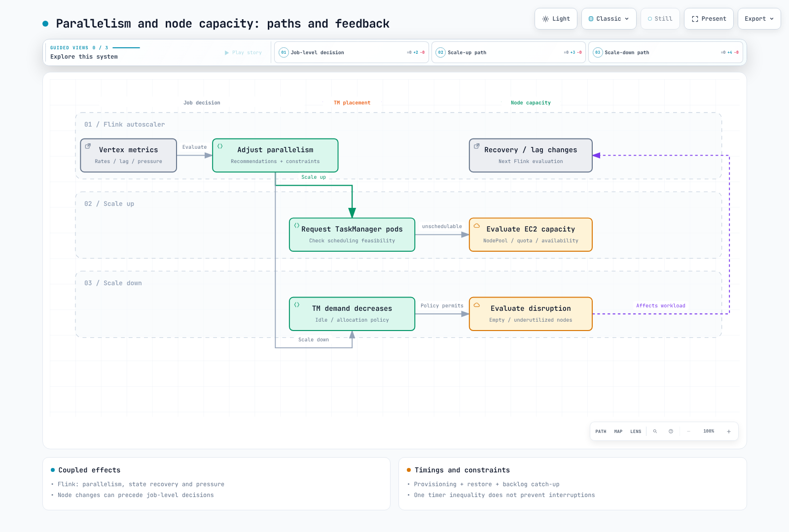

# Parte 4: Operaciones, alta disponibilidad y Flink administrado

> **Última actualización**: 12 de septiembre de 2026. Los ejemplos autoadministrados usan Flink 2.2.1 / Operator 1.15.0; la comparación con el servicio administrado usa la documentación de Flink 2.3 de AWS.

Conecte la observabilidad y la alta disponibilidad (HA) con la implementación con estado de la Parte 3 y, después, valide los fallos, la recuperación y la capacidad. Karpenter no es obligatorio; inspeccione el modelo de capacidad de nodos que utilice. Los ejemplos dan por supuesto Prometheus Operator y una configuración de Prometheus que selecciona los monitores.

## 1. Conectar los reporters, los puertos de los pods y los PodMonitor

Una configuración de reporter por sí sola no completa la ingesta en Prometheus. Haga coincidir el JAR, el puerto de escucha, el puerto con nombre del contenedor, los selectores y espacios de nombres, y la selección de PodMonitor que realiza Prometheus.

Estos son **campos que se deben combinar con la especificación CR completa de la Parte 3**. Se conserva la configuración del complemento o volumen de S3 al habilitar el complemento de Prometheus. Por lo general, las IP de los pods permiten que JM/TM usen el mismo puerto 9249. La red del host o varios reporters en un mismo pod requieren un plan independiente para evitar colisiones y permitir el descubrimiento.

```yaml
flinkConfiguration:
  metrics.reporter.prom.factory.class: org.apache.flink.metrics.prometheus.PrometheusReporterFactory
  metrics.reporter.prom.port: '9249'
  state.backend.rocksdb.metrics.block-cache-usage: 'true'
  state.backend.rocksdb.metrics.block-cache-capacity: 'true'
  state.backend.rocksdb.metrics.num-running-compactions: 'true'
  state.backend.rocksdb.metrics.compaction-pending: 'true'
podTemplate:
  spec:
    securityContext:
      fsGroup: 9999
    containers:
    - name: flink-main-container
      env:
      - name: ENABLE_BUILT_IN_PLUGINS
        value: flink-s3-fs-hadoop-2.2.1.jar;flink-metrics-prometheus-2.2.1.jar
      volumeMounts:
      - name: rocksdb-local
        mountPath: /opt/flink/state
      ports:
      - name: flink-metrics
        containerPort: 9249
        protocol: TCP
    volumes:
    - name: rocksdb-local
      emptyDir: {}
  metadata:
    labels:
      metrics-group: flink-state-demo
```

```yaml
apiVersion: monitoring.coreos.com/v1
kind: PodMonitor
metadata:
  name: flink-state-metrics
  namespace: monitoring
  labels:
    release: monitoring
spec:
  selector:
    matchLabels:
      metrics-group: flink-state-demo
  namespaceSelector:
    matchNames:
    - data-processing
  podMetricsEndpoints:
  - port: flink-metrics
    path: /metrics
    interval: 30s
```

Este PodMonitor reside en monitoring y selecciona cargas de trabajo en data-processing. metadata.labels.release=monitoring es un ejemplo: debe coincidir con los valores reales de podMonitorSelector y podMonitorNamespaceSelector de Prometheus. El namespaceSelector del PodMonitor, por separado, elige los espacios de nombres de los pods de destino.

Compruebe que los pods realmente tengan la etiqueta metrics-group y el puerto con nombre flink-metrics. Si se supone una etiqueta app.kubernetes.io/managed-by que no existe o un nombre de puerto que no está declarado, es posible que no haya destinos. Inspeccione también el estado de los destinos de Prometheus, las respuestas reales de /metrics, las políticas de red y el RBAC de descubrimiento.

### Las métricas del propio Operator requieren una configuración aparte

Incluir un reporter de Dropwizard no habilita un endpoint HTTP de Prometheus. La imagen de Operator proporciona complementos de reporters, pero el gráfico predeterminado selecciona Slf4j y deja metrics.port sin configurar. Este ejemplo amplía los valores de la Parte 2 con la configuración de Prometheus y un puerto con nombre.

```yaml
watchNamespaces:
- data-processing
image:
  repository: ghcr.io/apache/flink-kubernetes-operator
  tag: 1.15.0
  digest: sha256:5372e4461b433ee37391b0ee3fc3e4029980d14e9b64576b0cb78493d1cafe3a
webhook:
  create: true
metrics:
  port: 9249
defaultConfiguration:
  flink-conf.yaml: 'kubernetes.operator.metrics.reporter.prom.factory.class: org.apache.flink.metrics.prometheus.PrometheusReporterFactory

    kubernetes.operator.metrics.reporter.prom.port: 9249

    '
```

```yaml
apiVersion: monitoring.coreos.com/v1
kind: PodMonitor
metadata:
  name: flink-operator-metrics
  namespace: monitoring
  labels:
    release: monitoring
spec:
  selector:
    matchLabels:
      app.kubernetes.io/name: flink-kubernetes-operator
  namespaceSelector:
    matchNames:
    - flink-operator
  podMetricsEndpoints:
  - port: metrics
    path: /metrics
    interval: 30s
```

El pod real de Operator de este gráfico tiene app.kubernetes.io/name, pero no la etiqueta predeterminada app.kubernetes.io/instance. Las etiquetas de metadatos del Deployment no se convierten automáticamente en etiquetas de los pods. Después de cambiar los valores, vuelva a comprobar los pods renderizados y los destinos.
La revisión verificó que los selectores y puertos coincidieran en ambos monitores, pero no comprobó la ingesta activa en Prometheus.

### Unidades y coste de las métricas de RocksDB

block-cache-usage y block-cache-capacity se expresan en **bytes**; el uso no es por sí mismo una proporción. Si los compara, contemple que la capacidad sea cero o falte. Que la caché esté llena no demuestra por sí solo que haya un fallo: inspeccione los aciertos y fallos de caché, la latencia de lectura, la E/S y la compactación.
num-running-compactions es un recuento; compaction-pending es una señal de estado. Habilite las métricas de forma selectiva y tenga en cuenta las series por familia de columnas y subtarea, además de la sobrecarga.

Este reporter de Prometheus convierte los Counters de Flink en Gauges y los Histograms en Summaries. Antes de elegir consultas de contador o histograma, inspeccione los tipos TYPE, los nombres y las etiquetas que se exportan. Cree paneles que relacionen el éxito, los fallos y el tiempo de restauración de los checkpoints, el rendimiento, la demora, la contrapresión, la memoria JVM/nativa, el GC y el disco, y el estado de programación de los pods.

## 2. La memoria administrada y la de red son regiones independientes

El modelo de memoria de TaskManager es más detallado que cuatro regiones sin distinción.

| Región | Ejemplos |
| --- | --- |
| Heap del framework / heap de tareas | Estructuras del framework, objetos del usuario y estado en heap |
| Memoria fuera del heap del framework / de las tareas | Asignaciones directas/nativas del framework y del usuario |
| Memoria administrada | Presupuesto para RocksDB, operadores de ordenación/hash y UDF de Python |
| Memoria de red | Presupuesto separado para búferes de shuffle/red |
| Metaspace de JVM | Metadatos de clases |
| Sobrecarga de JVM | Pilas de subprocesos, caché de código y otros costes de JVM |

RocksDB y los búferes de red no comparten directamente un mismo grupo de memoria administrada. Aun así, están limitados por el presupuesto total del proceso. Un tamaño administrado explícito sustituye su fracción; evite ajustes contradictorios del total y de sus componentes, y tenga en cuenta las ponderaciones de quienes consumen memoria.

Estos resultados proceden del cálculo real de Flink 2.2.1 con 4 GiB de memoria total de proceso y los demás ajustes predeterminados. Son **presupuestos configurados, no RSS medido**.

| Fracción administrada | Heap de JVM (MiB) | Memoria administrada (MiB) | Memoria de red (MiB) |
| --- | ---: | ---: | ---: |
| 0.4 | 1587.20 | 1372.16 | 343.04 |
| 0.5 | 1244.16 | 1715.20 | 343.04 |

En este caso, aumentar la fracción administrada no cambia la memoria de red y reduce el heap de tareas. Otras combinaciones de configuración pueden comportarse de forma distinta. Inspeccione las solicitudes y límites de los pods, los sidecars, las asignaciones nativas y la caché de páginas, y el RSS/GC máximo. process.size no garantiza que abarque a todos los consumidores de memoria de un pod.

## 3. HA en Kubernetes: coordinación y estado duradero

La HA de Kubernetes evita que usted tenga que operar por su cuenta un ensemble externo de ZooKeeper; HA de ZooKeeper sigue siendo una alternativa compatible. La implementación de Flink revisada usa **ConfigMapLock** de Fabric8, no un servidor/API de elección de líder de Kubernetes independiente ni necesariamente un objeto Lease. La disponibilidad del plano de control de Kubernetes es un requisito previo.

| Ubicación | Función |
| --- | --- |
| ConfigMaps | Información del líder y referencias/controladores del estado de recuperación |
| high-availability.storageDir | Archivos duraderos de metadatos y del grafo de trabajo para la recuperación de JM |
| execution.checkpointing.dir | Almacenamiento para el estado real de los checkpoints |

Siguen vigentes los requisitos previos de complementos, credenciales y almacenamiento de la Parte 3.
Establecer un directorio de HA no coloca allí todos los archivos de datos de los checkpoints.
Estos campos se pueden combinar con un CR administrado por Operator:

```yaml
# Merge into the existing FlinkDeployment spec.
jobManager:
  replicas: 2
flinkConfiguration:
  high-availability.type: org.apache.flink.kubernetes.highavailability.KubernetesHaServicesFactory
  high-availability.storageDir: s3://replace-with-your-bucket/flink-state-demo/ha
```

**No establezca kubernetes.cluster-id, kubernetes.namespace ni high-availability.cluster-id dentro del CR de Operator.** El validador 1.15 los prohíbe; Operator administra la identidad a partir del nombre y el espacio de nombres del CR. Esto difiere de las guías de bajo nivel de Flink CLI.

La cuenta de servicio de JM necesita permisos de coordinación de ConfigMap. La gestión nativa de recursos también requiere permisos para pods y servicios. Un rol de ConfigMap exclusivo para HA no proporciona todos los permisos de implementación nativa. Los fallos pueden aparecer como errores de API, registros y reinicios; no necesariamente pasan inadvertidos con pods que parecen estar en buen estado.

Dos réplicas de JM pueden reducir el retraso de inicio, pero no garantizan una conmutación por error inmediata e ininterrumpida. Pruebe la ubicación por nodo/zona de disponibilidad, los tiempos de espera de elección, el acceso al almacenamiento, el tiempo de restauración/reproducción y las escrituras externas duplicadas. No elimine a la ligera ConfigMaps/archivos de HA ni trate la eliminación de un CR de Operator como si equivaliera a borrar su Deployment secundario.

## 4. El autoescalado y la capacidad de los nodos se afectan mutuamente

El autoescalador de Flink ajusta principalmente el paralelismo de los vértices; los autoescaladores de nodos ajustan la capacidad programable. Se aplican las limitaciones de presión/cuota y de estado/in situ de la Parte 2. No existe un orden universal en el que Flink actúe siempre primero y Karpenter solo después. Los fallos de nodos, la reclamación de instancias Spot, la deriva o la consolidación pueden cambiar primero la recuperación del trabajo y la demora.

No todos los pods Pending necesitan otro nodo. Distinga los fallos de programación de las descargas de imágenes, los PVC, la admisión y otras causas. También influyen los requisitos y taints de NodePool, las solicitudes de recursos, las instancias disponibles, las cuotas, los PDB y la política de interrupciones. La consolidación puede dirigirse tanto a los nodos infrautilizados que cumplan los requisitos como a los vacíos.

Un retraso de consolidación mayor que el tiempo de estabilización de Flink no garantiza conservar la capacidad ni ejecutar el trabajo sin interrupciones. Mida el aprovisionamiento, la restauración del estado y la recuperación de la cola de trabajo; ajuste conjuntamente la capacidad sobrante, los objetivos de reintento/checkpoint y la política de interrupciones.



[Diagrama interactivo](https://www.atomai.click/kubernetes-docs/archmaps/en-data-on-eks-flink-04-operations-ha-0.html)

## 5. Comparar Amazon Managed Service for Apache Flink

AWS ahora documenta la **compatibilidad con Flink 2.3.0**, Java 17 como versión recomendada y Python 3.12. Distinga la compatibilidad del servicio de los ejemplos de conectores y entornos de ejecución autoadministrados. El servicio 2.3 documenta restricciones para Java 21, ForSt, el sistema de archivos Native S3, la telemetría y los reporters personalizados, Materialized Tables y Studio. No traslade sin cambios las opciones de Prometheus ni las funciones experimentales autoadministradas.

| Aspecto | Servicio administrado | EKS + Operator |
| --- | --- | --- |
| Infraestructura | AWS administra la infraestructura del servicio y la recuperación del host/zona de disponibilidad | Opere los nodos, Operator, HA y actualizaciones |
| Responsabilidades del usuario | Aplicación, IAM/redes, conectores/estado, decisiones de capacidad y validación de recuperación | Las mismas responsabilidades de aplicación, más las operaciones de Kubernetes |
| Escalado | Paralelismo predeterminado de la aplicación basado en CPU; inspeccione la configuración, los límites y el escalado personalizado | Coordine el escalado de vértices, la capacidad de los nodos y las interrupciones |
| Observabilidad | Rutas de CloudWatch/telemetría compatibles | Configure reporters, Prometheus y otras formas de recopilación |
| Coste | KPU de aplicación, almacenamiento, orquestación y servicios relacionados | EC2/EBS/plano de control, almacenamiento/redes, observabilidad e ingeniería |

La HA/migración administrada no corrige automáticamente los errores de aplicación ni los estados o conectores incompatibles. Valide los checkpoints/snapshots y la restauración. La documentación de resiliencia del servicio describe internamente HA multi-AZ basada en ZooKeeper; el cliente no administra ese ensemble ni el clúster interno de EKS.

El escalado automático predeterminado utiliza CPU para cambiar el paralelismo de la aplicación, lo cual difiere del autoescalado ascendente por vértice. Revise Parallelism, ParallelismPerKPU, AutoScalingEnabled y las cuotas. El escalado y los reinicios pueden pausar el procesamiento y exigir recuperar el atraso acumulado.

Una KPU proporciona una vCPU, 4 GB de memoria y almacenamiento en ejecución. La documentación también indica un cargo adicional de KPU de orquestación. No compare únicamente el precio de una KPU en ejecución. Del mismo modo, evalúe el ahorro de Spot junto con los costes de interrupción y recuperación.
Compare un rendimiento, una latencia y unos objetivos de recuperación equivalentes; cambiar los valores predeterminados no es por sí mismo un objetivo.

## 6. Aceptación operativa

- [ ] Registre la compatibilidad del formato de estado, el entorno de ejecución y los conectores, y la justificación de Application/Session.
- [ ] Verifique los destinos reales de Prometheus y las métricas de CloudWatch, los registros del servicio/trabajo y la entrega de alertas.
- [ ] Mida heap, memoria administrada, de red y nativa, disco y GC con carga máxima.
- [ ] Pruebe la coordinación de HA, el almacenamiento de checkpoints, las credenciales, la restauración y los resultados de escrituras externas.
- [ ] Mida los fallos de nodo/zona de disponibilidad, los retrasos de capacidad, Spot/interrupciones y la recuperación de la cola acumulada.
- [ ] Registre las actualizaciones y reversiones, la retención/eliminación de snapshots, el coste y quién responde ante incidentes.

Mantener los valores predeterminados es válido si se cumplen los requisitos. Acepte resultados medidos y limitaciones restantes, en vez de considerar las casillas marcadas como una garantía de producción.

## Alcance de la validación

Las comprobaciones abarcaron dos cálculos de memoria nativa de Flink 2.2.1, los CRD de cargas de trabajo/PodMonitor, la renderización de Helm de Operator y la correspondencia entre selectores y puertos con nombre. No se realizaron una captura activa de Prometheus, una implementación en clúster, una conmutación por error de HA, una ejecución de aplicación administrada ni una medición de costes.

## Referencias

- [Reporters de métricas de Flink](https://nightlies.apache.org/flink/flink-docs-release-2.2/docs/deployment/metric_reporters/)
- [Modelo de memoria de TaskManager](https://nightlies.apache.org/flink/flink-docs-release-2.2/docs/deployment/memory/mem_setup_tm/)
- [HA en Kubernetes](https://nightlies.apache.org/flink/flink-docs-release-2.2/docs/deployment/ha/kubernetes_ha/)
- [Validación de configuración de Operator](https://github.com/apache/flink-kubernetes-operator/blob/release-1.15.0/flink-kubernetes-operator/src/main/java/org/apache/flink/kubernetes/operator/validation/DefaultValidator.java)
- [Métricas de RocksDB](https://github.com/apache/flink/blob/release-2.2.1/flink-state-backends/flink-statebackend-rocksdb/src/main/java/org/apache/flink/state/rocksdb/RocksDBNativeMetricOptions.java)
- [Compatibilidad y restricciones de Managed Flink 2.3](https://docs.aws.amazon.com/managed-flink/latest/java/flink-2-3.html)
- [Resiliencia de Managed Flink](https://docs.aws.amazon.com/managed-flink/latest/java/disaster-recovery-resiliency.html)
- [Escalado automático de Managed Flink](https://docs.aws.amazon.com/managed-flink/latest/java/how-scaling-auto.html)
- [Asignación de KPU de Managed Flink](https://docs.aws.amazon.com/managed-flink/latest/java/how-scaling.html)

[README](README.md)

[Cuestionario](../../quizzes/data-on-eks/flink/04-operations-ha-quiz.md)
