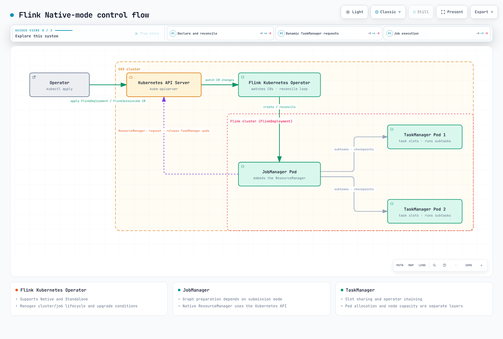

# Análisis profundo de Flink en EKS

Apache Flink es un motor distribuido con estado para flujos acotados y no acotados.
Los JobManagers coordinan la ejecución y la recuperación; los TaskManagers ejecutan
las tareas de los operadores e intercambian datos. La coherencia de los checkpoints
y el comportamiento exactly-once en un sink externo tienen requisitos distintos.
La parte 3 examina conjuntamente las fuentes, el estado y los sinks.

> **Última actualización**: September 12, 2026
> Baseline de integración: **Flink 2.2.1 / Java 17 / Operator 1.15.0**.

El ejemplo de Iceberg de la parte 3 usa por separado **Flink 2.1.3 / Iceberg 1.11.0**
para coincidir con su runtime. Consulte las limitaciones de cada capítulo sobre la
compatibilidad del SDK del plugin de S3 y las diferencias entre servicios administrados.

La versión estable más reciente de Flink es la 2.3.0. Estos ejemplos usan la 2.2.1
como baseline para comprobarla junto con las tablas publicadas de compatibilidad de
Operator y conectores. Que un CRD acepte una cadena de versión en un enum no demuestra
que exista compatibilidad de integración. Elija las versiones de Kubernetes/kubectl
según el soporte actual de EKS y las políticas de desfase de versiones; «Kubernetes
1.21+» no garantiza que esa versión tenga soporte vigente en EKS.

## ¿Quién gestiona qué en Kubernetes?

- **FlinkDeployment** define un clúster Application o Session.
- **FlinkSessionJob** define un trabajo enviado a un clúster Session administrado que ya existe.
- El Operator reconcilia el ciclo de vida del clúster y del trabajo, y admite **los modos Native y Standalone**.
- En el modo Native, el Kubernetes ResourceManager del JobManager solicita y libera
  pods de TaskManager. En el modo Standalone, un administrador externo, como el Operator,
  gestiona los recursos de Kubernetes.
- Un task slot no equivale a un núcleo de CPU ni exactamente a una subtask del operador.
  El encadenamiento y el uso compartido de slots pueden colocar varios operadores en un
  slot; dimensione el estado, la memoria y la CPU por separado.

El siguiente diagrama muestra el **flujo lógico de control en el modo Native**. La
liberación de pods depende de los tiempos de espera por inactividad, las necesidades
de capacidad y la política de limpieza; completar un trabajo no elimina de inmediato
los costos de los nodos.

[Diagrama interactivo](https://www.atomai.click/kubernetes-docs/archmaps/en-data-on-eks-flink-readme-0.html)

## Capítulos

1. [Arquitectura](01-architecture.md): procesos, uso compartido de slots y los ejes Application/Session y Native/Standalone.
2. [Flink Kubernetes Operator](02-flink-kubernetes-operator.md): CRD, instalación, actualizaciones y escalado automático.
3. [Estado, checkpoints y streaming](03-state-checkpointing-streaming.md): backends, recuperación y garantías reales de los conectores.
4. [Operaciones y alta disponibilidad](04-operations-ha.md): métricas, almacenamiento de alta disponibilidad, capacidad de nodos y comparación de servicios administrados.

La gestión declarativa con Operator es el enfoque principal de esta guía; los ejemplos
de CLI explican el runtime subyacente. Ejecutar Flink sin Operator sigue siendo una
opción compatible.

## Referencias

- [Versiones de Flink y compatibilidad de conectores](https://flink.apache.org/downloads/)
- [Arquitectura de Flink 2.2](https://nightlies.apache.org/flink/flink-docs-release-2.2/docs/concepts/flink-architecture/)
- [Modos de implementación de Flink 2.2](https://nightlies.apache.org/flink/flink-docs-release-2.2/docs/deployment/overview/)
- [Implementación en Kubernetes en modo Native](https://nightlies.apache.org/flink/flink-docs-release-2.2/docs/deployment/resource-providers/native_kubernetes/)
- [Compatibilidad de Java](https://nightlies.apache.org/flink/flink-docs-release-2.2/docs/deployment/java_compatibility/)
- [Modos de implementación de Operator 1.15.0](https://github.com/apache/flink-kubernetes-operator/blob/release-1.15.0/docs/content/docs/custom-resource/overview.md)

[Cuestionario](../../quizzes/data-on-eks/flink/01-architecture-quiz.md)
