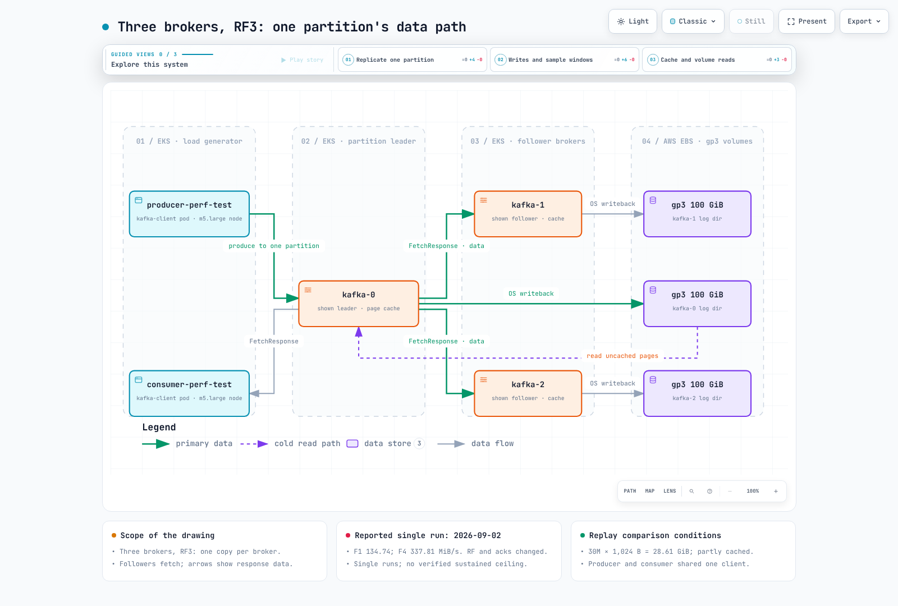

# Parte 9: Benchmark de Kafka en EKS (resultados informados y límites de reproducción)

> **Experimento informado**: 2 de septiembre de 2026, 02:07–02:36 UTC\
> **Revisión actualizada**: 12 de septiembre de 2026\
> **Versiones del experimento**: Kafka 4.3.1, EKS Kubernetes 1.36; tres pods combinados de broker/controller

Esta página conserva las tablas de una única ejecución informadas en PR #166 y revisa sus
unidades, comparaciones y procedimiento de reproducción. La telemetría sin procesar original y el hash
del payload no están incluidos en el informe del repositorio. Esta revisión no volvió a
ejecutar el experimento de AWS ni confirmó de forma independiente sus mediciones históricas.

Los datos sugieren restricciones de almacenamiento, caché y clientes que vale la pena probar. No
**establecen un límite universal de 130–135 MiB/s para RF3 durante varias horas**. En particular,
la comparación de RF también cambia `acks`, y la comparación de lotes cambia linger
y la duración de la ejecución. Los cocientes observados no deben presentarse como efectos causales aislados.



[Diagrama interactivo](https://www.atomai.click/kubernetes-docs/archmaps/en-data-on-eks-kafka-09-kafka-benchmark-0.html)

## Observaciones principales y lo que no demuestran

| Comparación informada | Valores registrados | Límite de interpretación |
| --- | --- | --- |
| F1 RF3 / acks=all | Rendimiento del cliente de 134.74 MiB/s; ventana de muestreo de brokers de unos 75 s | Una tasa de cliente de corta duración, no una tasa sostenida certificada de escritura en disco |
| F4 frente a F1 | 337.81 / 134.74 = 2.507× | Difieren RF, acks/idempotencia implícita, duración de la ejecución y estado de la caché |
| F6 frente a F1 | 148.38 frente a 134.74 MiB/s, +10.12%; menor CPU de broker informada | Cambiaron el lote, linger y el número de registros; no hay estimación de la variación entre ejecuciones repetidas |
| B1 frente a B2 | p50 de 3 ms en ambos; p99 de 126 frente a 17 ms | Un par con tasa limitada, no un «costo solo de la cola» universal |
| E4 frente a E0 | Productor: 57.37 frente a 103.36 MiB/s, −44.49% | La contención de lectura/escritura es plausible; un cliente compartido también introduce contención |

## Entorno informado

| Elemento | Valor |
|---|---|
| Clúster | Amazon EKS, Kubernetes 1.36, ap-northeast-2 (Seúl), nodos gestionados por Karpenter |
| Brokers | 3 × `apache/kafka:4.3.1` (distribución Kafka 4.3.1, OpenJDK 21.0.11 informado), **modo combinado KRaft** (cada pod es broker + controller), StatefulSet, sin operador |
| Nodos de broker | 3 × **m5.xlarge** bajo demanda (4 vCPU, 16 GiB), todos en ap-northeast-2b, un broker por nodo (`podAntiAffinity`), nodos nuevos del NodePool `system` de Karpenter |
| Recursos de los pods de broker | Solicitudes: 3 vCPU / 10 Gi; límites: 4 vCPU / 12 Gi; `KAFKA_HEAP_OPTS=-Xms4G -Xmx4G` (la memoria restante también sirve para asignaciones nativas/fuera del heap y la caché de páginas) |
| Almacenamiento de los brokers | Un PVC **gp3 de 100 GiB** por broker (EBS CSI, StorageClass `gp3`), rendimiento predeterminado de gp3: **3,000 IOPS / 125 MiB/s** (independiente del tamaño) |
| Configuración de los brokers | `num.partitions=6`, `default.replication.factor=3`, `min.insync.replicas=2`, `log.segment.bytes=1 GiB`, `num.network.threads=4`, `num.io.threads=8`, `num.replica.fetchers=2`, `log.retention.hours=2` |
| Kernel | Amazon Linux 2023, 6.18.41-94.142.amzn2023.x86_64; `vm.dirty_ratio=20`, `vm.dirty_background_ratio=10`, `vm.dirty_expire_centisecs=3000` |
| Límites de EC2 m5.xlarge | Línea base de red de 1.25 Gbps (ráfaga de 10 Gbps); línea base de EBS de 1,150 Mbps = 143.75 MB/s (≈ 137 MiB/s), 6,000 IOPS; esta es la línea base, no el máximo de ráfaga |
| Generador de carga | Un pod `kafka-client` (misma imagen) en un nodo **m5.large** (2 vCPU, 8 GiB) de la misma AZ, límite de CPU de cgroup **1.9**, `KAFKA_HEAP_OPTS=-Xms2G -Xmx2G`; línea base de red de m5.large de 0.75 Gbps (ráfaga de 10 Gbps) |
| Herramientas | `kafka-producer-perf-test.sh`, `kafka-consumer-perf-test.sh` incluidas en apache/kafka 4.3.1 |
| Ruta de red | De pod a pod dentro de una AZ, PLAINTEXT (sin TLS ni SASL) |
| Topics | Topic nuevo para cada prueba, 6 particiones; RF3 / `min.insync.replicas=2` salvo indicación contraria (pruebas RF1: RF1 / min.isr=1); `retention.bytes=-1` |
| Configuración del productor de prueba | `linger.ms=5`, `batch.size=65536`, `buffer.memory=67108864` (64 MiB), `compression.type=none` salvo indicación contraria |
| Costo por hora | 3 × m5.xlarge bajo demanda a $0.236/h + 3 × gp3 de 100 GiB a $0.0912/GB-mes (región de Seúl, API de precios, 2026-09) |

El informe describe un reinicio de `kafka-1` a las 02:05:22Z, antes de la primera prueba
medida, y ningún reinicio durante las pruebas. La explicación de «condición de carrera durante el inicio»
no se investigó hasta encontrar la causa raíz. Mantén esa distinción.

Se informó que todos los brokers y el generador de carga estaban en una AZ, usando PLAINTEXT
sin SASL ni Strimzi Operator. Esta no es una comparación de producción en tres AZ.
TLS, el tráfico entre AZ, diferentes límites de nodos/almacenamiento y controllers aislados requieren
sus propias mediciones.

## Semántica del payload y las herramientas

El archivo informado contenía 20,000 líneas JSON sintéticas de **1,008 bytes de payload**
cada una, incluido aproximadamente un 63.2% de relleno `x` fácilmente compresible. Los separadores
de nueva línea no forman parte de cada valor producido. Diez millones de estos valores son **9.388 GiB** de
payload; los 1,018 bytes en disco/registro informados equivaldrían a unos **9.481 GiB** por copia.

La carga de trabajo E2/E3 es de **30,000,000 × 1,024 B = 28.610 GiB** de payload. Las etiquetas anteriores
de «30 GiB» o «29.3 GiB» no eran conversiones exactas a GiB. Tres millones de valores de 1,024 bytes son 2.861 GiB.

En Kafka 4.3.1:

- `--record-size` genera bytes A–Z para cada registro, lo que añade trabajo de CPU en el cliente.
  `--payload-file` selecciona un valor ya cargado. La generación del payload ocurre
  **antes** de que la herramienta inicie el temporizador informado de latencia de envío.
- «MB/sec» en la salida divide los bytes por 1,024², por lo que la unidad es **MiB/s**.
  Con compresión, cuenta los bytes de payload sin comprimir, no los bytes de NIC o volumen.
- La latencia de envío empieza justo antes de `send()` e incluye la espera síncrona de envío/búfer
  hasta el callback. Excluye la generación previa del payload y no mide el procesamiento posterior.
  Con `acks=0`, la finalización del callback no es una confirmación de durabilidad del broker.
- Las ejecuciones largas usan muestras periódicas de latencias en milisegundos enteros. Un p50 informado
  de 3 ms en ambos casos no demuestra que la latencia subyacente sea idéntica.
- Los callbacks fallidos se imprimen, pero no se cuentan como registros enviados correctamente.
  Comprueba el recuento final de éxitos y stderr, no solo el estado de salida del proceso.
- El tiempo total del consumidor, el tiempo de fetch (sin incluir la incorporación al grupo) y las
  tasas seleccionadas por intervalo tienen denominadores distintos. Un lote del sondeo final puede superar
  el número de registros solicitado.

Las opciones antiguas `--producer-props` y `--messages` del consumidor todavía funcionan en esta
versión, pero están obsoletas. Los ejemplos revisados usan `--command-property` y
`--num-records`.

## 1. RF, confirmaciones y ventanas de muestreo

Modo de archivo de payload, sin compresión; las siguientes son las celdas originales informadas.

| Prueba | acks | RF | productores | registros | rec/s | MiB/s | prom. ms | p50 | p95 | p99 | p99.9 | máx. |
|---|---|---|---|---|---|---|---|---|---|---|---|---|
| F1 | all | 3 | 1 | 10 M | 140,164 | **134.74** | 443.89 | 321 | 1,276 | 2,689 | 4,026 | 4,038 |
| F2 | 1 | 3 | 1 | 6 M | 248,221 | 238.62 | 222.66 | 230 | 321 | 398 | 426 | 650 |
| F3 | 0 | 3 | 1 | 6 M | 241,138 | 231.81 | 235.02 | 191 | 333 | 1,977 | 4,327 | 4,340 |
| F4 | 1 | 1 | 1 | 10 M | 351,407 | **337.81** | 159.51 | 138 | 290 | 358 | 515 | 642 |
| F5 | all | 3 | 2 | 2 × 5 M | 67,694 + 67,360 = 135,054 | 65.07 + 64.75 = **129.82** | 893.88 / 889.22 | 639 / 630 | 2,536 / 2,493 | 3,270 / 3,301 | 4,284 / 4,228 | 4,662 / 4,660 |
| F6 | all | 3 | 1 | 6 M | 154,349 | 148.38 | 395.82 | 238 | 1,142 | 2,094 | 2,594 | 2,621 |

El cociente aritmético F4/F1 es 2.507, pero F4 usa RF1/acks=1 y F1 RF3/acks=all.
Con el ajuste de idempotencia omitido, los valores predeterminados de Kafka 4.3.1 también difieren entre
estas opciones de confirmación. Esta no es una medición controlada solo de la replicación. La ejecución
de F4, de unos 32 segundos, distribuye solo aproximadamente un tercio de sus datos en cada broker y
puede verse muy afectada por los límites de caché y del cliente.

Para F5, 129.82 es la suma de dos tasas informadas individualmente. Una tasa combinada rigurosa
usa los bytes totales correctos divididos por un intervalo común de inicio/finalización; sumar tasas
con ventanas de tiempo diferentes puede no dar ese resultado.

### Contadores de broker informados

| Ventana | escritura MiB/s prom. (pico de 10 s) | wIOPS | lectura MiB/s (rIOPS) | núcleos de CPU del broker | NIC tx / rx MiB/s |
|---|---|---|---|---|---|
| F1 RF3 acks=all 10 M (75 s) | 115.2–117.5 (134.9–135.1) | 495–505 | 0 | 0.64–0.84 | 80.2–108.1 / 134.2–135.8 |
| F2 RF3 acks=1 6 M (28 s) | 92.8–100.4 (124.1–127.6) | 397–427 | 0 | 0.53–0.62 | 64.4–80.4 / 123.7–125.0 |
| F3 RF3 acks=0 6 M (28 s) | 97.2–120.5 (123.5–124.1) | 414–514 | 0 | 0.80–0.81 | 87.3–94.4 / 163.5–170.6 |
| F4 RF1 acks=1 10 M (32 s) | 72.5–80.4 (117.6–129.1) | 312–346 | 0 | 0.30–0.31 | 0.3 / 119.9–125.4 |
| F5 2 productores RF3 acks=all (81 s) | 99.9–102.2 (134.8–135.5) | 431–439 | 0 | 0.59–0.81 | 66.5–89.7 / 113.8–115.6 |
| F6 RF3 acks=all lote de 256 KiB (43 s) | 102.3–107.7 (134.8–135.4) | 426–445 | 0 | **0.40–0.50** | 68.7–110.4 / 124.2–124.5 |
| E2 carga 30M × 1,024 B, modo aleatorio (262 s) | 110.0–111.5 (134.5–135.0) | 468–473 | 0 | 0.72–0.80 | 74.9–77.5 / 114.3 |

El muestreador original esperaba diez segundos entre llamadas secuenciales a kubectl,
por lo que los intervalos reales fueron de unos doce segundos. Marcaba la ronda una sola vez,
antes de muestrear los tres brokers. Por tanto, importan el retraso de ejecución, la resolución de las marcas
de tiempo y los límites de las ventanas. La muestra más alta no estima el estado estable, y los valores
cercanos a 135 MiB/s no demuestran que el rendimiento aprovisionado de gp3, de 125 MiB/s, deba modelarse como 135.

Las ventanas de CloudWatch de E2 del informe contienen entre 7,008 y 7,257 MiB/minuto, o
116.8–121.0 MiB/s, y entre 29,637 y 30,730 escrituras/minuto, o unos 494–512 IOPS.
Estos agregados son compatibles con una E/S secuencial considerable. Por sí solos no
distinguen un límite del volumen, un límite EBS de la instancia, los búferes o artefactos de
muestreo de corta duración. Una CPU de broker baja no descarta un cuello de botella en el cliente.

### Modelo de equilibrio de almacenamiento, no un límite universal medido

Sea `Xlog` la tasa de bytes de log codificados de una copia, `R` el factor de replicación,
`B` el número de brokers y `D` el presupuesto de almacenamiento sostenido por broker. Con una colocación
equilibrada, las escrituras medias por broker son aproximadamente `R × Xlog / B`, más otras E/S.
Con exactamente tres brokers y RF3, cada broker tiene una copia de cada partición.
El tráfico equilibrado de líderes también da aproximadamente `2 × Xlog / 3` de tráfico de transmisión
de réplicas por broker; en todo el clúster, el tráfico de réplicas es aproximadamente `2 × Xlog`.

Este cálculo ayuda a plantear una hipótesis. No equivale a un benchmark de tasa de payload:
la codificación, compresión, caché/escritura diferida, lecturas y metadatos consumen presupuestos distintos.
El aumento del rendimiento del broker/volumen debe probarse como un cambio controlado antes
de identificar un único cuello de botella.

## 2. Latencia de confirmación


[Diagrama interactivo](https://www.atomai.click/kubernetes-docs/archmaps/en-data-on-eks-kafka-09-kafka-benchmark-1.html)

Las pruebas B con tasa limitada usaron 20,000 registros/s, RF3 y valores aleatorios de 1,024 bytes:

| Prueba | acks | linger.ms | prom. ms | p50 | p95 | p99 | p99.9 | máx. |
|---|---|---|---|---|---|---|---|---|
| B1 | all | 5 | 5.27 | 3 | 6 | **126** | 173 | 771 |
| B2 | 1 | 5 | 2.58 | 3 | 5 | **17** | 40 | 642 |
| B3 | all | 0 | 3.23 | 3 | 5 | 25 | 59 | 752 |

El cociente de p99 informado de B1/B2 es 7.412; la latencia media también difiere
(5.27 frente a 2.58 ms), por lo que decir que «solo difiere la cola» exagera el resultado.
B3 cambia linger, pero la explicación causal basada en lotes más pequeños necesita evidencia sobre
el tamaño de las solicitudes, la cantidad de solicitudes y ejecuciones repetidas. No se informó
ningún resultado de acks=0 con tasa limitada.

Las ejecuciones A siguientes también incluyen la sobrecarga de generar payloads aleatorios:

| Prueba | acks | RF | rec/s | MiB/s | prom. ms | p50 | p95 | p99 | p99.9 | máx. |
|---|---|---|---|---|---|---|---|---|---|---|
| A1 | all | 3 | 107,150 | 104.64 | 11.38 | 3 | 50 | 164 | 263 | 871 |
| A2 | 1 | 3 | 105,955 | 103.47 | 3.00 | 1 | 11 | 38 | 79 | 812 |
| A3 | 0 | 3 | 112,461 | 109.82 | 1.48 | 0 | 6 | 26 | 52 | 636 |
| A4 | 1 | 1 | 109,926 | 107.35 | 1.57 | 1 | 6 | 11 | 36 | 662 |

Un rendimiento similar entre las configuraciones A sugiere una restricción compartida, pero
no constituye por sí solo un perfil de CPU. Con acks=0 sigue habiendo contrapresión del cliente/búfer/socket;
la ausencia de confirmación del broker no elimina todas las formas de contrapresión. Tampoco demuestra
un callback exitoso que una réplica contenga el registro.

En el diagrama de secuencia, el high watermark es un **siguiente offset**. Para un lote cuyo
último registro está en `r`, el offset requerido es `r+1`; la confirmación requiere la comprobación
adecuada de HW y la condición del ISR. El recorrido muestra las tres réplicas en un ISR estable,
no un requisito de que siempre permanezcan dos followers en el ISR cuando minISR=2.

## 3. Tamaño de lote y número de productores

| Prueba | Cambio frente a F1 | MiB/s | prom. ms | p99 ms | núcleos de CPU del broker |
|---|---|---|---|---|---|
| F1 | línea base: 1 productor, `batch.size=65536`, `linger.ms=5`, 10 M registros | 134.74 | 443.89 | 2,689 | 0.64–0.84 |
| F5 | 2 productores (5 M registros cada uno), mismas props | 65.07 + 64.75 = 129.82 | 893.88 / 889.22 | 3,270 / 3,301 | 0.59–0.81 |
| F6 | `batch.size=262144`, `linger.ms=10`, 6 M registros | 148.38 | 395.82 | 2,094 | **0.40–0.50** |

F6 cambia el tamaño del lote, linger y el número de registros. Su rendimiento informado es
un 10.12% mayor, y su rango de CPU del broker es menor. El cálculo del punto medio
`1 − 0.45/0.74 = 39.19%` describe esos rangos informados; no es un ahorro de CPU aislado
del 40% causado por el tamaño del lote. Sin repeticiones, la diferencia de rendimiento
no puede clasificarse como «dentro del ruido».

F5 no mejoró la tasa registrada en esta configuración. También ejecutó dos productores en
el mismo pod de cliente limitado. Repite con clientes aprovisionados de forma independiente y
un intervalo de tiempo común antes de concluir que los productores adicionales nunca ayudan.

## 4. Compresión en el corpus con relleno

| códec | rec/s | MiB/s (sin comprimir, según lo informado) | prom. ms | p50 | p95 | p99 | p99.9 | B en disco/registro (por réplica) | proporción frente a ninguno |
|---|---|---|---|---|---|---|---|---|---|
| ninguno | 203,887 | 196.00 | 259.59 | 266 | 370 | 425 | 458 | 1,018 | 1.00× |
| lz4 | 275,356 | 264.70 | 4.38 | 3 | 11 | 24 | 60 | 113.1 | **9.0×** más pequeño |
| snappy | 198,557 | 190.87 | 5.07 | 3 | 10 | 35 | 205 | 141.7 | 7.2× |
| zstd | 160,274 | 154.07 | 5.39 | 5 | 10 | 18 | 47 | 61.3 | **16.6×** |
| gzip | 53,418 | 51.35 | 6.01 | 6 | 10 | 17 | 45 | 60.7 | 16.8× |

Los tamaños originales del log por copia fueron 2,912.4 / 323.5 / 405.3 / 175.3 / 173.8 MiB
para none/lz4/snappy/zstd/gzip. Dividirlos entre tres millones de registros reproduce las
celdas redondeadas de bytes/registro. Este es el tamaño informado del log de Kafka, no el de todos
los índices, el sistema de archivos ni los bytes aprovisionados del volumen.

El relleno hace que estos resultados no representen muchos conjuntos de datos reales.
**Ni las proporciones ni el orden de los códecs son universales ni constituyen límites
matemáticos superiores.** Las cifras zlib-6 del corpus completo del informe original fueron 18.5× con relleno
y 7.8× sin él. Al regenerar el AWK publicado con GNU Awk 5.1.0 durante esta revisión
se obtuvieron 20,000 líneas válidas de 1,008 bytes con un 63.17% de relleno, pero proporciones
de 15.92× y 6.53×. Ese es un corpus nuevo, no un reemplazo de la medición histórica;
fija la imagen/la implementación de AWK y conserva el hash del payload.

Con la compresión del topic configurada como `producer`, se conserva la elección del códec en lugar
de recomprimir intencionalmente a otro códec configurado. La validación del broker y otros procesamientos
siguen consumiendo CPU. La menor latencia informada con compresión es compatible con menos bytes almacenados/
transferidos, pero se necesitan datos sobre la CPU del cliente y las E/S específicas de cada fase
para afirmar que el cuello de botella cambió exclusivamente.

## 5. Tamaño del registro

| Prueba | tamaño del registro | registros | rec/s | MiB/s | prom. ms | p50 | p95 | p99 | p99.9 |
|---|---|---|---|---|---|---|---|---|---|
| D1 | 100 B | 10,000,000 | 506,380 | 48.29 | 3.18 | 2 | 9 | 15 | 33 |
| A1 | 1,024 B | 3,000,000 | 107,150 | 104.64 | 11.38 | 3 | 50 | 164 | 263 |
| D2 | 10,240 B | 300,000 | 12,326 | 120.37 | 17.40 | 5 | 84 | 157 | 223 |

Se trata de cargas de trabajo distintas de generación de registros y cantidades de registros diferentes.
El caso de 100 bytes tiene aproximadamente 4.73× los registros/s, pero un 46.15% de la tasa de payload
del caso de 1,024 bytes. Esto ilustra por qué importan tanto los registros/s como los bytes/s; no
aísla el costo por registro del broker de la generación en el cliente, el batching o los efectos de caché.
Evalúa la agregación solo si su latencia, claves y semántica de fallos son adecuadas para la aplicación.

## 6. Reproducción simultánea con producción

La tasa del productor E0 informada fue de 103.36 MiB/s con p99 de 82 ms. El intervalo caliente
seleccionado de E1 fue de 434.11 MiB/s. E2 produjo treinta millones de valores de 1,024 bytes
(28.610 GiB), con 112.84 MiB/s y p99 de 1,531 ms según el informe. Se observaron sus
intervalos lentos recurrentes, pero la escritura diferida de páginas sucias era solo una hipótesis.

Otros valores de latencia registrados para E2 fueron: promedio 60.17 ms, p50 2, p95 125,
p99.9 5,034 y máx. 5,258 ms. De los 51 intervalos informados, cinco tasas estuvieron por debajo de
60 MiB/s: 56.8, 36.3, 45.3, 40.8 y 45.8. Estas observaciones no identifican la causa de
las pausas.

La media aritmética de las 13 tasas de intervalos completos de E3 es **438.615 MiB/s**:
337.6, 431.3, 414.2, 495.7, 454.9, 452.1, 387.9, 458.7, 439.9, 452.4,
447.7, 491.0 y 438.6. La reproducción solo estaba parcialmente fría; no se estableció un estado
de caché completamente frío. No derives una tasa exacta de bytes de caché de páginas simplemente
restando promedios de disco a promedios de NIC con ventanas diferentes.

| | Por separado | Durante la reproducción | Prueba |
|---|---|---|---|
| Rendimiento del productor | 103.36 MiB/s (105,843 rec/s) | **57.37 MiB/s** (58,746 rec/s) | E0 → E4 |
| Prom. / p50 del productor | - / - | 294.06 ms / 18 ms | E4 |
| p95 / p99 / p99.9 / máx. del productor | p99 82 ms | **1,587 / 2,147 / 2,425 / 2,569 ms** | E0 → E4 |
| Rendimiento del consumidor (media de intervalos completos de 5 s frente a tasa de tiempo de fetch) | 438.6 MiB/s | **299.62 MiB/s** de tiempo de fetch, 295,726 msg/s (288.79 MiB/s en total, incluido el rebalanceo de 3,666 ms; 29,297.33 MiB / 30,000,466 msgs en 101.4 s de tiempo real) | E3 → E4 |
| Por broker (ventana de producción) | escritura de 60.4–67.4 MiB/s (la caché de páginas absorbe el resto), lectura 0 | escritura de 39.4–47.2 + lectura de 28.6–37.7 MiB/s, tx de 92.6–106.0 MiB/s, CPU de 0.36–0.42 núcleos | E0 → E4 |

La disminución del productor en E4 es del **44.49%**. La contención de almacenamiento es plausible porque
las lecturas y escrituras comparten cada volumen, pero el productor y el consumidor también compartieron
un pod de cliente de 1.9 CPU y su NIC. Los totales de limitación de toda la sesión y una CPU **del broker**
baja no descartan la contención **del cliente** específica de cada fase.

El informe registra para el consumo de E4 29,297.33 MiB y 30,000,466 registros, con
288.79 MiB/s en total y 299.62 MiB/s sin contar el tiempo de incorporación al grupo. Es posible
superar la cantidad solicitada con un lote del sondeo final; el recuento adicional por sí solo no demuestra duplicados.

El intervalo seleccionado de E1, la media no ponderada de intervalos de E3 y las tasas de fetch/total de E4
no son intercambiables. En particular, «438.6 → 299.62» no es una reducción de rendimiento controlada
con el mismo denominador. Conserva las marcas de tiempo sin procesar, los bytes totales y los contadores
de recursos específicos de cada fase para comparar un intervalo común.

## 7. ¿Cuánto tiempo es suficiente?

Las confirmaciones de Kafka no implican un fsync por registro en cada réplica. Las adiciones pueden
acumularse en la caché de páginas mientras la escritura diferida se ejecuta de forma asíncrona; esto no
convierte la replicación en una garantía frente a todos los fallos correlacionados.

El informe incluye intervalos de F4 por encima del presupuesto idealizado de volumen de
`3 × 125 = 375 MiB/s` y escritura diferida tras finalizar E0. Esas son razones para conciliar búferes y
ventanas de medición. **No existe un umbral universal de diez GiB o un minuto que
demuestre un estado estable del disco.** La ejecución F1, con unos 9.5 GiB de datos codificados, tampoco
lo demuestra.

Usa períodos fijos de calentamiento y períodos de medición estables y prolongados, captura el vaciado
posterior a la ejecución, supervisa la memoria sucia y el comportamiento de los créditos de EBS/red,
y repite los órdenes de prueba aleatorizados. Cambia un factor a la vez para las comparaciones causales.
Un aumento del rendimiento de almacenamiento con los demás factores estables es un experimento de seguimiento útil.

### Comparaciones correctas de red y EBS

EC2 usa **depósitos de créditos de red separados para entrada y salida**. No sumes rx
y tx para comparar la suma con una línea base direccional. El rx máximo informado de F1, de 136 MiB/s,
es aproximadamente **1.141 Gbps**, y los 108 MiB/s de tx son aproximadamente **0.906 Gbps**;
cada uno está por debajo de la línea base de 1.25 Gbps de m5.xlarge. Estas cifras de F1 no demuestran
que la red del broker esté usando ráfagas.

La tasa de payload de cliente de F4, de 337.81 MiB/s, equivale aproximadamente a 2.834 Gbps,
por encima de la línea base de 0.75 Gbps de m5.large. El rendimiento del cliente dependiente de créditos
sigue siendo una limitación importante. También hay que observar la tasa de paquetes, los límites de flujo
y el resto del tráfico del nodo.

El ancho de banda EBS de m5.xlarge figura como línea base de 1,150 Mbps y máximo de 4,750 Mbps:
aproximadamente **137.09 / 566.24 MiB/s**, respectivamente. La línea base no es un límite absoluto
instantáneo. El máximo actual de gp3 es de **2,000 MiB/s**, sujeto a sus condiciones de IOPS/volumen y al
límite de la instancia; la afirmación anterior de 1,000 MiB/s está desactualizada. Ni un volumen mayor ni
un broker más potente demuestran automáticamente qué recurso limitó la ejecución informada.

## Cálculo de costos, no una factura ni un precio actual

Usando las tarifas históricas del informe, `$0.236/broker-hour` y
`$0.0912/GB-month`, y sus supuestos de atribución:

| Cálculo | Resultado |
| --- | --- |
| Tres brokers × 50 minutos | $0.590 |
| Tres volúmenes de 100 GiB × 39 minutos, usando un divisor de 730 horas | $0.02436 |
| Esos elementos atribuidos para una ejecución | Unos $0.614 |
| Tres brokers × 730 horas más almacenamiento de 300 GiB-mes | $544.20 |

La fila de 730 horas es una convención de planificación, no una factura de septiembre. Se excluyen
el nodo del cliente original, los cargos de EKS/control plane, la red y otra infraestructura compartida.
Si un nodo se conserva para otras cargas de trabajo, la atribución del tiempo de ejecución también es una
estimación. Comprueba los precios regionales actuales antes de aprovisionar; esta revisión no consultó
una factura ni estableció un nuevo comprobante de precios.

Una CPU de broker baja por sí sola no significa que el gasto en cómputo sea un desperdicio: la memoria,
la red, el ancho de banda de EBS, el margen para fallos y la colocación pueden requerir ese tamaño de instancia.

## Ejemplos de reproducción revisados

Usa un **entorno/namespace de prueba dedicado nuevo**, compatibilidad estándar con EBS CSI y
capacidad para los tipos de instancia/AZ indicados. No lo apliques sobre datos de Kafka/PVC existentes.
Sustituye el ID de clúster de ejemplo por un valor nuevo de `kafka-storage.sh random-uuid`
para una nueva ejecución y registra el digest real de la imagen y las versiones del entorno de ejecución.

El manifiesto siguiente es una **plantilla de reproducción corregida**, no el manifiesto histórico sin cambios.
Fija la AZ indicada, define IOPS/rendimiento/cifrado explícitos para gp3, publica el DNS headless antes
de que los pods estén listos, añade comprobaciones TCP de inicio/disponibilidad y limita el ingreso a los brokers
a los pods de benchmark. Se desactiva el montaje automático del token de API.
NetworkPolicy requiere la aplicación de políticas por parte del CNI. Se conservan PLAINTEXT y los roles combinados
para esta prueba aislada; no se proponen como diseño de producción.

```yaml
apiVersion: v1
kind: Namespace
metadata:
  name: bench-kafka
---
apiVersion: storage.k8s.io/v1
kind: StorageClass
metadata:
  name: bench-kafka-gp3
provisioner: ebs.csi.aws.com
volumeBindingMode: WaitForFirstConsumer
reclaimPolicy: Delete
parameters:
  type: gp3
  iops: '3000'
  throughput: '125'
  encrypted: 'true'
---
apiVersion: v1
kind: Service
metadata:
  name: kafka-hs
  namespace: bench-kafka
spec:
  clusterIP: None
  selector:
    app: kafka
  ports:
  - name: broker
    port: 9092
  - name: controller
    port: 9093
  publishNotReadyAddresses: true
---
apiVersion: apps/v1
kind: StatefulSet
metadata:
  name: kafka
  namespace: bench-kafka
spec:
  serviceName: kafka-hs
  replicas: 3
  podManagementPolicy: Parallel
  selector:
    matchLabels:
      app: kafka
  template:
    metadata:
      labels:
        app: kafka
      annotations:
        karpenter.sh/do-not-disrupt: 'true'
    spec:
      terminationGracePeriodSeconds: 60
      nodeSelector:
        node.kubernetes.io/instance-type: m5.xlarge
        karpenter.sh/capacity-type: on-demand
        topology.kubernetes.io/zone: ap-northeast-2b
      affinity:
        podAntiAffinity:
          requiredDuringSchedulingIgnoredDuringExecution:
          - labelSelector:
              matchLabels:
                app: kafka
            topologyKey: kubernetes.io/hostname
      securityContext:
        fsGroup: 1000
      containers:
      - name: kafka
        image: apache/kafka:4.3.1
        command:
        - /bin/bash
        - -c
        - |
          set -e
          ORD=${HOSTNAME##*-}
          export KAFKA_NODE_ID=$ORD
          export KAFKA_ADVERTISED_LISTENERS="PLAINTEXT://${HOSTNAME}.kafka-hs.bench-kafka.svc.cluster.local:9092"
          exec /etc/kafka/docker/run
        env:
        - name: CLUSTER_ID
          value: UdHYY7YQRrunSRromZFozw
        - name: KAFKA_PROCESS_ROLES
          value: broker,controller
        - name: KAFKA_CONTROLLER_QUORUM_VOTERS
          value: 0@kafka-0.kafka-hs.bench-kafka.svc.cluster.local:9093,1@kafka-1.kafka-hs.bench-kafka.svc.cluster.local:9093,2@kafka-2.kafka-hs.bench-kafka.svc.cluster.local:9093
        - name: KAFKA_LISTENERS
          value: PLAINTEXT://0.0.0.0:9092,CONTROLLER://0.0.0.0:9093
        - name: KAFKA_LISTENER_SECURITY_PROTOCOL_MAP
          value: PLAINTEXT:PLAINTEXT,CONTROLLER:PLAINTEXT
        - name: KAFKA_INTER_BROKER_LISTENER_NAME
          value: PLAINTEXT
        - name: KAFKA_CONTROLLER_LISTENER_NAMES
          value: CONTROLLER
        - name: KAFKA_LOG_DIRS
          value: /var/lib/kafka/data/kafka
        - name: KAFKA_NUM_PARTITIONS
          value: '6'
        - name: KAFKA_DEFAULT_REPLICATION_FACTOR
          value: '3'
        - name: KAFKA_OFFSETS_TOPIC_REPLICATION_FACTOR
          value: '3'
        - name: KAFKA_TRANSACTION_STATE_LOG_REPLICATION_FACTOR
          value: '3'
        - name: KAFKA_TRANSACTION_STATE_LOG_MIN_ISR
          value: '2'
        - name: KAFKA_MIN_INSYNC_REPLICAS
          value: '2'
        - name: KAFKA_LOG_RETENTION_HOURS
          value: '2'
        - name: KAFKA_LOG_SEGMENT_BYTES
          value: '1073741824'
        - name: KAFKA_NUM_NETWORK_THREADS
          value: '4'
        - name: KAFKA_NUM_IO_THREADS
          value: '8'
        - name: KAFKA_NUM_REPLICA_FETCHERS
          value: '2'
        - name: KAFKA_HEAP_OPTS
          value: -Xms4G -Xmx4G
        ports:
        - containerPort: 9092
        - containerPort: 9093
        resources:
          requests:
            cpu: '3'
            memory: 10Gi
          limits:
            cpu: '4'
            memory: 12Gi
        volumeMounts:
        - name: data
          mountPath: /var/lib/kafka/data
        startupProbe:
          tcpSocket:
            port: 9092
          periodSeconds: 5
          failureThreshold: 60
        readinessProbe:
          tcpSocket:
            port: 9092
          periodSeconds: 5
      automountServiceAccountToken: false
  volumeClaimTemplates:
  - metadata:
      name: data
    spec:
      accessModes:
      - ReadWriteOnce
      storageClassName: bench-kafka-gp3
      resources:
        requests:
          storage: 100Gi
---
apiVersion: v1
kind: Pod
metadata:
  name: kafka-client
  namespace: bench-kafka
  labels:
    app: kafka-client
spec:
  restartPolicy: Never
  nodeSelector:
    node.kubernetes.io/instance-type: m5.large
    topology.kubernetes.io/zone: ap-northeast-2b
    karpenter.sh/capacity-type: on-demand
  containers:
  - name: client
    image: apache/kafka:4.3.1
    command:
    - sleep
    - infinity
    env:
    - name: KAFKA_HEAP_OPTS
      value: -Xms2G -Xmx2G
    resources:
      requests:
        cpu: 500m
        memory: 2500Mi
      limits:
        cpu: 1900m
        memory: 4Gi
  automountServiceAccountToken: false
---
apiVersion: networking.k8s.io/v1
kind: NetworkPolicy
metadata:
  name: benchmark-brokers
  namespace: bench-kafka
spec:
  podSelector:
    matchLabels:
      app: kafka
  policyTypes:
  - Ingress
  ingress:
  - from:
    - podSelector:
        matchExpressions:
        - key: app
          operator: In
          values:
          - kafka
          - kafka-client
    ports:
    - protocol: TCP
      port: 9092
    - protocol: TCP
      port: 9093
```

Guárdalo como `bench-kafka.yaml`, revisa los recursos y la capacidad disponible, y luego ejecuta:

```bash
kubectl apply -f bench-kafka.yaml
kubectl -n bench-kafka rollout status statefulset/kafka --timeout=600s
kubectl -n bench-kafka wait --for=condition=Ready pod/kafka-client --timeout=600s
kubectl -n bench-kafka get pods -o wide
kubectl -n bench-kafka get pods -o jsonpath='{range .items[*]}{.metadata.name}{"\t"}{.status.containerStatuses[*].imageID}{"\n"}{end}'
```

Guarda el generador publicado como `payload.awk` y ejecútalo **dentro del pod del cliente**.
Se conserva el generador para compararlo; su relleno compresible es intencional.

```awk
BEGIN{srand(42); split("payments orders inventory auth search checkout shipping catalog notify gateway",ns," ");
     split("INFO INFO INFO INFO WARN ERROR DEBUG",lv," ");
     for(i=0;i<20000;i++){
       n=ns[int(rand()*10)+1]; l=lv[int(rand()*7)+1]; d=int(rand()*900)+5; u=int(rand()*100000);
       msg=sprintf("{\"ts\":\"2026-09-02T02:%02d:%02d.%03dZ\",\"level\":\"%s\",\"namespace\":\"%s\",\"pod\":\"%s-7d9f8b6c4-%05x\",\"trace_id\":\"%08x%08x%08x%08x\",\"http\":{\"method\":\"POST\",\"path\":\"/api/v1/%s/%d\",\"status\":%d,\"duration_ms\":%d,\"bytes\":%d},\"user_id\":%d,\"region\":\"ap-northeast-2\",\"msg\":\"request completed upstream=%s-svc:8080 retries=%d cache=%s\"",
         int(rand()*60),int(rand()*60),int(rand()*1000),l,n,n,int(rand()*1048576),int(rand()*4294967296),int(rand()*4294967296),int(rand()*4294967296),int(rand()*4294967296),n,u,(l=="ERROR"?500:200),d,int(rand()*20000),u,n,int(rand()*3),(rand()<0.7?"hit":"miss"));
       pad=1000-length(msg)-2; if(pad<0)pad=0; p=""; for(k=0;k<pad;k++)p=p "x";
       printf "%s,\"pad\":\"%s\"}\n", msg, p }}
```

```bash
mkdir -p /tmp/results
LC_ALL=C awk -f payload.awk > /tmp/results/payload-1k.txt
sha256sum /tmp/results/payload-1k.txt
wc -l -c /tmp/results/payload-1k.txt
```

El siguiente `runs.sh` también se ejecuta dentro del pod del cliente. Crea y carga previamente los topics,
escribe logs separados, comprueba el recuento final de éxitos del productor y usa un tiempo límite
de pared de 20 minutos, con 30 segundos de gracia antes de terminar. `--timeout` del consumidor
es un límite de inactividad, no un límite de tiempo de pared.

```bash
#!/bin/bash
set -euo pipefail
BIN=/opt/kafka/bin
BS="kafka-0.kafka-hs.bench-kafka.svc.cluster.local:9092,kafka-1.kafka-hs.bench-kafka.svc.cluster.local:9092,kafka-2.kafka-hs.bench-kafka.svc.cluster.local:9092"
BENCH_RESULTS=/tmp/results
mkdir -p "$BENCH_RESULTS"
RUN_ID="$(date -u +%Y%m%dT%H%M%SZ)-$$"

new_topic() {
  "$BIN/kafka-topics.sh" --bootstrap-server "$BS" --create --topic "$1" \
    --partitions 6 --replication-factor "$2" \
    --config "min.insync.replicas=$3" --config retention.bytes=-1
}
produce() {
  local topic="$1" count="$2" mode="$3" value="$4" rate="$5" acks="$6" codec="$7"
  shift 7
  local result="$BENCH_RESULTS/$topic-$BASHPID.log"
  date -u +%Y-%m-%dT%H:%M:%SZ > "$result.start"
  timeout -k 30 1200 "$BIN/kafka-producer-perf-test.sh" \
    --bootstrap-server "$BS" --topic "$topic" --num-records "$count" \
    --throughput "$rate" "$mode" "$value" --print-metrics \
    --command-property "acks=$acks" "compression.type=$codec" \
      linger.ms=5 batch.size=65536 buffer.memory=67108864 "$@" 2>&1 | tee "$result"
  date -u +%Y-%m-%dT%H:%M:%SZ > "$result.end"
  # The tool can print callback errors without making every failure a nonzero exit.
  # This check is for warmup-records=0 and the final, non-window summary.
  awk -v expected="$count" '/ms 99[.]9th[.]/ {seen=1; actual=$1}
    END {if (!seen || actual != expected) exit 1}' "$result"
}

# Historical F1-shaped workload: a new topic and the published padded payload.
F_TOPIC="bench-f1-$RUN_ID"
new_topic "$F_TOPIC" 3 2
produce "$F_TOPIC" 10000000 --payload-file "$BENCH_RESULTS/payload-1k.txt" -1 all none

# Historical B1-shaped workload: pre-create the latency topic.
B_TOPIC="bench-b1-$RUN_ID"
new_topic "$B_TOPIC" 3 2
produce "$B_TOPIC" 1200000 --record-size 1024 20000 all none

# E2/E3-shaped replay: populate before consuming; 30M*1024 B = 28.61 GiB.
E_TOPIC="bench-e2-$RUN_ID"
new_topic "$E_TOPIC" 3 2
produce "$E_TOPIC" 30000000 --record-size 1024 -1 all none
timeout -k 30 1200 "$BIN/kafka-consumer-perf-test.sh" --bootstrap-server "$BS" \
  --topic "$E_TOPIC" --num-records 30000000 --group "bench-e3-$RUN_ID" \
  --timeout 600000 --show-detailed-stats --reporting-interval 5000 --print-metrics \
  2>&1 | tee "$BENCH_RESULTS/$E_TOPIC-consumer.log"

printf '%s\n' "$F_TOPIC" "$B_TOPIC" "$E_TOPIC" > "$BENCH_RESULTS/topics-$RUN_ID.txt"
# Preserve logs and validate success/readback before deleting this run's topics.
```

La plantilla muestra cargas de trabajo similares a F1, B1 y E2/E3. Para las demás filas,
usa topics nuevos, el RF/minISR, el recuento, acks, el códec y los ajustes de batch/linger de la tabla;
la función `produce` acepta propiedades Kafka adicionales después de sus siete
argumentos obligatorios. Para F6, son `batch.size=262144 linger.ms=10`. Para F5, ejecuta dos
productores de cinco millones de registros con logs separados y captura un intervalo de tiempo común.
Para E4, registra tanto la reproducción con cliente compartido como una variante controlada que use
capacidad de generador de carga separada. Deja que se produzca la escritura diferida/vaciado entre ejecuciones
y verifica el contenido de los topics y los errores, especialmente para acks=0. Nunca vuelvas a etiquetar
una ejecución finita completada como estado estable solo porque alcanzó la cantidad solicitada.

### Muestrea el dispositivo de bloques correcto y el intervalo real

Asocia cada PVC de benchmark con su PV/volumen EBS y verifica el dispositivo de bloques correspondiente
antes de escribir `devices.txt`. `nvme1n1` no es un nombre universal para los dispositivos de datos EBS.
Los scripts presuponen los contadores de CPU documentados de cgroup v2, visibilidad de sysfs
y `eth0`; adáptalos solo después de comprobar el entorno real.

Guárdalo como `sample-broker.sh` en la máquina que ejecuta kubectl:

```sh
#!/bin/sh
set -eu
device="${1:?Pass the verified data-volume block-device name}"
interface="${2:-eth0}"
case "$device" in *[!a-zA-Z0-9_-]*|'') echo "Invalid block-device name" >&2; exit 2;; esac
case "$interface" in *[!a-zA-Z0-9_.-]*|'') echo "Invalid network interface" >&2; exit 2;; esac
read -r start_uptime ignored < /proc/uptime
read -r read_ios read_merges read_sectors read_ms write_ios write_merges write_sectors write_ms rest \
  < "/sys/class/block/$device/stat"
cpu_usage="$(awk '$1=="usage_usec" {print $2}' /sys/fs/cgroup/cpu.stat)"
cpu_throttled="$(awk '$1=="throttled_usec" {print $2}' /sys/fs/cgroup/cpu.stat)"
: "${cpu_usage:?Missing cgroup v2 CPU usage counter}"
: "${cpu_throttled:?Missing cgroup v2 CPU throttling counter}"
net_tx="$(cat "/sys/class/net/$interface/statistics/tx_bytes")"
net_rx="$(cat "/sys/class/net/$interface/statistics/rx_bytes")"
read -r end_uptime ignored < /proc/uptime
printf '{"device":"%s","interface":"%s","start_uptime_s":%s,"end_uptime_s":%s,"read_ios":%s,"read_sectors":%s,"write_ios":%s,"write_sectors":%s,"cpu_usage_usec":%s,"cpu_throttled_usec":%s,"net_tx_bytes":%s,"net_rx_bytes":%s}\n' \
  "$device" "$interface" "$start_uptime" "$end_uptime" "$read_ios" "$read_sectors" "$write_ios" "$write_sectors" \
  "$cpu_usage" "$cpu_throttled" "$net_tx" "$net_rx"
```

Guarda el contenedor como `sampler.sh`; `devices.txt` contiene una entrada
`kafka-N device-name [interface]` verificada por línea; la interfaz predeterminada es `eth0`:

```bash
#!/bin/bash
set -euo pipefail
# devices.txt: "pod block-device [interface]" per line; interface defaults to eth0.
# Example only: kafka-0 nvme1n1. Verify PVC -> PV -> EBS volume -> device first.
while true; do
  while read -r pod device interface; do
    [[ "$pod" =~ ^kafka-[0-2]$ ]] || { echo "Invalid benchmark pod" >&2; exit 2; }
    utc="$(date -u +%Y-%m-%dT%H:%M:%SZ)"
    sample="$(kubectl -n bench-kafka exec -i "$pod" -- sh -s -- "$device" "${interface:-eth0}" < sample-broker.sh)"
    printf '%s\t%s\t%s\n' "$utc" "$pod" "$sample" >> broker-samples.tsv
  done < devices.txt
  sleep 10
done
```

Usa los intervalos de muestreo monótonos reales de cada pod, considerando el lapso de inicio/final
como incertidumbre de temporización. Los deltas de sectores × 512 / segundos transcurridos dan bytes/s;
los deltas de E/S dan IOPS, y los deltas de `usage_usec` / 1,000,000 / segundos transcurridos dan núcleos de CPU.
Descarta los deltas reiniciados/negativos y las muestras faltantes. Captura la CPU/NIC del **cliente**
y las métricas de búfer/solicitud del productor para las mismas fases. Alinea las ventanas de
CloudWatch VolumeReadBytes/VolumeWriteBytes/VolumeWriteOps usando los ID de volumen verificados.

Exporta los resultados antes de la limpieza. Eliminar el namespace es destructivo y no elimina
automáticamente los nodos ni los StorageClasses de ámbito de clúster. La plantilla usa la política
de recuperación Delete; verifica la eliminación de PVC/PV/EBS y cualquier costo de nodo restante:

```bash
kubectl delete namespace bench-kafka
# After confirming this run's PVs/volumes are gone and no claims use the class:
kubectl delete storageclass bench-kafka-gp3
```

## Evidencia de la revisión y lecturas relacionadas

Esta revisión comprobó la aritmética, el generador de payload publicado, el análisis de opciones y el
comportamiento de callbacks de las herramientas nativas de rendimiento de Kafka, los esquemas de recursos,
la sintaxis de shell y la representación de los diagramas. No realizó un nuevo benchmark de rendimiento de AWS.

- [Informe original del benchmark, PR #166](https://github.com/Atom-oh/kubernetes-docs/pull/166)
- [Código fuente de ProducerPerformance de Kafka 4.3.1](https://github.com/apache/kafka/blob/4.3.1/tools/src/main/java/org/apache/kafka/tools/ProducerPerformance.java)
- [Código fuente de ConsumerPerformance de Kafka 4.3.1](https://github.com/apache/kafka/blob/4.3.1/tools/src/main/java/org/apache/kafka/tools/ConsumerPerformance.java)
- [Offset de producción requerido de Kafka 4.3.1](https://github.com/apache/kafka/blob/4.3.1/core/src/main/scala/kafka/server/ReplicaManager.scala)
- [Comprobación de high watermark de Kafka 4.3.1](https://github.com/apache/kafka/blob/4.3.1/core/src/main/scala/kafka/cluster/Partition.scala)
- [Definición de la imagen oficial de Kafka](https://github.com/apache/kafka/blob/4.3.1/docker/jvm/Dockerfile)
- [Condiciones de rendimiento y aprovisionamiento de gp3](https://docs.aws.amazon.com/ebs/latest/userguide/general-purpose.html)
- [Créditos de red por dirección de EC2](https://docs.aws.amazon.com/AWSEC2/latest/UserGuide/ec2-instance-network-bandwidth.html)
- [Especificaciones generales de red/EBS de EC2](https://docs.aws.amazon.com/ec2/latest/instancetypes/gp.html)
- [Contadores de E/S de bloques de Linux](https://www.kernel.org/doc/html/latest/admin-guide/iostats.html)

- [Benchmark de EBS gp2/gp3](../../storage/01-ebs-gp2-gp3-benchmark.md)
- [ClickHouse en EKS](../../database/01-clickhouse-on-eks.md)
- [Fundamentos de Kafka](./01-kafka-fundamentals.md)
- [Operaciones de Kafka](./03-kafka-operations.md)
- [Buenas prácticas](./08-best-practices.md)
- [Cuestionario sobre topics](../../quizzes/data-on-eks/kafka/09-kafka-benchmark-quiz.md)
