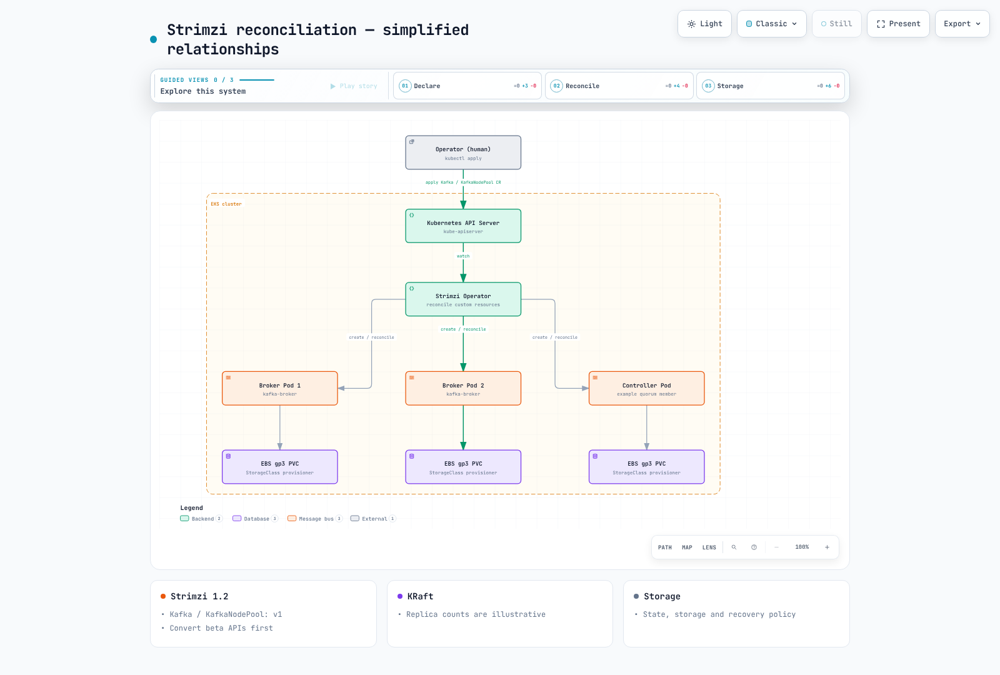

# Análisis en profundidad de Kafka en EKS

## Descripción general

Esta guía utiliza el operador Strimzi como opción de Kafka autogestionada en EKS. El operador reconcilia pods, almacenamiento, listeners, certificados y actualizaciones; no elimina la responsabilidad sobre los datos, la disponibilidad ni las políticas de seguridad. La parte 6 compara alternativas administradas, como Amazon MSK.

> **Última actualización**: 16 de octubre de 2026. Strimzi 1.3.0 / Kafka 4.3.1.
> **Requisito de actualización**: Strimzi 1.0 y versiones posteriores solo admiten la API de CRD `v1`. Convierte los recursos existentes `v1beta2` / `v1beta1` / `v1alpha1` y prepara los CRD siguiendo el procedimiento oficial de migración antes de actualizar el operador. Cambiar solo los números de versión no constituye un plan de actualización.

Strimzi 1.3.0 admite Kafka 4.2.0, 4.2.1, 4.2.2, 4.3.0 y 4.3.1, y usa 4.3.1 de forma predeterminada. Esta guía fija una combinación compatible; antes de la instalación, comprueba también la distribución, la versión de Kubernetes y la ruta de actualización.

## Conceptos básicos de la arquitectura

Los brokers almacenan réplicas de particiones de temas. Los grupos de KafkaConsumer distribuyen las particiones, y un miembro puede tener varias particiones asignadas. Un quórum de controladores independiente administra el registro Raft de metadatos.

KRaft apareció como acceso anticipado en la versión 2.8 y estuvo listo para producción en la 3.3; Kafka 4.0 eliminó el modo ZooKeeper. Los controladores y los brokers pueden tener roles dedicados. Eliminar ZooKeeper no elimina las operaciones de controladores, almacenamiento ni recuperación.

Los usuarios declaran recursos personalizados, como Kafka y KafkaNodePool; Strimzi reconcilia Pods, PVC, Services y Secrets. El diagrama siguiente es un esquema simplificado de las relaciones, no una especificación de implementación de los recuentos de réplicas para alta disponibilidad.

[Ver diagrama interactivo](https://www.atomai.click/kubernetes-docs/archmaps/en-data-on-eks-kafka-readme-0.html)

## Índice del análisis en profundidad

**[1. Fundamentos de Kafka](01-kafka-fundamentals.md)**
- Brokers y estructura de temas/particiones
- Garantías de replicación y durabilidad
- Grupos de consumidores y administración de offsets
- Arquitectura del quórum de controladores de KRaft

**[2. Strimzi Operator](02-strimzi-operator.md)**
- Instalación y configuración de Strimzi
- Descripción detallada de los CRD `Kafka` y `KafkaNodePool`
- Implementación de un clúster de Kafka en EKS

**[3. Operaciones de Kafka](03-kafka-operations.md)**
- Diseño del almacenamiento con EBS/gp3
- Estrategias de escalado de brokers
- Reequilibrio de particiones con Cruise Control
- Actualizaciones continuas con comprobaciones de compatibilidad y disponibilidad

**[4. Schema Registry](04-schema-registry.md)**
- Diseño de esquemas Avro/Protobuf
- Karapace frente a Apicurio Registry
- Estrategias de compatibilidad: BACKWARD/FORWARD/FULL

**[5. Kafka Connect y MirrorMaker](05-kafka-connect-mirrormaker.md)**
- Implementación de Kafka Connect y configuración de conectores
- Operación de conectores de origen y de destino
- Recuperación ante desastres y replicación entre regiones con MirrorMaker2

**[6. Integración con MSK](06-msk-integration.md)**
- Amazon MSK frente a Strimzi autogestionado
- Uso de MSK Connect
- Integración y comparación con Kinesis Data Streams

**[7. Supervisión](07-monitoring.md)**
- Recopilación de métricas de brokers con Prometheus/Grafana
- Supervisión del retraso de los consumidores
- Escalado automático de consumidores con KEDA

**[8. Prácticas recomendadas](08-best-practices.md)**
- Estrategias para el número de particiones y el diseño de claves
- Ajuste del rendimiento de productores/consumidores
- Seguridad con mTLS/SASL
- Optimización de los costos de almacenamiento e instancias

**[9. Resultados medidos de rendimiento de Kafka](09-kafka-benchmark.md)**
- Límite de ingesta medido de RF3 frente a RF1 en un clúster KRaft de 3 brokers con volúmenes gp3
- Compensaciones entre rendimiento y latencia p99 con acks=0/1/all
- Rendimiento y costo de CPU por códec de compresión y tamaño de registro
- Cómo afectan los consumidores inactivos y las cargas de trabajo mixtas al rendimiento de los productores

## Referencias

- [Lanzamiento de Strimzi 1.3.0](https://github.com/strimzi/strimzi-kafka-operator/releases/tag/1.3.0)

- [Documentación de Strimzi](https://strimzi.io/docs/operators/1.3.0/overview.html)
- [Documentación de Apache Kafka](https://kafka.apache.org/43/design/design/)
- [Guía de operaciones de KRaft](https://kafka.apache.org/43/operations/kraft/)
- [Proyecto AWS Data on EKS](https://awslabs.github.io/data-on-eks/)

## Cuestionario

Para comprobar lo que has aprendido en esta sección, prueba el [Cuestionario sobre los fundamentos de Kafka](../../quizzes/data-on-eks/kafka/01-kafka-fundamentals-quiz.md). Para comprobar si puedes convertir los resultados de las pruebas de rendimiento en decisiones de diseño, prueba también el [Cuestionario sobre la prueba de rendimiento medida de Kafka](../../quizzes/data-on-eks/kafka/09-kafka-benchmark-quiz.md).
