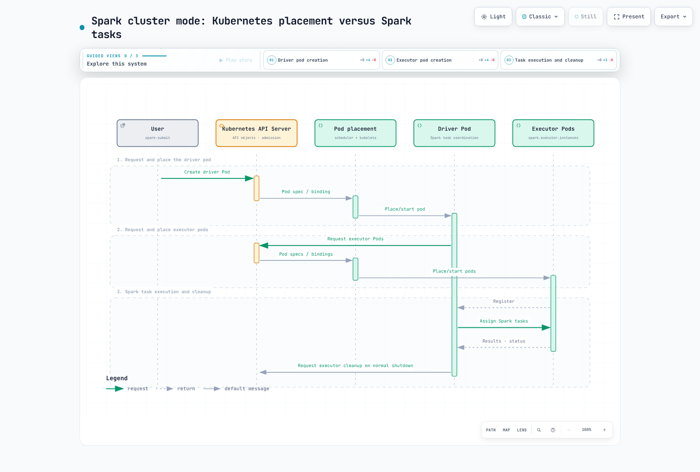

# Parte 1: Fundamentos de Spark en Kubernetes

> **Referencia de revisión**: Spark 4.2.0, Kubernetes 1.34 o posterior; la imagen de ejemplo usa Java 21\
> **Última revisión**: 12 de septiembre de 2026

## Modo clúster y modo cliente

Kubernetes admite **los dos** modos de implementación de Spark. El modo cliente es compatible desde Spark 2.4 y no está restringido a los blocs de notas.

| Modo | Ubicación del controlador | Consecuencia operativa |
| --- | --- | --- |
| Clúster | Un pod de controlador creado para el envío | Quien envía necesita acceso a la API; el controlador necesita su propia cuenta de servicio y RBAC |
| Cliente | La aplicación que envía el trabajo, en un pod o en un host | Los ejecutores deben poder acceder a los endpoints RPC y del administrador de bloques anunciados por el controlador; mantenga el controlador en ejecución |

Poder acceder a la API de Kubernetes no basta para establecer la conectividad entre los ejecutores y el controlador. Las redes del modo cliente pueden necesitar un Service o nombre de host estable y puertos fijos. Si el controlador se ejecuta en un pod, configure el nombre **real** de ese pod para que la recolección por referencia de propietario de los ejecutores funcione; no invente un propietario de pod para un controlador que se ejecuta fuera de Kubernetes.

## ¿Quién programa qué?

El servidor de API gestiona la autenticación y la admisión, y almacena los objetos de API; el planificador de Kubernetes coloca los pods y los kubelets de los nodos inician sus contenedores. El controlador de Spark solicita pods de ejecutor y sus propios planificadores coordinan las etapas y tareas en los ejecutores registrados. Son capas distintas.



[Diagrama interactivo](https://www.atomai.click/kubernetes-docs/archmaps/en-data-on-eks-spark-01-spark-fundamentals-0.html)

1. El emisor solicita el pod del controlador y los recursos asociados.
2. Kubernetes coloca e inicia el controlador; este solicita los pods de ejecutor.
3. Kubernetes coloca e inicia los ejecutores, que se registran en el controlador.
4. El controlador asigna las tareas de Spark; los ejecutores las ejecutan e informan de los resultados y del estado.
5. Durante un cierre normal, Spark limpia los ejecutores según su configuración. Un pod de controlador que haya terminado o fallado puede permanecer para conservar los registros; hay que tener en cuenta el comportamiento ante fallos y las referencias de propietario, en vez de suponer que todo se limpia de inmediato.

Así se evita una capa de control aparte, como YARN o Spark Standalone, pero no se eliminan las tareas de operar la capacidad, los nodos, el almacenamiento, la red ni las imágenes de Kubernetes.

## Ejemplo concreto en modo clúster

Requisitos previos: Spark 4.2.0 instalado localmente, kubectl compatible y contexto kubeconfig actual, Kubernetes 1.34 o posterior, capacidad en el espacio de nombres y acceso a la imagen. Las credenciales de API del emisor y el RBAC del controlador dentro del clúster son independientes. El ejemplo SparkPi no necesita permisos de AWS para los datos; las cargas de trabajo en S3 también necesitan la identidad de carga elegida y bibliotecas de Hadoop/AWS compatibles.

Un administrador del espacio de nombres revisa y aplica `rbac.yaml`:

```yaml
apiVersion: v1
kind: Namespace
metadata:
  name: spark-jobs
---
apiVersion: v1
kind: ServiceAccount
metadata:
  name: spark-driver
  namespace: spark-jobs
---
apiVersion: v1
kind: ServiceAccount
metadata:
  name: spark-executor
  namespace: spark-jobs
automountServiceAccountToken: false
---
apiVersion: rbac.authorization.k8s.io/v1
kind: Role
metadata:
  name: spark-driver
  namespace: spark-jobs
rules:
- apiGroups:
  - ''
  resources:
  - pods
  - services
  - configmaps
  verbs:
  - create
  - get
  - list
  - watch
  - delete
  - patch
---
apiVersion: rbac.authorization.k8s.io/v1
kind: RoleBinding
metadata:
  name: spark-driver
  namespace: spark-jobs
roleRef:
  apiGroup: rbac.authorization.k8s.io
  kind: Role
  name: spark-driver
subjects:
- kind: ServiceAccount
  name: spark-driver
  namespace: spark-jobs
```

Este rol permite el ejemplo básico sin PVC creados dinámicamente. Otras funciones de gestión de volúmenes o recursos pueden requerir permisos de alcance equivalente. Los pods de ejecutor usan una cuenta de servicio independiente, con el montaje automático del token de API deshabilitado. Solo el código de trabajo y quienes lo envíen de confianza deben utilizar un espacio de nombres en el que el controlador pueda crear pods; RBAC por sí solo no aísla el código de aplicación no confiable.

Guarde estos archivos como **plantillas de Pod**, no como pods independientes que se aplican con `kubectl apply`. Spark completa la imagen, los comandos y otros campos:

Plantilla del controlador, `driver-template.yaml`:

```yaml
apiVersion: v1
kind: Pod
metadata:
  name: spark-driver-template
spec:
  securityContext:
    runAsNonRoot: true
    runAsUser: 185
    runAsGroup: 185
    seccompProfile:
      type: RuntimeDefault
  containers:
  - name: spark-kubernetes-driver
    securityContext:
      allowPrivilegeEscalation: false
      capabilities:
        drop:
        - ALL
```

Plantilla del ejecutor, `executor-template.yaml`:

```yaml
apiVersion: v1
kind: Pod
metadata:
  name: spark-executor-template
spec:
  securityContext:
    runAsNonRoot: true
    runAsUser: 185
    runAsGroup: 185
    seccompProfile:
      type: RuntimeDefault
  containers:
  - name: spark-kubernetes-executor
    securityContext:
      allowPrivilegeEscalation: false
      capabilities:
        drop:
        - ALL
  automountServiceAccountToken: false
  terminationGracePeriodSeconds: 60
```

Los archivos deben estar accesibles para el **proceso que envía el trabajo**. En modo clúster, Spark se encarga de montar la plantilla del ejecutor en el controlador. Spark sobrescribe algunos campos de las plantillas; inspeccione los pods generados al combinar plantillas, webhooks del operador y ajustes de Spark.

```bash
#!/bin/bash
set -euo pipefail
# Run in the directory containing driver-template.yaml and executor-template.yaml.
KUBE_CONTEXT="$(kubectl config current-context)"
KUBE_API_URL="$(kubectl --context "$KUBE_CONTEXT" config view --minify -o jsonpath='{.clusters[0].cluster.server}')"
case "$KUBE_API_URL" in https://*) ;; *) echo "Expected an HTTPS Kubernetes API URL" >&2; exit 1;; esac
SPARK_APP_NAME="spark-pi-$(date -u +%Y%m%d%H%M%S)"
spark-submit \
  --master "k8s://${KUBE_API_URL}" \
  --deploy-mode cluster \
  --name "$SPARK_APP_NAME" \
  --class org.apache.spark.examples.SparkPi \
  --conf "spark.kubernetes.context=$KUBE_CONTEXT" \
  --conf spark.kubernetes.namespace=spark-jobs \
  --conf spark.kubernetes.container.image=spark:4.2.0-scala2.13-java21-ubuntu \
  --conf spark.kubernetes.authenticate.driver.serviceAccountName=spark-driver \
  --conf spark.kubernetes.authenticate.executor.serviceAccountName=spark-executor \
  --conf "spark.kubernetes.driver.pod.name=$SPARK_APP_NAME-driver" \
  --conf spark.kubernetes.driver.podTemplateFile=driver-template.yaml \
  --conf spark.kubernetes.executor.podTemplateFile=executor-template.yaml \
  --conf spark.kubernetes.executor.terminationGracePeriodSeconds=60s \
  --conf spark.driver.cores=1 \
  --conf spark.driver.memory=1g \
  --conf spark.kubernetes.driver.limit.cores=1 \
  --conf spark.executor.cores=1 \
  --conf spark.executor.memory=1g \
  --conf spark.kubernetes.executor.limit.cores=1 \
  --conf spark.executor.instances=3 \
  local:///opt/spark/examples/jars/spark-examples.jar 10
kubectl -n spark-jobs logs "$SPARK_APP_NAME-driver"
kubectl -n spark-jobs get pod "$SPARK_APP_NAME-driver" -o jsonpath='{.status.phase}{"\n"}'
```

Aplique `rbac.yaml` antes de ejecutar el script de envío. La imagen oficial con versión fija contiene el enlace simbólico `spark-examples.jar`; `local:///` significa que el artefacto ya está en el contenedor, no que sea un archivo del portátil local que se deba cargar. Si es necesario, replique y fije la imagen según el proceso habitual de la cadena de suministro. El script auxiliar usa un nombre de controlador nuevo y el contexto kubeconfig seleccionado; conserve estos valores para investigar fallos.

Se solicitan tres ejecutores fijos, pero las cuotas, la admisión, la programación, la descarga de imágenes o la capacidad de los nodos pueden mantener los pods en estado Pending. Compruebe los eventos y registros del controlador y los ejecutores; ejecutar `spark-submit` no demuestra por sí solo que las tareas se hayan ejecutado correctamente.

## Los recursos son solicitudes, límites y ranuras de tareas

| Ajuste de Spark | Efecto en Kubernetes o en el perfil predeterminado |
| --- | --- |
| `spark.driver.cores` | Solicitud de CPU del controlador, salvo que se sobrescriba |
| `spark.executor.cores` | Capacidad de tareas del ejecutor y solicitud de CPU predeterminada |
| `spark.kubernetes.{driver,executor}.request.cores` | Sobrescribe la solicitud de CPU de Kubernetes, no el ajuste de ranuras de tareas de Spark del ejecutor |
| `spark.kubernetes.{driver,executor}.limit.cores` | Límite de CPU explícito; los cores no implican automáticamente un límite de CPU |
| Memoria del controlador | La solicitud y el límite incluyen el heap más la sobrecarga configurada o calculada |
| Memoria del ejecutor | La solicitud y el límite incluyen el heap, la sobrecarga y la memoria fuera del heap o de PySpark que corresponda |

Para este ejemplo de JVM, un heap de 1 GiB más la sobrecarga mínima predeterminada de 384 MiB da como resultado una solicitud y un límite de memoria de **1,408 MiB**. Es un cálculo verificado con los valores predeterminados, no un tamaño universal para los trabajos. La memoria de Python/nativa y los ResourceProfiles personalizados requieren una revisión propia. Una solicitud de CPU inferior a la capacidad de tareas puede permitir la contención; cambiar una solicitud no equivale a cambiar el número de tareas que puede ejecutar un ejecutor.

## Asignación dinámica de recursos

Spark DRA cambia el **número de ejecutores** según la cola de tareas y las condiciones de inactividad. Es distinta de DRA de Kubernetes para dispositivos y de la respuesta de un escalador de nodos a los pods Pending.

Spark estándar en Kubernetes no admite el servicio externo de shuffle al estilo de YARN. El seguimiento de shuffle es una opción compatible, pero no el único mecanismo de Spark: la conservación de shuffle basada en la retirada de nodos y una implementación adecuada y fiable de ShuffleDataIO son alternativas, cada una con sus propios requisitos.

Para un perfil que use seguimiento de shuffle:

```properties
spark.dynamicAllocation.enabled=true
spark.dynamicAllocation.shuffleTracking.enabled=true
spark.dynamicAllocation.minExecutors=2
spark.dynamicAllocation.initialExecutors=3
spark.dynamicAllocation.maxExecutors=20
spark.kubernetes.allocation.batch.size=5
```

Pase estas propiedades con `--conf` o con un archivo de propiedades. El seguimiento de shuffle se introdujo en Spark 3.0 y **ya está habilitado de forma predeterminada en 4.2**; indicarlo explícitamente documenta la elección. Es incorrecto afirmar que siempre son obligatorias ambas opciones explícitas.

El seguimiento intenta conservar los ejecutores que contienen datos de shuffle activos. Los tiempos de espera configurados para el seguimiento o los ejecutores en caché, la terminación forzada y los fallos de nodos aún pueden causar recálculos. No es almacenamiento compartido duradero. Habilitar mecanismos de conservación que se solapan puede retrasar la liberación de ejecutores; pruebe cómo interactúan.

El recuento inicial tiene en cuenta `minExecutors`, `initialExecutors` y un valor existente de `spark.executor.instances`. El recuento fijo de tres del ejemplo coincide con su recuento inicial de tres; min=2 no significa que deba comenzar con dos.

`spark.kubernetes.allocation.batch.size` controla un lote de solicitudes de pods. No es una política directa de escalado de EC2: la limitación de solicitudes a la API, el tiempo de asignación de los pods, ResourceQuota, las restricciones de programación y el aprovisionamiento de nodos siguen siendo aspectos independientes.

## La retirada gradual es un mejor esfuerzo

Estos ajustes habilitan la retirada de ejecutores y del administrador de bloques, así como la migración de los bloques RDD/shuffle correspondientes:

```properties
spark.decommission.enabled=true
spark.storage.decommission.enabled=true
spark.storage.decommission.rddBlocks.enabled=true
spark.storage.decommission.shuffleBlocks.enabled=true
spark.kubernetes.executor.terminationGracePeriodSeconds=60s
```

En la ruta de Kubernetes elegida para Spark 4.2, habilitar la retirada **inyecta un hook preStop** que ejecuta `spark.kubernetes.decommission.script`, cuyo valor predeterminado es `/opt/decom.sh`. La imagen oficial incluye ese script. El script encuentra la JVM del ejecutor, envía **SIGPWR** y espera; la señal de retirada predeterminada de Spark es PWR. Por tanto, la terminación normal del pod está mediada por este hook; no dé por sentado que cualquier SIGTERM simple migra los datos automáticamente.

Las imágenes personalizadas deben incluir un script operativo y sus herramientas; si se cambia la señal, debe coincidir con el script. Spark puede sobrescribir los ajustes del ciclo de vida de una plantilla. Inspeccione el hook real y pruebe tanto la reducción planificada de capacidad como las rutas de interrupción.

El envío fija explícitamente `spark.kubernetes.executor.terminationGracePeriodSeconds=60s`. Spark 4.2 sobrescribe con este ajuste el valor de la plantilla del pod; el valor predeterminado es 30 segundos. No basta con establecer solo `terminationGracePeriodSeconds: 60` en la plantilla. El periodo de gracia incluye la ejecución de preStop. Es un presupuesto máximo, no una garantía de que termine la migración ni un aplazamiento del plazo de terminación de Spot subyacente. Se requieren ejecutores de destino en buen estado, capacidad de disco y de red, tiempo y cualquier almacenamiento de reserva configurado. Una pérdida abrupta del nodo o una eliminación forzada pueden eliminar por completo esa oportunidad. Los ajustes explícitos del periodo de gracia para la eliminación, incluida la ruta de eliminación de la asignación dinámica de Spark, también pueden cambiar el presupuesto disponible.

Estas opciones no reinician un controlador fallido, no sustituyen los puntos de control de la aplicación ni garantizan que la salida sea exactamente una vez de extremo a extremo. Distinga los bloques intermedios recalculables de las entradas y salidas duraderas, y planifique la recuperación en consecuencia.

## Referencias y validación

Un trabajo local de SparkPi se ejecutó correctamente con el controlador enlazado a loopback y la interfaz de usuario deshabilitada. Las pruebas de pasos funcionales de Spark 4.2 confirmaron la correspondencia de memoria, el comportamiento predeterminado del límite de CPU y la inserción automática del hook de retirada, sin crear un cliente de Kubernetes. Estas comprobaciones no demuestran el envío a EKS, la aplicación real de RBAC/CNI, que la migración termine ni el acceso a datos de AWS.

- [Spark 4.2.0 en Kubernetes](https://spark.apache.org/docs/4.2.0/running-on-kubernetes.html)
- [Configuración de Spark 4.2.0](https://spark.apache.org/docs/4.2.0/configuration.html)
- [Alternativas de asignación dinámica de Spark 4.2.0](https://spark.apache.org/docs/4.2.0/job-scheduling.html#dynamic-resource-allocation)
- [Correspondencia de recursos del controlador](https://github.com/apache/spark/blob/v4.2.0/resource-managers/kubernetes/core/src/main/scala/org/apache/spark/deploy/k8s/features/BasicDriverFeatureStep.scala)
- [Recursos del ejecutor y hook de retirada](https://github.com/apache/spark/blob/v4.2.0/resource-managers/kubernetes/core/src/main/scala/org/apache/spark/deploy/k8s/features/BasicExecutorFeatureStep.scala)
- [Script oficial de retirada de Spark](https://github.com/apache/spark/blob/v4.2.0/resource-managers/kubernetes/docker/src/main/dockerfiles/spark/decom.sh)
- [Etiquetas de la imagen oficial de Spark](https://github.com/docker-library/official-images/blob/master/library/spark)

## Pasos siguientes

[Parte 2: Spark Operator](./02-spark-operator.md)

[Volver a la página principal](./README.md)

## Cuestionario

[Cuestionario del tema](../../quizzes/data-on-eks/spark/01-spark-fundamentals-quiz.md)
