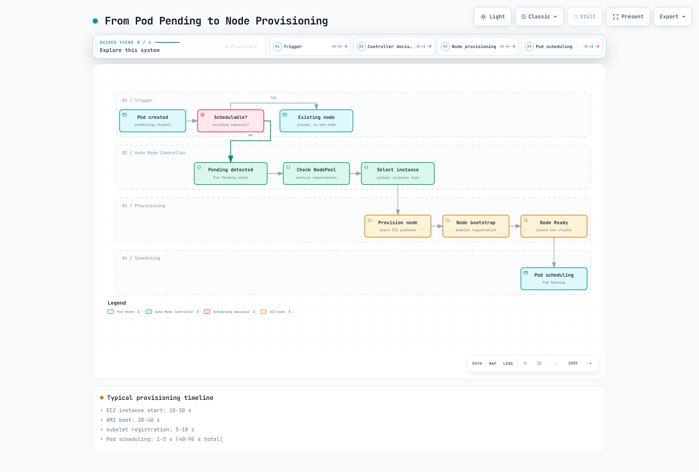
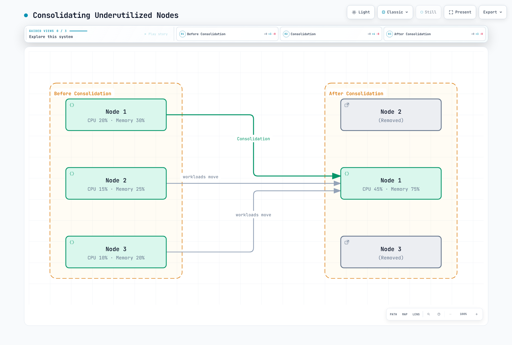

# Comprender el comportamiento de escalado

> **Versiones compatibles**: EKS Auto Mode GA; referencia de ejemplo EKS 1.36
> **Última actualización**: October 12, 2026

Este capítulo separa el aprovisionamiento, la consolidación, la deriva y la expiración. Use la cuenta/el contexto revisado de [Primeros pasos](./01-getting-started.md). Los manifiestos suponen un NodeClass `default` configurado y usan capacidad On-Demand para centrarse en el comportamiento del ciclo de vida. Los límites son ilustrativos y aun así pueden permitir un costo considerable.

No se ejecutó ningún benchmark de clúster, carga de trabajo o latencia durante esta auditoría. Las configuraciones y transformaciones de diagnóstico se comprobaron localmente; valide el comportamiento de admisión, IAM, programación e interrupción en un entorno controlado antes de producción.

## De un Pod no programable a capacidad

Auto Mode observa los Pods que el scheduler no puede ubicar en la capacidad existente. Deben existir un NodePool/NodeClass adecuado, restricciones compatibles, cuota disponible y capacidad EC2 antes de que el aprovisionamiento pueda tener éxito. Las solicitudes, afinidad, taints, topología, ubicación de volúmenes y arquitectura son factores importantes. HPA/KEDA u otro controlador de aplicación es responsable de aumentar las réplicas; la automatización de Nodes no es un autoscaler de utilización de CPU de aplicaciones.

`Pending` por sí solo no demuestra una escasez de Nodes. Un Pod ya puede estar asignado a un Node mientras espera imágenes o inicialización. El diagrama muestra una ruta de capacidad exitosa y omite las ramas de error; una selección de instancias compatibles no constituye un óptimo global ni una garantía de tiempo de preparación. `Running` tampoco significa que la aplicación esté lista.



[Ver diagrama interactivo](https://www.atomai.click/kubernetes-docs/archmaps/en-eks-auto-mode-03-scaling-behavior-0.html)

### Estimaciones didácticas históricas

La guía anterior publicó los siguientes números sin observaciones sin procesar ni un benchmark reproducible. Se conservan como **estimaciones históricas no verificadas**, no como tiempos medidos con EKS 1.36 ni como un SLO de AWS. Las definiciones de las etapas pueden superponerse; no las sume como si fueran una traza medida.

| Fase en la ilustración anterior | Duración publicada |
|---------------------------------|--------------------|
| Detección de Pending | 1–5 segundos |
| Selección de instancia | 1–3 segundos |
| Inicio de EC2 | 10–30 segundos |
| Arranque de AMI | 20–40 segundos |
| Registro de kubelet | 5–10 segundos |
| Programación de Pod | 1–5 segundos |
| Total declarado | 40–90 segundos |

## Consolidación: elegibilidad, no una garantía de temporizador

La consolidación busca una eliminación o sustitución que ahorre costos y siga siendo programable. No la modele como un umbral fijo y medido de utilización de CPU o memoria: las solicitudes de recursos y las restricciones de ubicación son importantes. Los PDB, presupuestos de interrupción, anotaciones, capacidad de sustitución y el progreso del drenaje pueden impedir o retrasar una acción.

`consolidateAfter` es un retraso de estabilidad/elegibilidad. Las adiciones/eliminaciones de Pods reinician el temporizador. Un valor de 30 segundos no promete la eliminación 30 segundos después, ni limita el tiempo de preparación de la sustitución.

### WhenEmpty

Esta política considera Nodes vacíos elegibles. «Vacío» no implica necesariamente cero Pods en `kubectl get pods`: los Nodes que solo ejecutan DaemonSet pueden cumplir los requisitos. Es conservadora para la consolidación, pero no deshabilita otros motivos de interrupción como la deriva, la expiración o la interrupción de Spot.

```yaml
apiVersion: karpenter.sh/v1
kind: NodePool
metadata:
  name: when-empty-example
spec:
  template:
    spec:
      requirements:
      - key: eks.amazonaws.com/instance-category
        operator: In
        values:
        - m
        - c
      - key: karpenter.sh/capacity-type
        operator: In
        values:
        - on-demand
      nodeClassRef:
        group: eks.amazonaws.com
        kind: NodeClass
        name: default
  disruption:
    consolidationPolicy: WhenEmpty
    consolidateAfter: 30s
    budgets:
    - nodes: 10%
  limits:
    cpu: '100'
    memory: 400Gi
```

### WhenEmptyOrUnderutilized

Esto permite la consolidación de Nodes no vacíos cuando sus cargas de trabajo pueden reempaquetarse de forma más económica bajo las restricciones pertinentes. Puede eliminar Nodes usando capacidad libre existente o sustituir Nodes por capacidad más económica; no siempre es necesario un Node nuevo.

```yaml
apiVersion: karpenter.sh/v1
kind: NodePool
metadata:
  name: when-underutilized-example
spec:
  template:
    spec:
      requirements:
      - key: eks.amazonaws.com/instance-category
        operator: In
        values:
        - m
        - c
      - key: karpenter.sh/capacity-type
        operator: In
        values:
        - on-demand
      nodeClassRef:
        group: eks.amazonaws.com
        kind: NodeClass
        name: default
  disruption:
    consolidationPolicy: WhenEmptyOrUnderutilized
    consolidateAfter: 1m
    budgets:
    - nodes: 10%
  limits:
    cpu: '100'
    memory: 400Gi
```

### Balanced

En EKS 1.37, un NodePool personalizado creado recientemente que omite su política de consolidación usa `Balanced` de forma predeterminada. Los pools integrados `general-purpose` y `system` también usan `Balanced`, y sus políticas no se pueden modificar. Configure explícitamente la política de un pool personalizado cuando se pretenda otro comportamiento. `Balanced` considera el costo de interrupción junto con los ahorros y puede omitir acciones marginales que `WhenEmptyOrUnderutilized` ejecutaría; no es una garantía de ausencia de interrupciones. Los ejemplos de este capítulo configuran la política explícitamente.

```yaml
apiVersion: karpenter.sh/v1
kind: NodePool
metadata:
  name: balanced-example
spec:
  template:
    spec:
      requirements:
      - key: eks.amazonaws.com/instance-category
        operator: In
        values:
        - m
        - c
      - key: karpenter.sh/capacity-type
        operator: In
        values:
        - on-demand
      nodeClassRef:
        group: eks.amazonaws.com
        kind: NodeClass
        name: default
  disruption:
    consolidationPolicy: Balanced
    consolidateAfter: 1m
    budgets:
    - nodes: 10%
  limits:
    cpu: '100'
    memory: 400Gi
```

### Interpretar un diagrama de empaquetado



[Ver diagrama interactivo](https://www.atomai.click/kubernetes-docs/archmaps/en-eks-auto-mode-03-scaling-behavior-1.html)

El 20/15/10 % de CPU y el 30/25/20 % de memoria de la figura suman 45 % y 75 % en Nodes de igual capacidad. Estos son valores de empaquetado ilustrativos, no datos medidos para un umbral de consolidación universal. La ubicación real también debe satisfacer requisitos de solicitudes, topología, almacenamiento y disponibilidad. Los Pods son expulsados y recreados por los controladores de carga de trabajo; no se migran en vivo.

## Detección y sustitución de deriva

La deriva significa que un NodeClaim ya no coincide con la configuración deseada o resuelta relevante. Inspeccione su condición `Drifted`; la antigua consulta de anotación de Node `karpenter.sh/drift-hash` no era una comprobación válida del estado público de deriva. Una condición ausente se informa a continuación como `NotReported`, no se inventa como un resultado falso definitivo.

```bash
kubectl --context "$CLUSTER_NAME" --request-timeout=15s get nodeclaims -o json |
  jq '[.items[] | {
    claim: .metadata.name,
    node: .status.nodeName,
    pool: .metadata.labels["karpenter.sh/nodepool"],
    drift: ((.status.conditions // [] | map(select(.type == "Drifted") |
              {status, reason, lastTransitionTime, observedGeneration}) | first)
            // {status: "NotReported"})
  }]'
```

| Cambio | Interpretación |
|--------|----------------|
| Los requisitos excluyen la instancia actual | Puede causar deriva |
| Los requisitos se amplían pero aún permiten la instancia | No causa necesariamente deriva |
| Se modifican configuraciones relevantes de NodeClass o selecciones resueltas de subred/grupo de seguridad | Puede causar deriva; inspeccione las condiciones reales |
| AWS selecciona una nueva AMI administrada de Auto Mode | Puede causar sustitución; los usuarios no eligen un `amiFamily` |
| Edición de reglas en un grupo de seguridad ya referenciado | No equivale a seleccionar un grupo diferente; no suponga que siempre causa deriva de Node |
| Peso, límites o comportamiento de interrupción de NodePool | No son deriva de plantilla de Node por sí mismos; pueden cambiar qué acciones están permitidas |
| Cambios en `expireAfter` o `terminationGracePeriod` | Los campos existentes de NodeClaim no se reescriben; las sustituciones obtienen los nuevos valores |

Una ruta gradual típica comprueba presupuestos y la viabilidad de programación, evita nuevas ubicaciones en los Nodes seleccionados, prepara capacidad de sustitución **si es necesario** y luego expulsa/drena y termina los Nodes antiguos. La capacidad de sustitución puede solaparse con la capacidad antigua e incurrir en costos. El paralelismo está limitado por los presupuestos; la sustitución no es necesariamente secuencial. Las rutas de interrupción/expiración forzosa no deben describirse como si siempre esperaran primero una sustitución en buen estado.

## Expiración y período de gracia de terminación

AWS documenta una duración máxima de 21 días para los Nodes de Auto Mode. La expiración predeterminada es de 336 horas y Auto Mode configura de forma predeterminada `terminationGracePeriod` en 24 horas en NodeClaims cuando se omite de un NodePool personalizado. No importe el valor predeterminado genérico upstream de 720 horas como recomendación para Auto Mode.

Lo siguiente solicita la expiración después de 168 horas con un período de gracia explícito. La expiración inicia el drenaje; no promete una sustitución en buen estado exactamente siete días después. Los Nodes pueden interrumpirse antes por otros motivos.

```yaml
apiVersion: karpenter.sh/v1
kind: NodePool
metadata:
  name: with-expiration
spec:
  template:
    spec:
      requirements:
      - key: eks.amazonaws.com/instance-category
        operator: In
        values:
        - m
        - c
      - key: karpenter.sh/capacity-type
        operator: In
        values:
        - on-demand
      nodeClassRef:
        group: eks.amazonaws.com
        kind: NodeClass
        name: default
      expireAfter: 168h
      terminationGracePeriod: 24h
  disruption:
    consolidationPolicy: WhenEmptyOrUnderutilized
    consolidateAfter: 1m
    budgets:
    - nodes: 10%
  limits:
    cpu: '100'
    memory: 400Gi
```

| Valor de política analizado en la guía anterior | Interpretación actual |
|---------------------------------------------|------------------------|
| 24–72 horas | Política opcional de corta duración, con más rotación; no prueba que exista un nuevo parche en cada ciclo |
| 168 horas | El ejemplo de siete días anterior; evalúe la disponibilidad y la sobrecarga de sustitución |
| 336 horas | Expiración predeterminada documentada de Auto Mode |
| 720 horas / 30 días | Supera el máximo documentado de 21 días de Auto Mode; no lo use como promesa de reutilización de Nodes |

Los presupuestos de interrupción de NodePool limitan la tasa de los métodos graduales; no son un escudo universal contra la expiración, la interrupción o la reparación. Los PDB y `do-not-disrupt` afectan las decisiones de drenaje/interrupción, pero no garantizan una retención indefinida. Tras un período de gracia de terminación configurado, los Pods restantes pueden eliminarse de forma forzosa. Elija políticas que consideren cargas de trabajo con estado, la desconexión de almacenamiento, los períodos de gracia de la aplicación y los escenarios de fallo.

## Diagnosticar la latencia sin inventar un benchmark

Los siguientes comandos capturan metadatos y estado seleccionados, no especificaciones completas de Pods. Mantenga las evidencias privadas. La última transición de condición de una instantánea puede reflejar una transición posterior o una oscilación, no el primer hito de inicio.

```bash
umask 077
: "${WORK_DIR:?Use the private evidence directory from the getting-started guide}"
kubectl --context "$CLUSTER_NAME" --request-timeout=15s get nodeclaims -o json |
  jq '[.items[] | {
    claim: .metadata.name, uid: .metadata.uid,
    node: .status.nodeName, createdAt: .metadata.creationTimestamp,
    pool: .metadata.labels["karpenter.sh/nodepool"],
    expireAfter: .spec.expireAfter,
    terminationGracePeriod: .spec.terminationGracePeriod,
    conditions: [.status.conditions[]? |
      select(.type == "Launched" or .type == "Registered" or .type == "Initialized" or .type == "Ready") |
      {type, status, reason, lastTransitionTime}]
  }]' > "$WORK_DIR/nodeclaims-summary.json"
```

```bash
: "${WORKLOAD_NAMESPACE:?Set the controlled test namespace}"
: "${POD_NAME:?Set the controlled test Pod name}"
kubectl --context "$CLUSTER_NAME" --request-timeout=15s -n "$WORKLOAD_NAMESPACE" \
  get pod "$POD_NAME" -o json |
  jq '{name: .metadata.name, uid: .metadata.uid,
       createdAt: .metadata.creationTimestamp, node: .spec.nodeName, phase: .status.phase,
       conditions: [.status.conditions[]? |
         select(.type == "PodScheduled" or .type == "Ready") |
         {type, status, reason, lastTransitionTime}]}' > "$WORK_DIR/pod-summary.json"
```

Para un benchmark real, inicie una observación controlada al crear la carga de trabajo, correlacione los UID de los objetos y las asignaciones de NodeClaim/Node, y registre por separado la primera programación, la preparación del Node y la preparación de la aplicación. Incluya intentos fallidos/timeouts y el entorno, las imágenes y la configuración de la carga de trabajo. Los datos de instantáneas y los eventos de Kubernetes conservados por sí solos no pueden establecer una distribución de latencia completa.

### Ajuste de almacenamiento compatible

Auto Mode selecciona su variante de Bottlerocket. No configure `amiFamily` ni `blockDeviceMappings` para buscar una mejora declarada en el tiempo de arranque. Esta plantilla de almacenamiento válida usa `ephemeralStorage`; reemplace el perfil y los selectores por recursos revisados y haga referencia a este NodeClass desde el pool previsto.

```yaml
apiVersion: eks.amazonaws.com/v1
kind: NodeClass
metadata:
  name: image-storage-example
spec:
  instanceProfile: eks-node-instance-profile
  subnetSelectorTerms:
  - tags:
      Name: private-subnet
  securityGroupSelectorTerms:
  - tags:
      Name: eks-cluster-sg
  advancedNetworking:
    associatePublicIPAddress: false
  ephemeralStorage:
    size: 50Gi
    iops: 3000
    throughput: 125
```

Analice las transferencias reales de imágenes, el desempaquetado, la CPU, la red y los cuellos de botella de almacenamiento antes de cambiar la configuración. Las cifras anteriores de «Bottlerocket ahorra 10–20 segundos», «un EBS más pequeño ahorra 5–10 segundos» y «un IOPS más alto ahorra 5–10 segundos» no tenían mediciones verificadas. No son garantías de ajuste actuales. Una capacidad más pequeña puede en su lugar causar presión de imágenes/almacenamiento efímero.

Opciones más amplias de instancias/AZ compatibles pueden mejorar las opciones de capacidad, pero deben respetar las restricciones de las cargas de trabajo y los volúmenes. Los Pods de marcador de posición pueden reservar capacidad a un costo inactivo; no garantizan descargas de imágenes casi instantáneas ni la preparación de la aplicación.

## Observar las señales adecuadas

Inspeccione los Pods explícitamente informados como no programables, en lugar de tratar cada Pod Pending como una solicitud de capacidad:

```bash
kubectl --context "$CLUSTER_NAME" --request-timeout=15s \
  get pods -A --field-selector=status.phase=Pending -o json |
  jq '[.items[] | select(any(.status.conditions[]?;
    .type == "PodScheduled" and .status == "False" and .reason == "Unschedulable")) |
    {namespace: .metadata.namespace, name: .metadata.name, uid: .metadata.uid,
     createdAt: .metadata.creationTimestamp}]'
```

Los eventos pueden explicar decisiones, pero pueden agregarse, repetirse o expirar. Esta consulta usa el recurso explícito `events.k8s.io` y selecciona identificadores de estado en lugar de volcar datos de la carga de trabajo:

```bash
kubectl --context "$CLUSTER_NAME" --request-timeout=15s \
  get events.events.k8s.io -A -o json |
  jq '[.items[] |
    select(.regarding.kind == "NodeClaim" or .regarding.kind == "Node" or .regarding.kind == "Pod") |
    {time: (.eventTime // .deprecatedLastTimestamp // .metadata.creationTimestamp),
     reason, regarding: {kind: .regarding.kind, name: .regarding.name, uid: .regarding.uid},
     count: (.series.count // .deprecatedCount // 1)}] | sort_by(.time)'
```

| Señal | Consideración de evidencia y diseño de alertas |
|--------|----------------------------------------|
| Pods no programables sostenidos | Condiciones de Kubernetes más un recopilador configurado; el umbral anterior de >10 durante 5 minutos era solo un ejemplo |
| Tasa de creación/error de NodeClaim | Eventos/logs duraderos o instrumentación; una instantánea de objetos actuales omite intentos eliminados |
| Latencia de aprovisionamiento/aplicación | Observaciones correlacionadas que incluyen fallos; el umbral anterior de p99 >120 segundos no era un SLO de AWS |
| Recursos del pool próximos a los límites | Estado de NodePool, comprobaciones de cuota y capacidad; diferencie los recursos solicitados/reservados de la utilización real |

No suponga que los nombres de tabla `karpenter_*` anteriores son métricas integradas de CloudWatch para Auto Mode. Las métricas de Prometheus de Karpenter autogestionado, las métricas del plano de control de EKS y sus propios recopiladores son interfaces independientes; seleccione los nombres y dimensiones de las métricas del publicador configurado real.

### Logs de componentes administrados por AWS

Auto Mode expone logs de componentes administrados mediante la entrega de CloudWatch Vended Logs. Esto se configura por separado del logging ordinario del plano de control de EKS:

- `AUTO_MODE_COMPUTE_LOGS` para decisiones de Karpenter administrado
- `AUTO_MODE_BLOCK_STORAGE_LOGS`
- `AUTO_MODE_LOAD_BALANCING_LOGS`
- `AUTO_MODE_IPAM_LOGS`

La configuración documentada usa una fuente de entrega, un destino de entrega y una entrega. Revise los permisos de destino y los cargos de entrega/almacenamiento antes de habilitarla. Los logs de auditoría existentes del plano de control también pueden mostrar eventos de Kubernetes como `DisruptionBlocked`, `Unconsolidatable`, `FailedScheduling`, `NodeClassNotReady` y errores de terminación; use la referencia de solución de problemas de AWS y un intervalo de tiempo acotado. Estos son eventos de diagnóstico, no automáticamente un histograma de latencia publicado.

## Referencias

- [Comportamiento de EKS Auto Mode y duración máxima de Node](https://docs.aws.amazon.com/eks/latest/userguide/automode.html)
- [Políticas de NodePool y período de gracia de Auto Mode](https://docs.aws.amazon.com/eks/latest/userguide/create-node-pool.html)
- [Interrupción y deriva de Karpenter v1.14](https://karpenter.sh/v1.14/concepts/disruption/)
- [Campos de NodeClass de Auto Mode](https://docs.aws.amazon.com/eks/latest/userguide/create-node-class.html)
- [Solución de problemas de Auto Mode](https://docs.aws.amazon.com/eks/latest/userguide/auto-troubleshoot.html)
- [Entrega de logs de componentes administrados por AWS](https://docs.aws.amazon.com/eks/latest/userguide/auto-managed-component-logs.html)

< [Anterior: Configuración de NodePool](./02-nodepool-configuration.md) | [Tabla de contenidos](./README.md) | [Siguiente: Estrategias de Spot](./04-spot-strategies.md) >
