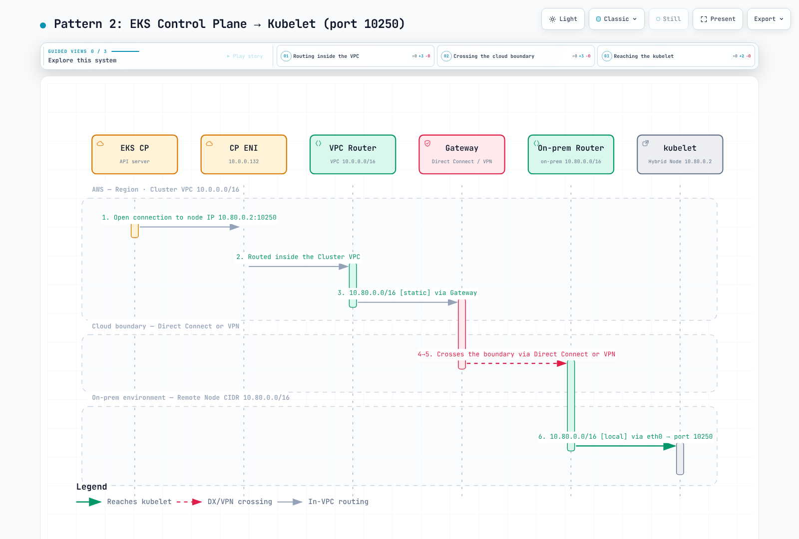
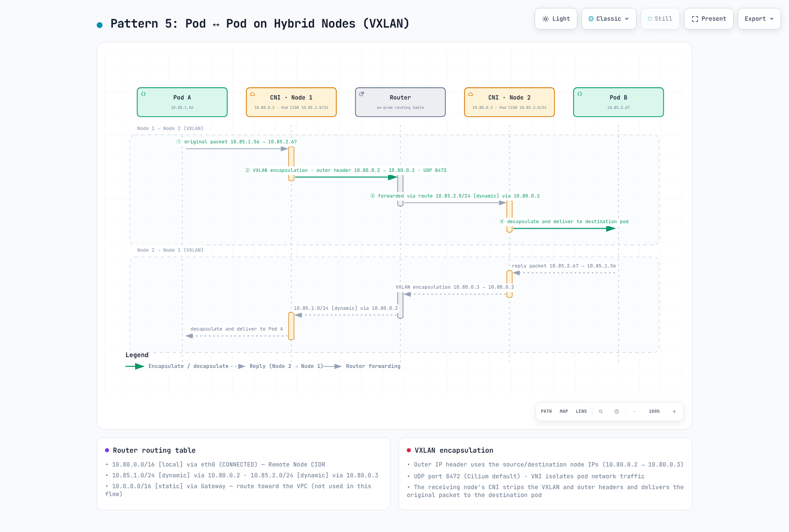
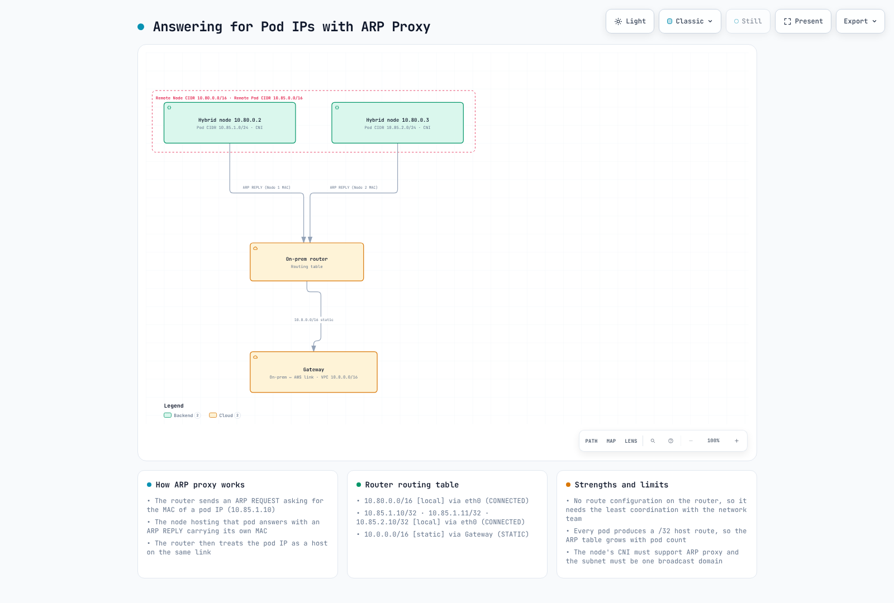

# Configuración de red

> **Versiones compatibles**: ejemplos de EKS 1.36; referencia de Cilium 1.18.3-0 mantenida por AWS; se requiere un host/kernel compatible
> **Última actualización**: 18 de octubre de 2026

Valide por separado el enrutamiento, DNS, TLS, las credenciales y el tráfico de las aplicaciones. Estos ejemplos se comprobaron con esquemas y datos de prueba locales, incluido un proveedor de Terraform simulado; no se modificaron recursos de AWS, enrutadores, firewalls ni clústeres activos. Los diagramas son ilustraciones del repositorio basadas en conceptos de AWS, no una validación de esta configuración publicada por AWS.


[🔍 Ver diagrama interactivo](https://www.atomai.click/kubernetes-docs/archmaps/en-eks-hybrid-nodes-prereq-0.html)

**Material complementario para el equipo de seguridad:** [Revisión de la separación de red de nodos híbridos](11-network-separation-security.md) explica las nuevas conexiones desde el plano de control hacia las instalaciones locales, los tipos de endpoints, los límites de permisos y datos, y las evidencias de revisión. La conectividad privada por sí sola no demuestra el cumplimiento.

## Descripción general de la arquitectura de red

El tráfico del plano de control→nodo híbrido y el tráfico privado de la API de Kubernetes utilizan la ruta de red de la VPC del clúster. En cambio, el tráfico de kubelet hacia un endpoint de API público utiliza la ruta pública configurada; afirmar que «todo el tráfico siempre atraviesa las ENI de la VPC» era demasiado general. Las VIF públicas de Direct Connect, la conectividad privada y las rutas por Internet pública son opciones distintas.

Las ENI/IP del plano de control de EKS pueden cambiar. Revise la propiedad real del clúster y los rangos de subred aprobados para el plano de control, en lugar de considerar que todas las ENI `Amazon EKS*` de una VPC compartida pertenecen a este clúster.

Vincule la cuenta y el contexto de Kubernetes antes de ejecutar diagnósticos de solo lectura:

```bash
set -euo pipefail
: "${EXPECTED_ACCOUNT_ID:?Set the intended account}"
: "${AWS_REGION:?Set the cluster Region}"
: "${CLUSTER_NAME:?Set the reviewed cluster name}"
: "${KUBECONFIG:?Set the reviewed kubeconfig}"
export KUBECONFIG KUBE_CONTEXT="${KUBE_CONTEXT:-$CLUSTER_NAME}"
check_account() {
  local account
  account=$(aws sts get-caller-identity --region "$AWS_REGION" --query Account --output text) || return
  test "$account" = "$EXPECTED_ACCOUNT_ID" || { printf 'Account mismatch.\n' >&2; return 1; }
}
check_account
umask 077
export WORK_DIR
WORK_DIR=$(mktemp -d "$PWD/hybrid-network.XXXXXXXX")
aws eks describe-cluster --region "$AWS_REGION" --name "$CLUSTER_NAME" --output json \
  > "$WORK_DIR/cluster.json"
endpoint=$(kubectl --context "$KUBE_CONTEXT" config view --minify \
  -o jsonpath='{.clusters[0].cluster.server}')
jq -e --arg endpoint "$endpoint" '
  .cluster.status=="ACTIVE" and .cluster.endpoint==$endpoint and
  (.cluster.remoteNetworkConfig.remoteNodeNetworks|length)>0
' "$WORK_DIR/cluster.json" >/dev/null
printf 'Private diagnostics: %s\n' "$WORK_DIR"
```

## Requisitos de rangos CIDR

Utilice redes IPv4 remotas de nodos/Pod no superpuestas, **RFC1918 o CGNAT**, separadas de los CIDR de la VPC y de los Service de Kubernetes. Se admiten hasta 15 CIDR de cada tipo de red remota. La versión actual de EKS admite configurar redes remotas en clústeres existentes mediante su flujo de trabajo de API; no es una función exclusiva de la creación del clúster.

| Comportamiento de red | Significado |
|----------------------|-------------|
| IP de Pod enrutables | Las rutas aprobadas permiten que los clientes de la nube/plano de control inicien conexiones con las IP de Pod |
| Salida con enmascaramiento | SNAT puede proporcionar una ruta de retorno para las conexiones iniciadas por los Pod; no permite automáticamente nuevas conexiones entrantes |
| Red de Pod no enrutable | El tráfico directo de la nube→Pod necesita otra ruta compatible; para el diseño convencional, utilice webhooks/servicios de API alojados en la nube |

Que la red no sea enrutable no significa que un Pod no pueda iniciar ninguna llamada a la API de AWS. Para la comunicación directa entre Pod híbridos y de la nube, y para los webhooks alojados en entornos híbridos, proporcione las rutas reales de los Pod. Las alternativas con gateway/proxy tienen requisitos distintos.

## Puertos de firewall necesarios

| Flujo | Protocolo / puerto |
|------|-----------------|
| Nodo/Pod → API de Kubernetes | TCP443 al endpoint real del clúster |
| ENI del plano de control → kubelet | TCP10250 con autenticación/autorización de kubelet |
| Plano de control → webhook o Pod de API agregada | Su puerto TCP configurado, no un rango genérico de «8443+» |
| Clientes DNS ↔ resolutores reales | UDP/TCP53 y tráfico de retorno con estado |
| VXLAN de Cilium entre nodos participantes | UDP8472 |
| Geneve de Cilium, solo si se seleccionó y es compatible con el diseño | UDP6081 |
| Comprobaciones de estado de Cilium | TCP4240 y la conectividad ICMP/endpoint de estado necesaria |
| Nodo BGP↔enrutador | TCP179 para los peers activos/pasivos configurados |
| Transporte del gateway VPN | UDP500/4500 y los requisitos de transporte IPsec aplicables |
| Aplicaciones / servicios de credenciales y registro de AWS | Solo sus destinos y puertos reales |

El administrador de red debe cambiar las reglas del firewall preservando las reglas existentes y el seguimiento de conexiones. Permita solo las direcciones IP, los CIDR y los puertos necesarios para la comunicación. Evite reglas INPUT que permitan todo el rango `10.0.0.0/8` o reglas de DNS/VXLAN sin restricciones de origen y destino. Antes de guardar los cambios de forma persistente, revise qué reglas conservar, en lugar de guardar indiscriminadamente todo el conjunto de reglas.

Use TCP `10250` para la API de kubelet, con autenticación y autorización. No abra TCP `10255`, el antiguo puerto de kubelet de solo lectura que permite el acceso sin autenticar.

## Acceso a endpoints de AWS

El **endpoint de PrivateLink de la API de administración de EKS no es el endpoint del servidor de la API de Kubernetes**.

| Sufijo de servicio para `com.amazonaws.<region>.*` | Propósito / cuándo se necesita |
|------------------------------------------------|-----------------------|
| `eks` | Llamadas de administración de AWS EKS, como DescribeCluster |
| `eks-auth` | EKS Pod Identity, cuando se utiliza |
| `ecr.api`, `ecr.dkr` | API/registro privado de ECR; las capas de imagen también necesitan acceso a S3 |
| `s3` | Acceso privado a S3; los sistemas locales no pueden usar directamente un endpoint de gateway de VPC |
| `ssm`, servicios de mensajería SSM aplicables | Funciones de credenciales/administración de SSM |
| `rolesanywhere` | Credenciales de IAM Roles Anywhere cuando se utiliza ese proveedor |
| `sts` | Llamadas reales del cliente a STS/IRSA/AssumeRole; firmar localmente un token de EKS no constituye por sí mismo una solicitud de red del cliente a STS |
| `logs`, `monitoring`, otros servicios seleccionados | Solo si los agentes/cargas de trabajo elegidos los llaman |
| `oidc-eks` | Servicio PrivateLink actual de descubrimiento/JWKS de OIDC de EKS, cuando está disponible |
| `eks-proxy` | Vistas de recursos de la consola de AWS; no es una API/SDK público para aplicaciones |

Confirme la disponibilidad de los servicios en la región de destino. Los endpoints privados de ECR no hacen que **ECR público**, CloudFront ni repositorios de paquetes arbitrarios sean privados. Por ejemplo, el Helm Chart de Cilium de AWS en ECR público necesita una ruta de distribución aprobada, accesible o espejada.

El descubrimiento/JWKS de OIDC consiste en material de clave pública anónimo. `oidc-eks` solo acepta su política de endpoint predeterminada de acceso total; use SG/enrutamiento para la conectividad y condiciones `aud`/`sub` de confianza de IAM para autorizar roles. STS valida los tokens de IRSA dentro de AWS, de manera independiente de este endpoint de VPC.

Para una política de endpoint de CreateSession de Roles Anywhere, el principal debe ser `*`, porque la evaluación tiene lugar antes de la autenticación del certificado; restrinja el recurso de trust anchor aprobado y las condiciones compatibles del certificado según la documentación. No copie una política genérica de endpoint para todos estos servicios. Las políticas de endpoint filtran el tráfico del endpoint; no reemplazan la confianza de IAM/rol ni deshabilitan globalmente los endpoints públicos de los servicios.

```bash
check_account
vpc_id=$(jq -er '.cluster.resourcesVpcConfig.vpcId' "$WORK_DIR/cluster.json")
aws ec2 describe-vpc-endpoints --region "$AWS_REGION" \
  --filters "Name=vpc-id,Values=$vpc_id" --output json |
  jq '[.VpcEndpoints[]|{id:.VpcEndpointId,service:.ServiceName,type:.VpcEndpointType,
      state:.State,privateDNS:.PrivateDnsEnabled,dnsOptions:.DnsOptions,
      subnets:.SubnetIds,groups:.Groups,dnsEntries:.DnsEntries}]'
```

### DNS privado de S3 y distribución de artefactos

Los **endpoints de interfaz de S3 admiten DNS privado**. La opción exclusiva para Resolver entrante dirige las consultas locales a través de endpoints de interfaz, mientras que el tráfico dentro de la VPC utiliza un endpoint de gateway de S3 obligatorio. Mantenga ese gateway habilitado mientras la opción esté activa. Como alternativa, desactive la opción para utilizar el endpoint de interfaz para todo el tráfico de S3 pertinente.

El DNS privado no reescribe TLS. Una asignación de PHZ/CNAME de `hybrid-assets.eks.amazonaws.com` a un endpoint de S3 no proporciona a S3 el certificado del nombre de host de CloudFront ni su comportamiento de enrutamiento de objetos/Host. No deshabilite la verificación de TLS para hacer funcionar un espejo de este tipo. Utilice una ruta compatible de preparación de artefactos/configuración del cliente, un espejo aprobado con su propio nombre de host/certificado o dependencias preinstaladas en una imagen validada.

## Endpoints privados de VPC (conectividad con acceso restringido a Internet) {#vpc-private-endpoints-air-gap-private-connectivity}

Aquí, «air-gap» significa acceso restringido a Internet con la conectividad necesaria a AWS, no un clúster desconectado.

El siguiente ejemplo completo de Terraform usa una VPC, subredes de endpoints y un TGW existentes. No crea un circuito VPN/DX, conexiones de TGW, rutas locales ni configuración de DNS privado de EKS. Verifique que DNS support/hostnames estén habilitados en la VPC y que se trate de AZ reales y distintas; tener dos ID de subred diferentes no demuestra por sí solo que haya diversidad de AZ.

Use al propietario original de la infraestructura e importe/adopte los recursos existentes antes de planificar reemplazos. El conjunto predeterminado de endpoints ilustra SSM; cámbielo según el proveedor/cargas de trabajo elegidos. Los endpoints y las ENI de Resolver tienen cargos. La protección de cuenta del proveedor y la entrada con alcance limitado son intencionales; el tráfico de respuesta utiliza el seguimiento con estado de SG.

```hcl
terraform {
  required_version = ">= 1.9, < 2.0"
  required_providers {
    aws = {
      source  = "hashicorp/aws"
      version = "= 6.69.1"
    }
  }
}

provider "aws" {
  region              = var.region
  allowed_account_ids = [var.expected_account_id]
}

variable "expected_account_id" {
  type = string
  validation {
    condition     = can(regex("^[0-9]{12}$", var.expected_account_id))
    error_message = "Set the reviewed 12-digit account ID."
  }
}

variable "region" {
  type = string
}

variable "name_prefix" {
  type    = string
  default = "hybrid-network"
}

variable "vpc_id" {
  type = string
}

variable "endpoint_subnet_ids" {
  type = set(string)
  validation {
    condition     = length(var.endpoint_subnet_ids) >= 2
    error_message = "Provide subnets in at least two verified Availability Zones."
  }
}

variable "s3_gateway_route_table_ids" {
  type = set(string)
  validation {
    condition     = length(var.s3_gateway_route_table_ids) > 0
    error_message = "Provide the reviewed VPC route tables for the S3 gateway endpoint."
  }
}

variable "client_ipv4_cidrs" {
  type = set(string)
  validation {
    condition = length(var.client_ipv4_cidrs) > 0 && alltrue([
      for c in var.client_ipv4_cidrs : can(cidrnetmask(c)) && c != "0.0.0.0/0"
    ])
    error_message = "Provide scoped IPv4 CIDRs for the actual VPC/on-premises clients."
  }
}

variable "onprem_dns_client_cidrs" {
  type = set(string)
  validation {
    condition = length(var.onprem_dns_client_cidrs) > 0 && alltrue([
      for c in var.onprem_dns_client_cidrs : can(cidrnetmask(c)) && c != "0.0.0.0/0"
    ])
    error_message = "Scope inbound DNS to the actual on-premises resolvers."
  }
}

variable "onprem_dns_servers" {
  type = set(string)
  validation {
    condition = length(var.onprem_dns_servers) > 0 && alltrue([
      for ip in var.onprem_dns_servers : can(cidrnetmask("${ip}/32"))
    ])
    error_message = "Provide actual IPv4 addresses of the on-premises DNS servers."
  }
}

variable "onprem_domain" {
  type    = string
  default = "corp.example.internal"
  validation {
    condition = length(var.onprem_domain) <= 253 && length(split(".", trimsuffix(var.onprem_domain, "."))) >= 2 && alltrue([
      for label in split(".", trimsuffix(var.onprem_domain, ".")) :
      length(label) <= 63 && can(regex("^[A-Za-z0-9]([A-Za-z0-9-]*[A-Za-z0-9])?$", label))
    ]) && !can(regex("(^|\\.)(amazonaws\\.com|api\\.aws|cluster\\.local)\\.?$", lower(var.onprem_domain)))
    error_message = "Use a specific owned DNS suffix; do not forward root, AWS or Kubernetes service zones back to on-premises."
  }
}

variable "interface_services" {
  type    = set(string)
  default = ["eks", "ecr.api", "ecr.dkr", "ssm", "ssmmessages"]
  validation {
    condition     = !contains(var.interface_services, "s3")
    error_message = "S3 has its own gateway/interface configuration below."
  }
}

variable "endpoint_policy_json" {
  type    = map(string)
  default = {}
  validation {
    condition = !contains(keys(var.endpoint_policy_json), "oidc-eks") && alltrue([
      for policy in values(var.endpoint_policy_json) : can(jsondecode(policy))
    ])
    error_message = "Use valid service-specific JSON policies; oidc-eks supports only its default full-access policy."
  }
}

variable "controlplane_route_table_ids" {
  type = set(string)
}

variable "remote_ipv4_cidrs" {
  type = set(string)
  validation {
    condition = alltrue([
      for c in var.remote_ipv4_cidrs : can(cidrnetmask(c)) && c != "0.0.0.0/0"
    ])
    error_message = "Use reviewed remote node, Pod and required DNS/service IPv4 CIDRs."
  }
}

variable "existing_transit_gateway_id" {
  type = string
}
```
```hcl
# Import/adopt existing resources through their owner before using this example.
# The existing VPC must have DNS support/hostnames and working hybrid routes.
resource "aws_security_group" "endpoints" {
  name_prefix = "${var.name_prefix}-vpce-"
  description = "HTTPS clients for interface endpoints"
  vpc_id      = var.vpc_id
}

resource "aws_vpc_security_group_ingress_rule" "endpoint_https" {
  for_each          = var.client_ipv4_cidrs
  security_group_id = aws_security_group.endpoints.id
  cidr_ipv4         = each.value
  ip_protocol       = "tcp"
  from_port         = 443
  to_port           = 443
}

resource "aws_vpc_endpoint" "service" {
  for_each            = var.interface_services
  vpc_id              = var.vpc_id
  service_name        = "com.amazonaws.${var.region}.${each.value}"
  vpc_endpoint_type   = "Interface"
  private_dns_enabled = true
  subnet_ids          = var.endpoint_subnet_ids
  security_group_ids  = [aws_security_group.endpoints.id]
  policy              = lookup(var.endpoint_policy_json, each.key, null)
  tags                = { Name = "${var.name_prefix}-${each.key}" }
}

# S3 inbound-Resolver-only private DNS requires this gateway endpoint.
resource "aws_vpc_endpoint" "s3_gateway" {
  vpc_id            = var.vpc_id
  service_name      = "com.amazonaws.${var.region}.s3"
  vpc_endpoint_type = "Gateway"
  route_table_ids   = var.s3_gateway_route_table_ids
  tags             = { Name = "${var.name_prefix}-s3-gateway" }
}

resource "aws_vpc_endpoint" "s3_interface" {
  vpc_id              = var.vpc_id
  service_name        = "com.amazonaws.${var.region}.s3"
  vpc_endpoint_type   = "Interface"
  private_dns_enabled = true
  subnet_ids          = var.endpoint_subnet_ids
  security_group_ids  = [aws_security_group.endpoints.id]
  dns_options {
    private_dns_only_for_inbound_resolver_endpoint = true
  }
  depends_on = [aws_vpc_endpoint.s3_gateway]
  tags       = { Name = "${var.name_prefix}-s3-interface" }
}

resource "aws_security_group" "dns_inbound" {
  name_prefix = "${var.name_prefix}-dns-in-"
  description = "DNS from on-premises resolvers"
  vpc_id      = var.vpc_id
}

resource "aws_security_group" "dns_outbound" {
  name_prefix = "${var.name_prefix}-dns-out-"
  description = "DNS to reviewed on-premises resolvers"
  vpc_id      = var.vpc_id
}

locals {
  inbound_dns_rules = {
    for pair in setproduct(var.onprem_dns_client_cidrs, toset(["tcp", "udp"])) :
    "${pair[0]}-${pair[1]}" => { cidr = pair[0], protocol = pair[1] }
  }
  outbound_dns_rules = {
    for pair in setproduct(var.onprem_dns_servers, toset(["tcp", "udp"])) :
    "${pair[0]}-${pair[1]}" => { ip = pair[0], protocol = pair[1] }
  }
}

resource "aws_vpc_security_group_ingress_rule" "dns" {
  for_each          = local.inbound_dns_rules
  security_group_id = aws_security_group.dns_inbound.id
  cidr_ipv4         = each.value.cidr
  ip_protocol       = each.value.protocol
  from_port         = 53
  to_port           = 53
}

resource "aws_vpc_security_group_egress_rule" "dns" {
  for_each          = local.outbound_dns_rules
  security_group_id = aws_security_group.dns_outbound.id
  cidr_ipv4         = "${each.value.ip}/32"
  ip_protocol       = each.value.protocol
  from_port         = 53
  to_port           = 53
}

resource "aws_route53_resolver_endpoint" "inbound" {
  name                   = "${var.name_prefix}-inbound"
  direction              = "INBOUND"
  resolver_endpoint_type = "IPV4"
  security_group_ids     = [aws_security_group.dns_inbound.id]
  dynamic "ip_address" {
    for_each = var.endpoint_subnet_ids
    content {
      subnet_id = ip_address.value
    }
  }
}

resource "aws_route53_resolver_endpoint" "outbound" {
  name                   = "${var.name_prefix}-outbound"
  direction              = "OUTBOUND"
  resolver_endpoint_type = "IPV4"
  security_group_ids     = [aws_security_group.dns_outbound.id]
  dynamic "ip_address" {
    for_each = var.endpoint_subnet_ids
    content {
      subnet_id = ip_address.value
    }
  }
}

resource "aws_route53_resolver_rule" "onprem" {
  domain_name          = var.onprem_domain
  name                 = "${var.name_prefix}-onprem"
  rule_type            = "FORWARD"
  resolver_endpoint_id = aws_route53_resolver_endpoint.outbound.id
  dynamic "target_ip" {
    for_each = var.onprem_dns_servers
    content {
      ip   = target_ip.value
      port = 53
    }
  }
}

resource "aws_route53_resolver_rule_association" "onprem" {
  resolver_rule_id = aws_route53_resolver_rule.onprem.id
  vpc_id           = var.vpc_id
}

output "inbound_resolver_ips" {
  value = [for address in aws_route53_resolver_endpoint.inbound.ip_address : address.ip]
}

# VPC return routes only. Existing TGW attachment routes/propagation and
# on-premises routing must be managed separately by their infrastructure owner.
locals {
  remote_routes = {
    for pair in setproduct(var.controlplane_route_table_ids, var.remote_ipv4_cidrs) :
    "${pair[0]}-${pair[1]}" => { table = pair[0], cidr = pair[1] }
  }
}

resource "aws_route" "hybrid" {
  for_each               = local.remote_routes
  route_table_id         = each.value.table
  destination_cidr_block = each.value.cidr
  transit_gateway_id     = var.existing_transit_gateway_id
  # A VGW topology uses gateway_id instead; do not set both target fields.
}
```

La dependencia del gateway de S3 es explícita. Incluya los rangos locales necesarios de DNS/servicios en `remote_ipv4_cidrs`, no solo las redes de nodos/Pod: los servidores DNS de ejemplo `192.168.1.10/11` necesitan una ruta aprobada `192.168.1.0/24` o las rutas de host correspondientes. Para una ruta de retorno de VGW, use `gateway_id` en lugar de `transit_gateway_id`; no ponga un ID de TGW en un campo de VGW/gateway ni configure ambos destinos. Las rutas de la VPC por sí solas no establecen el enrutamiento de TGW/VPN/sistemas locales.

## Configuración de DNS

Los resolutores locales pueden reenviar condicionalmente nombres seleccionados de AWS/servicios y nombres reales de endpoints del clúster a las IP de Route 53 Resolver entrante. Use las direcciones devueltas para el endpoint real. Un reenvío amplio de `amazonaws.com` puede afectar a servicios no relacionados; elija cuidadosamente las zonas y evite los bucles de reenvío.

```text
// Example service zones only. Replace these Resolver IPs with actual outputs.
zone "eks.ap-northeast-2.amazonaws.com" {
    type forward;
    forward only;
    forwarders { 10.0.1.10; 10.0.2.10; };
};
zone "s3.ap-northeast-2.amazonaws.com" {
    type forward;
    forward only;
    forwarders { 10.0.1.10; 10.0.2.10; };
};
```

Este fragmento de BIND cubre las zonas de servicio mostradas, pero no cubre automáticamente el nombre de host de la API de Kubernetes. Añada el nombre/sufijo DNS real del endpoint del clúster y los demás nombres necesarios del inventario de servicios verificado. Las reglas de salida de Resolver gestionan la zona local; esa zona debe ser autoritativa o accesible en los servidores DNS seleccionados, no reenviarse de vuelta al mismo bucle.

### Configuración de dominio personalizado en CoreDNS

Si el diseño elegido reenvía directamente desde CoreDNS, combine un bloque de servidor revisado con el Corefile existente; no sobrescriba todo el ConfigMap administrado:

```text
# Fragment to merge through the CoreDNS configuration owner.
corp.example.internal:53 {
    errors
    cache 30
    forward . 192.168.1.10 192.168.1.11 {
        max_concurrent 1000
    }
}
```

Conserve las zonas de Kubernetes existentes y el comportamiento de estado, disponibilidad y recarga. Compruebe el archivo de resolutores real y la disposición de systemd-resolved/stub; reenviar a un servidor DNS hacia sí mismo puede generar un bucle. Para una zona, elija la ruta de reenvío de VPC adecuada o el reenvío explícito de CoreDNS, en lugar de combinar rutas contradictorias.

Para el complemento administrado de EKS, obtenga el esquema de configuración de la **versión instalada** y valide todos los valores propuestos, conservando los demás ajustes existentes:

```bash
check_account
aws eks describe-addon --region "$AWS_REGION" --cluster-name "$CLUSTER_NAME" \
  --addon-name coredns --output json > "$WORK_DIR/coredns-addon.json"
addon_version=$(jq -er '.addon.addonVersion' "$WORK_DIR/coredns-addon.json")
aws eks describe-addon-configuration --region "$AWS_REGION" --addon-name coredns \
  --addon-version "$addon_version" --output json > "$WORK_DIR/coredns-schema-response.json"
jq -r '.configurationSchema' "$WORK_DIR/coredns-schema-response.json" \
  > "$WORK_DIR/coredns-schema.json"
# Prepare the full intended values, preserving unrelated existing configuration.
: "${COREDNS_CANDIDATE_JSON:?Set the reviewed full configurationValues JSON file}"
export COREDNS_CANDIDATE_JSON
python3 - <<'PY'
import json, os
from pathlib import Path
import jsonschema
folder = Path(os.environ["WORK_DIR"])
schema = json.loads((folder / "coredns-schema.json").read_text())
candidate = json.loads(Path(os.environ["COREDNS_CANDIDATE_JSON"]).read_text())
validator = jsonschema.validators.validator_for(schema)
validator.check_schema(schema)
validator(schema).validate(candidate)
print("Configuration matches the fetched schema; rollout and DNS behavior are not yet verified")
PY
```

Esto es una comprobación local del esquema, no un despliegue. Coordine la propiedad del complemento administrado/GitOps, el escalado automático y la recuperación antes de aplicar la configuración.

### Ubicación y proximidad de CoreDNS

AWS recomienda al menos una réplica de CoreDNS en nodos de la nube y una en nodos híbridos en clústeres mixtos. Dos por ubicación pueden ser una opción de resiliencia; cuatro réplicas no son un mínimo universal ni una garantía.

Verifique las etiquetas de zona reales en todos los nodos DNS previstos. Los nodos híbridos necesitan un valor de `topology.kubernetes.io/zone` definido por el propietario, como `onprem-dc1`; una etiqueta de tipo de cómputo no es automáticamente esa zona ni una taint. Combine las preferencias de ubicación sin eliminar affinity/tolerations no relacionadas:

```json
{
  "affinity": {
    "podAntiAffinity": {
      "preferredDuringSchedulingIgnoredDuringExecution": [
        {
          "weight": 100,
          "podAffinityTerm": {
            "labelSelector": {
              "matchLabels": {
                "k8s-app": "kube-dns"
              }
            },
            "topologyKey": "kubernetes.io/hostname"
          }
        },
        {
          "weight": 50,
          "podAffinityTerm": {
            "labelSelector": {
              "matchLabels": {
                "k8s-app": "kube-dns"
              }
            },
            "topologyKey": "topology.kubernetes.io/zone"
          }
        }
      ]
    }
  }
}
```

La affinity/distribución flexible es una preferencia, no una distribución 2+2 garantizada ni un arranque satisfactorio. La ubicación por sí sola tampoco garantiza que los clientes elijan una réplica DNS local.

El ejemplo documentado por AWS de Service Traffic Distribution utiliza `PreferClose`. Con Cilium, configure el ajuste compatible `loadBalancer.serviceTopology` y haga que el propietario despliegue de nuevo los agentes afectados antes de depender de este comportamiento. Revise el dataplane/la versión reales y los endpoints locales en buen estado.

```json
{
  "spec": {
    "trafficDistribution": "PreferClose"
  }
}
```
```bash
kubectl --context "$KUBE_CONTEXT" --request-timeout=15s -n kube-system \
  get service kube-dns -o json |
  jq '{name:.metadata.name,uid:.metadata.uid,clusterIP:.spec.clusterIP,
       clusterIPs:.spec.clusterIPs,ports:.spec.ports,trafficDistribution:.spec.trafficDistribution}'
kubectl --context "$KUBE_CONTEXT" --request-timeout=15s -n kube-system \
  get endpointslices -l kubernetes.io/service-name=kube-dns -o json |
  jq '[.items[]|{name:.metadata.name,addressType,ports,
       endpoints:[.endpoints[]?|{addresses,nodeName,zone,conditions,hints}]}]'
kubectl --context "$KUBE_CONTEXT" --request-timeout=15s -n kube-system \
  get pods -l k8s-app=kube-dns -o json |
  jq '[.items[]|{name:.metadata.name,node:.spec.nodeName,phase:.status.phase,
       ready:([.status.conditions[]?|select(.type=="Ready")|.status]|first // "NotReported")}]'
```

Inspeccione las IP reales de Service, las zonas/sugerencias de EndpointSlice y el estado de los Pod. `10.100.0.10` es un ejemplo para un CIDR de Service específico, no una dirección DNS universal del clúster. Las réplicas locales no convierten un clúster de EKS desconectado en un plano de control/DNS totalmente independiente.

## Patrones de flujo de tráfico

Los diagramas utilizan direcciones ilustrativas y etapas de procesamiento simplificadas. Compruebe si el dataplane de Service real es kube-proxy iptables, nftables/IPVS o el reemplazo eBPF de Cilium.

### Patrón 1: Kubelet → plano de control de EKS

Kubelet resuelve y se conecta al endpoint de API de Kubernetes configurado. El acceso privado y el público tienen rutas distintas; no debe confundirse ninguno con el endpoint de PrivateLink de administración de EKS.


[🔍 Ver diagrama interactivo](https://www.atomai.click/kubernetes-docs/archmaps/en-eks-hybrid-nodes-02-network-configuration-10.html)

### Patrón 2: Plano de control de EKS → kubelet

El plano de control llega a la dirección enrutable del nodo informada mediante TCP10250. Esta ruta admite logs, exec y port-forward, y necesita enrutamiento inverso, permiso de firewall y autenticación de kubelet.



[🔍 Ver diagrama interactivo](https://www.atomai.click/kubernetes-docs/archmaps/en-eks-hybrid-nodes-02-network-configuration-11.html)

### Patrón 3: Pod → plano de control de EKS

Un Pod que utiliza la IP de Service de Kubernetes necesita traducción de Service al endpoint de API seleccionado. Si se aplica SNAT de salida, las respuestas se dirigen a la dirección del nodo y el seguimiento de conexiones revierte la traducción; sin SNAT, la dirección del Pod necesita una ruta de retorno.


[🔍 Ver diagrama interactivo](https://www.atomai.click/kubernetes-docs/archmaps/en-eks-hybrid-nodes-02-network-configuration-12.html)

La numeración del diagrama, con SNAT antes que DNAT, no representa un orden universal de hooks. En una ruta de iptables, DNAT de Service suele preceder al enrutamiento y al SNAT aplicable de POSTROUTING. Las rutas eBPF son distintas. Capture el estado real del paquete/conexión antes de sacar conclusiones.

### Patrón 4: Plano de control de EKS → Pod (webhooks)

El servidor de API necesita poder alcanzar la IP/puerto del Pod de webhook seleccionado. Utilice el puerto configurado; la antigua indicación «8443+» no es un requisito válido de rango de puertos.


[🔍 Ver diagrama interactivo](https://www.atomai.click/kubernetes-docs/archmaps/en-eks-hybrid-nodes-02-network-configuration-13.html)

### Patrón 5: Pod ↔ Pod en nodos híbridos

Con el overlay VXLAN compatible, se llega al nodo de destino mediante **IP externas de los nodos**. La red subyacente no necesita una ruta al CIDR interno de destino de los Pod solo para transportar el paquete encapsulado.



[🔍 Ver diagrama interactivo](https://www.atomai.click/kubernetes-docs/archmaps/en-eks-hybrid-nodes-02-network-configuration-14.html)

Las etiquetas de reenvío del diagrama que utilizan `10.85.x.0/24` después de la encapsulación deben interpretarse como una simplificación antigua: el paquete externo se enruta a `10.80.0.x`. Los nodos del mismo segmento L2 pueden comunicarse directamente, sin pasar por un enrutador.

VXLAN encapsula una trama Ethernet interna mediante UDP. En el ejemplo IPv4/sin encapsulación adicional, 50 bytes de sobrecarga explican un ajuste de MTU de 1500→1450; los túneles adicionales modifican ese cálculo. VXLAN de Cilium utiliza UDP8472; VXLAN estándar suele usar 4789. Geneve utiliza UDP6081. La configuración actual de túneles de Cilium distingue VXLAN/Geneve; IP-in-IP no es un overlay predeterminado intercambiable que se seleccione con la antigua indicación `--tunnel`.

El campo VNI tiene 24 bits; Cilium puede transportar identidad de seguridad en los metadatos de encapsulación. No es aislamiento criptográfico de tenants. Mantenga separadas las políticas de red y la propagación real de identidad.

### Patrón 6: Pod de la nube ↔ Pod híbrido

El tráfico directo a IP de Pod necesita las rutas correspondientes a los Pod a través de la VPC, la WAN y los sistemas locales. La traducción de Service solo se necesita cuando la solicitud realmente tiene como destino una VIP de Service.


[🔍 Ver diagrama interactivo](https://www.atomai.click/kubernetes-docs/archmaps/en-eks-hybrid-nodes-02-network-configuration-15.html)

El bloque kube-proxy/iptables de la imagen depende del dataplane; un paquete directo a una IP de Pod no requiere intrínsecamente DNAT de kube-proxy.

### Detalles de kube-proxy y kubelet

En el **modo iptables** de kube-proxy, una ruta habitual de cadenas es:

```text
KUBE-SERVICES → KUBE-SVC-* → KUBE-SEP-* → endpoint DNAT
```

Con tres endpoints elegibles de igual peso y sin políticas de affinity/localidad que prevalezcan, las probabilidades condicionales de 1/3, luego 1/2 de los paquetes restantes y, después, el resto producen una selección aproximadamente equilibrada. Es una ilustración, no una salida capturada ni la estructura de reglas de todos los dataplane:

```text
# KUBE-SERVICES chain (nat table)
-A KUBE-SERVICES -d 172.20.0.10/32 -p tcp -m tcp --dport 80 -j KUBE-SVC-XXXXXX

# KUBE-SVC chain (load balancing)
-A KUBE-SVC-XXXXXX -m statistic --mode random --probability 0.33333 -j KUBE-SEP-AAAAAA
-A KUBE-SVC-XXXXXX -m statistic --mode random --probability 0.50000 -j KUBE-SEP-BBBBBB
-A KUBE-SVC-XXXXXX -j KUBE-SEP-CCCCCC

# KUBE-SEP chain (DNAT)
-A KUBE-SEP-AAAAAA -p tcp -j DNAT --to-destination 10.85.0.15:8080
-A KUBE-SEP-BBBBBB -p tcp -j DNAT --to-destination 10.85.0.16:8080
-A KUBE-SEP-CCCCCC -p tcp -j DNAT --to-destination 10.85.1.20:8080
```

| Endpoint seguro de kubelet | Propósito |
|------------------------|---------|
| `/pods` | Información de Pod |
| `/exec/{namespace}/{pod}/{container}` | Flujo de exec del contenedor |
| `/containerLogs/{namespace}/{pod}/{container}` | Logs del contenedor; no es la ruta anterior `/logs/...` |
| `/metrics`, `/healthz` | Endpoints autorizados de métricas/estado |

Utilice diagnósticos compatibles mediados por el servidor de API y la autorización adecuada. Importa el `status.addresses` real del nodo; no lo sustituya por un nombre de host ni por la primera dirección de un objeto no relacionado.

## Cómo elegir un diseño de CNI: solo Cilium o combinado con VPC CNI

VPC CNI no es compatible con los nodos híbridos. **Esta comparación presupone Cilium en los nodos híbridos, con la compilación mantenida por AWS que se describe en la guía actual de CNI.** Si ya tiene Calico instalado, confirme por separado la compatibilidad actual y la responsabilidad operativa. Por tanto, la pregunta «¿solo Cilium o combinado con VPC CNI?» se refiere en realidad a **si el clúster tiene nodos de la nube y, de ser así, qué CNI ejecutan**.

| Criterio | ① Clúster solo híbrido (solo Cilium) | ② Modo mixto (VPC CNI en la nube + Cilium en el entorno híbrido) | ③ Cilium también en los nodos de la nube |
|---|---|---|---|
| Compatibilidad con AWS | Compatible (Cilium en nodos híbridos) | Compatible. Es el diseño de modo mixto recomendado por AWS | Lado de la nube no compatible: AWS no admite Cilium ejecutándose en nodos de AWS Cloud |
| Ubicación de webhooks | Se ejecutan en nodos híbridos. El plano de control se conecta a las IP de Pod, por lo que el CIDR de Pod local debe ser enrutable mediante BGP o rutas estáticas | Se ejecutan en nodos de la nube. No hace falta que el CIDR de Pod local sea enrutable | Depende de IPAM y del enrutamiento de Cilium en la nube; debe validarlo por su cuenta |
| Tráfico de Pod de la nube a sistemas locales | No aplicable | CIDR de Pod local enrutable o [gateway de Hybrid Nodes](10-hybrid-nodes-gateway.md) | Diseñe los túneles o el enrutamiento por su cuenta. El gateway de Hybrid Nodes requiere VPC CNI (o las redes integradas de Auto Mode) en los nodos de la nube, incluidos los nodos de gateway, por lo que no se puede utilizar |
| Capacidad elástica y Auto Mode | No es posible sin capacidad en la nube | Karpenter puede añadir nodos de la nube. Auto Mode usa redes integradas | Auto Mode no puede sustituir su CNI. Cilium en nodos de Karpenter también es autogestionado |
| Políticas y observabilidad | Un CNI (NetworkPolicy, políticas de Cilium, Hubble), con la aplicación de políticas configurada | Configure y verifique por separado la aplicación de NetworkPolicy para cada CNI. La aplicación de VPC CNI debe estar habilitada en los nodos EC2 Linux compatibles; un objeto NetworkPolicy por sí solo no la habilita. Las políticas específicas de Cilium y Hubble solo existen en el lado híbrido | Un CNI con aplicación de políticas configurada, pero usted o un proveedor se encargan de la respuesta a incidentes y las actualizaciones del lado de la nube |

Cómo elegir:

- **Hay nodos de la nube: ②.** El diseño mixto está dentro del soporte de AWS. Ejecute los webhooks en la nube y utilice la capacidad elástica y el gateway de Hybrid Nodes. En modo mixto, ejecute al menos una réplica de CoreDNS en cada lado; las funciones en las que el plano de control o la VPC deben acceder a IP de Pod híbridos (destinos IP de ALB/NLB, Metrics Server, recopilación de AMP) necesitan un CIDR de Pod local enrutable ([Operaciones de webhooks en modo mixto](08-operations.md#mixed-mode-webhook-operations)).
- **Solo hay sistemas locales: ①.** Es más sencillo con un solo CNI, pero los webhooks se ejecutan en nodos híbridos, por lo que se necesita un [CIDR de Pod enrutable](#routable-pod-cidr-configuration).
- **Considere cuidadosamente la opción ③.** Cilium en nodos de la nube queda fuera del soporte de AWS, y no se pueden usar el gateway de Hybrid Nodes ni Auto Mode. Considérela solo si cuenta con un acuerdo de soporte de proveedor y si la ventaja de un único CNI compensa estas limitaciones.

Referencias:
- [Configuración de CNI para nodos híbridos](https://docs.aws.amazon.com/eks/latest/userguide/hybrid-nodes-cni.html)
- [Restricción del tráfico de Pod con políticas de red de Kubernetes](https://docs.aws.amazon.com/eks/latest/userguide/cni-network-policy.html)
- [Configuración de webhooks para nodos híbridos: consideraciones para clústeres en modo mixto](https://docs.aws.amazon.com/eks/latest/userguide/hybrid-nodes-webhooks.html)
- [Introducción al gateway de EKS Hybrid Nodes](https://docs.aws.amazon.com/eks/latest/userguide/hybrid-nodes-gateway-getting-started.html)

## Configuración de CIDR de Pod enrutable


[🔍 Ver diagrama interactivo](https://www.atomai.click/kubernetes-docs/archmaps/en-eks-hybrid-nodes-02-network-configuration-0.html)

### Opción 1: BGP (recomendada)


[🔍 Ver diagrama interactivo](https://www.atomai.click/kubernetes-docs/archmaps/en-eks-hybrid-nodes-02-network-configuration-1.html)

La página específica de AWS sobre compatibilidad de CNI enumera compilaciones de Cilium 1.17/1.18 mantenidas por AWS. La referencia aquí es 1.18.3-0 en un kernel/SO compatible; no la sustituya a ciegas por upstream 1.19. Otras páginas de AWS siguen mencionando BGP de Calico y los ejemplos que se conservan. Eso no demuestra que el proyecto Calico esté obsoleto; confirme el alcance del soporte para una implementación existente.

Habilite BGP a través del propietario de la **versión existente de Cilium fijada**, combinando valores y revisando el despliegue progresivo del operador/agente:

```yaml
bgpControlPlane:
  enabled: true
operator:
  rollOutPods: true
```

Las API `v2alpha1` de estilo AWS siguen disponibles en las CRD 1.18.3 revisadas (que también sirven `v2`). No es necesario reemplazar las CRD solo para usar este ejemplo. En Cilium 1.19 y posteriores, use las CRD BGP `cilium.io/v2` en su lugar (las CRD BGP `v2alpha1` están obsoletas), y `CiliumBGPPeeringPolicy`, la API heredada, se eliminó en 1.19.

Lo siguiente selecciona nodos híbridos, vincula el selector de anuncios del peer con las etiquetas de los anuncios y anuncia solo sus CIDR de Pod:

```yaml
apiVersion: cilium.io/v2alpha1
kind: CiliumBGPClusterConfig
metadata:
  name: hybrid-bgp-config
spec:
  nodeSelector:
    matchLabels:
      eks.amazonaws.com/compute-type: hybrid
  bgpInstances:
  - name: hybrid-instance
    localASN: 65001
    peers:
    - name: on-prem-router
      peerASN: 65000
      peerAddress: 10.80.1.1
      peerConfigRef:
        name: on-prem-peer
```
```yaml
apiVersion: cilium.io/v2alpha1
kind: CiliumBGPPeerConfig
metadata:
  name: on-prem-peer
spec:
  timers:
    holdTimeSeconds: 90
    keepAliveTimeSeconds: 30
  gracefulRestart:
    enabled: true
    restartTimeSeconds: 120
  families:
  - afi: ipv4
    safi: unicast
    advertisements:
      matchLabels:
        advertise: hybrid-pods
```
```yaml
apiVersion: cilium.io/v2alpha1
kind: CiliumBGPAdvertisement
metadata:
  name: hybrid-pod-cidrs
  labels:
    advertise: hybrid-pods
spec:
  advertisements:
  - advertisementType: PodCIDR
```

El ejemplo presupone que los nodos seleccionados pueden llegar al enrutador `10.80.1.1` con la topología de peering prevista. Es posible que diferentes racks/loopbacks necesiten selectores distintos y no superpuestos, además de ajustes multihop revisados. El equipo propietario de la red debe revisar TCP179, ASN, autenticación, filtros de rutas, temporizadores negociados y el comportamiento de rutas obsoletas durante el reinicio gradual.

Que se establezca la sesión BGP no demuestra por sí solo que los prefijos previstos se hayan anunciado, aceptado o instalado en la tabla de reenvío del enrutador. El plano de control BGP de Cilium anuncia la conectividad; no reemplaza todo el enrutamiento del kernel/la red subyacente.

```bash
cilium --context "$KUBE_CONTEXT" bgp peers
cilium --context "$KUBE_CONTEXT" bgp routes
kubectl --context "$KUBE_CONTEXT" --request-timeout=15s \
  get ciliumbgpclusterconfigs,ciliumbgppeerconfigs,ciliumbgpadvertisements -o json |
  jq '[.items[]|{kind,name:.metadata.name,status:.status}]'
```

#### ASN y configuración del enrutador

Los rangos privados RFC6996 son **64512–65534** y **4200000000–4294967294**. La antigua regla general de que «solo se puede usar el rango de 16 bits» era incorrecta. No describa todos los valores 1–64511 como ASN públicos que se puedan usar libremente; las asignaciones públicas, reservadas y de documentación tienen reglas propias.

Utilice ASN de red existentes y coordinados. En estos ejemplos, `localASN=65001` representa los nodos de Cilium y `peerASN=65000`, su enrutador local. El ASN de un TGW pertenece a otra relación ascendente: Cilium no establece peering automáticamente con un TGW por el mero hecho de que exista. BGP de Site-to-Site VPN termina en la ruta configurada del gateway de VPN/cliente; TGW Connect es otro transporte/diseño independiente.

Los siguientes fragmentos de proveedores son puntos de partida ilustrativos, no configuraciones probadas en dispositivos. Combínelos con las políticas de importación/exportación de prefijos específicas de la plataforma/versión, los límites y la recuperación, a través del propietario del enrutador. No cambie indiscriminadamente el ASN global de un enrutador activo.

**Cisco IOS / IOS-XE**

```text
router bgp 65000
 neighbor 10.80.1.10 remote-as 65001
 neighbor 10.80.1.10 description "EKS Hybrid Node - Cilium BGP"
 !
 address-family ipv4 unicast
  neighbor 10.80.1.10 activate
  neighbor 10.80.1.10 soft-reconfiguration inbound
 exit-address-family
```

**Cisco NX-OS (Nexus)**

```text
router bgp 65000
  address-family ipv4 unicast
  neighbor 10.80.1.10
    remote-as 65001
    description EKS-Hybrid-Cilium
    address-family ipv4 unicast
      soft-reconfiguration inbound
```

**Juniper Junos (MX / QFX / SRX)**

```text
set protocols bgp group eks-hybrid type external
set protocols bgp group eks-hybrid peer-as 65001
set protocols bgp group eks-hybrid neighbor 10.80.1.10 description "EKS Hybrid Node"
set protocols bgp group eks-hybrid family inet unicast
set routing-options autonomous-system 65000
```

**Arista EOS**

```text
router bgp 65000
   neighbor 10.80.1.10 remote-as 65001
   neighbor 10.80.1.10 description EKS-Hybrid-Cilium
   !
   address-family ipv4
      neighbor 10.80.1.10 activate
```

**MikroTik RouterOS 7.20+**

```text
/routing/bgp/instance
add name=hybrid as=65000
/routing/bgp/connection
add name=hybrid-node-001 instance=hybrid remote.address=10.80.1.10 remote.as=65001 local.role=ebgp address-families=ip disabled=yes
# Review input/output filters and routing before enabling the connection.
```

**FRRouting (FRR), referencia 10.7.1**

```text
ip prefix-list HYBRID_PODS seq 10 permit 10.85.0.0/16 ge 25 le 25
route-map FROM_HYBRID permit 10
 match ip address prefix-list HYBRID_PODS
route-map TO_HYBRID deny 10
router bgp 65000
 bgp router-id 10.80.1.1
 bgp ebgp-requires-policy
 neighbor 10.80.1.10 remote-as 65001
 address-family ipv4 unicast
  neighbor 10.80.1.10 activate
  neighbor 10.80.1.10 route-map FROM_HYBRID in
  neighbor 10.80.1.10 route-map TO_HYBRID out
 exit-address-family
```

RouterOS 7.20+ define explícitamente la instancia BGP. Los valores predeterminados tradicionales de FRR requieren una política eBGP; una sesión establecida sin filtros puede mostrar `(Policy)` y no intercambiar rutas. El ejemplo de FRR solo acepta los bloques `/25` de Pod revisados y no exporta rutas a Cilium; adapte los filtros al diseño real de IPAM y al enrutamiento ascendente.

### Opción 2: Rutas estáticas


[🔍 Ver diagrama interactivo](https://www.atomai.click/kubernetes-docs/archmaps/en-eks-hybrid-nodes-02-network-configuration-2.html)

En **IPAM de cluster-pool** de Cilium, lea todos los valores asignados de `CiliumNode.spec.ipam.podCIDRs`. No se garantiza que la asignación siga el orden de registro de los nodos. Un `/16` contiene geométricamente 512 bloques `/25`, y cada `/25` tiene 128 direcciones; esto no garantiza 512 nodos compatibles ni 128 direcciones IP de Pod utilizables para aplicaciones por nodo. También importan las direcciones reservadas, el uso del nodo/CNI y los límites de kubelet/recursos.

Este fragmento de valores de Helm de Cilium es para un nuevo pool revisado, no un ajuste global de `podCIDR` de kubelet. No cambie los CIDR asignados existentes ni el tamaño del bloque como atajo para una migración:

```yaml
ipam:
  mode: cluster-pool
  operator:
    clusterPoolIPv4PodCIDRList:
    - 10.85.0.0/16
    clusterPoolIPv4MaskSize: 25
```

No use `.addresses[0]` como siguiente salto: puede ser una dirección interna de Cilium. Lo siguiente contrasta la InternalIP IPv4 con el Node de Kubernetes, valida todos los prefijos de Pod con los rangos remotos aprobados, rechaza superposiciones/estados faltantes y genera **candidatos JSON**, no comandos de shell ejecutables:

```bash
kubectl --context "$KUBE_CONTEXT" --request-timeout=15s get nodes \
  -l eks.amazonaws.com/compute-type=hybrid -o json |
  jq '{items:[.items[]|{metadata:{name:.metadata.name,uid:.metadata.uid},
       status:{addresses:.status.addresses}}]}' > "$WORK_DIR/hybrid-nodes.json"
kubectl --context "$KUBE_CONTEXT" --request-timeout=15s get ciliumnodes.cilium.io -o json |
  jq '{items:[.items[]|{metadata:{name:.metadata.name,uid:.metadata.uid},
       spec:{addresses:.spec.addresses,ipam:{podCIDRs:.spec.ipam.podCIDRs}}}]}' \
  > "$WORK_DIR/cilium-nodes.json"
```
```bash
python3 - <<'PY'
import ipaddress, json, os
from pathlib import Path
folder = Path(os.environ["WORK_DIR"])
network = json.loads((folder / "cluster.json").read_text())["cluster"]["remoteNetworkConfig"]
node_ranges = [ipaddress.ip_network(c, strict=True) for n in network["remoteNodeNetworks"] for c in n["cidrs"]]
pod_ranges = [ipaddress.ip_network(c, strict=True) for n in network.get("remotePodNetworks", []) for c in n["cidrs"]]
if not pod_ranges:
    raise SystemExit("A reviewed routable remote Pod range is required for this route plan")
nodes = {n["metadata"]["name"]: n for n in json.loads((folder / "hybrid-nodes.json").read_text())["items"]}
claims = json.loads((folder / "cilium-nodes.json").read_text())["items"]
rows, seen = [], []
for item in claims:
    name = item["metadata"]["name"]
    if name not in nodes:
        continue
    node = nodes[name]
    ips = [ipaddress.ip_address(a["address"]) for a in node["status"]["addresses"]
           if a["type"] == "InternalIP" and ":" not in a["address"]]
    if len(ips) != 1 or not any(ips[0] in n for n in node_ranges):
        raise SystemExit(f"Review the unique IPv4 InternalIP and remote-node range for {name}")
    cilium_ips = [ipaddress.ip_address(a["ip"]) for a in item["spec"].get("addresses", [])
                  if a["type"] == "InternalIP" and ":" not in a["ip"]]
    if cilium_ips != ips:
        raise SystemExit(f"Kubernetes/Cilium InternalIP mismatch for {name}")
    cidrs = item["spec"]["ipam"].get("podCIDRs") or []
    if not cidrs:
        raise SystemExit(f"No allocated cluster-pool Pod CIDRs for {name}; do not invent a route")
    for raw in cidrs:
        cidr = ipaddress.ip_network(raw, strict=True)
        if cidr.version != 4 or not any(cidr.subnet_of(p) for p in pod_ranges):
            raise SystemExit(f"Unapproved Pod CIDR for {name}: {cidr}")
        if any(cidr.overlaps(previous) for previous in seen):
            raise SystemExit("Overlapping or duplicate Pod routes require investigation")
        seen.append(cidr)
        rows.append({"node": name, "nodeUID": node["metadata"]["uid"],
                     "ciliumNodeUID": item["metadata"]["uid"], "destination": str(cidr), "nextHop": str(ips[0])})
if set(nodes) != {row["node"] for row in rows}:
    raise SystemExit("Some hybrid nodes have no matching Cilium allocation")
(folder / "reviewed-route-candidates.json").write_text(json.dumps(rows, indent=2) + "\n")
print(json.dumps(rows, indent=2))
PY
```

Este es un plan en un momento concreto para IPAM de cluster-pool, no una reserva atómica de la identidad del nodo ni un controlador de enrutamiento. Vuelva a validarlo antes de los cambios. BlockAffinity de Calico es un modelo diferente; inspeccione su estado, el comportamiento de asignación compartida/pools y las rutas reales en lugar de reutilizar este generador a ciegas.

Después de la revisión del propietario, la sintaxis manual del enrutador podría ser:

```text
# Illustrative syntax after validating the route plan on the intended router:
# Linux
ip route add 10.85.0.0/25 via 10.80.1.10
# Cisco IOS / IOS-XE
ip route 10.85.0.0 255.255.255.128 10.80.1.10 name hybrid-node-001-pods
# FRR
ip route 10.85.0.0/25 10.80.1.10
```

Guarde los cambios mediante el administrador de red/la configuración del dispositivo real. Una línea `up ip route ...` pertenece a una sección de ifupdown, no a un script Bash independiente ni a todos los administradores de red modernos de Linux. Las rutas estáticas necesitan seguimiento de desviaciones/fallos; el umbral original de «1–5 nodos» era una heurística de planificación, no un límite técnico.

### Opción 3: Proxy ARP

AWS describe el proxy ARP como una posible estrategia L2. Necesita el comportamiento adecuado de detección de vecinos en el enlace y una implementación de CNI/host configurada específicamente; habilitar Cilium genérico no demuestra que esta ruta esté lista.



[🔍 Ver diagrama interactivo](https://www.atomai.click/kubernetes-docs/archmaps/en-eks-hybrid-nodes-02-network-configuration-3.html)

Los broadcasts ARP no atraviesan el enrutamiento de capa 3 de TGW/VPN/DX. Esta opción no elimina los requisitos de rutas de retorno de VPC/WAN. Valide el comportamiento L2 real y la conmutación por error antes de sustituir un diseño BGP/estático.

## Políticas de red

Las políticas dependen de la selección, la dirección y el dataplane que las aplique. Las reglas de permiso de Kubernetes NetworkPolicy son aditivas: otra política coincidente puede permitir el tráfico. El comportamiento de denegación explícita y L7 de Cilium requiere una evaluación propia. Estos ejemplos son alternativas para probar en un espacio de nombres controlado, no instrucciones para superponer todas las reglas de permiso esperando un comportamiento más restrictivo.

### Kubernetes NetworkPolicy

```yaml
apiVersion: networking.k8s.io/v1
kind: NetworkPolicy
metadata:
  name: allow-frontend-to-backend
  namespace: bookinfo
spec:
  podSelector:
    matchLabels:
      app: reviews
  policyTypes:
  - Ingress
  ingress:
  - from:
    - podSelector:
        matchLabels:
          app: productpage
    ports:
    - protocol: TCP
      port: 9080
```

Esto selecciona el tráfico de entrada a `reviews` y permite el de los Pod `productpage` coincidentes en el mismo espacio de nombres mediante TCP9080. No aísla todos los Pod/direcciones ni prevalece sobre todas las demás políticas.

### CiliumNetworkPolicy y L7

```yaml
apiVersion: cilium.io/v2
kind: CiliumNetworkPolicy
metadata:
  name: allow-frontend-to-backend
  namespace: bookinfo
spec:
  endpointSelector:
    matchLabels:
      app: reviews
  ingress:
  - fromEndpoints:
    - matchLabels:
        app: productpage
        k8s:io.kubernetes.pod.namespace: bookinfo
    toPorts:
    - ports:
      - port: '9080'
        protocol: TCP
```
```yaml
apiVersion: cilium.io/v2
kind: CiliumNetworkPolicy
metadata:
  name: frontend-http-contract
  namespace: bookinfo
spec:
  endpointSelector:
    matchLabels:
      app: reviews
  ingress:
  - fromEndpoints:
    - matchLabels:
        app: productpage
        k8s:io.kubernetes.pod.namespace: bookinfo
    toPorts:
    - ports:
      - port: '9080'
        protocol: TCP
      rules:
        http:
        - method: GET
          path: /api/v1/.*
```

La regla HTTP es una alternativa al permiso L4 sin restricciones, no una restricción que se aplique automáticamente al superponerla. Utilice la ruta real de la aplicación. La inspección HTTP necesita la visibilidad adecuada; el tráfico cifrado de mesh/TLS no se puede inspeccionar automáticamente.

### Salida basada en DNS

El ejemplo independiente `external-api-client` permite DNS a través de **Pod de CoreDNS identificados por Cilium** y HTTPS a las direcciones de API observadas:

```yaml
apiVersion: cilium.io/v2
kind: CiliumNetworkPolicy
metadata:
  name: allow-external-api
  namespace: bookinfo
spec:
  endpointSelector:
    matchLabels:
      app: external-api-client
  egress:
  - toEndpoints:
    - matchLabels:
        k8s:io.kubernetes.pod.namespace: kube-system
        k8s:k8s-app: kube-dns
    toPorts:
    - ports:
      - port: '53'
        protocol: ANY
      rules:
        dns:
        - matchPattern: '*'
  - toFQDNs:
    - matchName: api.example.com
    toPorts:
    - ports:
      - port: '443'
        protocol: TCP
```

Verifique la disposición real de resolutores/identidad. DNS NodeLocal, DNS del host o endpoints que no administra Cilium pueden necesitar otra regla compatible. La observación de IP por FQDN no autentica la API remota; tenga en cuenta la caché DNS y las direcciones compartidas. Las funciones L7/FQDN específicas de Cilium también exceden el ámbito predeterminado de compatibilidad de Kubernetes NetworkPolicy que enumera AWS.

## Configuración de webhook

El diseño convencional de enrutamiento directo requiere que el plano de control pueda acceder a las IP de Pod de webhook. Si no existe una ruta de retorno adecuada para los Pod, utilice componentes alojados en la nube y ubicados como corresponde. Verifique por separado los diseños alternativos con gateway/proxy.

```yaml
affinity:
  nodeAffinity:
    requiredDuringSchedulingIgnoredDuringExecution:
      nodeSelectorTerms:
      - matchExpressions:
        - key: eks.amazonaws.com/compute-type
          operator: NotIn
          values:
          - hybrid
```

Este es un fragmento de affinity de una plantilla de Pod, no un Deployment completo. Una condición `NotIn hybrid` no demuestra que haya capacidad de nube coincidente y en buen estado ni que se cumplan todas las demás restricciones de planificación.

AWS Load Balancer Controller, los operadores de CloudWatch/ADOT y cert-manager tienen requisitos de ubicación para los webhooks. Distinga sus operadores de los recopiladores de los nodos. **Metrics Server es un servicio de API agregada, no un webhook de admisión**, pero aun así necesita conectividad desde el plano de control hasta el Pod. Pruebe las llamadas reales a la API y los webhooks, no solo la fase de los Pod.

## Diagnósticos de conectividad de solo lectura

### TLS y tiempos de la API de Kubernetes

```bash
set -euo pipefail
endpoint=$(jq -er '.cluster.endpoint' "$WORK_DIR/cluster.json")
case "$endpoint" in https://*) ;; *) printf 'HTTPS endpoint required.\n' >&2; exit 1;; esac
jq -er '.cluster.certificateAuthority.data' "$WORK_DIR/cluster.json" |
  base64 --decode > "$WORK_DIR/cluster-ca.pem"
openssl x509 -in "$WORK_DIR/cluster-ca.pem" -noout >/dev/null
curl --silent --show-error --connect-timeout 5 --max-time 15 \
  --cacert "$WORK_DIR/cluster-ca.pem" --output "$WORK_DIR/api-response.txt" \
  --write-out '{"httpCode":%{http_code},"remoteIP":"%{remote_ip}","dnsTotalSeconds":%{time_namelookup},"connectTotalSeconds":%{time_connect},"tlsTotalSeconds":%{time_appconnect},"totalSeconds":%{time_total}}\n' \
  "$endpoint/readyz" > "$WORK_DIR/api-timing.json"
cat "$WORK_DIR/api-timing.json"
```

La CA del clúster y el nombre de host deben validarse. Una respuesta HTTP401/403 puede demostrar que se llega a un endpoint TLS, aunque falte autorización; no es una comprobación satisfactoria del estado de la aplicación. Los campos de tiempo de Curl representan fases acumuladas, no una medición pura de RTT. Que no haya respuesta a un ping ICMP no demuestra que la API de EKS esté caída.

### Estado y métricas de VPN

```bash
: "${VPN_ID:?Select the reviewed VPN connection}"
: "${TUNNEL_IP:?Select its actual AWS tunnel outside IP}"
check_account
# Select telemetry only: do not dump customer gateway configuration or pre-shared keys.
aws ec2 describe-vpn-connections --region "$AWS_REGION" --vpn-connection-ids "$VPN_ID" \
  --query 'VpnConnections[].{id:VpnConnectionId,state:State,telemetry:VgwTelemetry}' \
  --output json > "$WORK_DIR/vpn-state.json"
jq -e --arg ip "$TUNNEL_IP" 'length==1 and any(.[0].telemetry[]?; .OutsideIpAddress==$ip)' \
  "$WORK_DIR/vpn-state.json" >/dev/null
export VPN_ID TUNNEL_IP
python3 - <<'PY'
import ipaddress, json, os
from datetime import datetime, timedelta, timezone
from pathlib import Path
ipaddress.ip_address(os.environ["TUNNEL_IP"])
now = datetime.now(timezone.utc)
end = now.replace(minute=now.minute - now.minute % 5, second=0, microsecond=0)
body = {"Namespace": "AWS/VPN", "MetricName": "TunnelState",
        "Dimensions": [{"Name": "VpnId", "Value": os.environ["VPN_ID"]},
                       {"Name": "TunnelIpAddress", "Value": os.environ["TUNNEL_IP"]}],
        "StartTime": (end - timedelta(minutes=15)).isoformat(), "EndTime": end.isoformat(),
        "Period": 300, "Statistics": ["Minimum", "Maximum"]}
(Path(os.environ["WORK_DIR"]) / "vpn-metric-request.json").write_text(json.dumps(body, indent=2) + "\n")
PY
aws cloudwatch get-metric-statistics --region "$AWS_REGION" \
  --cli-input-json "file://$WORK_DIR/vpn-metric-request.json" --output json \
  > "$WORK_DIR/vpn-metric-result.json"
jq '{label:.Label,datapoints:(.Datapoints|sort_by(.Timestamp))}' "$WORK_DIR/vpn-metric-result.json"
```

`available` es el estado de un recurso VPN, no el estado del túnel. TunnelState vale 1 cuando está UP/estático o ESTABLISHED/BGP, y 0 para otros estados; los agregados pueden ser fraccionarios. Distinga los datos ausentes de DOWN y verifique ambos túneles, las rutas y el comportamiento real de las cargas de trabajo. La consulta evita mostrar las configuraciones de gateways de cliente/las claves precompartidas.

La recomendación general de conectividad de AWS es **100 Mbps de ancho de banda y RTT de 200 ms o menos**. Al elegir VPN o Direct Connect, evalúe la latencia real de ida y vuelta, la pérdida de paquetes, las rutas de conmutación por error y los tiempos de respuesta de las cargas de trabajo, además del ancho de banda nominal del circuito.

## Referencias

- [Redes híbridas](https://docs.aws.amazon.com/eks/latest/userguide/hybrid-nodes-networking.html)
- [PrivateLink de EKS: endpoints de administración, OIDC y consola](https://docs.aws.amazon.com/eks/latest/userguide/vpc-interface-endpoints.html)
- [Endpoints de interfaz de S3 y DNS privado](https://docs.aws.amazon.com/AmazonS3/latest/userguide/privatelink-interface-endpoints.html)
- [Políticas de endpoints de Roles Anywhere](https://docs.aws.amazon.com/rolesanywhere/latest/userguide/vpc-interface-endpoints.html)
- [Compatibilidad actual de CNI híbridos](https://docs.aws.amazon.com/eks/latest/userguide/hybrid-nodes-cni.html)
- [Procedimiento BGP híbrido de AWS](https://docs.aws.amazon.com/eks/latest/userguide/hybrid-nodes-cilium-bgp.html)
- [DNS y webhooks en modo mixto](https://docs.aws.amazon.com/eks/latest/userguide/hybrid-nodes-webhooks.html)
- [Conceptos de enrutamiento híbrido](https://docs.aws.amazon.com/eks/latest/userguide/hybrid-nodes-concepts-kubernetes.html)
- [Referencia de flujo de tráfico híbrido](https://docs.aws.amazon.com/eks/latest/userguide/hybrid-nodes-concepts-traffic-flows.html)
- [Código fuente de enrutamiento de Cilium 1.18.3](https://github.com/cilium/cilium/blob/v1.18.3/Documentation/network/concepts/routing.rst)
- [Código fuente de políticas DNS de Cilium 1.18.3](https://github.com/cilium/cilium/blob/v1.18.3/Documentation/security/dns.rst)
- [ASN privados RFC6996](https://www.rfc-editor.org/rfc/rfc6996.html)
- [Referencia de BGP de RouterOS](https://help.mikrotik.com/docs/spaces/ROS/pages/328220/BGP)
- [Código fuente de referencia de BGP de FRR 10.7.1](https://github.com/FRRouting/frr/blob/frr-10.7.1/doc/user/bgp.rst)
- [Métricas de VPN](https://docs.aws.amazon.com/vpn/latest/s2svpn/monitoring-cloudwatch-vpn.html)
- [Código fuente del servidor kubelet de Kubernetes 1.36.5](https://github.com/kubernetes/kubernetes/blob/v1.36.5/pkg/kubelet/server/server.go)
- [Semántica de Kubernetes NetworkPolicy](https://kubernetes.io/docs/concepts/services-networking/network-policies/)


< [Anterior: Requisitos previos](01-prerequisites.md) | [Índice](./README.md) | [Siguiente: Configuración con acceso restringido a Internet](03-airgap-setup.md) >
