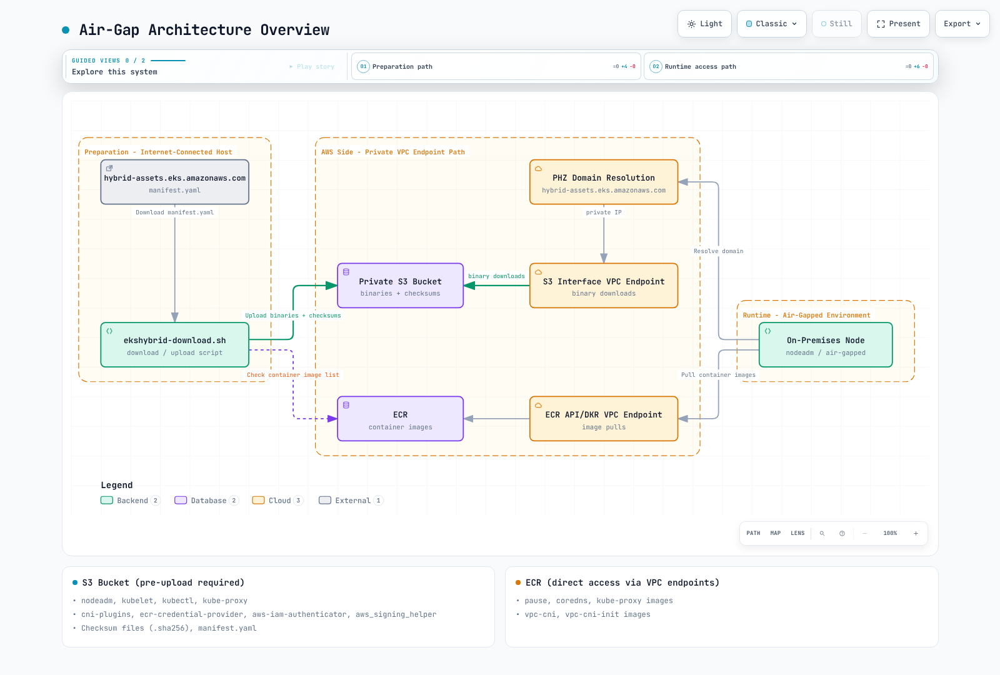

# Configuración con acceso restringido a Internet (S3, endpoints privados y proxy)

< [Anterior: Configuración de red](./02-network-configuration.md) | [Tabla de contenido](./README.md) | [Siguiente: Inicio de nodos](./04-node-bootstrap.md) >

> **Versiones compatibles**: EKS Hybrid Nodes; se verificó el código fuente de nodeadm v1.0.20. Seleccione el conjunto de versiones de Kubernetes, SO, runtime y complementos para su clúster.
> **Última actualización**: September 16, 2026

Este capítulo prepara Hybrid Nodes cuyo acceso público a Internet está restringido. **Hybrid Nodes aún necesitan conectividad con el plano de control de EKS alojado en AWS y con los servicios de AWS que se usan para las credenciales.** La transferencia física de software no convierte Hybrid Nodes en una distribución de Kubernetes desconectada.

Los ejemplos son procedimientos de preparación y revisión, no una implementación de producción probada. La auditoría verificó el código fuente, la configuración y casos de fallo locales; no creó una imagen de SO, publicó artefactos, registró un nodo ni validó una red privada real. No se pudo recuperar el manifiesto público de artefactos en el entorno de auditoría porque falló la verificación del nombre de host TLS. No se omitió ninguna comprobación de certificados, y de esa descarga fallida no se deduce ningún parche o digest actual de los artefactos.

**Material complementario para el equipo de seguridad:** [Revisión de la separación de redes para Hybrid Nodes](11-network-separation-security.md) explica las nuevas conexiones desde el plano de control hacia las instalaciones locales, los tipos de endpoint, los límites de permisos y datos, y las evidencias de revisión. La conectividad privada por sí sola no establece el cumplimiento.

## Límites de conectividad y aislamiento

| Patrón | Qué proporciona | Consideración para Hybrid Nodes |
|---|---|---|
| Red físicamente desconectada | Ninguna conexión activa con AWS | No puede proporcionar la conectividad necesaria con el plano de control de EKS y los servicios de credenciales |
| Proxy de salida controlado | Destinos HTTPS externos aprobados y registros | Configure por separado el instalador, los administradores de paquetes, los daemons del host y los Pods correspondientes |
| VPN/Direct Connect con endpoints privados | Rutas privadas al clúster y a las API de AWS compatibles | Requiere rutas bidireccionales, DNS, grupos de seguridad y autorización; los endpoints no cubren todos los hosts públicos de descarga |
| Transferencia de software sin conexión | Una forma controlada de importar artefactos revisados | Útil junto con la conectividad privada de AWS; no la reemplaza |

Las restricciones de red pueden reducir la exposición, pero no garantizan el cumplimiento normativo, no eliminan la exfiltración de datos ni previenen todos los ataques a la cadena de suministro. La confianza en los certificados, los publicadores aprobados, las firmas, los parches, el acceso de los operadores y los flujos de datos de las aplicaciones siguen siendo controles independientes. La conectividad privada también mantiene dependencias de los servicios de AWS y de la red local.


[🔍 Ver diagrama interactivo](https://www.atomai.click/kubernetes-docs/archmaps/en-eks-hybrid-nodes-03-airgap-setup-0.html)

> **Aclaración del diagrama:** la opción físicamente aislada es una comparación, no un modo de operación compatible con Hybrid Nodes.

## Arquitectura y responsabilidades sobre los artefactos



[🔍 Ver diagrama interactivo](https://www.atomai.click/kubernetes-docs/archmaps/en-eks-hybrid-nodes-03-airgap-setup-1.html)

> **Corrección del diagrama:** el atajo `hybrid-assets.eks.amazonaws.com → PHZ → S3` no es un espejo transparente funcional. Use las rutas de instalación que se indican a continuación. Los cambios de DNS por sí solos no proporcionan el certificado TLS del nombre de host original, el enrutamiento de objetos de S3 ni la autorización de solicitudes.

| Artefacto | Preparación y entrega |
|---|---|
| Hybrid `nodeadm` | Apruebe una versión de `aws/eks-hybrid`; verifique la procedencia y la suma de comprobación antes de ejecutarlo como root. Es distinto de nodeadm de `amazon-eks-ami` para EC2 |
| kubelet, kubectl, complementos de CNI, proveedor de credenciales de ECR, autenticador de IAM | Seleccione una versión/build/SO/arquitectura exactos del manifiesto de artefactos aprobado |
| Ayudante de firma de IAM Roles Anywhere | Seleccione y verifique su propia versión; no elija arbitrariamente el primer elemento de una matriz |
| Instalador/agente de SSM | Ruta de descarga, firma y registro regional independiente; no se redirige por completo con un manifiesto de artefactos de EKS personalizado |
| containerd, runc, iptables y dependencias del SO | Conjunto aprobado de paquetes de SO/runtime, incluidas las dependencias transitivas y los metadatos firmados del repositorio |
| CNI, CoreDNS, kube-proxy, imágenes de sandbox y de cargas de trabajo | Haga un inventario de los manifiestos reales, los contenedores de inicialización, los digests de imagen y las plataformas; el manifiesto binario no proporciona etiquetas de imagen |

Amazon VPC CNI (`aws-node` / `vpc-cni-init`) no es el CNI para Hybrid Nodes. Use el procedimiento compatible de Hybrid CNI en [Configuración de red](./02-network-configuration.md). Incluya kube-proxy solo cuando la ruta de datos del CNI elegido lo utilice. Un conjunto de binarios de complemento CNI no equivale a un controlador CNI implementado.

## Elija una ruta de instalación

### Ruta A: imagen de SO preinstalada

En un entorno de compilación controlado, instale el nodeadm de Hybrid aprobado y ejecute `nodeadm install` con la versión de Kubernetes seleccionada para el clúster y el proveedor de credenciales. AWS documenta este uso para crear imágenes. Conserve los artefactos instalados y el tracker de nodeadm en la imagen.

```bash
# Controlled image builder only; installs software on this host.
set -euo pipefail
: "${KUBERNETES_VERSION:?Approved cluster-compatible version}"
: "${REGION:?}" "${CREDENTIAL_PROVIDER:?ssm or iam-ra}"
case "$CREDENTIAL_PROVIDER" in ssm|iam-ra) ;; *) exit 1 ;; esac
sudo nodeadm install "$KUBERNETES_VERSION" \
  --credential-provider "$CREDENTIAL_PROVIDER" --region "$REGION"
```

El origen predeterminado del runtime es la distribución del SO; ese origen no es compatible con RHEL. Para RHEL, seleccione el origen de paquetes de Docker documentado o preinstale un runtime compatible y use `--containerd-source none`. El origen Docker no es compatible con AL2023. `none` no instala containerd por usted.

**No** inicialice ni registre el entorno de compilación ni clone su identidad. Entregue la activación de SSM o el certificado/clave privada de IAM Roles Anywhere de cada nodo mediante el proceso aprobado para cada nodo. No incluya códigos de activación, claves privadas, estado de registro de SSM, certificados de kubelet ni credenciales de operadores en una imagen reutilizable. Bottlerocket tiene su propio flujo de preparación/inicio y no usa este procedimiento de nodeadm.

Las instalaciones/actualizaciones nuevas de SSM requieren nodeadm **1.0.19 o posterior**, porque las versiones anteriores contienen una clave de firma de SSM obsoleta. Este capítulo inspeccionó **v1.0.20**, no un binario `latest` sin versión específica.

### Ruta B: un manifiesto de artefactos personalizado

El **código fuente de la versión v1.0.20** admite las siguientes opciones, aunque la tabla de opciones de la guía del usuario no las enumera todas:

| Comando/configuración | Comportamiento real en la versión inspeccionada |
|---|---|
| `install --manifest-override file:///path/manifest.json` | Lee el manifiesto local; el decodificador YAML acepta JSON |
| `install --manifest-override https://mirror.example.com/manifest.json` | Descarga el manifiesto con un cliente HTTP convencional |
| `install --private-mode` | Requiere `--manifest-override`; omite la instalación de paquetes del SO, pero sigue instalando los artefactos de credenciales y EKS |
| `init --manifest-override ... --private-mode` | Requiere el argumento del manifiesto y obtiene de este los metadatos de Región; no elimina los requisitos de autenticación de AWS ni de conectividad de EKS |
| `uri` / `checksum_uri` de cada artefacto | Se obtienen por HTTP(S), sin firma S3 SigV4. Un manifiesto `file://` no implica compatibilidad con URL `file://` para los artefactos |
| `gzip_uri` | Tiene prioridad sobre `uri` cuando está presente; la verificación de la suma de comprobación se realiza después de la descompresión |

Compruebe `install --help` y `init --help` del binario implementado exacto antes de usar estas opciones. El modo privado no es un instalador de paquetes sin conexión completo. Preinstale containerd con su unidad systemd, runc, iptables, certificados de CA y todas las dependencias necesarias del SO.

Con `--credential-provider ssm`, v1.0.20 sigue construyendo por separado las URL regionales de `ssm-setup-cli` y de las firmas. El campo `ssm_releases` de un manifiesto no redirige esta ruta de instalación. Planifique el acceso a esos objetos de S3 y a las dependencias posteriores de instalación/registro del agente, o use un flujo de trabajo validado con imagen preinstalada.

### Revise un manifiesto y seleccione un conjunto de versiones

El manifiesto upstream contiene `supported_eks_releases`, `iam_roles_anywhere_releases` y `region_config`. Los registros de Kubernetes incluyen `major_minor_version`, `latest_patch_version`, `patch_releases[].version`, **`patch_version`**, **`release_date`** y URL por artefacto. Varios builds pueden compartir una versión de parche. El ejemplo anterior `1.33.3` ilustraba un esquema histórico, no era evidencia de un parche aprobado actualmente.

Conserve el manifiesto upstream descargado, su fecha/hash de recuperación y el registro de aprobación. Verifique el origen HTTPS antes de seleccionar una versión. El siguiente selector local requiere un parche exacto de Kubernetes, una fecha de build, una versión del ayudante de firma y una arquitectura. Rechaza selecciones ambiguas, artefactos ausentes, claves YAML duplicadas y Regiones desconocidas. Conserva los metadatos reales de Región en lugar de adivinar una cuenta de ECR.

Guarde el archivo como `select-mirror.py` en el host de preparación; requiere Python 3 y PyYAML:

```python
#!/usr/bin/env python3
"""Build a local review plan, not an installer. Requires PyYAML."""
import copy
import datetime
import json
import re
import sys
from pathlib import Path
from urllib.parse import urlsplit

import yaml


class UniqueLoader(yaml.SafeLoader):
    pass


def mapping(loader, node, deep=False):
    result = {}
    for key_node, value_node in node.value:
        key = loader.construct_object(key_node, deep=deep)
        if key in result:
            raise ValueError("duplicate YAML key")
        result[key] = loader.construct_object(value_node, deep=deep)
    return result


UniqueLoader.add_constructor(
    yaml.resolver.BaseResolver.DEFAULT_MAPPING_TAG, mapping
)


def https_url(value):
    if not isinstance(value, str) or any(c.isspace() for c in value):
        raise ValueError("URL must be a nonempty HTTPS URL")
    parsed = urlsplit(value)
    if (parsed.scheme != "https" or not parsed.hostname or parsed.username
            or parsed.password or parsed.query or parsed.fragment):
        raise ValueError("HTTPS URL must not contain credentials, query or fragment")
    return value


def select(manifest, version, build_date, iam_version, arch, region, mirror):
    if not re.fullmatch(r"1\.\d+\.\d+", version):
        raise ValueError("an exact approved Kubernetes patch is required")
    datetime.date.fromisoformat(build_date)
    if arch not in ("amd64", "arm64"):
        raise ValueError("unsupported architecture")
    mirror = https_url(mirror).rstrip("/")
    region_info = manifest["region_config"][region]  # No account fallback.
    if (region_info.get("partition") != "aws"
            or region_info.get("dns_suffix") != "amazonaws.com"
            or not region_info.get("cred_providers", {}).get("iam-ra")
            or not re.fullmatch(r"\d{12}", str(region_info.get("ecr_account_id", "")))):
        raise ValueError("review a supported commercial Region with IAM Roles Anywhere")
    minor, patch = version.rsplit(".", 1)
    releases = [
        release
        for family in manifest["supported_eks_releases"]
        if family["major_minor_version"] == minor
        for release in family["patch_releases"]
        if release["version"] == version and release["patch_version"] == patch
        and release["release_date"] == build_date
    ]
    iam = [
        release for release in manifest["iam_roles_anywhere_releases"]
        if release["version"] == iam_version
    ]
    if len(releases) != 1 or len(iam) != 1:
        raise ValueError("release selection must be unique")
    eks_release, iam_release = copy.deepcopy(releases[0]), copy.deepcopy(iam[0])
    plan = []
    for release, names in [
        (eks_release, ["kubelet", "kubectl", "cni-plugins",
                       "ecr-credential-provider", "aws-iam-authenticator"]),
        (iam_release, ["aws_signing_helper"]),
    ]:
        chosen = []
        for name in names:
            matches = [a for a in release["artifacts"]
                       if a["name"] == name and a["arch"] == arch and a["os"] == "linux"]
            if len(matches) != 1:
                raise ValueError("missing or duplicate artifact: " + name)
            artifact = matches[0]
            item_id = "a%02d" % len(plan)
            plan.append({"id": item_id, "name": name,
                         "uri": https_url(artifact["uri"]),
                         "checksum_uri": https_url(artifact["checksum_uri"])})
            # Use the original, uncompressed URI; its checksum is not a gzip-file hash.
            artifact.pop("gzip_uri", None)
            artifact["uri"] = mirror + "/" + item_id + "/data"
            artifact["checksum_uri"] = mirror + "/" + item_id + "/data.sha256"
            chosen.append(artifact)
        release["artifacts"] = chosen
    selected = {
        "supported_eks_releases": [{
            "major_minor_version": minor, "latest_patch_version": patch,
            "patch_releases": [eks_release],
        }],
        "iam_roles_anywhere_releases": [iam_release],
        "region_config": {region: copy.deepcopy(region_info)},
    }
    return selected, {"artifacts": plan}


def main():
    if len(sys.argv) != 9:
        raise ValueError(
            "usage: select-mirror.py UPSTREAM VERSION BUILD_DATE IAM_VERSION "
            "ARCH REGION HTTPS_MIRROR_PREFIX NEW_OUTPUT_DIR"
        )
    source, version, date, iam, arch, region, mirror, output = sys.argv[1:]
    manifest = yaml.load(Path(source).read_text(), Loader=UniqueLoader)
    selected, plan = select(manifest, version, date, iam, arch, region, mirror)
    out = Path(output)
    out.mkdir(mode=0o700, parents=False, exist_ok=False)
    (out / "upstream.yaml").write_bytes(Path(source).read_bytes())
    (out / "manifest.json").write_text(json.dumps(selected, indent=2) + "\n")
    (out / "plan.json").write_text(json.dumps(plan, indent=2) + "\n")


if __name__ == "__main__":
    main()
```

El directorio de salida debe ser nuevo. El prefijo HTTPS del espejo debe corresponder al mismo prefijo de objetos inmutables que se usa para la publicación. Este script solo crea un plan; no descarga ni se autentica en el espejo.

```bash
set -euo pipefail
: "${APPROVED_PATCH:?}" "${APPROVED_BUILD_DATE:?}" "${APPROVED_IAM_VERSION:?}"
: "${ARCH:?amd64 or arm64}" "${REGION:?}"
: "${MIRROR_PREFIX:?HTTPS URL for this reviewed candidate}"
: "${NEW_PLAN_DIR:?A new local directory}"
python3 select-mirror.py upstream.yaml "$APPROVED_PATCH" "$APPROVED_BUILD_DATE" \
  "$APPROVED_IAM_VERSION" "$ARCH" "$REGION" "$MIRROR_PREFIX" "$NEW_PLAN_DIR"
```

Revise todos los hosts de origen y los seis artefactos seleccionados antes de descargarlos. Este es un **ejemplo de artefactos de IAM Roles Anywhere**, no un espejo del instalador de SSM. No incluye nodeadm, paquetes de SO, imágenes, claves de firma ni certificados.

Guarde el archivo como `download-plan.sh`:

```bash
#!/usr/bin/env bash
# Download into a new plan directory. No AWS writes or host installation.
set -euo pipefail
umask 077
cd -- "${1:?Use the directory produced by select-mirror.py}"
test ! -e checksums.sha256
test ! -e queue.tsv
jq -er '.artifacts[] | [.id, .uri, .checksum_uri] | @tsv' plan.json > queue.tsv
test "$(wc -l < queue.tsv)" -eq 6
while IFS=$'\t' read -r item_id uri checksum_uri; do
  [[ "$item_id" =~ ^a[0-9]{2}$ ]]
  mkdir -- "$item_id"  # Refuse a partial run or existing directory.
  curl --fail --show-error --silent --location \
    --proto '=https' --proto-redir '=https' --connect-timeout 10 \
    --max-time 300 --max-filesize 268435456 \
    "$uri" -o "$item_id/data"
  curl --fail --show-error --silent --location \
    --proto '=https' --proto-redir '=https' --connect-timeout 10 \
    --max-time 30 --max-filesize 4096 \
    "$checksum_uri" -o "$item_id/upstream.sha256"
  expected=$(python3 - "$item_id/upstream.sha256" <<'CHECKSUM_PY'
import pathlib, re, sys
text = pathlib.Path(sys.argv[1]).read_text().strip()
match = re.fullmatch(r"([0-9a-fA-F]{64})(?:[ \t]+[^\r\n]+)?", text)
if not match:
    raise SystemExit("missing, malformed or multi-record upstream checksum")
print(match.group(1).lower())
CHECKSUM_PY
)
  actual=$(sha256sum "$item_id/data")
  [[ "${actual%% *}" == "$expected" ]]
  # nodeadm v1.0.20 requires GNU format: digest, space, filename.
  printf '%s  data\n' "$expected" > "$item_id/data.sha256"
done < queue.tsv
sha256sum manifest.json plan.json upstream.yaml a*/data a*/data.sha256 \
  > checksums.sha256
sha256sum --strict --check checksums.sha256
printf '%s\n' 'Six artifacts verified locally; publishing and node installation remain separate.'
```

El límite de tamaño es de 256 MiB por artefacto de forma intencional; revíselo si un artefacto aprobado lo supera. Una descarga fallida, una suma de comprobación mal formada o una discrepancia de hash detienen el script. Se conserva un directorio parcial para inspeccionarlo; inicie un candidato nuevo después de resolver la causa. No elimine un directorio compartido de `/tmp` ni omita sumas de comprobación ausentes.

Estos hashes vinculan los bytes seleccionados con las sumas de comprobación recuperadas. No son una firma independiente ni demuestran que un publicador comprometido sea confiable. Proteja el registro revisado de manifiesto/sumas de comprobación y use la verificación del publicador cuando esté disponible.

## Publicación en S3 privado y autorización

Use un bucket **previamente creado y de su propiedad**, con Bloqueo de acceso público, cifrado aprobado, control de versiones/retención y permisos separados para publicadores y lectores. Los siguientes ejemplos no crean un bucket ni reemplazan su política. AccessDenied, las credenciales vencidas y los tiempos de espera agotados son errores, no pruebas de que un bucket/objeto no exista.

Un ejemplo de *declaración de política para lectores* para un bucket existente:

```json
{
  "Sid": "ReadApprovedHybridArtifacts",
  "Effect": "Allow",
  "Principal": {"AWS": "arn:aws:iam::111122223333:role/HybridArtifactReader"},
  "Action": "s3:GetObject",
  "Resource": "arn:aws:s3:::example-hybrid-artifacts/hybrid-candidates/*",
  "Condition": {"StringEquals": {"aws:SourceVpce": "vpce-0123456789abcdef0"}}
}
```

Reemplace la cuenta, el rol, el bucket, el prefijo y el endpoint por valores revisados. Esta declaración concede acceso a una ruta; no revoca otros permisos existentes. Un `Deny s3:*` para todo el bucket que se aplique a cada solicitud fuera de un endpoint puede bloquear también al publicador conectado y la recuperación administrativa. Diseñe explícitamente esas rutas antes de aplicar ese límite.

La política con principal especificado requiere una solicitud firmada. **El descargador HTTPS convencional de nodeadm no se convierte en un cliente de S3 autenticado con IAM porque el nodo tenga un rol de IAM.** Dos diseños que se pueden validar son:

1. Use un agente/CLI de preparación autenticado para obtener los archivos aprobados y luego ofrézcalos mediante un servicio de artefactos HTTPS controlado por la organización, con controles de acceso de red adecuados y un certificado para su propio nombre de host.
2. Use la ruta de imagen preinstalada, sin depender de un espejo de binarios en tiempo de ejecución.

Una URL de objeto privado de S3 que devuelve `403` no se arregla con una anulación de DNS. No incluya URL prefirmadas portadoras de tokens ni credenciales en manifiestos, argumentos de procesos o registros publicados. Si una organización opta por lecturas no autenticadas de binarios no secretos restringidas a una red privada, esa es una política distinta y debe revisarse explícitamente; no es la política con principal especificado descrita anteriormente.

Guarde el archivo como `publish-plan.sh`. Ejecútelo solo después de que el propietario del bucket apruebe el candidato y los permisos; este script **escribe objetos en S3**:

```bash
#!/usr/bin/env bash
# Owner-approved publication only; creates billable S3 objects, never a bucket.
set -euo pipefail
umask 077
cd -- "${1:?Use a verified plan directory}"
: "${REGION:?}" "${BUCKET:?}" "${EXPECTED_ACCOUNT_ID:?}" "${PREFIX:?}"
[[ "$EXPECTED_ACCOUNT_ID" =~ ^[0-9]{12}$ ]]
[[ "$PREFIX" =~ ^hybrid-candidates/[A-Za-z0-9-]+$ ]]
sha256sum --strict --check checksums.sha256
aws s3api head-bucket --region "$REGION" --bucket "$BUCKET" \
  --expected-bucket-owner "$EXPECTED_ACCOUNT_ID"
# Manifest is last. Any failed write stops; retain the partial prefix for review.
for file in a{00..05}/data a{00..05}/data.sha256 checksums.sha256 \
            upstream.yaml plan.json manifest.json; do
  test -f "$file"
  aws s3api put-object --region "$REGION" --bucket "$BUCKET" \
    --expected-bucket-owner "$EXPECTED_ACCOUNT_ID" \
    --key "$PREFIX/$file" --body "$file" --if-none-match '*' \
    --server-side-encryption AES256 --checksum-algorithm SHA256 \
    --output json > "${file//\//_}.upload.json"
done
printf '%s\n' 'Candidate uploaded. Verify readback, mirror URL mapping and hashes before promotion.'
```

Para un bucket que requiera SSE-KMS, use la clave aprobada y los permisos de KMS correspondientes en lugar del ejemplo AES256. Las escrituras condicionales impiden sobrescribir una clave existente; no hacen atómica una carga de varios objetos. El manifiesto se carga al final, y un candidato con errores sigue sin publicarse hasta verificar la lectura posterior y la correspondencia HTTPS real del espejo. Registre los VersionId/sumas de comprobación de los objetos devueltos y la retención; los ETag de S3 no son siempre un digest SHA-256.

## Requisitos de DNS y endpoints privados

`hybrid-assets.eks.amazonaws.com` es el host de descarga de AWS CloudFront. Crear una PHZ con ese nombre y asignarle un alias a S3 no conserva:

- el certificado TLS/nombre de host SNI;
- el encabezado HTTP Host y la correspondencia entre bucket/clave de objeto de S3;
- las rutas originales, especialmente si un cargador aplanó todos los nombres;
- la autorización de solicitudes.

No lo resuelva desactivando las comprobaciones TLS. Mantenga accesible el origen aprobado mediante un proxy controlado, use la imagen preinstalada o use anulaciones compatibles del manifiesto con URL reales del espejo.

Los endpoints **Interface** de S3 pueden servir a clientes locales a través de VPN/Direct Connect. Se admite el DNS privado de S3. La opción **Private DNS only for inbound Resolver** requiere un endpoint de gateway de S3 mantenido para el lado de la VPC; otra opción es enrutar las solicitudes de la VPC y de las instalaciones locales a través del endpoint de interfaz. No se puede acceder directamente desde las instalaciones locales a un endpoint de gateway por sí solo.

Seleccione endpoints según los ID de VPC y de endpoint revisados, no el primer endpoint de S3 de una Región. Use el procedimiento de DNS/enrutamiento de [Configuración de red](./02-network-configuration.md). Los endpoints de la API de administración de EKS no son el endpoint de la API de Kubernetes; los endpoints privados de ECR no proporcionan acceso general a ECR público ni a CloudFront.

## Instale e inicialice un nodo preparado

Para la ruta personalizada de IAM Roles Anywhere, el runtime, las dependencias del SO, nodeadm aprobado y el servicio de espejo ya deben estar preparados. El comando instala software en el nodo de destino:

```bash
set -euo pipefail
: "${APPROVED_PATCH:?}" "${REGION:?}" "${LOCAL_MANIFEST:?Absolute local path}"
[[ "$LOCAL_MANIFEST" = /* ]]
test -s "$LOCAL_MANIFEST"
sudo nodeadm install "$APPROVED_PATCH" --region "$REGION" \
  --credential-provider iam-ra --containerd-source none \
  --manifest-override "file://$LOCAL_MANIFEST" --private-mode
```

Prepare la configuración por nodo siguiendo [Requisitos previos](./01-prerequisites.md) y [Inicio de nodos](./04-node-bootstrap.md). Por ejemplo, la **estructura** de la configuración de SSM es:

```yaml
apiVersion: node.eks.aws/v1alpha1
kind: NodeConfig
spec:
  cluster:
    name: my-hybrid-cluster
    region: ap-northeast-2
  hybrid:
    ssm:
      activationCode: REPLACE_WITH_NODE_ACTIVATION_CODE
      activationId: REPLACE_WITH_NODE_ACTIVATION_ID
```

Use exactamente el proveedor instalado en el nodo; esta estructura de SSM no es la configuración del comando de IAM Roles Anywhere anterior. Proteja el archivo rellenado (propiedad de root, modo `0600`), nunca lo confirme en el repositorio y no incluya secretos en el historial de shell. Proporcionar manualmente campos de endpoint de API/CA no elimina la necesidad de la ruta documentada de descubrimiento y autenticación del clúster.

```bash
# Local config validation; this is not a join or an end-to-end network test.
sudo nodeadm config check --config-source file:///etc/eks/nodeconfig.yaml
```

Después de que se cumplan los requisitos previos de red, identidad y CNI, el propietario puede ejecutar `nodeadm init`. En la ruta con manifiesto privado, vuelva a pasar el manifiesto aprobado:

```bash
# Mutates the target node and registers it with EKS.
sudo nodeadm init --config-source file:///etc/eks/nodeconfig.yaml \
  --manifest-override file:///etc/eks/manifest.json --private-mode
```

La versión inspeccionada no incluye `nodeadm init --dry-run`. No omita la validación de la inicialización solo para que pase una preparación incompleta.

## Entrega de imágenes de contenedor

Las extracciones desde ECR privado requieren las rutas de ECR API y DKR, la ruta de descarga de capas de S3, DNS y los permisos adecuados para extraer imágenes. Una llamada correcta a `describe-repositories` no demuestra que se puedan descargar las capas de imágenes. Rellene y pruebe cualquier caché pull-through; la documentación de endpoints de ECR describe requisitos adicionales de Internet para la primera extracción sin caché.

Use las referencias reales de registro/cuenta/Región/imagen de los manifiestos de complementos implementados. No construya etiquetas de imagen añadiendo `-eksbuild.1` a un parche de Kubernetes ni copie versiones obsoletas de pause/CoreDNS de un clúster no relacionado.

nodeadm instala el helper de ECR en `/etc/eks/image-credential-provider/ecr-credential-provider` e inicializa su configuración en `/etc/eks/image-credential-provider/config.json`. Revise la configuración generada de kubelet en lugar de escribir un archivo sin uso en otro directorio. `ctr images pull` es un cliente independiente y no usa automáticamente el proveedor de credenciales exec de kubelet.

### Transferencia de imágenes sin conexión

Seleccione un digest aprobado y las plataformas necesarias. Para un archivo mult plataforma, conserve el índice y los digests cuando lo permitan los formatos de origen/destino:

```bash
# Preparation host: downloads images; requires reviewed registry authentication.
set -euo pipefail
: "${SOURCE_DIGEST_REF:?registry/repository@sha256:approved-digest}"
: "${NEW_IMAGE_DIR:?New directory}"
[[ "$SOURCE_DIGEST_REF" =~ @sha256:[0-9a-f]{64}$ ]]
mkdir -m 700 -- "$NEW_IMAGE_DIR"
skopeo copy --all --preserve-digests "docker://$SOURCE_DIGEST_REF" \
  "oci-archive:$NEW_IMAGE_DIR/image.tar:approved"
(cd "$NEW_IMAGE_DIR" && sha256sum image.tar > image.tar.sha256)
```

Transfiera el archivo y su registro de aprobación/hash protegido de forma independiente. Antes de importarlo o enviarlo, ejecute `sha256sum --strict --check image.tar.sha256` en ese directorio y deténgase si falla. Para un destino de registro interno:

```bash
# Internal staging host: writes an image to the reviewed destination registry.
set -euo pipefail
: "${DEST_DIGEST_REF:?approved-registry/repository@sha256:approved-digest}"
[[ "$DEST_DIGEST_REF" =~ @sha256:[0-9a-f]{64}$ ]]
sha256sum --strict --check image.tar.sha256
skopeo copy --all --preserve-digests oci-archive:image.tar:approved \
  "docker://$DEST_DIGEST_REF"
```

No desactive la verificación TLS del registro. Cambiar la compresión o el formato del manifiesto puede impedir conservar un digest; deténgase y revise la identidad resultante en lugar de afirmar silenciosamente que no ha cambiado.

La precarga directa en containerd es otra opción, pero debe probarse con el runtime implementado: Kubernetes usa el espacio de nombres `k8s.io`, las referencias importadas deben coincidir con las referencias de Pod/sandbox y deben existir todos los blobs de las plataformas requeridas. La anotación `approved` de un archivo no es automáticamente el nombre del registro que solicita un Pod. La recolección de basura de imágenes y `imagePullPolicy` también pueden provocar extracciones posteriores. Una importación correcta del tar por sí sola no demuestra que un Pod sin conexión vaya a iniciarse.

## Repositorios locales de paquetes firmados

Duplique la versión del SO, la arquitectura, las dependencias transitivas y los metadatos como un conjunto revisado. Conserve las firmas del proveedor o firme un repositorio mantenido por la organización con una clave de confianza independiente.

Ejemplo de configuración de cliente Ubuntu para un repositorio local plano **ya preparado y firmado**:

```text
deb [signed-by=/etc/apt/keyrings/hybrid-mirror.gpg] file:///srv/apt-repo ./
```

El repositorio necesita `Release` válido y `InRelease` o `Release.gpg`, no solo `Packages.gz`. Distribuya y verifique la huella digital de la clave mediante una ruta de confianza independiente. No use `trusted=yes` para omitir la autenticación del repositorio.

Ejemplo de configuración de repositorio DNF/YUM:

```ini
[hybrid-local]
name=Reviewed hybrid packages
baseurl=file:///srv/yum-repo
enabled=1
gpgcheck=1
repo_gpgcheck=1
gpgkey=file:///etc/pki/rpm-gpg/RPM-GPG-KEY-hybrid-mirror
```

Esto requiere firmas de paquetes válidas y metadatos de repositorio firmados. Las claves de firma de metadatos y paquetes pueden ser distintas; configure el conjunto de claves aprobado. No establezca `gpgcheck=0` cuando falle la verificación. La instalación de paquetes y los reinicios de servicios corresponden a una compilación de imagen o a una operación de mantenimiento con los nodos desalojados, no a un script arbitrario de verificación en un nodo activo.

## Configuración del proxy

Primero, cree un mapa de destinos por cliente. Incluya loopback, los nombres reales de las API/registros privados y los rangos de nodo/Pod/Service que deben omitir el proxy. La coincidencia de CIDR y sufijos varía según el cliente. No incluya **`.eks.amazonaws.com`** a ciegas en `NO_PROXY`: también coincide con el host público de descarga `hybrid-assets.eks.amazonaws.com`.

Ejemplo de shell para una configuración de proxy revisada y sin secretos:

```bash
export HTTP_PROXY=http://proxy.internal.example.com:3128
export HTTPS_PROXY=http://proxy.internal.example.com:3128
export NO_PROXY=localhost,127.0.0.1,::1,.svc,.cluster.local,registry.internal.example.com
export http_proxy="$HTTP_PROXY" https_proxy="$HTTPS_PROXY" no_proxy="$NO_PROXY"
```

Añada el nombre de host/IP real de la API privada y otros destinos que deban omitir el proxy; esto no es una configuración completa del sitio. El entorno de un shell de inicio de sesión no configura los servicios systemd existentes. No obtenga ni añada repetidamente contenido a `/etc/environment`.

Para `containerd.service` y `kubelet.service`, use un archivo complementario administrado por el propietario en `/etc/systemd/system/UNIT.service.d/http-proxy.conf`:

```ini
[Service]
Environment="HTTP_PROXY=http://proxy.internal.example.com:3128"
Environment="HTTPS_PROXY=http://proxy.internal.example.com:3128"
Environment="NO_PROXY=localhost,127.0.0.1,::1,.svc,.cluster.local,registry.internal.example.com"
```

Revise los archivos complementarios existentes y reinicie las unidades afectadas solo durante la fase de compilación/mantenimiento aprobada. Una sección `[proxy.http]` en TOML de containerd no es la configuración del proxy HTTP.

| Componente | Configuración y condiciones |
|---|---|
| Proceso nodeadm | Pase solo el entorno de proxy revisado mediante `sudo`; no reenvíe todo el entorno del operador con `sudo -E` |
| containerd / kubelet | Entorno systemd independiente; la configuración generada de kubelet y el entorno del host son capas distintas |
| SSM en Ubuntu con la instalación snap documentada | `snap.amazon-ssm-agent.amazon-ssm-agent.service.d/http-proxy.conf` |
| SSM en AL2023/RHEL | `amazon-ssm-agent.service.d/http-proxy.conf`; confirme la unidad instalada real |
| Proceso de credenciales de IAM Roles Anywhere | nodeadm detecta las variables de proxy al generar `--with-proxy`; el daemon que lo invoca también debe recibir el entorno correcto |
| IAM Roles Anywhere con `spec.hybrid.enableCredentialsFile: true` | El servicio `aws_signing_helper_update.service` **sí existe** en este modo; configure su archivo complementario antes de la inicialización. No dé por hecho que el servicio está presente en todas las instalaciones de IAM Roles Anywhere |
| apt | Archivo `/etc/apt/apt.conf.d/` administrado por el propietario con `Acquire::http::Proxy` y `Acquire::https::Proxy` |
| snap | `snap set system proxy.http=... proxy.https=...`, cuando se use snap |
| dnf / yum | Revise y actualice la configuración existente de `proxy`; no reemplace las demás opciones ni añada duplicados |
| kube-proxy / otros Pods | Configure el entorno de sus Pods solo cuando su tráfico requiera el proxy |

Para la topología de proxy documentada, configure kube-proxy después de crear el clúster y antes de unir los nodos híbridos. Conserve el entorno `NODE_NAME` existente y todos los argumentos del comando. Lo siguiente es un **fragmento de parche de combinación estratégica**, no un DaemonSet independiente:

```yaml
spec:
  template:
    spec:
      containers:
        - name: kube-proxy
          env:
            - name: HTTP_PROXY
              value: http://proxy.internal.example.com:3128
            - name: HTTPS_PROXY
              value: http://proxy.internal.example.com:3128
            - name: NO_PROXY
              value: localhost,127.0.0.1,::1,.svc,.cluster.local
```

Revise/amplíe los destinos que deben omitir el proxy y aplique los cambios mediante el propietario del complemento. Una combinación estratégica integrada de DaemonSet usa los nombres de contenedores/variables de entorno; `add /containers/0/env` de JSON Patch puede reemplazar todo el entorno existente y da por sentado el índice del contenedor. No implemente kube-proxy solo por este ejemplo si el CNI elegido lo reemplaza.

## Validación y actualizaciones controladas

| Comprobación | Evidencia necesaria | Qué no es suficiente |
|---|---|---|
| Integridad de los artefactos | Cada archivo seleccionado, suma de comprobación, manifiesto aprobado y conjunto de versiones coincide | Omitir archivos ausentes o aceptar cero archivos verificados |
| DNS/TLS | Destino correcto y validación de nombre de host/CA en la ruta prevista | Una dirección `10.*`, cualquier dirección `172.*` o `curl -k` |
| S3 | Lectura real autorizada del bucket/clave/versión exactos, propietario esperado y hash | Enumerar un prefijo o tratar errores de API como ausencia |
| ECR | Extracción real del digest/plataforma y las capas necesarios mediante la ruta de credenciales de la carga de trabajo | `describe-repositories` o una llamada `ctr` independiente sin autenticación |
| Configuración de nodeadm | `nodeadm config check` se ejecuta correctamente con un archivo protegido y rellenado | Contar una configuración ausente como correcta o usar un `init --dry-run` inexistente |
| Operación del nodo | Actualización de credenciales, confianza/autenticación de la API de Kubernetes, CNI/DNS y una prueba acotada de carga de trabajo | Una comprobación correcta del analizador local o una única respuesta `/healthz` |

Use `nodeadm debug --config-source file:///etc/eks/nodeconfig.yaml` para los diagnósticos documentados de conectividad/identidad cuando se autoricen las lecturas de AWS. Se conecta a servicios y puede emitir contexto de diagnóstico sensible; mantenga la salida en privado y enmascárela antes de compartirla. No convierta las comprobaciones desconocidas/fallidas en “listo para producción”.

La automatización de actualizaciones debe **detectar candidatos** y luego exigir la verificación del origen, la revisión de compatibilidad, el análisis del SO/las imágenes, la validación local, una prueba piloto en un nodo representativo y la aprobación antes de promoverlos. Publique con un nuevo prefijo inmutable de versión/build, conserve el conjunto aprobado anterior y registre los límites de reversión. No ejecute un cron que sobrescriba silenciosamente las claves `latest` de producción; `nodeadm upgrade` causa interrupciones y requiere evacuar las cargas de trabajo.

El almacenamiento en caché de capas, la compresión y la sincronización de imágenes solo para las plataformas necesarias pueden reducir el volumen de transferencia. Compare los bytes realmente transferidos antes y después de aplicar estas técnicas y calcule el ahorro para las imágenes seleccionadas y la reutilización de capas. Si se recomprime contenido aprobado, vuelva a comprobar su digest y envíe los artefactos modificados a través del proceso de aprobación.

## Referencias principales

- [Referencia de nodeadm de Hybrid de AWS](https://docs.aws.amazon.com/eks/latest/userguide/hybrid-nodes-nodeadm.html)
- [Preparación de sistemas operativos para Hybrid](https://docs.aws.amazon.com/eks/latest/userguide/hybrid-nodes-os.html)
- [Configuración de proxy para Hybrid](https://docs.aws.amazon.com/eks/latest/userguide/hybrid-nodes-proxy.html)
- [Opciones de instalación de nodeadm v1.0.20](https://github.com/aws/eks-hybrid/blob/v1.0.20/cmd/nodeadm/install/install.go) y [opciones de init](https://github.com/aws/eks-hybrid/blob/v1.0.20/cmd/nodeadm/init/init.go)
- [Implementación de selección/descarga de artefactos](https://github.com/aws/eks-hybrid/blob/v1.0.20/internal/aws/source.go) y [origen de SSM](https://github.com/aws/eks-hybrid/blob/v1.0.20/internal/ssm/source.go)
- [Endpoints de interfaz/DNS privado de S3](https://docs.aws.amazon.com/AmazonS3/latest/userguide/privatelink-interface-endpoints.html)
- [Endpoints de VPC de ECR](https://docs.aws.amazon.com/AmazonECR/latest/userguide/vpc-endpoints.html)
- [Copia con Skopeo](https://github.com/containers/skopeo/blob/main/docs/skopeo-copy.1.md)
- [Autenticación de repositorios APT](https://manpages.ubuntu.com/manpages/noble/man8/apt-secure.8.html)
- [Configuración de firmas de repositorios DNF](https://github.com/rpm-software-management/dnf/blob/master/doc/conf_ref.rst)
- [Condiciones, cifrado y sumas de comprobación de S3 PutObject](https://docs.aws.amazon.com/AmazonS3/latest/API/API_PutObject.html)
- [Nombres, digests y políticas de extracción de imágenes de Kubernetes](https://kubernetes.io/docs/concepts/containers/images/)

< [Anterior: Configuración de red](./02-network-configuration.md) | [Tabla de contenido](./README.md) | [Siguiente: Inicio de nodos](./04-node-bootstrap.md) >
