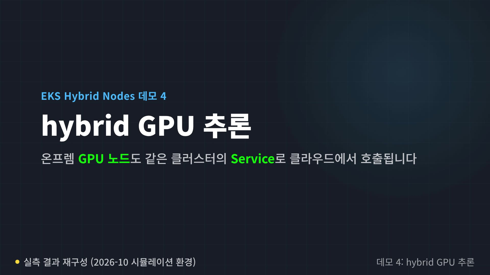

# Integración de servidores GPU

< [Anterior: Inicio de nodos](./04-node-bootstrap.md) | [Tabla de contenidos](./README.md) | [Siguiente: Estrategias de ubicación de cargas de trabajo](./06-workload-placement.md) >

> **Versiones compatibles**: Los ejemplos de GPU DRA requieren Kubernetes 1.34.2+ en una versión de EKS compatible. Interfaces revisadas: GPU Operator 26.7.0, controlador DRA 0.5.0, plugin de dispositivos 0.20.0.
> **Última actualización**: 18 de octubre de 2026

Este capítulo integra hosts NVIDIA con GPU preparados con EKS Hybrid Nodes. Abarca la asignación, la administración de GPU Operator, MIG y time-slicing. **Para esta auditoría no se ejecutaron GPU, no se instalaron controladores ni se descargaron modelos, y tampoco se realizó una prueba de rendimiento de inferencia.** Los ejemplos requieren una combinación aprobada de SO/kernel/controlador/toolkit/entorno de ejecución/imagen y pruebas en el hardware real.

## Elija un propietario de asignación por GPU

| Ruta | Requisitos previos y asignación |
|---|---|
| Plugin de dispositivos NVIDIA independiente | Controlador del host preparado, NVIDIA Container Toolkit y entorno de ejecución; anuncia recursos extendidos como `nvidia.com/gpu` |
| Controlador DRA independiente | Controlador preparado y entorno de ejecución CDI; publica ResourceSlices y asigna mediante DeviceClass/ResourceClaim |
| GPU Operator con `ClusterPolicy` | Flujo de trabajo del plugin de dispositivos administrado por Operator; quién administra los componentes de controlador/toolkit/MIG debe coincidir con lo ya instalado |
| GPU Operator 26.7 con `GPUCluster` | Flujo de trabajo DRA administrado por Operator para una instalación nueva; no puede coexistir con `ClusterPolicy` en el clúster |

AWS recomienda DRA para nuevos despliegues de EKS 1.34+ con aprovisionamiento de capacidad estática compatible. **El controlador NVIDIA DRA no es compatible con EKS Auto Mode**, que ya administra su plugin de dispositivos GPU; AWS dirige Auto Mode y la capacidad dinámica de Karpenter al plugin de dispositivos NVIDIA (sección de Kubernetes 1.37 de las [notas de la versión de soporte estándar de EKS](https://docs.aws.amazon.com/eks/latest/userguide/kubernetes-versions-standard.html), consultada el 12 de octubre de 2026). Los ejemplos independientes a continuación se dirigen solo a los nodos GPU Hybrid identificados; no instale administradores de asignación duplicados en Auto Mode ni en otros nodos GPU.

Use etiquetas distintas administradas por el propietario, como `workload.example.com/gpu-allocation=device-plugin` o `dra`. Esas etiquetas son entradas para la programación, no un límite de seguridad ni evidencia de que el hardware GPU esté en buen estado. Verifique que ningún otro plugin/Operator publique los mismos dispositivos físicos antes de habilitar cualquiera de las rutas.

## Prepare y verifique el grupo de hosts

- Complete [Inicio de nodos](./04-node-bootstrap.md), incluida la identidad Hybrid, el CNI y la sincronización horaria.
- Compruebe el modelo y el formato de GPU, el firmware, la rama del controlador, el SO/kernel y el entorno de ejecución según la matriz de NVIDIA y la compatibilidad de SO de AWS para Hybrid Nodes. Una matriz de NVIDIA más reciente no significa que EKS ofrezca todas las versiones de Kubernetes que se indican allí.
- Verifique que el controlador y NVIDIA Container Toolkit estén instalados realmente. Que el host esté en las instalaciones no significa que ya tenga un controlador.
- Para el ejemplo heredado, prepare un `RuntimeClass` existente llamado `nvidia`, respaldado por el controlador de entorno de ejecución NVIDIA de containerd ya configurado. El nombre de la clase por sí solo no configura dicho controlador.
- Para la asignación de GPU DRA 0.5.0, la guía de requisitos previos publicada exige Kubernetes **1.34.2+**, un controlador independiente **565+**, NVIDIA Container Toolkit **1.18+** y un entorno de ejecución con CDI habilitado. El flujo de trabajo DRA de GPU Operator requiere un controlador **580+**. Estos son mínimos de compatibilidad, no recomendaciones de parches o ramas actuales.
- Prepare las etiquetas de descubrimiento mediante la instalación aprobada de NFD/GFD o el proceso de inventario de hosts. No despliegue un segundo controlador de descubrimiento solo porque un ejemplo habilite uno.

La siguiente comprobación, ejecutada por el operador, lee metadatos de GPU del host; no es una prueba de rendimiento de CUDA ni de LLM:

```bash
nvidia-smi --query-gpu=name,driver_version,uuid,memory.total --format=csv,noheader
```

Una salida que muestre `cpu: 128`, `memory: 1024Gi`, `nvidia.com/gpu: 8` en el ejemplo anterior era una **ilustración no verificada**, no una medición de esta auditoría. La capacidad GPU de Kubernetes puede representar GPUs físicas, instancias MIG o réplicas de time-slicing, según la configuración.

## Plugin de dispositivos independiente en nodos Hybrid seleccionados

Los siguientes valores requieren el controlador y el entorno de ejecución preinstalados, además de una configuración de descubrimiento compatible. Las dos etiquetas selectoras del nodo se combinan con la afinidad de descubrimiento de GPU del chart. Si no coincide ningún nodo, corrija el inventario o las etiquetas; no elimine la afinidad solo para que se ejecuten los Pods.

```yaml
nodeSelector:
  eks.amazonaws.com/compute-type: hybrid
  workload.example.com/gpu-allocation: device-plugin
runtimeClassName: nvidia
migStrategy: none
failOnInitError: true
deviceListStrategy: envvar
gfd:
  enabled: false
nfd:
  enabled: false
resources:
  requests:
    cpu: 50m
    memory: 64Mi
  limits:
    cpu: 500m
    memory: 256Mi
```

Guarde como `device-plugin-values.yaml`. El chart revisado es **0.20.0**; verifique la ruta de actualización deseada y la compatibilidad de imágenes antes del despliegue:

```bash
# Cluster write; installs a privileged infrastructure component.
set -euo pipefail
umask 077
: "${KUBECONFIG:?}" "${CONTEXT:?}"
kubectl --kubeconfig "$KUBECONFIG" --context "$CONTEXT" get nodes \
  -l 'eks.amazonaws.com/compute-type=hybrid,workload.example.com/gpu-allocation=device-plugin' \
  -o json > plugin-nodes.json
jq -e '.items | length > 0 and
  all(.[]; .metadata.labels["nvidia.com/mps.capable"] != "true")' plugin-nodes.json
helm repo add nvdp https://nvidia.github.io/k8s-device-plugin
helm repo update nvdp
helm install hybrid-gpu-plugin nvdp/nvidia-device-plugin \
  --version 0.20.0 --namespace gpu-system --create-namespace \
  --kubeconfig "$KUBECONFIG" --kube-context "$CONTEXT" \
  --values device-plugin-values.yaml --wait --timeout 10m
```

Use un espacio de nombres y una versión que pertenezcan al operador de infraestructura GPU. Revise el RBAC renderizado, las rutas del host, los privilegios, el acceso al registro y las tolerations. Que `--wait` de Helm finalice correctamente no demuestra la compatibilidad con CUDA ni el rendimiento de la carga de trabajo.

El chart 0.20.0 publicado también genera un DaemonSet de control de MPS, restringido por `nvidia.com/mps.capable=true` y la cohorte Hybrid seleccionada. Este ejemplo de GPU exclusiva se detiene si esa etiqueta ya está configurada. Investigue quién administra el MPS existente en lugar de eliminar la etiqueta sin más; no suponga que el chart contiene un solo DaemonSet.

## DRA independiente en una cohorte Hybrid GPU separada

El proyecto actual del controlador es **`kubernetes-sigs/dra-driver-nvidia-gpu`**. La estabilidad de la API DRA, la compatibilidad de EKS y la madurez de las funciones de cada proveedor son comprobaciones independientes. La documentación actual de NVIDIA 26.7 identifica la asignación de GPU completa y MIG existente como GA; MIG dinámico, MPS, algunas opciones de uso compartido y las funciones de estado de asignación NVML tienen gates Alpha independientes. No habilite todos los feature gates para que una demostración se inicie.

El texto anterior del README del repositorio etiquetado describe la asignación GPU como no compatible. La documentación publicada de requisitos previos/instalación y la tabla actual de capacidades de NVIDIA ofrecen la orientación más reciente y específica por función. Registre la versión exacta y el contrato de soporte para un despliegue de producción.

El ejemplo deshabilita ComputeDomains porque la asignación normal de H100/H200 no requiere orquestación NVLink de varios nodos. ComputeDomains tienen requisitos adicionales de Grace Blackwell/MNNVL, IMEX y descubrimiento.

```yaml
gpuResourcesEnabledOverride: true
nvidiaDriverRoot: /
resources:
  gpus:
    enabled: true
  computeDomains:
    enabled: false
featureGates: {}
kubeletPlugin:
  nodeSelector:
    eks.amazonaws.com/compute-type: hybrid
    workload.example.com/gpu-allocation: dra
  updateStrategy:
    type: RollingUpdate
    rollingUpdate:
      maxUnavailable: 1
  containers:
    gpus:
      resources:
        requests:
          cpu: 50m
          memory: 128Mi
        limits:
          cpu: "1"
          memory: 512Mi
webhook:
  enabled: false
```

Guarde como `dra-values.yaml`. Esta ruta supone que la raíz del controlador del host es `/` y que CDI está configurado. Un controlador instalado por Operator suele usar una raíz distinta; no copie este valor en ese despliegue.

```bash
# Alternative cluster write, only for the separately selected DRA cohort.
set -euo pipefail
: "${KUBECONFIG:?}" "${CONTEXT:?}"
helm install hybrid-gpu-dra \
  oci://registry.k8s.io/dra-driver-nvidia/charts/dra-driver-nvidia-gpu \
  --version 0.5.0 --namespace gpu-dra-system --create-namespace \
  --kubeconfig "$KUBECONFIG" --kube-context "$CONTEXT" \
  --values dra-values.yaml --wait --timeout 10m
```

`gpuResourcesEnabledOverride=true` sigue siendo necesario en este chart para recursos GPU. Su presencia no afirma que todas las funciones GPU sean Alpha. El webhook de admisión opcional está deshabilitado en este ejemplo mínimo; habilitarlo requiere endpoints de webhook accesibles y una configuración validada de TLS/cert-manager o secreto existente.

### Alternativa de GPU Operator y propiedad

Use GPU Operator cuando el ciclo de vida de sus componentes administrados coincida con la instalación prevista. `driver.enabled=false` es adecuado **solo si ya se verificó el controlador del host**. Del mismo modo, deshabilite la administración del toolkit solo después de preparar la configuración del entorno de ejecución necesaria. Las actualizaciones de Operator pueden cambiar controladores, validadores, el anuncio de recursos y la disponibilidad de los nodos.

Para **DRA administrado por Operator en una instalación nueva**, los valores documentados incluyen:

```yaml
clusterPolicy:
  deployCR: false
gpuCluster:
  deployCR: true
driver:
  enabled: false
nfd:
  enabled: false
draDriver:
  computeDomains:
    enabled: false
```

Este fragmento supone que ya se prepararon un controlador aprobado, el entorno de ejecución CDI y la instalación de descubrimiento. GPUCluster no proporciona automáticamente la administración de toolkit/MIG de ClusterPolicy. Revise todos los valores del chart **26.7.0** y luego impleméntelo a través del responsable de GPU del clúster.

`GPUCluster` es un recurso único, con ámbito de clúster, llamado `gpu-cluster`. No puede coexistir con `ClusterPolicy`. Este flujo de trabajo no admite la migración in situ desde ClusterPolicy ni desde una versión independiente de Helm DRA a GPUCluster; use la ruta documentada para una instalación nueva. No instale otra versión DRA independiente en un despliegue administrado por Operator.

El `nodeSelector` del controlador de Operator **no** restringe todos los operandos. Su ubicación usa el descubrimiento de GPU y las etiquetas `nvidia.com/gpu.deploy.*`; revise también las GPU excluidas de cloud/Auto Mode y los nodos que se agreguen en el futuro. Si no puede mantener ese límite, use un clúster aislado o la opción independiente con el alcance adecuado.

La reconciliación de GPUCluster puede ejecutar validadores de GPU y asignar claims. Su estado de preparación y la telemetría DCGM no equivalen al estado de salud de asignación de dispositivos DRA: `NVMLDeviceHealthCheck` es Alpha y viene deshabilitado en esta versión.

## Manifiestos DRA actuales

Estos ejemplos usan **`resource.k8s.io/v1`**. El formato alpha anterior de Kubernetes 1.31 no se puede intercambiar por manifiestos para clústeres actuales. DRA requiere un controlador del proveedor que funcione, ResourceSlices, kubelets y entornos de ejecución compatibles, y la API habilitada; DeviceClass por sí solo no descubre GPU.

```yaml
apiVersion: resource.k8s.io/v1
kind: DeviceClass
metadata:
  name: hybrid-full-gpu
spec:
  selectors:
    - cel:
        expression: >-
          device.driver == "gpu.nvidia.com" &&
          device.attributes["gpu.nvidia.com"].type == "gpu"
---
apiVersion: resource.k8s.io/v1
kind: DeviceClass
metadata:
  name: hybrid-large-gpu
spec:
  selectors:
    - cel:
        expression: >-
          device.driver == "gpu.nvidia.com" &&
          device.attributes["gpu.nvidia.com"].type == "gpu" &&
          device.capacity["gpu.nvidia.com"].memory.isGreaterThan(quantity("40Gi"))
---
apiVersion: resource.k8s.io/v1
kind: ResourceClaimTemplate
metadata:
  name: single-large-gpu
  namespace: ai-workloads
spec:
  spec:
    devices:
      requests:
        - name: gpu
          exactly:
            deviceClassName: hybrid-large-gpu
            allocationMode: ExactCount
            count: 1
```

El selector `type == "gpu"` excluye los dispositivos MIG y VFIO publicados por el mismo controlador `gpu.nvidia.com`. La segunda clase selecciona dispositivos con **más de 40 GiB** de memoria anunciada; no selecciona únicamente H100/H200. Inspeccione ResourceSlice para consultar la capacidad real y el `productName` de NVML. Una etiqueta GFD de nodo como `NVIDIA-H200` no tiene por qué coincidir con el atributo DRA del nombre del producto.

DeviceClass no tiene un campo `suitableNodes` en esta API. Restrinja las cargas de trabajo mediante su selector o afinidad de nodo y deje que DRA haga coincidir los dispositivos con la disponibilidad de nodos. La solicitud usa `requests[].exactly`; los claims de Pod hacen referencia directamente a `resourceClaimTemplateName`, sin el wrapper `source` anterior.

## Jobs de comprobación de GPU acotados

Use un espacio de nombres aprobado (por ejemplo, `ai-workloads`) y una imagen probada **fijada por digest** que funcione con el controlador y el entorno de ejecución seleccionados, un UID distinto de root y un sistema de archivos raíz de solo lectura. La imagen de marcador de posición es deliberadamente inutilizable. Ambos Jobs están **suspendidos de forma predeterminada**, de modo que aplicarlos no inicia ninguna tarea de GPU.

```yaml
apiVersion: batch/v1
kind: Job
metadata:
  name: hybrid-gpu-plugin-smoke
  namespace: ai-workloads
spec:
  suspend: true
  completions: 1
  parallelism: 1
  backoffLimit: 0
  activeDeadlineSeconds: 120
  ttlSecondsAfterFinished: 600
  template:
    spec:
      restartPolicy: Never
      automountServiceAccountToken: false
      runtimeClassName: nvidia
      nodeSelector:
        eks.amazonaws.com/compute-type: hybrid
        workload.example.com/gpu-allocation: device-plugin
      tolerations:
        - key: nvidia.com/gpu
          operator: Exists
          effect: NoSchedule
      securityContext:
        runAsNonRoot: true
        runAsUser: 65532
        seccompProfile:
          type: RuntimeDefault
      containers:
        - name: gpu-check
          image: registry.example.invalid/approved/gpu-smoke:replace-with-approved-digest
          command: ["nvidia-smi", "-L"]
          securityContext:
            allowPrivilegeEscalation: false
            readOnlyRootFilesystem: true
            capabilities:
              drop: ["ALL"]
          resources:
            requests:
              cpu: 100m
              memory: 128Mi
              nvidia.com/gpu: 1
            limits:
              cpu: 500m
              memory: 256Mi
              nvidia.com/gpu: 1
---
apiVersion: batch/v1
kind: Job
metadata:
  name: hybrid-gpu-dra-smoke
  namespace: ai-workloads
spec:
  suspend: true
  completions: 1
  parallelism: 1
  backoffLimit: 0
  activeDeadlineSeconds: 120
  ttlSecondsAfterFinished: 600
  template:
    spec:
      restartPolicy: Never
      automountServiceAccountToken: false
      nodeSelector:
        eks.amazonaws.com/compute-type: hybrid
        workload.example.com/gpu-allocation: dra
      tolerations:
        - key: nvidia.com/gpu
          operator: Exists
          effect: NoSchedule
      securityContext:
        runAsNonRoot: true
        runAsUser: 65532
        seccompProfile:
          type: RuntimeDefault
      containers:
        - name: gpu-check
          image: registry.example.invalid/approved/gpu-smoke:replace-with-approved-digest
          command: ["nvidia-smi", "-L"]
          securityContext:
            allowPrivilegeEscalation: false
            readOnlyRootFilesystem: true
            capabilities:
              drop: ["ALL"]
          resources:
            requests:
              cpu: 100m
              memory: 128Mi
            limits:
              cpu: 500m
              memory: 256Mi
            claims:
              - name: gpu-resource
      resourceClaims:
        - name: gpu-resource
          resourceClaimTemplateName: single-large-gpu
```

El primer Job es para el ejemplo de plugin de dispositivos heredado exclusivo; el segundo es para la cohorte DRA separada. No solicite la misma GPU mediante ambos mecanismos. Un solo claim DRA es una asignación aunque varios contenedores hagan referencia a él.

Después de que el propietario reemplace la imagen, verifique la ubicación, el entorno de ejecución y la seguridad, y apruebe la prueba de GPU; luego reanude solo el Job previsto mediante el proceso normal de despliegue. Capture el resultado antes de la limpieza TTL. El plazo de 120 segundos limita la duración del Job una vez iniciado, no la preparación de la imagen ni una operación de mantenimiento externa.

No configure `CUDA_VISIBLE_DEVICES=0,1,2,3` para un claim de un dispositivo. El administrador de dispositivos y el entorno de ejecución proporcionan los dispositivos asignados; los índices visibles para el proceso CUDA pueden diferir de los índices físicos de GPU. Una anulación manual puede ocultar o identificar erróneamente la asignación y no concede GPU adicionales.

`nvidia-smi -L` confirma solo la visibilidad de dispositivos. Valide por separado una operación CUDA acotada y la aplicación real en hardware aprobado; aquí no se afirma tal ejecución ni resultado de rendimiento.

### Demostración con mediciones

[](https://presentation.atomai.click/eks-hybrid-nodes-1h/media/v4-gpu.mp4)

A diferencia de los Jobs de prueba anteriores, este video sin sonido ejecuta un Pod de inferencia de vLLM (v0.19.1, `Qwen/Qwen2.5-0.5B-Instruct`) en un nodo Hybrid con GPU y el plugin de dispositivos; un Job cliente en un nodo de la nube le envía solicitudes. Es una grabación real de terminal, realizada el 18 de octubre de 2026 en un entorno simulado (un host g6.xlarge con GPU NVIDIA L4 incorporado al clúster desde una VPC local conectada mediante TGW; no es una configuración compatible para producción). En la ejecución grabada, solo el nodo con GPU anunció 1 unidad de `nvidia.com/gpu`; el Pod de inferencia ejecutó un único contenedor (sin `istio-proxy` y con `hostNetwork=false`), y la respuesta tardó menos de 1 s. La primera descarga de la imagen de vLLM (9.6 GB a través de una ruta NAT) tardó 4 min 35 s y se produjo fuera de la grabación. Se trata de una comprobación funcional, no de un resultado de rendimiento. Consulte la [presentación de la sesión de una hora](https://presentation.atomai.click/eks-hybrid-nodes-1h/index.html) para ver el recorrido completo.

## MIG y time-slicing

MIG divide las GPU compatibles en instancias de cómputo y memoria respaldadas por hardware. Proporciona más aislamiento de recursos, memoria y fallos que time-slicing, pero no convierte un host o controlador compartido en un límite de seguridad completo ni garantiza el SLO de latencia de una aplicación. Los perfiles compatibles y los límites de instancias dependen del SKU de GPU y del controlador.

Los perfiles comunes de **A100 40 GB** incluyen:

| Perfil | Memoria nominal del perfil | Máximo de instancias de ese perfil |
|---|---|---|
| `1g.5gb` | 5 GB | 7 |
| `2g.10gb` | 10 GB | 3 |
| `3g.20gb` | 20 GB | 2 |
| `4g.20gb` | 20 GB | 1 |
| `7g.40gb` | 40 GB | 1 |

`4g.40gb` pertenece al conjunto de perfiles de **A100 80 GB**; el cuestionario antiguo mezclaba estas tablas de SKU. `1g` se refiere al recuento de slices de cómputo GPU del perfil, no a un recuento de GPUs físicas. Las etiquetas de memoria nominal no son una garantía exacta de memoria utilizable. La ubicación de perfiles mixtos tiene restricciones geométricas adicionales.

Habilitar o reconfigurar MIG es una operación de mantenimiento controlada por el propietario y puede interrumpir las cargas de trabajo de GPU. Los valores base anteriores del plugin independiente usan `migStrategy: none`; cambiar una solicitud de Pod a `nvidia.com/mig-1g.5gb` no crea la instancia MIG. Prepare primero la geometría MIG real y la estrategia adecuada del plugin.

Time-slicing anuncia varios **slots de acceso lógicos**, no GPUs ni particiones de memoria físicamente separadas. Por ejemplo, una configuración de plugin de dispositivos revisada por separado podría usar:

```yaml
# Fragment of device-plugin configuration, not a Kubernetes resource.
version: v1
sharing:
  timeSlicing:
    renameByDefault: true
    failRequestsGreaterThanOne: true
    resources:
      - name: nvidia.com/gpu
        replicas: 4
```

Conecte esta configuración al plugin mediante el ConfigMap con nombre y la selección de configuración previstos para esos nodos; un ConfigMap sin asociar no cambia nada. Con `renameByDefault: true`, el recurso anunciado es `nvidia.com/gpu.shared`. No reutilice sin cambios la solicitud de comprobación de GPU exclusiva para ese recurso compartido.

Cuatro réplicas no reservan cuatro regiones de memoria independientes, y solicitar más turnos de acceso no garantiza un aumento proporcional del cómputo. La contención, los cambios de contexto y el comportamiento de la carga de trabajo pueden afectar la latencia y el rendimiento; mida en lugar de suponer una causa fija. Time-slicing no ofrece aislamiento de memoria ni de fallos entre réplicas. No se puede dar por hecho que la inferencia tolere la sobresuscripción, y el entrenamiento no es siempre incompatible con el uso compartido.

## Contexto de especificaciones H100/H200

| Especificación de NVIDIA | H100 **SXM** | H200 **SXM** |
|---|---|---|
| Memoria GPU | 80 GB HBM3 | 141 GB HBM3e |
| Ancho de banda de memoria publicado | 3.35 TB/s | 4.8 TB/s |
| MIG | Hasta 7, perfiles específicos del modelo | Hasta 7, perfiles específicos del modelo |

Estas son especificaciones de hardware del proveedor, no mediciones de este entorno de Kubernetes. Las variantes H100 NVL/PCIe tienen distinta capacidad y ancho de banda; no generalice la fila SXM a todos los H100. Una memoria mayor puede ayudar a que quepa una carga de trabajo, pero el rendimiento real de inferencia/entrenamiento también depende del modelo, la precisión, el tamaño de lote, el software, la interconexión y la contención.

## Inspeccione la asignación y limpie de forma segura

Use el kubeconfig/context de administrador explícito y mantenga privados los diagnósticos de hardware/Pod:

```bash
set -euo pipefail
umask 077
: "${KUBECONFIG:?}" "${CONTEXT:?}"
kubectl --kubeconfig "$KUBECONFIG" --context "$CONTEXT" \
  get resourceslices -o json > gpu-slices.json
jq '[.items[] | select(.spec.driver == "gpu.nvidia.com") |
  {name: .metadata.name, node: .spec.nodeName,
   devices: [.spec.devices[] | {name, attributes, capacity}]}]' gpu-slices.json
kubectl --kubeconfig "$KUBECONFIG" --context "$CONTEXT" \
  get resourceclaims -n ai-workloads -o json > gpu-claims.json
jq '[.items[] | {name: .metadata.name,
  allocation: .status.allocation.devices.results,
  reservedFor: .status.reservedFor}]' gpu-claims.json
```

Los ResourceClaims actuales no tienen un enum almacenado universal de las fases `Pending → Allocated → Bound`. Compruebe los resultados de asignación, las reservas, la programación y los eventos del Pod, y la preparación del controlador. Una reserva no demuestra que el contenedor haya usado correctamente la GPU. El ejemplo antiguo de `resourceHandles` no corresponde al formato actual de asignación estructurada.

Al inspeccionar registros, use los nombres y etiquetas de las cargas de trabajo que genera realmente la versión elegida del controlador. DRA administrado por Operator y una versión DRA independiente no comparten necesariamente el selector antiguo `app=nvidia-dra-driver`.

Después de guardar los resultados, elimine solo los Jobs/Pods de prueba que le pertenezcan; verifique que se liberen los claims generados y que los dispositivos queden sin preparar. Los claims o finalizers retenidos pueden permanecer después de detener un contenedor. No elimine el plugin DRA de kubelet mientras las cargas de trabajo lo necesiten para dejar los claims sin preparar.

Para DRA administrado por Operator, siga el procedimiento ordenado de desmontaje de hooks/finalizers de Helm. No use `helm uninstall --no-hooks`, elimine finalizers a ciegas ni fuerce la eliminación de claims compartidos. Resuelva cualquier fallo de limpieza con el propietario del recurso antes de reutilizar el hardware.

## Referencias principales

- [Administración de dispositivos NVIDIA de AWS](https://docs.aws.amazon.com/eks/latest/userguide/device-management-nvidia.html)
- [Inferencia Hybrid de AWS: plugin de dispositivos con ámbito](https://aws.amazon.com/blogs/containers/run-genai-inference-across-environments-with-amazon-eks-hybrid-nodes/)
- [Matriz de plataforma/componentes de GPU Operator](https://docs.nvidia.com/datacenter/cloud-native/gpu-operator/latest/platform-support.html)
- [Flujo de trabajo DRA/GPUCluster de GPU Operator](https://docs.nvidia.com/datacenter/cloud-native/gpu-operator/latest/dra-intro-install.html)
- [Requisitos previos de DRA driver 0.5.0](https://github.com/kubernetes-sigs/dra-driver-nvidia-gpu/blob/v0.5.0/site/content/docs/prerequisites.md)
- [Atributos de ResourceSlice de DRA](https://github.com/kubernetes-sigs/dra-driver-nvidia-gpu/blob/v0.5.0/site/content/docs/reference/resourceslice-attributes.md)
- [DRA de Kubernetes](https://kubernetes.io/docs/concepts/resource-management/dynamic-resource-allocation/)
- [Plugin de dispositivos NVIDIA 0.20.0](https://github.com/NVIDIA/k8s-device-plugin/tree/v0.20.0)
- [Perfiles MIG](https://docs.nvidia.com/datacenter/tesla/mig-user-guide/supported-mig-profiles.html) y [time-slicing](https://docs.nvidia.com/datacenter/cloud-native/gpu-operator/latest/gpu-sharing.html)
- [Especificaciones H100](https://www.nvidia.com/en-us/data-center/h100/) y [especificaciones H200](https://www.nvidia.com/en-us/data-center/h200/)

< [Anterior: Inicio de nodos](./04-node-bootstrap.md) | [Tabla de contenidos](./README.md) | [Siguiente: Estrategias de ubicación de cargas de trabajo](./06-workload-placement.md) >
