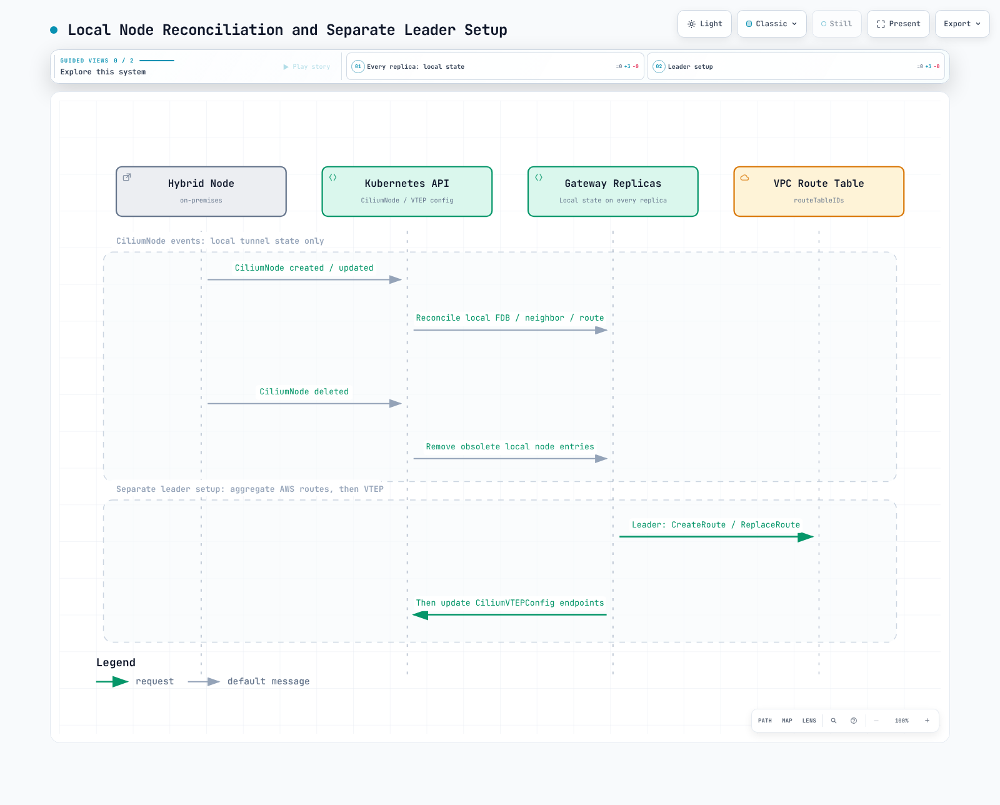
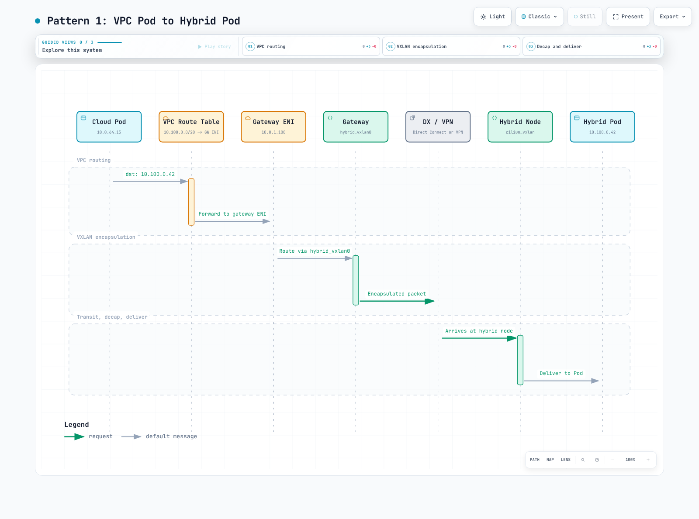
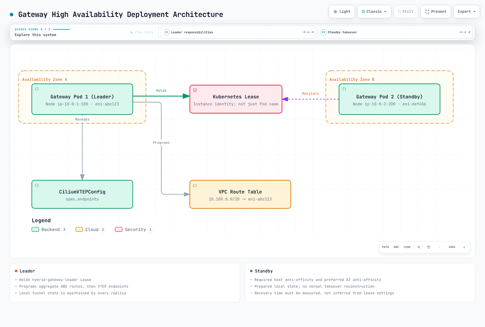
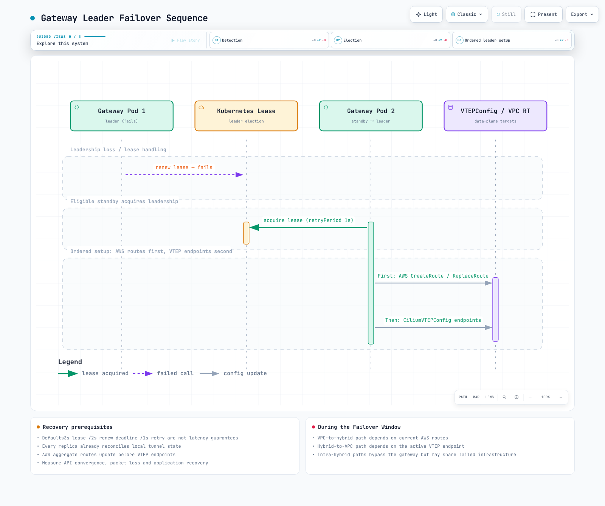
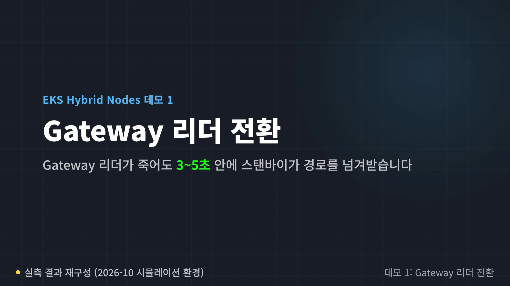

# Gateway de EKS Hybrid Nodes

< [Anterior: Configuración del SO en bare metal](./09-bare-metal-os-setup.md) | [Tabla de contenido](./README.md) >

> **Base de validación**: Gateway/chart 1.0.2; use una versión de Kubernetes compatible con EKS y una versión de Cilium mantenida por AWS que cumpla los requisitos previos del gateway.
> **Última actualización**: 18 de octubre de 2026

---

## Descripción general

EKS Hybrid Nodes Gateway es un componente de red de código abierto que automatiza la conectividad entre su Amazon VPC y los Pods de Kubernetes que se ejecutan en Hybrid Nodes en entornos locales o periféricos. Anunciado como disponible de forma general el 21 de abril de 2026, el gateway automatiza las rutas de los Pods que administra y el estado de reenvío VXLAN. La conectividad de la red subyacente, la propiedad de las rutas, la planificación del firewall/MTU, el despliegue y la limpieza aún requieren una configuración explícita.

El gateway funciona estableciendo túneles VXLAN entre instancias de gateway EC2 dedicadas en su VPC y Hybrid Nodes locales administrados por Cilium. Programa automáticamente las tablas de rutas de la VPC, administra las entradas de la base de datos de reenvío (FDB) y configura la integración VTEP (VXLAN Tunnel Endpoint) de Cilium para que los Pods de la VPC puedan comunicarse directamente con los Pods de Hybrid Nodes. El reenvío correcto sigue dependiendo de una infraestructura subyacente, una CNI, IAM, reglas de seguridad y rutas de aplicación revisadas.

**Características principales:**

- **Código abierto**: Disponible por completo en [github.com/aws/eks-hybrid-nodes-gateway](https://github.com/aws/eks-hybrid-nodes-gateway)
- **Sin cargo por el software del gateway**: EC2, almacenamiento, tarifas de Auto Mode (solo cuando los nodos del gateway se ejecutan en Auto Mode; también funcionan los grupos de nodos administrados o autoadministrados), el tráfico entre zonas de disponibilidad, la conectividad y la observabilidad siguen contribuyendo al costo
- **Administración automatizada de rutas**: El líder programa las rutas agregadas configuradas para los Pods de la VPC; cada réplica reconcilia por separado el estado local de los túneles por CiliumNode
- **Alta disponibilidad**: Admite un Deployment de 2 réplicas con elección de líder basada en Lease para la conmutación por error
- **Integración con Cilium**: Aprovecha la función VTEP de Cilium para habilitar el enrutamiento transparente de Pod a Pod a través del túnel VXLAN

### Objetivos de aprendizaje

Al terminar este documento, podrá:

1. **Explicar la arquitectura** de EKS Hybrid Nodes Gateway, incluido el túnel VXLAN, la elección de líder y la administración de rutas de la VPC
2. **Implementar y configurar** el gateway mediante Helm, incluidos los roles de IAM, los grupos de seguridad y la integración VTEP de Cilium
3. **Rastrear los flujos de tráfico** entre los Pods de la VPC y los Pods de Hybrid Nodes en ambas direcciones
4. **Implementar alta disponibilidad** con deployments del gateway de varias réplicas y comprender el comportamiento de conmutación por error
5. **Operar y solucionar problemas** de los deployments del gateway, incluidas la supervisión, el escalado y las situaciones de error habituales
6. **Comparar enfoques** de redes para Hybrid Nodes y decidir cuándo usar el gateway frente al enrutamiento manual
7. **Aplicar prácticas recomendadas** de seguridad, rendimiento y optimización de costos en deployments del gateway de producción

### El problema: enrutamiento manual de Pods en entornos híbridos

Antes de que existiera el gateway, habilitar la comunicación a nivel de Pod entre la VPC y los Hybrid Nodes requería un esfuerzo manual considerable:

```
Before Gateway (Manual Approach):
=================================

1. Configure BGP peering between on-prem routers and VPC (or use static routes)
2. Manually manage VPC route table entries for every hybrid Pod CIDR
3. Set up and maintain VPN tunnels or Direct Connect with proper route propagation
4. Handle route updates when nodes join/leave the cluster
5. Troubleshoot routing asymmetries and MTU issues across multiple hops
6. Maintain custom scripts or controllers to keep routes in sync

After Gateway (Automated Approach):
====================================

1. Deploy gateway via Helm chart
2. Gateway automatically:
   - Creates VXLAN tunnels to hybrid nodes
   - Programs VPC route table entries
   - Configures Cilium VTEP for transparent routing
   - Handles failover via leader election
   - Updates routes as nodes come and go
```

El gateway transforma lo que era un desafío de redes complejo, propenso a errores y que implicaba a varios equipos, en una única instalación de Helm con un puñado de valores de configuración.

---

## Análisis detallado de la arquitectura

### Arquitectura de alto nivel

EKS Hybrid Nodes Gateway se sitúa en el límite entre su VPC y su red local, y actúa como un puente basado en VXLAN para el tráfico de los Pods. El siguiente diagrama ilustra la arquitectura general:


[🔍 Ver diagrama interactivo](https://www.atomai.click/kubernetes-docs/archmaps/en-eks-hybrid-nodes-10-hybrid-nodes-gateway-0.html)

### Mecanismos del túnel VXLAN

El gateway usa VXLAN (Virtual Extensible LAN) para encapsular el tráfico de los Pods entre la VPC y los entornos locales. A continuación se explica cómo se establece y mantiene el túnel:

#### Interfaz VXLAN del gateway

Cuando el Pod del gateway se inicia en una instancia EC2, crea una interfaz de red `hybrid_vxlan0` con los siguientes parámetros:

| Parámetro | Valor | Descripción |
|-----------|-------|-------------|
| **Nombre de la interfaz** | `hybrid_vxlan0` | Interfaz del túnel VXLAN en el gateway |
| **VNI (VXLAN Network Identifier)** | 2 | Valor predeterminado del gateway compatible con la ruta VTEP de Cilium; no es un campo de CiliumVTEPConfig |
| **Puerto UDP** | 8472 | Puerto VXLAN del gateway/Cilium; el puerto asignado por IANA para VXLAN es 4789 |
| **IP local** | IP privada de la instancia EC2 del gateway | IP de origen de los paquetes encapsulados en VXLAN |
| **Aprendizaje** | Deshabilitado | El gateway programa estáticamente las entradas FDB |

El gateway crea esta interfaz con netlink. Lo siguiente es una ilustración conceptual, no un comando que se deba ejecutar junto al controlador. La versión 1.0.2 no asigna una dirección IP a esta interfaz; el túnel externo usa la IP privada del nodo del gateway.

```bash
# Conceptual equivalent of what the gateway does programmatically
ip link add hybrid_vxlan0 type vxlan \
    id 2 \
    local <gateway-private-ip> \
    dstport 8472 \
    nolearning

ip link set hybrid_vxlan0 up
```

#### Programación de FDB, ARP y rutas

El reconciliador de nodos supervisa los objetos `CiliumNode` etiquetados con `eks.amazonaws.com/compute-type: hybrid`. Se ejecuta en cada réplica del gateway y programa tres tipos de entradas locales a partir de la IP interna del nodo y del CIDR de Pod asignado:

```text
Per Hybrid Node, the gateway programs:
=======================================

1. FDB (Forwarding Database) Entry:
   deterministic node MAC → hybrid node's internal IP
   → Tells the VXLAN interface where to send encapsulated frames for this node

2. ARP Entry:
   hybrid node's internal IP → deterministic node MAC
   → Pre-populates ARP so the gateway can immediately forward packets without ARP discovery

3. Route Entry:
   hybrid node's Pod CIDR via its internal IP, dev hybrid_vxlan0, onlink
   → Directs Pod traffic for this node's CIDR through the VXLAN tunnel
```

El controlador deriva la MAC remota de la dirección IPv4 del nodo en vez de descubrir una MAC de interfaz de Cilium. Las entradas estáticas de vecino/FDB evitan depender del aprendizaje dinámico para esta ruta. Los errores de reconciliación, las entradas obsoletas y los fallos de la red subyacente aún pueden interrumpir el reenvío. Estas rutas locales son distintas de las entradas de la tabla de rutas de la VPC.

#### Lado del Hybrid Node (VTEP de Cilium)

En el lado del Hybrid Node, la función VTEP (VXLAN Tunnel Endpoint) de Cilium gestiona la terminación del túnel. El gateway se registra como VTEP remoto mediante el recurso personalizado `CiliumVTEPConfig`. Esto indica a cada agente de Cilium de los Hybrid Nodes lo siguiente:

1. El tráfico destinado a CIDR de la VPC debe encapsularse en VXLAN
2. El tráfico encapsulado debe enviarse a la dirección IP del gateway
3. El túnel VXLAN usa VNI 2 en el puerto UDP 8472

```yaml
# CiliumVTEPConfig created and managed by the gateway
apiVersion: cilium.io/v2
kind: CiliumVTEPConfig
metadata:
  name: hybrid-gateway
spec:
  endpoints:
    - name: vpc-gateway
      tunnelEndpoint: "10.0.1.5"      # Actual leader node IP
      cidr: "10.0.0.0/16"            # One VPC prefix per endpoint
      mac: "82:36:6c:89:e6:ad"       # Illustrative; read the leader's actual VXLAN MAC
```

Cuando un Pod de un Hybrid Node envía tráfico a una dirección IP de la VPC (por ejemplo, un Pod del lado de la nube o un punto de conexión de un servicio de AWS), el agente de Cilium:

1. Compara el destino con el `cidr` de un endpoint en CiliumVTEPConfig
2. Encapsula el paquete en VXLAN con VNI 2
3. Envía el paquete UDP externo a la IP del gateway por el puerto 8472
4. El gateway desencapsula y reenvía el paquete interno a la VPC

### Elección de líder y alta disponibilidad

El chart usa de forma predeterminada un Deployment de dos réplicas. Ambas mantienen interfaces y entradas locales de VXLAN/FDB/vecinos/rutas. Solo el líder actualiza las rutas de la VPC de AWS y el recurso `CiliumVTEPConfig` llamado `hybrid-gateway`, que administra el controlador.

#### Elección de líder basada en Lease

La elección de líder usa el recurso Lease estándar de Kubernetes:

```yaml
apiVersion: coordination.k8s.io/v1
kind: Lease
metadata:
  name: hybrid-gateway-leader
  namespace: eks-hybrid-nodes-gateway
spec:
  holderIdentity: "gateway-node-hostname_example-uuid"
  leaseDurationSeconds: 3
  acquireTime: "2026-06-28T10:00:00Z"
  renewTime: "2026-06-28T10:00:10Z"
  leaseTransitions: 3
```

Este Lease es una observación ilustrativa, no un manifiesto que se deba aplicar. La identidad del titular no es necesariamente el nombre de un Pod; antes de cualquier acción operativa, identifique el nodo/Pod correspondiente. Estos parámetros binarios controlan los tiempos de la elección; la versión 1.0.2 del chart no expone un objeto `leaderElection` en los valores:

| Parámetro | Valor predeterminado | Descripción |
|-----------|---------------------|-------------|
| `--leader-election-lease-duration` | 3s | Duración del Lease de elección |
| `--leader-election-renew-deadline` | 2s | Plazo de renovación del líder |
| `--leader-election-retry-period` | 1s | Intervalo de reintento de la elección |

#### Qué hace el líder

El Pod líder es responsable de:

1. **Administración de la tabla de rutas de la VPC**: Crea y actualiza rutas en las tablas de rutas de la VPC especificadas, que dirigen los CIDR de Pod híbridos a la ENI de la instancia EC2 del líder
2. **Administración de CiliumVTEPConfig**: Crea y actualiza el recurso CiliumVTEPConfig para dirigir el tráfico VTEP de los nodos híbridos a la IP de la instancia EC2 del líder
3. **Programación de FDB/ARP/rutas**: Programa la interfaz VXLAN local con entradas para todos los nodos híbridos
4. **Supervisión de nodos**: Al igual que la réplica en espera, supervisa los objetos CiliumNode y actualiza las entradas locales de los túneles. No crea ni elimina una ruta de AWS por cada evento de nodo.

#### Qué hace la réplica en espera

El Pod en espera:

1. **Mantiene el túnel VXLAN**: Mantiene activa su interfaz `hybrid_vxlan0` y la programa con entradas FDB/ARP/rutas
2. **NO programa rutas de la VPC**: Solo el líder modifica las tablas de rutas de la VPC
3. **NO actualiza CiliumVTEPConfig**: Solo el líder actualiza la configuración VTEP
4. **Supervisa el Lease**: Intenta continuamente adquirir el Lease por si falla el líder

### Administración automática de la tabla de rutas de la VPC

Al adquirir el liderazgo, el gateway crea o reemplaza rutas para los valores agregados configurados de `podCIDRs` en cada tabla de rutas configurada. Primero actualiza las rutas de AWS y luego actualiza CiliumVTEPConfig. La reconciliación de CiliumNode mantiene de forma independiente las entradas locales de túneles de cada nodo en todas las réplicas.



[🔍 Ver diagrama interactivo](https://www.atomai.click/kubernetes-docs/archmaps/en-eks-hybrid-nodes-10-hybrid-nodes-gateway-1.html)

El gateway usa la API de EC2 para administrar rutas:

| Llamada a la API | Cuándo se usa | Finalidad |
|----------|-----------|---------|
| `ec2:DescribeRouteTables` | Comprobación de acceso y configuración del líder | Leer las tablas de rutas especificadas explícitamente |
| `ec2:CreateRoute` | Configuración del líder cuando no existe una ruta CIDR configurada | Agregar la ruta agregada del CIDR de Pod |
| `ec2:ReplaceRoute` | Configuración del líder cuando el destino no coincide | Redirigir la ruta configurada a la ENI principal del líder actual |
| `ec2:DescribeInstances` | Inicio, conmutación por error | Identificar los ID de ENI de las instancias EC2 del gateway |

El runtime del gateway no llama a `DeleteRoute`. La eliminación mediante Helm no limpia las rutas de AWS. Se pueden reemplazar las rutas existentes del mismo CIDR aunque las haya creado otro sistema: antes de la instalación, revise la propiedad y el plan de transición/reversión.

Estos contratos se comprobaron en la [implementación 1.0.2](https://github.com/aws/eks-hybrid-nodes-gateway/tree/v1.0.2/internal) y en las [guías operativas de AWS](https://docs.aws.amazon.com/eks/latest/userguide/hybrid-nodes-gateway-operations.html). Las lecturas de la API, el estado de preparación o una métrica de líder por sí solos no demuestran que el reenvío funcione de extremo a extremo.

### Resumen de la interacción entre componentes

El siguiente diagrama muestra cómo interactúan todos los componentes:


[🔍 Ver diagrama interactivo](https://www.atomai.click/kubernetes-docs/archmaps/en-eks-hybrid-nodes-10-hybrid-nodes-gateway-2.html)

---

## Requisitos previos

Antes de implementar EKS Hybrid Nodes Gateway, asegúrese de cumplir todos los requisitos previos siguientes.

### Configuración del clúster EKS

| Requisito | Detalles |
|-------------|---------|
| **Versión de EKS** | Una versión actualmente compatible con EKS y los complementos elegidos |
| **Familia de direcciones** | IPv4; redes de VPC, Service, nodo remoto y Pod remoto sin superposición |
| **Hybrid Nodes** | Al menos un Hybrid Node configurado y unido al clúster |
| **Modo de autenticación** | `API` o `API_AND_CONFIG_MAP` |
| **Acceso a endpoints** | Solo público O solo privado (no «Público y privado») |
| **Red de Pods remotos** | CIDR de Pod configurados para los nodos híbridos del clúster |

### Requisitos de CNI

El gateway requiere una configuración de CNI específica:

| Ubicación | CNI | Versión | Compatibilidad con VTEP |
|----------|-----|---------|--------------|
| **Nodos de nube administrados/autoadministrados** | Amazon VPC CNI | Versión de complemento compatible; configure la exclusión SNAT de ClusterIP híbrido | No se requiere |
| **Nodos de nube de Auto Mode** | Redes integradas | Use la configuración compatible con Auto Mode | No se requiere |
| **Nodos híbridos** | Cilium mantenido por AWS | Cumpla el mínimo de la rama indicado en [Configuración de CNI](#cni-configuration) | VTEP habilitado, proxy L7 deshabilitado |

> Esta implementación del gateway requiere la integración VTEP de Cilium de AWS; no es un controlador compatible con Calico. Si sus requisitos de CNI/L7 no encajan, use un diseño enrutado de Pods compatible por separado. Los [requisitos para crear clústeres híbridos](https://docs.aws.amazon.com/eks/latest/userguide/hybrid-nodes-cluster-create.html) exigen autenticación API/API_AND_CONFIG_MAP, IPv4 y conectividad de endpoint solo pública o solo privada para Hybrid Nodes.

### Conectividad de red

La conectividad privada entre la VPC y el entorno local debe estar ya establecida:

| Tipo de conectividad | Cuándo usarla | Notas |
|-------------------|-------------|-------|
| **AWS Direct Connect** | Cargas de trabajo de producción que requieren una latencia baja y constante | Conectividad dedicada; la resiliencia y la latencia dependen del diseño redundante real |
| **AWS Site-to-Site VPN** | Conectividad híbrida estándar | Conectividad IPsec; el rendimiento depende de la oferta de túnel seleccionada, la combinación de paquetes y el enrutamiento |
| **Transit Gateway + VPN** | Entornos con varias VPC | Terminación centralizada de VPN; admite ECMP para un mayor rendimiento |
| **VPN personalizada (por ejemplo, WireGuard)** | Requisitos especializados | Túnel autoadministrado; útil cuando preocupan las limitaciones de AWS VPN |

> **Nota**: El gateway no establece la conectividad básica entre la VPC y el entorno local. Agrega una superposición VXLAN sobre la conectividad existente para el enrutamiento a nivel de Pod.

### Instancias EC2 del gateway

Necesita al menos dos instancias EC2 en la VPC para ejecutar los Pods del gateway:

```yaml
# Recommended EC2 instance configuration for gateway nodes
Instance type: c6i.large (2 vCPU, 4 GiB RAM) or larger
AMI: Amazon Linux 2023 (EKS optimized)
Placement: Spread across at least 2 Availability Zones
EBS: 20 GiB gp3 (minimal storage needed)
```

Las instancias del gateway deben:

1. Ser nodos EC2 de nube registrados; distinga entre Amazon VPC CNI de AWS administrado/autoadministrado y las redes integradas de Auto Mode
2. Tener el rol de nodo adecuado y un rol de carga de trabajo del gateway con alcance independiente (consulte [Configuración de IAM](#iam-configuration))
3. Tener etiquetas para programar los Pods del gateway (consulte [Instalación](#installation-and-configuration))

### Configuración del grupo de seguridad

Use los CIDR reales de nodos/Pods y los puertos revisados. UDP8472 por sí solo no establece todas las rutas de aplicación o del plano de control. Separe estos flujos:

| Flujo | Revisión necesaria |
|---|---|
| IP principal del gateway ↔ IP del nodo híbrido | UDP8472 externo de VXLAN en ambas direcciones |
| Cargas de trabajo de la nube ↔ Pods híbridos | Protocolos/puertos de aplicación internos previstos y su tráfico de retorno |
| Nodos → API de Kubernetes, API/registro de AWS y DNS | Endpoints/resolutores reales, TCP443 y rutas DNS requeridas |
| Plano de control → kubelet | TCP10250 hacia los nodos previstos; es distinto del tráfico API443 saliente de un nodo |
| Prometheus → gateway | Restringir TCP10080 al origen de scraping previsto |

Tenga en cuenta por separado los grupos de seguridad, las NACL sin estado y los firewalls locales. No agregue una regla de entrada general desde toda la VPC como sustituto de los flujos de aplicación necesarios. Proteja todas las IP posibles de los nodos líderes, incluida la capacidad de reemplazo.

#### Ejemplo de grupo de seguridad de Terraform

Administre la matriz de reglas aprobada en la pila de Terraform existente de nodos/red. Una regla UDP exclusiva del gateway es un fragmento, no un grupo de seguridad de nodo completo. Conserve los requisitos de arranque, DNS, API y aplicación del clúster e inspeccione el plan final; evite crear un grupo de seguridad duplicado sin restricciones y suponer que una regla VXLAN lo hace seguro.

### Configuración del firewall local

Use las **IP privadas de los nodos** del gateway accesibles por la red privada subyacente, no las IP elásticas. Permita la ruta UDP8472 necesaria para cada líder/réplica en espera elegible y revise por separado los flujos de API de Kubernetes/kubelet, DNS y aplicación. Ajuste las actualizaciones del firewall cuando Auto Mode u otro administrador de nodos reemplace las instancias del gateway. Ni este capítulo ni una tabla estática de grupos de seguridad demuestran que la ruta real del firewall funcione.

Verifique la comprobación de origen/destino en la ENI principal prevista. Auto Mode utiliza la configuración de reenvío de NodeClass; el aprovisionamiento administrado/autoadministrado controla cualquier modificación de ENI necesaria. Lo siguiente solo lee su valor actual:

```bash
: "${AWS_REGION:?Set the reviewed Region}"
: "${GATEWAY_PRIMARY_ENI_ID:?Set the verified gateway primary ENI}"
aws ec2 describe-network-interface-attribute --region "$AWS_REGION" \
  --network-interface-id "$GATEWAY_PRIMARY_ENI_ID" --attribute sourceDestCheck
```

### Consideraciones sobre MTU

VXLAN IPv4 suele agregar 50 bytes, incluido el encabezado Ethernet interno. Use la MTU efectiva de extremo a extremo de la red subyacente, no el máximo de la interfaz EC2. Las siguientes cifras originales de MTU son ilustraciones de planificación, no resultados medidos de la ruta ni configuraciones universales de DX/VPN:

| Componente | MTU recomendada | Notas |
|-----------|----------------|-------|
| Instancia EC2 del gateway | 9001 (tramas jumbo) | Valor predeterminado de la mayoría de los tipos de instancia EC2 en la VPC |
| Hybrid Nodes locales | 1500 o más | Depende de la infraestructura de red |
| Interfaz VXLAN (efectiva) | MTU de la ruta - 50 | Por ejemplo, 1450 si la MTU de la ruta es 1500 |
| Direct Connect | 9001 (tramas jumbo) | Si la conexión DX lo admite |
| Túnel VPN | 1399-1500 | Varía según la configuración de VPN |

Si la ruta de red entre la VPC y el entorno local usa una MTU estándar de 1500:

```
Effective Pod MTU calculation:
Physical MTU:        1500 bytes
VXLAN overhead:      - 50 bytes (outer IPv4 + outer UDP + VXLAN + inner Ethernet headers)
VPN overhead (IPsec): - 57-73 bytes (if applicable)
Effective Pod MTU:   ~1377-1450 bytes
```

Cilium en los nodos híbridos se puede configurar con la MTU adecuada:

```yaml
# Cilium Helm values for hybrid nodes
mtu: 1400  # Illustrative only; replace using validated path MTU and chosen Cilium datapath.
```

---

## Configuración de IAM

### Permisos de IAM necesarios

Separe el rol de carga de trabajo del gateway del rol de nodo EC2 y de los permisos de aprovisionamiento/limpieza del operador. La [guía de inicio de AWS](https://docs.aws.amazon.com/eks/latest/userguide/hybrid-nodes-gateway-getting-started.html) recomienda EKS Pod Identity. Su agente debe estar disponible en los nodos administrados/autoadministrados elegibles; Auto Mode proporciona compatibilidad con Pod Identity. No cree a ciegas un complemento sobre una instalación existente.

Las acciones de runtime del gateway son `ec2:DescribeRouteTables`, `ec2:DescribeInstances`, `ec2:CreateRoute` y `ec2:ReplaceRoute`. Las operaciones Describe requieren `Resource: "*"`; restrinja la región. Las escrituras de rutas pueden usar los ARN exactos de las tablas de rutas y una condición de VPC. Eliminar rutas retiradas es una acción del operador, no un permiso de runtime.

### Política de IAM con alcance restringido (recomendada para producción)

Guarde lo siguiente como `gateway-permissions.json` después de reemplazar la cuenta, la región, la VPC y los ID de tablas de rutas por los del inventario revisado. Son identificadores ilustrativos, no recursos aprovisionados por esta auditoría. La política no restringe qué CIDR de destino puede modificar el rol dentro de esas tablas de rutas: trátelas como un límite de seguridad de enrutamiento y controle quién puede editar los valores del Gateway o usar su ServiceAccount.

```json
{
  "Version": "2012-10-17",
  "Statement": [
    {
      "Sid": "ReadGatewayRoutingMetadata",
      "Effect": "Allow",
      "Action": [
        "ec2:DescribeRouteTables",
        "ec2:DescribeInstances"
      ],
      "Resource": "*",
      "Condition": {
        "StringEquals": {
          "aws:RequestedRegion": "ap-northeast-2"
        }
      }
    },
    {
      "Sid": "ManageOnlyOwnedRouteTables",
      "Effect": "Allow",
      "Action": [
        "ec2:CreateRoute",
        "ec2:ReplaceRoute"
      ],
      "Resource": [
        "arn:aws:ec2:ap-northeast-2:111122223333:route-table/rtb-0abc123456789def0",
        "arn:aws:ec2:ap-northeast-2:111122223333:route-table/rtb-0def456789abc1230"
      ],
      "Condition": {
        "StringEquals": {
          "ec2:Vpc": "arn:aws:ec2:ap-northeast-2:111122223333:vpc/vpc-0123456789abcdef0"
        }
      }
    }
  ]
}
```

El alcance del ARN de la tabla de rutas y de `ec2:Vpc` sigue el [ejemplo de política de tablas de rutas EC2](https://docs.aws.amazon.com/AWSEC2/latest/UserGuide/ExamplePolicies_EC2.html). Una solicitud Describe correcta no demuestra autorización para CreateRoute/ReplaceRoute. Pruebe la autorización y la propiedad de las rutas en un entorno aprobado antes del cambio.

### Configuración de IAM con Terraform

Para Pod Identity, guarde esta política de confianza como `gateway-trust.json` y reemplace el ARN exacto del clúster. Las etiquetas de sesión deben seguir habilitadas porque las condiciones vinculan el clúster, el espacio de nombres y el ServiceAccount. Restrinja tanto la creación de Pods/ServiceAccounts y la administración de asociaciones de Pod Identity como los permisos de IAM.

```json
{
  "Version": "2012-10-17",
  "Statement": [
    {
      "Effect": "Allow",
      "Principal": {
        "Service": "pods.eks.amazonaws.com"
      },
      "Action": [
        "sts:AssumeRole",
        "sts:TagSession"
      ],
      "Condition": {
        "StringEquals": {
          "aws:RequestTag/eks-cluster-arn": "arn:aws:eks:ap-northeast-2:111122223333:cluster/hybrid-production",
          "aws:RequestTag/kubernetes-namespace": "eks-hybrid-nodes-gateway",
          "aws:RequestTag/kubernetes-service-account": "eks-hybrid-nodes-gateway"
        }
      }
    }
  ]
}
```

La [política de confianza de Pod Identity](https://docs.aws.amazon.com/eks/latest/userguide/pod-id-role.html) y las [etiquetas de sesión](https://docs.aws.amazon.com/eks/latest/userguide/pod-id-abac.html) definen estas condiciones. El siguiente HCL es un fragmento de integración, no una pila completa de proveedor/clúster; use Terraform o la ruta de CLI para administrar cada recurso, pero no ambas.

```hcl
# Fragment in the existing reviewed AWS provider/cluster stack.
# Declare and validate these variables; do not create duplicate CLI-managed resources.
resource "aws_iam_role" "gateway" {
  name               = var.gateway_role_name
  assume_role_policy = file("${path.module}/gateway-trust.json")
}
resource "aws_iam_role_policy" "gateway_routes" {
  name   = "GatewayOwnedRoutes"
  role   = aws_iam_role.gateway.id
  policy = file("${path.module}/gateway-permissions.json")
}
resource "aws_eks_pod_identity_association" "gateway" {
  cluster_name    = var.cluster_name
  namespace       = "eks-hybrid-nodes-gateway"
  service_account = "eks-hybrid-nodes-gateway"
  role_arn        = aws_iam_role.gateway.arn
}
```

### Configuración de IAM con AWS CLI

Prepare el rol con el JSON de confianza/permisos revisado mediante su responsable de IAM. El nombre del ServiceAccount de la asociación debe coincidir con el del chart renderizado; cambiar las sobrescrituras del nombre/versión de Helm puede cambiarlo. La configuración de la asociación es independiente de los valores del chart: la versión 1.0.2 del chart ignora `serviceAccount.annotations`.

```bash
: "${AWS_REGION:?Set the reviewed Region}"
: "${CLUSTER_NAME:?Set the reviewed cluster}"
: "${GATEWAY_ROLE_ARN:?Set the prepared, scoped Pod Identity role ARN}"
# Inspect existing associations; do not create a duplicate or replace another owner.
aws eks list-pod-identity-associations --region "$AWS_REGION" \
  --cluster-name "$CLUSTER_NAME" --namespace eks-hybrid-nodes-gateway \
  --service-account eks-hybrid-nodes-gateway
# Run only for the reviewed new association; keep session tags enabled:
aws eks create-pod-identity-association --region "$AWS_REGION" \
  --cluster-name "$CLUSTER_NAME" --namespace eks-hybrid-nodes-gateway \
  --service-account eks-hybrid-nodes-gateway --role-arn "$GATEWAY_ROLE_ARN" \
  --no-disable-session-tags
```

IRSA sigue siendo una alternativa con una política de confianza OIDC real y una anotación en el ServiceAccount renderizado, administrada mediante un parche/superposición revisados; un valor que Helm ignora no puede establecer IRSA. Evite asignar permisos de escritura de rutas de forma generalizada a todas las cargas de trabajo de los nodos. Las consultas de metadatos EC2 del binario para obtener la identidad del nodo y la cadena de credenciales del SDK son cuestiones independientes; no deshabilite los metadatos a ciegas sin proporcionar y verificar las entradas de identidad del nodo necesarias.

El reenvío de Auto Mode usa `NodeClass.spec.advancedNetworking.sourceDestCheck: DisabledPrimaryENI`. El arranque de nodos administrados/autoadministrados debe deshabilitar la comprobación de origen/destino en la ENI principal prevista mediante permisos de nodo/operador con alcance independiente. `ModifyNetworkInterfaceAttribute` y la creación de clústeres/roles/complementos no forman parte de la política de carga de trabajo del gateway anterior.

---

## Instalación y configuración

### Paso 1: Etiquetar los nodos del gateway

Primero aprovisione los nodos EC2 de nube elegibles. Los nodos administrados/autoadministrados usan `autoMode.enabled=false`; Auto Mode necesita un NodeClass/NodePool preparado y `autoMode.enabled=true`. Etiquete solo los nodos cuyos requisitos previos de reenvío, grupos de seguridad e IAM se hayan verificado. No invente etiquetas de tipo de instancia ni de zona de disponibilidad administradas por el proveedor. Si es posible, elija dos nodos elegibles en distintas zonas de disponibilidad.

```bash
: "${KUBE_CONTEXT:?Set the reviewed Kubernetes context}"
: "${GW_NODE_A:?Set the first eligible gateway node}"
: "${GW_NODE_B:?Set the second eligible gateway node}"
kubectl --context "$KUBE_CONTEXT" get node "$GW_NODE_A" "$GW_NODE_B" \
  -L topology.kubernetes.io/zone,eks.amazonaws.com/compute-type
# Apply only after source/destination check, IAM and network prerequisites are met:
kubectl --context "$KUBE_CONTEXT" label node "$GW_NODE_A" "$GW_NODE_B"   hybrid-gateway-node=true
```

### Paso 2: Recopilar los valores de configuración

Confirme la cuenta de AWS, la VPC del clúster, los CIDR de Pod remotos, las ENI reales del gateway y las tablas de rutas de subred/plano de control afectadas. Seleccione solo las tablas de rutas propiedad de este diseño de enrutamiento; enumerar todas las tablas de una VPC no autoriza a modificarlas todas. `remoteNetworkConfig` está directamente debajo de `cluster`, no de `kubernetesNetworkConfig`.

```bash
: "${AWS_REGION:?Set the reviewed AWS Region}"
: "${CLUSTER_NAME:?Set the reviewed EKS cluster}"
: "${VPC_ID:?Set the cluster VPC ID}"
aws sts get-caller-identity --query Account --output text
aws eks describe-cluster --region "$AWS_REGION" --name "$CLUSTER_NAME" \
  --query 'cluster.{VpcId:resourcesVpcConfig.vpcId,RemotePodCIDRs:remoteNetworkConfig.remotePodNetworks[].cidrs[]}' \
  --output json
aws ec2 describe-vpcs --region "$AWS_REGION" --vpc-ids "$VPC_ID" \
  --query 'Vpcs[].CidrBlockAssociationSet[].{CIDR:CidrBlock,State:CidrBlockState.State}' \
  --output json
aws ec2 describe-route-tables --region "$AWS_REGION" \
  --filters "Name=vpc-id,Values=$VPC_ID" \
  --query 'RouteTables[].{ID:RouteTableId,Associations:Associations,Routes:Routes}' \
  --output json
```

### Paso 3: Instalar con Helm

Complete los pasos de CNI, nodos e IAM de carga de trabajo antes de la instalación. El líder puede reemplazar de inmediato las rutas existentes de los CIDR configurados. Use el archivo de valores siguiente después de comprobar la propiedad, el enrutamiento inverso y el plan de reversión. Los pasos de instalación se comprobaron localmente; no son constancia de una instalación activa correcta. Las observaciones de laboratorio y los videos de demostración, fechados por separado a continuación, describen un entorno simulado y no validan su deployment.

### Referencia completa de valores de Helm

El chart publicado 1.0.2 acepta **cadenas CSV**, no matrices YAML, para `podCIDRs` y `routeTableIDs`. Use un archivo de valores para que el análisis de listas/comas de `helm --set` no cambie sus tipos.

```yaml
# values.yaml: replace CIDRs/table IDs from the reviewed network inventory.
vpcCIDR: "10.0.0.0/16"
podCIDRs: "10.85.0.0/16"
routeTableIDs: "rtb-0abc123456789def0,rtb-0def456789abc1230"
replicas: 2
nodeLabel: hybrid-gateway-node
autoMode:
  enabled: false  # MNG/self-managed. Set true only for prepared Auto Mode nodes.
```

El chart también admite `image.repository`, `image.tag`, `image.pullPolicy` y asistentes de nombres. Sus plantillas **no** conectan `replicaCount`, `nodeSelector`, `resources`, `affinity`, `topologySpreadConstraints`, `serviceAccount.annotations`, `leaderElection`, `logLevel`, `metrics`, `extraEnv` ni valores de volúmenes personalizados. No interprete que el YAML acepta un valor como prueba de que se aplicó. Configure la identidad de la carga de trabajo por separado; si se necesita un post-renderizador mantenido para otro ajuste, revise explícitamente el Deployment resultante y su comportamiento durante las actualizaciones.

Ambos modos usan redes del host, NET_ADMIN, antiafinidad obligatoria entre hosts y antiafinidad preferida entre zonas de disponibilidad. El chart no crea un Service, ServiceMonitor ni PDB. Auto Mode usa maxSurge=1/maxUnavailable=0; los demás nodos usan 0/1. Ninguna de las dos estrategias tiene en cuenta al líder ni garantiza un reenvío ininterrumpido. El aumento de capacidad de Auto Mode necesita otro nodo elegible debido a la antiafinidad entre hosts.

```bash
: "${KUBE_CONTEXT:?Set the reviewed Kubernetes context}"
# Local rendering first; it does not prove API admission, IAM or network readiness.
helm template eks-hybrid-nodes-gateway \
  oci://public.ecr.aws/eks/eks-hybrid-nodes-gateway \
  --version 1.0.2 --namespace eks-hybrid-nodes-gateway \
  --values values.yaml > gateway-rendered.yaml
# Creates/changes cluster resources and can redirect existing VPC routes:
helm upgrade --install eks-hybrid-nodes-gateway \
  oci://public.ecr.aws/eks/eks-hybrid-nodes-gateway \
  --version 1.0.2 --namespace eks-hybrid-nodes-gateway --create-namespace \
  --kube-context "$KUBE_CONTEXT" --values values.yaml
```

### Paso 4: Verificar la instalación

Lea el titular real del Lease, el nodo/IP del Pod del gateway, el endpoint/MAC de VTEP y la ENI de la ruta; verifique que todos correspondan al mismo líder. Una holderIdentity puede ser el nombre de host de un nodo seguido de un UUID, por lo que no debe pasarse directamente a `kubectl logs` ni a `kubectl delete pod`.

```bash
: "${KUBE_CONTEXT:?Set the reviewed Kubernetes context}"
: "${AWS_REGION:?Set the reviewed AWS Region}"
: "${ROUTE_TABLE_ID:?Set one reviewed route table ID}"
kubectl --context "$KUBE_CONTEXT" -n eks-hybrid-nodes-gateway \
  rollout status deployment/eks-hybrid-nodes-gateway --timeout=180s
kubectl --context "$KUBE_CONTEXT" -n eks-hybrid-nodes-gateway get pods -o wide
kubectl --context "$KUBE_CONTEXT" -n eks-hybrid-nodes-gateway   get lease hybrid-gateway-leader -o yaml
kubectl --context "$KUBE_CONTEXT" get ciliumvtepconfig hybrid-gateway -o yaml
aws ec2 describe-route-tables --region "$AWS_REGION" \
  --route-table-ids "$ROUTE_TABLE_ID" --query 'RouteTables[].Routes' --output json
kubectl --context "$KUBE_CONTEXT" -n eks-hybrid-nodes-gateway logs \
  -l app.kubernetes.io/name=eks-hybrid-nodes-gateway --all-containers=true --tail=50
```

Un Pod en estado Running, una respuesta de disponibilidad y una métrica de líder no demuestran que el reenvío funcione. Pruebe ambas direcciones, las IP directas de los Pods, los servicios ClusterIP con endpoints híbridos, las llamadas reales de webhook y el tráfico de retorno desde cargas de trabajo de nube e híbridas seleccionadas explícitamente. El servidor debe estar escuchando realmente en el puerto probado. Mantenga los registros en privado y enmascare los datos sensibles de las cargas de trabajo antes de compartirlos.

---

## Configuración de CNI

### Configuración de Cilium VTEP en Hybrid Nodes

Use la compilación de Cilium mantenida por AWS. Los [requisitos previos de CNI del gateway](https://docs.aws.amazon.com/eks/latest/userguide/hybrid-nodes-gateway-cni.html) especifican los mínimos de rama **1.17.13-1, 1.18.8-1 o 1.19.2-1**; son mínimos de funcionalidad, no recomendaciones para degradar ni ignorar la compatibilidad de la rama. Conserve los selectores de nodo, los rangos de IPAM y otros valores revisados de la versión.

El cambio necesario es `vtep.enabled=true` y **`l7Proxy=false`**. El perfil L7 de Cilium Ingress/Gateway API de [Operaciones](./08-operations.md) no se puede habilitar en esa misma instalación de Cilium. Esto no impide que las aplicaciones HTTP habituales usen la ruta enrutada. No deduzca que VXLAN proporciona cifrado ni habilite WireGuard solo porque lo mencione un ejemplo no relacionado; valide la combinación concreta compatible de plano de datos/cifrado.

#### Verificación de Cilium VTEP en Hybrid Nodes

```bash
: "${KUBE_CONTEXT:?Set the reviewed Kubernetes context}"
: "${CILIUM_VERSION:?Choose an AWS-maintained Cilium version meeting the gateway minimum}"
# Apply to the existing reviewed Hybrid Cilium release during a maintenance window.
helm upgrade cilium oci://public.ecr.aws/eks/cilium/cilium \
  --version "$CILIUM_VERSION" --namespace kube-system \
  --kube-context "$KUBE_CONTEXT" --reuse-values \
  --set vtep.enabled=true --set l7Proxy=false
kubectl --context "$KUBE_CONTEXT" -n kube-system rollout restart daemonset/cilium
kubectl --context "$KUBE_CONTEXT" -n kube-system   rollout status daemonset/cilium --timeout=300s
kubectl --context "$KUBE_CONTEXT" -n kube-system get configmap cilium-config \
  -o jsonpath='{.data.enable-vtep}{"\n"}{.data.enable-l7-proxy}{"\n"}'
```

Los dos valores impresos del ConfigMap deben ser primero `true` y luego `false`. Inspeccione también el estado de Cilium en cada nodo híbrido y el objeto VTEP administrado por el controlador. Use la CLI incluida en la imagen de Cilium seleccionada y revise su ayuda antes de depender de un comando `bpf vtep` concreto; un Pod seleccionado del DaemonSet no representa a todos los nodos.

### Configuración de VPC CNI en los nodos de nube

En los nodos de nube que ejecutan AWS VPC CNI, se deben excluir los CIDR de Pod híbridos de SNAT para el **tráfico ClusterIP hacia endpoints híbridos**. El tráfico directo por IP de Pod puede funcionar aunque falte este ajuste, por lo que una prueba solo de IP directa no basta. Conserve las demás exclusiones y coordine el cambio con el responsable de la configuración del complemento.

```bash
: "${KUBE_CONTEXT:?Set the reviewed Kubernetes context}"
# MNG/self-managed cloud nodes using the aws-node DaemonSet:
kubectl --context "$KUBE_CONTEXT" -n kube-system get daemonset aws-node
# Preserve existing exclusions; use the complete reviewed CSV union, not just a new CIDR.
: "${SNAT_EXCLUDE_CIDRS:?Set existing exclusions plus all Hybrid Pod CIDRs}"
kubectl --context "$KUBE_CONTEXT" -n kube-system set env daemonset/aws-node \
  AWS_VPC_K8S_CNI_EXCLUDE_SNAT_CIDRS="$SNAT_EXCLUDE_CIDRS"
```

Auto Mode proporciona redes integradas en lugar de un DaemonSet `aws-node` que haya que configurar. No instale ni reemplace sus redes con esta receta del DaemonSet. Valide por separado la ruta de servicio híbrido compatible; en clústeres mixtos, aplique el ajuste de aws-node a los nodos de nube que realmente administre ese componente. La delegación de prefijos y la configuración de redes personalizadas son decisiones de diseño independientes, no requisitos previos del gateway.

### Detalles del CRD CiliumVTEPConfig

El código de actualización de la [versión 1.0.2 del controlador](https://github.com/aws/eks-hybrid-nodes-gateway/blob/v1.0.2/internal/cilium/vtep.go) usa la siguiente forma de API. El gateway es propietario del objeto llamado `hybrid-gateway`; esto no significa que Kubernetes permita solo un objeto CiliumVTEPConfig en el clúster.

```yaml
# Illustrative controller-owned observation; do not apply over the running controller.
apiVersion: cilium.io/v2
kind: CiliumVTEPConfig
metadata:
  name: hybrid-gateway
spec:
  endpoints:
  - name: vpc-gateway
    tunnelEndpoint: "10.0.1.5"
    cidr: "10.0.0.0/16"
    mac: "82:36:6c:89:e6:ad"  # Read the actual leader VXLAN MAC.
```

Al cambiar el liderazgo, actualiza `tunnelEndpoint` y `mac`. Cada endpoint tiene un `cidr`; varios prefijos de VPC configurados generan varias entradas. La MAC es la de la interfaz VXLAN real del líder, no una constante ficticia arbitraria. Observe la convergencia de Cilium y la recuperación de las aplicaciones, en vez de suponer una garantía universal de propagación de 1–5 segundos. Ese intervalo anterior era una ilustración no verificada, no un resultado medido.

---

## Patrones de flujo de tráfico

Comprender cómo fluye el tráfico por el gateway es esencial para solucionar problemas y planificar la capacidad. Esta sección sigue los paquetes por el sistema en cada patrón de comunicación principal. Los diagramas históricos usan un rango de Pods ilustrativo independiente, 10.100.0.0/20; no combine ese plan de direcciones con el ejemplo de instalación sin conciliar todos los CIDR reales.

### Patrón 1: Pod de la VPC a Pod híbrido

Este es el patrón más común: un Pod que se ejecuta en un nodo de nube de la VPC necesita comunicarse con un Pod que se ejecuta en un nodo híbrido local.



[🔍 Ver diagrama interactivo](https://www.atomai.click/kubernetes-docs/archmaps/en-eks-hybrid-nodes-10-hybrid-nodes-gateway-3.html)

**Flujo de paquetes paso a paso:**

1. El Pod de nube (`10.0.64.15`) envía un paquete al Pod híbrido (`10.100.0.42`)
2. El paquete entra en la red de la VPC; la tabla de rutas de la VPC coincide con la ruta agregada configurada `10.100.0.0/20 -> gateway ENI`
3. El paquete llega a la ENI principal de la instancia EC2 del gateway
4. La tabla de enrutamiento de Linux del gateway coincide con la ruta: `10.100.0.0/24 via <hybrid-node-internal-ip> dev hybrid_vxlan0 onlink`
5. El gateway encapsula el paquete en VXLAN (origen externo: IP del gateway, destino externo: IP del nodo híbrido, VNI: 2, puerto UDP de destino externo: 8472)
6. El paquete encapsulado atraviesa Direct Connect/VPN hasta la red local
7. El agente de Cilium del nodo híbrido recibe el paquete UDP en el puerto 8472
8. Cilium desencapsula el paquete VXLAN y entrega el paquete interno al Pod de destino

### Patrón 2: Pod híbrido a Pod de la VPC

Cuando un Pod de un nodo híbrido necesita llegar a un Pod (o cualquier IP) de la VPC.


[🔍 Ver diagrama interactivo](https://www.atomai.click/kubernetes-docs/archmaps/en-eks-hybrid-nodes-10-hybrid-nodes-gateway-4.html)

**Flujo de paquetes paso a paso:**

1. El Pod híbrido (`10.100.0.42`) envía un paquete al Pod de nube (`10.0.64.15`)
2. El agente de Cilium del nodo híbrido realiza una búsqueda BPF y determina que `10.0.64.15` coincide con el `cidr` del endpoint VTEP `10.0.0.0/16`
3. Cilium encapsula el paquete en VXLAN (destino externo: IP del gateway `10.0.1.100`, VNI: 2, puerto UDP de destino externo: 8472)
4. El paquete encapsulado atraviesa Direct Connect/VPN hasta la VPC
5. La instancia EC2 del gateway recibe el paquete UDP en el puerto 8472
6. El gateway desencapsula el paquete VXLAN y extrae el paquete interno (destino: `10.0.64.15`)
7. El paquete interno se reenvía a la VPC a través de la ENI de la instancia EC2 del gateway
8. El enrutamiento estándar de la VPC entrega el paquete al Pod de nube

> La ENI principal real del gateway debe tener deshabilitada la comprobación de origen/destino a través del responsable de aprovisionamiento de sus nodos. Consulte los requisitos anteriores de Auto Mode frente a los nodos administrados/autoadministrados; leer la ruta no verifica este ajuste.

### Patrón 3: Plano de control a webhook en un nodo híbrido

Cuando un webhook de mutación o validación se ejecuta en un nodo híbrido, el plano de control de EKS debe poder acceder a él.

```text
Webhook invocation → resolved remote Pod endpoint
  → control-plane VPC network path / matching route table
  → gateway primary ENI → VXLAN → Hybrid node → webhook listener
  → verified reverse path for the response
```

La red de Pods remotos configurada, las rutas de las subredes del plano de control, el Service/endpoint/TLS del webhook, las reglas de seguridad y la ruta de retorno deben ser compatibles entre sí. No suponga una implementación de kube-proxy/iptables dentro del plano de control administrado. Un diseño nativo de Pods enrutables también puede admitir webhooks híbridos; esta capacidad no es exclusiva del gateway.

### Patrón 4: Servicios de AWS a Pods híbridos

| Ruta | Configuración necesaria |
|---|---|
| Destinos IP de ALB/NLB | Registre las IP de Pod elegibles mediante el controlador previsto; verifique las rutas de subredes del LB, las comprobaciones de estado, los puertos de aplicación, la identidad de origen y el tráfico de retorno |
| Recolector administrado de AMP | El scraper llega a los endpoints de métricas a través de las rutas de VPC/Pods remotos y los puertos de firewall abiertos; la guía del complemento híbrido también requiere acceso privado al endpoint del clúster |
| Prometheus remote_write | Un recolector de Prometheus/ADOT envía muestras al endpoint de ingesta del espacio de trabajo de AMP; el espacio de trabajo no actúa por sí mismo como scraper entrante |
| Exportación a CloudWatch/trazas | Un agente/recolector configurado adecuadamente envía datos al endpoint del servicio; las rutas de IAM/API/DNS/egreso necesarias son independientes del enrutamiento entrante de Pods |
| PrivateLink | Endpoint de consumidor → servicio/LB de proveedor → destinos, según el diseño del servicio; un servicio de AWS genérico no inicia conexiones arbitrarias a través de un endpoint hacia Pods híbridos |

La [guía de complementos híbridos](https://docs.aws.amazon.com/eks/latest/userguide/hybrid-nodes-add-ons.html) admite explícitamente la recopilación administrada de AMP cuando se cumplen estos requisitos previos de endpoint y red. Distinga ese scraper de remote_write autoadministrado; ninguno aparece simplemente por haber instalado el gateway.

#### Medido: destinos IP de ALB en Pods híbridos (2026-10-18)

Las notas de ejecución proporcionadas informan observaciones de un entorno simulado (el entorno local se sustituyó por una VPC separada a través de TGW, gateway 1.0.2, chart 3.6.0 de AWS Load Balancer Controller, ALB interno). Esta no es una configuración de producción compatible y las cifras no son garantías.

Los registros de solicitudes sin procesar y las capturas de paquetes de las observaciones 20/20, 54 s, 0 de 276 y 1 de 191 no se incluyen en este documento. Trátelas como ejemplos de las notas de laboratorio proporcionadas, no como pruebas de aceptación reproducibles de forma independiente. La [prueba de enrutamiento nativo de 38 comprobaciones](12-connectivity-validation.md) es un experimento independiente y no corrobora estos resultados del gateway. Para su deployment, use los diagnósticos de [Configuración de red](02-network-configuration.md) y pruebe las rutas de aplicación de ida y vuelta desde clientes de nube e híbridos. Conserve resultados de clientes con marca de tiempo, direcciones de origen, estado de los destinos y cambios de rutas/Lease.

| Comprobación | Resultado |
|---|---|
| Registro de destinos | LBC registró las IP de los Pods híbridos (`172.17.0.202`, `172.17.0.48`) como destinos `ip`. Están fuera de la VPC, por lo que `AvailabilityZone` es `all`; las comprobaciones de estado pasaron a través de la ruta del gateway |
| Solicitud | Cliente de VPC → ALB interno → ruta de VPC `172.17.0.0/16` (ENI del líder) → VXLAN → Pod híbrido, 20/20 |
| Reemplazo de Pods | Reinicio del rollout con carga; los destinos convergieron en las nuevas IP de Pod en 54 s, 0 de 276 solicitudes fallidas (preStop 15 s, retraso de cancelación del registro 10 s) |
| Cambio de líder | Se eliminó el Pod líder con carga; traspaso de 4 s, 1 de 191 solicitudes fallidas (cliente sin reintentos) |

El **AWS Load Balancer Controller**, no el gateway, actualiza los destinos cuando cambian las IP de los Pods. El gateway solo proporciona la ruta a las IP de Pod que están fuera de la VPC, por lo que el CIDR de Pod debe ser enrutables desde la VPC. Durante la instalación, el objeto `kind: List` del chart 3.6.0 de LBC (IngressClassParams e IngressClass) falló la validación OpenAPI del lado del cliente con `the server is currently unable to handle the request`; `--disable-openapi-validation` permitió sortearlo. Si reduce a 5 s el intervalo de comprobación de estado, establezca también un tiempo de espera inferior a 5 s o fallará la creación del grupo de destino.

### Patrón 5: Clientes locales a Pods de la región (dirección inversa)

Un cliente local entra a través de un balanceador de carga y llega a Pods de nodos de la región (VPC). La ruta predeterminada en esta dirección es el propio enrutamiento de la VPC, no el gateway.

| Ruta | Comportamiento | Medido (2026-10-18) |
|---|---|---|
| Entorno local → ALB interno → Pod de VPC CNI | El DNS local resuelve el nombre del ALB a IP privadas (endpoint de entrada de Route 53 Resolver); el tráfico entra en la VPC por DX/VPN/TGW y el ALB lo reenvía a las IP de Pod de VPC CNI. No pasa por el gateway | 20/20 |
| Entorno local → ALB interno → Pod híbrido | La misma ruta más un retorno a la red local a través del gateway, que atraviesa la conexión privada en ambas direcciones. Esta simulación usó TGW; una ruta de producción por DX o VPN debe evaluarse por separado en cuanto a latencia y costo de transferencia | 20/20 |
| Entorno local → NodePort de Hybrid Node → Pod de VPC CNI | La ruta de laboratorio informada usó SNAT de IP de nodo y enrutamiento de red subyacente sin el gateway (VTEP). Ese comportamiento depende de la política de tráfico del Service, el plano de datos de kube-proxy/Cilium y la configuración de masquerading. Inspeccione la IP de origen y la ruta de retorno; si se aplica SNAT de IP de nodo, los grupos de seguridad de los nodos de la región deben permitir el puerto de aplicación desde el CIDR de nodos remotos | Falló (el grupo de seguridad del clúster de laboratorio solo permitía 443 desde el CIDR de nodos remotos) |

La [guía de Ingress de AWS](https://docs.aws.amazon.com/eks/latest/userguide/hybrid-nodes-ingress.html) recomienda ALB con Load Balancer Controller para el tráfico originado en la región e Ingress local para el tráfico originado en el entorno local. Como el gateway requiere `l7Proxy=false` en Cilium, Cilium Ingress y Gateway API no están disponibles en la misma instalación; para el tráfico entrante local, considere un Service `LoadBalancer` L4 (Cilium LB IPAM/BGP) o un balanceador de hardware existente con NodePort.

#### Video de demostración: destinos ip de ALB y ruta inversa

[](https://presentation.atomai.click/eks-hybrid-nodes-1h/media/v3-alb-reverse.mp4)

Video sin sonido que reinicia el rollout de los Pods híbridos con carga para que los destinos `ip` del ALB pasen a las nuevas IP de Pod; después, prueba las tres rutas que parten de un host local. Grabado el 18 de octubre de 2026 en un entorno simulado (hosts EC2 que simulan el entorno local a través de TGW; no es una configuración de producción compatible). En la ejecución grabada, solo las nuevas IP de Pod seguían en buen estado 50 s después del reinicio del rollout, fallaron 0 de 174 solicitudes y, desde el entorno local, `/cloud` respondió 3/3, `/hybrid` 3/3 y la ruta NodePort falló en los 3 intentos. Las cifras de 54 s, 276 solicitudes, 4 s y 1 de 191 de las tablas anteriores corresponden a una medición anterior del mismo día (02:11 UTC). Consulte la [presentación de la sesión de 1 hora](https://presentation.atomai.click/eks-hybrid-nodes-1h/index.html) para ver el recorrido completo.

### Patrón 6: Comparación: con y sin gateway

El enrutamiento nativo/BGP/estático y este gateway son planos de datos distintos, con propietarios diferentes. El gateway agrega un salto VXLAN activo-en espera y automatización de rutas agregadas, pero mantiene las responsabilidades de infraestructura subyacente, CIDR, firewall, IAM y aplicaciones. Las secciones de comparación y migración siguientes describen sus límites; ninguno de los dos enfoques garantiza automáticamente la disponibilidad de webhooks/LB.

---

## Alta disponibilidad y conmutación por error

### Arquitectura del Deployment

El deployment de producción recomendado usa 2 réplicas del gateway distribuidas entre zonas de disponibilidad:



[🔍 Ver diagrama interactivo](https://www.atomai.click/kubernetes-docs/archmaps/en-eks-hybrid-nodes-10-hybrid-nodes-gateway-5.html)

### Secuencia de conmutación por error

Cuando el Pod del gateway líder deja de estar disponible (fallo de nodo, bloqueo del Pod o partición de red), se produce la siguiente secuencia de conmutación por error:



[🔍 Ver diagrama interactivo](https://www.atomai.click/kubernetes-docs/archmaps/en-eks-hybrid-nodes-10-hybrid-nodes-gateway-6.html)

### Cronología de la conmutación por error

**Ilustración histórica, no evidencia medida:** la tabla original siguiente no cuenta con un registro de pruebas reproducible. Conserve sus valores como contexto, no como SLO. Las guías actuales de AWS estiman aproximadamente entre 3 y 5 segundos, mientras que el README etiquetado del proyecto contiene una estimación diferente; se deben probar la convergencia real de rutas/API/Cilium/aplicaciones. La configuración del líder actualiza las rutas de la VPC **antes** que el objeto VTEP, no en paralelo. Ninguno de los intervalos garantiza la recuperación ante un fallo de nodo, zona de disponibilidad o plano de control.

| Fase | Duración | Descripción |
|-------|----------|-------------|
| **Detección** | 0-3s | El líder actual no renueva el Lease; el Lease caduca después de `leaseDuration` |
| **Elección** | 0-1s | La réplica en espera adquiere el Lease en el siguiente intervalo de `retryPeriod` |
| **Actualización de rutas** | 1-3s | El nuevo líder llama a `ec2:ReplaceRoute` para actualizar las rutas de la VPC |
| **Actualización de VTEP** | 1-5s | El nuevo líder actualiza `CiliumVTEPConfig`; los agentes de Cilium vuelven a cargar los mapas BPF |
| **Total** | **~5-10s** | Tiempo de conmutación por error de extremo a extremo |

Durante el intervalo de conmutación por error:

- **Tráfico de la VPC al entorno híbrido**: Se descarta hasta que se actualicen las rutas de la VPC (los paquetes se dirigen a la ENI del gateway que falló)
- **Tráfico del entorno híbrido a la VPC**: Se descarta hasta que se actualice CiliumVTEPConfig (Cilium envía el tráfico a la IP anterior del gateway)
- **Rutas internas del entorno híbrido y rutas de nodos/plano de control**: Las rutas que no atraviesan el gateway pueden continuar solo si su propia infraestructura subyacente, CNI, DNS y dependencias siguen en buen estado; un fallo compartido de zona de disponibilidad/red también puede afectarlas.

#### Video de demostración: conmutación por error del líder del gateway

[](https://presentation.atomai.click/eks-hybrid-nodes-1h/media/v1-gateway-failover.mp4)

Video sin sonido que elimina el Pod líder del gateway y muestra el traspaso del Lease, el cambio de ENI de la ruta de la VPC y los resultados de sondeos de 1 segundo. Es una grabación real del terminal, hecha el 18 de octubre de 2026 en un entorno simulado (hosts EC2 que simulan el entorno local a través de TGW; no es una configuración de producción compatible). En la ejecución grabada, el traspaso del Lease tardó 5 s y fallaron 2 de 60 sondeos. Las tres ejecuciones anteriores que se muestran al final (15 de octubre de 2026) registraron traspasos de 3 s, 5 s y 5 s, con 1 de 60, 1 de 60 y 2 de 45 sondeos fallidos. Al igual que la estimación aproximada de 3 a 5 s de la documentación de AWS, estas cifras no son garantías. Consulte la [presentación de la sesión de 1 hora](https://presentation.atomai.click/eks-hybrid-nodes-1h/index.html) para ver el recorrido completo.

### Fallo de un solo gateway y varios centros de datos

El gateway (1.0.2) se implementa como un conjunto por clúster, con un único líder activo. El líder crea una ruta en cada tabla de rutas configurada **para cada CIDR** de `podCIDRs` (CSV), y las entradas de túnel se administran por cada `CiliumNode` híbrido. Los centros de datos con distintos CIDR de Pod (por ejemplo, DC A `10.85.0.0/16`, DC B `10.86.0.0/16`) reciben servicio de un único gateway siempre que cada CIDR aparezca tanto en `remotePodNetworks` del clúster como en `podCIDRs` del gateway. Los rangos no tienen que ser contiguos.

| Elemento | Detalles |
|---|---|
| Número de CIDR | Hasta 15 CIDR de redes de Pods remotos (límite de EKS). Cada CIDR agrega una ruta por tabla de rutas; compruebe también la cuota de rutas por tabla (50 de forma predeterminada) |
| Rendimiento | El tráfico de Pods VPC↔Hybrid de todos los centros de datos pasa por un líder. El modo activo/en espera no escala horizontalmente; dimensione la instancia y su rendimiento de red |
| Firewall | Los nodos híbridos de todos los centros de datos deben poder acceder a UDP 8472 en las IP de los nodos líder **y** en espera |
| División por centro de datos | No está documentada la ejecución de un gateway independiente por centro de datos dentro de un mismo clúster. En 1.0.2, los nombres del Lease (`hybrid-gateway-leader`) y de CiliumVTEPConfig (`hybrid-gateway`) son fijos, por lo que es probable que varias versiones entren en conflicto (no verificado) |

Si falla el único Pod del gateway o fallan ambas réplicas, el tráfico de Pods entre la VPC y los CIDR de Pods híbridos de **todos** los centros de datos se interrumpe al mismo tiempo. Un líder en buen estado aún puede reenviar tráfico, pero sin una réplica en espera no hay redundancia de gateway. El runtime nunca llama a `DeleteRoute`, por lo que las rutas de la VPC siguen apuntando a la ENI que falló hasta que un operador o un líder recuperado las cambie.

| Rutas que se interrumpen | Rutas que permanecen (si sus propias redes y DNS funcionan) |
|---|---|
| Pod de VPC ↔ Pod híbrido en ambas direcciones, webhooks en Pods híbridos, destinos ALB/NLB en Pods híbridos, scraper de AMP → endpoints híbridos | Plano de control ↔ kubelet (ruta de CIDR de nodo), comunicación entre Hybrid Nodes de un mismo centro de datos, tráfico híbrido entre centros de datos enrutado localmente, rutas de IP de nodo (NodePort, hostNetwork) |

Por lo tanto, se necesitan prácticamente dos réplicas en nodos elegibles de distintas zonas de disponibilidad. Si el mismo Service también tiene Pods en la VPC, el grupo de destinos contiene también destinos de nube, por lo que, tras perderse los destinos híbridos en las comprobaciones de estado, el balanceador de carga puede seguir respondiendo desde los destinos de nube (esta combinación no se midió).

### Recomendaciones para deployments multizona

La versión 1.0.2 del chart exige hosts diferentes, pero solo prefiere zonas de disponibilidad diferentes. Seleccione/aprovisione nodos elegibles en distintas zonas de disponibilidad e inspeccione la ubicación real; no establezca etiquetas de topología falsas. Los valores `affinity` y `topologySpreadConstraints` de ejemplos anteriores no están conectados en este chart. Si se necesitan restricciones estrictas de zona de disponibilidad, mantenga una superposición de deployment revisada y tenga en cuenta que los Pods pueden quedar Pending cuando una zona de disponibilidad/capacidad no esté disponible.

### Pod Disruption Budget

Este PDB opcional limita la expulsión voluntaria a través de la API de eviction. No impide la eliminación directa de Pods, los rollouts del Deployment ni los fallos involuntarios, y no conserva el líder activo por su identidad:

```yaml
apiVersion: policy/v1
kind: PodDisruptionBudget
metadata:
  name: eks-hybrid-nodes-gateway
  namespace: eks-hybrid-nodes-gateway
spec:
  minAvailable: 1
  selector:
    matchLabels:
      app.kubernetes.io/name: eks-hybrid-nodes-gateway
```

### Recuperación tras un fallo total del gateway

Inspeccione ambos Pods del gateway, los nodos de nube elegibles, el Lease, los destinos de las rutas y el estado de VTEP. Distinga la pérdida del gateway de una interrupción más amplia de la infraestructura subyacente/API/Cilium. La conectividad existente entre las IP de nodo y el plano de control es una ruta independiente; no suponga que todas las cargas de trabajo conservan el DNS o las dependencias de nube.

```bash
: "${KUBE_CONTEXT:?Set the reviewed Kubernetes context}"
kubectl --context "$KUBE_CONTEXT" -n eks-hybrid-nodes-gateway get pods -o wide
kubectl --context "$KUBE_CONTEXT" get nodes -l hybrid-gateway-node=true -o wide
kubectl --context "$KUBE_CONTEXT" -n eks-hybrid-nodes-gateway   get lease hybrid-gateway-leader -o yaml
kubectl --context "$KUBE_CONTEXT" get ciliumvtepconfig hybrid-gateway -o yaml
```

Antes de etiquetarlo, un nodo de reemplazo debe cumplir los requisitos de IAM, reenvío de ENI principal, red y ubicación del chart. Una vez restablecido el liderazgo, vuelva a comprobar las ENI de las rutas de la VPC y las pruebas de aplicación bidireccionales. Las métricas de disponibilidad/liderazgo no bastan como criterios de aceptación. Los ejercicios destructivos de conmutación por error deben realizarse en una ventana aprobada, con una identidad de Pod/nodo verificada, pruebas de tráfico y un responsable de recuperación; no deduzca a ciegas el destino de eliminación de un Pod a partir de holderIdentity.

---

## Operaciones

### Supervisión

#### Métricas clave que se deben observar

La versión 1.0.2 expone `/metrics` en el puerto **10080**, y `/healthz` y `/readyz` en 8088. Las [definiciones de métricas etiquetadas](https://github.com/aws/eks-hybrid-nodes-gateway/blob/v1.0.2/internal/metrics/metrics.go) y el [recolector](https://github.com/aws/eks-hybrid-nodes-gateway/blob/v1.0.2/internal/metrics/collector.go) definen estos nombres y tipos:

| Métrica | Tipo | Interpretación |
|---|---|---|
| `hybrid_gateway_leader_is_active` | Gauge | Estado de líder de esta réplica; no demuestra que la configuración de rutas haya finalizado correctamente |
| `hybrid_gateway_hybrid_nodes_configured` | Gauge | Número de nodos configurados localmente en esta réplica |
| `hybrid_gateway_vxlan_tx_bytes_total`, `hybrid_gateway_vxlan_rx_bytes_total` | Counter | Contadores de bytes de la interfaz del kernel; use la tasa y tenga en cuenta los reinicios |
| `hybrid_gateway_vxlan_tx_packets_total`, `hybrid_gateway_vxlan_rx_packets_total` | Counter | Contadores de paquetes, no de éxito de aplicaciones |
| `hybrid_gateway_vxlan_interface_up` | Gauge | Estado de la interfaz, no accesibilidad de extremo a extremo |
| `hybrid_gateway_vxlan_fdb_entries`, `hybrid_gateway_vxlan_route_count` | Gauge | Cantidad de entradas observadas localmente |
| `hybrid_gateway_aws_route_table_update_total`, `hybrid_gateway_aws_route_table_update_errors_total` | Counter | Eventos correctos/de error de operaciones de rutas |
| `hybrid_gateway_aws_route_table_update_duration_seconds`, `hybrid_gateway_leader_setup_duration_seconds` | Histogram | Observaciones de duración; si no hay eventos, no existe una estimación de latencia útil |

El código emite métricas de red `_total` como contadores aunque una tabla en prosa las etiquete como gauges. `LeaderIsActive` se establece antes de que finalice la configuración de rutas/VTEP, y la disponibilidad no es una prueba de aplicación. Investigue la ausencia/multiplicidad sostenida de líderes junto con el estado del scraping y los errores de la API; una sola muestra transitoria no demuestra split-brain.

#### ServiceMonitor de Prometheus

El chart no crea un Service. Este ejemplo independiente proporciona uno y vincula un ServiceMonitor al **puerto con nombre del Service**. Prometheus Operator/CRD, la selección de espacios de nombres y el `serviceMonitorSelector` real deben estar ya configurados. Reemplace la etiqueta de ejemplo `release` para que coincida con esa pila. Restrinja el acceso al puerto de métricas de la red del host mediante controles de nodo/red.

```yaml
apiVersion: v1
kind: Service
metadata:
  name: hybrid-gateway-metrics
  namespace: eks-hybrid-nodes-gateway
  labels:
    app.kubernetes.io/name: eks-hybrid-nodes-gateway
    app.kubernetes.io/instance: eks-hybrid-nodes-gateway
spec:
  selector:
    app.kubernetes.io/name: eks-hybrid-nodes-gateway
    app.kubernetes.io/instance: eks-hybrid-nodes-gateway
  ports:
  - name: metrics
    port: 10080
    targetPort: metrics
---
apiVersion: monitoring.coreos.com/v1
kind: ServiceMonitor
metadata:
  name: hybrid-gateway-metrics
  namespace: eks-hybrid-nodes-gateway
  labels:
    release: kube-prom  # Must match the existing Prometheus serviceMonitorSelector.
spec:
  namespaceSelector:
    matchNames: [eks-hybrid-nodes-gateway]
  selector:
    matchLabels:
      app.kubernetes.io/name: eks-hybrid-nodes-gateway
      app.kubernetes.io/instance: eks-hybrid-nodes-gateway
  endpoints:
  - port: metrics
    interval: 30s
    scrapeTimeout: 10s
    path: /metrics
```

#### Ejemplos de consultas de dashboard de Grafana

```promql
# Expected steady-state leader count, scoped to this one Service scrape job.
sum(hybrid_gateway_leader_is_active{namespace="eks-hybrid-nodes-gateway",service="hybrid-gateway-metrics"})

# Per-target VXLAN TX/RX byte rates; do not sum duplicate scrape jobs.
rate(hybrid_gateway_vxlan_tx_bytes_total{namespace="eks-hybrid-nodes-gateway",service="hybrid-gateway-metrics"}[5m])
rate(hybrid_gateway_vxlan_rx_bytes_total{namespace="eks-hybrid-nodes-gateway",service="hybrid-gateway-metrics"}[5m])

# Failures in the observation window, not a cumulative nonzero counter alert.
increase(hybrid_gateway_aws_route_table_update_errors_total{namespace="eks-hybrid-nodes-gateway",service="hybrid-gateway-metrics"}[5m])

# Per-replica local configuration counts; summing leader and standby double-counts nodes.
hybrid_gateway_hybrid_nodes_configured{namespace="eks-hybrid-nodes-gateway",service="hybrid-gateway-metrics"}

# Target scrape health is separate from leader/traffic metrics.
up{namespace="eks-hybrid-nodes-gateway",service="hybrid-gateway-metrics"}
```

Las series temporales ausentes requieren una alerta de destino/scraping ausente; una suma sin series no equivale automáticamente a cero. Derive los intervalos de alerta y las expectativas de cantidad de nodos del deployment real. La disminución del tráfico puede significar que las aplicaciones están inactivas, no que haya un fallo, y los errores acumulados siguen siendo distintos de cero después de un incidente antiguo.

#### Integración con CloudWatch

`NetworkIn`/`NetworkOut` de EC2 son contadores a nivel de instancia, no métricas exclusivas de la ENI VXLAN. Para usar métricas personalizadas del gateway en CloudWatch, configure primero un recolector con un espacio de nombres, dimensiones, unidades y gestión de contadores acumulativos explícitos; después, verifique las muestras publicadas. El comando put-metric-alarm no crea la métrica ni demuestra un fallo de tráfico. Incluya en el diseño de alertas las interrupciones del exportador, los períodos inactivos y los reinicios de contadores.

### Registro

Recopile registros acotados en privado y conserve los errores de API/permisos como errores. Un selector de etiquetas selecciona ambas réplicas, no solo el líder. holderIdentity no es necesariamente el nombre de un Pod. Entre los mensajes útiles de la versión 1.0.2 se incluyen `Processing CiliumNode`, `Adding hybrid node to gateway`, `Remote VTEP added` y `Reconciling CiliumVTEPConfig`; use los registros estructurados reales en lugar de suponer mensajes de una operación DeleteRoute de AWS que el runtime nunca ejecuta.

#### Habilitar el registro de depuración

La versión 1.0.2 del chart no conecta `logLevel=debug`; ese valor de Helm no puede habilitar la depuración. Inspeccione las marcas de registro admitidas por el binario seleccionado y mantenga explícitamente cualquier superposición de deployment necesaria. Evite exponer credenciales o cargas útiles de las cargas de trabajo al aumentar la verbosidad.

### Solución de problemas

#### Problema: los Pods no pueden comunicarse a través del gateway

Este script de recopilación se detiene ante una consulta de API/registros fallida. No etiqueta los errores de autenticación/transporte como ausencia de recursos. Revise y enmascare los artefactos privados antes de compartirlos.

```bash
#!/usr/bin/env bash
set -euo pipefail
umask 077
: "${KUBE_CONTEXT:?Set the reviewed Kubernetes context}"
: "${AWS_REGION:?Set the reviewed AWS Region}"
: "${ROUTE_TABLE_ID:?Set one reviewed route table ID}"
OUT_DIR=$(mktemp -d "${TMPDIR:-/tmp}/gateway-diagnose.XXXXXX")
kubectl --context "$KUBE_CONTEXT" -n eks-hybrid-nodes-gateway get pods -o json > "$OUT_DIR/pods.json"
kubectl --context "$KUBE_CONTEXT" -n eks-hybrid-nodes-gateway \
  get lease hybrid-gateway-leader -o json > "$OUT_DIR/lease.json"
kubectl --context "$KUBE_CONTEXT" get ciliumvtepconfig hybrid-gateway -o json > "$OUT_DIR/vtep.json"
kubectl --context "$KUBE_CONTEXT" get ciliumnodes -o json > "$OUT_DIR/ciliumnodes.json"
aws ec2 describe-route-tables --region "$AWS_REGION" \
  --route-table-ids "$ROUTE_TABLE_ID" --output json > "$OUT_DIR/routes.json"
kubectl --context "$KUBE_CONTEXT" -n eks-hybrid-nodes-gateway logs \
  -l app.kubernetes.io/name=eks-hybrid-nodes-gateway \
  --all-containers=true --prefix=true --tail=100 > "$OUT_DIR/gateway.log"
printf 'Private diagnostic files: %s\n' "$OUT_DIR"
```

Compare el nodo/IP del Pod del líder real, la IP/MAC de VTEP, la ruta de la ENI principal y los CIDR de CiliumNode. Compruebe toda la ruta de retorno y la configuración necesaria VTEP=true/L7=false. No reinicie Cilium a ciegas porque falte un mapa; primero inspeccione la versión, la configuración y los errores de reconciliación.

#### Problema: configuración incorrecta del grupo de seguridad

UDP no tiene protocolo de enlace de conexión. Que `nc -uz` informe de éxito no demuestra que haya llegado tráfico VXLAN ni que se haya desencapsulado. Compruebe los grupos de seguridad, las NACL sin estado, los firewalls locales y ambas direcciones de la red subyacente mediante capturas/contadores acotados y aprobados. Una captura filtrada en la interfaz física ve UDP8472 externo; una captura en `hybrid_vxlan0` ve el tráfico interno, por lo que filtrar esa interfaz por UDP8472 externo puede no detectar el tráfico que se está diagnosticando.

#### Problema: faltan rutas de la VPC

Confirme los ID de tablas configurados, los prefijos exactos de los Pods, la ENI principal del gateway y la identidad IAM de la carga de trabajo. El comando `sts get-caller-identity` de un operador no demuestra qué rol usa el SDK del gateway. Una prueba DryRun tiene resultados distintos, `DryRunOperation` y `UnauthorizedOperation`, y debe usar el principal/parámetros previstos; no constituye una modificación correcta de ruta. Inspeccione la comprobación de origen/destino en la ENI principal real, no en un atributo de nodo supuesto.

#### Problema: transiciones frecuentes de líder

Inspeccione el Lease especificado, la latencia/accesibilidad de la API, el estado de los nodos del gateway y la presión de recursos. La pérdida del liderazgo no demuestra que otra réplica ya haya completado la configuración de rutas. El controlador de disponibilidad es una comprobación booleana local. Un wget no autenticado al servidor de API puede fallar por TLS/autenticación sin demostrar que la red esté caída.

#### Problema: problemas de MTU

Use una imagen/entorno de diagnóstico que incluya iproute2/iputils. Ping de BusyBox no admite universalmente la opción `-M do` de iputils. Limite la cantidad de paquetes y el tiempo de espera, elija deliberadamente ambos endpoints y recuerde que una carga útil ICMP IPv4 también necesita 28 bytes para los encabezados IP/ICMP antes de la encapsulación. Una respuesta ICMP bloqueada no constituye una medición concluyente de MTU. Importa más la MTU mínima de extremo a extremo de la infraestructura subyacente, incluida la encapsulación VPN/DX, que restar 50 solo a la NIC EC2.

#### Árbol de decisiones para la solución de problemas

1. Confirme ambos objetos del plano de control y las identidades reales de los nodos de nube/híbridos; conserve los errores de API.
2. Verifique por separado la propiedad/destino de la ruta agregada y la FDB/vecinos/rutas locales por nodo.
3. Verifique la accesibilidad UDP externa y la comprobación de origen/destino en la ENI principal.
4. Verifique la versión de AWS Cilium, los ajustes de VTEP/L7 y el endpoint VTEP actual.
5. Pruebe por separado la IP directa del Pod y ClusterIP y, después, la ruta real de webhook/LB.
6. Investigue la MTU, la pérdida de paquetes, el listener/TLS de la aplicación y el enrutamiento de retorno con diagnósticos acotados.

### Escalado

#### Agregar más Hybrid Nodes

Cada réplica del gateway reconcilia los objetos CiliumNode etiquetados en entradas de túnel locales. El líder administra las rutas agregadas configuradas de CIDR de Pod cuando asume el liderazgo; no agrega una ruta de AWS por cada nodo nuevo. Verifique las direcciones/CIDR de los nodos nuevos y las cantidades locales en ambas réplicas. Una cantidad mayor de nodos no determina por sí sola el rendimiento; las réplicas adicionales proporcionan capacidad en espera, no distribución de carga activa-activa.

#### Dimensionamiento de instancias del gateway

Dimensione según la tasa máxima de bytes, los paquetes por segundo, las conexiones/túneles simultáneos, la CPU, la memoria y el margen para fallos. Solo una réplica reenvía el tráfico administrado por el gateway en cada momento.

**Ilustración histórica de dimensionamiento:** la tabla siguiente conserva estimaciones originales, no límites de cantidad de nodos probados ni rendimiento validado. Consulte las especificaciones EC2 actuales; en particular, la entrada de 50 Gbps para c6in.2xlarge no es una especificación sostenida verificada.

| Tipo de instancia | vCPU | Memoria | Ancho de banda de red | Recomendado para |
|---------------|------|--------|-------------------|-----------------|
| c6i.large | 2 | 4 GiB | Hasta 12.5 Gbps | Desarrollo/pruebas, < 10 nodos híbridos |
| c6i.xlarge | 4 | 8 GiB | Hasta 12.5 Gbps | Producción pequeña, 10-50 nodos |
| c6i.2xlarge | 8 | 16 GiB | Hasta 12.5 Gbps | Producción mediana, 50-100 nodos |
| c6i.4xlarge | 16 | 32 GiB | Hasta 12.5 Gbps | Producción grande, 100+ nodos |
| c6in.2xlarge | 8 | 16 GiB | Hasta 50 Gbps | Cargas de trabajo de alto rendimiento |
| c6in.4xlarge | 16 | 32 GiB | Hasta 50 Gbps | Rendimiento muy alto |

> La tabla no garantiza capacidad. El procesamiento VXLAN consume CPU y memoria, y siguen aplicándose los límites de ancho de banda de ráfaga/referencia, PPS y ruta de tráfico de EC2. Valide la instancia/combinación de paquetes real en vez de elegirla solo por el máximo de red anunciado.

#### Planificación de capacidad del gateway

El cálculo original siguiente se conserva como **ejemplo de planificación no medido**. El cálculo de 800 Mbps usa KB/MB decimales y supone 10 KB en cada dirección por solicitud. Si los 10 KB ya incluyen solicitud más respuesta, multiplicar por dos los cuenta dos veces. El tamaño de paquetes, los encabezados, la concurrencia máxima y los reintentos requieren cálculos por separado. Esto no demuestra que la instancia indicada tenga suficiente margen sostenido:

```
Throughput estimation:
======================
Number of hybrid Pods with cross-boundary traffic:   100
Average request/response size:                        10 KB
Average requests per second per Pod:                  50
VXLAN overhead per packet:                            ~3% (50 bytes / ~1500 bytes)

Required throughput:
  100 Pods × 50 req/s × 10 KB × 2 (bidirectional) = ~100 MB/s = ~800 Mbps

Recommendation: c6i.xlarge (12.5 Gbps) with comfortable headroom
```

### Actualización del gateway

Revise una versión realmente publicada y sus contratos de chart/aplicación. Esta auditoría validó la versión 1.0.2; el antiguo comando 1.1.0 era un ejemplo no verificado, no una actualización ejecutada. Haga una copia de seguridad privada de los valores/manifiestos administrados y del inventario de rutas, inspeccione el historial de Helm y elija la revisión exacta para la reversión en vez de suponer que la revisión 1 es adecuada.

```bash
: "${KUBE_CONTEXT:?Set the reviewed Kubernetes context}"
: "${GATEWAY_VERSION:?Set an existing, reviewed release version}"
helm history eks-hybrid-nodes-gateway -n eks-hybrid-nodes-gateway   --kube-context "$KUBE_CONTEXT"
# OCI charts are inspected/pulled by an explicit version, not helm search repo.
helm show chart oci://public.ecr.aws/eks/eks-hybrid-nodes-gateway   --version "$GATEWAY_VERSION"
helm template eks-hybrid-nodes-gateway \
  oci://public.ecr.aws/eks/eks-hybrid-nodes-gateway \
  --version "$GATEWAY_VERSION" --namespace eks-hybrid-nodes-gateway \
  --values values.yaml > gateway-upgrade-rendered.yaml
# Run only after reviewing the rendered diff, IAM, routes and rollback plan:
helm upgrade eks-hybrid-nodes-gateway \
  oci://public.ecr.aws/eks/eks-hybrid-nodes-gateway \
  --version "$GATEWAY_VERSION" --namespace eks-hybrid-nodes-gateway \
  --kube-context "$KUBE_CONTEXT" --values values.yaml
kubectl --context "$KUBE_CONTEXT" -n eks-hybrid-nodes-gateway \
  rollout status deployment/eks-hybrid-nodes-gateway --timeout=300s
```

Las actualizaciones progresivas del Deployment no tienen en cuenta al líder: no garantizan el reemplazo primero de la réplica en espera. La versión 1.0.2 del chart no conecta un valor `strategy` personalizado. La antiafinidad/capacidad de hosts, los cambios de Lease y la convergencia de rutas/VTEP pueden interrumpir el tráfico. Los ejemplos históricos de 5–10 s y 40–55 s no son SLO de actualización. Una reversión de Helm también requiere CRD/configuración compatibles y verificación de aplicaciones/rutas; no restaura automáticamente todas las rutas externas de AWS.

### Limpieza

**La desinstalación de Helm deja las rutas de AWS.** Registre las tablas, CIDR, destinos anteriores y ENI actuales del gateway antes de instalarlo y antes de eliminarlo. Migre/drene primero el tráfico que depende del gateway. Detenga el controlador antes de cambiar el objeto VTEP que administra para que no lo vuelva a crear.

```bash
: "${KUBE_CONTEXT:?Set the reviewed Kubernetes context}"
: "${AWS_REGION:?Set the reviewed AWS Region}"
: "${ROUTE_TABLE_ID:?Set one route table whose ownership was confirmed}"
# Snapshot/read current targets before deciding which routes to restore or delete.
aws ec2 describe-route-tables --region "$AWS_REGION"   --route-table-ids "$ROUTE_TABLE_ID" --output json
kubectl --context "$KUBE_CONTEXT" get ciliumvtepconfig hybrid-gateway -o yaml
# Disruptive: retire/migrate traffic and record the current leader/ENI before running.
helm uninstall eks-hybrid-nodes-gateway -n eks-hybrid-nodes-gateway   --kube-context "$KUBE_CONTEXT" --wait --timeout=180s
```

Después de que desaparezcan los Pods del gateway, restaure el destino de ruta anterior cuando así lo requiera el plan de migración; elimine una ruta solo si su tabla/CIDR/destino actual y propiedad coinciden con el plan de retiro. Nunca elimine a ciegas todos los CIDR configurados: otro responsable puede haber cambiado el destino. Vuelva a consultar el estado de AWS después de cada cambio aprobado y distinga los errores de acceso/transporte de la ausencia de recursos.

Elimine `ciliumvtepconfig/hybrid-gateway`, propiedad del controlador, solo después de confirmar que ningún consumidor/controlador lo sigue usando. Elimine la asociación/rol de Pod Identity de esta versión, los recursos de métricas y la capacidad dedicada a través de su responsable de infraestructura registrado; una versión de Helm desinstalada no demuestra que esos recursos facturables hayan desaparecido. Elimine un espacio de nombres o una etiqueta de nodo solo si son de uso exclusivo y no quedan otras cargas de trabajo relacionadas. Verifique las rutas de aplicación, las rutas, las asociaciones y la capacidad resultantes.

---

## Comparación: con y sin gateway

### Comparación de características

| Aspecto | Pods enrutables sin este gateway | Gateway de Hybrid Nodes |
|---|---|---|
| Enrutamiento | BGP/enrutamiento estático u otra ruta de automatización administrada | Rutas agregadas de la VPC más VTEP de Cilium/reconciliación local de túneles |
| Configuración | Planificación de infraestructura subyacente/enrutadores/CNI/direcciones | La misma planificación de infraestructura subyacente más nodos de gateway elegibles, IAM, perfil de VTEP/L7 de AWS Cilium y propiedad de rutas |
| Webhooks y destinos IP de ALB/NLB | Posibles con rutas, redes de Pods remotos, rutas de retorno y reglas de seguridad válidas | También requieren esos requisitos previos de aplicación/plano de control; instalar Helm no los establece por sí solo |
| CNI | Elegir un diseño de Pods enrutables compatible | Requiere la integración VTEP de Cilium mantenida por AWS, con el proxy L7 deshabilitado |
| Capacidad | Límites reales de enrutador/enlace/CNI/host | Capacidad de un gateway activo más todos los límites de rutas y enlaces subyacentes |
| HA | Diseño de red/convergencia administrado | Lease activo-en espera y convergencia de rutas/VTEP; puede haber interrupciones temporales |
| Costos | Clúster/Hybrid Nodes, conectividad, infraestructura y operaciones | Esos costos más EC2/almacenamiento del gateway, tarifas de Auto Mode cuando los nodos del gateway usan Auto Mode y posible tráfico adicional entre zonas de disponibilidad |
| Eliminación | Reconciliar las rutas/recursos administrados | Helm no elimina las rutas externas de AWS, las asociaciones de IAM ni la capacidad dedicada |

### Cuándo usar el gateway

Úselo cuando su perfil AWS Cilium/VTEP y el salto activo-en espera se adapten a la carga de trabajo y simplifiquen la administración de rutas de Pods. No elimina la responsabilidad del equipo de redes sobre la accesibilidad privada de los nodos, la MTU, los CIDR, las reglas de seguridad y la recuperación ante fallos. El enrutamiento nativo existente, los requisitos incompatibles de CNI/L7 u otras necesidades de capacidad/dominios de fallo pueden favorecer otro diseño. Ninguna opción tiene una ventaja universal de latencia, disponibilidad o costo.

### Características de rendimiento

**Las estimaciones originales siguientes son ilustraciones no medidas, no resultados de pruebas comparativas actuales.** El enrutamiento nativo también tiene retrasos de procesamiento/colas, y el costo de VXLAN depende del tamaño de los paquetes, la CPU, los límites del enlace y el comportamiento de descarga. Un salto adicional puede importar incluso con tramas jumbo.

| Métrica | Ilustración original nativa/BGP | Ilustración original VXLAN |
|---|---|---|
| Sobrecarga de latencia | ~0 ms | ~0.1–0.5 ms |
| Rendimiento | Ancho de banda completo de DX/VPN | Mínimo(ancho de banda de la instancia del gateway, ancho de banda de DX/VPN) |
| Sobrecarga de paquetes | 0 bytes para esta superposición | ~50 bytes con VXLAN IPv4 |
| Jitter | Depende de DX/VPN | DX/VPN más procesamiento VXLAN |
| PPS | Limitado por la red | La CPU del gateway puede limitarlo |

Las expresiones de rendimiento omiten las limitaciones de ráfaga/referencia, PPS, CPU y aplicación; no las trate como garantías. Las antiguas afirmaciones de conmutación por error de 5–10 s y de «baja complejidad/instalación única» también requieren las salvedades operativas anteriores.

### Migración del enrutamiento manual al gateway

1. Registre en privado la propiedad exacta de tabla/CIDR/destino actual y el estado existente de BGP/enrutamiento estático/NAT/CNI. Planifique la reversión y valide la infraestructura subyacente, el firewall y la superposición de redes.
2. Prepare los nodos de gateway elegibles, IAM de la carga de trabajo y el perfil de VTEP/L7 de AWS Cilium revisado. El cambio de CNI en sí puede interrumpir el tráfico.
3. Considere la instalación del controlador como un **cambio que modifica rutas**: su líder puede reemplazar una ruta existente para el mismo CIDR. No suponga que CreateRoute simplemente fallará y dejará intacto el destino anterior.
4. Verifique las IP directas de nube/Hybrid, ClusterIP, el tráfico real de webhook/LB y ambas rutas de retorno. Coordine con los demás controladores de rutas para que no se sobrescriban continuamente.
5. Retire solo los recursos obsoletos cuya propiedad esté confirmada. No elimine todas las rutas manuales/BGP después de que el gateway ya haya reutilizado la misma tabla/CIDR.

La reversión requiere detener el controlador del gateway, restaurar los destinos anteriores registrados y la configuración compatible de Cilium/red, y volver a verificar el tráfico. La reversión/desinstalación de Helm por sí sola no deshace los cambios de rutas externas. Las rutas más específicas son un diseño deliberado de enrutamiento con efectos de prefijo más largo, no una solución genérica a los conflictos.

---

## Prácticas recomendadas

### Seguridad

#### IAM con privilegio mínimo

Use las cuatro acciones de runtime y la política exacta para las tablas de rutas administradas indicada anteriormente; reserve DeleteRoute para el responsable de limpieza aprobado. Controle el acceso a los valores del Gateway, el ServiceAccount, las etiquetas de nodo y las asociaciones de Pod Identity. NET_ADMIN con redes del host es acceso privilegiado a la infraestructura, aunque el contenedor no esté marcado como `privileged: true`.

#### Prácticas recomendadas para grupos de seguridad

Use los CIDR privados reales de los nodos híbridos, los puertos de aplicación previstos y las rutas específicas de API/DNS/métricas. Las NACL no tienen estado: una sola regla de entrada que permita UDP8472 no define una política bidireccional funcional. Revise las direcciones de los nodos de reemplazo y todo el tráfico de retorno necesario.

#### Segmentación de red

El Gateway se ejecuta con redes del host. El tratamiento habitual de NetworkPolicy para Pods con hostNetwork depende de la implementación; no sustituye los controles del nodo/ENI/firewall. Aplique políticas L3/L4 compatibles a los endpoints reales de las cargas de trabajo y verifique la identidad de origen después de NAT/encapsulación. Un selector de CIDR no identifica un espacio de nombres de Kubernetes. Las reglas L7 de Cilium entran en conflicto con el perfil `l7Proxy=false` que exige este gateway.

### Rendimiento

#### Dimensionamiento de instancias del gateway

Use las asignaciones de ancho de banda sostenido/de ráfaga, PPS, tamaños de paquetes, CPU/memoria y margen para fallos. Las reglas originales de «actualizar por encima del 60 %, reducir por debajo del 20 %, elegir c6in por encima de 25 Gbps/hasta 100 Gbps» son heurísticas no medidas, no garantías de capacidad ni especificaciones actuales de familias de instancias. La tabla de operaciones actual de AWS para el gateway indica c6in.2xlarge con **hasta 40 Gbps**; la cifra anterior de 50 Gbps se conserva solo como dato histórico no verificado.

La suma de NetworkIn/NetworkOut de EC2 durante un intervalo proporciona bytes; divídala por el intervalo para obtener bytes/s. Estas métricas de instancia incluyen otro tráfico y no miden por sí solas el rendimiento de VXLAN/aplicación. No trate los puntos de datos Average/Maximum como una garantía de tasa de bits sostenida.

#### Supervisión de latencia

Prepare cargas de trabajo de cliente existentes y aprobadas que tengan curl instalado; no instale paquetes al iniciar las pruebas ni suponga que `compute-type=ec2` selecciona nodos de nube. El destino debe estar realmente escuchando. Ejecute esta comprobación acotada desde cada ubicación elegida explícitamente, una vez para una IP directa de Pod y por separado para el ClusterIP/endpoint de aplicación real. `time_total` incluye DNS, conexión/TLS y procesamiento del servidor; no es el RTT de red aislado ni una prueba comparativa de sobrecarga.

```bash
#!/usr/bin/env bash
set -euo pipefail
: "${KUBE_CONTEXT:?Set the reviewed Kubernetes context}"
: "${PROBE_NAMESPACE:?Set the approved probe namespace}"
: "${PROBE_CLIENT_POD:?Set an existing client Pod with curl installed}"
: "${PROBE_URL:?Set the actual listening application URL}"
# Select and inspect the client node first; run separately from cloud and Hybrid clients.
kubectl --context "$KUBE_CONTEXT" -n "$PROBE_NAMESPACE" get pod "$PROBE_CLIENT_POD" -o wide
for attempt in 1 2 3; do
  kubectl --context "$KUBE_CONTEXT" -n "$PROBE_NAMESPACE" exec "$PROBE_CLIENT_POD" -- \
  curl --fail --show-error --silent --connect-timeout 3 --max-time 10 \
  --output /dev/null --write-out 'http_code=%{http_code} total_seconds=%{time_total}\n' \
  "$PROBE_URL"
done
```

### Costo

#### Costos del gateway

No se cobra por el software del gateway. Cuente EC2, almacenamiento, tarifas de administración de Auto Mode (solo para los nodos del gateway que se ejecuten en Auto Mode), transferencia de datos entre zonas de disponibilidad, conectividad privada y observabilidad, además de los costos habituales del clúster/Hybrid Nodes. «Dentro de la misma VPC» no implica que la transferencia entre zonas de disponibilidad sea gratuita. El enrutamiento a través de otra zona puede agregar cargos de tráfico. Solo hay un líder activo, por lo que, incluso si hay nodos del gateway en varias zonas de disponibilidad, el tráfico híbrido de Pods, ALB o scrapers de otras zonas entra en la zona de disponibilidad del líder ([guía de operaciones de AWS](https://docs.aws.amazon.com/eks/latest/userguide/hybrid-nodes-gateway-operations.html)). Para volúmenes de tráfico altos, compare el gateway con un diseño alternativo de CIDR de Pods enrutables que use Cilium BGP o rutas estáticas. El gateway es propietario de las rutas de CIDR de Pod configuradas y de la configuración VTEP de Cilium; no selecciona una ruta según la aplicación, el webhook o el volumen de tráfico. No permita que la automatización de enrutamiento nativo y la del gateway administren la misma ruta de destino. Un diseño combinado requiere propiedad de rutas explícitamente disjunta y rutas de ida y vuelta validadas, y ninguno de los diseños garantiza la salida por la zona de disponibilidad del Pod cliente.

**Estimaciones históricas, no cotizaciones actuales ni ahorros medidos:** los siguientes precios/descuentos originales no tienen una fuente de verificación recuperable. Se conservan como contexto; antes de comprometerse, elabore una estimación regional fechada basada en el uso real y en la [página de precios de EKS](https://aws.amazon.com/eks/pricing/), las condiciones de EC2 y las rutas de transferencia de datos.

| Componente | Estimación mensual original no verificada (us-west-2) | Notas |
|-----------|-------------------------|-------|
| 2x c6i.large (instancias del gateway) | ~$124 ($0.085/hr cada una) | Precios bajo demanda |
| 2x c6i.large (reservadas 1 año) | ~$78 | RI sin pago anticipado |
| 2x c6i.large (Savings Plan 1 año) | ~$81 | Compute Savings Plan |
| EBS (20 GiB gp3 x 2) | ~$3.20 | Almacenamiento mínimo |
| Transferencia de datos (supuesto original) | $0 | Incorrecto como regla universal; pueden aplicarse cargos entre zonas de disponibilidad |
| **Total (bajo demanda)** | **~$127/mes** | Para 2 instancias del gateway |

#### Consejos para optimizar costos

Ajuste el tamaño a partir de mediciones y del requisito de réplica en espera/fallos. Evalúe los descuentos por compromiso según el uso estable y las condiciones reales, en vez de suponer un ahorro fijo. Elija los tipos de capacidad conforme a un presupuesto explícito de interrupciones; no deduzca que Spot es seguro porque haya dos réplicas ni que todos los deployments del gateway toleren las interrupciones por igual.

### Integración con las funciones existentes de Hybrid Nodes

| Función | Límite necesario |
|---|---|
| Cargas de trabajo de GPU | La accesibilidad de red es independiente de los controladores, los complementos de dispositivos y la compatibilidad con cargas de trabajo de GPU |
| Ubicación | Aplique etiquetas/taints a los nodos elegibles; un selector no aprovisiona capacidad |
| Redes restringidas | Proporcione las rutas necesarias a redes privadas/API/registro/DNS; los nodos híbridos no están completamente desconectados de las dependencias de AWS/plano de control |
| SSM / IAM Roles Anywhere | Las credenciales de los nodos híbridos son independientes del rol de carga de trabajo del Gateway en la nube |
| Ciclo de vida de nodeadm | La unión de nodos y la reconciliación de túneles del Gateway son responsabilidades distintas |
| Políticas de red | Valide el comportamiento L3/L4 compatible y las excepciones de red del host; no hay compatibilidad L7 general |
| Services y webhooks | Verifique SNAT de ClusterIP, rutas, accesibilidad de endpoints y la ruta real de solicitud |
| DNS | Los tipos de nodo mixtos necesitan la configuración DNS adecuada; la instalación del Gateway no establece la disponibilidad de DNS |

Cada deployment de Gateway pertenece a un clúster EKS. El acceso desde otras VPC requiere un diseño de rutas/seguridad/direcciones compatible por separado; no deduzca que una sola versión de Helm crea enrutamiento multiclúster o de Transit Gateway. Los prefijos de VPC configurados determinan la coincidencia de VTEP, no una ruta predeterminada automática a Internet. Es posible que los ajustes existentes de DX/VPN necesiten cambios de MTU, rutas y firewall aunque el gateway no cree la conexión subyacente.

---

## Referencias

### Documentación de AWS

- [Descripción general de EKS Hybrid Nodes](https://docs.aws.amazon.com/eks/latest/userguide/hybrid-nodes-overview.html)
- [Redes de EKS Hybrid Nodes](https://docs.aws.amazon.com/eks/latest/userguide/hybrid-nodes-networking.html)
- [Configuración de CNI de EKS Hybrid Nodes](https://docs.aws.amazon.com/eks/latest/userguide/hybrid-nodes-cni.html)
- [Solución de problemas de EKS Hybrid Nodes](https://docs.aws.amazon.com/eks/latest/userguide/hybrid-nodes-troubleshooting.html)
- [Tablas de rutas de VPC](https://docs.aws.amazon.com/vpc/latest/userguide/VPC_Route_Tables.html)
- [Requisitos de CNI del gateway](https://docs.aws.amazon.com/eks/latest/userguide/hybrid-nodes-gateway-cni.html)

### Código abierto

- [Repositorio de EKS Hybrid Nodes Gateway en GitHub](https://github.com/aws/eks-hybrid-nodes-gateway)
- [Documentación de Cilium VTEP](https://docs.cilium.io/en/stable/network/vtep/)
- [Documentación de Linux VXLAN](https://www.kernel.org/doc/html/latest/networking/vxlan.html)

### Documentos internos relacionados

- [Requisitos previos y requisitos del sistema](./01-prerequisites.md)
- [Configuración de red](./02-network-configuration.md)
- [Arranque de nodos](./04-node-bootstrap.md)
- [Operaciones y mantenimiento](./08-operations.md)
- [Configuración del SO en bare metal](./09-bare-metal-os-setup.md)
- [Análisis detallado de Cilium](../networking/cilium/README.md)
- [VPC CNI](../networking/01-vpc-cni.md)

---

< [Anterior: Configuración del SO en bare metal](./09-bare-metal-os-setup.md) | [Tabla de contenido](./README.md) >
