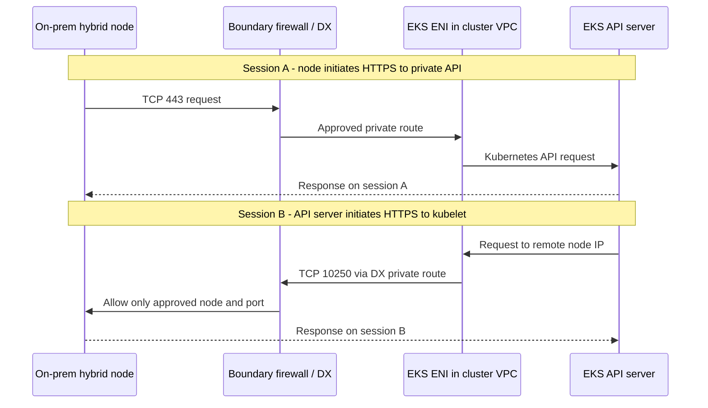

# Revisión de la separación de red de Hybrid Nodes con los equipos de seguridad

> **Última actualización**: 16 de septiembre de 2026

Que un plano de control de AWS se conecte a infraestructura local mediante Direct Connect (DX) no constituye por sí solo una infracción de separación de redes. Del mismo modo, **«usamos un endpoint privado, por lo tanto cumplimos» no es una conclusión válida**. La revisión debe determinar qué conexiones de administración cruzan límites de confianza, cómo se controlan y qué datos pueden transportar.

Este artículo sirve para una revisión técnica de **un despliegue convencional enrutado de Hybrid Nodes con un endpoint privado únicamente para la API de Kubernetes y enrutamiento privado por DX**. No determina cumplimiento ni aprueba el uso para el sector, la clasificación de sistemas o la política interna de un cliente. «Potencialmente aceptable» significa aquí que la política de la organización permite comunicaciones de administración controladas entre redes. Para redactar este artículo no se inspeccionaron ninguna cuenta de cliente, conexión DX, firewall ni clúster.

Consulta el [glosario](#glossary) si no conoces las abreviaturas de AWS o Kubernetes.

## Explicación para el equipo de seguridad

> EKS Hybrid Nodes conecta nodos locales con un plano de control de Kubernetes administrado por AWS. El diseño que se revisa deshabilita el acceso público a la API de Kubernetes y usa rutas privadas aprobadas y firewalls de perímetro. Las conexiones iniciadas por el plano de control atraviesan las ENI de EKS en la VPC del clúster y se restringen a nodos aprobados por TCP 10250 de kubelet y, cuando corresponda, a destinos y puertos aprobados de webhooks. La autenticación y autorización de la API y de kubelet, los permisos restringidos de operadores y los registros de auditoría se aplican en conjunto.
>
> Por tanto, el argumento de seguridad depende de **restringir y verificar qué identidades pueden realizar qué operaciones en qué recursos**, en vez de dar por sentado que se confía en AWS o en un endpoint. Esta arquitectura incluye conexiones de administración entre redes. Un requisito de desconexión completa o una prohibición general de conexiones iniciadas desde la nube es incompatible con el diseño descrito.

En una entrega, usa «restringido» y «aplicado» solo cuando la configuración y las pruebas lo demuestren. En la fase de diseño, di «previsto y sujeto a verificación». Los [requisitos de red de Hybrid Nodes](https://docs.aws.amazon.com/eks/latest/userguide/hybrid-nodes-networking.html) de AWS enumeran explícitamente TCP 10250 entrante y los puertos de webhook necesarios para el firewall local.

## Tres significados distintos de «endpoint»

| Componente | Propósito | Lo que no demuestra |
|---|---|---|
| **Endpoint privado de la API de Kubernetes** | Acceso HTTPS privado por TCP 443 a la API del clúster para kubelets, Pods y operadores aprobados | No elimina las conexiones del plano de control hacia la infraestructura local ni impide el movimiento de datos mediante operaciones de API autorizadas |
| **ENI del plano de control de EKS en la VPC del clúster** | Conexión de red entre el servidor de API y la VPC/redes remotas de nodos y Pods, sujeta a los grupos de seguridad y al enrutamiento asociados | Una ENI no es un dispositivo DLP, una solución certificada entre dominios ni un sistema para aprobar comandos de aplicaciones |
| **Endpoints de VPC de interfaz / PrivateLink para servicios de AWS** | Acceso con dirección privada a la API del servicio de AWS correspondiente, como `eks`, `ssm` o `rolesanywhere` | `com.amazonaws.<region>.eks` no retransmite la API de Kubernetes ni las conexiones del plano de control hacia kubelet |

AWS describe el endpoint privado de la API de Kubernetes como algo distinto de un endpoint AWS API PrivateLink tradicional; no aparece en la lista de endpoints de la consola de VPC. El endpoint de interfaz `eks` ofrece la **API de administración de AWS EKS**, incluido `DescribeCluster`. Confundir estos endpoints puede llevar a afirmar erróneamente que una política de endpoint controla la conexión TCP 10250. [Endpoint del clúster](https://docs.aws.amazon.com/eks/latest/userguide/cluster-endpoint.html), [PrivateLink para EKS](https://docs.aws.amazon.com/eks/latest/userguide/vpc-interface-endpoints.html)

`endpointPrivateAccess=true` por sí solo no significa que el acceso sea solo privado. Este artículo también presupone `endpointPublicAccess=false`. Si están habilitados tanto el acceso público como el privado, los nodos híbridos pueden resolver el nombre del clúster a direcciones IP públicas. `publicAccessCidrs` no restringe el endpoint privado; los grupos de seguridad del clúster, el enrutamiento y los firewalls controlan la ruta privada. [Modos de acceso al endpoint](https://docs.aws.amazon.com/eks/latest/userguide/cluster-endpoint.html)

## ¿Qué extremo inicia cada conexión?

El diagrama muestra solicitudes en **dos sesiones TCP independientes**. Las flechas de respuesta en sentido inverso no implican que las respuestas de una conexión saliente existente permitan cualquier operación. El firewall de perímetro es un control diseñado por el cliente; DX no lo proporciona automáticamente.

Las respuestas discontinuas atraviesan la ruta aprobada en sentido inverso. El dibujo no introduce un proxy que cambie la terminación TLS. El enrutamiento real depende de las tablas de rutas de VPC, de la configuración elegida de VGW o TGW/gateway DX y del enrutamiento y los firewalls locales. [Referencia del flujo de paquetes de AWS](https://docs.aws.amazon.com/eks/latest/userguide/hybrid-nodes-concepts-traffic-flows.html)

| Iniciador → destino | Puerto de destino | Propósito y alcance de la revisión |
|---|---|---|
| Kubelet de Hybrid Node → endpoint privado de la API de Kubernetes | TCP 443 | Administración del clúster, incluido el estado de los nodos y las especificaciones de Pods |
| Servidor de API → kubelet del nodo híbrido | TCP 10250 | Conexión independiente para operaciones como `logs`, `exec`, `attach`, `cp` y `port-forward` |
| Servidor de API → webhook local / backend de API agregada | Puerto TCP real del backend | Aprobación separada cuando estos componentes se ejecutan en las instalaciones; distingue el puerto del Service del puerto de destino real |
| Nodo híbrido → endpoint seleccionado de SSM o IAM Roles Anywhere | TCP 443 | Emisión y renovación de credenciales temporales de nodo; revisa también los permisos y la conectividad de las funciones de administración de SSM que se utilicen |
| Pod → API de Kubernetes / servicios de AWS necesarios | Normalmente TCP 443 | SNAT de CNI afecta a la dirección de origen que ve el firewall y a la ruta de retorno |
| Cliente DNS → resolver aprobado | UDP/TCP 53 | Define por separado las rutas DNS, teniendo en cuenta la ubicación de CoreDNS y el reenvío DNS |
| Aplicaciones, CNI y componentes de monitorización | Según la función | Mantén un inventario de flujos separado en lugar de aprobarlos colectivamente como tráfico de administración |

Esta tabla no es una política de firewall completa para todos los CNI y aplicaciones. Consulta [Configuración de red](02-network-configuration.md) y los [requisitos operativos continuos de AWS](https://docs.aws.amazon.com/eks/latest/userguide/hybrid-nodes-networking.html). El puerto de webhook `8443` es un ejemplo, no una solicitud para permitir todos los puertos iguales o superiores a `8443`.

**Permitir tráfico de respuesta con estado para TCP 443 iniciado por un nodo no permite una nueva conexión entrante TCP 10250.** Describir esta arquitectura como un túnel de agente solo saliente crea errores operativos y de seguridad. Los grupos de seguridad tienen estado; las listas de control de acceso de red no tienen estado y requieren considerar por separado el tráfico de retorno. Si intervienen NAT o dispositivos de inspección, verifica las direcciones visibles en cada límite y la ruta de retorno simétrica. [Flujos de tráfico de Hybrid Nodes](https://docs.aws.amazon.com/eks/latest/userguide/hybrid-nodes-concepts-traffic-flows.html), [Grupos de seguridad y ACL de red](https://aws.amazon.com/vpc/faqs/)

## Convierte la política de separación de red en requisitos de diseño

Primero obtén la declaración de política real del cliente. Esta tabla evalúa la **compatibilidad técnica con los requisitos**, no interpreta legislación ni exenciones regulatorias.

| Requisito del cliente | Evaluación de este diseño |
|---|---|
| Sin exposición a Internet; se permiten conexiones privadas de administración aprobadas entre redes | Candidato a revisión. Demuestra que la API pública está deshabilitada, que existen rutas privadas para los servicios necesarios, el mínimo privilegio, los controles de firewall y los registros |
| El aislamiento físico impide la comunicación en tiempo real con un plano de control externo | Incompatible con los requisitos de conectividad de Hybrid Nodes. Considera ubicar el plano de control dentro del límite interno permitido |
| Solo se permiten respuestas a sesiones iniciadas internamente; se prohíben todas las conexiones nuevas iniciadas desde la nube | Incompatible con los flujos de kubelet y webhook de un despliegue convencional enrutado de Hybrid Nodes |
| Los dominios de cargas de trabajo requieren autoridad administrativa independiente además de redes separadas | No concluyas que se cumple solo por tener VLAN o espacios de nombres. Revisa al administrador compartido del clúster y el plano de control; separa los clústeres cuando sea necesario |
| Los objetos de Kubernetes, los Secrets y los registros operativos también deben permanecer exclusivamente en las instalaciones | Identifica los datos incompatibles con un plano de control alojado en AWS. La ubicación de los nodos por sí sola no satisface el requisito |
| Las conexiones requieren un dispositivo entre dominios y un proceso de aprobación específicos | No presupongas que DX o PrivateLink sustituyen ese dispositivo o proceso. Confirma la aplicabilidad y la compatibilidad funcional |

[Configuración con acceso a Internet restringido](03-airgap-setup.md) distingue la restricción de Internet de la desconexión completa de AWS. Hybrid Nodes requiere conectividad bidireccional fiable. [Descripción general de Hybrid Nodes](https://docs.aws.amazon.com/eks/latest/userguide/hybrid-nodes-overview.html)

## Aplica cada control en el límite adecuado

### Enrutamiento y acceso de red

Los CIDR de nodos remotos y Pods informan a EKS de las redes de destino. Registrarlos no completa las rutas locales, los firewalls ni las políticas de aislamiento. Inspecciona también las reglas entrantes de los grupos de seguridad de clúster creados por EKS, incluidas las reglas obsoletas después de reducir un CIDR. AWS indica explícitamente que quitar redes remotas no elimina automáticamente sus reglas de grupo de seguridad. [Configuración de red y grupos de seguridad](https://docs.aws.amazon.com/eks/latest/userguide/hybrid-nodes-networking.html)

Presenta la regla como **rango de direcciones de origen verificado de ENI de EKS → direcciones designadas de nodos híbridos → TCP 10250**. Las IP de ENI pueden cambiar, así que no congeles para siempre la lista actual de `/32`. Cuando sea viable, las subredes dedicadas del plano de control acotan la propiedad de direcciones; mantén un proceso de actualización de listas de permitidos y revalidación al reemplazar ENI y actualizar el clúster. Permitir una subred compartida completa puede incluir otros recursos de ese rango de origen: registra este riesgo residual. [Ciclo de vida de ENI de EKS y planificación de red](https://docs.aws.amazon.com/eks/latest/userguide/hybrid-nodes-networking.html)

Revisa en conjunto el egreso de grupos de seguridad del clúster, las rutas de VPC/TGW y los firewalls perimetrales y de host locales. Un ID de grupo de seguridad no se transmite como identidad a un firewall local. Una ruta tampoco autoriza una operación de API. Limita la propagación y el acceso a prefijos de redes empresariales no relacionados, y verifica el rechazo de destinos fuera del conjunto aprobado. Son recomendaciones de diseño, no afirmaciones de que los controles ya se hayan aplicado en el entorno de un cliente.

### Cifrado, identidad y autorización

**DX no cifra el tráfico en tránsito de forma predeterminada.** Conserva las comprobaciones TLS y de autenticación para la API de Kubernetes y las conexiones HTTPS de kubelet. Si se requiere cifrado del enlace, revisa las opciones compatibles de IPsec sobre DX o MACsec y su cobertura. MACsec protege enlaces DX compatibles; su alcance difiere del TLS de extremo a extremo de la aplicación. El uso de DX por sí solo no demuestra que todo el tráfico de aplicaciones u overlays esté cifrado. [Cifrado de DX](https://docs.aws.amazon.com/directconnect/latest/UserGuide/encryption-in-transit.html)

Una dirección IP privada no establece los permisos de quien llama. Revisa por separado las identidades IAM de operadores, las entradas y políticas de acceso de EKS y RBAC de Kubernetes, las identidades de nodos y la autenticación y autorización de kubelet. No resuelvas problemas de conectividad deshabilitando la verificación TLS ni habilitando acceso anónimo o AlwaysAllow a kubelet. El acceso directo a kubelet es una ruta de autorización distinta y no debe tratarse como equivalente a una operación mediada por el servidor de API. [Administración del acceso a EKS](https://docs.aws.amazon.com/eks/latest/userguide/access-entries.html), [Autenticación y autorización de kubelet](https://kubernetes.io/docs/reference/access-authn-authz/kubelet-authn-authz/)

Una política de endpoint de un servicio AWS filtra las llamadas a la API de ese servicio a través de ese endpoint. No concede permisos IAM ni sustituye RBAC de Kubernetes. Si se usa SSM, revisa la autorización de funciones de administración como Run Command y Session Manager. Que un nodo inicie HTTPS no elimina la posibilidad de que se le envíen comandos de administración desde fuera. [Control de acceso al endpoint](https://docs.aws.amazon.com/vpc/latest/privatelink/vpc-endpoints-access.html), [Control de acceso a SSM](https://docs.aws.amazon.com/systems-manager/latest/userguide/security-iam.html)

### Límites de datos y administración

Hybrid Nodes no replica automáticamente en AWS todos los conjuntos de datos empresariales procesados por Pods locales. Sin embargo, el plano de control de AWS administra objetos de la API de Kubernetes. El contenido confidencial que se incluya en especificaciones de Pods, ConfigMaps o Secrets de Kubernetes también pasa a ser dato administrado. `logs` transfiere la salida de la aplicación, mientras que `exec`, `cp` y `port-forward` pueden dar a usuarios autorizados rutas de acceso a los datos. No afirmes que el tráfico de administración nunca puede contener datos empresariales. El cifrado de datos de API en reposo no cambia su ubicación de almacenamiento ni impide su movimiento mediante lecturas autorizadas. [Conceptos de red de Hybrid Nodes](https://docs.aws.amazon.com/eks/latest/userguide/hybrid-nodes-concepts-networking.html), [Cifrado de datos de API de EKS](https://docs.aws.amazon.com/eks/latest/userguide/envelope-encryption.html)

Revisa en conjunto los permisos de `pods/log`, `pods/exec`, `pods/attach`, `pods/portforward`, `nodes/proxy` y creación/modificación de cargas de trabajo. Restringir únicamente `exec` no basta si una identidad puede crear Pods o cargas privilegiadas/con `hostPath` que accedan a los datos de otra manera. Las políticas de seguridad y admisión de Pods, así como las restricciones de acceso al host, complementan RBAC. Los espacios de nombres y NetworkPolicy por sí solos no crean un límite de seguridad independiente frente a un administrador que comparte el clúster. [Buenas prácticas de RBAC de Kubernetes](https://kubernetes.io/docs/concepts/security/rbac-good-practices/)

En concreto, no clasifiques `get nodes/proxy` como solo lectura. Puede autorizar la ejecución de comandos de contenedor mediante la API de kubelet y ese acceso puede eludir las rutas de auditoría y admisión de Kubernetes. Recopilar únicamente los registros de auditoría de API no demuestra cobertura de todas las operaciones de administrador. [Riesgos del permiso de proxy de nodo](https://kubernetes.io/docs/concepts/security/rbac-good-practices/#access-to-proxy-subresource-of-nodes)

Clasifica por separado los datos empresariales, objetos de API, registros transmitidos, registros de auditoría, imágenes/artefactos y credenciales. Registra ubicaciones de almacenamiento, destinos de transferencia, permisos de acceso y retención. Incluye el egreso de aplicaciones y las rutas de administración de SSM para establecer el alcance real de una afirmación de que «los datos permanecen solo en las instalaciones».

## Evidencia que se debe adjuntar a la revisión de seguridad

Estos son **requisitos de evidencia**, no resultados de una inspección ya realizada. No adjuntes identificadores de clientes, tokens, valores de Secret ni registros empresariales reales a documentación pública.

| Pregunta de revisión | Evidencia | Criterios de aceptación |
|---|---|---|
| ¿Se aplica realmente el acceso solo privado? | Ajustes del endpoint del clúster objetivo, respuestas DNS locales, rutas DX y registros de flujo de perímetro | Acceso público deshabilitado; direcciones y rutas privadas reales verificadas; el éxito de DNS por sí solo no basta |
| ¿A qué puede llegar AWS internamente? | Propiedad de ENI/subredes, CIDR remotos, rutas de VPC/TGW y locales, y reglas de SG/firewall coincidentes | Solo se permiten nodos, backends y puertos aprobados; se demuestran las restricciones a otros dominios empresariales |
| ¿Se distinguen las operaciones permitidas y prohibidas? | Éxito de `logs` y operaciones de administración aprobadas con datos sintéticos en un entorno de prueba aislado; denegación de identidades y destinos no autorizados | Conectividad y autorización se prueban por separado; un fallo de red no sustituye una prueba de denegación de autorización |
| ¿Quién realizó qué operación de API y cuándo? | Registros de auditoría/autenticación de Kubernetes de EKS, CloudTrail para las API de administración de AWS y marcas de tiempo correlacionadas | Distingue las dos capas de API y rastrea identidad de prueba, hora, operación, destino y resultado |
| ¿Qué cruzó el límite? | VPC Flow Logs, registros del firewall local e inventario separado de flujos de datos | Presenta evidencia de IP/puerto/permitido-denegado junto con la clasificación de datos; no afirmes que Flow Logs certifica cargas útiles TLS ni cuerpos de comandos |
| ¿Los límites resisten cambios y fallos? | Planes de revalidación y recuperación ante reemplazo de ENI, cambios de rutas, conmutación DX/VPN y renovación/caducidad de credenciales | Las rutas de respaldo conservan la política; no se etiqueta como segura una conmutación que no se haya probado |

Habilita los tipos necesarios de registro del plano de control de EKS; la auditoría de Kubernetes y CloudTrail cumplen funciones distintas. Los registros de auditoría registran eventos de API según la política y el nivel de auditoría, no cada entrada/salida de `exec` ni la carga de `port-forward`. Diseña junto con la recopilación la retención, los controles de acceso y el tratamiento de datos confidenciales. [Registros del plano de control](https://docs.aws.amazon.com/eks/latest/userguide/control-plane-logs.html), [Auditoría de EKS](https://docs.aws.amazon.com/eks/latest/best-practices/auditing-and-logging.html), [CloudTrail de EKS](https://docs.aws.amazon.com/eks/latest/userguide/logging-using-cloudtrail.html), [Límites de Flow Logs](https://docs.aws.amazon.com/vpc/latest/userguide/flow-logs.html)

Los registros pueden excluir tráfico fuera del alcance de captura configurado o retrasarse/omitirse. La entrega de registros de EKS es de mejor esfuerzo; inspecciona los ajustes de recopilación y señales de datos ausentes como `SKIPDATA` de Flow Logs. **La ausencia de un registro por sí sola no demuestra que una conexión u operación no haya ocurrido.** Correlaciona los registros del firewall con pruebas explícitas de permitir/denegar. [Límites de recopilación de Flow Logs](https://docs.aws.amazon.com/vpc/latest/userguide/flow-logs-limitations.html), [Solución de problemas de Flow Logs ausentes](https://docs.aws.amazon.com/vpc/latest/userguide/flow-logs-troubleshooting.html)

Realiza la validación en destinos de preproducción aprobados con datos sintéticos. Establecer el perímetro no exige explorar toda la red empresarial, abrir ampliamente firewalls de producción ni extraer datos de clientes mediante `logs` o `cp`.

## Preguntas frecuentes de los equipos de seguridad

### «¿Abrir 10250 permite que todo AWS acceda a los servidores internos?»

Un diseño correctamente restringido permite rangos de origen verificados de las ENI del clúster e identidades autenticadas, no todo el espacio de direcciones de AWS. Una lista de permitidos de IP por sí sola tampoco demuestra la identidad del clúster, y siguen existiendo riesgos de exposición en subredes compartidas o de permisos excesivos de administrador. Presenta las restricciones de red junto con evidencia TLS, de autenticación y de autorización.

### «¿Mover los webhooks a AWS elimina las conexiones entrantes?»

Puede reducir las conexiones directas a webhooks locales. El requisito TCP 10250 de kubelet sigue siendo independiente y los webhooks alojados en la nube pueden tener otras dependencias. Consulta las [recomendaciones de AWS para webhooks](https://docs.aws.amazon.com/eks/latest/userguide/hybrid-nodes-webhooks.html) sobre opciones de ubicación en nodos de nube.

### «¿Hybrid Nodes Gateway hace que el diseño sea solo saliente?»

[Hybrid Nodes Gateway](10-hybrid-nodes-gateway.md) usa Cilium VTEP/VXLAN para admitir conectividad híbrida de Pods. No es un producto para clústeres desconectados ni un gateway de seguridad unidireccional. Revisa por separado las direcciones/puertos exteriores del gateway y túnel y los flujos interiores de Pods; no copies sin cambios la tabla de enrutamiento directo de este artículo. [Descripción general de AWS Gateway](https://aws.amazon.com/blogs/containers/simplify-hybrid-kubernetes-networking-with-amazon-eks-hybrid-nodes-gateway/)

### «¿Podemos afirmar que esto no infringe los requisitos de separación de redes?»

No basándonos solo en el método de conexión. Si la política aplicable permite conectividad de administración controlada y la evidencia y aprobación de la organización cubren las conexiones, los permisos y el límite de datos, registra junto con la conclusión el **alcance y las condiciones de la revisión**. No vuelvas a etiquetar una conexión prohibida como permitida solo porque use DX o un endpoint privado.

## Glosario {#glossary}

| Abreviatura | Nombre completo y significado en este artículo |
|---|---|
| VPC / ENI | Virtual Private Cloud / Elastic Network Interface: un límite lógico de red de AWS y una interfaz de red virtual conectada dentro de él |
| SG / NACL | Security Group / Network Access Control List: reglas de permiso con estado asociadas a interfaces y reglas sin estado de permitir/denegar en los límites de subred, respectivamente |
| DLP | Data Loss Prevention: controles para detectar o impedir la transferencia inadecuada de datos confidenciales; no es una función de ENI |
| CNI / SNAT | Container Network Interface / Source Network Address Translation: la especificación e implementaciones de interfaces para redes de Pods, y la traducción de direcciones de origen de paquetes |
| VGW / TGW | Virtual Private Gateway / Transit Gateway: gateways utilizados en el diseño elegido de conectividad privada de AWS |
| VXLAN / VTEP | Virtual Extensible LAN / VXLAN Tunnel Endpoint: un mecanismo de encapsulación de red y su extremo de túnel, no un control unidireccional |
| IAM / RBAC | Identity and Access Management / Role-Based Access Control: administración de identidades y permisos de AWS, y autorización basada en roles de Kubernetes |
| TLS / IPsec / MACsec | Transport Layer Security / Internet Protocol Security / Media Access Control Security: tecnologías de seguridad con diferente cobertura de capa de protocolo y ruta |
| SSM | Identificador del servicio AWS Systems Manager; este artículo distingue el acceso a credenciales de nodos de las funciones opcionales de administración de sistemas |

## Lecturas adicionales

- [Configuración de red y detalles de endpoints](02-network-configuration.md)
- [Acceso a Internet restringido frente a desconexión completa](03-airgap-setup.md)
- [Operaciones y mantenimiento](08-operations.md)
- [Cuestionario de revisión de seguridad de separación de redes](../quizzes/eks-hybrid-nodes/11-network-separation-security-quiz.md)

< [Contenido de Hybrid Nodes](README.md) | [Anterior: Hybrid Nodes Gateway](10-hybrid-nodes-gateway.md) >
