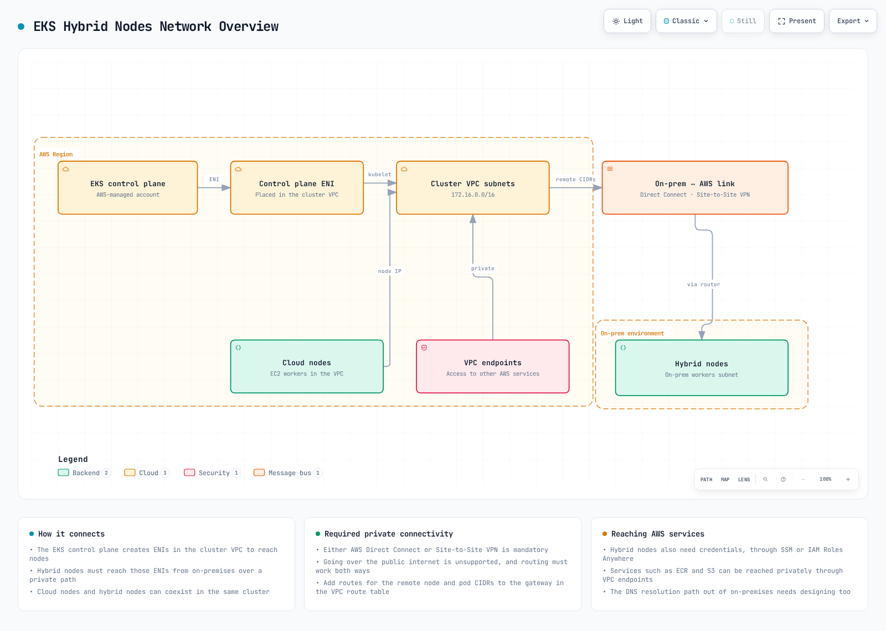

# Nodos híbridos de EKS

> **Versiones compatibles**: Versiones actuales compatibles con EKS; ejemplos revisados para EKS 1.36 / nodeadm 1.0.20
> **Última actualización**: October 12, 2026

Amazon EKS Hybrid Nodes conecta nodos locales o de edge operados por el cliente a un plano de control de EKS administrado por AWS. Usted continúa operando los hosts, los sistemas operativos, la conectividad y las cargas de trabajo. Esta guía distingue las interfaces compatibles de las configuraciones de ejemplo; no demuestra que se haya probado una implementación de producción local en particular.

EKS 1.37 estuvo disponible el 1 de octubre de 2026. Los ejemplos de esta guía siguen revisados con EKS 1.36 y nodeadm 1.0.20.

Antes de elegir una versión, consulte el [calendario de versiones de EKS](https://docs.aws.amazon.com/eks/latest/userguide/kubernetes-versions.html), la documentación de Hybrid Nodes y la información de compatibilidad de host/CNI.

## Tabla de contenido

1. [Requisitos previos y requisitos del sistema](01-prerequisites.md)
2. [Configuración de red](02-network-configuration.md)
3. [Configuración con Internet restringido (S3 + puntos de enlace de VPC)](03-airgap-setup.md)
4. [Bootstrap de nodos](04-node-bootstrap.md)
5. [Integración de servidores GPU](05-gpu-integration.md)
6. [Estrategias de colocación de cargas de trabajo](06-workload-placement.md)
7. [Administración del ciclo de vida de los nodos](07-node-lifecycle.md)
8. [Operaciones y mantenimiento](08-operations.md)
9. [Guía de instalación y migración de SO de servidores bare metal](09-bare-metal-os-setup.md)
10. [Gateway de Hybrid Nodes](10-hybrid-nodes-gateway.md)
11. [Revisión de seguridad de separación de red](11-network-separation-security.md)

## ¿Qué son los Hybrid Nodes?

Los Hybrid Nodes pueden compartir un clúster con nodos de computación de AWS comunes. Registrar una máquina en la nube como nodo **híbrido** es diferente: AWS no admite infraestructura de nodos híbridos en las regiones de AWS, Local Zones, Outposts ni otras nubes, y el uso de EC2 sigue generando tarifas de Hybrid Nodes.



[🔍 Ver diagrama interactivo](https://www.atomai.click/kubernetes-docs/archmaps/en-eks-hybrid-nodes-highlevel-0.html)

El siguiente diagrama muestra los requisitos previos de red, incluidos VPC, subredes, Transit Gateway/Virtual Private Gateway y conectividad de CIDR de Remote Node/Pod.


[🔍 Ver diagrama interactivo](https://www.atomai.click/kubernetes-docs/archmaps/en-eks-hybrid-nodes-prereq-0.html)

Los diagramas ilustran la conectividad y el enrutamiento privados, no la creación automática de cada ruta local, regla de firewall o punto de enlace de servicio de AWS.

Para las revisiones de los equipos de seguridad, use la [guía de revisión de separación de red](11-network-separation-security.md). Distingue los puntos de enlace privados del clúster, las ENI de EKS y los puntos de enlace de PrivateLink de servicios de AWS, e identifica la evidencia de las conexiones de administración y de los límites de datos a través de DX.

## Casos de uso y límites de datos

Las GPU locales, los conjuntos de datos locales de gran tamaño, el procesamiento de edge y el hardware existente pueden ser motivos para usar Hybrid Nodes. Los requisitos de localidad de datos aún necesitan controles de aplicación, almacenamiento, egreso y registro. Los objetos de la API de Kubernetes y los metadatos del plano de control se administran en AWS; un selector de nodos por sí solo no establece la soberanía de los datos ni el cumplimiento normativo.

Use la etiqueta de computación híbrida real y una etiqueta de organización mantenida explícitamente para la colocación, en lugar de suponer que existe una zona de AWS denominada `on-premises`:

```yaml
# Pod spec fragment; set organization labels through the node owner.
nodeSelector:
  eks.amazonaws.com/compute-type: hybrid
  example.com/data-location: on-premises
```

Este fragmento no crea una etiqueta, una aplicación completa, un límite de seguridad ni una política de retención de datos. Valide la compatibilidad de la imagen/runtime y las rutas de datos reales.

## Arquitectura y responsabilidad

| Componente | Ubicación | Responsabilidad |
|-----------|----------|----------------|
| Servidor de API de EKS, etcd, controladores, scheduler | AWS | Plano de control administrado por AWS |
| nodeadm | Host Linux local compatible | CLI de instalación/bootstrap/actualización; no es el agente de nodo de larga ejecución |
| kubelet / containerd | Local | Agente de nodo / runtime de CRI, operado por el propietario del host |
| Cilium o Calico | Local y clúster | Configuración de CNI compatible; VPC CNI no administra nodos híbridos |
| SSM Agent o ayudante de firma de Roles Anywhere | Local | Obtiene credenciales temporales del servicio de AWS correspondiente |
| Servicio SSM / IAM Roles Anywhere | AWS | Servicio de credenciales, no un sustituto de CA local sin conexión |
| VPN / Direct Connect y enrutamiento | Ambos entornos | Conectividad bidireccional; Direct Connect por sí solo no implica cifrado |

Las variantes VMware compatibles de Bottlerocket usan su propia ruta de bootstrap y no usan nodeadm. Para otros hosts compatibles, `nodeadm install` instala dependencias y `nodeadm init` configura/incorpora el nodo. Las nuevas instalaciones/actualizaciones basadas en SSM requieren **nodeadm 1.0.19 o posterior** debido a los cambios en la clave de firma de SSM; la versión actual revisada es la **1.0.20**.

## Restricciones que se deben planificar

- **Entorno conectado:** Se requiere conectividad privada bidireccional confiable con AWS. Hybrid Nodes no está diseñado para operaciones DDIL desconectadas o intermitentes. «Air-gap» en esta guía significa acceso a Internet restringido con la conectividad de AWS necesaria, no aislamiento de AWS.
- **Direcciones:** Rangos IPv4 RFC1918 o CGNAT, sin superposición entre los CIDR de nodo/Pod remotos, VPC y servicio. Se admiten hasta **15 CIDR de nodo y 15 CIDR de Pod por clúster**.
- **Autenticación:** Use `API` o `API_AND_CONFIG_MAP` y prepare el rol/las entradas de acceso de IAM para Hybrid Nodes.
- **Punto de enlace de la API:** AWS recomienda solo público o solo privado. Con ambos habilitados, los nodos fuera de la VPC resuelven direcciones de puntos de enlace públicos; eso **puede** impedir la incorporación si la ruta esperada o las reglas de acceso son privadas. No es una prohibición universal de la API. Incluso un punto de enlace público de la API no elimina el requisito de conectividad privada entre el plano de control y el nodo.
- **Regiones:** Disponible excepto en AWS GovCloud (US) y las regiones de AWS China, según la visión general actual.
- **Compatibilidad de hosts:** Revise conjuntamente el SO, la arquitectura, CNI y el kernel. AL2023 es para entornos virtualizados locales, no una recomendación genérica para bare metal.
- **Cargos:** Las tarifas de Hybrid Nodes usan las horas de vCPU notificadas mientras los nodos están conectados. Los núcleos bare metal con hyperthreading pueden notificar dos vCPU. Las cargas de trabajo inactivas no detienen automáticamente los cargos por nodos; las tarifas del clúster y de otros servicios son independientes.

## Proveedores de credenciales

Ambos proveedores necesitan acceso a puntos de enlace de servicios de AWS para renovar las credenciales. Una CA local no permite que IAM Roles Anywhere emita credenciales de AWS sin conexión. Prefiera un proveedor de forma coherente en toda la flota, salvo que exista una razón revisada para combinarlos.

| Tema | Activaciones híbridas de SSM | IAM Roles Anywhere |
|-------|------------------------|--------------------|
| Bootstrap | ID/código de activación y rol preparado que confía en SSM | PKI, certificado/clave por nodo, trust anchor, perfil y rol |
| Nomenclatura | Nombre `mi-...` generado por SSM | Nombre de nodo personalizado vinculado a la identidad del certificado |
| Duración de la sesión | Una hora fija, renovada por SSM | Una hora de forma predeterminada; duraciones de solicitud/perfil compatibles de 15 minutos a 12 horas, sujetas a la duración efectiva y al máximo del rol |
| Desconexión | No se puede renovar; el retroceso de reintentos puede retrasar la reconexión después de la recuperación de la red | No se pueden obtener credenciales nuevas sin conexión; el proceso de credenciales las obtiene bajo demanda cuando vuelve la conectividad |
| Escala / costo | Sin cargo de registro de nodo de SSM ni de administración por nodo; el precio por uso de la característica es independiente | Revise las cuotas de IAM Roles Anywhere y los requisitos operativos de PKI |
| Opción habitual | Sin PKI existente; registro más sencillo | PKI existente y ciclo de vida de certificados administrado |

**Precios verificados el 16 de septiembre de 2026:** SSM eliminó el nivel de instancias avanzadas con vigencia desde el 30 de junio de 2026. Consulte los [precios actuales de SSM](https://aws.amazon.com/systems-manager/pricing/) para conocer los términos de uso de Session Manager y Run Command; los [cargos de vCPU de EKS Hybrid Nodes](https://aws.amazon.com/eks/pricing/) siguen siendo independientes.

El perfil de Roles Anywhere debe aceptar un nombre de sesión de rol personalizado, y la política de confianza debe vincularlo al atributo de certificado elegido. Su duración de sesión efectiva **no debe superar** el máximo del rol de IAM; la igualdad está permitida por la API CreateSession. Los [requisitos previos](01-prerequisites.md) detallan estos contratos y la preparación segura.

## Cargas de trabajo de ejemplo

1. Entrenamiento o inferencia de GPU local con un runtime y un plan de recuperación verificados.
2. Procesamiento de datos local con rutas de metadatos/telemetría/egreso de AWS revisadas por separado.
3. Aplicaciones de fábrica/edge con conectividad confiable y comportamiento de desconexión probado.
4. Procesamiento de medios cerca de grandes conjuntos de datos existentes.

## Siguientes pasos

Comience con los [Requisitos previos y requisitos del sistema](01-prerequisites.md) para asegurar que su entorno esté listo para EKS Hybrid Nodes.

## Cuestionario

Para poner a prueba su comprensión de EKS Hybrid Nodes, pruebe el siguiente cuestionario:

* [Cuestionario de requisitos previos de EKS Hybrid Nodes](../quizzes/eks-hybrid-nodes/01-prerequisites-quiz.md)
* [Cuestionario de configuración de red de EKS Hybrid Nodes](../quizzes/eks-hybrid-nodes/02-network-configuration-quiz.md)
* [Cuestionario de configuración con Internet restringido de EKS Hybrid Nodes](../quizzes/eks-hybrid-nodes/03-airgap-setup-quiz.md)
* [Cuestionario de bootstrap de nodos de EKS Hybrid Nodes](../quizzes/eks-hybrid-nodes/04-node-bootstrap-quiz.md)
* [Cuestionario de integración de GPU de EKS Hybrid Nodes](../quizzes/eks-hybrid-nodes/05-gpu-integration-quiz.md)
* [Cuestionario de colocación de cargas de trabajo de EKS Hybrid Nodes](../quizzes/eks-hybrid-nodes/06-workload-placement-quiz.md)
* [Cuestionario de administración del ciclo de vida de nodos](../quizzes/eks-hybrid-nodes/07-node-lifecycle-quiz.md)
* [Cuestionario de operaciones de EKS Hybrid Nodes](../quizzes/eks-hybrid-nodes/08-operations-quiz.md)
* [Cuestionario de instalación y migración de SO de servidores bare metal](../quizzes/eks-hybrid-nodes/09-bare-metal-os-setup-quiz.md)
* [Cuestionario de Gateway de EKS Hybrid Nodes](../quizzes/eks-hybrid-nodes/10-hybrid-nodes-gateway-quiz.md)
* [Cuestionario de revisión de seguridad de separación de red](../quizzes/eks-hybrid-nodes/11-network-separation-security-quiz.md)

## Documentos relacionados

* [Guía de resiliencia de EKS](../eks/10-eks-resiliency.md) - Configuración de alta disponibilidad en entornos híbridos
* [Optimización de costos de EKS](../eks/07-eks-cost-optimization.md) - Estrategias de administración de costos
* [Monitoreo y registro de EKS](../eks/06-eks-monitoring-logging.md) - Configuración de monitoreo integrado

## Documentación oficial

* [Documentación oficial de AWS EKS Hybrid Nodes](https://docs.aws.amazon.com/eks/latest/userguide/hybrid-nodes-overview.html)
* [Calendario de versiones de EKS Kubernetes](https://docs.aws.amazon.com/eks/latest/userguide/kubernetes-versions.html)
* [Guía del usuario de nodeadm](https://docs.aws.amazon.com/eks/latest/userguide/hybrid-nodes-nodeadm.html)
* [Documentación oficial de Harbor](https://goharbor.io/docs/)
* [Documentación de NVIDIA GPU Operator](https://docs.nvidia.com/datacenter/cloud-native/gpu-operator/overview.html)
* [Guía de redes de Hybrid Nodes](https://docs.aws.amazon.com/eks/latest/userguide/hybrid-nodes-networking.html)
* [Configuración de CNI de Hybrid Nodes](https://docs.aws.amazon.com/eks/latest/userguide/hybrid-nodes-cni.html)
* [Solución de problemas de Hybrid Nodes](https://docs.aws.amazon.com/eks/latest/userguide/hybrid-nodes-troubleshooting.html)

* [Compatibilidad del sistema operativo híbrido](https://docs.aws.amazon.com/eks/latest/userguide/hybrid-nodes-os.html)
* [Credenciales híbridas y rol de IAM](https://docs.aws.amazon.com/eks/latest/userguide/hybrid-nodes-creds.html)
* [Credenciales de host durante la desconexión de red](https://docs.aws.amazon.com/eks/latest/best-practices/hybrid-nodes-host-creds.html)
* [Semántica de CreateSession de IAM Roles Anywhere](https://docs.aws.amazon.com/rolesanywhere/latest/userguide/authentication-create-session.html)
* [Precios de EKS](https://aws.amazon.com/eks/pricing/)
