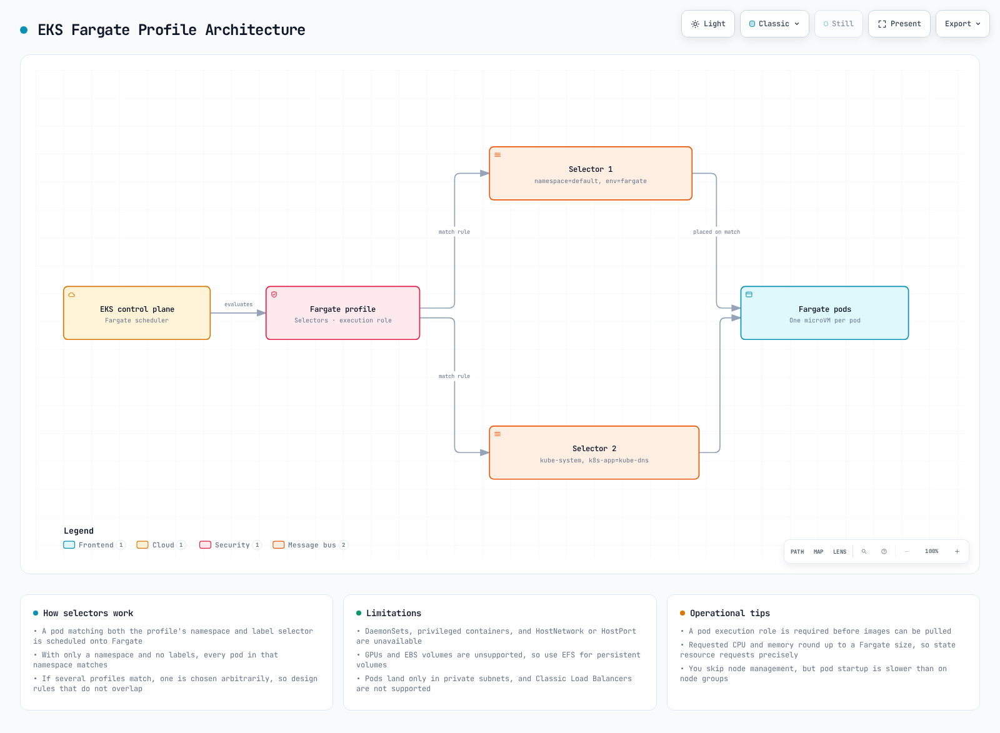
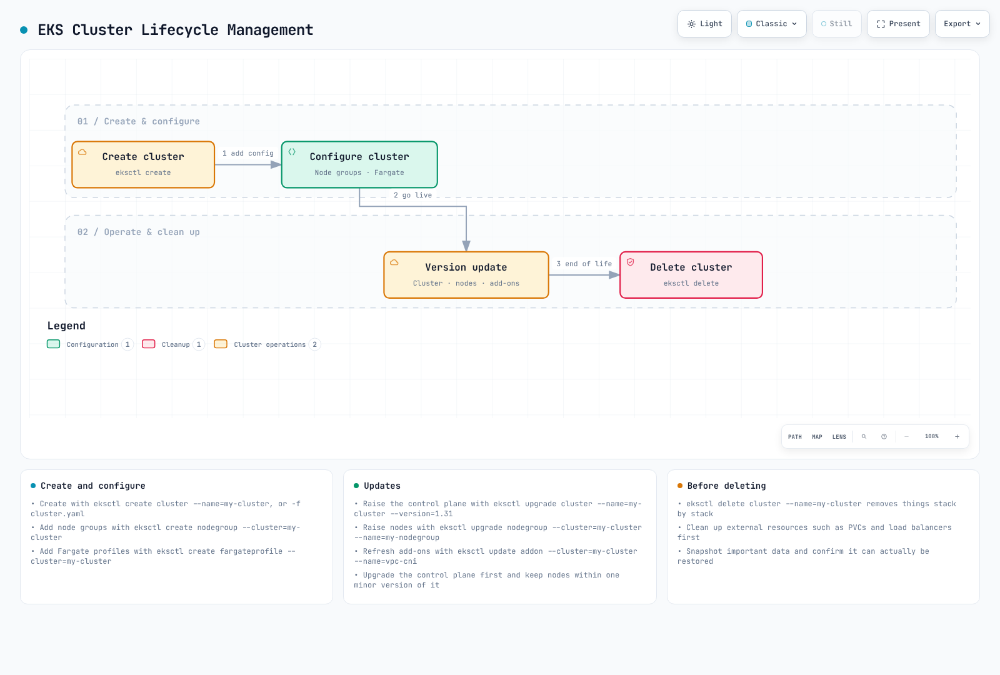

# Parte 2: creación de clústeres con eksctl

> **Última actualización**: 11 de septiembre de 2026

Usa los [requisitos previos de la parte 1](02-eks-cluster-creation-part1.md), una cuenta y un clúster de capacitación dedicados, y un kubeconfig temporal y privado (`EKS_KUBECONFIG`). Los ejemplos son alternativas, no un único script secuencial. Asigna a `EKS_CLUSTER_NAME` y `EKS_REGION` los valores del entorno revisado y utiliza identidades existentes y aprobadas. Los comandos que crean recursos de AWS generan cargos; esta revisión no aprovisionó recursos. Los ejemplos se comprobaron con eksctl 0.230.0 y EKS 1.36.

## Crear un clúster con eksctl

eksctl ofrece una interfaz de línea de comandos y una interfaz declarativa de configuración para EKS. Usa CloudFormation para crear clústeres de EKS y los recursos relacionados.

El siguiente diagrama muestra el proceso para crear un clúster de EKS con eksctl:


[🔍 Ver el diagrama interactivo](https://www.atomai.click/kubernetes-docs/archmaps/en-eks-02-eks-cluster-creation-part2-0.html)

Este diagrama ilustra un flujo de trabajo que crea una VPC nueva. También se pueden reutilizar VPC existentes; los tiempos varían, y escribir el kubeconfig no concede autorización ni confirma que el clúster esté listo.

### Crear un clúster básico

Crea el clúster básico a partir de un archivo de configuración revisado:

```bash
eksctl create cluster --config-file cluster.yaml --kubeconfig "${EKS_KUBECONFIG:?}"
```

Antes de ejecutar este comando, lee y edita el archivo `cluster.yaml` que aparece abajo. Selecciona de forma explícita EKS 1.36, AL2023, subredes de una VPC existente y las capacidades de los grupos de nodos. Sustituye los identificadores de ejemplo y el CIDR reservado para documentación por valores reales aprobados. Son ajustes seleccionados para este ejemplo, no afirmaciones sobre los valores predeterminados de todas las versiones de eksctl.

### Crear un clúster con un archivo de configuración

Para configuraciones más complejas, puedes definir el clúster en un archivo YAML:

```yaml
# cluster.yaml
apiVersion: eksctl.io/v1alpha5
kind: ClusterConfig
metadata:
  name: my-cluster
  region: us-west-2
  version: '1.36'
vpc:
  id: vpc-12345678
  subnets:
    private:
      us-west-2a:
        id: subnet-12345678
      us-west-2b:
        id: subnet-87654321
    public:
      us-west-2a:
        id: subnet-23456789
      us-west-2b:
        id: subnet-98765432
  clusterEndpoints:
    privateAccess: true
    publicAccess: true
  publicAccessCIDRs:
  - 203.0.113.10/32
managedNodeGroups:
- name: ng-1
  instanceType: m5.large
  desiredCapacity: 2
  minSize: 1
  maxSize: 3
  privateNetworking: true
  volumeSize: 80
  volumeType: gp3
  amiFamily: AmazonLinux2023
  disableIMDSv1: true
- name: ng-2
  instanceType: c5.xlarge
  desiredCapacity: 2
  privateNetworking: true
  spot: true
  amiFamily: AmazonLinux2023
  disableIMDSv1: true
cloudWatch:
  clusterLogging:
    enableTypes:
    - api
    - audit
    - authenticator
    - controllerManager
    - scheduler
fargateProfiles:
- name: fp-default
  selectors:
  - namespace: default
    labels:
      env: fargate
iam:
  withOIDC: true
accessConfig:
  authenticationMode: API
```

Para crear un clúster con este archivo de configuración, ejecuta el siguiente comando:

```bash
eksctl create cluster -f cluster.yaml --kubeconfig "${EKS_KUBECONFIG:?}"
```

La configuración anterior muestra nodos de EC2 y un perfil de Fargate opcional para aplicaciones. CoreDNS permanece en EC2; para moverlo a Fargate, también hay que revisar los ajustes de cómputo de CoreDNS, además del perfil.


La configuración elimina los permisos generales para complementos de los roles de nodo. Revisa la configuración IRSA de CNI y las políticas que genera eksctl cuando se habilita `iam.withOIDC`, y configura roles independientes para los demás controladores integrados con AWS. Inspecciona la configuración real del complemento y cualquier alternativa convencional de CNI basada en el rol del nodo. La autenticación de la API también requiere las entradas o políticas de acceso adecuadas de EKS para los operadores. Los recuentos mínimo y máximo de nodos no instalan Cluster Autoscaler.

### Crear grupos de nodos administrados

El siguiente diagrama muestra la arquitectura de un grupo de nodos administrado para un clúster de EKS:


[🔍 Ver el diagrama interactivo](https://www.atomai.click/kubernetes-docs/archmaps/en-eks-02-eks-cluster-creation-part2-1.html)

Los componentes de infraestructura son el servicio de grupos de nodos administrados de AWS EKS y su grupo de Auto Scaling. El diagrama ilustra los valores de AMI seleccionados por EKS; las AMI personalizadas requieren una configuración de arranque propia y revisada. Kubernetes programa los Pods en los nodos resultantes.

Para añadir un grupo de nodos administrado a un clúster existente, ejecuta el siguiente comando:

```bash
eksctl create nodegroup \
  --cluster my-cluster \
  --region us-west-2 \
  --name my-nodegroup \
  --node-type m5.large \
  --nodes 3 \
  --nodes-min 1 \
  --nodes-max 5 \
  --managed --node-ami-family AmazonLinux2023 --node-private-networking
```

También puedes usar un archivo de configuración:

```yaml
# nodegroup.yaml
apiVersion: eksctl.io/v1alpha5
kind: ClusterConfig

metadata:
  name: my-cluster
  region: us-west-2

managedNodeGroups:
  - name: my-nodegroup
    instanceType: m5.large
    desiredCapacity: 3
    minSize: 1
    maxSize: 5
    volumeSize: 80
    volumeType: gp3
    amiFamily: AmazonLinux2023
    privateNetworking: true
    disableIMDSv1: true
    ssh:
      allow: false
```

```bash
eksctl create nodegroup -f nodegroup.yaml
```

### Crear perfiles de Fargate

Un perfil selecciona los Pods que coinciden con sus criterios; no crea Pods ni escala las réplicas de una aplicación. Verifica las subredes privadas, el rol de ejecución de Pods de Fargate y las funciones admitidas por la carga de trabajo. Un perfil de aplicación no mueve CoreDNS automáticamente a Fargate. Los ejemplos de CLI y de archivo que aparecen abajo son alternativas.

Los perfiles de Fargate seleccionan Pods según el namespace y las etiquetas. Si varios perfiles coinciden, selecciona uno explícitamente con `eks.amazonaws.com/fargate-profile`; AWS documenta que, cuando coinciden varios perfiles, se elige el nombre alfanuméricamente. La latencia de inicio depende de la imagen, la capacidad y el entorno.

<!-- Audit asset repair pending: Correct overlapping-profile selection and remove unmeasured startup comparison. Restore this embed/link after parent repairs the asset.


[🔍 View interactive diagram](https://www.atomai.click/kubernetes-docs/archmaps/en-eks-02-eks-cluster-creation-part2-2.html)
-->

Para crear un perfil de Fargate, ejecuta el siguiente comando:

```bash
eksctl create fargateprofile \
  --cluster my-cluster \
  --region us-west-2 \
  --name my-fargate-profile \
  --namespace default \
  --labels env=fargate
```

También puedes usar un archivo de configuración:

```yaml
# fargate.yaml
apiVersion: eksctl.io/v1alpha5
kind: ClusterConfig

metadata:
  name: my-cluster
  region: us-west-2

fargateProfiles:
- name: my-fargate-profile
  selectors:
    - namespace: default
      labels:
        env: fargate
```

```bash
eksctl create fargateprofile -f fargate.yaml
```

### Actualizar un clúster

Actualiza una versión secundaria compatible cada vez. Antes, revisa las recomendaciones de actualización de EKS, las API eliminadas, la diferencia de versiones de kubelet, los complementos, la capacidad y la posible interrupción de las cargas de trabajo. EKS tiene un ciclo de soporte propio, independiente del calendario de versiones de Kubernetes. El primer comando de actualización de eksctl muestra una vista previa; `--approve` inicia el cambio.

```bash
aws eks describe-cluster-versions --region "${EKS_REGION:?}" --output table
aws eks describe-cluster --name "${EKS_CLUSTER_NAME:?}" --region "$EKS_REGION" \
  --query 'cluster.{version:version,status:status}' --output table

# Select the next supported minor after compatibility/readiness review.
eksctl upgrade cluster --name "$EKS_CLUSTER_NAME" --region "$EKS_REGION" \
  --version "${NEXT_MINOR_VERSION:?}"

# This separate command actually starts the reviewed control-plane upgrade.
eksctl upgrade cluster --name "$EKS_CLUSTER_NAME" --region "$EKS_REGION" \
  --version "$NEXT_MINOR_VERSION" --approve
```

Espera a que la actualización del plano de control termine correctamente y después actualiza los complementos compatibles y los grupos de nodos administrados en el orden revisado. Este comando de grupos de nodos aplica la actualización de AMI seleccionada por EKS; para AMI personalizadas se necesita una versión revisada de la misma plantilla de lanzamiento. Las actualizaciones de nodos administrados reemplazan instancias y son independientes de las actualizaciones del plano de control. Los PDB y la capacidad adicional ayudan a controlar las interrupciones, pero no garantizan la disponibilidad.

```bash
# After control-plane completion and add-on/workload compatibility checks.
eksctl upgrade nodegroup --cluster "${EKS_CLUSTER_NAME:?}" \
  --region "${EKS_REGION:?}" --name "${EKS_NODEGROUP_NAME:?}" --wait
```

### Eliminar un clúster

Después de crear el clúster de laboratorio previsto, guarda su ARN en `EKS_EXPECTED_CLUSTER_ARN`. Antes de eliminarlo, elimina los Services de tipo LoadBalancer y los recursos Ingress del laboratorio mientras sus controladores sigan en ejecución, espera a que AWS limpie los recursos e inspecciona las políticas de recuperación de los PVC y los datos retenidos. Confirma que el clúster solo contiene recursos que quieras eliminar. La comprobación del ARN de abajo verifica la cuenta, la región y el nombre registrados; no es una copia de seguridad ni un identificador inmutable de creación.

```bash
if CURRENT_CLUSTER_ARN=$(aws eks describe-cluster \
  --name "${EKS_CLUSTER_NAME:?}" --region "${EKS_REGION:?}" \
  --query cluster.arn --output text) &&
  [ "$CURRENT_CLUSTER_ARN" = "${EKS_EXPECTED_CLUSTER_ARN:?Recorded lab cluster ARN required}" ]; then
  eksctl delete cluster --name "$EKS_CLUSTER_NAME" --region "$EKS_REGION" --wait
else
  printf '%s\n' 'Cluster lookup/identity mismatch; no deletion attempted.' >&2
fi
```

Después, inspecciona los eventos de eliminación de CloudFormation y los recursos retenidos o creados de forma independiente. Este ejemplo no es propietario de una VPC compartida existente. Consulta la [guía completa de limpieza](02-eks-cluster-creation-part5.md) para revisar las dependencias del ciclo de vida.

## Administración del ciclo de vida del clúster de EKS

El ciclo de vida comprende la creación, la configuración, la operación, las actualizaciones revisadas y, finalmente, la limpieza. Elimina los recursos de balanceadores de carga de aplicaciones mientras sus controladores sigan en ejecución; después, elimina los grupos de nodos y los perfiles, y por último el clúster. Elimina una VPC dedicada solo cuando ya no queden sus recursos dependientes.

<!-- Audit asset repair pending: Correct upgrade target/approval and resource cleanup order; VPC comes after dependencies are removed. Restore this embed/link after parent repairs the asset.


[🔍 View interactive diagram](https://www.atomai.click/kubernetes-docs/archmaps/en-eks-02-eks-cluster-creation-part2-3.html)
-->

## Cuestionario

Para poner a prueba lo aprendido en este capítulo, responde el [cuestionario sobre la creación de clústeres de EKS, parte 2](../quizzes/eks/02-eks-cluster-creation-part2-quiz.md).

## Referencias

- [Esquema de eksctl](https://schema.eksctl.io/)
- [Versiones de EKS](https://docs.aws.amazon.com/eks/latest/userguide/kubernetes-versions.html)
- [AL2023](https://docs.aws.amazon.com/eks/latest/userguide/al2023.html)
- [Perfiles de Fargate](https://docs.aws.amazon.com/eks/latest/userguide/fargate-profile.html)
- [Actualizar EKS](https://docs.aws.amazon.com/eks/latest/userguide/update-cluster.html)
- [Actualizaciones de nodos administrados](https://docs.aws.amazon.com/eks/latest/userguide/managed-node-update-behavior.html)
