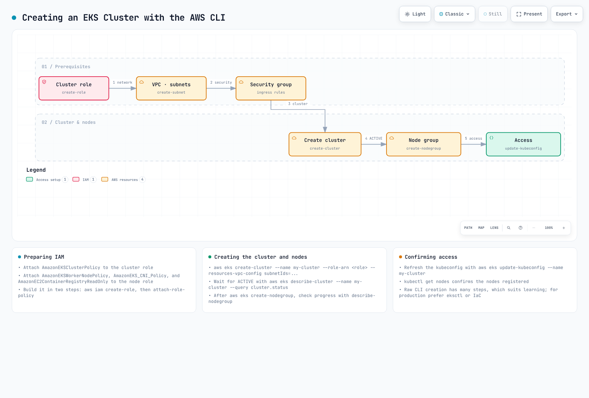

# Parte 3: Creación de clústeres con AWS Management Console y AWS CLI

> **Última actualización**: 11 de septiembre de 2026

Complete los [requisitos previos de la parte 1](02-eks-cluster-creation-part1.md). Los ejemplos crean recursos de AWS facturables y son flujos de trabajo educativos; en esta auditoría no se han aprovisionado ni certificado para producción.

## Crear un clúster mediante AWS Management Console

Esta sección crea un clúster convencional con un grupo de nodos administrado de EC2. Use **Custom configuration** y desactive **Use EKS Auto Mode**. El flujo rápido de Auto Mode usa roles y administra la infraestructura de otra manera.


[🔍 Ver diagrama interactivo](https://www.atomai.click/kubernetes-docs/archmaps/en-eks-02-eks-cluster-creation-part3-0.html)

El diagrama ilustra el flujo de trabajo; el tiempo de creación puede variar. Revise explícitamente el acceso de la identidad creadora y la disponibilidad de los nodos: no dé por sentado que la configuración predeterminada satisface sus requisitos.

### Configurar el clúster

Abra la consola de EKS en la cuenta y la región previstas, elija **Add cluster → Create** y seleccione la configuración personalizada indicada arriba.

- Elija un nombre de clúster único y una versión de EKS que tenga soporte actualmente. El ejemplo de CLI siguiente usa **1.36**; las versiones publicadas de Kubernetes no equivalen al catálogo de versiones compatibles con EKS.
- Seleccione un rol de IAM del clúster que se haya revisado, con relación de confianza para `eks.amazonaws.com` y `AmazonEKSClusterPolicy`. La identidad que aprovisiona también necesita los permisos adecuados de EKS e IAM, incluidos permisos de `iam:PassRole` con alcance limitado y, cuando haga falta, la creación del rol vinculado al servicio.
- Revise la política de soporte estándar o extendido, las etiquetas y las funciones opcionales. Desde EKS 1.28, los datos de la API de Kubernetes ya se cifran mediante cifrado de sobre con una clave propiedad de AWS; una clave de KMS administrada por el cliente es opcional.
- Seleccione la autenticación mediante entradas de acceso a la API. Para este laboratorio, impida la concesión automática de permisos de administrador a la identidad creadora y planifique una entrada de acceso explícita para el rol de operador existente. Crear el archivo kubeconfig más adelante no concede autorización.

### Especificar la red

Seleccione una VPC existente que cumpla los requisitos de EKS, o prepare primero una con un diseño de red completo. Elija al menos dos subredes adecuadas en zonas de disponibilidad diferentes. Cada subred del clúster necesita al menos seis direcciones IP disponibles; AWS recomienda al menos dieciséis, y la capacidad adicional para nodos, Pods y actualizaciones requiere planificación.

Revise DNS de VPC, rutas, solapamientos entre la familia IP y el CIDR del servicio, y el acceso de los nodos a los servicios y registros necesarios de AWS. Use subredes privadas para los nodos con NAT o puntos de conexión de VPC adecuados. Las opciones del endpoint de la API son:

- **Público:** enrutable desde redes públicas; `publicAccessCidrs` restringe los rangos de origen de los clientes autorizados.
- **Privado:** acceso mediante la VPC o redes conectadas, con las rutas, DNS, grupos de seguridad y autorizaciones de IAM y Kubernetes necesarios.
- **Público y privado:** habilita ambas vías; restrinja los CIDR públicos y verifique la ruta privada.

EKS crea el grupo de seguridad del clúster. Los grupos adicionales son opcionales y se asocian a las interfaces del clúster; no se adjuntan automáticamente a todos los grupos de nodos. El endpoint público de la API no se controla con una regla TCP 443 general en este grupo.

### Configurar el registro

En **Configure observability**, seleccione los tipos de registro del plano de control necesarios: `api`, `audit`, `authenticator`, `controllerManager` y `scheduler`. Revise aparte las funciones opcionales de métricas. La ingesta, el almacenamiento y las consultas de CloudWatch tienen un costo, y la entrega de registros se realiza con el mejor esfuerzo.

### Seleccionar complementos

En este clúster convencional de EC2, mantenga versiones compatibles de VPC CNI, CoreDNS y kube-proxy salvo que tenga una sustitución revisada. Seleccione versiones compatibles en **Configure selected add-ons settings** y configure las identidades IAM necesarias para los complementos. Los controladores opcionales y los drivers de almacenamiento requieren su propia instalación y sus propios permisos.

### Revisar y crear

Revise los roles, el modo de acceso, la red y la configuración de complementos elegidos; después, cree el clúster y espere a que alcance el estado **ACTIVE**. Configure la entrada de acceso del operador antes de intentar acceder con kubectl.

### Añadir un grupo de nodos

Añada un grupo de nodos administrado desde la sección **Compute** del clúster:

1. Elija un nombre de grupo que no se esté usando y un rol IAM de nodo EC2 revisado.
2. Seleccione **AL2023 x86_64**, un tipo de instancia compatible y valores de disco y escalado adecuados para la carga de trabajo. `m5.large`, 80 GiB y los límites de 1 a 3 del ejemplo de CLI son ejemplos, no recomendaciones basadas en mediciones de capacidad.
3. Elija las subredes privadas reales. Deje desactivado el acceso SSH salvo que se requiera una vía de acceso revisada por separado.
4. Cree el grupo y espere a que alcance el estado **ACTIVE** y a que los nodos estén sanos y **Ready**. Los límites mínimo y máximo no instalan un autoescalador de nodos que responda a las cargas de trabajo.

El rol del nodo necesita permisos para que los nodos actúen como trabajadores del clúster y descarguen imágenes. Es preferible usar un rol de carga de trabajo CNI independiente; la CLI siguiente documenta explícitamente una alternativa más sencilla para nodos IPv4.

## Crear un clúster mediante AWS CLI

El siguiente ejemplo convencional de IPv4 usa EKS 1.36 y nodos administrados de AL2023. Elija este flujo de trabajo o el de la consola. Ejecute los pasos de CLI en una sola sesión de Bash, use nombres de laboratorio que no estén ocupados y conserve los archivos de respuesta privados para comprobar la propiedad de los recursos y facilitar su limpieza.



[🔍 Ver diagrama interactivo](https://www.atomai.click/kubernetes-docs/archmaps/en-eks-02-eks-cluster-creation-part3-1.html)

El diagrama muestra pasos generales. EKS crea automáticamente el grupo de seguridad del clúster; use las políticas actuales de los roles y la configuración de acceso explícita que se indica a continuación. En esta auditoría no se ejecutaron las operaciones de AWS.

```bash
: "${EKS_CLUSTER_NAME:?Choose an unused training cluster name}"
: "${EKS_REGION:?For example us-west-2}"
: "${OPERATOR_ROLE_ARN:?Existing operator IAM role that this login may assume}"
: "${APPROVED_API_CIDR:?Actual approved administration egress CIDR}"
EKS_CREATE_DIR=$(mktemp -d /tmp/eks-console-cli.XXXXXX)
: "${EKS_CREATE_DIR:?}"
EKS_KUBECONFIG="$EKS_CREATE_DIR/kubeconfig"
aws sts get-caller-identity
```

### 1. Crear el rol IAM del clúster

Estos comandos crean un rol **nuevo** y se detienen si falla la creación. Para reutilizar un rol que ya se haya revisado, establezca `EKS_CLUSTER_ROLE_ARN` y omita el bloque de creación y asociación, en vez de modificar un rol existente solo porque tenga un nombre parecido.

```bash
cat > "${EKS_CREATE_DIR:?}/cluster-trust.json" << 'EOF'
{
  "Version":"2012-10-17",
  "Statement":[{
    "Effect":"Allow",
    "Principal":{"Service":"eks.amazonaws.com"},
    "Action":"sts:AssumeRole"
  }]
}
EOF
aws iam create-role --role-name "${NEW_CLUSTER_ROLE_NAME:?Unused role name}" \
  --assume-role-policy-document "file://$EKS_CREATE_DIR/cluster-trust.json" \
  --query Role --output json > "$EKS_CREATE_DIR/created-cluster-role.json" || exit 1
EKS_CLUSTER_ROLE_ARN=$(jq -er '.Arn' "$EKS_CREATE_DIR/created-cluster-role.json") || exit 1
aws iam attach-role-policy --role-name "$NEW_CLUSTER_ROLE_NAME" \
  --policy-arn arn:aws:iam::aws:policy/AmazonEKSClusterPolicy || exit 1
```

### 2. Crear la VPC y las subredes

Use una VPC existente y revisada o, si lo desea, cree una red de ejemplo completa con la plantilla oficial que aparece abajo. La plantilla crea dos subredes públicas y dos privadas en dos zonas de disponibilidad, una puerta de enlace de Internet y dos puertas de enlace NAT con sus EIP. Revise primero los solapamientos de CIDR, las rutas y los costos. La fecha de la URL no es una versión de Kubernetes.

```bash
# Optional new-network path; review the entire template and its CIDR/NAT costs first.
aws cloudformation create-stack --region "${EKS_REGION:?}" \
  --stack-name "${NEW_VPC_STACK_NAME:?Unused stack name}" \
  --template-url https://s3.us-west-2.amazonaws.com/amazon-eks/cloudformation/2020-10-29/amazon-eks-vpc-private-subnets.yaml \
  > "${EKS_CREATE_DIR:?}/vpc-stack.json" || exit 1
aws cloudformation wait stack-create-complete --region "$EKS_REGION" \
  --stack-name "$NEW_VPC_STACK_NAME" || exit 1
aws cloudformation describe-stacks --region "$EKS_REGION" \
  --stack-name "$NEW_VPC_STACK_NAME" --query 'Stacks[0].Outputs' --output table
```

La salida `SubnetIds` de la pila incluye **las cuatro subredes**. Identifique el par privado a partir de sus tablas de rutas y etiquetas antes de establecer `EKS_PRIVATE_SUBNET_A/B`. Una subred sin una asociación explícita a una tabla de rutas usa la tabla principal de la VPC; aun así, tiene enrutamiento.

Las comprobaciones siguientes validan los requisitos básicos de zona de disponibilidad, VPC, IP y DNS. Verifique por separado las rutas efectivas, los controles de seguridad, el acceso al registro y a S3, y los puntos de conexión de VPC que se necesiten. Crear solo una VPC y dos subredes no proporciona una ruta de salida funcional para los nodos.

```bash
# Set these IDs after identifying the actual private subnets and their routes.
aws ec2 describe-subnets --region "${EKS_REGION:?}" \
  --subnet-ids "${EKS_PRIVATE_SUBNET_A:?}" "${EKS_PRIVATE_SUBNET_B:?}" \
  --query Subnets --output json > "${EKS_CREATE_DIR:?}/subnets.json" || exit 1
jq -e 'length == 2 and
  (map(.VpcId) | unique | length) == 1 and
  (map(.AvailabilityZone) | unique | length) == 2 and
  all(.[]; .AvailableIpAddressCount >= 6)' \
  "$EKS_CREATE_DIR/subnets.json" >/dev/null || exit 1
EKS_VPC_ID=$(jq -er '.[0].VpcId' "$EKS_CREATE_DIR/subnets.json") || exit 1
aws ec2 describe-vpc-attribute --region "$EKS_REGION" --vpc-id "$EKS_VPC_ID" \
  --attribute enableDnsSupport --output json > "$EKS_CREATE_DIR/dns-support.json" || exit 1
aws ec2 describe-vpc-attribute --region "$EKS_REGION" --vpc-id "$EKS_VPC_ID" \
  --attribute enableDnsHostnames --output json > "$EKS_CREATE_DIR/dns-hostnames.json" || exit 1
jq -e '.EnableDnsSupport.Value == true' "$EKS_CREATE_DIR/dns-support.json" >/dev/null || exit 1
jq -e '.EnableDnsHostnames.Value == true' "$EKS_CREATE_DIR/dns-hostnames.json" >/dev/null || exit 1
```

### 3. Crear el grupo de seguridad del clúster

EKS crea automáticamente el grupo de seguridad del clúster durante su creación. Este ejemplo no requiere otro grupo con acceso abierto a `0.0.0.0/0`. El acceso público a la API se restringe mediante `publicAccessCidrs`; las reglas del grupo de seguridad del clúster controlan la ruta privada y la comunicación entre nodos.

Si necesita grupos adicionales, revise sus reglas y agregue deliberadamente sus ID a la configuración. Construya como JSON la solicitud de red del clúster:

```bash
# EKS creates the cluster security group; public API restrictions use this CIDR list.
jq -n --arg a "${EKS_PRIVATE_SUBNET_A:?}" --arg b "${EKS_PRIVATE_SUBNET_B:?}" \
  --arg cidr "${APPROVED_API_CIDR:?}" '{
    subnetIds:[$a,$b],
    endpointPublicAccess:true,
    endpointPrivateAccess:true,
    publicAccessCidrs:[$cidr]
  }' > "${EKS_CREATE_DIR:?}/vpc-config.json" || exit 1
```

### 4. Crear el clúster de EKS

Use `--kubernetes-version` con `aws eks create-cluster`; `--version` muestra la versión de AWS CLI. El campo JSON de la API sigue siendo `version`. Este ejemplo desactiva el acceso de administrador automático de la identidad creadora, habilita los cinco tipos de registro del plano de control e inicia los complementos esenciales convencionales. Los complementos iniciados por CLI son autoadministrados; adoptarlos como complementos administrados por EKS requiere otro flujo de trabajo con una configuración y versiones compatibles.

```bash
aws eks describe-cluster-versions --region "${EKS_REGION:?}" --output table
aws eks create-cluster --name "${EKS_CLUSTER_NAME:?}" --region "$EKS_REGION" \
  --kubernetes-version 1.36 --role-arn "${EKS_CLUSTER_ROLE_ARN:?}" \
  --resources-vpc-config "file://${EKS_CREATE_DIR:?}/vpc-config.json" \
  --access-config authenticationMode=API,bootstrapClusterCreatorAdminPermissions=false \
  --bootstrap-self-managed-addons \
  --logging '{"clusterLogging":[{"types":["api","audit","authenticator","controllerManager","scheduler"],"enabled":true}]}' \
  --query cluster --output json > "$EKS_CREATE_DIR/created-cluster.json" || exit 1
aws eks wait cluster-active --name "$EKS_CLUSTER_NAME" --region "$EKS_REGION" || exit 1
aws eks describe-cluster --name "$EKS_CLUSTER_NAME" --region "$EKS_REGION" \
  --query 'cluster.{arn:arn,status:status,version:version,vpc:resourcesVpcConfig}'
```

Si falla una operación de espera, eso no demuestra que se hayan revertido todos los recursos. Inspeccione el estado del clúster y las respuestas guardadas antes de continuar. El registro genera costos de CloudWatch.

### 5. Crear el rol IAM del nodo

Cree un rol nuevo de confianza EC2. `AmazonEC2ContainerRegistryPullOnly` proporciona permisos para descargar imágenes. En este sencillo **laboratorio IPv4**, los permisos de CNI se asignan al rol del nodo para que funcione el VPC CNI iniciado durante el arranque. Cuando sea compatible, es preferible un rol IRSA o Pod Identity dedicado para CNI; quite esta alternativa solo después de comprobar que esa configuración funciona. Los permisos de AWS para otras aplicaciones o controladores no deben estar en todos los nodos.

```bash
cat > "${EKS_CREATE_DIR:?}/node-trust.json" << 'EOF'
{
  "Version":"2012-10-17",
  "Statement":[{
    "Effect":"Allow",
    "Principal":{"Service":"ec2.amazonaws.com"},
    "Action":"sts:AssumeRole"
  }]
}
EOF
aws iam create-role --role-name "${NEW_NODE_ROLE_NAME:?Unused role name}" \
  --assume-role-policy-document "file://$EKS_CREATE_DIR/node-trust.json" \
  --query Role --output json > "$EKS_CREATE_DIR/created-node-role.json" || exit 1
EKS_NODE_ROLE_ARN=$(jq -er '.Arn' "$EKS_CREATE_DIR/created-node-role.json") || exit 1
aws iam attach-role-policy --role-name "$NEW_NODE_ROLE_NAME" \
  --policy-arn arn:aws:iam::aws:policy/AmazonEKSWorkerNodePolicy || exit 1
aws iam attach-role-policy --role-name "$NEW_NODE_ROLE_NAME" \
  --policy-arn arn:aws:iam::aws:policy/AmazonEC2ContainerRegistryPullOnly || exit 1
# Simple IPv4 lab fallback only. Prefer a dedicated CNI workload role in production.
aws iam attach-role-policy --role-name "$NEW_NODE_ROLE_NAME" \
  --policy-arn arn:aws:iam::aws:policy/AmazonEKS_CNI_Policy || exit 1
```

### 6. Crear el grupo de nodos

Cree el grupo administrado en las subredes privadas revisadas. EKS proporciona la inicialización de nodo de la AMI AL2023 seleccionada y la entrada de acceso para los nodos administrados. El ejemplo omite el acceso SSH y las anulaciones personalizadas de la plantilla de lanzamiento.

```bash
aws eks create-nodegroup --cluster-name "${EKS_CLUSTER_NAME:?}" --region "${EKS_REGION:?}" \
  --nodegroup-name "${NEW_NODEGROUP_NAME:?}" --node-role "${EKS_NODE_ROLE_ARN:?}" \
  --subnets "${EKS_PRIVATE_SUBNET_A:?}" "${EKS_PRIVATE_SUBNET_B:?}" \
  --ami-type AL2023_x86_64_STANDARD --instance-types m5.large --capacity-type ON_DEMAND \
  --disk-size 80 --scaling-config minSize=1,maxSize=3,desiredSize=2 \
  --query nodegroup --output json > "${EKS_CREATE_DIR:?}/created-nodegroup.json" || exit 1
aws eks wait nodegroup-active --cluster-name "$EKS_CLUSTER_NAME" --region "$EKS_REGION" \
  --nodegroup-name "$NEW_NODEGROUP_NAME" || exit 1
aws eks describe-nodegroup --cluster-name "$EKS_CLUSTER_NAME" --region "$EKS_REGION" \
  --nodegroup-name "$NEW_NODEGROUP_NAME" \
  --query 'nodegroup.{status:status,health:health,ami:amiType,release:releaseVersion}'
```

### 7. Configurar kubeconfig

Use un rol IAM de operador existente que su sesión actual tenga permiso para asumir. La identidad que aprovisiona debe poder crear su entrada de acceso a EKS y asociar la política de acceso al laboratorio. Estos comandos conceden administración de Kubernetes en este clúster, no administración de toda la cuenta de AWS.

```bash
# The named operator gets cluster-admin only on this training cluster.
aws eks create-access-entry --cluster-name "${EKS_CLUSTER_NAME:?}" --region "${EKS_REGION:?}" \
  --principal-arn "${OPERATOR_ROLE_ARN:?}" --type STANDARD || exit 1
aws eks associate-access-policy --cluster-name "$EKS_CLUSTER_NAME" --region "$EKS_REGION" \
  --principal-arn "$OPERATOR_ROLE_ARN" \
  --policy-arn arn:aws:eks::aws:cluster-access-policy/AmazonEKSClusterAdminPolicy \
  --access-scope type=cluster || exit 1
aws eks update-kubeconfig --name "$EKS_CLUSTER_NAME" --region "$EKS_REGION" \
  --role-arn "$OPERATOR_ROLE_ARN" --kubeconfig "${EKS_KUBECONFIG:?}" \
  --alias "$EKS_CLUSTER_NAME" || exit 1
```

### 8. Verificar el clúster

Inspeccione el contexto previsto, la disponibilidad de los nodos y los Pods del sistema:

```bash
kubectl --kubeconfig "${EKS_KUBECONFIG:?}" config current-context
kubectl --kubeconfig "$EKS_KUBECONFIG" auth can-i get nodes
kubectl --kubeconfig "$EKS_KUBECONFIG" get nodes -o wide
kubectl --kubeconfig "$EKS_KUBECONFIG" get pods -n kube-system
```

La infraestructura en estado `ACTIVE` no demuestra que la aplicación esté lista; `get nodes` debe mostrar realmente nodos sanos en estado Ready. Verifique la programación de cargas de trabajo, DNS, la descarga de imágenes y las dependencias de la aplicación antes de usarla en producción. En esta auditoría no se midieron el rendimiento ni la disponibilidad de las cargas de trabajo.

Para limpiar, siga el [procedimiento de ciclo de vida revisado](02-eks-cluster-creation.md#cluster-deletion): primero quite las dependencias de nube de la aplicación y, después, los grupos o perfiles de nodos correspondientes y el clúster. Elimine una VPC de laboratorio dedicada solo cuando ya no tenga dependencias, y elimine únicamente los roles propios del laboratorio. Si falla la limpieza, conserve los archivos de respuesta y propiedad.

## Cuestionario

Para comprobar lo aprendido en este capítulo, responda el [cuestionario sobre la creación de clústeres de EKS, parte 3](../quizzes/eks/02-eks-cluster-creation-part3-quiz.md).

## Referencias

- [Crear un clúster de EKS](https://docs.aws.amazon.com/eks/latest/userguide/create-cluster.html)
- [Requisitos de red de EKS](https://docs.aws.amazon.com/eks/latest/userguide/network-reqs.html)
- [Acceso al endpoint de la API](https://docs.aws.amazon.com/eks/latest/userguide/cluster-endpoint.html)
- [Rol IAM del nodo](https://docs.aws.amazon.com/eks/latest/userguide/create-node-role.html)
- [Cifrado de sobre predeterminado](https://docs.aws.amazon.com/eks/latest/userguide/envelope-encryption.html)
- [Entradas de acceso de EKS](https://docs.aws.amazon.com/eks/latest/userguide/access-entries.html)
