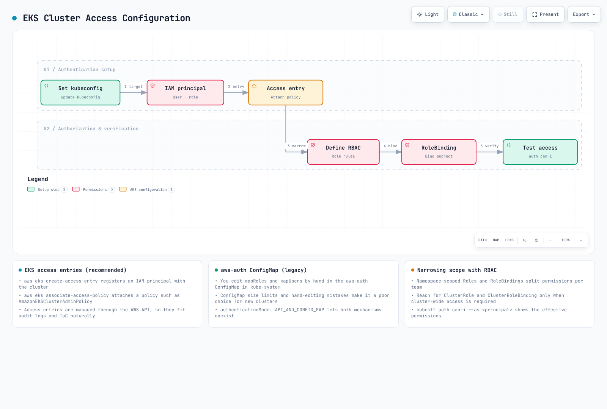

# Parte 5: Acceso al clúster, validación, actualización y eliminación

> **Última actualización**: September 11, 2026

Esta guía trata sobre un clúster de EKS existente. Use la cuenta/Región autorizada y un kubeconfig privado. Los ejemplos se revisaron con la documentación actual de AWS y analizadores locales; durante esta auditoría no se realizaron cambios en AWS, cargas de trabajo del clúster ni pruebas de recuperación en producción.

## Configurar el acceso al clúster

### Establecer el contexto

Configure `EXAMPLE_CLUSTER` y `EXAMPLE_REGION` para el clúster previsto. La identidad actual de AWS CLI necesita los permisos adecuados para la API de AWS. Para administrar Kubernetes, use una identidad ya autorizada; de forma opcional, configure `ADMIN_ROLE_ARN` con un rol aprobado que el operador pueda asumir. Un kubeconfig no concede permisos. La administración inicial depende de la configuración de arranque/acceso del clúster, no de una regla universal de «solo el creador».

Use una sesión Bash dedicada para las variables y funciones auxiliares que aparecen a continuación. Ejecute solo el flujo de trabajo que necesite; las actualizaciones y la eliminación son operaciones independientes.

```bash
set -euo pipefail
umask 077
: "${EXAMPLE_CLUSTER:?Set the existing cluster name}"
: "${EXAMPLE_REGION:?Set the Region}"
EKS_REVIEW_DIR=$(mktemp -d /tmp/eks-lifecycle-review.XXXXXX)
ADMIN_KUBECONFIG="$EKS_REVIEW_DIR/admin.kubeconfig"
aws eks describe-cluster --name "$EXAMPLE_CLUSTER" --region "$EXAMPLE_REGION" \
  --query cluster --output json > "$EKS_REVIEW_DIR/cluster-before.json"
jq -e '{arn,createdAt} | (.arn | type == "string") and (.createdAt != null)' \
  "$EKS_REVIEW_DIR/cluster-before.json" >/dev/null
EXPECTED_CLUSTER_ARN=$(jq -er '.arn' "$EKS_REVIEW_DIR/cluster-before.json")
EXPECTED_CLUSTER_CREATED=$(jq -er '.createdAt | tostring' "$EKS_REVIEW_DIR/cluster-before.json")
CLUSTER_KUBERNETES_VERSION=$(jq -er '.version' "$EKS_REVIEW_DIR/cluster-before.json")
KUBECONFIG_ARGS=(--name "$EXAMPLE_CLUSTER" --region "$EXAMPLE_REGION"
  --kubeconfig "$ADMIN_KUBECONFIG" --alias "$EXAMPLE_CLUSTER-review")
if [ -n "${ADMIN_ROLE_ARN:-}" ]; then
  KUBECONFIG_ARGS+=(--role-arn "$ADMIN_ROLE_ARN")
fi
aws eks update-kubeconfig "${KUBECONFIG_ARGS[@]}"
```
Esto escribe un kubeconfig privado en el directorio de revisión registrado en lugar de cambiar el contexto predeterminado. Sin `--kubeconfig`, AWS CLI elige la ruta de salida a partir de `KUBECONFIG` o de la ruta predeterminada `~/.kube/config`; esa ruta no es fija en todos los entornos.

<!-- Audit 2026-09-11: parent asset repair required. Material correction:access-policy andRBACpermissionsareadditive;RBACcannotnarrowAmazonEKSClusterAdminPolicy. Arrow3narrowandfooter--asprincipal effectiveEKSpermissionsclaimarewrong;testactualIAMcredentials. Rebuilddiagramasalternative/additiveauthorizationpaths.


[🔍 View interactive diagram](https://www.atomai.click/kubernetes-docs/archmaps/en-eks-02-eks-cluster-creation-part5-0.html)
-->

Las entradas de acceso pueden usar políticas de acceso de EKS, grupos de Kubernetes con RBAC o ambas opciones. Sus permisos son **aditivos**: un RoleBinding de espacio de nombres no puede reducir los permisos de una política de acceso de administrador del clúster de EKS. Este ejemplo usa un grupo personalizado y RBAC de espacio de nombres, sin añadir una política de acceso amplia.
### Esperar las actualizaciones de EKS

Los cambios de configuración/versión son asíncronos. Use el ID de actualización devuelto y deténgase si hay errores, en lugar de considerar que una observación de `ACTIVE`/`InProgress` demuestra que la operación ha finalizado:

```bash
# Additional describe-update arguments can identify a node group or add-on.
wait_eks_update() {
  local update_id="$1"
  shift
  local update_json update_status attempt
  for attempt in $(seq 1 120); do
    update_json=$(aws eks describe-update --name "$EXAMPLE_CLUSTER" \
      --region "$EXAMPLE_REGION" --update-id "$update_id" "$@" --output json) || return 1
    update_status=$(printf '%s' "$update_json" | jq -er '.update.status') || return 1
    case "$update_status" in
      Successful) return 0 ;;
      Failed|Cancelled)
        printf '%s' "$update_json" | jq '.update.errors' >&2
        return 1 ;;
      InProgress) sleep 10 ;;
      *) printf 'Unexpected update status: %s\n' "$update_status" >&2; return 1 ;;
    esac
  done
  printf 'Update %s did not finish within this wait window; inspect it before retrying.\n' "$update_id" >&2
  return 1
}
```
### Método 1: Entradas de acceso y RBAC con ámbito limitado

Inspeccione primero el modo de autenticación. Un clúster antiguo con `CONFIG_MAP` puede habilitar `API_AND_CONFIG_MAP` después de revisar la migración. Un clúster con `API` ya admite entradas de acceso; no intente volver a habilitar el acceso por ConfigMap. Durante la migración unidireccional, mantenga el acceso de administradores y nodos.

```bash
AUTH_MODE=$(aws eks describe-cluster --name "$EXAMPLE_CLUSTER" --region "$EXAMPLE_REGION" \
  --query cluster.accessConfig.authenticationMode --output text)
case "$AUTH_MODE" in
  CONFIG_MAP)
    AUTH_UPDATE_ID=$(aws eks update-cluster-config --name "$EXAMPLE_CLUSTER" \
      --region "$EXAMPLE_REGION" --access-config authenticationMode=API_AND_CONFIG_MAP \
      --query update.id --output text)
    wait_eks_update "$AUTH_UPDATE_ID"
    ;;
  API_AND_CONFIG_MAP|API)
    printf '%s\n' 'Access entries are already enabled.'
    ;;
  *)
    printf 'Unexpected authentication mode: %s\n' "$AUTH_MODE" >&2
    exit 1
    ;;
esac
```
Use un **rol de IAM de desarrollador existente y distinto**, no el único rol de administrador. El grupo generado y el espacio de nombres evitan afectar a bindings no relacionados. Deje que EKS genere el nombre de usuario para que las sesiones de roles asumidos sigan siendo identificables. `system:masters` no es un grupo adecuado para este ejemplo, que está limitado a un espacio de nombres.

```bash
# Use a separate, existing developer IAM role; retain the administrator's access.
: "${DEVELOPER_ROLE_ARN:?Existing role that the test operator can assume}"
ACCESS_NAMESPACE="eks-access-$(date +%s)-$$"
DEVELOPER_GROUP="$ACCESS_NAMESPACE-developers"
kubectl --kubeconfig "$ADMIN_KUBECONFIG" create namespace "$ACCESS_NAMESPACE"
ACCESS_NAMESPACE_UID=$(kubectl --kubeconfig "$ADMIN_KUBECONFIG" \
  get namespace "$ACCESS_NAMESPACE" -o jsonpath='{.metadata.uid}')
: "${ACCESS_NAMESPACE_UID:?}"
jq -n --arg name "$ACCESS_NAMESPACE" --arg uid "$ACCESS_NAMESPACE_UID" \
  '{namespace:$name,namespaceUID:$uid}' > "$EKS_REVIEW_DIR/access-namespace.json"
kubectl --kubeconfig "$ADMIN_KUBECONFIG" label namespace "$ACCESS_NAMESPACE" \
  pod-security.kubernetes.io/enforce=restricted \
  "pod-security.kubernetes.io/enforce-version=v$CLUSTER_KUBERNETES_VERSION"

# Creation fails rather than rewriting an existing principal's entry.
aws eks create-access-entry --cluster-name "$EXAMPLE_CLUSTER" --region "$EXAMPLE_REGION" \
  --principal-arn "$DEVELOPER_ROLE_ARN" --type STANDARD \
  --kubernetes-groups "$DEVELOPER_GROUP" \
  --query accessEntry --output json > "$EKS_REVIEW_DIR/created-access-entry.json"
```
Cree el Role y el binding del grupo correspondiente y, después, pruebe con el propio rol de desarrollador. Este Role no concede acceso directo de lectura a Secrets ni permisos para administrar RBAC o espacios de nombres. La creación de cargas de trabajo aún puede usar las identidades y Secrets disponibles dentro de ese espacio de nombres; aplique controles de admisión para restringir las cuentas de servicio y los montajes cuando se necesite un aislamiento más estricto.

```bash
kubectl --kubeconfig "$ADMIN_KUBECONFIG" -n "$ACCESS_NAMESPACE" create -f - <<EOF
apiVersion: rbac.authorization.k8s.io/v1
kind: Role
metadata:
  name: developer
rules:
- apiGroups: [""]
  resources: ["pods", "pods/log"]
  verbs: ["get", "list", "watch"]
- apiGroups: [""]
  resources: ["services", "configmaps"]
  verbs: ["get", "list", "watch", "create", "update", "patch", "delete"]
- apiGroups: ["apps"]
  resources: ["deployments", "statefulsets"]
  verbs: ["get", "list", "watch", "create", "update", "patch", "delete"]
---
apiVersion: rbac.authorization.k8s.io/v1
kind: RoleBinding
metadata:
  name: developer-binding
subjects:
- kind: Group
  name: $DEVELOPER_GROUP
  apiGroup: rbac.authorization.k8s.io
roleRef:
  kind: Role
  name: developer
  apiGroup: rbac.authorization.k8s.io
EOF

DEVELOPER_KUBECONFIG="$EKS_REVIEW_DIR/developer.kubeconfig"
aws eks update-kubeconfig --name "$EXAMPLE_CLUSTER" --region "$EXAMPLE_REGION" \
  --role-arn "$DEVELOPER_ROLE_ARN" --kubeconfig "$DEVELOPER_KUBECONFIG" \
  --alias "$EXAMPLE_CLUSTER-developer"

# Allow for access-entry propagation; test using the role, not --as impersonation.
kubectl --kubeconfig "$DEVELOPER_KUBECONFIG" auth can-i list pods -n "$ACCESS_NAMESPACE"
kubectl --kubeconfig "$DEVELOPER_KUBECONFIG" -n "$ACCESS_NAMESPACE" get pods
NODE_DELETE_ALLOWED=$(kubectl --kubeconfig "$DEVELOPER_KUBECONFIG" auth can-i delete nodes 2>"$EKS_REVIEW_DIR/can-i-errors.txt") || {
  # kubectl returns nonzero for an ordinary "no"; distinguish other failures.
  [ "$NODE_DELETE_ALLOWED" = no ] || exit 1
}
[ "$NODE_DELETE_ALLOWED" = no ] || {
  printf '%s\n' 'Unexpected cluster-wide permission; review all access policies and RBAC bindings.' >&2
  exit 1
}
```
Las entradas de acceso son eventualmente coherentes; inspeccione los errores y espere a que se propaguen antes de volver a intentarlo. La suplantación con `kubectl --as`/`--as-group` prueba RBAC de Kubernetes, no los permisos de las políticas de acceso de EKS de la entidad principal de IAM. Del mismo modo, `auth can-i --list` no es un inventario completo de los permisos concedidos por las políticas de acceso de EKS. Se admiten usuarios de IAM como entidades principales, pero es preferible usar roles con credenciales temporales; un usuario existente necesita su propia vía de credenciales configurada adecuadamente.
### Método 2: Migración del aws-auth heredado


[🔍 Ver diagrama interactivo](https://www.atomai.click/kubernetes-docs/archmaps/en-eks-02-eks-cluster-creation-part5-1.html)

Use esta vía solo mientras el modo de autenticación del clúster incluya el acceso por ConfigMap. Conserve el ConfigMap completo real; no lo sustituya por un ejemplo que contenga un único rol de nodo. Las asignaciones existentes de nodos administrados y Fargate deben mantenerse hasta que se hayan verificado sus correspondientes entradas de acceso. Ambos métodos pueden administrarse mediante IaC y auditarse a través de los registros de AWS/Kubernetes correspondientes.

```bash
kubectl --kubeconfig "$ADMIN_KUBECONFIG" -n kube-system get configmap aws-auth -o yaml   > "$EKS_REVIEW_DIR/aws-auth-before.yaml"
kubectl --kubeconfig "$ADMIN_KUBECONFIG" -n kube-system edit configmap aws-auth
```
Combine solo las entradas de roles/usuarios revisadas en el YAML existente de `mapRoles`/`mapUsers`, usando el mismo grupo personalizado que su RoleBinding. Mantenga intactos los nombres de usuario/grupos de los nodos y todas las asignaciones no relacionadas. Las restricciones de ruta de ARN de roles del aws-auth heredado difieren de las de las entradas de acceso; siga la ruta de migración documentada en vez de normalizar manualmente ARN arbitrarios. Cuando la misma entidad principal aparece en ambos sistemas, prevalece su asignación de entrada de acceso. Mantenga una sesión de administrador aparte mientras valida la identidad migrada.
## Validación del clúster

### Comprobar el cómputo previsto y los componentes del sistema

<!-- Audit 2026-09-11: parent asset repair required. Footercriteriaareincomplete:RunningdoesnotmeanReady,defaultStorageClassnotuniversallyrequired,LoadBalancerdoesnotproveAWSLBCwithoutclass/ownership,loggroupexistencedoesnotprovedelivery. Mainflowusableaftercaption/footercorrection.


[🔍 View interactive diagram](https://www.atomai.click/kubernetes-docs/archmaps/en-eks-02-eks-cluster-creation-part5-2.html)
-->

```bash
kubectl --kubeconfig "$ADMIN_KUBECONFIG" get nodes -o wide
kubectl --kubeconfig "$ADMIN_KUBECONFIG" get pods -n kube-system -o wide
aws eks list-addons --cluster-name "$EXAMPLE_CLUSTER" --region "$EXAMPLE_REGION"
```
Verifique que la cantidad y el estado de los nodos sean los esperados, el estado de las implementaciones de Deployment/DaemonSet y el estado de los add-ons. `Running` es una fase de Pod, no una prueba de que los contenedores estén listos; los Jobs completados correctamente pueden estar en estado `Succeeded`. Una lista de nodos vacía no indica un clúster EC2 convencional saludable. Auto Mode, Fargate y Hybrid Nodes tienen distintas disposiciones de componentes del sistema; solo se necesita una StorageClass predeterminada para las cargas de trabajo que dependan de ella.
### Implementar una prueba HTTP propia

Este ejemplo convencional de Linux usa un respondedor HTTP pequeño en un espacio de nombres recién creado. Prueba la programación, la descarga de imágenes, DNS y un Service de tipo ClusterIP sin aprovisionar automáticamente un balanceador de carga público. Las políticas existentes de toda la organización pueden exigir una excepción aprobada para DNS/HTTP; este ejemplo no las deshabilita.

```bash
VALIDATION_NAMESPACE="eks-validation-$(date +%s)-$$"
kubectl --kubeconfig "$ADMIN_KUBECONFIG" create namespace "$VALIDATION_NAMESPACE"
VALIDATION_NAMESPACE_UID=$(kubectl --kubeconfig "$ADMIN_KUBECONFIG" \
  get namespace "$VALIDATION_NAMESPACE" -o jsonpath='{.metadata.uid}')
: "${VALIDATION_NAMESPACE_UID:?}"
jq -n --arg name "$VALIDATION_NAMESPACE" --arg uid "$VALIDATION_NAMESPACE_UID" \
  '{namespace:$name,namespaceUID:$uid}' > "$EKS_REVIEW_DIR/validation-namespace.json"
kubectl --kubeconfig "$ADMIN_KUBECONFIG" label namespace "$VALIDATION_NAMESPACE" \
  pod-security.kubernetes.io/enforce=restricted \
  "pod-security.kubernetes.io/enforce-version=v$CLUSTER_KUBERNETES_VERSION"
kubectl --kubeconfig "$ADMIN_KUBECONFIG" -n "$VALIDATION_NAMESPACE" create -f - <<'EOF'
apiVersion: apps/v1
kind: Deployment
metadata:
  name: http-validation
spec:
  replicas: 3
  selector:
    matchLabels: {app: http-validation}
  template:
    metadata:
      labels: {app: http-validation}
    spec:
      automountServiceAccountToken: false
      securityContext:
        runAsNonRoot: true
        runAsUser: 1000
        runAsGroup: 1000
        fsGroup: 1000
        seccompProfile: {type: RuntimeDefault}
      containers:
      - name: server
        image: public.ecr.aws/docker/library/busybox:1.38.0
        command: [sh, -c]
        args:
        - 'printf "%s\n" eks-validation-ok > /work/index.html && exec httpd -f -p 8080 -h /work'
        ports:
        - containerPort: 8080
        readinessProbe:
          httpGet: {path: /, port: 8080}
        resources:
          requests: {cpu: 50m, memory: 32Mi}
          limits: {cpu: 200m, memory: 64Mi}
        securityContext:
          allowPrivilegeEscalation: false
          readOnlyRootFilesystem: true
          capabilities: {drop: [ALL]}
        volumeMounts:
        - {name: work, mountPath: /work}
      volumes:
      - name: work
        emptyDir: {}
---
apiVersion: v1
kind: Service
metadata:
  name: http-validation
spec:
  type: ClusterIP
  selector: {app: http-validation}
  ports:
  - {port: 8080, targetPort: 8080, protocol: TCP}
EOF
kubectl --kubeconfig "$ADMIN_KUBECONFIG" -n "$VALIDATION_NAMESPACE" \
  rollout status deployment/http-validation --timeout=180s
```

```bash
kubectl --kubeconfig "$ADMIN_KUBECONFIG" -n "$VALIDATION_NAMESPACE" create -f - <<'EOF'
apiVersion: batch/v1
kind: Job
metadata:
  name: dns-http-check
spec:
  backoffLimit: 0
  template:
    spec:
      restartPolicy: Never
      automountServiceAccountToken: false
      securityContext:
        runAsNonRoot: true
        runAsUser: 1000
        seccompProfile: {type: RuntimeDefault}
      containers:
      - name: client
        image: public.ecr.aws/docker/library/busybox:1.38.0
        command: [sh, -c]
        args:
        - |
          set -eu
          nslookup http-validation
          response=$(wget -qO- -T 5 http://http-validation:8080/) || exit 1
          [ "$response" = eks-validation-ok ]
          printf '%s\n' 'DNS and Service HTTP check passed'
        resources:
          requests: {cpu: 10m, memory: 16Mi}
          limits: {cpu: 100m, memory: 32Mi}
        securityContext:
          allowPrivilegeEscalation: false
          readOnlyRootFilesystem: true
          capabilities: {drop: [ALL]}
EOF
kubectl --kubeconfig "$ADMIN_KUBECONFIG" -n "$VALIDATION_NAMESPACE" \
  wait --for=condition=complete job/dns-http-check --timeout=120s
kubectl --kubeconfig "$ADMIN_KUBECONFIG" -n "$VALIDATION_NAMESPACE" logs job/dns-http-check
```
Un resultado satisfactorio solo cubre esta ruta, no todos los requisitos de red, almacenamiento o aplicaciones. La validación opcional del balanceador de carga requiere un controlador instalado/autorizado, un esquema revisado, reglas de subredes/seguridad y el `loadBalancerClass` correcto para el cómputo convencional o Auto Mode. AWS suele devolver un nombre de host en `status.loadBalancer.ingress`, no una IP externa literal. Esa prueba crea recursos facturables y debe incluir su limpieza. El port-forward es útil para depurar, pero omite la ruta de datos normal del Service/balanceador de carga.

```bash
CURRENT_VALIDATION_UID=$(kubectl --kubeconfig "${ADMIN_KUBECONFIG:?}" \
  get namespace "${VALIDATION_NAMESPACE:?}" --ignore-not-found \
  -o jsonpath='{.metadata.uid}') || exit 1
if [ -z "$CURRENT_VALIDATION_UID" ]; then
  printf '%s\n' 'Validation namespace is already absent.'
elif [ "$CURRENT_VALIDATION_UID" = "${VALIDATION_NAMESPACE_UID:?Recorded UID required}" ]; then
  kubectl --kubeconfig "$ADMIN_KUBECONFIG" delete namespace "$VALIDATION_NAMESPACE" --wait=true
else
  printf '%s\n' 'Namespace identity changed; no deletion attempted.' >&2
  exit 1
fi
```
### Verificar la entrega real de registros

El registro del plano de control debe estar habilitado antes de esperar eventos nuevos. Inspeccione los tipos habilitados y las marcas de tiempo de los flujos en la Región correcta; la mera existencia de un grupo de registros no demuestra que se estén entregando registros. La entrega es de mejor esfuerzo y los flujos rotan. Revise los eventos pertinentes reales con los permisos adecuados en vez de volcar los registros en un informe público.

```bash
aws eks describe-cluster --name "$EXAMPLE_CLUSTER" --region "$EXAMPLE_REGION" \
  --query cluster.logging
aws logs describe-log-streams --region "$EXAMPLE_REGION" \
  --log-group-name "/aws/eks/$EXAMPLE_CLUSTER/cluster" \
  --order-by LastEventTime --descending --max-items 5 \
  --query 'logStreams[].{stream:logStreamName,lastEvent:lastEventTimestamp}'
```
Los registros de kubelet/contenedores de los nodos de trabajo requieren su propio método de recopilación. No se habilitan simplemente al activar los registros del plano de control de EKS.
## Actualización del clúster

<!-- Audit 2026-09-11: parent asset repair required. Materialcorrection:footerincorrectlydeniesEKScontrolplanerollback;currentAWSsupportsconditionalpreviousminorrollbackwithin7days. Stale1.31copytarget/1.29→1.30→1.31; trackupdateIDSuccessful,notACTIVEalone. Preservecompatiblecomponentsequence/preflight.


[🔍 View interactive diagram](https://www.atomai.click/kubernetes-docs/archmaps/en-eks-02-eks-cluster-creation-part5-3.html)
-->

Use el calendario de versiones de EKS y las perspectivas de actualización. Revise las API eliminadas, las copias de seguridad de datos/cargas de trabajo, la capacidad y las versiones compatibles de los add-ons. Antes de actualizar el plano de control, actualice los nodos administrados/Fargate a la versión secundaria actual, según lo requiera el procedimiento de EKS, y actualice los nodos autoadministrados/Hybrid según se recomiende. La versión de kubelet no debe ser más reciente que la del servidor de API. El siguiente flujo de trabajo de API no sustituye esas comprobaciones de preparación; use el flujo de trabajo de Terraform/eksctl propietario para los recursos que se administren de esa manera.

```bash
# Read the EKS release catalog; add-on versions are not the cluster release catalog.
aws eks describe-cluster-versions --region "$EXAMPLE_REGION" \
  --query 'clusterVersions[].{version:clusterVersion,status:versionStatus,standardEnd:endOfStandardSupportDate,extendedEnd:endOfExtendedSupportDate}' \
  --output table

: "${NEXT_KUBERNETES_VERSION:?Select the next supported minor after readiness review}"
CURRENT_KUBERNETES_VERSION=$(aws eks describe-cluster --name "$EXAMPLE_CLUSTER" \
  --region "$EXAMPLE_REGION" --query cluster.version --output text)
if [[ "$CURRENT_KUBERNETES_VERSION" =~ ^1\.([0-9]+)$ ]]; then
  EXPECTED_NEXT_VERSION="1.$((BASH_REMATCH[1] + 1))"
else
  printf '%s\n' 'Unexpected version; stop and inspect.' >&2
  exit 1
fi
[ "$NEXT_KUBERNETES_VERSION" = "$EXPECTED_NEXT_VERSION" ] || {
  printf '%s\n' 'This upgrade workflow only permits the next minor version.' >&2
  exit 1
}
CLUSTER_UPDATE_ID=$(aws eks update-cluster-version --name "$EXAMPLE_CLUSTER" \
  --region "$EXAMPLE_REGION" --kubernetes-version "$NEXT_KUBERNETES_VERSION" \
  --query update.id --output text)
wait_eks_update "$CLUSTER_UPDATE_ID"
```
### Actualizar nodos y add-ons

Para cada grupo de nodos administrado que se haya revisado, valide primero la estrategia de actualización, los PDB, la capacidad disponible y las restricciones de volúmenes persistentes. No use la expulsión forzada como solución rutinaria:

```bash
# Configure/review node update strategy and PDB/capacity prerequisites separately first.
: "${NODEGROUP_TO_UPDATE:?Select an owned managed node group}"
NODE_UPDATE_ID=$(aws eks update-nodegroup-version --cluster-name "$EXAMPLE_CLUSTER" \
  --region "$EXAMPLE_REGION" --nodegroup-name "$NODEGROUP_TO_UPDATE" \
  --query update.id --output text)
wait_eks_update "$NODE_UPDATE_ID" --nodegroup-name "$NODEGROUP_TO_UPDATE"
```
Los nodos autoadministrados/Hybrid requieren su propio ciclo de vida de imágenes/paquetes y vaciado. Auto Mode administra el ciclo de vida de sus nodos; es posible que los Pods de Fargate existentes deban reemplazarse de forma controlada para adoptar la versión actual. Alinee controladores como Cluster Autoscaler con la versión secundaria de destino. Siga el procedimiento de compatibilidad de cada add-on para decidir qué actualizaciones previas deben realizarse antes del paso del plano de control.

```bash
: "${ADDON_NAME:?Select an existing managed add-on}"
TARGET_CLUSTER_VERSION=$(aws eks describe-cluster --name "$EXAMPLE_CLUSTER" \
  --region "$EXAMPLE_REGION" --query cluster.version --output text)
aws eks describe-addon --cluster-name "$EXAMPLE_CLUSTER" --region "$EXAMPLE_REGION" \
  --addon-name "$ADDON_NAME" > "$EKS_REVIEW_DIR/addon-before.json"
aws eks describe-addon-versions --region "$EXAMPLE_REGION" --addon-name "$ADDON_NAME" \
  --kubernetes-version "$TARGET_CLUSTER_VERSION"

: "${REVIEWED_ADDON_VERSION:?Choose a compatible build before inspecting its schema}"
aws eks describe-addon-configuration --region "$EXAMPLE_REGION" --addon-name "$ADDON_NAME" \
  --addon-version "$REVIEWED_ADDON_VERSION" --query configurationSchema --output text \
  > "$EKS_REVIEW_DIR/addon-target-schema.json"
# Preserve the configuration string, whether the service returned JSON or YAML.
jq -er '(.addon.configurationValues // "{}") |
  if type != "string" then error("Unexpected configurationValues type")
  elif . == "" then "{}" else . end' \
  "$EKS_REVIEW_DIR/addon-before.json" > "$EKS_REVIEW_DIR/addon-values-reviewed.txt"
# Stop here to review this file against the target schema, plus IAM and direct customizations.
```
Revise la configuración guardada con respecto al esquema de destino antes de aplicarla. Registre cualquier personalización directa de Kubernetes que no figure en `configurationValues`; para CoreDNS administrado, coloque un Corefile personalizado en la clave de configuración compatible `corefile`. `PRESERVE` no sustituye la propiedad de configuración ni la revisión del esquema.

```bash
: "${REVIEWED_ADDON_VERSION:?Use the reviewed compatible build}"
ADDON_UPDATE_ID=$(aws eks update-addon --cluster-name "$EXAMPLE_CLUSTER" \
  --region "$EXAMPLE_REGION" --addon-name "$ADDON_NAME" \
  --addon-version "$REVIEWED_ADDON_VERSION" --resolve-conflicts PRESERVE \
  --configuration-values "file://$EKS_REVIEW_DIR/addon-values-reviewed.txt" \
  --query update.id --output text)
wait_eks_update "$ADDON_UPDATE_ID" --addon-name "$ADDON_NAME"
aws eks describe-addon --cluster-name "$EXAMPLE_CLUSTER" --region "$EXAMPLE_REGION" \
  --addon-name "$ADDON_NAME" --query 'addon.{status:status,version:addonVersion,health:health}'
```
Actualmente, EKS admite la reversión condicional a la versión secundaria anterior durante los siete días posteriores a una actualización in situ. No revierte etcd, la configuración de las cargas de trabajo ni los datos persistentes. Prepare nodos/add-ons compatibles y compruebe todas las condiciones de elegibilidad para la reversión; Auto Mode administra la reversión de sus propios nodos. No se base en una afirmación general de que «la degradación es imposible» ni en una garantía incondicional de deshacer los cambios.
## Eliminación del clúster

<!-- Audit 2026-09-11: parent asset repair required. Bulkall-namespacesservicedeleteexampleandunconditionalPVCdeleteflowneedownedinventory/dataretentionguards;RetainvsDelete/CSIcleanupwaits matter. Specifyallownedgroups/profileswaitersandoriginalIaCowner;retentionbackupbeforedeletion.


[🔍 View interactive diagram](https://www.atomai.click/kubernetes-docs/archmaps/en-eks-02-eks-cluster-creation-part5-4.html)
-->

La retirada es una operación independiente que debe revisarse. Confirme la cuenta/Región de destino, la identidad del clúster, las copias de seguridad/necesidades de restauración y la propiedad de todos los recursos relacionados. Primero haga un inventario; no ejecute un comando general para eliminar PVC ni Services de todos los espacios de nombres.

```bash
# Read-only inventory: review ownership and data retention before selecting any deletion.
kubectl --kubeconfig "$ADMIN_KUBECONFIG" get services,ingresses -A
kubectl --kubeconfig "$ADMIN_KUBECONFIG" get pvc -A
kubectl --kubeconfig "$ADMIN_KUBECONFIG" get pv
aws eks list-nodegroups --cluster-name "$EXAMPLE_CLUSTER" --region "$EXAMPLE_REGION"
aws eks list-fargate-profiles --cluster-name "$EXAMPLE_CLUSTER" --region "$EXAMPLE_REGION"
aws eks list-capabilities --cluster-name "$EXAMPLE_CLUSTER" --region "$EXAMPLE_REGION"
```
Elimine solo los Services/Ingresses y recursos de datos revisados explícitamente, a través de sus propietarios. La eliminación de un PVC puede eliminar el almacenamiento si se aplica una política de recuperación `Delete`; `Retain`, las instantáneas, las copias de seguridad y los finalizers requieren una gestión independiente. Detenga las aplicaciones y espere a que se complete la limpieza prevista del almacenamiento/balanceador de carga mientras los controladores y los permisos de IAM sigan disponibles. La lista de grupos de nodos de EKS solo abarca los grupos administrados; haga también un inventario independiente de los ASG/instancias autoadministrados y Hybrid Nodes.
### Usar el propietario original de los recursos

Para el proyecto Terraform por capas, use los planes de destrucción revisados y guardados en orden inverso de la Parte 4. Para un clúster creado con eksctl, siga su flujo de eliminación después de completar los requisitos previos de recursos/datos y espere a que finalice:

```bash
eksctl delete cluster --name "${EXAMPLE_CLUSTER:?}" --region "${EXAMPLE_REGION:?}" --wait
```
No use la API para eliminar recursos propiedad de Terraform o CloudFormation y suponga después que el estado o la pila siguen siendo coherentes. Para un clúster administrado por API, gestione todos los grupos administrados, los perfiles de Fargate y las capacidades de EKS de su propiedad antes de eliminar el clúster. Las capacidades como ACK, Argo CD o kro tienen sus propias políticas de limpieza. Deshabilite la protección contra eliminación solo mediante el flujo de trabajo revisado del propietario; las comprobaciones siguientes se detienen si sigue habilitada.

```bash
check_retirement_cluster() {
  [ "${RETIREMENT_REVIEWED:?Set yes only after this cluster retirement is reviewed}" = yes ] || return 1
  local current_cluster
  current_cluster=$(aws eks describe-cluster --name "$EXAMPLE_CLUSTER" --region "$EXAMPLE_REGION" \
    --query cluster --output json) || return 1
  printf '%s' "$current_cluster" |
    jq -e --arg arn "${EXPECTED_CLUSTER_ARN:?}" --arg created "${EXPECTED_CLUSTER_CREATED:?}" \
      '.arn == $arn and (.createdAt | tostring) == $created and .deletionProtection != true' \
      >/dev/null || {
        printf '%s\n' 'Cluster identity changed or deletion protection is enabled; stop.' >&2
        return 1
      }
}
```

```bash
# For an API-owned group, after workload/data cleanup and ownership review.
: "${NODEGROUP_TO_DELETE:?Select a reviewed managed node group}"
aws eks describe-nodegroup --cluster-name "$EXAMPLE_CLUSTER" --region "$EXAMPLE_REGION" \
  --nodegroup-name "$NODEGROUP_TO_DELETE" --query 'nodegroup.{arn:nodegroupArn,status:status}'
if [ "${RETIREMENT_REVIEWED:?Set yes only for this reviewed cluster retirement}" = yes ]; then
  check_retirement_cluster
  aws eks delete-nodegroup --cluster-name "$EXAMPLE_CLUSTER" --region "$EXAMPLE_REGION" \
    --nodegroup-name "$NODEGROUP_TO_DELETE"
  aws eks wait nodegroup-deleted --cluster-name "$EXAMPLE_CLUSTER" --region "$EXAMPLE_REGION" \
    --nodegroup-name "$NODEGROUP_TO_DELETE"
fi
```

```bash
# Delete profiles serially; another profile cannot be deleted while one is DELETING.
: "${FARGATE_PROFILE_TO_DELETE:?Select a reviewed Fargate profile}"
aws eks describe-fargate-profile --cluster-name "$EXAMPLE_CLUSTER" --region "$EXAMPLE_REGION" \
  --fargate-profile-name "$FARGATE_PROFILE_TO_DELETE"
if [ "${RETIREMENT_REVIEWED:?}" = yes ]; then
  check_retirement_cluster
  aws eks delete-fargate-profile --cluster-name "$EXAMPLE_CLUSTER" --region "$EXAMPLE_REGION" \
    --fargate-profile-name "$FARGATE_PROFILE_TO_DELETE"
  aws eks wait fargate-profile-deleted --cluster-name "$EXAMPLE_CLUSTER" --region "$EXAMPLE_REGION" \
    --fargate-profile-name "$FARGATE_PROFILE_TO_DELETE"
fi
```
Repita el proceso para cada elemento de su propiedad que se haya revisado, y elimine los perfiles de Fargate en serie. Complete la limpieza de las capacidades y la infraestructura autoadministrada a través de sus propietarios documentados. A continuación, antes de la llamada final a la API, verifique la identidad del clúster registrada y que las listas de recursos administrados estén vacías:

```bash
# Final API-owned-cluster step. It does not disable deletion protection or delete capabilities.
[ "${RETIREMENT_REVIEWED:?}" = yes ] || exit 1
check_retirement_cluster
aws eks describe-cluster --name "$EXAMPLE_CLUSTER" --region "$EXAMPLE_REGION" \
  --query cluster --output json > "$EKS_REVIEW_DIR/cluster-before-delete.json"
jq -e --arg arn "${EXPECTED_CLUSTER_ARN:?}" --arg created "${EXPECTED_CLUSTER_CREATED:?}" \
  '.arn == $arn and (.createdAt | tostring) == $created and .deletionProtection != true' \
  "$EKS_REVIEW_DIR/cluster-before-delete.json" >/dev/null || {
    printf '%s\n' 'Cluster identity changed or deletion protection is enabled; stop.' >&2
    exit 1
  }
aws eks list-nodegroups --cluster-name "$EXAMPLE_CLUSTER" --region "$EXAMPLE_REGION" \
  > "$EKS_REVIEW_DIR/remaining-nodegroups.json"
aws eks list-fargate-profiles --cluster-name "$EXAMPLE_CLUSTER" --region "$EXAMPLE_REGION" \
  > "$EKS_REVIEW_DIR/remaining-fargate.json"
aws eks list-capabilities --cluster-name "$EXAMPLE_CLUSTER" --region "$EXAMPLE_REGION" \
  > "$EKS_REVIEW_DIR/remaining-capabilities.json"
jq -e '.nodegroups | type == "array" and length == 0' \
  "$EKS_REVIEW_DIR/remaining-nodegroups.json" >/dev/null
jq -e '.fargateProfileNames | type == "array" and length == 0' \
  "$EKS_REVIEW_DIR/remaining-fargate.json" >/dev/null
jq -e '.capabilities | type == "array" and length == 0' \
  "$EKS_REVIEW_DIR/remaining-capabilities.json" >/dev/null
aws eks delete-cluster --name "$EXAMPLE_CLUSTER" --region "$EXAMPLE_REGION"
aws eks wait cluster-deleted --name "$EXAMPLE_CLUSTER" --region "$EXAMPLE_REGION"
```
### Revisar los recursos restantes y su conservación

La eliminación de un clúster de Auto Mode también elimina sus nodos/instancias EC2 y balanceadores de carga administrados, según se documenta. Eso no justifica eliminar recursos compartidos arbitrarios de VPC. Revise los volúmenes/instantáneas conservados, las puertas de enlace NAT/EIP, ENI, grupos de seguridad, roles de IAM, proveedores de OIDC y grupos de registros, de acuerdo con el plan de conservación y propiedad registrado.

Cuando corresponda, use el estado de Terraform de VPC/IAM original o las pilas de CloudFormation. Un comando aislado `delete-vpc` no es un proceso de desmantelamiento que tenga en cuenta las dependencias. No desconecte políticas genéricas `EKSClusterRole`/`EKSNodeRole` ni elimine roles compartidos por su nombre. Conserve los grupos de registros y las claves de cifrado necesarias para auditoría/recuperación; eliminar el plano de control de EKS no implica que también deban eliminarse.

## Cuestionario

[Creación de clúster de EKS - Cuestionario de la Parte 5](../quizzes/eks/02-eks-cluster-creation-part5-quiz.md)

## Referencias

- [Grupos de entradas de acceso](https://docs.aws.amazon.com/eks/latest/userguide/create-k8s-group-access-entry.html)
- [Autorización mediante políticas de acceso](https://docs.aws.amazon.com/eks/latest/userguide/access-policies.html)
- [Migración del acceso](https://docs.aws.amazon.com/eks/latest/userguide/migrating-access-entries.html)
- [Ciclo de vida de las versiones de EKS](https://docs.aws.amazon.com/eks/latest/userguide/kubernetes-versions.html)
- [Actualización del clúster](https://docs.aws.amazon.com/eks/latest/userguide/update-cluster.html)
- [Reversión del clúster](https://docs.aws.amazon.com/eks/latest/userguide/rollback-cluster.html)
- [Registro del plano de control](https://docs.aws.amazon.com/eks/latest/userguide/control-plane-logs.html)
- [Eliminación del clúster](https://docs.aws.amazon.com/eks/latest/userguide/delete-cluster.html)
