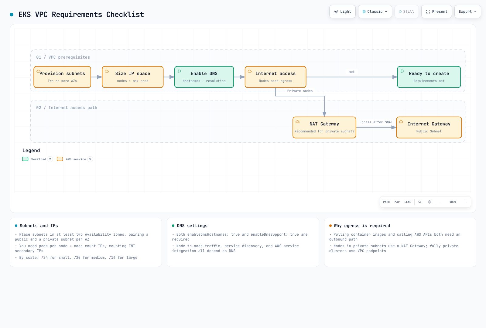

# Redes de EKS

> **Última actualización**: 11 de septiembre de 2026

## Descripción general

Este capítulo trata la planificación de VPC y subredes y las rutas de los grupos de seguridad para un clúster EKS convencional. AWS administra el plano de control en infraestructura administrada por AWS; la VPC del cliente contiene las ENI de conectividad del clúster, las interfaces de nodos y Pods, y los recursos de balanceadores de carga y endpoints. No interpretes el límite de la VPC del cliente como la ubicación física del plano de control administrado ni de los servicios regionales S3, ECR y STS.

## Arquitectura de redes de EKS

<!-- Audit 2026-09-11: parent asset repair required. MoveAWS-managedcontrolplaneandregionalS3/ECR/STSservicesoutsidethecustomerVPCboundary;showcustomerclusterENIs/interfaceendpointendsinsideVPC. ScopeNATpathasIPv4internetexample,notalltraffic.


[🔍 View interactive diagram](https://www.atomai.click/kubernetes-docs/archmaps/en-eks-03-eks-networking-part1-0.html)
-->

| Componente | Función |
| --- | --- |
| VPC y subredes | Límites de direccionamiento y enrutamiento; cada subred pertenece a una AZ |
| Tablas de rutas | Seleccionan el siguiente salto para los rangos de destino |
| Gateway de Internet | Se asocia a la VPC; las subredes públicas tienen una ruta hacia él |
| Gateway NAT público | Proporciona una ruta común de salida IPv4 a Internet para direcciones privadas cuando se coloca en una subred pública con una EIP y una ruta al IGW |
| Grupos de seguridad | Reglas con estado asociadas a interfaces de red y recursos compatibles |
| ACL de red | Reglas sin estado en los límites de subred, incluido el tráfico de retorno necesario |
| CNI | Configura la red de los Pods; su comportamiento depende de la implementación y del modo seleccionados |

### Rutas del tráfico

<!-- Audit 2026-09-11: parent asset repair required. NodePortusesallocatedportsfromthedefaultrange,nottheentire30000–32767rangeoneverynode;separateNLBServicefromALBIngress/GatewayandIPvsinstancetargetpaths. KOPNGfooterappearscropped;parentfullPagecapture.


[🔍 View interactive diagram](https://www.atomai.click/kubernetes-docs/archmaps/en-eks-03-eks-networking-part1-1.html)
-->

El tráfico entre Pods puede permanecer en un mismo nodo o atravesar interfaces de nodo y rutas de VPC. El tráfico dentro de un mismo nodo no necesariamente pasa por la infraestructura de red de la VPC, por lo que los registros de flujo de VPC no registran todas las comunicaciones entre Pods. El tráfico de Service usa la ruta de proxy configurada y los backends seleccionados; un Service no es un dispositivo de reenvío dedicado. La entrada y salida externas dependen del esquema, las rutas, el tipo de destino y los controles de seguridad. El tráfico del plano de control tiene una ruta distinta de la del tráfico de aplicaciones.


[🔍 Ver diagrama interactivo](https://www.atomai.click/kubernetes-docs/archmaps/en-eks-03-eks-networking-part1-2.html)

La figura muestra una entrada pública y una salida IPv4 mediante NAT zonal. Es un diseño, no un requisito de crear subredes públicas o NAT para cada clúster EKS. Los endpoints completamente privados, la salida centralizada y las rutas IPv6 nativas tienen requisitos y costos distintos.

## Requisitos de VPC y subredes

<!-- Audit 2026-09-11: parent asset repair required. InternetaccessisnotuniversalEKSprerequisite;fullyprivateendpointsareanalternative. IGWattachesVPC,notpublicsubnet. Replacearbitrarysmall/mediumCIDRswithmeasuredplanninginputs.


[🔍 View interactive diagram](https://www.atomai.click/kubernetes-docs/archmaps/en-eks-03-eks-networking-part1-3.html)
-->

* Para un clúster EKS regional, selecciona subredes aptas en al menos dos AZ. Cada subred del clúster necesita al menos seis IP disponibles para EKS; AWS recomienda al menos dieciséis. Reserva espacio para las ENI de reemplazo del plano de control durante las actualizaciones y para otros recursos.
* Habilita la compatibilidad con DNS y los nombres de host DNS de la VPC. Las subredes del clúster y las de nodos/Pods no tienen que ser idénticas, pero todas las rutas deben ser alcanzables según se requiera.
* Los nodos necesitan acceso a la API de Kubernetes, los registros de imágenes y los servicios de AWS que utilizan. Esto no siempre requiere acceso público a Internet: los endpoints privados y los repositorios espejo pueden proporcionar esas rutas. El endpoint de servicios de AWS para EKS es distinto del endpoint de la API de Kubernetes del clúster.
* Revisa el enrutamiento de salida personalizado del plano de control si está habilitado `controlPlaneEgressMode=CUSTOMER_ROUTED`; las rutas de subredes del clúster y las reglas de seguridad deben llegar a los webhooks, endpoints OIDC y demás endpoints necesarios.
* Al cambiar las subredes del clúster se mantienen las restricciones originales de VPC y conjunto de AZ. Asociar un CIDR nuevo a la VPC no es inmediato para todas las operaciones del plano de control; AWS documenta que la conciliación puede tardar hasta una hora.

### Planificación de CIDR

<!-- Audit 2026-09-11: parent asset repair required. Removeuniversal1–10node/24,10–100node/20,100+node/16and20–30%headroomguarantees;countreserved/ENI/warm/controlplane/LB/upgradeIPs. RFC1918onlylabeltoobroad;nonoverlapandsupportedCIDRrulesmatter.


[🔍 View interactive diagram](https://www.atomai.click/kubernetes-docs/archmaps/en-eks-03-eks-networking-part1-4.html)
-->

Planifica las direcciones según la cantidad prevista de nodos, Pods normales y Pods con ENI de rama, los pools de reserva y bloques de prefijos, las interfaces del plano de control, los balanceadores de carga y endpoints, el crecimiento y la capacidad necesaria para actualizaciones. Comprueba que no se superpongan con los CIDR de Services, las VPC conectadas ni las redes locales. La cantidad de nodos por sí sola no determina un CIDR de VPC seguro, y reservar siempre entre el 20 % y el 30 % no es una regla universal de capacidad.

Los siguientes son **recuentos totales de direcciones IPv4**; no son recomendaciones de tamaño de clúster ni capacidad utilizable para Pods:

| CIDR | Direcciones totales |
| --- | ---: |
| /24 | 256 |
| /22 | 1.024 |
| /20 | 4.096 |
| /16 | 65.536 |

En las asignaciones normales de subredes IPv4 de AWS, AWS reserva las primeras cuatro direcciones y la última dirección de cada subred: por lo tanto, un /24 tiene 251 direcciones asignables y un /22 tiene 1.019, antes de que las cargas de trabajo y la infraestructura consuman alguna. Esto se aplica a cada subred, no a cinco direcciones para toda la VPC; BYOIP tiene excepciones documentadas. Los CIDR de subredes existentes no se pueden ampliar sin más en el mismo sitio. La delegación de prefijos requiere bloques contiguos y no crea espacio de direcciones nuevo.

### Ejemplo de diseño de subredes

<!-- Audit 2026-09-11: parent asset repair required. Private10.0.2.0/22and10.0.6.0/22arenoncanonical;canonicalfirstoverlapspublicsubnets. Use10.0.4.0/22and10.0.8.0/22;showzonalpublicNATplacementandIGWroute;rawIPcountsnotusable.


[🔍 View interactive diagram](https://www.atomai.click/kubernetes-docs/archmaps/en-eks-03-eks-networking-part1-5.html)
-->

Para una VPC `10.0.0.0/16`, estos rangos alineados no se superponen. Ilustran un diseño con balanceador público y NAT zonal, no un dimensionamiento medido. Una subred pública tiene una ruta asociada a un IGW; ni una etiqueta ni el nombre de la subred la convierten en pública. Los nodos privados pueden usar NAT o los endpoints de servicio privados adecuados.

| Tipo | AZ | CIDR | Ejemplo de uso |
| --- | --- | --- | --- |
| Pública | us-west-2a | 10.0.0.0/24 | Balanceadores de carga públicos y NAT zonal |
| Pública | us-west-2b | 10.0.1.0/24 | Balanceadores de carga públicos y NAT zonal |
| Privada | us-west-2a | 10.0.4.0/22 | Nodos de trabajo/Pods |
| Privada | us-west-2b | 10.0.8.0/22 | Nodos de trabajo/Pods |

Los antiguos `10.0.2.0/22` y `10.0.6.0/22` no eran direcciones de red alineadas. AWS canonicaliza los CIDR; el primer rango anterior se convertiría en `10.0.0.0/22` y se superpondría a las subredes públicas. Valida los límites de red y las superposiciones antes de aprovisionar. Las rutas NAT locales a cada AZ evitan depender de una NAT en otra AZ, pero también hay que revisar la capacidad y las rutas redundantes, además de la ubicación de las cargas de trabajo.

### Etiquetas para detectar subredes

<!-- Audit 2026-09-11: parent asset repair required. Tagrequirementsdependcontroller/version/features;LBC>=2.12.1canuseSubnetDiscoveryByReachabilitywithoutroletags. owned/sharedarenotsecurityisolation;privatesubnetscanhaveegress. Removewithouttagsalwaysfailsclaim.


[🔍 View interactive diagram](https://www.atomai.click/kubernetes-docs/archmaps/en-eks-03-eks-networking-part1-6.html)
-->

La detección depende del controlador y de la versión seleccionados. En AWS Load Balancer Controller 3.5, las etiquetas de rol orientan la selección de subredes públicas o internas; los valores admitidos son `1` o un valor vacío. Las versiones modernas de LBC no requieren universalmente la antigua etiqueta de propiedad del clúster. Si no hay subredes candidatas con etiqueta de rol, LBC 2.12.1 o posterior puede detectarlas mediante rutas cuando está habilitado `SubnetDiscoveryByReachability`. También influyen el filtrado por etiquetas de clúster, las IP libres y la selección por AZ. EKS Auto Mode tiene sus propios requisitos de etiquetas documentados.

* Ubicación orientada a Internet: `kubernetes.io/role/elb`.
* Ubicación interna: `kubernetes.io/role/internal-elb`.
* `kubernetes.io/cluster/<cluster-name>` puede afectar al filtrado o la prioridad; `owned`/`shared` no son límites de seguridad ni reglas de enrutamiento automáticas.

```bash
# After reviewing subnet ownership and its associated routes, tag the intended public subnet.
aws ec2 describe-subnets --region "${EXAMPLE_REGION:?}" --subnet-ids "${PUBLIC_SUBNET_ID:?}" \
  --query 'Subnets[].{id:SubnetId,vpc:VpcId,cidr:CidrBlock,free:AvailableIpAddressCount,tags:Tags}'
aws ec2 create-tags --region "$EXAMPLE_REGION" --resources "$PUBLIC_SUBNET_ID" \
  --tags Key=kubernetes.io/role/elb,Value=1
```

Usa la etiqueta de rol `internal-elb` para una ubicación privada/interna revisada. No etiquetes subredes existentes arbitrarias ni deshabilites las comprobaciones de etiquetas del clúster para sortear un error de detección que no se ha revisado. La selección explícita de subredes debe seguir cumpliendo los requisitos de elegibilidad del balanceador de carga.

### Rutas de los grupos de seguridad

<!-- Audit 2026-09-11: parent asset repair required. Replace1025–65535kubeletrangewithactualTCP10250;distinguishprivateAPI443,DNS53,webhook/workloadports,andstatefulSGvsNACLreturnports. EKSdefaultclusterSGmaybesharedwithMNG;publicAPIusesCIDRs;alloutboundnotuniversalneed.


[🔍 View interactive diagram](https://www.atomai.click/kubernetes-docs/archmaps/en-eks-03-eks-networking-part1-7.html)
-->

EKS crea un grupo de seguridad predeterminado del clúster y lo asocia a las ENI del clúster y, normalmente, a las interfaces de los nodos administrados. No existe un diseño universal de solo dos grupos. Los grupos de seguridad adicionales del clúster no se convierten automáticamente en grupos de los nodos; los grupos de plantillas de lanzamiento personalizadas y los grupos de seguridad de Pods cambian las rutas. Antes de editar las reglas, inspecciona las asociaciones reales:

```bash
aws eks describe-cluster --name "${EXAMPLE_CLUSTER:?}" --region "${EXAMPLE_REGION:?}" \
  --query 'cluster.resourcesVpcConfig.{clusterSG:clusterSecurityGroupId,additionalSGs:securityGroupIds,subnets:subnetIds,public:endpointPublicAccess,private:endpointPrivateAccess,publicCIDRs:publicAccessCidrs}'
```

| Flujo | Puerto de destino habitual | Alcance que se debe revisar |
| --- | --- | --- |
| Nodos/clientes conectados autorizados → API privada de Kubernetes | TCP 443 | Grupos de seguridad del endpoint del clúster y orígenes aprobados |
| Plano de control → kubelet | TCP 10250 | Grupos de seguridad y rutas de los nodos de destino |
| Nodos/Pods → backend DNS | UDP y TCP 53 | Ruta real de CoreDNS/NodeLocal DNS |
| Plano de control → webhook de admisión | Puerto de backend configurado | Service/endpoint del webhook y ruta de grupos de seguridad |
| Aplicación/balanceador de carga → carga de trabajo | Puertos de aplicación/comprobación de estado configurados | Tipo de destino, grupos de seguridad de destino y comprobaciones de estado |

AWS documenta TCP 443, TCP 10250 y TCP/UDP 53 hacia el grupo de seguridad del clúster como el conjunto mínimo de salida al restringir el grupo predeterminado; además, hay que permitir los requisitos reales de aplicaciones, comunicación entre nodos y acceso a Services. El antiguo rango `1025–65535` para kubelet no forma parte de ese mínimo. Los grupos de seguridad tienen estado; el tráfico de respuesta permitido no requiere abrir a ciegas todo el rango de puertos efímeros. Las ACL de red no tienen estado y deben permitir las rutas de respuesta correspondientes.

Las reglas predeterminadas de entrada y salida propias y de EFA se pueden volver a crear durante las actualizaciones del clúster. Añadir un grupo de seguridad restrictivo no anula una regla de permiso más amplia de otro grupo asociado. El acceso a la API pública usa `publicAccessCidrs`; el grupo de seguridad del clúster controla la ruta al endpoint privado. Revisa la salida hacia registros y API de AWS y usa los endpoints o rutas adecuados en lugar de suponer que todos los clústeres necesitan `ALL → 0.0.0.0/0`.

## Próximos pasos y cuestionario

[Redes de EKS, parte 2](./03-eks-networking-part2.md) trata Services, balanceo de carga y políticas. Comprueba tus conocimientos con el [cuestionario de la parte 1](../quizzes/eks/03-eks-networking-part1-quiz.md).

## Referencias

- [VPC/subredes de EKS](https://docs.aws.amazon.com/eks/latest/userguide/network-reqs.html)
- [Clústeres privados](https://docs.aws.amazon.com/eks/latest/userguide/private-clusters.html)
- [Dimensionamiento de subredes](https://docs.aws.amazon.com/vpc/latest/userguide/subnet-sizing.html)
- [Grupos de seguridad](https://docs.aws.amazon.com/eks/latest/userguide/sec-group-reqs.html)
- [Detección de subredes de LBC](https://github.com/kubernetes-sigs/aws-load-balancer-controller/blob/v3.5.0/docs/deploy/subnet_discovery.md)
