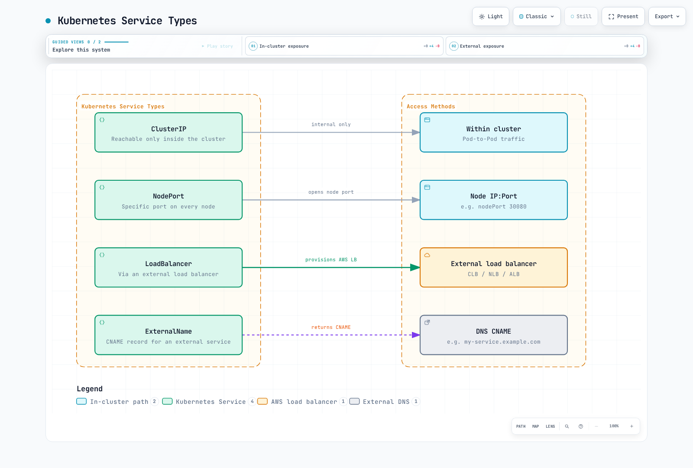

# Redes de EKS - Parte 2: Services, balanceo de carga y políticas de red

> **Versiones verificadas del ejemplo**: EKS Kubernetes 1.36, AWS Load Balancer Controller 3.6.0, Gateway API 1.6.0
> **Última actualización**: 16 de octubre de 2026

## Descripción general

En este documento, aprenderemos sobre los services, el balanceo de carga y las políticas de red en Amazon EKS. Veremos cómo exponer aplicaciones mediante Services de Kubernetes, integrarlos con los balanceadores de carga de AWS y controlar la comunicación entre Pods mediante políticas de red.

## Tipos de Service de Kubernetes

Kubernetes ofrece los siguientes tipos de Service:



[🔍 Ver diagrama interactivo](https://www.atomai.click/kubernetes-docs/archmaps/en-eks-03-eks-networking-part2-0.html)

1. **ClusterIP**: IP virtual del Service para el enrutamiento del clúster; no constituye un límite de autorización
2. **NodePort**: Service expuesto en las direcciones de nodo elegibles y en un puerto asignado, sujeto a las reglas de enrutamiento y del firewall
3. **LoadBalancer**: Service reconciliado por una implementación de balanceador de carga instalada; el balanceador puede ser interno
4. **ExternalName**: Proporciona un registro CNAME para services externos

### Service ClusterIP

ClusterIP es el tipo predeterminado. Su IP virtual está destinada a las redes del clúster; no aplica aislamiento de espacios de nombres ni autenticación. En cambio, un Service sin IP de clúster (`clusterIP: None`) expone las direcciones de sus endpoints mediante DNS.

```yaml
apiVersion: v1
kind: Service
metadata:
  name: my-service
spec:
  selector:
    app: my-app
  ports:
  - port: 80
    targetPort: 8080
  type: ClusterIP
```

### Service NodePort

NodePort normalmente utiliza el conjunto configurado de direcciones de nodo y un puerto del rango 30000–32767 (el rango predeterminado). La disponibilidad real depende de la preparación de los nodos, la configuración del proxy del Service, `externalTrafficPolicy`, las rutas y las reglas de seguridad. No es necesario abrir todo el rango para un único Service.

```yaml
apiVersion: v1
kind: Service
metadata:
  name: my-service
spec:
  selector:
    app: my-app
  ports:
  - port: 80
    targetPort: 8080
    nodePort: 30080
  type: NodePort
```

### Service LoadBalancer

Un controlador instalado reconcilia este Service. El ejemplo selecciona explícitamente LBC y crea un NLB interno con direcciones IP de Pod como destinos; los ALB se configuran mediante Ingress o un Gateway de ALB. EKS Auto Mode utiliza `eks.amazonaws.com/nlb` y tiene su propia configuración compatible. No aplique juntas las dos versiones del mismo ejemplo de `my-service`.
```yaml
apiVersion: v1
kind: Service
metadata:
  name: my-service
  annotations:
    service.beta.kubernetes.io/aws-load-balancer-scheme: internal
    service.beta.kubernetes.io/aws-load-balancer-nlb-target-type: ip
spec:
  type: LoadBalancer
  loadBalancerClass: service.k8s.aws/nlb
  allocateLoadBalancerNodePorts: false
  selector:
    app: my-app
  ports:
  - port: 80
    targetPort: 8080
```

### Service ExternalName

Un Service ExternalName proporciona un registro CNAME para services externos. No enruta el tráfico como proxy ni configura TLS, puertos o acceso al firewall. Los encabezados HTTP Host y los nombres de los certificados deben seguir coincidiendo con el destino.

```yaml
apiVersion: v1
kind: Service
metadata:
  name: my-service
spec:
  type: ExternalName
  externalName: my-service.example.com
```

## Integración con los balanceadores de carga de AWS

EKS integra los Services de Kubernetes con los balanceadores de carga de AWS para que se pueda acceder a las aplicaciones desde el exterior.

<!-- Diagram repair pending: see batch report.


[🔍 Ver diagrama interactivo](https://www.atomai.click/kubernetes-docs/archmaps/en-eks-03-eks-networking-part2-1.html)
-->

### Classic Load Balancer (CLB)

Las rutas heredadas del controlador de services de AWS podían crear CLB. Este no es el comportamiento predeterminado de LBC moderno: LBC 2.5+ normalmente asigna su clase NLB a los nuevos Services LoadBalancer. Antes de migrar un Service existente, compruebe el controlador, la clase y la propiedad reales; cambiar las anotaciones de propiedad en el sitio puede dejar recursos sin administrar o cambiar la exposición.

### Network Load Balancer (NLB)

Utilice el ejemplo explícito de NLB anterior. Lo siguiente es un **fragmento de anotaciones para combinar con ese Service**, no un manifiesto independiente:
```yaml
metadata:
  annotations:
    service.beta.kubernetes.io/aws-load-balancer-scheme: internal
    service.beta.kubernetes.io/aws-load-balancer-nlb-target-type: ip
    service.beta.kubernetes.io/aws-load-balancer-attributes: load_balancing.cross_zone.enabled=true
    service.beta.kubernetes.io/aws-load-balancer-target-group-attributes: preserve_client_ip.enabled=true
```
`aws-load-balancer-nlb-target-type` selecciona el tipo de destino. `preserve_client_ip.enabled` cambia el comportamiento de la IP de origen, no el tipo de destino. El balanceo entre zonas es una decisión sobre capacidad, disponibilidad y costos; compruebe los destinos por zona y el comportamiento ante fallos. Proxy Protocol v2 es opcional y requiere un analizador en el backend; habilitarlo en un servidor HTTP común puede interrumpir las solicitudes.

### Application Load Balancer (ALB)

Para usar ALB, debe instalar AWS Load Balancer Controller y utilizar recursos Ingress:


[🔍 Ver diagrama interactivo](https://www.atomai.click/kubernetes-docs/archmaps/en-eks-03-eks-networking-part2-2.html)

1. Prepare el controlador junto con el responsable de la plataforma. Estos comandos descargan la política de IAM fijada por versión y renderizan el chart fijado; no establecen la relación de confianza de IAM. Primero aprovisione un ServiceAccount `kube-system/aws-load-balancer-controller` con una asociación de Pod Identity revisada o un rol de IRSA/confianza de OIDC, y la política de la versión. Mantenga las instalaciones existentes bajo su propiedad original de Helm/IaC. Confirme la detección de subredes, la conectividad de la API/webhook y la disponibilidad de un kubeconfig utilizable.
```bash
set -euo pipefail
: "${CLUSTER_NAME:?Set the existing cluster name}"
: "${AWS_REGION:?Set the cluster Region}"
: "${VPC_ID:?Set the cluster VPC ID}"
curl --fail --show-error --location \
  https://raw.githubusercontent.com/kubernetes-sigs/aws-load-balancer-controller/v3.6.0/docs/install/iam_policy.json \
  --output lbc-iam-policy-v3.6.0.json
helm repo add eks https://aws.github.io/eks-charts
helm repo update eks
helm template aws-load-balancer-controller eks/aws-load-balancer-controller \
  --version 3.6.0 --namespace kube-system \
  --set-string clusterName="$CLUSTER_NAME" \
  --set-string region="$AWS_REGION" --set-string vpcId="$VPC_ID" \
  --set serviceAccount.create=false \
  --set-string serviceAccount.name=aws-load-balancer-controller \
  > lbc-rendered.yaml
```
Después de revisar los recursos renderizados y cumplir los requisitos previos de IAM, la instalación modificará el clúster. Actualice los CRD según el procedimiento documentado de la versión; las actualizaciones de Helm no actualizan automáticamente todos los CRD.
```bash
helm upgrade --install aws-load-balancer-controller eks/aws-load-balancer-controller \
  --version 3.6.0 --namespace kube-system \
  --set-string clusterName="$CLUSTER_NAME" \
  --set-string region="$AWS_REGION" --set-string vpcId="$VPC_ID" \
  --set serviceAccount.create=false \
  --set-string serviceAccount.name=aws-load-balancer-controller
kubectl -n kube-system rollout status deployment/aws-load-balancer-controller --timeout=180s
```
2. Cree un Ingress con `spec.ingressClassName: alb`. Utilice el Service `my-service` de tipo **ClusterIP** del primer ejemplo como backend para evitar crear otro balanceador de carga. Los Pods seleccionados deben escuchar realmente en el puerto 8080. El diagrama anterior representa la configuración lógica: el tráfico no pasa a través de un objeto de la API Ingress ni del Pod del controlador.
```yaml
apiVersion: networking.k8s.io/v1
kind: Ingress
metadata:
  name: my-ingress
  annotations:
    alb.ingress.kubernetes.io/scheme: internal
    alb.ingress.kubernetes.io/target-type: ip
spec:
  ingressClassName: alb
  rules:
  - http:
      paths:
      - path: /
        pathType: Prefix
        backend:
          service:
            name: my-service
            port:
              number: 80
```
Para HTTPS, combine este fragmento con el Ingress y sustituya el ARN de ACM y el grupo de seguridad por recursos reales de la misma región/VPC. Configure usted mismo el SG de frontend personalizado; la administración de reglas del backend es una decisión aparte. Una anotación de acción por sí sola no añade una redirección a menos que se haga referencia a ella; `ssl-redirect`, a continuación, proporciona el atajo documentado.
```yaml
metadata:
  annotations:
    alb.ingress.kubernetes.io/listen-ports: '[{"HTTP":80},{"HTTPS":443}]'
    alb.ingress.kubernetes.io/certificate-arn: arn:aws:acm:us-west-2:123456789012:certificate/00000000-0000-4000-8000-000000000000
    alb.ingress.kubernetes.io/ssl-redirect: "443"
    alb.ingress.kubernetes.io/security-groups: sg-0123456789abcdef0
    alb.ingress.kubernetes.io/manage-backend-security-group-rules: "true"
```

### Prácticas recomendadas para Services y balanceadores de carga

<!-- Diagram repair pending: see batch report.


[🔍 Ver diagrama interactivo](https://www.atomai.click/kubernetes-docs/archmaps/en-eks-03-eks-networking-part2-3.html)
-->

1. **Use ClusterIP para los services internos**: Use el tipo ClusterIP para los services a los que solo se accede dentro del clúster.
2. **Use LoadBalancer o Ingress para los services externos**: Use el tipo LoadBalancer o recursos Ingress para los services que necesitan acceso externo.
3. **Use ALB**: Use ALB cuando se necesiten funciones como el enrutamiento basado en rutas, la terminación SSL y la autenticación.
4. **Use NLB**: Use NLB cuando se necesiten tráfico TCP/UDP, alto rendimiento e IP estáticas.
5. **Use balanceadores de carga internos**: Use un balanceador de carga interno para clientes privados con conectividad enrutable, incluidas las VPC conectadas y, cuando esté permitido, las redes locales; ClusterIP suele bastar para los clientes dentro del clúster.
6. **Habilite el balanceo de carga entre zonas**: Evalúe el comportamiento entre zonas considerando la capacidad de los destinos, las pruebas de fallos zonales y los costos de transferencia; habilitarlo por sí solo no garantiza una alta disponibilidad.
7. **Seleccione el tipo de destino adecuado**: Elija el tipo de destino `ip` para utilizar directamente las IP de los Pods como destinos, o el tipo de destino `instance` para utilizar las IP de los nodos como destinos.

## Políticas de red

NetworkPolicy aplica filtros L3/L4 a los Pods seleccionados y a los sentidos de tráfico (entrada o salida) seleccionados, siempre que haya una implementación que aplique las políticas. Amazon VPC CNI ofrece compatibilidad nativa con políticas de red en configuraciones compatibles de EC2/Linux; no es necesario instalar otro CNI por el mero hecho de habilitarlas. Consulte la [guía de AWS](https://docs.aws.amazon.com/eks/latest/userguide/cni-network-policy.html) para conocer la versión exacta del add-on, las limitaciones del kernel y del cómputo, los modos estándar/estricto y los requisitos de los Pods administrados.

<!-- Diagram repair pending: see batch report.


[🔍 Ver diagrama interactivo](https://www.atomai.click/kubernetes-docs/archmaps/en-eks-03-eks-networking-part2-4.html)
-->

### Cómo elegir la implementación de políticas

Para un add-on de VPC CNI administrado por EKS, combine el siguiente fragmento con su configuración existente a través del responsable del add-on después de comprobar `describe-addon-configuration`; conserve los ajustes no relacionados. Verifique la aplicación con pruebas TCP positivas y negativas, no solo comprobando que exista un objeto de política.
```json
{"enableNetworkPolicy":"true"}
```
Calico es un motor de políticas alternativo. Con VPC CNI, siga el [procedimiento oficial de EKS para usar Calico solo como motor de políticas](https://docs.tigera.io/calico/latest/getting-started/kubernetes/managed-public-cloud/eks), incluida la configuración `cni.type: AmazonVPC`, los permisos para las anotaciones de IP de Pod y la compatibilidad de versiones. No habilite simultáneamente la aplicación nativa de políticas de VPC CNI. Aplicar un manifiesto de red VXLAN sobre un clúster VPC CNI existente no es una instalación de Calico solo como motor de políticas. La sustitución de la red requiere un diseño de migración independiente.

### Política de red predeterminada

Si ninguna NetworkPolicy selecciona un Pod, este no está aislado para ese sentido del tráfico; las rutas, los grupos de seguridad y otros controles siguen aplicándose. El aislamiento se aplica por separado a la entrada y la salida, y los permisos de todas las políticas coincidentes se suman. Cuando tanto el origen como el destino están aislados, la conexión debe estar permitida tanto por la salida del origen como por la entrada del destino. El tráfico de respuesta se permite implícitamente. Estos ejemplos de políticas son alternativas, no un conjunto restrictivo acumulativo: la regla que permite la entrada a todo el espacio de nombres que aparece a continuación también permitiría tráfico que el ejemplo posterior, limitado al frontend, pretende restringir.

### Política de aislamiento del espacio de nombres

Esta política selecciona todos los Pods de `my-namespace` y aísla **solo el tráfico de entrada**. Permite el tráfico de entrada desde el mismo espacio de nombres en todos los puertos; no restringe el tráfico de salida. Cree primero el espacio de nombres y las etiquetas previstas para la carga de trabajo.

```yaml
apiVersion: networking.k8s.io/v1
kind: NetworkPolicy
metadata:
  name: namespace-isolation
  namespace: my-namespace
spec:
  podSelector: {}
  policyTypes:
  - Ingress
  ingress:
  - from:
    - podSelector: {}
```

### Política para permitir la comunicación entre Pods específicos

Una política que permite la comunicación solo entre Pods con etiquetas específicas:

```yaml
apiVersion: networking.k8s.io/v1
kind: NetworkPolicy
metadata:
  name: allow-frontend-to-backend
  namespace: my-namespace
spec:
  podSelector:
    matchLabels:
      app: backend
  policyTypes:
  - Ingress
  ingress:
  - from:
    - podSelector:
        matchLabels:
          app: frontend
    ports:
    - protocol: TCP
      port: 80
```

### Política de restricción del tráfico externo

Una regla de entrada permite un CIDR de origen, sujeta a otras políticas aditivas. Evalúa la IP de origen visible en el punto de aplicación de la política; NAT, NodePort y los balanceadores de carga pueden cambiar esa IP. No sustituye a una regla de SG o WAF en el balanceador de carga frontend.

```yaml
apiVersion: networking.k8s.io/v1
kind: NetworkPolicy
metadata:
  name: allow-external-traffic
  namespace: my-namespace
spec:
  podSelector:
    matchLabels:
      app: web
  policyTypes:
  - Ingress
  ingress:
  - from:
    - ipBlock:
        cidr: 192.168.1.0/24
        except:
        - 192.168.1.10/32
    ports:
    - protocol: TCP
      port: 80
```

### Política de restricción del tráfico de salida

Una política que permite el tráfico de salida solo a destinos específicos: `203.0.113.0/24` es un rango reservado para documentación; sustitúyalo por el destino externo real aprobado. La regla que permite DNS presupone Pods de CoreDNS comunes y debe adaptarse para NodeLocal DNS u otros diseños de DNS. Excluir los rangos RFC1918 de `0.0.0.0/0` no identificaría un único service externo ni protegería de forma fiable los metadatos de instancias.

```yaml
apiVersion: networking.k8s.io/v1
kind: NetworkPolicy
metadata:
  name: limit-egress-traffic
  namespace: my-namespace
spec:
  podSelector:
    matchLabels:
      app: web
  policyTypes:
  - Egress
  egress:
  - to:
    - podSelector:
        matchLabels:
          app: db
    ports:
    - protocol: TCP
      port: 5432
  - to:
    - ipBlock:
        cidr: 203.0.113.0/24
    ports:
    - protocol: TCP
      port: 443
  - to:
    - namespaceSelector:
        matchLabels:
          kubernetes.io/metadata.name: kube-system
      podSelector:
        matchLabels:
          k8s-app: kube-dns
    ports:
    - protocol: UDP
      port: 53
    - protocol: TCP
      port: 53
```

### Prácticas recomendadas para las políticas de red


[🔍 Ver diagrama interactivo](https://www.atomai.click/kubernetes-docs/archmaps/en-eks-03-eks-networking-part2-5.html)

1. **Aplique una política predeterminada de denegación**: Deniegue todo el tráfico de forma predeterminada y permita explícitamente solo el tráfico necesario.
2. **Aísle los espacios de nombres**: Refuerce la seguridad restringiendo la comunicación entre espacios de nombres.
3. **Aplique el principio de mínimo privilegio**: Permita solo la comunicación mínima necesaria.
4. **Restrinja el tráfico de salida**: Refuerce la seguridad restringiendo el tráfico saliente de los Pods.
5. **Pruebe las políticas**: Pruebe las políticas de red antes de aplicarlas para evitar bloquear comunicaciones de forma imprevista.

---

## Gateway API

### Descripción general

Gateway API separa la propiedad de la infraestructura (GatewayClass/Gateway) de las rutas de las aplicaciones. LBC utiliza **Gateways ALB y NLB separados**; un Gateway no puede combinar rutas L4 y L7. ALB admite HTTPRoute/GRPCRoute y NLB admite TCPRoute/UDPRoute/TLSRoute dentro del subconjunto de funciones documentado por el controlador.

<!-- Diagram repair pending: see batch report.


[🔍 Ver diagrama interactivo](https://www.atomai.click/kubernetes-docs/archmaps/en-eks-03-eks-networking-part2-6.html)
-->

### Requisitos previos

Estos ejemplos se basan en LBC **3.6.0** y Gateway API **1.6.0**, la versión especificada por LBC 3.6.0. 3.6.0 utiliza los mismos CRD de Gateway API 1.6.0 que 3.5.0, pero las notas de la versión indican que deben aplicarse los CRD más recientes proporcionados por AWS (los CRD del chart y los CRD de Gateway de LBC) antes de actualizar el controlador. La compatibilidad inicial con L4 comenzó en 2.13.3 y la de L7 en 2.14.0; decir que «2.13+ es compatible con todo» es incorrecto. En 3.6.0, el controlador detecta los CRD y habilita `NLBGatewayAPI`/`ALBGatewayAPI` de forma predeterminada. No existe la opción `EnableGatewayAPI`. TCPRoute y UDPRoute ahora son recursos v1 del canal estándar; no instale a ciegas CRD experimentales antiguos.
```bash
set -euo pipefail
curl --fail --show-error --location \
  https://github.com/kubernetes-sigs/gateway-api/releases/download/v1.6.0/standard-install.yaml \
  --output gateway-standard-v1.6.0.yaml
curl --fail --show-error --location \
  https://raw.githubusercontent.com/kubernetes-sigs/aws-load-balancer-controller/v3.6.0/config/crd/gateway/gateway-crds.yaml \
  --output lbc-gateway-crds-v3.6.0.yaml
```
Revise las descargas y la propiedad existente de los CRD, así como sus versiones almacenadas, antes de aplicar estas actualizaciones con alcance de clúster. Si se trata de una instalación existente, siga el procedimiento de migración de la versión. Reinicie o reconcilie el controlador después de establecer los CRD si se inició sin ellos.
```bash
kubectl apply --server-side -f gateway-standard-v1.6.0.yaml
kubectl apply --server-side -f lbc-gateway-crds-v3.6.0.yaml
kubectl get crd gateways.gateway.networking.k8s.io \
  tcproutes.gateway.networking.k8s.io udproutes.gateway.networking.k8s.io \
  loadbalancerconfigurations.gateway.k8s.aws
```


### Configuración de GatewayClass y Gateway

Primero cree un espacio de nombres dedicado `gateway-demo` y los Services de backend indicados, junto con las cargas de trabajo listas. Sustituya el ARN de ACM y el CIDR de origen; el certificado debe poder utilizarse con el ALB en su región. Este es un ejemplo de configuración, no una implementación de producción ejecutada. El TargetGroupConfiguration predeterminado referenciado hace que los backends ClusterIP utilicen destinos IP; de lo contrario, el valor predeterminado del controlador puede ser el de destinos instance, que requieren NodePort. Este patrón HTTPS específico de LBC configura ACM mediante LoadBalancerConfiguration y omite deliberadamente `tls.certificateRefs`, que esta implementación no admite.
```yaml
apiVersion: gateway.networking.k8s.io/v1
kind: GatewayClass
metadata:
  name: amazon-alb
spec:
  controllerName: gateway.k8s.aws/alb
---
apiVersion: gateway.k8s.aws/v1
kind: TargetGroupConfiguration
metadata:
  name: ip-targets
  namespace: gateway-demo
spec:
  defaultConfiguration:
    targetType: ip
---
apiVersion: gateway.k8s.aws/v1
kind: LoadBalancerConfiguration
metadata:
  name: alb-config
  namespace: gateway-demo
spec:
  scheme: internal
  sourceRanges:
  - 10.0.0.0/16
  defaultTargetGroupConfiguration:
    name: ip-targets
  listenerConfigurations:
  - protocolPort: HTTPS:443
    defaultCertificate: arn:aws:acm:us-west-2:123456789012:certificate/00000000-0000-4000-8000-000000000000
---
apiVersion: gateway.networking.k8s.io/v1
kind: Gateway
metadata:
  name: my-hotel-gateway
  namespace: gateway-demo
spec:
  gatewayClassName: amazon-alb
  infrastructure:
    parametersRef:
      group: gateway.k8s.aws
      kind: LoadBalancerConfiguration
      name: alb-config
  listeners:
  - name: https
    protocol: HTTPS
    port: 443
    hostname: app.example.com
    allowedRoutes:
      namespaces:
        from: Same
```


### Ejemplo de HTTPRoute (L7 → ALB)

Los pesos 90/10 se aplican a las solicitudes elegibles que coinciden con `/api`; no garantizan una cantidad exacta de solicitudes ni representan una política de conmutación por error basada en el estado de salud. Esta ruta se asocia al listener HTTPS y usa un nombre de host compatible con el del listener. Los puertos de backend son puertos de Service. Las rutas o los backends entre espacios de nombres requieren los controles `allowedRoutes`/ReferenceGrant correspondientes.
```yaml
apiVersion: gateway.networking.k8s.io/v1
kind: HTTPRoute
metadata:
  name: app-route
  namespace: gateway-demo
spec:
  parentRefs:
  - name: my-hotel-gateway
    sectionName: https
  hostnames:
  - app.example.com
  rules:
  - matches:
    - path:
        type: PathPrefix
        value: /api
    backendRefs:
    - name: api-service
      port: 80
      weight: 90
    - name: api-service-v2
      port: 80
      weight: 10
  - matches:
    - path:
        type: PathPrefix
        value: /
    backendRefs:
    - name: frontend-service
      port: 80
```


### Ejemplo de TCPRoute (L4 → NLB)

Este Gateway NLB interno independiente reutiliza `ip-targets`. `postgres-service` debe existir en `gateway-demo` y tener destinos listos y enrutables en el puerto de destino del Service. Un listener TCP reenvía bytes; por sí mismo no configura la autenticación ni TLS de la base de datos.
```yaml
apiVersion: gateway.networking.k8s.io/v1
kind: GatewayClass
metadata:
  name: amazon-nlb
spec:
  controllerName: gateway.k8s.aws/nlb
---
apiVersion: gateway.k8s.aws/v1
kind: LoadBalancerConfiguration
metadata:
  name: nlb-config
  namespace: gateway-demo
spec:
  scheme: internal
  sourceRanges:
  - 10.0.0.0/16
  defaultTargetGroupConfiguration:
    name: ip-targets
---
apiVersion: gateway.networking.k8s.io/v1
kind: Gateway
metadata:
  name: my-nlb-gateway
  namespace: gateway-demo
spec:
  gatewayClassName: amazon-nlb
  infrastructure:
    parametersRef:
      group: gateway.k8s.aws
      kind: LoadBalancerConfiguration
      name: nlb-config
  listeners:
  - name: tcp
    protocol: TCP
    port: 5432
    allowedRoutes:
      namespaces:
        from: Same
---
apiVersion: gateway.networking.k8s.io/v1
kind: TCPRoute
metadata:
  name: db-route
  namespace: gateway-demo
spec:
  parentRefs:
  - name: my-nlb-gateway
    sectionName: tcp
  rules:
  - backendRefs:
    - name: postgres-service
      port: 5432
```


### Compatibilidad con QUIC/HTTP3

Un listener HTTPS de ALB **no se convierte automáticamente en HTTP/3**. LBC 3.6.0 documenta QUIC para **listeners UDP/TCP_UDP de NLB**, mediante `listenerConfigurations[].quicEnabled`. Se requieren destinos IP y un NLB sin grupos de seguridad asociados. El backend debe terminar QUIC/HTTP3 por sí mismo. Lo siguiente es un componente de configuración para un Gateway NLB independiente con UDP:443 y UDPRoute; no es una configuración de ALB ni una implementación completa. Planifique la seguridad del lado de los destinos y las comprobaciones de estado antes de elegir el diseño sin SG.
```yaml
apiVersion: gateway.k8s.aws/v1
kind: LoadBalancerConfiguration
metadata:
  name: quic-config
  namespace: gateway-demo
spec:
  scheme: internal
  disableSecurityGroup: true
  defaultTargetGroupConfiguration:
    name: ip-targets
  listenerConfigurations:
  - protocolPort: UDP:443
    quicEnabled: true
```


### Detección de certificados

Los certificados estáticos utilizan `LoadBalancerConfiguration.spec.listenerConfigurations[].defaultCertificate` (y `certificates` para ARN adicionales). Como alternativa, con un listener seguro, LBC detecta certificados de ACM que coinciden con los nombres de host del listener y de las rutas asociadas. Una HTTPRoute por sí sola no agrega un listener HTTPS ni emite un certificado. Los `certificateRefs` de Gateway que apuntan a Secrets de Kubernetes no son compatibles con esta versión de LBC; crear ese Secret no lo importa a ACM.

### Grupos de seguridad

De forma predeterminada, LBC administra las rutas de los SG de frontend y backend. Un SG de frontend personalizado se configura mediante LoadBalancerConfiguration, **no** con `gateway.k8s.aws/security-group-ids`. Combine los siguientes campos con `alb-config` y conserve su certificado, esquema y configuración de destinos; configure sus reglas de frontend por separado. `sourceRanges` no es un filtro adicional sobre un SG de frontend proporcionado explícitamente. Confirme quién administra las reglas del backend y permita solo los puertos necesarios para los destinos y las comprobaciones de estado.
```yaml
apiVersion: gateway.k8s.aws/v1
kind: LoadBalancerConfiguration
metadata:
  name: alb-config
  namespace: gateway-demo
spec:
  securityGroups:
  - sg-0123456789abcdef0
  manageBackendSecurityGroupRules: true
```


### Grupos de destino externos a Kubernetes

La extensión de LBC utiliza `group: ""`, `kind: TargetGroupName` y el **nombre del grupo de destino existente en AWS**, no un TargetGroupBinding de Kubernetes. El registro, el ciclo de vida, el protocolo, la VPC y la compatibilidad con la asociación del balanceador de carga siguen siendo responsabilidad del propietario externo. El ejemplo es una alternativa a la ruta anterior de raíz; no cree coincidencias de raíz que entren en conflicto en el mismo listener.
```yaml
apiVersion: gateway.networking.k8s.io/v1
kind: HTTPRoute
metadata:
  name: oob-route
  namespace: gateway-demo
spec:
  parentRefs:
  - name: my-hotel-gateway
    sectionName: https
  hostnames:
  - app.example.com
  rules:
  - backendRefs:
    - group: ""
      kind: TargetGroupName
      name: existing-target-group
      weight: 1
```


### Comparación entre Gateway API e Ingress

| Función | Ingress con LBC | Gateway API con LBC 3.6.0 |
|---|---|---|
| Enrutamiento | Host/ruta más anotaciones del controlador | Coincidencias de HTTPRoute/GRPCRoute y extensiones compatibles |
| L4 | Utilizar un Service NLB independiente | Gateway NLB independiente con TCPRoute/UDPRoute/TLSRoute |
| Distribución del tráfico | Acción weighted-forward referenciada | Pesos de backend de la ruta |
| Responsabilidades | IngressClass e Ingress | Funciones de GatewayClass, Gateway y Route |
| Certificado TLS | Anotación/detección de ACM | LoadBalancerConfiguration/detección de ACM; sin certificateRefs de Secret |
| Portabilidad | Anotaciones específicas del controlador | Comprobar la conformidad del controlador; no se implementan todos los filtros estándar |

Referencias oficiales: [Gateway API de LBC](https://kubernetes-sigs.github.io/aws-load-balancer-controller/latest/guide/gateway/gateway/), [LoadBalancerConfiguration](https://kubernetes-sigs.github.io/aws-load-balancer-controller/latest/guide/gateway/loadbalancerconfig/), [Services de Kubernetes](https://kubernetes.io/docs/concepts/services-networking/service/), [NetworkPolicy](https://kubernetes.io/docs/concepts/services-networking/network-policies/).

## Cuestionario

Para comprobar lo que aprendió en este capítulo, intente el [cuestionario del tema](../quizzes/eks/03-eks-networking-part2-quiz.md).
